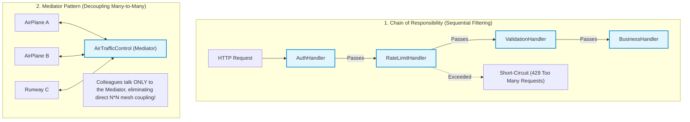
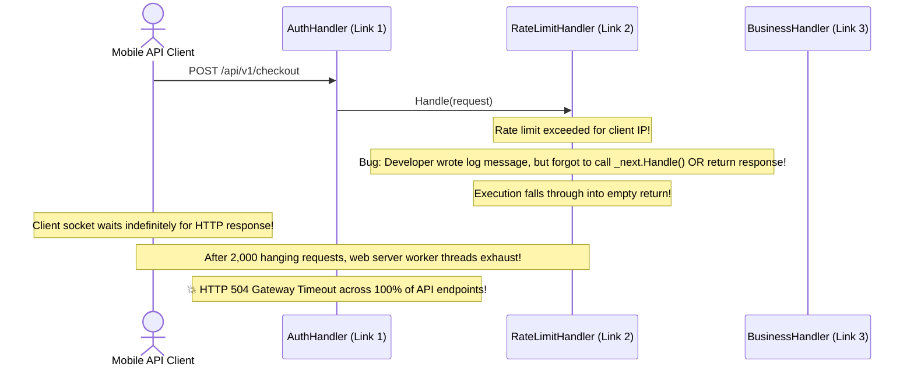

# Module 09: Behavioral Design Patterns II — Chain of Responsibility, Iterator, Mediator, Memento, and Visitor

> **Prerequisites:** Module 02 (OOP Foundations), Module 08 (Behavioral Patterns I).  
> **Estimated Reading Time:** 25 minutes  
> **Target Audience:** Backend Developers, Software Engineers, Low-Level Design Candidates.

> [!TIP]
> **The Golden Rule of Advanced Behavioral Patterns:** Structure complex object communication to prevent $O(N^2)$ direct coupling. Use **Chain of Responsibility** for sequential processing pipelines that can short-circuit early (like HTTP middleware); use **Mediator** to eliminate chaotic many-to-many mesh communication by routing through a central coordinator; use **Iterator** to traverse collections without exposing memory layouts; and use **Visitor** to add new operations to complex object structures without modifying their classes.

---

## 1. Architectural Mental Model: Advanced Collaboration Topologies

These five patterns complete the GoF behavioral catalog by decoupling coordination, traversal, state capture, and algorithm dispatch:



---

## 2. Taxonomic Reference: Behavioral Patterns II Comparison

| Pattern | Architectural Intent | Flow Mechanics | Production Use Case |
| :--- | :--- | :--- | :--- |
| **Chain of Responsibility** | Avoid coupling sender of a request to its receiver by allowing more than one object to handle it. | Sequential linked handlers; each can handle and pass, or **short-circuit**. | Web middleware (Express, ASP.NET Core pipelines), approval workflows. |
| **Iterator** | Access elements of an aggregate object sequentially without exposing underlying representation. | Exposes `has_next()` and `next()` cursor interface. | Traversing B-trees, linked lists, paginated database result sets. |
| **Mediator** | Define an object that encapsulates how a set of objects interact to prevent chaotic dependencies. | Central hub dispatches events between peers ("Colleagues"). | CQRS dispatchers (MediatR in .NET), chat room servers, flight controllers. |
| **Memento** | Capture and externalize an object's internal state without violating encapsulation for rollback. | Originator creates Memento; Caretaker stores mementos and restores state. | Undo/Redo managers, transactional database state rollbacks. |
| **Visitor** | Represent an operation to be performed on elements of an object structure without modifying classes. | **Double-dispatch:** Element calls `visitor.visit(this)`. | Abstract Syntax Tree (AST) compilers, tax calculators on heterogeneous shopping carts. |

---

## 3. Systematic Breakdown: Chain of Responsibility vs. Decorator

Because both patterns wrap or link objects together, candidates often confuse them in system design interviews:

```
  ┌───────────┬─────────────────────────────────┬────────────────────────────────────────┐
  │ Pattern   │ Execution Guarantee             │ Primary Purpose                        │
  ├───────────┼─────────────────────────────────┼────────────────────────────────────────┤
  │ Decorator │ **ALL layers MUST execute**     │ Augmenting behavior (e.g. gzip + log). │
  │ Chain of  │ Handlers can **SHORT-CIRCUIT**  │ Filtering / Gatekeeping. If auth fails,│
  │ Respons.  │ and abort the rest of the chain │ subsequent handlers are never invoked! │
  └───────────┴─────────────────────────────────┴────────────────────────────────────────┘
```

---

## 4. Production War Story: The Chain of Responsibility Silent Hang Outage



### The Incident
During an API gateway rollout, an engineering team added an IP-based rate limiter using the Chain of Responsibility pattern. When a burst of requests exceeded the threshold, the gateway did not return `HTTP 429`. 

Instead, the requests hung indefinitely until client connections timed out after 60 seconds. Within 4 minutes, all 2,000 thread pool workers in the gateway were blocked, causing a total blackout for all API services.

### The Post-Mortem Data
* **Severity:** SEV-1 (Platform Worker Thread Exhaustion)
* **Mean Time to Detect (MTTD):** 10 minutes
* **Mean Time to Resolution (MTTR):** 25 minutes

### The Root Cause
The rate-limiting handler in the Chain of Responsibility contained a control-flow bug:
```csharp
public class RateLimitHandler : BaseHandler {
    public override void Handle(Request req) {
        if (IsRateLimited(req)) {
            LogRateLimit(req);
            // 💥 BUG: Forgot to write HTTP 429 response OR call base.Handle(req)!
            // Request falls off the edge without a response!
        } else {
            base.Handle(req);
        }
    }
}
```
Because the handler neither forwarded the request to `_next.Handle()` nor sent an HTTP response to the client socket, the client thread remained blocked waiting on the socket.

### The Fix & Hardening
1. **Explicit Pipeline Response Types:** Handlers must return an explicit `Result` or `Response` object, forcing the compiler to verify that every code branch returns a value.
2. **Gateway Request Timeouts:** Enforce hard 15-second socket timeouts on all incoming gateway connections.

---

## 5. Multi-Language Production Code: Chain of Responsibility & Mediator Patterns

### Python (Chain of Responsibility Pipeline)
```python
from __future__ import annotations
from abc import ABC, abstractmethod
from typing import Optional

class HttpRequest:
    def __init__(self, path: str, token: Optional[str] = None):
        self.path = path
        self.token = token
        self.is_authorized = False

class Handler(ABC):
    def __init__(self):
        self._next_handler: Optional[Handler] = None

    def set_next(self, handler: Handler) -> Handler:
        self._next_handler = handler
        return handler

    @abstractmethod
    def handle(self, request: HttpRequest) -> bool:
        if self._next_handler:
            return self._next_handler.handle(request)
        return True

class AuthenticationHandler(Handler):
    def handle(self, request: HttpRequest) -> bool:
        if not request.token or request.token != "secret-token-xyz":
            print("❌ [Auth] Invalid token! Short-circuiting chain.")
            return False
        print("✅ [Auth] Token valid.")
        request.is_authorized = True
        return super().handle(request)

class RouteHandler(Handler):
    def handle(self, request: HttpRequest) -> bool:
        print(f"🚀 [Route] Request served at {request.path}")
        return super().handle(request)

if __name__ == "__main__":
    chain = AuthenticationHandler()
    chain.set_next(RouteHandler())

    # Test 1: Unauthorized
    chain.handle(HttpRequest("/orders", token="invalid"))
    # Test 2: Authorized
    chain.handle(HttpRequest("/orders", token="secret-token-xyz"))
```

### C# (.NET) — The Mediator Pattern (In-Process CQRS Dispatcher)
```csharp
using System;
using System.Collections.Generic;

// Request Contract
public interface IRequest<TResponse> { }

// Handler Contract
public interface IRequestHandler<TRequest, TResponse> where TRequest : IRequest<TResponse>
{
    TResponse Handle(TRequest request);
}

// The Central Mediator
public class Mediator
{
    private readonly Dictionary<Type, object> _handlers = new();

    public void RegisterHandler<TRequest, TResponse>(IRequestHandler<TRequest, TResponse> handler)
        where TRequest : IRequest<TResponse>
    {
        _handlers[typeof(TRequest)] = handler;
    }

    public TResponse Send<TResponse>(IRequest<TResponse> request)
    {
        var requestType = request.GetType();
        if (!_handlers.TryGetValue(requestType, out var handler))
            throw new InvalidOperationException($"No handler registered for {requestType.Name}");

        var typedHandler = (IRequestHandler<IRequest<TResponse>, TResponse>)handler;
        return typedHandler.Handle(request);
    }
}
```

### Go (Iterator Pattern)
```go
package main

import "fmt"

type IntIterator struct {
	data  []int
	index int
}

func (it *IntIterator) HasNext() bool {
	return it.index < len(it.data)
}

func (it *IntIterator) Next() (int, bool) {
	if !it.HasNext() {
		return 0, false
	}
	val := it.data[it.index]
	it.index++
	return val, true
}

func main() {
	it := &IntIterator{data: []int{10, 20, 30, 40}}
	for it.HasNext() {
		val, _ := it.Next()
		fmt.Printf("Iterated: %d\n", val)
	}
}
```

### TypeScript / Node.js (Visitor Pattern: AST / Calculation)
```typescript
interface ShapeVisitor {
  visitCircle(circle: Circle): number;
  visitRectangle(rect: Rectangle): number;
}

interface Shape {
  accept(visitor: ShapeVisitor): number;
}

class Circle implements Shape {
  constructor(public readonly radius: number) {}
  accept(visitor: ShapeVisitor): number { return visitor.visitCircle(this); }
}

class Rectangle implements Shape {
  constructor(public readonly width: number, public readonly height: number) {}
  accept(visitor: ShapeVisitor): number { return visitor.visitRectangle(this); }
}

// Concrete Visitor adding Area Calculation without touching Shape classes!
class AreaCalculatorVisitor implements ShapeVisitor {
  visitCircle(circle: Circle): number {
    return Math.PI * circle.radius * circle.radius;
  }
  visitRectangle(rect: Rectangle): number {
    return rect.width * rect.height;
  }
}
```

---

## 6. Practical Hands-On Verification CLI Workflows

Verify Visitor double-dispatch in your Ubuntu terminal:

### Workflow 1: Execute Visitor Pattern Double Dispatch
```bash
python3 -c '
class OrderItem:
    def __init__(self, price: float): self.price = price
    def accept(self, visitor): visitor.visit_order_item(self)

class SubscriptionItem:
    def __init__(self, monthly: float): self.monthly = monthly
    def accept(self, visitor): visitor.visit_subscription(self)

class TaxCalculatorVisitor:
    def __init__(self): self.total_tax = 0.0
    def visit_order_item(self, item): self.total_tax += item.price * 0.08
    def visit_subscription(self, item): self.total_tax += item.monthly * 0.02

cart = [OrderItem(100.0), SubscriptionItem(50.0)]
calc = TaxCalculatorVisitor()
for item in cart:
    item.accept(calc) # Double dispatch

print("Calculated Tax:", calc.total_tax)
assert calc.total_tax == 9.0
print("✅ Visitor double-dispatch verified.")
'
```
**Expected Output:**
```text
Calculated Tax: 9.0
✅ Visitor double-dispatch verified.
```

---

## 7. Operational Validation Checkpoint

<details>
<summary><strong>Question 1: Mediator vs. Observer Architecture</strong></summary>

**Scenario:** In an interview, the candidate is asked to design an Airport Air Traffic Control system. 
Why is the **Mediator Pattern** a superior architectural choice over raw **Observer Pattern** for airplane coordination?

**Answer:**
With the **Observer Pattern**, planes would observe other planes directly. If Plane A changes altitude, it must notify Plane B, Plane C, and Plane D. As traffic scales to 50 planes, this creates a chaotic $O(N^2)$ direct communication mesh where planes must know about each other.

With the **Mediator Pattern**, planes communicate **exclusively with the AirTrafficControl Mediator**. The Mediator centralizes coordination, evaluates flight paths, and resolves conflicts. The individual planes (Colleagues) are completely decoupled from each other.
</details>

<details>
<summary><strong>Question 2: Memento Pattern and Encapsulation</strong></summary>

**Scenario:** A text editor needs an Undo feature. A junior developer proposes: "We will make all internal fields of the `Document` class public so the `HistoryManager` can take copies of them and restore them."

Why does the **Memento Pattern** achieve undo without violating encapsulation?

**Answer:**
Making fields public violates **Encapsulation**: external classes become tightly coupled to the document's private internal representation.

The **Memento Pattern** solves this using a **wide vs. narrow interface**:
* The `Memento` object stores the snapshot.
* The `Originator` (the `Document`) has access to the **wide interface** (can read and write internal state to the memento).
* The `Caretaker` (the `HistoryManager`) sees only a **narrow interface** (a black-box token that it can store in a stack and pass back to the Document). The Caretaker cannot read, modify, or inspect the private state inside the memento.
</details>

<details>
<summary><strong>Question 3: Why the Visitor Pattern Requires Double Dispatch</strong></summary>

**Scenario:** In languages like Java or C#, why can't a caller simply invoke `visitor.visit(element)` directly? Why must `element.accept(visitor)` be used?

**Answer:**
Languages like Java, C#, and C++ support **Single Dispatch** on the receiver: the method called depends only on the runtime type of the object on the left-hand side of the dot (`obj.method()`), while method arguments are bound using **compile-time static types**.

If you pass a base reference `Element e = new ConcreteElement()`, calling `visitor.visit(e)` binds to `visit(Element)` at compile time! 

By calling `e.accept(visitor)`, the runtime executes the virtual method on the concrete element (`ConcreteElement.accept`), which then calls `visitor.visit(this)` where `this` is statically known as `ConcreteElement`. This is **Double Dispatch**.
</details>

---

## Next Step

Now that you have mastered all 22 core design patterns, proceed to **[10 · Concurrency-Safe Low-Level Design](../10-concurrency-safe-design/README.md)** to master race conditions, deadlocks, lock-free atomics, and thread-safe data structures.
