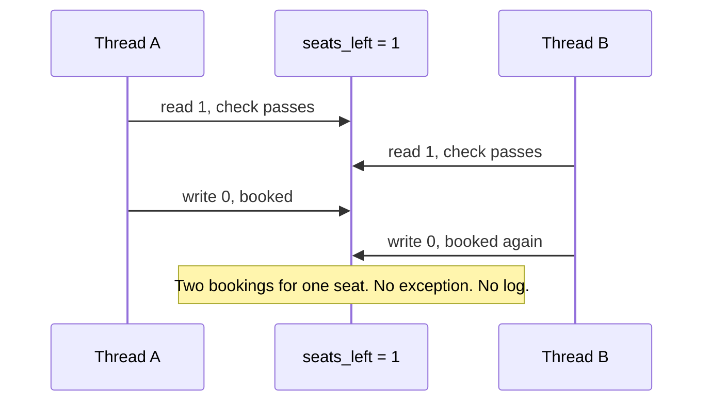
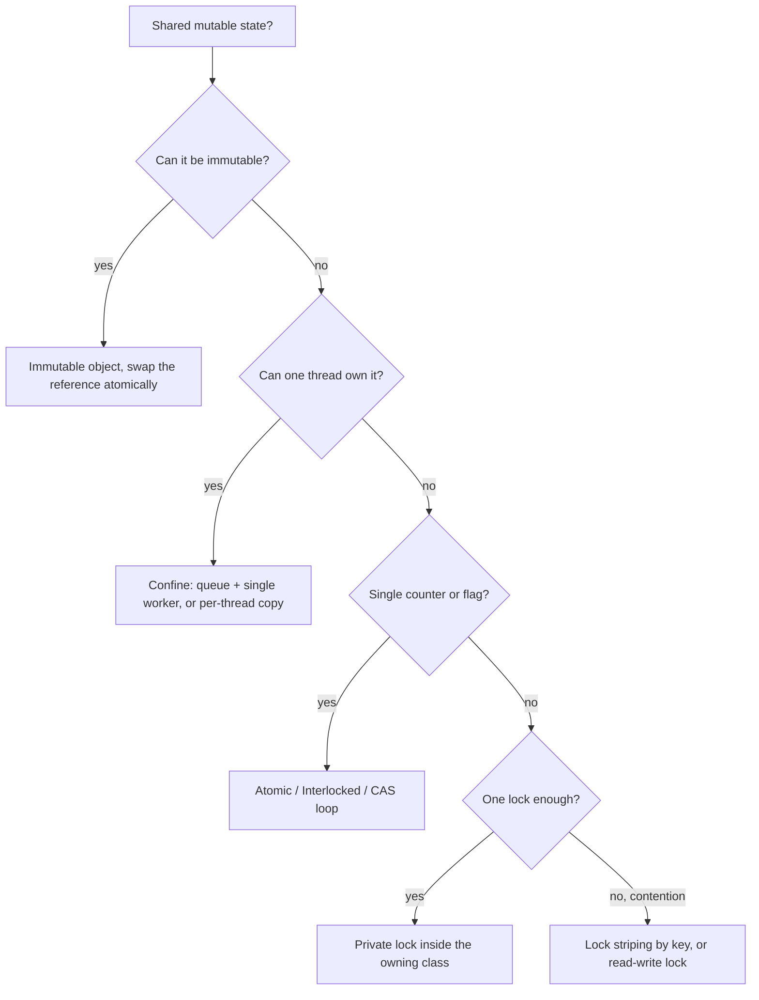
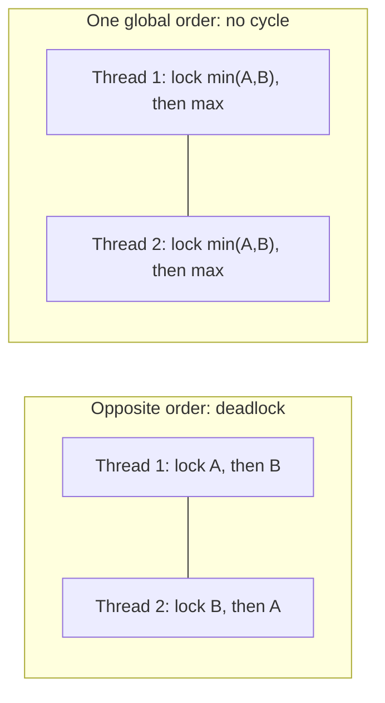
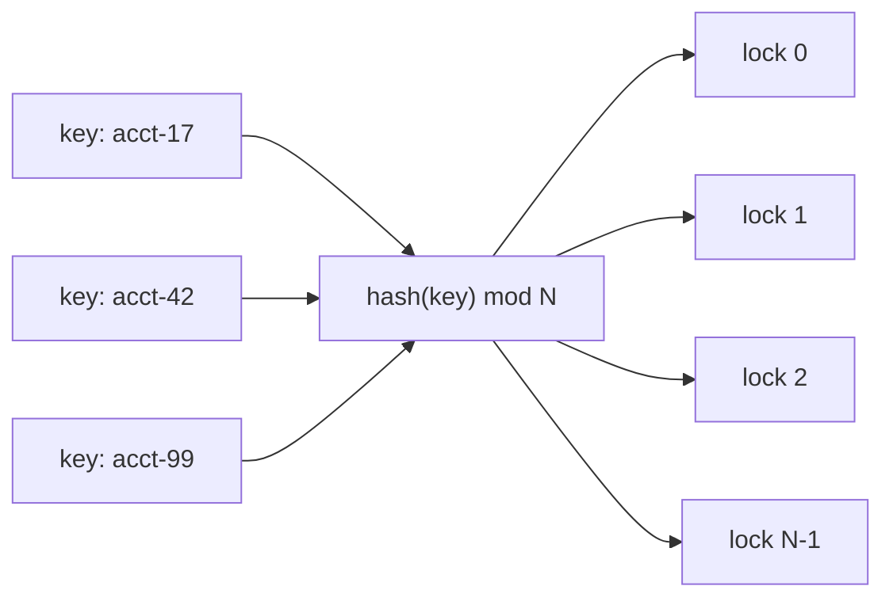

# Concurrency-Safe Design — Races, Locks, Deadlock & Lock Striping

> **Prerequisites:** [01 · Classes & Objects](../01-classes-objects-and-oop-building-blocks/README.md) (invariants), [06 · Creational Patterns](../06-creational-patterns/README.md) (Singleton), basic threads (what a thread is, what "shared memory" means).  
> **Reading time:** ~30 minutes  
> **Audience:** LLD / machine-coding candidates. Every "two gates / two users / two threads" follow-up lands here — parking lot, booking, wallet, cache, rate limiter

> [!NOTE]
> **In one line:** Concurrency bugs come from **shared mutable state touched by more than one thread** — fix them by sharing less (immutability, confinement), then by putting a **small lock inside the class that owns the invariant**, acquiring multiple locks in **one global order**, and **striping** locks by key when one lock becomes the bottleneck.

> [!TIP]
> **Golden rule:** Make **check-then-act** and **read-modify-write** atomic, protect each invariant with exactly one lock, keep critical sections tiny, and never call out to unknown code (I/O, callbacks, other locks) while holding a lock — unless the order is defined.

> [!TIP]
> **Try it:** In [LLD Studio](/tools/lld-studio/), draw `Bank` → `Account` and mark which class owns the lock. Then run the Python demo below and watch the broken counter oversell.

---

## 1. When this shows up in an interview

You finish the class diagram, the interviewer smiles, then: *"Two gates enter at the same time. Two users book the last seat. Two transfers touch the same account. What breaks?"*

**Smells that cost you points:**

- No mention of concurrency until prompted.
- `if available: book()` as two separate steps (**check-then-act**).
- One global lock around the whole system — correct but serialized.
- Believing a thread-safe collection makes compound operations safe.
- Locking `A` then `B` in one path and `B` then `A` in another.
- "Python has the GIL so I'm fine."
- Holding a lock while doing network I/O or calling a callback.
- In-process locks as the only protection for a service running on several machines.





Read the second diagram top to bottom: **the best lock is the one you don't need.**

---

## 2. Vocabulary (use these words precisely)

| Term | Meaning |
| :--- | :--- |
| **Race condition** | Result depends on timing/interleaving of threads. A *logic* bug. |
| **Data race** | Two threads access the same memory, at least one writes, no synchronization. Undefined/unspecified behavior in many languages. |
| **Critical section** | Code that touches shared state and must not run concurrently with itself. |
| **Atomicity** | An operation appears indivisible — no one sees a half-done state. |
| **Visibility** | A write by one thread becomes visible to others (needs a lock, `volatile`, or atomic to guarantee). |
| **Mutual exclusion** | At most one thread in a critical section. |
| **Deadlock** | Threads wait on each other's locks forever. |
| **Livelock / starvation** | Threads keep running without progress / a thread never gets its turn. |
| **Contention** | Threads queue for the same lock. Throughput limiter. |

### The three classic bugs

1. **Lost update (read-modify-write):** `count += 1` is read, add, write. Two threads read the same value.
2. **Check-then-act:** `if seat_free: take()` — the world changes between the check and the act.
3. **Broken compound invariant:** debit one account and credit another as two steps; an observer sees money missing (or two threads both pass the balance check).

---

## 3. Tools: what exists in each language

| Need | Python | C# | Notes |
| :--- | :--- | :--- | :--- |
| Mutual exclusion | `threading.Lock` | `lock (obj)` / `Monitor` | `Lock` is **not** reentrant; `Monitor` **is** |
| Reentrant lock | `threading.RLock` | `lock` (already reentrant) | Reentrancy hides design smells; prefer a design that doesn't need it |
| Read-mostly | No stdlib RW lock | `ReaderWriterLockSlim` | Many readers, one writer. Beware writer starvation and upgrade deadlocks |
| Atomic counter / flag | No true atomics (use a lock) | `Interlocked.Increment`, `CompareExchange` | CAS = lock-free, but loops under contention |
| Permits / pool | `threading.Semaphore` | `SemaphoreSlim` | Bounded concurrency; async-friendly (`WaitAsync`) |
| Wait for condition | `threading.Condition` | `Monitor.Wait/Pulse`, `SemaphoreSlim` | Always loop on the predicate |
| Producer-consumer | `queue.Queue` (thread-safe) | `Channel<T>`, `BlockingCollection<T>` | Hand off, don't share |
| Concurrent map | `dict` ops are atomic individually under the GIL | `ConcurrentDictionary<K,V>` | Single operations safe; **compound ones are not** |
| Async mutual exclusion | `asyncio.Lock` | `SemaphoreSlim(1,1)` + `WaitAsync` | You cannot `await` inside C# `lock` |

---

## 4. Deadlock

Deadlock needs **all four** Coffman conditions at once:

| Condition | Meaning | Practical way to break it |
| :--- | :--- | :--- |
| **Mutual exclusion** | The resource can't be shared | Use immutable data or lock-free structures |
| **Hold and wait** | Hold one lock while waiting for another | Acquire all up front, or `try_lock` with timeout and back off |
| **No preemption** | Can't take a lock away | Timeouts: give up, release, retry |
| **Circular wait** | A waits for B, B waits for A | **Global lock order** — the standard fix |



**Transfer is the canonical example.** `transfer(A→B)` and `transfer(B→A)` at the same moment: each locks its source first and waits for the other. **Fix:** always lock in a canonical order (e.g. by account ID, or by stripe index when striping).

### War story (compressed)

A checkout path locked the *user* then the *inventory* record; a reconciliation job locked *inventory* then *user*. Fine at normal load — critical sections were microseconds. During a flash sale both ran thousands of times a second, pairs interleaved, every worker thread ended up blocked, and health checks failed. **Fix:** one global order (inventory ID, then user ID), lock timeouts that abort cleanly and return 503, and moving the hot path to a single-writer queue.

---

## 5. Lock striping

One lock around a whole map is correct but serializes every key. **Lock striping** keeps an array of *N* locks and maps each key to one: `lock[hash(key) mod N]`. Operations on different stripes run in parallel; operations on the same key always share a stripe, so they stay mutually exclusive.



**Rules that make striping correct**

1. **Same key → same stripe, always.** Use a stable hash and a fixed *N*.
2. **Multi-key operations take the *set of stripes*, de-duplicated, in ascending index order.** Two accounts can hash to the same stripe — locking it twice with a non-reentrant lock **deadlocks yourself**; de-duplicate.
3. **Stripes protect values, not structure.** Don't add or remove keys from the underlying map under only a stripe lock; build the map once, or use a concurrent map.
4. **Choose *N* from contention, not data size.** A few times the number of concurrent threads (16–64) is typical.
5. **Whole-structure operations** (total, snapshot) take **all** stripes in order.

Striping is how `ConcurrentHashMap` (originally) and many caches and rate limiters scale.

---

## 6. Walkthrough

**Requirements (tiny):** (A) sell *N* tickets to many concurrent buyers without overselling; (B) move money between accounts concurrently without deadlock, with no money created or lost.

**Invariants:** tickets sold ≤ *N*; `sum(balances)` is constant; a failed transfer changes nothing.

### Step A — check-then-act: broken, then fixed

````carousel
```python
import threading
import time


class TicketsBroken:
    def __init__(self, total: int) -> None:
        self.left = total

    def buy(self) -> bool:
        if self.left > 0:          # CHECK
            time.sleep(0.001)      # a context switch can land anywhere; this makes it visible
            self.left -= 1         # ACT, based on a stale check
            return True
        return False


class Tickets:
    def __init__(self, total: int) -> None:
        self._left = total
        self._lock = threading.Lock()      # protects _left; private, never exposed

    def buy(self) -> bool:
        with self._lock:                   # check and act under one lock
            if self._left <= 0:
                return False
            self._left -= 1
            return True


def sell(tickets, buyers: int = 50) -> int:
    start = threading.Barrier(buyers)      # release all threads at the same moment
    sold = []

    def worker() -> None:
        start.wait()
        sold.append(tickets.buy())         # list.append is atomic in CPython

    threads = [threading.Thread(target=worker) for _ in range(buyers)]
    for t in threads:
        t.start()
    for t in threads:
        t.join()
    return sum(sold)


if __name__ == "__main__":
    print("broken sold:", sell(TicketsBroken(10)), "of 10")   # typically > 10
    print("fixed  sold:", sell(Tickets(10)), "of 10")         # always 10
```
<!-- slide -->
```csharp
using System;
using System.Collections.Generic;
using System.Linq;
using System.Threading;

public sealed class TicketsBroken
{
    private int _left;
    public TicketsBroken(int total) => _left = total;

    public bool Buy()
    {
        if (_left > 0)                 // CHECK
        {
            Thread.Sleep(1);           // widen the race window for the demo
            _left--;                   // ACT on a stale check
            return true;
        }
        return false;
    }
}

public sealed class Tickets
{
    private readonly object _gate = new();     // private lock, never lock(this)
    private int _left;
    public Tickets(int total) => _left = total;

    public bool Buy()
    {
        lock (_gate)                           // check and act under one lock
        {
            if (_left <= 0) return false;
            _left--;
            return true;
        }
    }
}

// Lock-free alternative for a single counter: compare-and-swap loop.
public sealed class AtomicTickets
{
    private int _left;
    public AtomicTickets(int total) => _left = total;

    public bool Buy()
    {
        while (true)
        {
            var current = Volatile.Read(ref _left);
            if (current <= 0) return false;
            if (Interlocked.CompareExchange(ref _left, current - 1, current) == current) return true;
            // someone else changed it first: retry with the fresh value
        }
    }
}

public static class Program
{
    private static int Sell(Func<bool> buy, int buyers = 50)
    {
        var gate = new Barrier(buyers);
        var sold = 0;
        var threads = Enumerable.Range(0, buyers).Select(_ => new Thread(() =>
        {
            gate.SignalAndWait();
            if (buy()) Interlocked.Increment(ref sold);
        })).ToList();
        threads.ForEach(t => t.Start());
        threads.ForEach(t => t.Join());
        return sold;
    }

    public static void Main()
    {
        Console.WriteLine($"broken sold: {Sell(new TicketsBroken(10).Buy)} of 10");   // typically > 10
        Console.WriteLine($"locked sold: {Sell(new Tickets(10).Buy)} of 10");         // always 10
        Console.WriteLine($"atomic sold: {Sell(new AtomicTickets(10).Buy)} of 10");    // always 10
    }
}
```
````

### Step B — striped locks + ordered multi-lock transfer

**Design:** the map of accounts is built once and never changes shape; each `Account` holds a mutable balance; a `StripedLocks` guards balances; `transfer` takes the stripes for both accounts in ascending order.

````carousel
```python
from __future__ import annotations

import random
import threading
from contextlib import contextmanager
from typing import Iterator


class StripedLocks:
    def __init__(self, stripes: int = 16) -> None:
        if stripes <= 0:
            raise ValueError("stripes must be positive")
        self._locks = tuple(threading.Lock() for _ in range(stripes))

    def index(self, key: str) -> int:
        return hash(key) % len(self._locks)

    @contextmanager
    def hold(self, *keys: str) -> Iterator[None]:
        order = sorted({self.index(k) for k in keys})   # de-duplicate AND global order
        taken: list[int] = []
        try:
            for i in order:
                self._locks[i].acquire()
                taken.append(i)
            yield
        finally:
            for i in reversed(taken):
                self._locks[i].release()


class _Account:
    __slots__ = ("cents",)

    def __init__(self, cents: int) -> None:
        self.cents = cents


class Bank:
    def __init__(self, opening: dict[str, int], stripes: int = 16) -> None:
        # Built once; the dict's shape never changes, so concurrent reads are safe.
        self._accounts = {k: _Account(v) for k, v in opening.items()}
        self._locks = StripedLocks(stripes)

    def _get(self, account_id: str) -> _Account:
        try:
            return self._accounts[account_id]
        except KeyError:
            raise KeyError(f"unknown account {account_id!r}") from None

    def balance(self, account_id: str) -> int:
        with self._locks.hold(account_id):
            return self._get(account_id).cents

    def transfer(self, src: str, dst: str, cents: int) -> bool:
        if cents <= 0:
            raise ValueError("cents must be positive")
        if src == dst:
            raise ValueError("cannot transfer to the same account")
        a, b = self._get(src), self._get(dst)
        with self._locks.hold(src, dst):          # both stripes, ascending order
            if a.cents < cents:
                return False                      # nothing changed
            a.cents -= cents
            b.cents += cents
            return True

    def total(self) -> int:
        with self._locks.hold(*self._accounts):   # all stripes: consistent snapshot
            return sum(a.cents for a in self._accounts.values())


if __name__ == "__main__":
    ids = [f"acct-{i}" for i in range(6)]
    bank = Bank({i: 10_000 for i in ids}, stripes=4)     # few stripes -> collisions on purpose
    before = bank.total()

    def worker(seed: int) -> None:
        rng = random.Random(seed)
        for _ in range(5_000):
            src, dst = rng.sample(ids, 2)
            bank.transfer(src, dst, rng.randint(1, 500))

    threads = [threading.Thread(target=worker, args=(s,)) for s in range(8)]
    for t in threads:
        t.start()
    for t in threads:
        t.join(timeout=30)
    assert not any(t.is_alive() for t in threads), "deadlock!"
    assert bank.total() == before, "money was created or destroyed"
    print("ok, total =", bank.total())
```
<!-- slide -->
```csharp
using System;
using System.Collections.Generic;
using System.Linq;
using System.Threading;

public sealed class StripedLocks
{
    private readonly object[] _locks;

    public StripedLocks(int stripes = 16)
    {
        if (stripes <= 0) throw new ArgumentOutOfRangeException(nameof(stripes));
        _locks = Enumerable.Range(0, stripes).Select(_ => new object()).ToArray();
    }

    public int IndexOf(string key) => (key.GetHashCode() & int.MaxValue) % _locks.Length;

    /// <summary>Takes the distinct stripes in ascending order. Dispose on the SAME thread.</summary>
    public IDisposable Hold(params string[] keys)
    {
        var order = keys.Select(IndexOf).Distinct().OrderBy(i => i).ToArray();
        var taken = 0;
        try
        {
            foreach (var i in order) { Monitor.Enter(_locks[i]); taken++; }
        }
        catch
        {
            for (var k = taken - 1; k >= 0; k--) Monitor.Exit(_locks[order[k]]);
            throw;
        }
        return new Releaser(_locks, order);
    }

    private sealed class Releaser : IDisposable
    {
        private readonly object[] _locks;
        private readonly int[] _order;
        private int _released;

        public Releaser(object[] locks, int[] order) { _locks = locks; _order = order; }

        public void Dispose()
        {
            if (Interlocked.Exchange(ref _released, 1) == 1) return;
            for (var k = _order.Length - 1; k >= 0; k--) Monitor.Exit(_locks[_order[k]]);
        }
    }
}

public sealed class Bank
{
    private sealed class Account { public long Cents; }

    private readonly Dictionary<string, Account> _accounts;   // shape never changes after construction
    private readonly StripedLocks _locks;

    public Bank(IReadOnlyDictionary<string, long> opening, int stripes = 16)
    {
        _accounts = opening.ToDictionary(kv => kv.Key, kv => new Account { Cents = kv.Value });
        _locks = new StripedLocks(stripes);
    }

    private Account Get(string id) =>
        _accounts.TryGetValue(id, out var a) ? a : throw new KeyNotFoundException($"unknown account '{id}'");

    public long Balance(string id)
    {
        using (_locks.Hold(id)) return Get(id).Cents;
    }

    public bool Transfer(string from, string to, long cents)
    {
        if (cents <= 0) throw new ArgumentOutOfRangeException(nameof(cents));
        if (from == to) throw new ArgumentException("cannot transfer to the same account");
        var src = Get(from);
        var dst = Get(to);
        using (_locks.Hold(from, to))              // both stripes, ascending order
        {
            if (src.Cents < cents) return false;   // nothing changed
            src.Cents -= cents;
            dst.Cents += cents;
            return true;
        }
    }

    public long Total()
    {
        using (_locks.Hold(_accounts.Keys.ToArray()))   // all stripes: consistent snapshot
            return _accounts.Values.Sum(a => a.Cents);
    }
}

public static class Program
{
    public static void Main()
    {
        var ids = Enumerable.Range(0, 6).Select(i => $"acct-{i}").ToArray();
        var bank = new Bank(ids.ToDictionary(i => i, _ => 10_000L), stripes: 4);   // collisions on purpose
        var before = bank.Total();

        var threads = Enumerable.Range(0, 8).Select(seed => new Thread(() =>
        {
            var rng = new Random(seed);
            for (var n = 0; n < 5_000; n++)
            {
                var a = rng.Next(ids.Length);
                var b = (a + 1 + rng.Next(ids.Length - 1)) % ids.Length;   // b != a
                bank.Transfer(ids[a], ids[b], rng.Next(1, 501));
            }
        })).ToList();

        threads.ForEach(t => t.Start());
        foreach (var t in threads)
            if (!t.Join(TimeSpan.FromSeconds(30))) throw new Exception("deadlock!");

        if (bank.Total() != before) throw new Exception("money was created or destroyed");
        Console.WriteLine($"ok, total = {bank.Total()}");
    }
}
```
````

**Why this design holds up**

| Decision | Reason |
| :--- | :--- |
| Lock is **private** and lives inside `Bank` / `Tickets` | Callers cannot forget it or take it in the wrong order |
| Check and act in one critical section | Removes the check-then-act window |
| `hold(*keys)` de-duplicates and sorts stripe indexes | No cycle between transfers; no self-deadlock when two accounts share a stripe |
| Account map built once | Stripe locks protect balances; no one resizes the dict under them |
| `total()` takes **all** stripes | A consistent snapshot, not a sum of half-finished transfers |
| Failed transfer returns before mutating | Atomicity of failure: no partial debit |

**Cost model to say aloud:** with one global lock, throughput ≈ one transfer at a time. With *N* stripes and random keys, roughly *N* transfers can proceed in parallel; `total()` is the slow operation (it briefly blocks everyone), so keep it rare or maintain it incrementally.

---

## 7. Edges interviewers push on

| Edge | What to say |
| :--- | :--- |
| **GIL (CPython)** | It makes single bytecode-level operations like `list.append` and `d[k] = v` atomic, but `x += 1` and check-then-act are **not** atomic. Free-threaded builds remove the GIL entirely — write correct code anyway |
| **`asyncio` is not threads** | One thread, but every `await` is a yield point: check, `await`, act is still a race. Use `asyncio.Lock` |
| **C# `lock` + `await`** | You cannot `await` inside `lock`. Use `SemaphoreSlim.WaitAsync()` and `try/finally Release()` |
| **Locking on `this` / a string / a type** | Others can lock the same object. Lock a **private** `readonly object` |
| **Reentrancy** | Python `Lock` self-deadlocks if you re-acquire it; `RLock` and C# `Monitor` allow it — which can hide a re-entrancy bug |
| **Compound ops on thread-safe maps** | `if key not in d: d[key] = v` is still check-then-act. Use `setdefault`, `ConcurrentDictionary.GetOrAdd`, `TryAdd` |
| **`GetOrAdd(key, factory)`** | The factory can run more than once under contention; wrap values in `Lazy<T>` if construction must happen once |
| **Calling out while holding a lock** | Callbacks, events, I/O, or other locks can deadlock or stall everyone. Copy data out, release, then call |
| **Double-checked locking** | Needs `volatile` / `Lazy<T>` in C# (reordering). In Python, create at import time or use a lock |
| **Reader-writer locks** | Great for read-heavy, rarely-written data; watch writer starvation and don't upgrade read→write in place |
| **Visibility** | Without a lock/atomic/volatile, a thread may never see another's write. Locks give both exclusion and visibility |
| **`hash(str)` is salted per process (Python)** | Fine for in-process striping — same key, same stripe, within one run. Never use it to pick a shard that must be stable across processes or restarts; use `zlib.crc32` / a real hash |
| **Hash collisions in striping** | Only cost throughput (false sharing of a stripe), never correctness — as long as multi-key ops lock the distinct stripe set |
| **Fairness** | Standard locks aren't FIFO; a hot thread can starve others. Mention if SLAs matter |
| **In-process locks across machines** | A lock protects one process. Several app instances need a **database** guard: row lock (`SELECT … FOR UPDATE`), optimistic version column, unique constraint, or an exclusion constraint |
| **Testing** | You can't prove absence of races by running tests once. Stress with barriers, many iterations, race detectors, and review invariants by reasoning |

### Try it — concurrency lab (5 minutes, runnable)

Four probes, one per bug class from §2 and §4. Save as `concurrency_lab.py` and run it a few times; it asserts the *bug is visible* before it asserts the *fix works*, so a passing run proves both.

```python
"""Concurrency lab: every probe is deterministic or has a loud failure message."""
import queue
import threading
import time


# 1) Lost update: split `+=` into read / yield / write so the race is not a coin-flip
class Counter:
    def __init__(self) -> None:
        self.n = 0
        self._lock = threading.Lock()

    def bump_unsafe(self) -> None:
        tmp = self.n          # read
        time.sleep(0.0001)    # a context switch can land here in real code
        self.n = tmp + 1      # write based on stale read

    def bump_safe(self) -> None:
        with self._lock:      # read-modify-write is ONE critical section
            self.n += 1


def hammer(fn, threads: int = 8, each: int = 100) -> None:
    def run() -> None:
        for _ in range(each):
            fn()
    ts = [threading.Thread(target=run) for _ in range(threads)]
    [t.start() for t in ts]
    [t.join() for t in ts]


c = Counter()
hammer(c.bump_unsafe)
assert c.n < 8 * 100, "lost updates expected (rerun if the scheduler was kind)"
c = Counter()
hammer(c.bump_safe)
assert c.n == 8 * 100
print("1) lost update:", "unsafe lost updates, safe exact")


# 2) Deadlock, detected with a timeout instead of hanging forever
def try_transfer(first, second, hold: threading.Barrier, results: list) -> None:
    with first:
        hold.wait(timeout=2)                      # both threads now hold their first lock
        got = second.acquire(timeout=0.3)         # try-lock + timeout = back off, do not hang
        results.append(got)
        if got:
            second.release()


a, b = threading.Lock(), threading.Lock()
res: list[bool] = []
bar = threading.Barrier(2)
t1 = threading.Thread(target=try_transfer, args=(a, b, bar, res))
t2 = threading.Thread(target=try_transfer, args=(b, a, bar, res))     # OPPOSITE order
t1.start(); t2.start(); t1.join(); t2.join()
assert False in res, res                        # a cycle: at least one had to give up
print("2) opposite lock order: a try-lock timed out (a plain `with` would hang forever)")

ordered = sorted([a, b], key=id)                # one global order, here by id()
res.clear()
bar = threading.Barrier(2)


def ordered_transfer() -> None:
    first, second = ordered
    with first:
        with second:
            res.append(True)


ts = [threading.Thread(target=ordered_transfer) for _ in range(2)]
[t.start() for t in ts]; [t.join(timeout=2) for t in ts]
assert res == [True, True]
print("   global order: both finished, no timeout needed")


# 3) Check-then-act on a "thread-safe" dict: compute-once needs a lock (or a Lazy)
calls = 0
cache: dict[str, int] = {}
cache_lock = threading.Lock()


def expensive(key: str) -> int:
    global calls
    calls += 1
    time.sleep(0.01)
    return len(key)


def get_racy(key: str) -> int:
    if key not in cache:                  # CHECK
        cache[key] = expensive(key)       # ACT: several threads can all get here
    return cache[key]


def get_once(key: str) -> int:
    with cache_lock:                      # one coarse lock is fine for a cold path;
        if key not in cache:              # stripe it per key if compute is slow
            cache[key] = expensive(key)
        return cache[key]


gate = threading.Barrier(6)


def call(fn) -> None:
    gate.wait()
    fn("hello")


ts = [threading.Thread(target=call, args=(get_racy,)) for _ in range(6)]
[t.start() for t in ts]; [t.join() for t in ts]
racy_calls = calls
cache.clear(); calls = 0
gate = threading.Barrier(6)
ts = [threading.Thread(target=call, args=(get_once,)) for _ in range(6)]
[t.start() for t in ts]; [t.join() for t in ts]
assert calls == 1 and racy_calls > 1, (racy_calls, calls)
print(f"3) compute-once: racy ran {racy_calls}x, locked ran {calls}x")


# 4) Confinement instead of locking: one worker owns the state, others send messages
inbox: "queue.Queue[tuple[str, int] | None]" = queue.Queue()
balances = {"a": 0, "b": 0}                # touched ONLY by the worker thread


def owner() -> None:
    while (msg := inbox.get()) is not None:
        who, delta = msg
        balances[who] += delta


w = threading.Thread(target=owner)
w.start()
senders = [threading.Thread(target=lambda: [inbox.put(("a", 1)) for _ in range(1000)]) for _ in range(4)]
[s.start() for s in senders]; [s.join() for s in senders]
inbox.put(None); w.join()
assert balances["a"] == 4000
print("4) confinement: no lock, still exact:", balances)
print("lab ok")


```

What each probe proves, and what to try next:

| Probe | Proves | Then try |
| :--- | :--- | :--- |
| 1. Lost update | `+=` is read → add → write; a switch in the middle loses increments | Remove the `sleep` and raise `each` to 1,000,000 — does it still lose updates on your Python version? (Free-threaded builds: yes, quickly.) |
| 2. Deadlock | Opposite order forms a cycle; a try-lock timeout converts a hang into a handled failure; one global order removes the cycle | Replace `sorted(..., key=id)` with a fixed lock ranking (`A=1`, `B=2`) and explain why `id()` is acceptable here but not across processes |
| 3. Compute-once | A "safe" dict still has check-then-act; one lock fixes it | Stripe `cache_lock` by key (reuse `StripedLocks` from Step B) so different keys compute in parallel |
| 4. Confinement | One owner thread plus a `queue.Queue` needs **no lock** on the state it owns | Add a `("transfer", a, b, n)` message and notice the lock-order problem disappears entirely |

Then draw `Bank → Account` in [LLD Studio](/tools/lld-studio/) and put a padlock on the class that owns each invariant.

---

## 8. What you'd say in two minutes

> "First I'd shrink shared mutable state: immutable value objects, and hand-offs through a queue where possible. What remains are invariants — seats left, balances — and I'd give each one exactly one owner and one private lock *inside* that class, so callers can't forget it. Check-then-act and read-modify-write both sit inside a single critical section. For money movement I'd lock both accounts in a **global order** — by account ID, or by stripe index if I stripe — which breaks circular wait, the one Coffman condition I can control cheaply. If a single lock became the bottleneck I'd use **lock striping**: an array of N locks, key hashed to a stripe, multi-key operations take the *de-duplicated, sorted* set of stripes, and whole-structure reads take them all. Read-heavy data could take a reader-writer lock or a copy-on-write snapshot. I'd say out loud that Python's GIL doesn't make compound operations atomic and `await` is a yield point, and that in-process locks don't protect multiple instances — there I'd use a database row lock or optimistic version check."

---

## 9. Anti-patterns

1. **Check-then-act without a lock** — `if free: take()`.
2. **One global lock around everything** — correct, but turns a multi-core service into a single-lane road.
3. **Locks in callers** — leaking raw synchronization so every caller must remember it. Encapsulate.
4. **Inconsistent lock order** — the root of most production deadlocks. Define and document one order.
5. **Locking on `this`, a `string`, or a public object** — someone else can take your lock.
6. **Holding a lock across I/O or callbacks** — latency spikes and deadlocks.
7. **Assuming thread-safe collection = thread-safe logic** — compound operations still race.
8. **Sleeping to "fix" a race**, or catching and retrying forever — masks the bug, adds latency.
9. **Lock striping with mutable structure** — resizing the map under per-stripe locks corrupts it.
10. **Singletons with mutable state and no lock** — a shared, unguarded global.

---

## 10. Interview questions

<details>
<summary><strong>1. Race condition vs data race vs deadlock? [BASIC]</strong></summary>

A **race condition** is any bug where the outcome depends on thread timing (check-then-act). A **data race** is the low-level version: unsynchronized conflicting accesses to the same memory. A **deadlock** is threads waiting on each other's locks forever. You can have a race condition with no data race (everything locked, but the check and the act are in different critical sections).

</details>

<details>
<summary><strong>2. Name the Coffman conditions and the one you break in practice. [BASIC]</strong></summary>

Mutual exclusion, hold-and-wait, no preemption, circular wait. All four must hold for deadlock. In practice, break **circular wait** with a global lock order (sort by ID), and add **timeouts / try-lock** so a thread can back off instead of waiting forever.

</details>

<details>
<summary><strong>3. Does the GIL make Python code thread-safe? [BASIC]</strong></summary>

No. The GIL prevents two threads from executing Python bytecode simultaneously in CPython and makes single operations like `list.append` atomic. But `x += 1` is several bytecodes, and any check-then-act spans several, so a thread switch between them still loses updates. Also, free-threaded Python removes the GIL. You still need locks for compound invariants.

</details>

<details>
<summary><strong>4. When would you pick a lock, an atomic, or immutability? [BASIC]</strong></summary>

**Immutability:** shared read-only config or snapshots — no synchronization at all (swap the reference to publish a new version). **Atomic / CAS:** one counter or flag, high contention, simple update. **Lock:** an invariant spanning several fields or objects, or a compound operation. Pick the weakest tool that preserves the invariant.

</details>

<details>
<summary><strong>5. 100 users try to book the last seat. [SCENARIO]</strong></summary>

Inside one process: the seat (or its show) owns a lock; `book()` checks and marks under it; exactly one succeeds, others get a clear "sold out" result. Across several app instances the in-memory lock is useless, so move the guarantee to the database: `UPDATE seats SET status='BOOKED' WHERE id=? AND status='FREE'` and check rows affected, or a unique constraint on `(show_id, seat_id)`, or a version column with retry.

</details>

<details>
<summary><strong>6. `transfer(A,B)` and `transfer(B,A)` hang once a day. [SCENARIO]</strong></summary>

Classic lock-order inversion: thread 1 holds A waiting for B, thread 2 holds B waiting for A. Fix by acquiring locks in a canonical order — sort the two account IDs (or stripe indexes) — and lock the lower first. Add a timeout/abort path for defense in depth and log the pair that timed out.

</details>

<details>
<summary><strong>7. A cache behind one lock can't keep up with 64 cores. [SCENARIO]</strong></summary>

Stripe it: `N` locks (say 16–64), `lock[hash(key) % N]`, each stripe guarding its own sub-map or its entries. Different keys proceed in parallel; the same key remains serialized. Multi-key operations lock the sorted distinct stripe set; whole-cache operations (clear, size, snapshot) lock all stripes in order. Don't resize the structure under per-stripe locks; use a concurrent map or pre-size. Consider read-write locks or a copy-on-write snapshot if reads dominate.

</details>

<details>
<summary><strong>8. Is `if key not in map: map[key] = compute(key)` safe on a concurrent map? [TRICKY]</strong></summary>

No. Each call may be individually thread-safe, but the pair is check-then-act: two threads can both miss and both compute. Use the map's atomic primitive — `setdefault`, `ConcurrentDictionary.GetOrAdd`, `TryAdd`. Note `GetOrAdd`'s factory can still run more than once and only one result is kept; if `compute` is expensive or has side effects, store a `Lazy<T>` (or a future) in the map so computation happens once.

</details>

---

## 11. One-page cheat sheet

```text
Three bugs    Lost update (read-modify-write) · Check-then-act · Broken multi-field invariant
Order of use  Immutable -> confine to one thread -> atomic -> private lock -> striped / RW lock
Lock design   One lock per invariant, private, INSIDE the owning class. Short critical sections.
              No I/O, callbacks, or foreign locks while holding it (unless order is defined).
Deadlock      Mutual excl + hold&wait + no preemption + circular wait.
              Break circular wait: ONE global lock order. Add timeouts / try-lock.
Striping      lock[hash(key) % N]. Multi-key: distinct stripes, ascending. All-keys: all stripes.
              Locks guard values, not map structure.
Python        GIL != safe. += and check-then-act race. await = yield point (asyncio.Lock).
C#            lock(private object), Interlocked, SemaphoreSlim for async, Lazy<T> for once-only.
Beyond 1 proc DB row lock, version column, unique/exclusion constraint.

Interview opener: "Which invariant is shared, who owns it, and what is the one lock order?"
```

---

## Further reading

- [Python `threading`](https://docs.python.org/3/library/threading.html) and [the GIL](https://docs.python.org/3/glossary.html#term-global-interpreter-lock)
- [Python FAQ — what kinds of global value mutation are thread-safe?](https://docs.python.org/3/faq/library.html#what-kinds-of-global-value-mutation-are-thread-safe)
- [C# `lock` statement](https://learn.microsoft.com/en-us/dotnet/csharp/language-reference/statements/lock) and [`Interlocked`](https://learn.microsoft.com/en-us/dotnet/api/system.threading.interlocked)
- [Managed threading best practices](https://learn.microsoft.com/en-us/dotnet/standard/threading/managed-threading-best-practices) and [`ConcurrentDictionary`](https://learn.microsoft.com/en-us/dotnet/api/system.collections.concurrent.concurrentdictionary-2)
- [*Java Concurrency in Practice*](https://jcip.net/) — the clearest treatment of confinement, lock ordering, and visibility (concepts apply to any language)
- [PostgreSQL — exclusion constraints](https://www.postgresql.org/docs/current/ddl-constraints.html#DDL-CONSTRAINTS-EXCLUSION) for database-level "no overlap" guarantees

## Next

**[11 · Requirements to Class Diagrams](../11-requirements-to-class-diagrams/README.md)** — turn an ambiguous prompt into actors, classes, and a UML diagram on the whiteboard.
