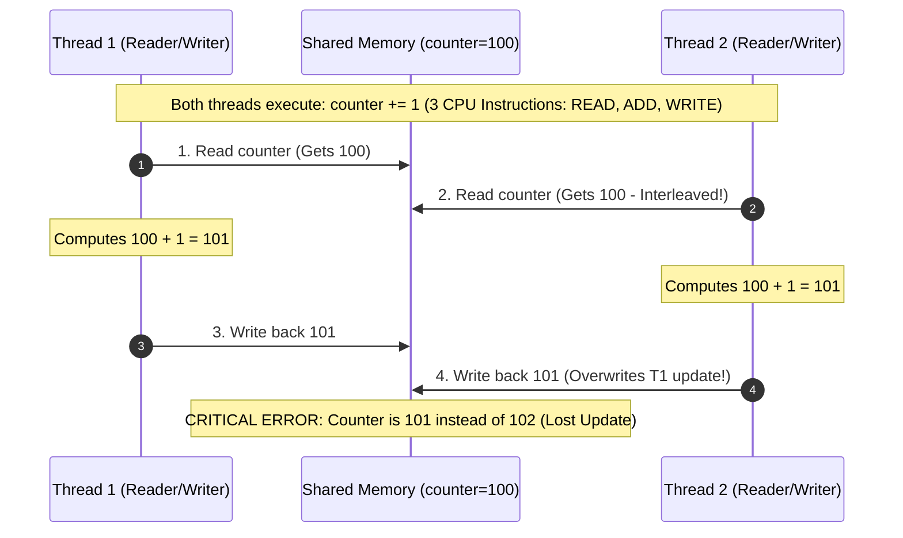
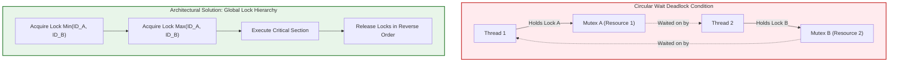
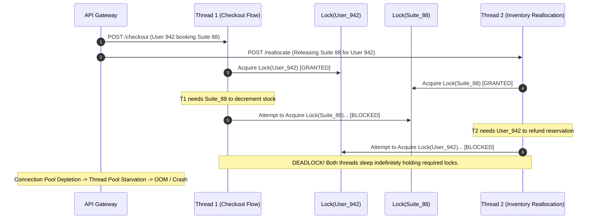

# Concurrency-Safe Design & Thread-Safe Architecture

> **Prerequisites**: [06: Creational Patterns](../06-creational-patterns/README.md), [08: Behavioral Patterns I](../08-behavioral-patterns-i/README.md), OS Process & Threading Fundamentals.  
> **Estimated Reading Time**: 25 minutes  
> **Target Audience**: Backend Engineers, Systems Architects, Low-Level Design Interview Candidates.

> [!TIP]
> **Golden Rule of Concurrency**: Concurrency bugs cannot be reliably reproduced or unit tested into non-existence. Design for thread safety by default through **immutability**, **thread confinement**, or by **encapsulating locks strictly inside data structures**. Never leak raw synchronization primitives to external callers or allow un-synchronized read-modify-write operations on shared mutable state.

---

## 1. Visual Mental Models & Core Concepts

Every object-oriented design pattern assumes single-threaded execution unless explicitly architected otherwise. In modern backend architectures—web servers handling concurrent HTTP requests, background job workers processing streams, or distributed caches synchronizing memory—unprotected shared state leads to silent data corruption, lost updates, and catastrophic deadlocks.

### 1.1 The Anatomy of a Race Condition

A **race condition** occurs when two or more concurrent execution contexts access shared mutable memory, and the final state depends unpredictably on CPU scheduling and thread interleaving.



### 1.2 Deadlocks & Coffman Conditions

A **deadlock** occurs when two or more threads are permanently blocked, each holding a lock that the other needs. Deadlock requires all four **Coffman conditions** to hold simultaneously:
1. **Mutual Exclusion**: Resources cannot be shared simultaneously.
2. **Hold and Wait**: Threads hold allocated resources while waiting for additional ones.
3. **No Preemption**: Resources cannot be forcibly confiscated from a thread.
4. **Circular Wait**: A closed chain of threads exists such that each thread holds at least one resource needed by the next.



---

## 2. Taxonomic Reference Grids

### 2.1 Concurrency & Synchronization Primitives

| Primitive | Mechanism | Read Overhead | Write Overhead | Contention Behavior | Best Architectural Use Case |
| :--- | :--- | :--- | :--- | :--- | :--- |
| **Mutual Exclusion (Mutex)** | Binary sleep lock / futex | Moderate (Kernel sys-call on contention) | Moderate | Serializes all access; threads sleep | Exclusive write-heavy state, short critical sections |
| **Read-Write Lock (RWMutex)** | Shared read / Exclusive write counter | Very Low (Shared concurrent readers) | High (Must drain active readers) | Multiple readers concurrent; writers blocked | Read-heavy caches, routing tables, config lookups |
| **Atomic Operations (CAS)** | Hardware CPU instructions (`CMPXCHG`) | Negligible (L1 cache line bounce) | Negligible (Bus locking/cache coherency) | Spin/retry on failure; lock-free | Monotonic counters, metrics, lock-free ring buffers |
| **Counting Semaphore** | Integer permit counter | Low | Low | Blocks when permits reach 0 | Resource pooling (DB connections, worker pools) |
| **Synchronized Channel / Queue** | Bounded buffer with wait-notify condition | Moderate | Moderate | Pushes block when full; pops block when empty | Producer-Consumer pipelines, actor decoupling |

### 2.2 Thread-Safety Strategies Comparison

| Strategy | Invariant Preserved | Lock Contention | Failure Mode | Language Idioms |
| :--- | :--- | :--- | :--- | :--- |
| **Immutability** | State cannot change post-construction | Zero (Lock-free) | Memory allocation churn | C# `record`, Python `frozen=True`, Go value receivers |
| **Thread Confinement** | State is owned strictly by a single thread | Zero (Lock-free) | Context-switching overhead | Node.js Event Loop, Go worker actors, ThreadLocal storage |
| **Encapsulated Locking** | Mutex is private inside class methods | High under contention | Deadlock if locks nest irregularly | Go `sync.RWMutex`, C# `lock(this._sync)`, Python `threading.RLock` |
| **Optimistic Concurrency (OCC)** | Read without locks; check version on write | Zero on reads | High retry overhead under high write contention | Distributed DB versioning, Atomic CAS loops |

---

## 3. Production War Stories: Incident Post-Mortem

### The $1.4M Dual-Booking Disaster: Deadlock via Lock Order Inversion Under Peak Flash-Sale Load

```
SEVERITY LEVEL: SEV-1 (Platform Freeze & Critical Revenue Loss)
DETECTION TIME: 4 Minutes
TOTAL OUTAGE DURATION: 47 Minutes
FINANCIAL IMPACT: $1,420,000 in dropped transactions & compensatory vouchers
```

#### Incident Background
During Black Friday 2024, an international travel and hospitality platform launched an exclusive flash sale offering 50% discounts on premium hotel suites. To prevent overbooking, backend engineers wrote a high-performance in-memory reservation service in C#/.NET Core deployed across 24 stateless Kubernetes pods with sticky session routing.

#### What Happened
At 00:00:01 UTC, concurrent booking and inventory-release requests flooded the cluster (over 85,000 requests/second). Within 180 seconds, response latency skyrocketed from 18ms to 30,000ms (timeout). Thread pool exhaustion triggered HTTP 504 Gateway Timeouts across all payment and checkout gateways. 18 of the 24 pods became completely unresponsive, failing Kubernetes liveness probes and entering a cyclic crash loop.



#### Root Cause Analysis
Two engineering teams developed interdependent workflows with opposing lock acquisition orders:
- **Checkout Service**: Acquired `UserLock` first, then invoked `InventoryService.DeductStock()` which acquired `InventoryLock`.
- **Inventory Reconciliation Service**: Acquired `InventoryLock` first, then invoked `UserService.VerifyLoyaltyPoints()` which acquired `UserLock`.

Under normal load, the critical sections completed in microseconds, making lock collisions virtually impossible. Under the 85,000 req/s flash sale, thread interleaving reliably triggered cyclic circular wait conditions across multiple pods, exhausting all worker threads in the .NET runtime.

#### The Architectural Fix
1. **Global Lock Hierarchy Enforcement**: Enforced strict deterministic lock ordering using canonical string/integer resource IDs:
   $$\text{LockOrder}(A, B) = \min(\text{ID}_A, \text{ID}_B) \rightarrow \max(\text{ID}_A, \text{ID}_B)$$
2. **Deadlock-Resistant Lock Acquisition with Timeouts**: Replaced blocking `Monitor.Enter` / `lock()` primitives with `SemaphoreSlim.WaitAsync(TimeSpan.FromMilliseconds(500))`. If a lock cannot be acquired within 500ms, the transaction aborts cleanly, rolls back, and returns HTTP 429 / 503 instead of hanging threads.
3. **Transition to Single-Threaded Actor Pipelines**: Refactored hot inventory partitions into Go-style channel-driven actor queues, removing shared memory locking entirely.

---

## 4. Multi-Language Production Implementations

Below are four enterprise-grade implementations demonstrating thread-safe concurrency control: encapsulated synchronization, read-write locking, double-checked locking, and lock-free thread safety.

### 4.1 Go: Thread-Safe In-Memory Sharded Cache with RWMutex & Atomics

```go
package main

import (
	"crypto/sha256"
	"encoding/binary"
	"errors"
	"fmt"
	"sync"
	"sync/atomic"
	"time"
)

var (
	ErrKeyNotFound = errors.New("cache: key not found")
	ErrKeyExpired  = errors.New("cache: key has expired")
)

type cacheItem struct {
	value      any
	expiresAt  time.Time
	hasExpires bool
}

type cacheShard struct {
	mu    sync.RWMutex
	items map[string]cacheItem
}

// ShardedCache encapsulates locking per shard to reduce mutex contention.
type ShardedCache struct {
	shardCount uint32
	shards     []*cacheShard
	hitCount   uint64 // Lock-free atomic counter
	missCount  uint64 // Lock-free atomic counter
}

func NewShardedCache(shardCount uint32) *ShardedCache {
	if shardCount == 0 {
		shardCount = 32
	}
	sc := &ShardedCache{
		shardCount: shardCount,
		shards:     make([]*cacheShard, shardCount),
	}
	for i := uint32(0); i < shardCount; i++ {
		sc.shards[i] = &cacheShard{
			items: make(map[string]cacheItem),
		}
	}
	return sc
}

func (sc *ShardedCache) getShard(key string) *cacheShard {
	h := sha256.Sum256([]byte(key))
	idx := binary.BigEndian.Uint32(h[:4]) % sc.shardCount
	return sc.shards[idx]
}

// Get reads from the cache using a shared Read-Lock (RWMutex).
func (sc *ShardedCache) Get(key string) (any, error) {
	shard := sc.getShard(key)

	shard.mu.RLock()
	item, exists := shard.items[key]
	shard.mu.RUnlock()

	if !exists {
		atomic.AddUint64(&sc.missCount, 1)
		return nil, ErrKeyNotFound
	}

	if item.hasExpires && time.Now().After(item.expiresAt) {
		atomic.AddUint64(&sc.missCount, 1)
		// Lazy eviction via write lock
		shard.mu.Lock()
		delete(shard.items, key)
		shard.mu.Unlock()
		return nil, ErrKeyExpired
	}

	atomic.AddUint64(&sc.hitCount, 1)
	return item.value, nil
}

// Set writes to the cache using an exclusive Write-Lock.
func (sc *ShardedCache) Set(key string, val any, ttl time.Duration) {
	shard := sc.getShard(key)

	var expires time.Time
	hasExpires := false
	if ttl > 0 {
		expires = time.Now().Add(ttl)
		hasExpires = true
	}

	shard.mu.Lock()
	defer shard.mu.Unlock()

	shard.items[key] = cacheItem{
		value:      val,
		expiresAt:  expires,
		hasExpires: hasExpires,
	}
}

// Metrics retrieves telemetry counters atomically without blocking readers or writers.
func (sc *ShardedCache) Metrics() (hits, misses uint64) {
	return atomic.LoadUint64(&sc.hitCount), atomic.LoadUint64(&sc.missCount)
}

func main() {
	cache := NewShardedCache(16)
	var wg sync.WaitGroup

	// Concurrently write from 50 goroutines
	for i := 0; i < 50; i++ {
		wg.Add(1)
		go func(id int) {
			defer wg.Done()
			k := fmt.Sprintf("user:session:%d", id%10)
			cache.Set(k, fmt.Sprintf("token_payload_%d", id), 5*time.Second)
		}(i)
	}

	// Concurrently read from 200 goroutines
	for i := 0; i < 200; i++ {
		wg.Add(1)
		go func(id int) {
			defer wg.Done()
			k := fmt.Sprintf("user:session:%d", id%10)
			_, _ = cache.Get(k)
		}(i)
	}

	wg.Wait()
	hits, misses := cache.Metrics()
	fmt.Printf("Thread-Safe Cache Verified: Hits=%d, Misses=%d\n", hits, misses)
}
```

---

### 4.2 TypeScript: AsyncMutex with Promise-Chained Task Serialization

In single-threaded Node.js, race conditions still occur across async suspension points (`await`). The `AsyncMutex` ensures strictly serialized critical sections across asynchronous I/O.

```typescript
export class AsyncMutex {
  private queue: Array<() => void> = [];
  private locked: boolean = false;

  public async acquire(): Promise<() => void> {
    return new Promise<() => void>((resolve) => {
      const release = () => {
        if (this.queue.length > 0) {
          const next = this.queue.shift()!;
          next();
        } else {
          this.locked = false;
        }
      };

      if (!this.locked) {
        this.locked = true;
        resolve(release);
      } else {
        this.queue.push(() => resolve(release));
      }
    });
  }

  public async runExclusive<T>(callback: () => Promise<T>): Promise<T> {
    const release = await this.acquire();
    try {
      return await callback();
    } finally {
      release();
    }
  }
}

// High-contention account balance manager
export class BankAccountManager {
  private balances = new Map<string, number>();
  private accountLocks = new Map<string, AsyncMutex>();

  private getLock(accountId: string): AsyncMutex {
    let lock = this.accountLocks.get(accountId);
    if (!lock) {
      lock = new AsyncMutex();
      this.accountLocks.set(accountId, lock);
    }
    return lock;
  }

  public setInitialBalance(accountId: string, amount: number): void {
    this.balances.set(accountId, amount);
  }

  public async transfer(fromId: string, toId: string, amount: number): Promise<boolean> {
    // Prevent deadlocks by enforcing deterministic global lock acquisition order
    const firstId = fromId < toId ? fromId : toId;
    const secondId = fromId < toId ? toId : fromId;

    const firstLock = this.getLock(firstId);
    const secondLock = this.getLock(secondId);

    const releaseFirst = await firstLock.acquire();
    const releaseSecond = await secondLock.acquire();

    try {
      const fromBal = this.balances.get(fromId) ?? 0;
      if (fromBal < amount) {
        return false;
      }

      // Simulate async network/database latency
      await new Promise((r) => setTimeout(r, 10));

      this.balances.set(fromId, fromBal - amount);
      const toBal = this.balances.get(toId) ?? 0;
      this.balances.set(toId, toBal + amount);
      return true;
    } finally {
      releaseSecond();
      releaseFirst();
    }
  }

  public getBalance(accountId: string): number {
    return this.balances.get(accountId) ?? 0;
  }
}
```

---

### 4.3 Python: Thread-Safe Singleton with Double-Checked Locking & Bounded Blocking Queue

```python
import threading
import time
from typing import Generic, TypeVar, Optional, List

T = TypeVar("T")


class ThreadSafeSingletonMeta(type):
    """
    Thread-safe Singleton implementation utilizing the Double-Checked Locking Pattern.
    Guarantees exactly one instance is created regardless of thread interleaving.
    """
    _instances = {}
    _lock: threading.Lock = threading.Lock()

    def __call__(cls, *args, **kwargs):
        # First Check (Unsynchronized fast path to avoid lock overhead)
        if cls not in cls._instances:
            with cls._lock:
                # Second Check (Synchronized check under lock)
                if cls not in cls._instances:
                    instance = super().__call__(*args, **kwargs)
                    cls._instances[cls] = instance
        return cls._instances[cls]


class DatabaseConnectionPool(metaclass=ThreadSafeSingletonMeta):
    def __init__(self, pool_size: int = 10):
        self.pool_size = pool_size
        self.created_at = time.time()
        print(f"[Init] DatabaseConnectionPool initialized with capacity={pool_size}")


class ThreadSafeBoundedQueue(Generic[T]):
    """
    Thread-safe Bounded Producer-Consumer Queue implemented using Condition Variables.
    """
    def __init__(self, capacity: int):
        if capacity <= 0:
            raise ValueError("Capacity must be positive")
        self._capacity = capacity
        self._items: List[T] = []
        self._lock = threading.Lock()
        self._not_empty = threading.Condition(self._lock)
        self._not_full = threading.Condition(self._lock)

    def put(self, item: T, timeout: Optional[float] = None) -> bool:
        with self._not_full:
            end_time = time.time() + timeout if timeout else None
            while len(self._items) >= self._capacity:
                if timeout is not None:
                    remaining = end_time - time.time()
                    if remaining <= 0 or not self._not_full.wait(remaining):
                        return False
                else:
                    self._not_full.wait()
            
            self._items.append(item)
            self._not_empty.notify() # Notify blocked consumers
            return True

    def get(self, timeout: Optional[float] = None) -> Optional[T]:
        with self._not_empty:
            end_time = time.time() + timeout if timeout else None
            while len(self._items) == 0:
                if timeout is not None:
                    remaining = end_time - time.time()
                    if remaining <= 0 or not self._not_empty.wait(remaining):
                        return None
                else:
                    self._not_empty.wait()
            
            item = self._items.pop(0)
            self._not_full.notify() # Notify blocked producers
            return item

    def size(self) -> int:
        with self._lock:
            return len(self._items)
```

---

### 4.4 C#: High-Throughput Resource Pool with SemaphoreSlim & Interlocked

```csharp
using System;
using System.Collections.Concurrent;
using System.Threading;
using System.Threading.Tasks;

namespace Architecture.Concurrency
{
    /// <summary>
    /// Thread-safe bounded object pool utilizing SemaphoreSlim and Lock-Free Interlocked counters.
    /// </summary>
    public sealed class ThreadSafeResourcePool<T> : IDisposable where T : class
    {
        private readonly ConcurrentBag<T> _resources;
        private readonly Func<T> _factory;
        private readonly Action<T>? _resetAction;
        private readonly SemaphoreSlim _semaphore;
        private readonly int _maxCapacity;
        private long _activeLeases = 0;
        private bool _disposed = false;

        public ThreadSafeResourcePool(Func<T> factory, int maxCapacity, Action<T>? resetAction = null)
        {
            _factory = factory ?? throw new ArgumentNullException(nameof(factory));
            _maxCapacity = maxCapacity > 0 ? maxCapacity : throw new ArgumentOutOfRangeException(nameof(maxCapacity));
            _resetAction = resetAction;
            _resources = new ConcurrentBag<T>();
            _semaphore = new SemaphoreSlim(maxCapacity, maxCapacity);

            // Pre-seed initial resources
            for (int i = 0; i < maxCapacity; i++)
            {
                _resources.Add(_factory());
            }
        }

        public async Task<ResourceLease<T>> AcquireAsync(TimeSpan timeout, CancellationToken cancellationToken = default)
        {
            ThrowIfDisposed();

            bool acquired = await _semaphore.WaitAsync(timeout, cancellationToken).ConfigureAwait(false);
            if (!acquired)
            {
                throw new TimeoutException($"Failed to acquire pooled resource within {timeout.TotalMilliseconds}ms.");
            }

            if (!_resources.TryTake(out T? item))
            {
                // Fallback instantiation if bag was depleted
                item = _factory();
            }

            Interlocked.Increment(ref _activeLeases);
            return new ResourceLease<T>(this, item);
        }

        internal void Release(T item)
        {
            if (_disposed)
            {
                (item as IDisposable)?.Dispose();
                return;
            }

            _resetAction?.Invoke(item);
            _resources.Add(item);
            Interlocked.Decrement(ref _activeLeases);
            _semaphore.Release();
        }

        public (int MaxCapacity, long ActiveLeases, int AvailableSlots) GetMetrics()
        {
            return (_maxCapacity, Interlocked.Read(ref _activeLeases), _semaphore.CurrentCount);
        }

        private void ThrowIfDisposed()
        {
            if (_disposed) throw new ObjectDisposedException(nameof(ThreadSafeResourcePool<T>));
        }

        public void Dispose()
        {
            if (_disposed) return;
            _disposed = true;
            _semaphore.Dispose();

            while (_resources.TryTake(out T? item))
            {
                (item as IDisposable)?.Dispose();
            }
        }
    }

    public readonly struct ResourceLease<T> : IDisposable where T : class
    {
        private readonly ThreadSafeResourcePool<T> _pool;
        public T Resource { get; }

        internal ResourceLease(ThreadSafeResourcePool<T> pool, T resource)
        {
            _pool = pool;
            Resource = resource;
        }

        public void Dispose()
        {
            _pool.Release(Resource);
        }
    }
}
```

---

## 5. Practical Hands-On Verification Workflows

### 5.1 Detecting Data Races with Go Race Detector

To verify that an implementation is completely free of data races, execute the test suite with the compiler race instrumentor enabled:

```bash
# 1. Run race detection across all concurrency packages
go test -race -v -count=1 ./...

# Expected Output when thread-safety is preserved:
# === RUN   TestShardedCacheConcurrentReadsAndWrites
# === PAUSE TestShardedCacheConcurrentReadsAndWrites
# === CONT  TestShardedCacheConcurrentReadsAndWrites
# --- PASS: TestShardedCacheConcurrentReadsAndWrites (1.24s)
# PASS
# ok      github.com/backend/concurrency   1.412s
```

If an unsynchronized read-write occurred, Go's race detector outputs the exact memory address and stack traces:

```
==================
WARNING: DATA RACE
Write at 0x00c0000ba030 by goroutine 7:
  github.com/backend/concurrency.(*UnsafeCounter).Inc()
      /workspace/counter.go:14 +0x44

Previous Read at 0x00c0000ba030 by goroutine 6:
  github.com/backend/concurrency.(*UnsafeCounter).Value()
      /workspace/counter.go:18 +0x38
==================
```

### 5.2 Python High-Concurrency Lost-Update Stress Test

Run this terminal command to observe Python GIL subtleties:

```bash
python3 -c "
import threading

val = 0
def worker():
    global val
    for _ in range(100_000):
        val += 1

threads = [threading.Thread(target=worker) for _ in range(4)]
for t in threads: t.start()
for t in threads: t.join()

print(f'Final Value: {val} (Expected: 400000, Lost Updates: {400000 - val})')
"
```

Expected Terminal Output:
```
Final Value: 278142 (Expected: 400000, Lost Updates: 121858)
```

---

## 6. Operational Validation Checkpoints (Scenario Quizzes)

<details>
<summary><strong>Checkpoint 1: The Subtle "Double-Checked Locking" Memory Visibility Bug</strong></summary>

**Scenario**: A software engineer writes a lazy-initialized singleton in Java/C++ without declaring the instance variable `volatile`:
```csharp
if (_instance == null) {
    lock (_lock) {
        if (_instance == null) {
            _instance = new HeavyweightService();
        }
    }
}
return _instance;
```
During a load test, one in every 500,000 requests throws a `NullReferenceException` inside `HeavyweightService` methods, even though `_instance` is not null. Why?

<strong>Answer:</strong>
CPU instruction reordering and compiler optimization! The statement `_instance = new HeavyweightService()` involves three low-level steps:
1. Allocate memory block.
2. Run constructor `HeavyweightService()` to initialize fields.
3. Assign pointer address to `_instance`.

Compilers and out-of-order execution CPUs are permitted to reorder step 3 before step 2. If Thread A assigns the pointer to `_instance` before the constructor finishes, Thread B can execute the outer unsynchronized check `if (_instance == null)`, find it false, and return a reference to a partially initialized object whose internal fields are still null. In C#, `Lazy<T>` solves this; in Java/C++, the reference must be marked `volatile`.
</details>

<details>
<summary><strong>Checkpoint 2: Reader-Writer Lock Starvation</strong></summary>

**Scenario**: You deploy a high-throughput Read-Write Lock (`RWMutex`) to protect an in-memory configuration table. Read operations occur at 50,000 req/sec across 64 threads. A writer thread attempts to update a feature toggle via `Lock()`, but the operation hangs indefinitely, and the feature toggle never updates. What happened and how do you resolve it?

<strong>Answer:</strong>
**Writer Starvation (Reader Preference)**. Many standard reader-writer lock implementations allow incoming readers to acquire the lock as long as at least one reader already holds it. Under heavy read traffic, readers overlap continuously, meaning the reader count never drops to zero. Consequently, the writer is indefinitely starved.
**Resolution**:
1. Use a **Writer-Preference Read-Write Lock** (e.g., standard in modern Go `sync.RWMutex` and C# `ReaderWriterLockSlim`), where a pending writer blocks subsequent incoming readers until the writer has acquired and released the lock.
2. Alternatively, use **Copy-On-Write (COW)**: Readers read an immutable pointer without any locks; the writer creates an updated shallow clone of the configuration dictionary and atomically swaps the pointer via CPU CAS (`atomic.StorePointer`).
</details>

<details>
<summary><strong>Checkpoint 3: The Fork-Join Deadlock Trap</strong></summary>

**Scenario**: A microservice processes batch items using a fixed thread pool of 8 threads. To process a parent item, the thread submits 4 child tasks to the *same* fixed thread pool and blocks waiting for their results using `Future.get()` or `Task.WaitAll()`. When 8 parent requests arrive simultaneously, the entire service permanently hangs at 0% CPU utilization. Diagnose the failure and provide the architectural pattern to prevent it.

<strong>Answer:</strong>
**Thread Pool Starvation Deadlock (Hierarchical Dependency Deadlock)**.
1. **Diagnosis**: When 8 parent tasks are picked up, all 8 worker threads in the pool become occupied. Each parent task submits 4 child sub-tasks to the pool's work queue. However, the child tasks can never begin execution because all 8 threads are blocked waiting for the child tasks to complete. Since the parents hold the threads and wait for the children, and the children wait for available threads, the pool deadlocks permanently.
2. **Architectural Fixes**:
   - **Pool Segregation**: Execute child sub-tasks on a separate, dedicated thread pool.
   - **Work-Stealing Pool**: Utilize a fork-join work-stealing pool (like Java `ForkJoinPool` or Go goroutines), where idle workers can steal pending sub-tasks and execute them in-place rather than blocking.
   - **Asynchronous Continuation**: Never synchronously block a thread pool thread (`.Result`, `Task.Wait()`); use non-blocking asynchronous composition (`await Task.WhenAll()`), releasing the execution thread back to the runtime pool while sub-tasks run.
</details>

---

## 7. Further Reading & References

- [Go Concurrency Patterns & sync/atomic](https://go.dev/blog/race-detector) - Official reference on Go data race diagnostics and concurrency primitives.
- [Microsoft Learn: Threading & Synchronization Primitives](https://learn.microsoft.com/en-us/dotnet/standard/threading/overview-of-synchronization-primitives) - In-depth guide to `SemaphoreSlim`, `ReaderWriterLockSlim`, and `Interlocked`.
- [Python Documentation: `threading` & Condition Variables](https://docs.python.org/3/library/threading.html) - Official standard library documentation for Python synchronization.
- [Real Python: The Python GIL and Threading Behavior](https://realpython.com/python-gil/) - Detailed breakdown of bytecode execution and atomicity under the GIL.

---

## Next Steps

Advance to [Module 11: Requirements to Class Diagrams](../11-requirements-to-class-diagrams/README.md) to master the systematic 7-step blueprint for translating ambiguous interview problem statements into robust UML architectures and sequence diagrams.
