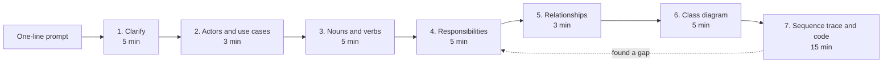
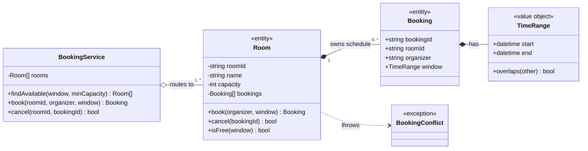
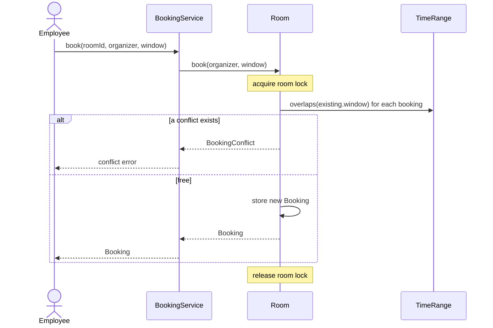

# Requirements to Class Diagrams — The Whiteboard Playbook

> **Prerequisites:** [02 · OOP Foundations & UML](../02-oop-foundations-and-uml/README.md), [03 · Generics, Exceptions & Value Objects](../03-generics-exceptions-and-value-objects/README.md), [04 · SOLID](../04-solid-principles/README.md), [10 · Concurrency-Safe Design](../10-concurrency-safe-design/README.md)  
> **Reading time:** ~30 minutes  
> **Audience:** LLD / machine-coding candidates who get a one-line prompt and 45 minutes. Pairs with [21 · LLD Interview Playbook](../21-lld-interview-playbook/README.md) for the full clock and communication protocol

> [!NOTE]
> **In one line:** Turn an ambiguous prompt into a design by moving through seven steps — **clarify → actors and use cases → nouns and verbs → responsibilities → relationships → class diagram → trace with a sequence** — and say your assumptions out loud at each step.

> [!TIP]
> **Golden rule:** Do not type code until you have agreed on scope and can name the **one invariant** that matters (here: *no two bookings overlap in the same room*). Interviewers grade the thinking before they grade the syntax.

> [!TIP]
> **Try it:** Redraw the class diagram below in [LLD Studio](/tools/lld-studio/), then add a `BookingPolicy` interface and see which arrows you need to change.

---

## 1. When this shows up in an interview

The whole prompt is one line: *"Design a meeting room booking system."* There is no spec, no API, no diagram. What you do in the first five minutes decides how the other forty go.

**Smells that cost you points:**

- Starting to type `class Room` before asking a single question.
- Drawing twelve classes from every noun (`Building`, `Floor`, `Projector`, `Coffee`) without a use case.
- A `BookingSystem` / `Manager` class that does everything.
- Inheritance trees for roles (`Admin extends User extends Person`) with no behavior difference.
- No mention of overlapping bookings, time zones, or two people booking at once.
- A UML diagram that doesn't match the code you write ten minutes later.
- Never stating what is **out of scope**.



Rough budget for a 45-minute round. If the interviewer redirects, follow them — the order matters less than saying your assumptions aloud.

---

## 2. The seven steps (what to do and what to say)

| # | Step | Output on the board | Say aloud |
| :--- | :--- | :--- | :--- |
| 1 | **Clarify** | 5–8 bullet requirements, 2–3 non-functional notes, an **out-of-scope** list | "I'll assume one building, 15-minute granularity, no recurring meetings yet — OK?" |
| 2 | **Actors and use cases** | Actor → verbs table | "Employees book and cancel; admins add rooms." |
| 3 | **Nouns and verbs** | Candidate list sorted into entity / value object / enum / service / discard | "Capacity is an attribute, not a class." |
| 4 | **Responsibilities** | One line per class: *knows* / *does* | "Room owns its schedule and protects the no-overlap rule." |
| 5 | **Relationships** | Arrows with multiplicity and lifecycle reason | "Booking dies with its room — composition." |
| 6 | **Class diagram** | ≤ 8 boxes; only the methods that carry the use case | "Five classes first; extensions later." |
| 7 | **Trace and code** | Sequence for the main flow, then code for the core | "Walking the happy path, then the conflict path." |

```text
┌──────────────────────┬───────────────────────────────┬─────────────────────────┐
│ REQUIREMENTS         │ CLASS DIAGRAM                 │ SEQUENCE / EDGE CASES   │
│  • functional        │  (center of the board;        │  happy path             │
│  • non-functional    │   erase and redraw freely)    │  conflict path          │
│  • OUT OF SCOPE      │                               │  concurrency note       │
└──────────────────────┴───────────────────────────────┴─────────────────────────┘
```

---

## 3. Applying it: Meeting Room Booking

### Step 1 — Clarify

| Question to ask | Why it matters | Assumption you state |
| :--- | :--- | :--- |
| Single office or many? Rooms have capacity? | Scope of the model | One office, rooms have a capacity |
| Booking granularity? Max length? | Validation rules | Any start/end; end after start; no max for now |
| Who can book/cancel? | Actors, permissions | Any employee books; the organizer cancels |
| Recurring meetings? | Big design extension | **Out of scope**, with a plan if asked |
| Multiple time zones? | Data model | Store time-zone-aware datetimes (UTC) |
| Search by time/capacity? | Extra use case | Yes: "find available rooms" |
| Concurrency: two people, same slot? | Core invariant | Exactly one wins; the other gets a clear conflict |
| Scale? Multiple servers? | Locks vs DB | One process for the whiteboard; call out DB guard for later |
| Notifications / calendar sync? | Extension hooks | Out of scope; Observer hook |

**State the invariant:** *Within one room, no two active bookings overlap.* Back-to-back is allowed (end = next start).

### Step 2 — Actors and use cases

| Actor | Use cases |
| :--- | :--- |
| **Employee** | Find available rooms for a time window (and capacity), book a room, cancel own booking, list a room's schedule |
| **Admin** | Add or remove a room, change capacity, cancel any booking |
| **System / clock** | Reject bookings in the past (needs a clock) |

### Step 3 — Nouns and verbs → classes

| Noun in the prompt | Verdict | Why |
| :--- | :--- | :--- |
| Meeting room | **Entity** `Room` | Has identity and a schedule |
| Booking / reservation | **Entity** `Booking` | Has an ID; can be cancelled |
| Time slot / window | **Value object** `TimeRange` | Defined by start+end; owns the `overlaps` rule |
| Employee / organizer | **String ID** (for now) | No behavior yet — don't build a `User` hierarchy |
| Capacity | Attribute of `Room` | A number, not a class |
| Booking system | **Service** `BookingService` | Orchestrates lookups; stays thin |
| Projector, coffee, building | **Discard** (out of scope) | Not needed by any use case |
| Status (active/cancelled) | Enum **only if** you keep cancelled records | Here: cancel removes it |

| Verb | Lives on |
| :--- | :--- |
| book, cancel, is-free | `Room` (it owns the schedule and the rule) |
| find available, route by room ID | `BookingService` |
| overlaps | `TimeRange` |

### Step 4 — Responsibilities (CRC)

| Class | Knows | Does | Collaborates with |
| :--- | :--- | :--- | :--- |
| `TimeRange` | start, end | validates `end > start`; `overlaps(other)` | — |
| `Booking` | id, room id, organizer, window | nothing (immutable record) | `TimeRange` |
| `Room` | id, name, capacity, its bookings | `book`, `cancel`, `is_free`; **enforces no-overlap atomically** | `Booking`, `TimeRange` |
| `BookingService` | rooms by ID | `find_available`, `book`, `cancel` (delegates) | `Room` |

**Why the lock/rule lives in `Room`, not the service:** the room owns the schedule, so it owns the invariant ([10](../10-concurrency-safe-design/README.md): lock inside the class that owns the data). Two bookings in *different* rooms never contend.

### Steps 5–6 — Relationships and class diagram



| Arrow | Reason (say it) |
| :--- | :--- |
| `BookingService o-- Room` | Rooms exist independently; the service holds references (aggregation) |
| `Room *-- Booking` | Bookings have no meaning without their room (composition) |
| `Booking *-- TimeRange` | A window is just part of the booking's value |
| `Room ..> BookingConflict` | Used briefly: thrown from `book`, not stored |

### Step 7 — Trace the main flow



If the trace reveals a missing method or state, **go back to step 4** and update the diagram — say so ("the sequence shows I need `cancel`"). That is a strength, not a mistake.

---

## 4. Code for the core

**Rules to code:** `TimeRange` is half-open `[start, end)`, so `10:00–11:00` and `11:00–12:00` do **not** overlap. `Room.book` checks and inserts under one lock. `find_available` is advisory; only `book` is authoritative.

````carousel
```python
from __future__ import annotations

import threading
import uuid
from dataclasses import dataclass
from datetime import datetime, timedelta, timezone
from typing import Iterable


@dataclass(frozen=True)
class TimeRange:
    start: datetime
    end: datetime

    def __post_init__(self) -> None:
        if self.start.tzinfo is None or self.end.tzinfo is None:
            raise ValueError("timezone-aware datetimes required")
        if self.end <= self.start:
            raise ValueError("end must be after start")

    def overlaps(self, other: "TimeRange") -> bool:
        """Half-open [start, end): back-to-back ranges do not overlap."""
        return self.start < other.end and other.start < self.end


@dataclass(frozen=True)
class Booking:
    booking_id: str
    room_id: str
    organizer: str
    window: TimeRange


class BookingConflict(Exception):
    pass


class Room:
    def __init__(self, room_id: str, name: str, capacity: int) -> None:
        if not room_id or capacity <= 0:
            raise ValueError("room_id required and capacity must be positive")
        self._room_id = room_id
        self._name = name
        self._capacity = capacity
        self._lock = threading.Lock()                 # guards _bookings
        self._bookings: dict[str, Booking] = {}

    @property
    def room_id(self) -> str:
        return self._room_id

    @property
    def capacity(self) -> int:
        return self._capacity

    def is_free(self, window: TimeRange) -> bool:
        with self._lock:
            return self._free_locked(window)

    def book(self, organizer: str, window: TimeRange) -> Booking:
        if not organizer or not organizer.strip():
            raise ValueError("organizer is required")
        with self._lock:                               # check + insert are one step
            if not self._free_locked(window):
                raise BookingConflict(f"{self._room_id} is not free for the requested window")
            booking = Booking(uuid.uuid4().hex[:8], self._room_id, organizer, window)
            self._bookings[booking.booking_id] = booking
            return booking

    def cancel(self, booking_id: str) -> bool:
        with self._lock:
            return self._bookings.pop(booking_id, None) is not None

    def schedule(self) -> tuple[Booking, ...]:
        with self._lock:
            return tuple(sorted(self._bookings.values(), key=lambda b: b.window.start))

    def _free_locked(self, window: TimeRange) -> bool:
        return not any(b.window.overlaps(window) for b in self._bookings.values())


class BookingService:
    def __init__(self, rooms: Iterable[Room]) -> None:
        self._rooms = {r.room_id: r for r in rooms}   # built once, never mutated

    def _room(self, room_id: str) -> Room:
        try:
            return self._rooms[room_id]
        except KeyError:
            raise KeyError(f"unknown room {room_id!r}") from None

    def find_available(self, window: TimeRange, min_capacity: int = 1) -> list[Room]:
        """Advisory: a room free now may be taken before you call book()."""
        return [r for r in self._rooms.values() if r.capacity >= min_capacity and r.is_free(window)]

    def book(self, room_id: str, organizer: str, window: TimeRange) -> Booking:
        return self._room(room_id).book(organizer, window)

    def cancel(self, room_id: str, booking_id: str) -> bool:
        return self._room(room_id).cancel(booking_id)


if __name__ == "__main__":
    nine = datetime(2030, 1, 7, 9, 0, tzinfo=timezone.utc)
    def slot(h0: float, h1: float) -> TimeRange:
        return TimeRange(nine + timedelta(hours=h0), nine + timedelta(hours=h1))

    service = BookingService([Room("r1", "Atlas", 8), Room("r2", "Borealis", 4)])
    service.book("r1", "asha", slot(0, 1))                        # 09:00-10:00
    service.book("r1", "ben", slot(1, 2))                         # back-to-back is fine
    try:
        service.book("r1", "carl", slot(0.5, 1.5))                # overlaps both
    except BookingConflict as exc:
        print("conflict:", exc)
    print([r.room_id for r in service.find_available(slot(0, 1), min_capacity=2)])   # ['r2']

    # Concurrency: 20 threads race for one slot, exactly one wins.
    wins: list[str] = []
    gate = threading.Barrier(20)
    def attempt(i: int) -> None:
        gate.wait()
        try:
            service.book("r2", f"user{i}", slot(3, 4))
            wins.append(f"user{i}")                              # list.append is atomic in CPython
        except BookingConflict:
            pass
    threads = [threading.Thread(target=attempt, args=(i,)) for i in range(20)]
    for t in threads: t.start()
    for t in threads: t.join()
    print("winners:", len(wins))                                  # 1
    assert len(wins) == 1
```
<!-- slide -->
```csharp
using System;
using System.Collections.Generic;
using System.Linq;
using System.Threading;

public sealed record TimeRange
{
    public DateTimeOffset Start { get; }
    public DateTimeOffset End { get; }

    public TimeRange(DateTimeOffset start, DateTimeOffset end)
    {
        if (end <= start) throw new ArgumentException("end must be after start");
        Start = start;
        End = end;
    }

    /// <summary>Half-open [Start, End): back-to-back ranges do not overlap.</summary>
    public bool Overlaps(TimeRange other) => Start < other.End && other.Start < End;
}

public sealed record Booking(string BookingId, string RoomId, string Organizer, TimeRange Window);

public sealed class BookingConflictException : InvalidOperationException
{
    public BookingConflictException(string message) : base(message) { }
}

public sealed class Room
{
    private readonly object _gate = new();                       // guards _bookings
    private readonly Dictionary<string, Booking> _bookings = new();

    public string RoomId { get; }
    public string Name { get; }
    public int Capacity { get; }

    public Room(string roomId, string name, int capacity)
    {
        if (string.IsNullOrWhiteSpace(roomId) || capacity <= 0)
            throw new ArgumentException("roomId required and capacity must be positive");
        RoomId = roomId;
        Name = name;
        Capacity = capacity;
    }

    public bool IsFree(TimeRange window)
    {
        lock (_gate) return FreeLocked(window);
    }

    public Booking Book(string organizer, TimeRange window)
    {
        if (string.IsNullOrWhiteSpace(organizer)) throw new ArgumentException("organizer is required");
        lock (_gate)                                              // check + insert are one step
        {
            if (!FreeLocked(window))
                throw new BookingConflictException($"{RoomId} is not free for the requested window");
            var booking = new Booking(Guid.NewGuid().ToString("N")[..8], RoomId, organizer, window);
            _bookings[booking.BookingId] = booking;
            return booking;
        }
    }

    public bool Cancel(string bookingId)
    {
        lock (_gate) return _bookings.Remove(bookingId);
    }

    public IReadOnlyList<Booking> Schedule()
    {
        lock (_gate) return _bookings.Values.OrderBy(b => b.Window.Start).ToList();
    }

    private bool FreeLocked(TimeRange window) => !_bookings.Values.Any(b => b.Window.Overlaps(window));
}

public sealed class BookingService
{
    private readonly IReadOnlyDictionary<string, Room> _rooms;   // built once, never mutated

    public BookingService(IEnumerable<Room> rooms) => _rooms = rooms.ToDictionary(r => r.RoomId);

    private Room RoomById(string id) =>
        _rooms.TryGetValue(id, out var r) ? r : throw new KeyNotFoundException($"unknown room '{id}'");

    /// <summary>Advisory: a room free now may be taken before you call Book().</summary>
    public IReadOnlyList<Room> FindAvailable(TimeRange window, int minCapacity = 1) =>
        _rooms.Values.Where(r => r.Capacity >= minCapacity && r.IsFree(window)).ToList();

    public Booking Book(string roomId, string organizer, TimeRange window) =>
        RoomById(roomId).Book(organizer, window);

    public bool Cancel(string roomId, string bookingId) => RoomById(roomId).Cancel(bookingId);
}

public static class Program
{
    public static void Main()
    {
        var nine = new DateTimeOffset(2030, 1, 7, 9, 0, 0, TimeSpan.Zero);
        TimeRange Slot(double h0, double h1) => new(nine.AddHours(h0), nine.AddHours(h1));

        var service = new BookingService(new[] { new Room("r1", "Atlas", 8), new Room("r2", "Borealis", 4) });
        service.Book("r1", "asha", Slot(0, 1));                   // 09:00-10:00
        service.Book("r1", "ben", Slot(1, 2));                    // back-to-back is fine
        try { service.Book("r1", "carl", Slot(0.5, 1.5)); }       // overlaps both
        catch (BookingConflictException ex) { Console.WriteLine($"conflict: {ex.Message}"); }
        Console.WriteLine(string.Join(",", service.FindAvailable(Slot(0, 1), minCapacity: 2).Select(r => r.RoomId)));   // r2

        // Concurrency: 20 threads race for one slot, exactly one wins.
        var wins = 0;
        var gate = new Barrier(20);
        var threads = Enumerable.Range(0, 20).Select(i => new Thread(() =>
        {
            gate.SignalAndWait();
            try { service.Book("r2", $"user{i}", Slot(3, 4)); Interlocked.Increment(ref wins); }
            catch (BookingConflictException) { }
        })).ToList();
        threads.ForEach(t => t.Start());
        threads.ForEach(t => t.Join());
        Console.WriteLine($"winners: {wins}");                    // 1
    }
}
```
````

**Design choices to name**

| Choice | Reason |
| :--- | :--- |
| Lock **per room** | Different rooms never contend; the invariant is per room |
| `TimeRange` owns `overlaps` | The tricky boundary rule is tested in one place |
| `Booking` immutable | No one can move a meeting by editing a field; cancel + rebook instead |
| `BookingService` thin | It routes; rules stay with the data |
| Conflict raised as a domain exception | Simple for a whiteboard; a `Result` is equally valid ([03](../03-generics-exceptions-and-value-objects/README.md)) — state the convention |
| Rooms map built once | No structural mutation after construction, so reads need no lock |

---

## 5. Edges interviewers push on

| Edge | What to say |
| :--- | :--- |
| **Overlap boundary** | Half-open intervals: `a.start < b.end and b.start < a.end`. Back-to-back is allowed; test `10-11` vs `11-12` |
| **Time zones / DST** | Store tz-aware instants (UTC). C# `DateTimeOffset` over `DateTime`; Python reject naive datetimes. Convert only for display |
| **Bookings in the past** | Needs a clock; inject it (`clock` / `TimeProvider`) so tests are deterministic |
| **Search is advisory** | `find_available` then `book` is check-then-act across two calls; `book` re-checks atomically and may still conflict |
| **Multi-room atomic booking** | Booking two rooms together needs both locks in a global order ([10](../10-concurrency-safe-design/README.md)) — or a coordinator that rolls back |
| **Multiple app instances** | A per-process lock does not protect a shared database. Use a DB exclusion constraint on `(room_id, tstzrange)` or a transaction with row locks |
| **Conflict check complexity** | Linear scan per booking is fine for a whiteboard. With many bookings keep a list sorted by start and binary-search the neighbors (O(log n)), or an interval tree |
| **Recurring meetings** | Keep `Booking` single-occurrence; add a `RecurrenceRule` that expands to occurrences, each checked and stored independently |
| **Cancel semantics** | Remove vs soft-cancel (`status`) — soft-cancel needs an enum and excludes cancelled rows from overlap checks |
| **Capacity vs attendees** | Capacity filters search; attendee count on `Booking` is an extension |
| **Policies** | Max duration, business hours, per-team quotas → `BookingPolicy` interface injected into `Room`/service (Strategy) |
| **Notifications** | Publish `BookingCreated` / `BookingCancelled` events; subscribers (email, calendar) are Observers |
| **Permissions** | Cancel-own vs admin — keep a `Role` check in the service, not scattered in entities |

---

## 6. What you'd say in two minutes

> "I'll clarify first: one office, rooms with capacity, book and cancel by a time window, search by time and capacity, no recurring meetings yet, time-zone-aware timestamps. The invariant is that within a room no two active bookings overlap; back-to-back is fine, so I'll use half-open intervals. Actors are employees and admins. From the nouns I get `Room` and `Booking` as entities, `TimeRange` as a value object that owns the overlap rule, and a thin `BookingService` for routing and search; capacity is an attribute and employees are just IDs for now. `Room` owns its schedule, so it owns the check-and-insert under its own lock — different rooms never contend. Relationships: the service aggregates rooms, a room composes its bookings. I'll trace the booking path and the conflict path in a sequence diagram, then code `TimeRange`, `Room`, and the service. Search is advisory — only `book` is authoritative. If we scale to multiple servers the guarantee moves to a database exclusion constraint. Recurring meetings, policies, and notifications are extension points I can sketch after the core."

---

## 7. Anti-patterns

1. **Coding before clarifying** — the fastest way to build the wrong thing quickly.
2. **Every noun is a class** — `Projector`, `Coffee`, `Building` with no use case.
3. **`BookingManager` / `System` god class** — owns data, rules, persistence, and notifications.
4. **Inheritance for roles** — `Admin extends User` with no behavioral difference; use a role field.
5. **Diagram drift** — code that contradicts the diagram you drew; update both.
6. **Skipping the invariant** — never saying "no overlap" out loud, then forgetting the boundary case.
7. **Locks in callers** or a single global lock — see [10](../10-concurrency-safe-design/README.md).
8. **Over-abstracting early** — `IBookingRepository`, `IClock`, `IPolicy`, `IEventBus` before the core works; add a seam when a requirement demands it.
9. **No out-of-scope list** — the interviewer assumes you forgot, not that you chose.

---

## 8. Interview questions

<details>
<summary><strong>1. What do you do in the first five minutes of an LLD prompt? [BASIC]</strong></summary>

Clarify scope and write it down: functional bullets, non-functional notes (concurrency, scale), and an **out-of-scope** list. State assumptions aloud and name the key invariant. List actors and their use cases. Only then start extracting classes.

</details>

<details>
<summary><strong>2. How do you find classes in a requirements paragraph? [BASIC]</strong></summary>

Underline nouns and verbs. Nouns become candidates; keep only those a use case needs. Sort each into **entity** (has identity), **value object** (defined by values, immutable), **enum** (closed set), **service** (stateless orchestration), or **attribute/discard**. Verbs tell you which class owns the behavior — the one that holds the data it needs.

</details>

<details>
<summary><strong>3. Entity, value object, or enum for `TimeRange`, `Booking`, `BookingStatus`? [BASIC]</strong></summary>

`TimeRange`: value object (equal if start and end are equal, immutable, owns `overlaps`). `Booking`: entity — it has an ID and can be cancelled even though we make the record itself immutable. `BookingStatus`: an enum if you keep cancelled records; otherwise you don't need it.

</details>

<details>
<summary><strong>4. Why is `Room *-- Booking` composition and `BookingService o-- Room` aggregation? [BASIC]</strong></summary>

A booking is meaningless without its room — delete the room, its bookings go. The service just holds references to rooms that exist independently (they were created elsewhere and can be registered or removed). The test is "if I delete the whole, does the part survive?"

</details>

<details>
<summary><strong>5. Add weekly recurring meetings. [SCENARIO]</strong></summary>

Introduce a `RecurrenceRule` (frequency, interval, until/count). A recurring booking expands into concrete `Booking` occurrences, each checked against the schedule; either all are accepted atomically or none (take the room lock once and validate the whole set first). Store the rule and a series ID so "cancel this / cancel series" works. Time-zone and DST rules apply to the rule's local time, not to a fixed UTC offset.

</details>

<details>
<summary><strong>6. Two people click "book" for the same slot at the same time. [SCENARIO]</strong></summary>

In one process, `Room.book` checks and inserts under the room's lock: exactly one wins, the other gets a conflict. Across servers, enforce it in the database: an exclusion constraint on `(room_id, time range)` (Postgres), or a transaction that locks the room row and re-checks, mapping a constraint violation to the same conflict error.

</details>

<details>
<summary><strong>7. Find the earliest 1-hour slot free in any room. [SCENARIO]</strong></summary>

Per room, walk the bookings sorted by start and look for a gap ≥ 1 hour between `max(cursor, earliest)` and the next booking start (also the tail after the last booking). Take the minimum across rooms. That's O(R · b log b) with sorting, or O(R · b) if each room keeps its schedule sorted. Remember the answer is a *hint*: book it and handle a conflict by retrying.

</details>

<details>
<summary><strong>8. `find_available` returned room 3, then `book` failed. Is that a bug? [TRICKY]</strong></summary>

No — it is expected. Search and book are two operations; between them another user can take the slot (time-of-check-to-time-of-use). Only `book` is atomic and authoritative. Design the UI/API for it: treat search as a suggestion, make `book` return a clear conflict, and optionally offer "next best" rooms. Locking during search would block everyone for a read.

</details>

---

## 9. One-page cheat sheet

```text
7 steps      Clarify -> Actors/use cases -> Nouns & verbs -> Responsibilities
             -> Relationships -> Class diagram (<= 8 boxes) -> Sequence trace + code
Clarify      Scope, rules, scale, concurrency, time zones, OUT OF SCOPE. State assumptions.
Invariant    Name it first (no overlap in a room). Half-open intervals: a.start < b.end and b.start < a.end.
Classes      Entity (identity) | Value object (TimeRange) | Enum | Service (thin) | Attribute | Discard.
Behavior     Lives with the data. The class that owns the schedule owns the rule (and the lock).
Arrows       o-- aggregation | *-- composition | ..> dependency | <|.. realization. Add multiplicity.
Concurrency  Lock inside Room. Search is advisory. Multi-server -> DB exclusion constraint.
Extensions   Policy (Strategy), notifications (Observer), recurrence (rule -> occurrences), clock injection.
Close        Re-state assumptions, trace happy + conflict path, list what you'd do next.

Interview opener: "Before I draw anything: what's in scope, and what must never be true?"
```

---

## Further reading

- [Martin Fowler — UML Distilled](https://martinfowler.com/books/umlDistilled.html)
- [UML class diagrams overview](https://www.uml-diagrams.org/class-diagrams-overview.html)
- [Mermaid class diagrams](https://mermaid.js.org/syntax/classDiagram.html) and [sequence diagrams](https://mermaid.js.org/syntax/sequenceDiagram.html)
- [Class-Responsibility-Collaboration cards](https://en.wikipedia.org/wiki/Class-responsibility-collaboration_card)
- [PostgreSQL — exclusion constraints](https://www.postgresql.org/docs/current/ddl-constraints.html#DDL-CONSTRAINTS-EXCLUSION) (database-enforced "no overlap")

## Next

**[12 · Parking Lot & Elevator](../12-parking-lot-and-elevator/README.md)** — apply this playbook end to end on two classic systems.
