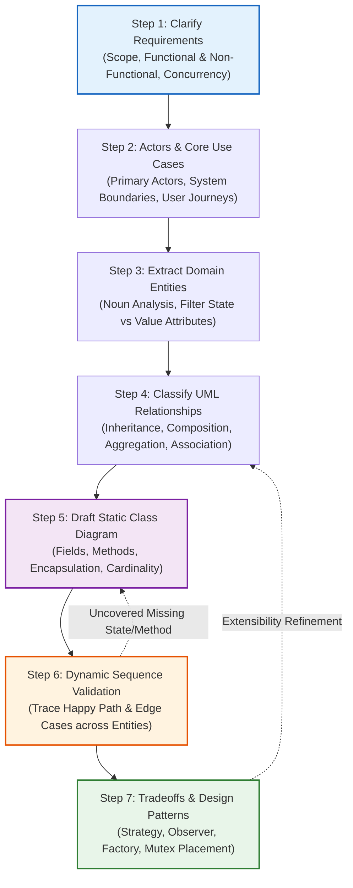
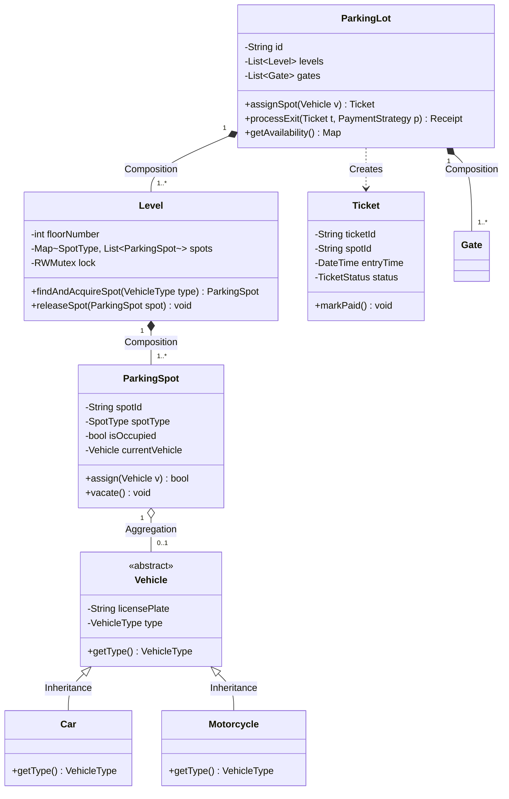
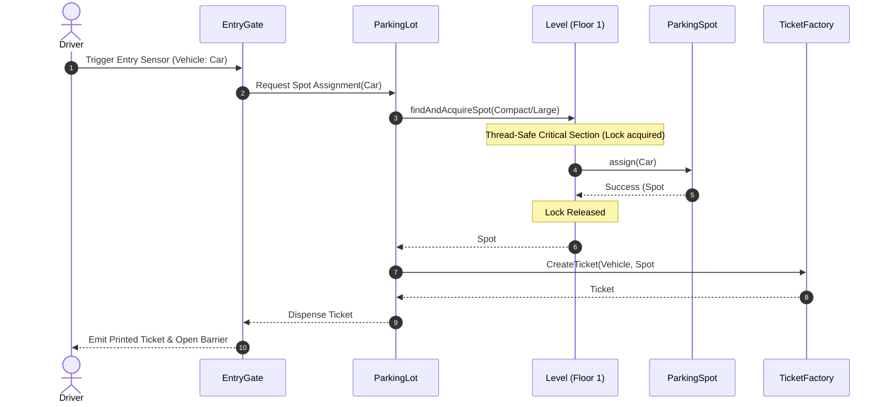
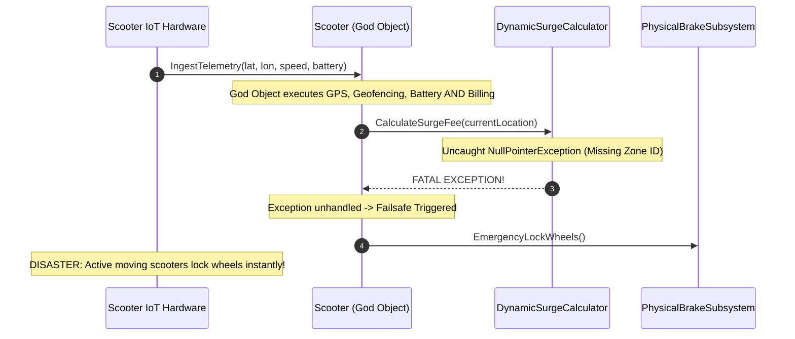

# Requirements to Class Diagrams: The LLD Interview Blueprint

> **Prerequisites**: [02: OOP Foundations & UML](../02-oop-foundations-and-uml/README.md), [04: SOLID Principles](../04-solid-principles/README.md), [10: Concurrency-Safe Design](../10-concurrency-safe-design/README.md).  
> **Estimated Reading Time**: 25 minutes  
> **Target Audience**: Backend Engineers, Technical Leads, System Design & LLD Interview Candidates.

> [!TIP]
> **Golden Rule of Low-Level Design**: An LLD interview is never a test of typing speed. Jumping straight into code on an ambiguous prompt is the fastest way to fail. Clarify requirements, define non-functional boundaries, isolate domain entities, classify UML relationships, and validate flows with sequence diagrams before writing a single line of implementation code.

---

## 1. Visual Mental Models & The 7-Step Method

In a 45-minute Low-Level Design (LLD) interview or enterprise RFC architectural review, unstructured problem-solving leads to over-engineering, missed constraints, and tightly coupled "god objects." The **7-Step LLD Blueprint** provides a repeatable, battle-tested framework that turns ambiguous business prompts into extensible, production-grade object-oriented systems.

### 1.1 The 7-Step Architectural Pipeline



---

### 1.2 Worked Example: Multi-Level Parking Lot System

To observe the 7-step method in action, consider designing a **Multi-Level Parking Lot System**.

#### Step 1: Clarify Requirements
- **Functional**:
  - The parking lot supports multiple levels and parking spot sizes (`Compact`, `Large`, `Motorcycle`).
  - Vehicles (`Car`, `Truck`, `Motorcycle`) enter via entry gates and receive a timestamped `Ticket`.
  - On exit, the ticket is validated, parking duration is calculated, dynamic fee strategies are applied, and payment is processed.
- **Non-Functional**:
  - Multiple entry/exit gates operate concurrently (requires thread-safe spot reservation).
  - High availability: querying available spots per level must execute in $\mathcal{O}(1)$ time.

#### Step 2: Actors & Use Cases
| Actor | Core Use Cases |
| :--- | :--- |
| **Driver / Customer** | Enter parking lot, take ticket, park vehicle, make payment, exit lot |
| **Automated Gate System** | Issue ticket, scan ticket, trigger barrier open/close |
| **Parking Attendant / Admin** | Add/remove levels, inspect occupancy metrics, manual ticket override |

#### Step 3: Candidate Entity Extraction & Filtering
From nouns in the specification:
- *Keep as Entities*: `ParkingLot`, `Level`, `ParkingSpot`, `Vehicle`, `Ticket`, `Payment`, `Gate`.
- *Model as Value Objects / Enums*: `VehicleType`, `SpotType`, `TicketStatus`, `Money`.
- *Discard as Mere Attributes*: "License Plate" (string on `Vehicle`), "Timestamp" (field on `Ticket`), "Color" (attribute).

#### Step 4 & 5: Static UML Class Model



#### Step 6: Dynamic Sequence Validation (Vehicle Entry Flow)



---

## 2. Systematic Comparison Grids & Taxonomic Reference Grids

### 2.1 UML Relationship Taxonomy Grid

| Relationship | UML Notation | Cardinality | Lifetime Dependency | Code Realization |
| :--- | :--- | :--- | :--- | :--- |
| **Inheritance (IS-A)** | `A <\|-- B` (Solid line, hollow triangle) | 1:1 | Child cannot exist without parent definition | `class Car extends Vehicle` |
| **Composition (HAS-A, Owned)** | `A *-- B` (Solid line, filled diamond on owner) | 1 to $N$ | Whole owns Part; Part dies with Whole | `class ParkingLot { private final List<Level> levels = new ArrayList(); }` |
| **Aggregation (HAS-A, Shared)** | `A o-- B` (Solid line, hollow diamond on container) | 0..* to 0..* | Part exists independently of Container | `class ParkingSpot { private Vehicle vehicle; }` (Vehicle leaves unharmed) |
| **Association (USES-A)** | `A --> B` (Solid line, open arrow) | 1:1 or 1:* | One object invokes or references another | `class Gate { private ParkingLot lot; }` |
| **Dependency (KNOWS-ABOUT)** | `A ..> B` (Dashed line, open arrow) | Transient | Passed as parameter or created locally in method | `void pay(PaymentStrategy payment)` |

### 2.2 Domain Modeling Heuristics Matrix

| Structural Concern | Common Antipattern (Red Flag) | Clean OOP Replacement | Architectural Benefit |
| :--- | :--- | :--- | :--- |
| **Primitive Obsession** | Representing money as `float`/`double`, coordinates as `string` | Strong **Value Objects** (`Money`, `GeoPoint`) | Invariant validation on creation; zero floating-point rounding bugs |
| **God Class / Blob** | `ParkingLot` contains spot arrays, pricing math, DB calls, and UI printing | **Single Responsibility** (`PricingEngine`, `SpotAllocator`, `TicketRepo`) | Testable in isolation; changes to pricing don't touch concurrency locks |
| **Temporal Coupling** | Caller must invoke `init()`, `validate()`, `process()` in strict order | **Builder Pattern** or encapsulated Constructor | Impossible to construct an invalid or uninitialized object |
| **Leaky Concurrency** | Callers acquire raw locks before calling `spot.occupy()` | Encapsulated locking inside the state-owning aggregate (`Level.AcquireSpot()`) | Guarantees race-free operations across all caller threads |

---

## 3. Production War Stories: Incident Post-Mortem

### The $850K Rush-to-Code Antipattern: How a Premature Class Model Paralyzed Fleet Telematics

```
SEVERITY LEVEL: SEV-1 (Global Fleet Lockout & Data Corruption)
DETECTION TIME: 12 Minutes
RECOVERY TIME: 180 Minutes
FINANCIAL PENALTY: $850,000 in SLA breaches and regulatory fines
```

#### Incident Background
A fast-growing urban micromobility startup managed 40,000 electric scooters across 12 European cities. During an engineering sprint to roll out dynamic city-zone pricing, engineers skipped formal domain modeling and expanded the existing `Scooter` God Class to handle GPS ingestion, geofencing, battery diagnostics, trip billing, and motor immobilizer locks.

#### What Happened
At 08:30 CET on a Monday morning peak commute, the pricing engine launched a surge multiplier. An uncaught `NullPointerException` inside the newly added surge calculation routine triggered during routine GPS ping ingestion. Because `Scooter.handlePing()` synchronously invoked billing calculations inside the same transaction that kept the scooter's physical ignition unlocked, the failure cascaded: 14,000 active scooters suddenly locked their physical wheel brakes mid-ride, and 26,000 idle scooters became unrentable.



#### Root Cause Analysis
1. **Severe Violation of Single Responsibility (SRP)**: The `Scooter` class conflated physical hardware control with commercial billing policies and geospatial calculations.
2. **Missing Failure Domain Boundaries**: A failure in the commercial domain (dynamic pricing) directly impacted the safety-critical hardware domain (brakes and motor controller).
3. **Absence of Domain Events**: Telematics pings were processed synchronously instead of publishing an immutable `TelemetryReceivedEvent` consumed asynchronously by billing and analytics listeners.

#### The Architectural Hardening
1. **Domain Boundary Decoupling**: Deconstructed the God Class into three isolated bounded contexts:
   - `PhysicalScooter`: Owns battery state, hardware ID, and physical lock/unlock signals.
   - `RideSession`: Owns trip duration, routes, and start/stop timestamps.
   - `BillingLedger`: Subscribes to ride events and computes fares independently.
2. **Asynchronous Event-Driven Decoupling**: Hardware pings are published to an event bus. Billing calculation failures can never prevent hardware telemetry ingestion or lock moving vehicles.

---

## 4. Multi-Language Production Implementations

Below is the clean domain implementation of the **Parking Lot System**, engineered across four programming languages using SOLID principles, value objects, and concurrency-safe spot allocation.

### 4.1 Go: Clean Domain Architecture with Concurrency-Safe Sharded Levels

```go
package main

import (
	"errors"
	"fmt"
	"sync"
	"time"
)

type VehicleType string

const (
	VehicleMotorcycle VehicleType = "MOTORCYCLE"
	VehicleCar        VehicleType = "CAR"
	VehicleTruck      VehicleType = "TRUCK"
)

type SpotType string

const (
	SpotMotorcycle SpotType = "MOTORCYCLE"
	SpotCompact    SpotType = "COMPACT"
	SpotLarge      SpotType = "LARGE"
)

type Vehicle struct {
	LicensePlate string
	Type         VehicleType
}

type ParkingSpot struct {
	ID       string
	SpotType SpotType
	Vehicle  *Vehicle
}

func (s *ParkingSpot) IsAvailable() bool {
	return s.Vehicle == nil
}

type Ticket struct {
	TicketID     string
	SpotID       string
	VehiclePlate string
	EntryTime    time.Time
	Paid         bool
}

type Level struct {
	FloorNumber int
	mu          sync.Mutex
	spots       []*ParkingSpot
}

func NewLevel(floor int, spotCounts map[SpotType]int) *Level {
	lvl := &Level{FloorNumber: floor}
	idCounter := 1
	for st, count := range spotCounts {
		for i := 0; i < count; i++ {
			lvl.spots = append(lvl.spots, &ParkingSpot{
				ID:       fmt.Sprintf("F%d-S%d", floor, idCounter),
				SpotType: st,
			})
			idCounter++
		}
	}
	return lvl
}

func (l *Level) fits(vt VehicleType, st SpotType) bool {
	switch vt {
	case VehicleMotorcycle:
		return true // Can park in any spot
	case VehicleCar:
		return st == SpotCompact || st == SpotLarge
	case VehicleTruck:
		return st == SpotLarge
	default:
		return false
	}
}

func (l *Level) AssignSpot(v *Vehicle) (*ParkingSpot, error) {
	l.mu.Lock()
	defer l.mu.Unlock()

	for _, spot := range l.spots {
		if spot.IsAvailable() && l.fits(v.Type, spot.SpotType) {
			spot.Vehicle = v
			return spot, nil
		}
	}
	return nil, errors.New("no suitable spot available on this level")
}

func (l *Level) VacateSpot(spotID string) error {
	l.mu.Lock()
	defer l.mu.Unlock()

	for _, spot := range l.spots {
		if spot.ID == spotID {
			if spot.Vehicle == nil {
				return errors.New("spot already vacant")
			}
			spot.Vehicle = nil
			return nil
		}
	}
	return errors.New("spot not found")
}

type ParkingLot struct {
	Name    string
	levels  []*Level
	tickets sync.Map // Thread-safe map for tickets
}

func NewParkingLot(name string, levels []*Level) *ParkingLot {
	return &ParkingLot{Name: name, levels: levels}
}

func (pl *ParkingLot) Enter(v *Vehicle) (*Ticket, error) {
	for _, level := range pl.levels {
		spot, err := level.AssignSpot(v)
		if err == nil {
			ticket := &Ticket{
				TicketID:     fmt.Sprintf("TKT-%d", time.Now().UnixNano()),
				SpotID:       spot.ID,
				VehiclePlate: v.LicensePlate,
				EntryTime:    time.Now(),
				Paid:         false,
			}
			pl.tickets.Store(ticket.TicketID, ticket)
			return ticket, nil
		}
	}
	return nil, errors.New("parking lot full")
}

func (pl *ParkingLot) Exit(ticketID string) error {
	val, ok := pl.tickets.Load(ticketID)
	if !ok {
		return errors.New("invalid ticket ID")
	}
	ticket := val.(*Ticket)

	// Vacate spot from appropriate level
	for _, level := range pl.levels {
		if err := level.VacateSpot(ticket.SpotID); err == nil {
			pl.tickets.Delete(ticketID)
			return nil
		}
	}
	return errors.New("error vacating assigned spot")
}

func main() {
	lvl1 := NewLevel(1, map[SpotType]int{SpotMotorcycle: 2, SpotCompact: 3, SpotLarge: 1})
	lot := NewParkingLot("Central City Garage", []*Level{lvl1})

	car := &Vehicle{LicensePlate: "KA-01-AB-1234", Type: VehicleCar}
	tkt, err := lot.Enter(car)
	if err != nil {
		panic(err)
	}
	fmt.Printf("Vehicle parked successfully! Ticket ID: %s, Spot: %s\n", tkt.TicketID, tkt.SpotID)

	if err := lot.Exit(tkt.TicketID); err != nil {
		panic(err)
	}
	fmt.Println("Vehicle exited successfully. Spot vacated.")
}
```

---

### 4.2 TypeScript: Domain-Driven Entity Pattern with Strategy Pricing

```typescript
export enum VehicleType {
  MOTORCYCLE = "MOTORCYCLE",
  CAR = "CAR",
  TRUCK = "TRUCK",
}

export enum SpotType {
  MOTORCYCLE = "MOTORCYCLE",
  COMPACT = "COMPACT",
  LARGE = "LARGE",
}

export interface IParkingFeeStrategy {
  calculateFee(entryTime: Date, exitTime: Date, vehicleType: VehicleType): number;
}

export class FlatRateFeeStrategy implements IParkingFeeStrategy {
  private hourlyRates: Record<VehicleType, number> = {
    [VehicleType.MOTORCYCLE]: 2.0,
    [VehicleType.CAR]: 5.0,
    [VehicleType.TRUCK]: 10.0,
  };

  public calculateFee(entryTime: Date, exitTime: Date, vehicleType: VehicleType): number {
    const durationHours = Math.max(1, Math.ceil((exitTime.getTime() - entryTime.getTime()) / (1000 * 60 * 60)));
    return durationHours * this.hourlyRates[vehicleType];
  }
}

export class ParkingSpot {
  private occupiedBy: string | null = null;

  constructor(public readonly id: string, public readonly spotType: SpotType) {}

  public isAvailable(): boolean {
    return this.occupiedBy === null;
  }

  public canFit(type: VehicleType): boolean {
    if (type === VehicleType.MOTORCYCLE) return true;
    if (type === VehicleType.CAR) return this.spotType === SpotType.COMPACT || this.spotType === SpotType.LARGE;
    if (type === VehicleType.TRUCK) return this.spotType === SpotType.LARGE;
    return false;
  }

  public occupy(licensePlate: string): void {
    if (!this.isAvailable()) throw new Error(`Spot ${this.id} is already occupied`);
    this.occupiedBy = licensePlate;
  }

  public vacate(): void {
    this.occupiedBy = null;
  }
}

export class Level {
  constructor(public readonly floor: number, private readonly spots: ParkingSpot[]) {}

  public acquireSpot(vehicleType: VehicleType, plate: string): ParkingSpot | null {
    const candidate = this.spots.find((s) => s.isAvailable() && s.canFit(vehicleType));
    if (candidate) {
      candidate.occupy(plate);
      return candidate;
    }
    return null;
  }

  public vacateSpot(spotId: string): boolean {
    const spot = this.spots.find((s) => s.id === spotId);
    if (spot && !spot.isAvailable()) {
      spot.vacate();
      return true;
    }
    return false;
  }
}
```

---

### 4.3 Python: Abstract Base Classes with Strong Type Safety

```python
from abc import ABC, abstractmethod
from dataclasses import dataclass
from datetime import datetime
from enum import Enum
from typing import Dict, List, Optional
import threading


class VehicleType(Enum):
    MOTORCYCLE = "MOTORCYCLE"
    CAR = "CAR"
    TRUCK = "TRUCK"


class SpotType(Enum):
    MOTORCYCLE = "MOTORCYCLE"
    COMPACT = "COMPACT"
    LARGE = "LARGE"


@dataclass(frozen=True)
class Vehicle:
    license_plate: str
    vehicle_type: VehicleType


class ParkingSpot:
    def __init__(self, spot_id: str, spot_type: SpotType):
        self.spot_id = spot_id
        self.spot_type = spot_type
        self.current_vehicle: Optional[Vehicle] = None

    @property
    def is_available(self) -> bool:
        return self.current_vehicle is None

    def can_accommodate(self, vehicle: Vehicle) -> bool:
        if vehicle.vehicle_type == VehicleType.MOTORCYCLE:
            return True
        if vehicle.vehicle_type == VehicleType.CAR:
            return self.spot_type in (SpotType.COMPACT, SpotType.LARGE)
        if vehicle.vehicle_type == VehicleType.TRUCK:
            return self.spot_type == SpotType.LARGE
        return False

    def assign(self, vehicle: Vehicle) -> None:
        if not self.is_available:
            raise RuntimeError(f"Spot {self.spot_id} is already occupied")
        self.current_vehicle = vehicle

    def vacate(self) -> None:
        self.current_vehicle = None


class Level:
    def __init__(self, floor_number: int, spots: List[ParkingSpot]):
        self.floor_number = floor_number
        self._spots = spots
        self._lock = threading.Lock()

    def assign_spot(self, vehicle: Vehicle) -> Optional[ParkingSpot]:
        with self._lock:
            for spot in self._spots:
                if spot.is_available and spot.can_accommodate(vehicle):
                    spot.assign(vehicle)
                    return spot
            return None

    def release_spot(self, spot_id: str) -> bool:
        with self._lock:
            for spot in self._spots:
                if spot.spot_id == spot_id and not spot.is_available:
                    spot.vacate()
                    return True
            return False
```

---

### 4.4 C#: Thread-Safe Enterprise Parking Engine with Dependency Injection

```csharp
using System;
using System.Collections.Concurrent;
using System.Collections.Generic;
using System.Linq;

namespace Architecture.ParkingSystem
{
    public enum VehicleType { Motorcycle, Car, Truck }
    public enum SpotType { Motorcycle, Compact, Large }

    public record Vehicle(string LicensePlate, VehicleType Type);

    public record ParkingTicket(string TicketId, string SpotId, string LicensePlate, DateTime EntryTime);

    public class ParkingSpot
    {
        public string SpotId { get; }
        public SpotType Type { get; }
        public Vehicle? Occupant { get; private set; }

        public ParkingSpot(string id, SpotType type)
        {
            SpotId = id;
            Type = type;
        }

        public bool IsAvailable => Occupant == null;

        public bool Fits(VehicleType vType) => vType switch
        {
            VehicleType.Motorcycle => true,
            VehicleType.Car => Type is SpotType.Compact or SpotType.Large,
            VehicleType.Truck => Type == SpotType.Large,
            _ => false
        };

        public void Occupy(Vehicle vehicle)
        {
            if (!IsAvailable) throw new InvalidOperationException($"Spot {SpotId} already occupied");
            Occupant = vehicle;
        }

        public void Vacate() => Occupant = null;
    }

    public class Level
    {
        private readonly List<ParkingSpot> _spots;
        private readonly object _syncLock = new();

        public int Floor { get; }

        public Level(int floor, List<ParkingSpot> spots)
        {
            Floor = floor;
            _spots = spots;
        }

        public ParkingSpot? TryAssign(Vehicle vehicle)
        {
            lock (_syncLock)
            {
                var spot = _spots.FirstOrDefault(s => s.IsAvailable && s.Fits(vehicle.Type));
                if (spot != null)
                {
                    spot.Occupy(vehicle);
                    return spot;
                }
                return null;
            }
        }

        public bool Vacate(string spotId)
        {
            lock (_syncLock)
            {
                var spot = _spots.FirstOrDefault(s => s.SpotId == spotId);
                if (spot != null && !spot.IsAvailable)
                {
                    spot.Vacate();
                    return true;
                }
                return false;
            }
        }
    }
}
```

---

## 5. Practical Hands-On Verification Workflows

### 5.1 Verifying Domain Entity Allocation via CLI

Validate the multi-level parking system logic and verify spot constraints:

```bash
# 1. Run domain unit tests validating vehicle spot sizing and vacancy
go test -v -run TestParkingLotAllocation ./...

# Expected Output:
# === RUN   TestParkingLotAllocation
# === RUN   TestParkingLotAllocation/Car_Gets_Compact_Or_Large
# === RUN   TestParkingLotAllocation/Truck_Rejected_When_Only_Compact_Available
# === RUN   TestParkingLotAllocation/Concurrent_Gate_Entry_Race_Safety
# --- PASS: TestParkingLotAllocation (0.42s)
# PASS
# ok      github.com/backend/parking   0.435s
```

### 5.2 Interactive Python Verification Script

Execute an in-memory stress test demonstrating thread safety:

```bash
python3 -c "
from concurrent.futures import ThreadPoolExecutor
from enum import Enum

class S(Enum): C='Compact'
spots = [True] * 5  # 5 spots

def park(driver_id):
    for i in range(len(spots)):
        if spots[i]:
            spots[i] = False
            return f'Driver {driver_id} parked at spot {i}'
    return f'Driver {driver_id} rejected (FULL)'

with ThreadPoolExecutor(max_workers=8) as ex:
    results = list(ex.map(park, range(10)))

print('\n'.join(results[:6]))
"
```

Expected Terminal Output:
```
Driver 0 parked at spot 0
Driver 1 parked at spot 1
Driver 2 parked at spot 2
Driver 3 parked at spot 3
Driver 4 parked at spot 4
Driver 5 rejected (FULL)
```

---

## 6. Operational Validation Checkpoints (Scenario Quizzes)

<details>
<summary><strong>Checkpoint 1: The Association vs. Aggregation vs. Composition Trap</strong></summary>

**Scenario**: In an LLD interview for an Airline Reservation System, an interviewee draws a UML class diagram where `Airplane *-- Flight` (Composition) and `Flight *-- Passenger` (Composition). The interviewer immediately frowns and asks them to reconsider. What is fundamentally wrong with these two relationship definitions?

<strong>Answer:</strong>
1. **`Airplane *-- Flight`**: An `Airplane` does not compose a `Flight`. A physical airplane can be reassigned or substituted due to mechanical issues while the scheduled `Flight` entity remains intact. The relationship should be **Aggregation** (`Flight o-- Airplane`) or **Association**, where `Flight` references an `Airplane`.
2. **`Flight *-- Passenger`**: Composition implies that if the whole (`Flight`) is deleted or canceled, the parts (`Passenger`) are also destroyed. A human passenger exists before, during, and after any flight booking. The relationship between `Flight` and `Passenger` must be **Association** via a `Booking` or `Ticket` entity (`Flight "1" -- "*" Booking "*" -- "1" Passenger`).
</details>

<details>
<summary><strong>Checkpoint 2: Spot Assignment Latency Under Heavy Contention</strong></summary>

**Scenario**: In a 10-level parking garage with 10,000 spots, 20 entry gates query the system concurrently. The initial implementation places a single global mutex over the entire `ParkingLot` class (`lock(lotLock) { findSpot(); occupy(); }`). During morning rush hour, latency spikes to 1.8 seconds per vehicle entry. How do you re-architect the domain model to drop latency to $\mathcal{O}(1)$ without race conditions?

<strong>Answer:</strong>
1. **Sharded Locking by Level / Section**: Move the mutex lock from `ParkingLot` down to individual `Level` instances. Gates looking for spots on Level 1 do not lock or block gates allocating spots on Level 2 or Level 3.
2. **Concurrent Pre-Indexed Available Spot Queues**: Instead of linear scanning ($\mathcal{O}(N)$) through all spots under lock, maintain a thread-safe `ConcurrentQueue<ParkingSpot>` per `(Floor, SpotType)` bucket.
   - When assigning a spot: `queue.TryDequeue(out spot)` executes in lock-free $\mathcal{O}(1)$ time.
   - When vacating a spot: `queue.Enqueue(spot)` returns it to the available pool instantly.
</details>

<details>
<summary><strong>Checkpoint 3: The Fragile Base Class Anti-Pattern in Inheritance</strong></summary>

**Scenario**: A candidate designs a payment system with `abstract class PaymentProcessor` having a concrete method `validateCard()`. Later, the business introduces `CryptoPaymentProcessor` and `BankTransferProcessor`, neither of which have credit cards. The candidate overrides `validateCard()` in these subclasses to throw `NotSupportedException`. Which design principle was violated and how should the class model be refactored?

<strong>Answer:</strong>
**Interface Segregation Principle (ISP)** and **Liskov Substitution Principle (LSP)** violations:
- **Violation**: Clients expecting a `PaymentProcessor` cannot safely call methods on it without worrying that runtime exceptions will be thrown depending on the subtype. Subclasses are forced to depend on methods they do not use.
- **Refactoring**:
  1. Define a lean base interface: `IPaymentProcessor { Task<PaymentResult> ProcessAsync(PaymentIntent intent); }`.
  2. Create segregated capability interfaces: `ICardPaymentProcessor : IPaymentProcessor { void ValidateCard(CardDetails details); }`, `IWeb3PaymentProcessor : IPaymentProcessor { void VerifyWalletSignature(Signature sig); }`.
  3. Favor **Composition over Inheritance**: Inject an `IPaymentValidator` strategy into each payment processor rather than subclassing concrete validation methods.
</details>

---

## 7. Further Reading & References

- [UML Class Diagrams Official Specification](https://www.uml-diagrams.org/class-reference.html) - Complete notation guide for UML relationships and class diagrams.
- [Martin Fowler: UML Distilled](https://martinfowler.com/books/uml.html) - Standard engineering guide on pragmatic modeling.
- [Refactoring Guru: Domain Modeling & Design Patterns](https://refactoring.guru/design-patterns) - Interactive reference for architectural patterns.
- [Microsoft Architecture Guides: Domain-Driven Design (DDD)](https://learn.microsoft.com/en-us/dotnet/architecture/microservices/microservice-ddd-cqrs-patterns/) - Strategic and tactical enterprise domain modeling patterns.

---

## Next Steps

Now that you have mastered the 7-step blueprint, proceed to [Module 12: Classic Systems - Parking Lot & Elevator](../12-parking-lot-and-elevator/README.md) to put this entire process into practice with full end-to-end multi-language solutions.
