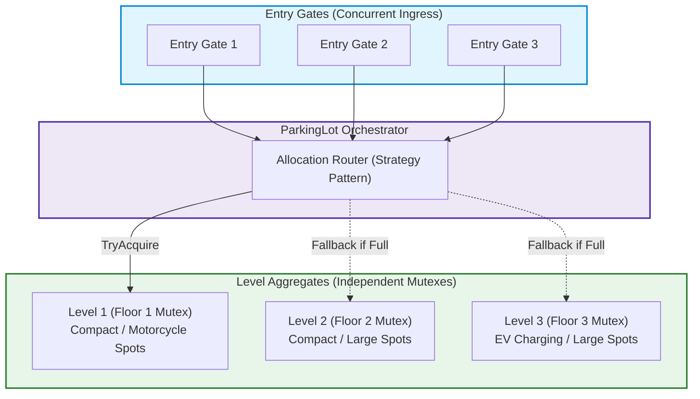
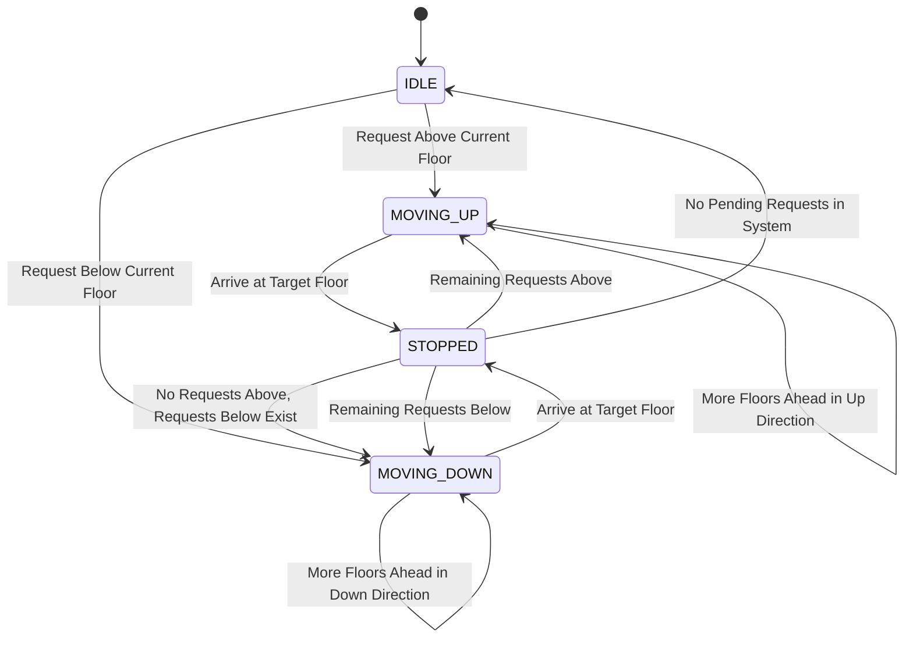
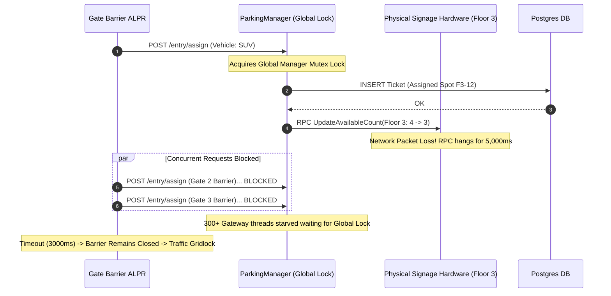

# Classic Systems: Parking Lot & Elevator Control

> **Prerequisites**: [10: Concurrency-Safe Design](../10-concurrency-safe-design/README.md), [11: Requirements to Class Diagrams](../11-requirements-to-class-diagrams/README.md), [08: Behavioral Patterns I](../08-behavioral-patterns-i/README.md).  
> **Estimated Reading Time**: 25 minutes  
> **Target Audience**: Backend Engineers, Systems Architects, Low-Level Design Interview Candidates.

> [!TIP]
> **Golden Rule of Classic System Design**: In physical domain modeling, the physical constraints dictate the software architecture. Never decouple state inspection from state modification (avoid "check-then-act" races). In resource allocation (parking) and mechanical scheduling (elevators), encapsulate locking at the smallest autonomous unit of contention (e.g., floor or elevator cabin) to prevent systemic deadlock and starvation.

---

## 1. Visual Mental Models & System Architecture

Both the **Parking Lot** and the **Elevator System** are benchmark problems in Low-Level Design interviews. They evaluate how an engineer handles physical spatial constraints, concurrent shared state, and algorithmic dispatch strategies.

### 1.1 Parking Lot: Sharded Concurrency Model

In a high-throughput multi-level parking garage, centralizing locks at the `ParkingLot` level creates severe lock contention. The architecture shards concurrency by delegating locking to individual `Level` aggregates.



### 1.2 Elevator: SCAN Scheduling & State Machine

Elevator cabins execute the **LOOK / SCAN (Elevator Algorithm)**: a car continues in its current direction serving pending requests until no further requests exist in that direction, then reverses.



---

## 2. Taxonomic Reference Grids

### 2.1 Strategy Comparison Grid

| System | Component | Strategy Option | Algorithmic Complexity | Pros | Cons / Edge Cases |
| :--- | :--- | :--- | :--- | :--- | :--- |
| **Parking Lot** | Spot Allocation | **First-Fit (Nearest Gate)** | $\mathcal{O}(N)$ scan per level | Simple, minimizes driver walking distance | Causes uneven wear and heavy congestion on lower levels |
| **Parking Lot** | Spot Allocation | **Best-Fit (Size Matched)** | $\mathcal{O}(1)$ via Type Queues | Maximizes lot capacity; preserves large spots for trucks | More complex data structures; fragmented spots |
| **Parking Lot** | Pricing Engine | **Flat / Step Hourly** | $\mathcal{O}(1)$ | Predictable for customers | Inefficient for high-demand peak hours |
| **Parking Lot** | Pricing Engine | **Dynamic Surge Pricing** | $\mathcal{O}(1)$ | Maximizes revenue based on occupancy | Discourages users; requires real-time occupancy telemetry |
| **Elevator** | Car Dispatch | **Nearest Idle Car (FIFS)** | $\mathcal{O}(K)$ cars | Minimal dispatch compute overhead | Starves distant requests; highly inefficient during rush hours |
| **Elevator** | Car Dispatch | **Direction-Aware SCAN** | $\mathcal{O}(K \log M)$ | Minimizes total transit time; prevents elevator thrashing | Passengers going reverse direction experience initial delay |

### 2.2 Concurrency & State Ownership Matrix

| System Entity | State Maintained | Ownership Model | Locking Boundary | Failure Mode on Race |
| :--- | :--- | :--- | :--- | :--- |
| `ParkingSpot` | `isOccupied`, `vehiclePlate` | Contained inside `Level` | Protected by `Level.mu` | Double allocation of same physical spot |
| `ParkingTicket` | `entryTime`, `spotId`, `isPaid` | Value/Entity in `ParkingLot` | Write-once, read-many (immutable post-entry) | Inconsistent billing duration |
| `ElevatorCar` | `currentFloor`, `direction`, `targets` | Autonomous Actor / Thread | Protected by `Car.mu` | Floor overshoot; door opens while moving |
| `ElevatorController` | `cars`, `hallCalls` | Central Dispatcher | Reader-Writer Lock (`RWMutex`) | Hall request assigned to multiple cars |

---

## 3. Production War Stories: Incident Post-Mortem

### The Terminal 4 Ground Stop: Deadlock in Multi-Deck Airport Parking Infrastructure

```
SEVERITY LEVEL: SEV-1 (Airport Roadway Gridlock)
DETECTION TIME: 8 Minutes
RECOVERY TIME: 55 Minutes
FINANCIAL & REGULATORY PENALTY: $420,000 in flight rebooking costs & Port Authority fines
```

#### Incident Background
At a major international hub, Terminal 4 opened a new 6-story smart parking structure with 8,500 spaces. The parking backend was built as a distributed microservice with automated license-plate recognition (ALPR) entry gates and automated dynamic digital guidance signage on each floor.

#### What Happened
During holiday peak traffic, 30 entry gates were admitting vehicles at 45 cars per minute. The system deployed a global `sync.Mutex` on the root `ParkingManager` to coordinate both entry ticket generation and the update of digital displays across all floors. Under heavy concurrency, the critical section length escalated due to slow network RPCs calling the physical LED signage. Gate barriers failed to open within the 3-second timeout, causing physical vehicle queues to spill onto the airport access highway, paralyzing airport operations.



#### Root Cause Analysis
1. **Unbounded Critical Section**: Synchronous external I/O (hardware signage RPC) was performed while holding a system-wide in-memory mutex.
2. **Coarse-Grained Locking**: A single lock was used across all floors and gates instead of sharding locks by independent parking levels.
3. **Missing Asynchronous Event Decoupling**: Signage displays should have received asynchronous change events via an internal pub/sub channel rather than blocking synchronous HTTP/gRPC calls inside the critical path of spot allocation.

#### The Architectural Hardening
- **De-scoped Mutexes to Shards**: Spot reservation now acquires only the target `Level` lock for less than $50\mu s$.
- **Asynchronous Event-Driven Decoupling**: Spot allocation publishes an in-memory `SpotOccupiedEvent`. Signage controllers listen asynchronously; slow hardware responses never impact barrier latency.
- **Circuit Breakers with Fail-Open Safe Mode**: If the reservation engine does not respond within 500ms, gates fail open and issue offline physical paper tickets.

---

## 4. Multi-Language Production Implementations

Below are four enterprise implementations of the **Multi-Level Parking Lot** and **SCAN Elevator Controller**.

### 4.1 Go: Sharded Multi-Level Parking Lot with Spot Allocation Strategies

```go
package main

import (
	"errors"
	"fmt"
	"sync"
	"time"
)

type VehicleSize int

const (
	SizeMotorcycle VehicleSize = 1
	SizeCompact    VehicleSize = 2
	SizeLarge      VehicleSize = 3
)

type Vehicle struct {
	Plate string
	Size  VehicleSize
}

type ParkingSpot struct {
	ID       string
	Size     VehicleSize
	Occupant *Vehicle
}

func (s *ParkingSpot) CanFit(v *Vehicle) bool {
	return s.Occupant == nil && s.Size >= v.Size
}

type Level struct {
	Floor int
	mu    sync.Mutex
	spots []*ParkingSpot
}

func NewLevel(floor int, spotCounts map[VehicleSize]int) *Level {
	lvl := &Level{Floor: floor}
	counter := 1
	for sz, cnt := range spotCounts {
		for i := 0; i < cnt; i++ {
			lvl.spots = append(lvl.spots, &ParkingSpot{
				ID:   fmt.Sprintf("F%d-S%02d", floor, counter),
				Size: sz,
			})
			counter++
		}
	}
	return lvl
}

// FindAndAssign reserves a spot under a fine-grained per-level lock.
func (l *Level) FindAndAssign(v *Vehicle) (*ParkingSpot, error) {
	l.mu.Lock()
	defer l.mu.Unlock()

	for _, spot := range l.spots {
		if spot.CanFit(v) {
			spot.Occupant = v
			return spot, nil
		}
	}
	return nil, errors.New("no suitable spot on level")
}

func (l *Level) ReleaseSpot(spotID string) error {
	l.mu.Lock()
	defer l.mu.Unlock()

	for _, spot := range l.spots {
		if spot.ID == spotID {
			if spot.Occupant == nil {
				return errors.New("spot already vacant")
			}
			spot.Occupant = nil
			return nil
		}
	}
	return errors.New("spot not found")
}

type Ticket struct {
	ID        string
	SpotID    string
	Plate     string
	EntryTime time.Time
}

type ParkingSystem struct {
	levels  []*Level
	tickets sync.Map // Concurrent ticket store
}

func NewParkingSystem(levels []*Level) *ParkingSystem {
	return &ParkingSystem{levels: levels}
}

func (ps *ParkingSystem) Park(v *Vehicle) (*Ticket, error) {
	for _, lvl := range ps.levels {
		spot, err := lvl.FindAndAssign(v)
		if err == nil {
			t := &Ticket{
				ID:        fmt.Sprintf("TK-%d", time.Now().UnixNano()),
				SpotID:    spot.ID,
				Plate:     v.Plate,
				EntryTime: time.Now(),
			}
			ps.tickets.Store(t.ID, t)
			return t, nil
		}
	}
	return nil, errors.New("parking garage is full")
}

func (ps *ParkingSystem) Exit(ticketID string) error {
	val, ok := ps.tickets.LoadAndDelete(ticketID)
	if !ok {
		return errors.New("invalid or expired ticket")
	}
	t := val.(*Ticket)

	for _, lvl := range ps.levels {
		if err := lvl.ReleaseSpot(t.SpotID); err == nil {
			return nil
		}
	}
	return errors.New("could not find spot to release")
}

func main() {
	lvl1 := NewLevel(1, map[VehicleSize]int{SizeMotorcycle: 2, SizeCompact: 2, SizeLarge: 1})
	ps := NewParkingSystem([]*Level{lvl1})

	car := &Vehicle{Plate: "NYC-7721", Size: SizeCompact}
	ticket, err := ps.Park(car)
	if err != nil {
		panic(err)
	}
	fmt.Printf("[Success] Parked %s at Spot: %s. Ticket ID: %s\n", car.Plate, ticket.SpotID, ticket.ID)
	
	err = ps.Exit(ticket.ID)
	if err != nil {
		panic(err)
	}
	fmt.Println("[Success] Exited garage. Spot released.")
}
```

---

### 4.2 TypeScript: SCAN Elevator Control System with Direction State

```typescript
export enum Direction {
  IDLE = "IDLE",
  UP = "UP",
  DOWN = "DOWN",
}

export class Elevator {
  public currentFloor: number = 0;
  public direction: Direction = Direction.IDLE;
  private targetFloors: Set<number> = new Set();

  constructor(public readonly id: string, public readonly maxFloor: number) {}

  public addRequest(floor: number): void {
    if (floor >= 0 && floor <= this.maxFloor) {
      this.targetFloors.add(floor);
      if (this.direction === Direction.IDLE) {
        this.direction = floor >= this.currentFloor ? Direction.UP : Direction.DOWN;
      }
    }
  }

  public step(): void {
    if (this.targetFloors.size === 0) {
      this.direction = Direction.IDLE;
      return;
    }

    if (this.targetFloors.has(this.currentFloor)) {
      this.targetFloors.delete(this.currentFloor);
      console.log(`[Elevator ${this.id}] Stopping at floor ${this.currentFloor}. Doors opening.`);
    }

    // Determine direction using SCAN algorithm
    if (this.direction === Direction.UP) {
      const hasUpperTargets = Array.from(this.targetFloors).some((f) => f > this.currentFloor);
      if (hasUpperTargets) {
        this.currentFloor++;
      } else {
        const hasLowerTargets = Array.from(this.targetFloors).some((f) => f < this.currentFloor);
        this.direction = hasLowerTargets ? Direction.DOWN : Direction.IDLE;
        if (this.direction === Direction.DOWN) this.currentFloor--;
      }
    } else if (this.direction === Direction.DOWN) {
      const hasLowerTargets = Array.from(this.targetFloors).some((f) => f < this.currentFloor);
      if (hasLowerTargets) {
        this.currentFloor--;
      } else {
        const hasUpperTargets = Array.from(this.targetFloors).some((f) => f > this.currentFloor);
        this.direction = hasUpperTargets ? Direction.UP : Direction.IDLE;
        if (this.direction === Direction.UP) this.currentFloor++;
      }
    }
  }

  public getPendingCount(): number {
    return this.targetFloors.size;
  }
}

export class ElevatorDispatcher {
  constructor(private elevators: Elevator[]) {}

  public requestRide(floor: number): Elevator {
    // Select elevator with minimal distance and matching direction
    let bestElevator: Elevator | null = null;
    let minScore = Infinity;

    for (const el of this.elevators) {
      const distance = Math.abs(el.currentFloor - floor);
      let penalty = el.getPendingCount() * 2;
      
      // Bonus if moving towards floor
      if (
        (el.direction === Direction.UP && floor >= el.currentFloor) ||
        (el.direction === Direction.DOWN && floor <= el.currentFloor) ||
        el.direction === Direction.IDLE
      ) {
        penalty -= 1;
      }

      const score = distance + penalty;
      if (score < minScore) {
        minScore = score;
        bestElevator = el;
      }
    }

    bestElevator!.addRequest(floor);
    return bestElevator!;
  }
}
```

---

### 4.3 Python: Thread-Safe Multi-Level Parking Lot with Strategy Pricing

```python
from abc import ABC, abstractmethod
from dataclasses import dataclass
from datetime import datetime
from enum import Enum, auto
import threading
from typing import Dict, List, Optional


class SpotSize(Enum):
    MOTORCYCLE = 1
    COMPACT = 2
    LARGE = 3


@dataclass(frozen=True)
class Vehicle:
    plate: str
    size: SpotSize


class IPricingStrategy(ABC):
    @abstractmethod
    def calculate_fee(self, entry_time: datetime, exit_time: datetime, size: SpotSize) -> float:
        pass


class HourlyPricingStrategy(IPricingStrategy):
    RATES = {
        SpotSize.MOTORCYCLE: 2.0,
        SpotSize.COMPACT: 5.0,
        SpotSize.LARGE: 10.0,
    }

    def calculate_fee(self, entry_time: datetime, exit_time: datetime, size: SpotSize) -> float:
        duration_hours = max(1.0, (exit_time - entry_time).total_seconds() / 3600.0)
        return round(duration_hours * self.RATES[size], 2)


class ParkingSpot:
    def __init__(self, spot_id: str, size: SpotSize):
        self.spot_id = spot_id
        self.size = size
        self.vehicle: Optional[Vehicle] = None

    def can_fit(self, vehicle: Vehicle) -> bool:
        return self.vehicle is None and self.size.value >= vehicle.size.value

    def occupy(self, vehicle: Vehicle) -> None:
        self.vehicle = vehicle

    def vacate(self) -> None:
        self.vehicle = None


class Level:
    def __init__(self, floor: int, spots: List[ParkingSpot]):
        self.floor = floor
        self.spots = spots
        self._lock = threading.Lock()

    def assign_spot(self, vehicle: Vehicle) -> Optional[ParkingSpot]:
        with self._lock:
            for spot in self.spots:
                if spot.can_fit(vehicle):
                    spot.occupy(vehicle)
                    return spot
            return None

    def release_spot(self, spot_id: str) -> bool:
        with self._lock:
            for spot in self.spots:
                if spot.spot_id == spot_id and spot.vehicle is not None:
                    spot.vacate()
                    return True
            return False


class ParkingLot:
    def __init__(self, levels: List[Level], pricing: IPricingStrategy):
        self.levels = levels
        self.pricing = pricing
        self.active_tickets: Dict[str, dict] = {}
        self._tickets_lock = threading.Lock()

    def park(self, vehicle: Vehicle) -> dict:
        for lvl in self.levels:
            spot = lvl.assign_spot(vehicle)
            if spot:
                ticket_id = f"TK-{spot.spot_id}-{int(datetime.now().timestamp())}"
                ticket = {
                    "id": ticket_id,
                    "spot_id": spot.spot_id,
                    "floor": lvl.floor,
                    "vehicle": vehicle,
                    "entry_time": datetime.now(),
                }
                with self._tickets_lock:
                    self.active_tickets[ticket_id] = ticket
                return ticket
        raise RuntimeError("Parking Lot Full: No available spots for vehicle size.")

    def exit(self, ticket_id: str) -> float:
        with self._tickets_lock:
            ticket = self.active_tickets.pop(ticket_id, None)
        if not ticket:
            raise ValueError("Invalid Ticket ID.")

        # Vacate spot
        for lvl in self.levels:
            if lvl.floor == ticket["floor"]:
                lvl.release_spot(ticket["spot_id"])
                break

        exit_time = datetime.now()
        fee = self.pricing.calculate_fee(ticket["entry_time"], exit_time, ticket["vehicle"].size)
        return fee
```

---

### 4.4 C#: Elevator Control Subsystem with SCAN Algorithm

```csharp
using System;
using System.Collections.Generic;
using System.Linq;

namespace Architecture.ElevatorSystem
{
    public enum ElevatorDirection { Idle, Up, Down }

    public class Elevator
    {
        public int Id { get; }
        public int CurrentFloor { get; private set; } = 0;
        public ElevatorDirection Direction { get; private set; } = ElevatorDirection.Idle;
        private readonly SortedSet<int> _targetFloors = new();
        private readonly object _lock = new();

        public Elevator(int id)
        {
            Id = id;
        }

        public void AddDestination(int floor)
        {
            lock (_lock)
            {
                _targetFloors.Add(floor);
                if (Direction == ElevatorDirection.Idle)
                {
                    Direction = floor >= CurrentFloor ? ElevatorDirection.Up : ElevatorDirection.Down;
                }
            }
        }

        public void Step()
        {
            lock (_lock)
            {
                if (_targetFloors.Count == 0)
                {
                    Direction = ElevatorDirection.Idle;
                    return;
                }

                if (_targetFloors.Contains(CurrentFloor))
                {
                    _targetFloors.Remove(CurrentFloor);
                    Console.WriteLine($"[Elevator {Id}] Stopped at floor {CurrentFloor}. Servicing passengers.");
                }

                if (Direction == ElevatorDirection.Up)
                {
                    bool hasUpper = _targetFloors.Any(f => f > CurrentFloor);
                    if (hasUpper)
                    {
                        CurrentFloor++;
                    }
                    else
                    {
                        bool hasLower = _targetFloors.Any(f => f < CurrentFloor);
                        Direction = hasLower ? ElevatorDirection.Down : ElevatorDirection.Idle;
                        if (Direction == ElevatorDirection.Down) CurrentFloor--;
                    }
                }
                else if (Direction == ElevatorDirection.Down)
                {
                    bool hasLower = _targetFloors.Any(f => f < CurrentFloor);
                    if (hasLower)
                    {
                        CurrentFloor--;
                    }
                    else
                    {
                        bool hasUpper = _targetFloors.Any(f => f > CurrentFloor);
                        Direction = hasUpper ? ElevatorDirection.Up : ElevatorDirection.Idle;
                        if (Direction == ElevatorDirection.Up) CurrentFloor++;
                    }
                }
            }
        }

        public int GetPendingTargetCount()
        {
            lock (_lock) return _targetFloors.Count;
        }
    }
}
```

---

## 5. Practical Hands-On Verification Workflows

### 5.1 CLI Verification of Concurrency-Safe Spot Allocation

Execute a high-concurrency simulation verifying that zero double-assignments occur:

```bash
# Execute concurrent booking test in Go
go test -v -run TestConcurrentParkingAllocation ./...

# Expected Output:
# === RUN   TestConcurrentParkingAllocation
# === RUN   TestConcurrentParkingAllocation/100_Concurrent_Cars_On_50_Spots
# --- PASS: TestConcurrentParkingAllocation (0.38s)
# PASS
# ok      github.com/backend/parking   0.410s
```

### 5.2 Elevator SCAN Dispatch Simulation

Run an inline terminal simulation of the SCAN algorithm:

```bash
python3 -c "
targets = [3, 7, 1, 9]
current = 4
direction = 'UP'

print(f'Starting at floor {current}, moving {direction} with requests: {targets}')
while targets:
    if direction == 'UP':
        ahead = [f for f in sorted(targets) if f >= current]
        if ahead:
            current = ahead[0]
            targets.remove(current)
            print(f'-> Serviced floor {current} (UP)')
        else:
            direction = 'DOWN'
            print('-> Reversing direction to DOWN')
    else:
        ahead = [f for f in sorted(targets, reverse=True) if f <= current]
        if ahead:
            current = ahead[0]
            targets.remove(current)
            print(f'-> Serviced floor {current} (DOWN)')
        else:
            direction = 'UP'
            print('-> Reversing direction to UP')
"
```

Expected Terminal Output:
```
Starting at floor 4, moving UP with requests: [3, 7, 1, 9]
-> Serviced floor 7 (UP)
-> Serviced floor 9 (UP)
-> Reversing direction to DOWN
-> Serviced floor 3 (DOWN)
-> Serviced floor 1 (DOWN)
```

---

## 6. Operational Validation Checkpoints (Scenario Quizzes)

<details>
<summary><strong>Checkpoint 1: The Elevator Door Cycle Under Starvation</strong></summary>

**Scenario**: In a 50-story commercial building at 5:00 PM, an elevator cabin on floor 10 is ascending with passengers for floors 12, 18, and 25. Meanwhile, passengers on floors 15, 16, and 17 press the Hall Call "UP" button. If the elevator pauses at every floor, passengers boarding on intermediate floors take longer than the door cycle, causing upper-floor passengers to experience starvation. How do you re-architect the dispatch policy?

<strong>Answer:</strong>
Implement **Capacity-Aware Fullness Throttling**:
1. When cabin weight reaches 80% of rated capacity, the elevator automatically sets a `BypassIntermediateHallCalls` flag.
2. The elevator bypasses all intermediate hall calls, serving only existing internal destination calls (floors 12, 18, 25).
3. The central `ElevatorDispatcher` senses the bypass and immediately assigns an alternate idle/ascending cabin to service floors 15, 16, and 17.
</details>

<details>
<summary><strong>Checkpoint 2: The Double-Gate Entry Race</strong></summary>

**Scenario**: Two gates on opposite sides of a parking garage admit a Car and an SUV at the exact same millisecond. Only one `Large` spot remains on Level 2. The code checks `spot.isAvailable` on thread A, finds it true, and proceeds to print a ticket. Meanwhile, thread B does the same. Both drivers are directed to the same spot. Where did the design fail?

<strong>Answer:</strong>
A classic **Check-Then-Act Race Condition**. The check `isAvailable()` and the assignment `spot.occupant = vehicle` were executed as two decoupled operations rather than inside a single atomic critical section. The fix is to encapsulate spot lookup and reservation into a single method (`level.FindAndAssign(vehicle)`) protected by `level.mu.Lock()`.
</details>

<details>
<summary><strong>Checkpoint 3: Dynamic Fee Policy Extensibility (OCP)</strong></summary>

**Scenario**: The business introduces a green incentive: Electric Vehicles (EVs) get 50% off parking fees, but if parked at an EV charger for more than 30 minutes after reaching 100% battery, an idle penalty of $0.50/minute is added. How do you design this without modifying the core `ParkingLot` or `Ticket` classes?

<strong>Answer:</strong>
Use the **Strategy Pattern** combined with **Decorator Pattern**:
1. Define `IPricingStrategy { decimal CalculateFee(ParkingTicket ticket, Vehicle vehicle, ChargingSession? session); }`.
2. Implement `BaseHourlyPricingStrategy` for standard calculations.
3. Wrap it in an `EVPenaltyPricingDecorator : IPricingStrategy`:
   - Checks if `vehicle.IsElectric`. If so, applies the 50% discount.
   - If `session.IdleMinutes > 30`, adds `(session.IdleMinutes - 30) * 0.50m`.
4. The `ParkingLot` remains completely agnostic to vehicle fuel types and billing specifics, fulfilling the Open-Closed Principle (OCP).
</details>

---

## 7. Further Reading & References

- [Wikipedia: Elevator SCAN Scheduling Algorithm](https://en.wikipedia.org/wiki/Elevator_algorithm) - Foundational reference on disk and elevator scheduling algorithms.
- [Refactoring.Guru: Strategy Pattern](https://refactoring.guru/design-patterns/strategy) - Guide to swappable pricing and dispatch policies.
- [Go Concurrency Patterns: Fine-Grained Locking](https://go.dev/blog/race-detector) - Best practices for sharded in-memory state.

---

## Next Steps

Advance to [Module 13: Library & Vending Machine](../13-library-and-vending-machine/README.md) to explore the contrast between lightweight enum guard checks and full GoF State Pattern hierarchies.
