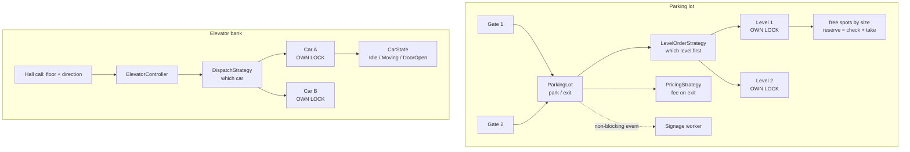
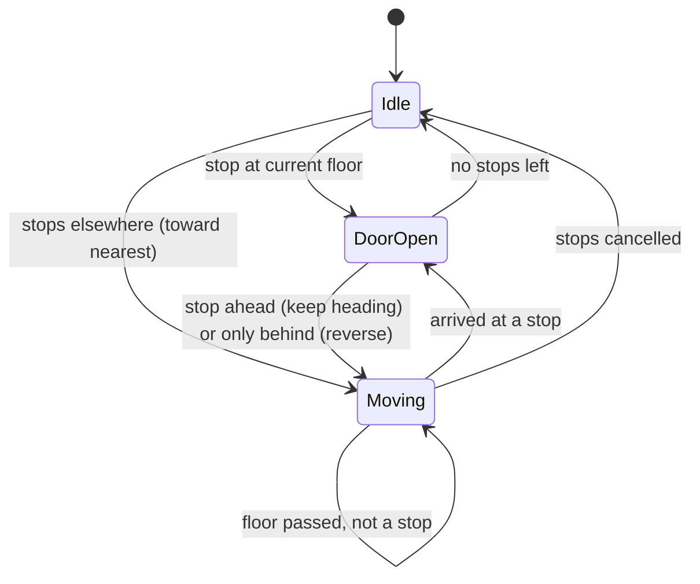

# Parking Lot & Elevator — Thread-Safe Allocation, Strategy, and State

> **Prerequisites:** [08 · Behavioral Patterns I](../08-behavioral-patterns-i/README.md) (Strategy, State), [10 · Concurrency-Safe Design](../10-concurrency-safe-design/README.md), [11 · Requirements to Class Diagrams](../11-requirements-to-class-diagrams/README.md)  
> **Reading time:** ~30 minutes (two full problems, both with concurrency)  
> **Audience:** Machine-coding / LLD rounds — the two most-asked "physical world" problems

> [!NOTE]
> **In one line:** Parking lot = *allocate a scarce resource under contention* (Strategy for which spot, one lock per level, check-and-reserve in one step); Elevator = *a state machine per car plus a dispatcher* (State for the car's behavior, Strategy for which car answers a call).

> [!TIP]
> **Golden rule:** Never check and act in two steps. "Is the spot free?" followed by "take it" is a bug the moment two gates exist. Put the check and the take inside **one** method, behind **one** lock, and make that lock as small as the thing it protects (a level, a car — not the whole building).

> [!TIP]
> **Try it:** Draw `ParkingLot → Level → Spot` and `ElevatorController → ElevatorCar → CarState` in [LLD Studio](/tools/lld-studio/), mark where each lock lives, then run the Python examples below.

---

## 1. Interview pressure

*"Design a multi-level parking lot with multiple entry gates. Then — if we have time — an elevator system."*

What the interviewer is really probing:

| They say | They are checking |
| :--- | :--- |
| "Two cars arrive at the same time, one spot left." | Do you know check-then-act races? Where is your lock? |
| "How do you choose which spot?" | Strategy pattern, not an `if/else` ladder |
| "Pricing changes on weekends." | Open/Closed: new pricing = new class |
| "Elevator is idle, moving, or has its door open." | State pattern, not boolean flags |
| "Which elevator answers a hall call?" | Dispatch policy as a swappable Strategy |
| "What if the signage display is slow?" | Never do I/O while holding a lock |

**The smell:** a single `synchronized` method on `ParkingLot` that does everything, or an `Elevator` with `isMoving`, `isDoorOpen`, `isIdle` booleans that can contradict each other.



---

## 2. Walkthrough — requirements → entities → methods

### Parking lot

**Requirements (ask these, then write them down)**

1. Multiple levels, spots of three sizes (motorcycle, compact, large). A vehicle may use any spot **at least as big** as it needs.
2. Several entry gates run in parallel; no spot may be double-assigned.
3. Entry issues a ticket; exit takes the ticket and returns a fee.
4. Allocation policy (lowest floor first vs. spread across floors) and pricing must be swappable.
5. Out of scope (say it): payment gateway, reservations, EV charging, license-plate recognition.

**Entities** (nouns → keep / drop)

| Noun | Decision |
| :--- | :--- |
| `Vehicle` | Value object: plate + minimum spot size it needs |
| `Spot` | Immutable identity (id, size, level). **Occupancy is not stored on it** — the level owns it, under the lock |
| `Level` | Aggregate: owns its spots and **its own lock** |
| `Ticket` | Immutable record: id, vehicle, spot, entry time |
| `ParkingLot` | Orchestrator: picks level order, issues/redeems tickets |
| `LevelOrderStrategy` | Strategy: which level to try first |
| `PricingStrategy` | Strategy: fee from ticket + exit time |
| `Gate`, `Attendant`, `Payment` | Dropped — not needed for the core |

**Methods**

| Method | Contract |
| :--- | :--- |
| `Level.try_reserve(vehicle) -> Spot \| None` | **Atomic** find-best-fit and mark occupied. Never "check" separately |
| `Level.release(spot) -> bool` | `False` if the spot was not occupied (double exit) |
| `ParkingLot.park(vehicle) -> Ticket` | Reject duplicate plate; try levels in strategy order; raise `LotFullError` |
| `ParkingLot.exit(ticket_id) -> fee` | Remove ticket **atomically** (second exit with the same ticket fails), release spot, price it |

### Elevator

**Requirements**

1. N cars, F floors. Hall call = (floor, direction). Cabin call = destination floor.
2. Each car serves stops in its current direction first, then reverses (SCAN / "LOOK" — what real elevators do).
3. Car behavior depends on whether it is idle, moving, or doors-open.
4. Dispatch policy is replaceable (nearest car, cost-based, zoned).
5. Out of scope: weight sensors, fire mode, express cars, door obstruction.

**Entities**

| Noun | Decision |
| :--- | :--- |
| `ElevatorCar` | Owns floor, stop set, current state, **its own lock** |
| `CarState` | State interface: `tick(car) -> next state`. Implementations: `Idle`, `Moving`, `DoorOpen` |
| `ElevatorController` | Receives hall calls, asks the strategy, forwards to a car |
| `DispatchStrategy` | Strategy: picks a car from **snapshots** |
| `CarSnapshot` | Immutable view (floor, heading, pending count) so strategy doesn't touch live cars |

**Methods:** `car.add_stop(floor)`, `car.tick()`, `car.snapshot()`, `controller.hall_call(floor, direction)`, `strategy.pick(snapshots, floor, direction)`.

---

## 3. The design decisions that matter (say these out loud)

### 3.1 Where does the lock live?

| Option | Verdict |
| :--- | :--- |
| One lock on `ParkingLot` | Correct but every gate waits on every other gate. Fine for a take-home, wrong for "multiple gates." |
| **One lock per `Level`** | Two gates only contend if they target the same level. Reserve is microseconds. **This is the answer.** |
| One lock per `Spot` | Needs lock ordering when scanning many spots; check-then-act returns if you scan unlocked. Over-engineered. |
| Lock-free (CAS on a counter) | Works for "count only" lots. Falls apart once spot sizes and best-fit matter. |

### 3.2 Check-then-act, concretely

```text
BROKEN                              FIXED
thread A: spot.is_free() -> True    with level.lock:
thread B: spot.is_free() -> True        spot = find_best_fit(vehicle)
thread A: spot.occupy(carA)             mark_occupied(spot, vehicle)
thread B: spot.occupy(carB)  <-- same spot, two cars
```

The fix is not "add a lock around `occupy`." It is: **make the search and the occupy one atomic operation.**

### 3.3 Strategy choosing a level vs reserving a spot

The strategy returns an **ordering of levels**, not a spot. Why: the strategy has to read state (free counts) to decide; if it also picked the spot, that read would be stale by the time you act. So: strategy proposes, `Level.try_reserve` decides atomically, and the lot just moves on to the next level if the first one filled up in between.

### 3.4 Never hold a lock while doing I/O

Signage updates, DB writes, and notifications happen **after** the lock is released, ideally through a queue. The war story (section 8) is exactly this mistake.

### 3.5 Idempotent exit

A ticket can be redeemed once. `tickets.pop(id)` under a tiny lock (or `TryRemove` on a concurrent map) makes a double exit fail cleanly instead of releasing a spot that has since been given to someone else.

### 3.6 Elevator: one lock per car, and the dispatcher never holds two

The controller takes **snapshots** (each acquires one car lock briefly, released immediately), runs the strategy on plain data, then calls `add_stop` on the winner (one lock). It never holds two car locks at once, so lock-ordering deadlock cannot happen. The snapshot can be stale — that is fine; dispatch is a best-effort hint and the car's own state machine is the source of truth.

---

## 4. Code — thread-safe parking lot

````carousel
```python
from __future__ import annotations

import queue
import threading
import uuid
from abc import ABC, abstractmethod
from collections import deque
from dataclasses import dataclass
from datetime import datetime, timezone
from enum import IntEnum
from math import ceil
from typing import Callable, Optional


class SpotType(IntEnum):          # IntEnum: iteration order == size order
    MOTORCYCLE = 1
    COMPACT = 2
    LARGE = 3


@dataclass(frozen=True)
class Vehicle:
    plate: str
    min_spot: SpotType            # smallest spot this vehicle fits in


@dataclass(frozen=True)
class Spot:
    id: str
    type: SpotType
    level: int                    # NOTE: no "occupied" flag here. Level owns occupancy.


@dataclass(frozen=True)
class Ticket:
    id: str
    vehicle: Vehicle
    spot: Spot
    entry_time: datetime


class LotFullError(Exception): ...
class InvalidTicketError(Exception): ...
class AlreadyParkedError(Exception): ...


class Level:
    """One lock, one level. Reserve = find + take in a single critical section."""

    def __init__(self, number: int, counts: dict[SpotType, int]) -> None:
        self.number = number
        self._lock = threading.Lock()
        self._free: dict[SpotType, deque[Spot]] = {t: deque() for t in SpotType}
        self._occupied: dict[str, Vehicle] = {}          # spot_id -> vehicle
        n = 0
        for spot_type, count in counts.items():
            for _ in range(count):
                n += 1
                self._free[spot_type].append(Spot(f"L{number}-{n:02d}", spot_type, number))

    def try_reserve(self, v: Vehicle) -> Optional[Spot]:
        with self._lock:
            for spot_type in SpotType:                   # smallest first => best fit
                if spot_type >= v.min_spot and self._free[spot_type]:
                    spot = self._free[spot_type].popleft()
                    self._occupied[spot.id] = v
                    return spot
        return None

    def release(self, spot: Spot) -> bool:
        with self._lock:
            if self._occupied.pop(spot.id, None) is None:
                return False                             # double release, ignore safely
            self._free[spot.type].append(spot)
            return True

    def free_count(self) -> int:
        with self._lock:
            return sum(len(q) for q in self._free.values())


# ── Strategy 1: which level to try first ─────────────────────────────
class LevelOrderStrategy(ABC):
    @abstractmethod
    def order(self, levels: list[Level], v: Vehicle) -> list[Level]: ...


class LowestFloorFirst(LevelOrderStrategy):
    def order(self, levels: list[Level], v: Vehicle) -> list[Level]:
        return sorted(levels, key=lambda lv: lv.number)


class LeastLoadedFirst(LevelOrderStrategy):
    """Spreads load. free_count() is a racy hint; try_reserve() is the authority."""

    def order(self, levels: list[Level], v: Vehicle) -> list[Level]:
        return sorted(levels, key=lambda lv: -lv.free_count())


# ── Strategy 2: pricing ──────────────────────────────────────────────
class PricingStrategy(ABC):
    @abstractmethod
    def fee_cents(self, ticket: Ticket, exit_time: datetime) -> int: ...


class HourlyPricing(PricingStrategy):
    RATE = {SpotType.MOTORCYCLE: 100, SpotType.COMPACT: 300, SpotType.LARGE: 600}

    def fee_cents(self, ticket: Ticket, exit_time: datetime) -> int:
        seconds = (exit_time - ticket.entry_time).total_seconds()
        hours = max(1, ceil(seconds / 3600))             # minimum one hour
        return hours * self.RATE[ticket.spot.type]


@dataclass(frozen=True)
class SpotEvent:
    level: int
    free: int


class ParkingLot:
    def __init__(
        self,
        levels: list[Level],
        allocation: LevelOrderStrategy,
        pricing: PricingStrategy,
        clock: Callable[[], datetime] = lambda: datetime.now(timezone.utc),
    ) -> None:
        self._levels = levels
        self._by_number = {lv.number: lv for lv in levels}
        self._allocation = allocation
        self._pricing = pricing
        self._clock = clock
        self._book_lock = threading.Lock()               # tiny: dict ops only, no I/O inside
        self._tickets: dict[str, Ticket] = {}
        self._inside: set[str] = set()                   # plates currently parked
        self.events: "queue.SimpleQueue[SpotEvent]" = queue.SimpleQueue()  # signage reads this

    def park(self, v: Vehicle) -> Ticket:
        with self._book_lock:
            if v.plate in self._inside:
                raise AlreadyParkedError(v.plate)
            self._inside.add(v.plate)
        try:
            for level in self._allocation.order(self._levels, v):
                spot = level.try_reserve(v)              # atomic find + take
                if spot is None:
                    continue                             # level filled up meanwhile; try next
                ticket = Ticket(uuid.uuid4().hex[:8], v, spot, self._clock())
                with self._book_lock:
                    self._tickets[ticket.id] = ticket
                self.events.put(SpotEvent(level.number, level.free_count()))  # non-blocking
                return ticket
            raise LotFullError(f"no spot for {v.plate}")
        except BaseException:
            with self._book_lock:
                self._inside.discard(v.plate)            # roll back the plate claim
            raise

    def exit(self, ticket_id: str) -> int:
        with self._book_lock:
            ticket = self._tickets.pop(ticket_id, None)  # atomic: only one caller wins
            if ticket is None:
                raise InvalidTicketError(ticket_id)
            self._inside.discard(ticket.vehicle.plate)
        level = self._by_number[ticket.spot.level]
        level.release(ticket.spot)
        self.events.put(SpotEvent(level.number, level.free_count()))
        return self._pricing.fee_cents(ticket, self._clock())


if __name__ == "__main__":
    # 2 levels x 25 compact spots = 50 spots. 100 cars arrive "at once".
    lot = ParkingLot(
        [Level(1, {SpotType.COMPACT: 25}), Level(2, {SpotType.COMPACT: 25})],
        LowestFloorFirst(),
        HourlyPricing(),
    )
    tickets: list[Ticket] = []
    full = 0
    guard = threading.Lock()

    def arrive(i: int) -> None:
        global full
        try:
            t = lot.park(Vehicle(f"CAR-{i}", SpotType.COMPACT))
            with guard:
                tickets.append(t)
        except LotFullError:
            with guard:
                full += 1

    threads = [threading.Thread(target=arrive, args=(i,)) for i in range(100)]
    for t in threads: t.start()
    for t in threads: t.join()

    spots = [t.spot.id for t in tickets]
    print("parked:", len(tickets), "| turned away:", full, "| unique spots:", len(set(spots)))
    assert len(tickets) == 50 and full == 50 and len(set(spots)) == 50

    fee = lot.exit(tickets[0].id)
    print("fee cents:", fee)                              # 300 (minimum 1 hour, compact)
    try:
        lot.exit(tickets[0].id)
    except InvalidTicketError:
        print("second exit rejected")
```
<!-- slide -->
```csharp
using System;
using System.Collections.Concurrent;
using System.Collections.Generic;
using System.Linq;
using System.Threading.Channels;

public enum SpotType { Motorcycle = 1, Compact = 2, Large = 3 }

public sealed record Vehicle(string Plate, SpotType MinSpot);
public sealed record Spot(string Id, SpotType Type, int Level);   // occupancy lives in Level
public sealed record Ticket(string Id, Vehicle Vehicle, Spot Spot, DateTimeOffset EntryTime);
public sealed record SpotEvent(int Level, int Free);

public sealed class LotFullException : Exception { public LotFullException(string m) : base(m) { } }

public sealed class Level
{
    private static readonly SpotType[] BySize = { SpotType.Motorcycle, SpotType.Compact, SpotType.Large };

    private readonly object _gate = new();                  // one lock, one level
    private readonly Dictionary<SpotType, Queue<Spot>> _free = BySize.ToDictionary(t => t, _ => new Queue<Spot>());
    private readonly Dictionary<string, Vehicle> _occupied = new();

    public int Number { get; }

    public Level(int number, IReadOnlyDictionary<SpotType, int> counts)
    {
        Number = number;
        int n = 0;
        foreach (var (type, count) in counts)
            for (int i = 0; i < count; i++)
                _free[type].Enqueue(new Spot($"L{number}-{++n:00}", type, number));
    }

    public Spot? TryReserve(Vehicle v)
    {
        lock (_gate)                                         // find + take, atomically
        {
            foreach (var type in BySize)                     // smallest first => best fit
            {
                if (type >= v.MinSpot && _free[type].Count > 0)
                {
                    var spot = _free[type].Dequeue();
                    _occupied[spot.Id] = v;
                    return spot;
                }
            }
            return null;
        }
    }

    public bool Release(Spot spot)
    {
        lock (_gate)
        {
            if (!_occupied.Remove(spot.Id)) return false;    // double release is a no-op
            _free[spot.Type].Enqueue(spot);
            return true;
        }
    }

    public int FreeCount() { lock (_gate) return _free.Values.Sum(q => q.Count); }
}

public interface ILevelOrderStrategy
{
    IEnumerable<Level> Order(IReadOnlyList<Level> levels, Vehicle v);
}

public sealed class LowestFloorFirst : ILevelOrderStrategy
{
    public IEnumerable<Level> Order(IReadOnlyList<Level> levels, Vehicle v) => levels.OrderBy(l => l.Number);
}

public sealed class LeastLoadedFirst : ILevelOrderStrategy      // FreeCount is a hint; TryReserve is the authority
{
    public IEnumerable<Level> Order(IReadOnlyList<Level> levels, Vehicle v) => levels.OrderByDescending(l => l.FreeCount());
}

public interface IPricingStrategy { long FeeCents(Ticket t, DateTimeOffset exit); }

public sealed class HourlyPricing : IPricingStrategy
{
    public long FeeCents(Ticket t, DateTimeOffset exit)
    {
        var hours = Math.Max(1, (long)Math.Ceiling((exit - t.EntryTime).TotalHours));
        long rate = t.Spot.Type switch { SpotType.Motorcycle => 100, SpotType.Compact => 300, _ => 600 };
        return hours * rate;
    }
}

public sealed class ParkingLot
{
    private readonly IReadOnlyList<Level> _levels;
    private readonly Dictionary<int, Level> _byNumber;
    private readonly ILevelOrderStrategy _allocation;
    private readonly IPricingStrategy _pricing;
    private readonly Func<DateTimeOffset> _clock;
    private readonly ConcurrentDictionary<string, Ticket> _tickets = new();
    private readonly ConcurrentDictionary<string, byte> _inside = new();      // plates currently parked
    private readonly Channel<SpotEvent> _events = Channel.CreateUnbounded<SpotEvent>();

    public ChannelReader<SpotEvent> Events => _events.Reader;                  // signage worker reads this

    public ParkingLot(IReadOnlyList<Level> levels, ILevelOrderStrategy allocation,
                      IPricingStrategy pricing, Func<DateTimeOffset>? clock = null)
    {
        _levels = levels;
        _byNumber = levels.ToDictionary(l => l.Number);
        _allocation = allocation;
        _pricing = pricing;
        _clock = clock ?? (() => DateTimeOffset.UtcNow);
    }

    public Ticket Park(Vehicle v)
    {
        if (!_inside.TryAdd(v.Plate, 0)) throw new InvalidOperationException($"{v.Plate} already inside");
        try
        {
            foreach (var level in _allocation.Order(_levels, v))
            {
                var spot = level.TryReserve(v);                                // atomic find + take
                if (spot is null) continue;                                    // filled meanwhile; next level
                var ticket = new Ticket(Guid.NewGuid().ToString("N")[..8], v, spot, _clock());
                _tickets[ticket.Id] = ticket;
                _events.Writer.TryWrite(new SpotEvent(level.Number, level.FreeCount()));  // never blocks
                return ticket;
            }
            throw new LotFullException($"no spot for {v.Plate}");
        }
        catch
        {
            _inside.TryRemove(v.Plate, out _);                                 // roll back plate claim
            throw;
        }
    }

    public long Exit(string ticketId)
    {
        if (!_tickets.TryRemove(ticketId, out var ticket))                     // only one caller wins
            throw new KeyNotFoundException("invalid or already-used ticket");
        _inside.TryRemove(ticket.Vehicle.Plate, out _);
        var level = _byNumber[ticket.Spot.Level];
        level.Release(ticket.Spot);
        _events.Writer.TryWrite(new SpotEvent(level.Number, level.FreeCount()));
        return _pricing.FeeCents(ticket, _clock());
    }
}
```
````

**Why `Spot` has no `occupied` field:** if occupancy lived on the spot, any code holding a `Spot` could flip it without the level lock. Keeping state in the `Level` means there is exactly one door to mutate it.

---

## 5. Code — elevator with State + Strategy

````carousel
```python
from __future__ import annotations

import threading
from abc import ABC, abstractmethod
from dataclasses import dataclass
from enum import IntEnum
from typing import Optional


class Direction(IntEnum):
    UP = 1
    DOWN = -1


# ── State: the car's behavior is its current state ───────────────────
class CarState(ABC):
    heading: Optional[Direction] = None

    @abstractmethod
    def tick(self, car: "ElevatorCar") -> "CarState":
        """Do one unit of work; return the NEXT state."""


class Idle(CarState):
    def tick(self, car: "ElevatorCar") -> CarState:
        if not car.stops:
            return self
        if car.floor in car.stops:
            return DoorOpen(Direction.UP)
        nearest = min(car.stops, key=lambda f: abs(f - car.floor))
        return Moving(Direction.UP if nearest > car.floor else Direction.DOWN)


class Moving(CarState):
    def __init__(self, direction: Direction) -> None:
        self.heading = direction

    def tick(self, car: "ElevatorCar") -> CarState:
        if not car.stops:
            return Idle()
        car.floor += int(self.heading)                   # one floor per tick
        return DoorOpen(self.heading) if car.floor in car.stops else self


class DoorOpen(CarState):
    def __init__(self, heading: Direction) -> None:
        self.heading = heading

    def tick(self, car: "ElevatorCar") -> CarState:
        car.stops.discard(car.floor)                     # door closes: this stop is served
        h = int(self.heading)
        ahead = any((f - car.floor) * h > 0 for f in car.stops)
        behind = any((f - car.floor) * h < 0 for f in car.stops)
        if ahead:
            return Moving(self.heading)                  # SCAN: keep going the same way
        if behind:
            return Moving(Direction(-h))                 # nothing ahead: reverse
        return Idle()


@dataclass(frozen=True)
class CarSnapshot:
    car_id: str
    floor: int
    heading: Optional[Direction]
    pending: int


class ElevatorCar:
    def __init__(self, car_id: str, lowest: int = 0, highest: int = 20, start: int = 0) -> None:
        self.id = car_id
        self.lowest, self.highest = lowest, highest
        self.floor = start
        self.stops: set[int] = set()
        self._state: CarState = Idle()
        self._lock = threading.Lock()                    # one lock per car

    def add_stop(self, floor: int) -> None:
        if not self.lowest <= floor <= self.highest:
            raise ValueError(f"floor {floor} out of range")
        with self._lock:
            self.stops.add(floor)

    def tick(self) -> str:
        with self._lock:
            self._state = self._state.tick(self)
            return type(self._state).__name__

    def snapshot(self) -> CarSnapshot:
        with self._lock:
            return CarSnapshot(self.id, self.floor, self._state.heading, len(self.stops))


# ── Strategy: which car answers a hall call ──────────────────────────
class DispatchStrategy(ABC):
    @abstractmethod
    def pick(self, cars: list[CarSnapshot], floor: int, direction: Direction) -> str: ...


class CostBasedDispatch(DispatchStrategy):
    def pick(self, cars: list[CarSnapshot], floor: int, direction: Direction) -> str:
        def cost(c: CarSnapshot) -> int:
            distance = abs(c.floor - floor)
            if c.heading is None:
                return distance                           # idle: just distance
            on_the_way = (floor - c.floor) * int(c.heading) >= 0 and c.heading == direction
            if on_the_way:
                return distance                           # will pass us going our way
            return distance + 2 * c.pending + 4           # must finish its run, maybe turn around
        return min(cars, key=cost).car_id                 # ties: first car (deterministic)


class ElevatorController:
    def __init__(self, cars: list[ElevatorCar], strategy: DispatchStrategy) -> None:
        self._cars = {c.id: c for c in cars}
        self._strategy = strategy

    def hall_call(self, floor: int, direction: Direction) -> str:
        snaps = [c.snapshot() for c in self._cars.values()]      # one car lock at a time
        winner = self._cars[self._strategy.pick(snaps, floor, direction)]
        winner.add_stop(floor)                                   # one car lock
        return winner.id

    def tick_all(self) -> None:
        for c in self._cars.values():
            c.tick()


if __name__ == "__main__":
    # SCAN trace: car at 4, requests 7, 3, 9, 1
    car = ElevatorCar("A", start=4)
    for f in (7, 3, 9, 1):
        car.add_stop(f)
    served = []
    while car.stops or car.snapshot().heading is not None:
        name = car.tick()
        if name == "DoorOpen":
            served.append(car.floor)
    print("service order:", served)                      # [3, 1, 7, 9]

    ctl = ElevatorController([ElevatorCar("A", start=0), ElevatorCar("B", start=10)], CostBasedDispatch())
    print("call at 9 going down ->", ctl.hall_call(9, Direction.DOWN))   # B is closer
```
<!-- slide -->
```csharp
using System;
using System.Collections.Generic;
using System.Linq;

public enum Direction { Down = -1, Up = 1 }

public interface ICarState
{
    Direction? Heading { get; }
    ICarState Tick(ElevatorCar car);              // do one unit of work; return NEXT state
}

public sealed class Idle : ICarState
{
    public Direction? Heading => null;

    public ICarState Tick(ElevatorCar car)
    {
        if (car.Stops.Count == 0) return this;
        if (car.Stops.Contains(car.Floor)) return new DoorOpen(Direction.Up);
        var nearest = car.Stops.OrderBy(f => Math.Abs(f - car.Floor)).First();
        return new Moving(nearest > car.Floor ? Direction.Up : Direction.Down);
    }
}

public sealed class Moving : ICarState
{
    private readonly Direction _dir;
    public Moving(Direction dir) => _dir = dir;
    public Direction? Heading => _dir;

    public ICarState Tick(ElevatorCar car)
    {
        if (car.Stops.Count == 0) return new Idle();
        car.Floor += (int)_dir;                                   // one floor per tick
        return car.Stops.Contains(car.Floor) ? new DoorOpen(_dir) : this;
    }
}

public sealed class DoorOpen : ICarState
{
    private readonly Direction _dir;
    public DoorOpen(Direction dir) => _dir = dir;
    public Direction? Heading => _dir;

    public ICarState Tick(ElevatorCar car)
    {
        car.Stops.Remove(car.Floor);                              // door closes: stop served
        int h = (int)_dir;
        bool ahead = car.Stops.Any(f => (f - car.Floor) * h > 0);
        bool behind = car.Stops.Any(f => (f - car.Floor) * h < 0);
        if (ahead) return new Moving(_dir);                       // SCAN: keep going
        if (behind) return new Moving((Direction)(-h));           // reverse
        return new Idle();
    }
}

public sealed record CarSnapshot(string CarId, int Floor, Direction? Heading, int Pending);

public sealed class ElevatorCar
{
    private readonly object _gate = new();                        // one lock per car
    private ICarState _state = new Idle();
    private readonly int _lowest, _highest;

    public string Id { get; }
    public int Floor { get; internal set; }
    internal HashSet<int> Stops { get; } = new();                 // touched only inside _gate

    public ElevatorCar(string id, int lowest = 0, int highest = 20, int start = 0)
    {
        Id = id; _lowest = lowest; _highest = highest; Floor = start;
    }

    public void AddStop(int floor)
    {
        if (floor < _lowest || floor > _highest) throw new ArgumentOutOfRangeException(nameof(floor));
        lock (_gate) Stops.Add(floor);
    }

    public string Tick()
    {
        lock (_gate)
        {
            _state = _state.Tick(this);
            return _state.GetType().Name;
        }
    }

    public CarSnapshot Snapshot()
    {
        lock (_gate) return new CarSnapshot(Id, Floor, _state.Heading, Stops.Count);
    }
}

public interface IDispatchStrategy
{
    string Pick(IReadOnlyList<CarSnapshot> cars, int floor, Direction direction);
}

public sealed class CostBasedDispatch : IDispatchStrategy
{
    public string Pick(IReadOnlyList<CarSnapshot> cars, int floor, Direction direction)
    {
        int Cost(CarSnapshot c)
        {
            int distance = Math.Abs(c.Floor - floor);
            if (c.Heading is null) return distance;               // idle
            bool onTheWay = (floor - c.Floor) * (int)c.Heading.Value >= 0 && c.Heading == direction;
            return onTheWay ? distance : distance + 2 * c.Pending + 4;
        }
        return cars.OrderBy(Cost).First().CarId;                  // stable: ties keep list order
    }
}

public sealed class ElevatorController
{
    private readonly Dictionary<string, ElevatorCar> _cars;
    private readonly IDispatchStrategy _strategy;

    public ElevatorController(IEnumerable<ElevatorCar> cars, IDispatchStrategy strategy)
    {
        _cars = cars.ToDictionary(c => c.Id);
        _strategy = strategy;
    }

    public string HallCall(int floor, Direction direction)
    {
        var snaps = _cars.Values.Select(c => c.Snapshot()).ToList();   // one car lock at a time
        var winner = _cars[_strategy.Pick(snaps, floor, direction)];
        winner.AddStop(floor);                                         // one car lock
        return winner.Id;
    }
}
```
````



**State transition table (put this on the whiteboard)**

```text
State       Event / condition                     Next
----------  ------------------------------------  ----------------------------
Idle        no stops                              Idle
Idle        stop at current floor                 DoorOpen
Idle        stops elsewhere                       Moving(toward nearest stop)
Moving      arrived at a stop floor               DoorOpen(same heading)
Moving      stops cancelled / none left           Idle
DoorOpen    stops ahead in heading                Moving(same heading)
DoorOpen    only stops behind                     Moving(reverse)
DoorOpen    no stops                              Idle
```

**SCAN trace** (car at 4, requests 7, 3, 9, 1): nearest is 3 → goes **down** serving 3, 1; nothing below → reverses; goes **up** serving 7, 9. Service order `[3, 1, 7, 9]`. Compare with FIFO (4→7→3→9→1), which crosses the building four times.

---

## 6. Strategy comparison

| Decision | Option | Cost | Pros | Cons |
| :--- | :--- | :--- | :--- | :--- |
| Level order | **Lowest floor first** | O(L) | Short walk, simple | Lower floors saturate, upper ones sit empty |
| Level order | **Least loaded first** | O(L log L) | Even usage | Reads racy counts (hint only); longer walks |
| Spot within level | **Smallest fitting size** | O(sizes) | Keeps big spots for big vehicles | Needs per-size free lists |
| Spot within level | First free in a flat list | O(spots) | Trivial | Truck can't park because compacts took the large spots |
| Pricing | **Hourly (ceil)** | O(1) | Predictable | Rigid on peak hours |
| Pricing | Surge / time-of-day | O(1) | Revenue | Needs occupancy and clock injected |
| Car dispatch | Nearest car | O(K) | Trivial | Picks a car heading the wrong way |
| Car dispatch | **Cost-based (distance + direction + load)** | O(K) | Good in rush hour | Weights need tuning |
| Car dispatch | Zoned / destination dispatch | O(K) | Best throughput | Needs destination-at-lobby hardware |

**Concurrency ownership**

| Entity | State | Owner | Lock | If you get it wrong |
| :--- | :--- | :--- | :--- | :--- |
| `Spot` | Immutable identity | Nobody | — | — |
| `Level` | Free lists, occupied map | The level | `Level._lock` | Two cars, one spot |
| `Ticket` | Immutable | Lot's ticket map | tiny book lock | Double exit frees someone else's spot |
| `ElevatorCar` | floor, stops, state | The car | `Car._lock` | Door opens while moving |
| `ElevatorController` | cars map (read-only after init) | Controller | none | — |

---

## 7. Edges — and when not to over-engineer

- **Spot sizes with fallback.** A motorcycle in a large spot wastes capacity; best-fit-first is the mitigation. Say what you do when only larger spots remain (allowed) vs. smaller (never).
- **Same plate twice.** ALPR glitches and tailgating happen. The `_inside` plate claim must be atomic with parking, and rolled back if the lot is full.
- **Spot stuck occupied.** Sensors fail. Add an admin `force_release(spot)` path, with an audit log.
- **Clock.** Inject it (`clock=...`). Fee tests with real `sleep` are flaky.
- **Elevator door obstruction / overload.** Add states (`Overloaded`, `OutOfService`) — exactly what State makes cheap. Do not bolt on a boolean.
- **Stale dispatch.** The chosen car may change direction before it gets the stop. Acceptable: the call is still queued on that car; mention re-dispatch on timeout if asked.
- **Hall-call direction is only used for dispatch.** In the code above the car serves *any* stop it reaches, so a car going UP stops for a DOWN hall call as it passes, and the rider boards a car heading the wrong way. Real controllers keep `(floor, direction)` pairs per car and skip a stop whose direction opposes the heading unless it is the last one in that direction. Say this limitation out loud; it is the first follow-up on a naive SCAN.
- **Re-entrant plate claim.** `park()` claims the plate before searching levels and rolls the claim back on `LotFullError` (or any exception); skip the rollback and a full lot permanently locks out every car that was turned away.
- **Starvation.** Pure nearest-first can starve far floors; SCAN bounds waiting time to one sweep. Aging (bump priority after N seconds) fixes the rest.

**When not to use the heavy version**

| Situation | Do this instead |
| :--- | :--- |
| Interviewer says "single-threaded, 30 minutes" | One lock-free class; **name** the lock you'd add and where |
| One vehicle size, one level | A counter and a set — no `Level`, no strategies |
| Elevator with only up/down/idle and no doors | An enum plus a switch is fine; State pays off at 4+ states with distinct behavior |
| One pricing rule that never changes | A function, not a Strategy hierarchy |

---

## 8. War story (short)

A 6-level airport garage guarded entry with **one global mutex** on `ParkingManager`. Inside the lock it also called the floor-signage hardware over RPC. During a holiday peak one signage RPC stalled for 5 s; 300 gate requests queued behind the lock, the barrier timeout (3 s) tripped, and cars backed up onto the highway for almost an hour.

**Fix:** reserve under a per-level lock for microseconds; publish a `SpotEvent` to a queue (what `ParkingLot.events` does above); let a separate signage worker drain it; add a fail-open mode that issues paper tickets if the engine is unresponsive.

---

## 9. What you'd say in two minutes

> "Two problems, same theme: shared physical resources under concurrency. For parking, I model `Level` as an aggregate that owns its spots and its own lock. `try_reserve` finds the best-fit free spot and marks it occupied in one critical section — that kills the check-then-act race when two gates see the same last spot. A Strategy chooses which level to try first; it only proposes an order, because the real decision has to be atomic inside the level. Pricing is another Strategy with an injected clock so I can test it. Exit removes the ticket atomically so a double exit can't free someone else's spot. Anything slow, like signage, goes through a queue, never inside a lock.
>
> For the elevator, each car is a State machine — Idle, Moving, DoorOpen — which replaces conflicting booleans with one source of truth, and it follows SCAN: keep going in the current direction, then reverse. A controller takes snapshots of the cars and a Strategy picks one; it never holds two car locks, so no lock-ordering deadlock. If you want weight limits or fire mode, that's a new state, not a new flag."

---

## 10. Anti-patterns

1. **`synchronized` on the whole `ParkingLot`** — correct, but it serializes every gate. Shard by level.
2. **`is_free()` then `occupy()`** — check-then-act. One atomic `try_reserve`.
3. **Occupancy flag on the `Spot` object** — anyone can mutate it without the lock. Keep it inside the level.
4. **I/O under a lock** (signage, DB, HTTP) — the airport outage. Queue it.
5. **Boolean flags for elevator state** (`moving`, `doorOpen`, `idle`) — contradictory combinations. Use one State.
6. **Strategy that reads live objects and picks the spot** — stale by the time you act. Strategy proposes, atomic method decides.
7. **Floating-point money** for fees — use integer cents.
8. **Real `sleep()` or `datetime.now()` hard-wired in pricing** — untestable. Inject a clock.
9. **Dispatcher grabbing every car lock at once** — invites lock-ordering deadlock. Snapshot, decide, then touch one car.

---

## 11. Interview questions

<details>
<summary><strong>1. Why lock per level, not per lot or per spot? [BASIC]</strong></summary>

Per-lot serializes every gate. Per-spot needs lock ordering when scanning and the unlocked scan brings the race back. Per-level is the sweet spot: contention only when two cars target the same level, and the critical section is a few dictionary operations.

</details>

<details>
<summary><strong>2. What is the check-then-act race here? [BASIC]</strong></summary>

Two threads both see the last spot free, then both occupy it. Fix by making "find free spot" and "mark occupied" one method under one lock (`try_reserve`).

</details>

<details>
<summary><strong>3. Where do Strategy and State appear, and why not swap them? [BASIC]</strong></summary>

Strategy: allocation order, pricing, car dispatch — the *caller/config* picks the algorithm. State: the car's `Idle / Moving / DoorOpen` — the *machine itself* moves to the next state after events. Using Strategy for the car would make the caller flip behavior, which is wrong; the car's behavior must follow its own state.

</details>

<details>
<summary><strong>4. Add a rule: EVs get 50% off, and an idle-charging penalty after 30 minutes. [SCENARIO]</strong></summary>

New `EvPricing` that wraps the base `HourlyPricing` (Decorator over a Strategy) and needs the `ChargingSession`. `ParkingLot` doesn't change. Pass the session in via the ticket or a lookup, not by adding EV fields to `ParkingLot`.

</details>

<details>
<summary><strong>5. At 5 pm elevators stop at every floor and top floors starve. Fix. [SCENARIO]</strong></summary>

Add a `Full` condition: above ~80% load, the car bypasses hall calls and serves cabin calls only; the dispatcher sees the bypass in the snapshot and assigns another car. Longer term, destination dispatch (passengers pick floor at the lobby) groups riders per car.

</details>

<details>
<summary><strong>6. Two gates, one spot left, same millisecond. Walk me through what happens. [SCENARIO]</strong></summary>

Both threads call `try_reserve` on the same level. One acquires the lock, takes the spot, releases. The other acquires, finds no free spot, returns `None`; the lot tries the next level and, if none, raises `LotFullError`. Exactly one ticket. My concurrency test: 100 threads, 50 spots → exactly 50 tickets, 50 rejections, 50 distinct spots.

</details>

<details>
<summary><strong>7. Dispatch used a stale snapshot and the car turned around. Bug? [TRICKY]</strong></summary>

Not a correctness bug. The snapshot is a hint; the car's state machine is the authority and the stop is queued on the car regardless. It's a quality issue (a worse car got the call). If it matters, re-dispatch calls that are not served within a timeout, or let cars bid.

</details>

<details>
<summary><strong>8. Exit is called twice with the same ticket (network retry). What stops a double release? [TRICKY]</strong></summary>

Ticket removal is atomic (`pop` under the book lock / `TryRemove`), so only the first call finds the ticket. `Level.release` also checks the spot was actually occupied and returns `False` otherwise. Defense in depth: even a buggy caller can't free a spot that's been re-assigned.

</details>

---

## 12. Try it

**A. Watch the race happen (runnable, 10 seconds).** Split *find* and *occupy*, exactly as 3.2 warns, then compare with a locked `try_reserve`. Save as `parking_race.py`:

```python
"""Break it on purpose: split find + occupy and watch two cars share one spot."""
import threading
import time
from collections import Counter


class BrokenLevel:
    def __init__(self, spots: int) -> None:
        self.free = [f"S{i:02d}" for i in range(spots)]   # shared mutable state, NO lock
        self.owner: dict[str, str] = {}

    def find_free(self):                       # CHECK
        return self.free[0] if self.free else None

    def occupy(self, spot: str, plate: str) -> None:   # ACT
        time.sleep(0.001)                      # any context switch lands here
        if spot in self.free:
            self.free.remove(spot)
        self.owner[spot] = plate               # last writer silently wins


class SafeLevel(BrokenLevel):
    def __init__(self, spots: int) -> None:
        super().__init__(spots)
        self._lock = threading.Lock()

    def try_reserve(self, plate: str):
        with self._lock:                       # find + take = ONE critical section
            if not self.free:
                return None
            spot = self.free.pop(0)
            self.owner[spot] = plate
            return spot


def run(reserve, cars: int = 40):
    gate, got = threading.Barrier(cars), []

    def car(i: int) -> None:
        gate.wait()
        got.append(reserve(f"CAR-{i}"))

    ts = [threading.Thread(target=car, args=(i,)) for i in range(cars)]
    [t.start() for t in ts]
    [t.join() for t in ts]
    return [g for g in got if g]


broken = BrokenLevel(5)


def broken_reserve(plate: str):
    spot = broken.find_free()
    if spot is None:
        return None
    broken.occupy(spot, plate)
    return spot


tickets = run(broken_reserve)
dupes = {s: n for s, n in Counter(tickets).items() if n > 1}
print(f"BROKEN: {len(tickets)} tickets for 5 spots, shared spots: {dupes}")
assert dupes, "expected double-assigned spots"

safe = SafeLevel(5)
tickets = run(safe.try_reserve)
print(f"SAFE:   {len(tickets)} tickets for 5 spots, unique: {len(set(tickets))}")
assert len(tickets) == 5 == len(set(tickets))
```

Expected output (the broken count is always 40 tickets for 5 spots; which spots are shared varies by run):

```text
BROKEN: 40 tickets for 5 spots, shared spots: {'S00': 40}
SAFE:   5 tickets for 5 spots, unique: 5
```

**B. Stress the real lot.** In the §4 Python example change `100` threads to `1000` and spots to `2 x 250`. The invariant is unchanged: `parked + turned_away == arrivals` and every spot id is unique. Then replace `LowestFloorFirst()` with `LeastLoadedFirst()` — the assertion must still pass, because the strategy only *proposes* an order.

**C. Extend without editing the lot.** Write `WeekendPricing(HourlyPricing)` (double the rate if `entry_time.weekday() >= 5`). Pass a fake clock into `ParkingLot(..., clock=...)` and assert 2 hours on Saturday costs `2 * 2 * 300 == 1200` for a compact spot. Files edited outside the new class: zero.

**D. Add `OutOfService` to the elevator.** Create `class OutOfService(CarState): tick -> self`. Then answer: (1) why does `CostBasedDispatch` still pick this car? *(Because `CarSnapshot` has no availability field; add `in_service: bool` and filter in `hall_call`.)* (2) which existing states changed? *(None — only the controller's filter; that is State paying off.)*

**E. Fix the direction edge.** Make `add_stop` accept `(floor, direction)` and have `DoorOpen` skip a stop whose direction opposes the heading while stops ahead remain. Re-run the SCAN trace (`[3, 1, 7, 9]`) and a new one: car at 0 going up with a DOWN call at 5 and an up stop at 8 — it should serve 8 first, then 5.

**F. Draw it.** Model both systems in [LLD Studio](/tools/lld-studio/), mark every lock, and verify no thread path ever holds two.

---

## 13. One-page cheat sheet

```text
PARKING
  Level      owns spots + ONE lock. try_reserve = find best fit + take, atomic.
  Spot       immutable. Occupancy lives in Level.
  Lot        strategy -> level ORDER; level decides; tickets popped atomically.
  Slow stuff signage/DB/notify -> queue, AFTER the lock.
  Test       100 threads on 50 spots -> 50 tickets, 50 rejects, 50 unique spots.

ELEVATOR
  Car        State machine: Idle -> Moving -> DoorOpen -> (Moving | Idle). One lock/car.
  SCAN       Keep direction while stops ahead; reverse only when none.
  Controller snapshots -> Strategy.pick -> car.add_stop. Never hold 2 car locks.
  Dispatch   hint, not truth. Car state is the authority.

Strategy = who picks the algorithm: caller.    State = who picks next behavior: machine.
Say aloud: "Where is the lock, how small is it, and is any I/O inside it?"
```

---

## Next

**[13 · Library & Vending Machine](../13-library-and-vending-machine/README.md)** — enum guards vs. full State hierarchies.
