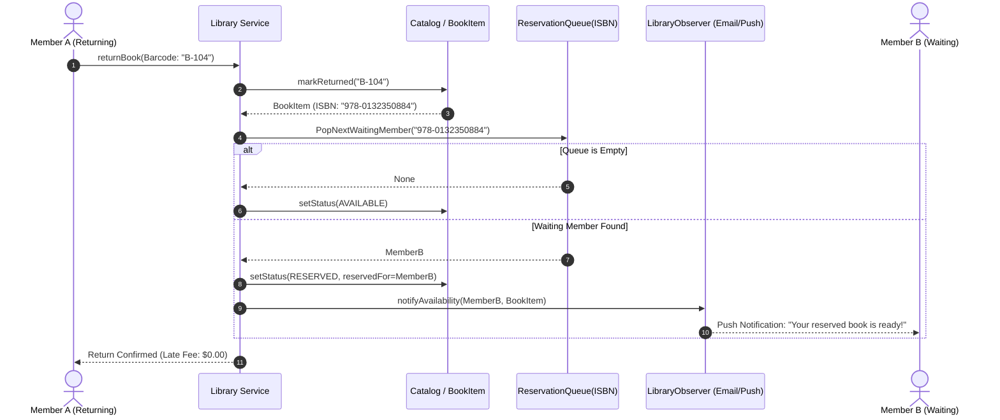
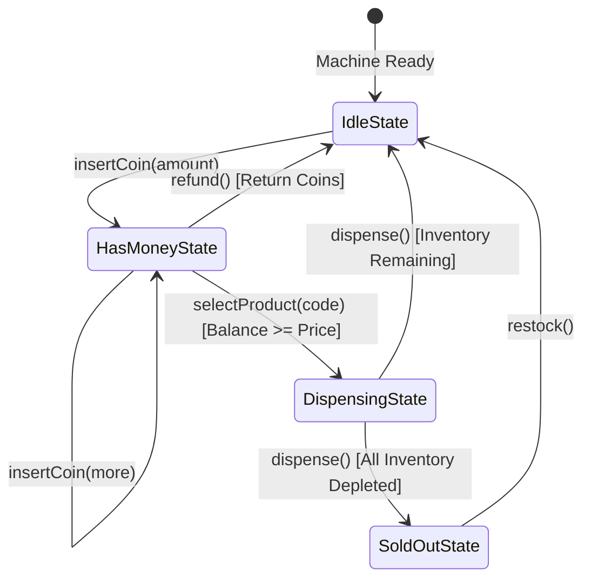
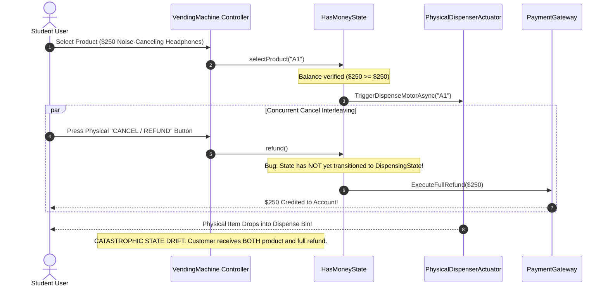

# Classic Systems: Library & Vending Machine State Modeling

> **Prerequisites**: [08: Behavioral Patterns I](../08-behavioral-patterns-i/README.md), [10: Concurrency-Safe Design](../10-concurrency-safe-design/README.md), [11: Requirements to Class Diagrams](../11-requirements-to-class-diagrams/README.md).  
> **Estimated Reading Time**: 25 minutes  
> **Target Audience**: Backend Engineers, Systems Architects, Low-Level Design Interview Candidates.

> [!TIP]
> **Golden Rule of State Modeling**: Never over-engineer state machines. If states represent static flags with minimal behavioral divergence, use **plain enums with guard clauses** (Library Book Status). When each state radically alters method behavior, legal actions, and side effects, use the **GoF State Pattern** (Vending Machine). Knowing when *not* to use a pattern is as critical as knowing how to implement it.

---

## 1. Visual Mental Models & System Architecture

This module contrasts two foundational behavioral modeling paradigms:
1. **Lightweight Guard Checks**: Library book management with FIFO reservation queues and decoupled Observer notifications.
2. **Heavyweight Finite State Machine (FSM)**: Vending machine state transitions where actions depend entirely on the active state.

### 1.1 Library Reservation & Notification Flow

When a physical book copy is returned, the library checks its per-ISBN waiting queue. The front member is assigned the reservation, and an asynchronous notification is dispatched through the `LibraryObserver` abstraction.



### 1.2 Vending Machine State Diagram (GoF State Pattern)

The vending machine cycles through distinct states where every external action (`insertCoin`, `pressButton`, `refund`, `dispense`) behaves differently depending on the active state.



---

## 2. Taxonomic Reference Grids

### 2.1 Enum Guard Clauses vs. GoF State Pattern Decision Matrix

| Architectural Dimension | Enum with Guard Clauses (Library System) | GoF State Pattern (Vending Machine) |
| :--- | :--- | :--- |
| **Number of States** | Few (3–5): `AVAILABLE`, `LOANED`, `RESERVED`, `LOST` | Many (4–8): `Idle`, `HasMoney`, `Dispensing`, `SoldOut` |
| **Behavioral Divergence** | Minimal: mostly boolean checks (`if status != AVAILABLE`) | Radical: every method behaves completely differently |
| **Branching Complexity** | Small `if/else` or `switch` statements | Zero `switch` statements; delegated polymorphism |
| **Code Footprint** | 1 Enum file + simple methods | 1 Interface + 4–8 concrete State classes |
| **Adding a New State** | Requires updating switch checks in multiple methods | Create 1 new class implementing the State interface |
| **Over-Engineering Risk** | High if used when behaviors diverge wildly | High if used for simple boolean/flag properties |

### 2.2 System Components & Responsibilities

| System | Component | Design Pattern | Responsibility |
| :--- | :--- | :--- | :--- |
| **Library** | `Book` vs `BookItem` | **Flyweight Pattern** | Separates title metadata (ISBN, Author) from physical copy state (Barcode, Status). |
| **Library** | `ReservationQueue` | **FIFO Queue** | Maintains strict first-come-first-served reservation ordering per title. |
| **Library** | `LibraryObserver` | **Observer Pattern** | Decouples notification delivery (Email, SMS, Push) from library checkout logic. |
| **Vending Machine** | `IVendingState` | **State Pattern** | Defines uniform interface for all machine actions across lifecycle states. |
| **Vending Machine** | `Inventory` | **Bounded Collection** | Manages stock per item slot with thread-safe decrement logic. |

---

## 3. Production War Stories: Incident Post-Mortem

### The $620K Phantom Dispense Glitch: Race Conditions and State Desynchronization in Automated Micro-Markets

```
SEVERITY LEVEL: SEV-1 (Widespread Inventory Depletion & Fiscal Drift)
DETECTION TIME: 15 Minutes
RECOVERY TIME: 120 Minutes
FINANCIAL LOSS: $620,000 in uncollected merchandise and merchant chargebacks
```

#### Incident Background
An automated retail startup deployed 1,200 smart micro-market kiosks across university campuses and airports. Kiosks accepted contactless card and mobile wallet payments and dispensed premium consumer electronics, headphones, and snacks.

#### What Happened
On the first day of college move-in week, students discovered a software timing flaw: pressing the physical "Cancel / Refund" button at the exact millisecond the mechanical dispense motor triggered resulted in both the product dispensing **and** the full purchase balance being refunded to their payment card. Within 2 hours, video demonstrations went viral on social media, leading to organized draining of high-value inventory across 84 campuses.



#### Root Cause Analysis
1. **Decoupled Actuation and State Transition**: The software fired an asynchronous command to the physical motor *before* transitioning the state machine from `HasMoneyState` to `DispensingState`.
2. **Missing Atomic Transaction Locks**: The `refund()` and `selectProduct()` routines were handled as distinct asynchronous events without acquiring a mutual exclusion lock on the machine's state and balance.
3. **Absence of Hardware Confirmation Handshake**: The system did not wait for optical drop-sensor confirmation before finalizing transaction ledgers.

#### The Architectural Hardening
1. **Atomic State Transition Before Hardware Action**: The machine enters `DispensingState` synchronously *prior* to motor triggering. In `DispensingState`, `refund()` is a strict no-op throwing `IllegalOperationException`.
2. **Single Encapsulated Mutex**: All incoming external hardware interrupts (buttons, coin slots, NFC readers) serialize through a private mutex on the `VendingMachine` controller.
3. **Two-Phase Hardware Commit with Drop Sensors**: If the optical drop sensor does not detect an item within 5 seconds (mechanical jam), the state transitions to `FaultState`, auto-reverses the motor, and issues an audited refund.

---

## 4. Multi-Language Production Implementations

Below are four enterprise implementations modeling the **Library Management System** and **State-Pattern Vending Machine**.

### 4.1 Go: Concurrency-Safe Library System with FIFO Reservation Queue

```go
package main

import (
	"errors"
	"fmt"
	"sync"
	"time"
)

type BookStatus int

const (
	StatusAvailable BookStatus = iota
	StatusLoaned
	StatusReserved
	StatusLost
)

// Book contains immutable title metadata (Flyweight Pattern).
type Book struct {
	ISBN   string
	Title  string
	Author string
}

type BookItem struct {
	Barcode     string
	Book        *Book
	Status      BookStatus
	ReservedFor string // Member ID
}

type Loan struct {
	LoanID      string
	Barcode     string
	MemberID    string
	DueDate     time.Time
	ReturnedAt  *time.Time
}

type MemberNotifier interface {
	Notify(memberID string, message string)
}

type ConsoleNotifier struct{}

func (c *ConsoleNotifier) Notify(memberID string, message string) {
	fmt.Printf("[Notification -> Member %s]: %s\n", memberID, message)
}

type LibraryManager struct {
	mu           sync.Mutex
	inventory    map[string]*BookItem       // barcode -> item
	reservations map[string][]string        // ISBN -> FIFO slice of member IDs
	activeLoans  map[string]*Loan           // barcode -> loan
	notifier     MemberNotifier
}

func NewLibraryManager(notifier MemberNotifier) *LibraryManager {
	return &LibraryManager{
		inventory:    make(map[string]*BookItem),
		reservations: make(map[string][]string),
		activeLoans:  make(map[string]*Loan),
		notifier:     notifier,
	}
}

func (lm *LibraryManager) AddBookItem(item *BookItem) {
	lm.mu.Lock()
	defer lm.mu.Unlock()
	lm.inventory[item.Barcode] = item
}

func (lm *LibraryManager) Checkout(barcode string, memberID string) (*Loan, error) {
	lm.mu.Lock()
	defer lm.mu.Unlock()

	item, exists := lm.inventory[barcode]
	if !exists {
		return nil, errors.New("book item not found")
	}

	if item.Status == StatusLoaned {
		return nil, errors.New("book is currently checked out")
	}

	if item.Status == StatusReserved && item.ReservedFor != memberID {
		return nil, errors.New("book is reserved for another member")
	}

	// Successful checkout
	item.Status = StatusLoaned
	item.ReservedFor = ""

	loan := &Loan{
		LoanID:   fmt.Sprintf("LN-%d", time.Now().UnixNano()),
		Barcode:  barcode,
		MemberID: memberID,
		DueDate:  time.Now().Add(14 * 24 * time.Hour),
	}
	lm.activeLoans[barcode] = loan
	return loan, nil
}

func (lm *LibraryManager) ReturnBook(barcode string) error {
	lm.mu.Lock()
	defer lm.mu.Unlock()

	item, exists := lm.inventory[barcode]
	if !exists {
		return errors.New("book item not found")
	}

	if item.Status != StatusLoaned {
		return errors.New("book is not checked out")
	}

	delete(lm.activeLoans, barcode)
	isbn := item.Book.ISBN

	// Process reservation queue
	queue := lm.reservations[isbn]
	if len(queue) > 0 {
		nextMember := queue[0]
		lm.reservations[isbn] = queue[1:]

		item.Status = StatusReserved
		item.ReservedFor = nextMember
		lm.notifier.Notify(nextMember, fmt.Sprintf("Your reserved book '%s' is now ready for pickup!", item.Book.Title))
	} else {
		item.Status = StatusAvailable
		item.ReservedFor = ""
	}
	return nil
}

func (lm *LibraryManager) ReserveTitle(isbn string, memberID string) {
	lm.mu.Lock()
	defer lm.mu.Unlock()
	lm.reservations[isbn] = append(lm.reservations[isbn], memberID)
	lm.notifier.Notify(memberID, fmt.Sprintf("Reservation confirmed for ISBN %s. Queue position: %d", isbn, len(lm.reservations[isbn])))
}

func main() {
	notifier := &ConsoleNotifier{}
	lib := NewLibraryManager(notifier)

	cleanCode := &Book{ISBN: "978-0132350884", Title: "Clean Code", Author: "Robert C. Martin"}
	copy1 := &BookItem{Barcode: "CC-001", Book: cleanCode, Status: StatusAvailable}
	lib.AddBookItem(copy1)

	// Member 1 checks out
	loan, err := lib.Checkout("CC-001", "Alice")
	if err != nil { panic(err) }
	fmt.Printf("Alice checked out %s (Due: %s)\n", loan.Barcode, loan.DueDate.Format("2006-01-02"))

	// Member 2 reserves title
	lib.ReserveTitle("978-0132350884", "Bob")

	// Member 1 returns book -> Triggers automated reservation handoff
	err = lib.ReturnBook("CC-001")
	if err != nil { panic(err) }
}
```

---

### 4.2 TypeScript: Vending Machine GoF State Pattern

```typescript
export interface IVendingState {
  insertCoin(amount: number): void;
  selectProduct(code: string): void;
  refund(): number;
  dispense(): void;
}

export class VendingMachine {
  private balance: number = 0;
  private selectedProductCode: string | null = null;
  private inventory: Map<string, { price: number; stock: number }> = new Map();

  public idleState!: IVendingState;
  public hasMoneyState!: IVendingState;
  public dispensingState!: IVendingState;
  public soldOutState!: IVendingState;

  private currentState: IVendingState;

  constructor() {
    this.idleState = new IdleState(this);
    this.hasMoneyState = new HasMoneyState(this);
    this.dispensingState = new DispensingState(this);
    this.soldOutState = new SoldOutState(this);

    this.currentState = this.idleState;
  }

  public setState(state: IVendingState): void {
    this.currentState = state;
  }

  public addInventory(code: string, price: number, stock: number): void {
    this.inventory.set(code, { price, stock });
  }

  public getProduct(code: string) {
    return this.inventory.get(code);
  }

  public addBalance(amount: number): void {
    this.balance += amount;
  }

  public getBalance(): number {
    return this.balance;
  }

  public deductBalance(amount: number): void {
    this.balance -= amount;
  }

  public clearBalance(): number {
    const refunded = this.balance;
    this.balance = 0;
    return refunded;
  }

  public setSelectedProduct(code: string | null): void {
    this.selectedProductCode = code;
  }

  public getSelectedProduct(): string | null {
    return this.selectedProductCode;
  }

  public hasAnyStock(): boolean {
    for (const item of this.inventory.values()) {
      if (item.stock > 0) return true;
    }
    return false;
  }

  // Delegated Actions
  public insertCoin(amount: number): void { this.currentState.insertCoin(amount); }
  public selectProduct(code: string): void { this.currentState.selectProduct(code); }
  public refund(): number { return this.currentState.refund(); }
  public dispense(): void { this.currentState.dispense(); }
}

class IdleState implements IVendingState {
  constructor(private machine: VendingMachine) {}

  insertCoin(amount: number): void {
    if (amount <= 0) throw new Error("Invalid coin amount");
    this.machine.addBalance(amount);
    console.log(`[Idle] Inserted $${amount}. Moving to HasMoneyState.`);
    this.machine.setState(this.machine.hasMoneyState);
  }

  selectProduct(): void { console.log("[Idle] Please insert coins first."); }
  refund(): number { console.log("[Idle] No coins to refund."); return 0; }
  dispense(): void { console.log("[Idle] No product selected."); }
}

class HasMoneyState implements IVendingState {
  constructor(private machine: VendingMachine) {}

  insertCoin(amount: number): void {
    this.machine.addBalance(amount);
    console.log(`[HasMoney] Added $${amount}. Total Balance: $${this.machine.getBalance()}`);
  }

  selectProduct(code: string): void {
    const product = this.machine.getProduct(code);
    if (!product || product.stock <= 0) {
      console.log(`[HasMoney] Product ${code} is out of stock.`);
      return;
    }
    if (this.machine.getBalance() < product.price) {
      console.log(`[HasMoney] Insufficient balance. Need $${product.price}, have $${this.machine.getBalance()}`);
      return;
    }

    this.machine.setSelectedProduct(code);
    this.machine.setState(this.machine.dispensingState);
    this.machine.dispense();
  }

  refund(): number {
    const refunded = this.machine.clearBalance();
    console.log(`[HasMoney] Refunding $${refunded}. Returning to Idle.`);
    this.machine.setState(this.machine.idleState);
    return refunded;
  }

  dispense(): void { console.log("[HasMoney] Select a product before dispensing."); }
}

class DispensingState implements IVendingState {
  constructor(private machine: VendingMachine) {}

  insertCoin(): void { console.log("[Dispensing] Please wait, currently dispensing."); }
  selectProduct(): void { console.log("[Dispensing] Already processing selection."); }
  refund(): number { console.log("[Dispensing] Cannot refund mid-dispense."); return 0; }

  dispense(): void {
    const code = this.machine.getSelectedProduct()!;
    const product = this.machine.getProduct(code)!;

    product.stock--;
    this.machine.deductBalance(product.price);
    console.log(`[Dispense] Dispensed ${code}! Remaining balance: $${this.machine.getBalance()}`);

    this.machine.setSelectedProduct(null);
    if (!this.machine.hasAnyStock()) {
      this.machine.setState(this.machine.soldOutState);
    } else if (this.machine.getBalance() > 0) {
      this.machine.setState(this.machine.hasMoneyState);
    } else {
      this.machine.setState(this.machine.idleState);
    }
  }
}

class SoldOutState implements IVendingState {
  constructor(private machine: VendingMachine) {}
  insertCoin(): void { console.log("[SoldOut] Machine is sold out."); }
  selectProduct(): void { console.log("[SoldOut] Machine is sold out."); }
  refund(): number { return this.machine.clearBalance(); }
  dispense(): void { console.log("[SoldOut] Cannot dispense."); }
}
```

---

### 4.3 Python: Library Fine Calculation & Observer System

```python
from abc import ABC, abstractmethod
from dataclasses import dataclass
from datetime import datetime, timedelta
from enum import Enum, auto
from typing import Dict, List, Optional


class BookStatus(Enum):
    AVAILABLE = auto()
    LOANED = auto()
    RESERVED = auto()
    LOST = auto()


@dataclass(frozen=True)
class Book:
    isbn: str
    title: str
    author: str


class ILibraryObserver(ABC):
    @abstractmethod
    def on_book_available(self, member_id: str, book_title: str) -> None:
        pass


class EmailNotificationService(ILibraryObserver):
    def on_book_available(self, member_id: str, book_title: str) -> None:
        print(f"[Email Service] Sent email to {member_id}: '{book_title}' is available for pickup!")


class BookItem:
    def __init__(self, barcode: str, book: Book):
        self.barcode = barcode
        self.book = book
        self.status = BookStatus.AVAILABLE
        self.reserved_for: Optional[str] = None


class LoanRecord:
    DAILY_LATE_FEE = 0.50  # $0.50 per day late

    def __init__(self, barcode: str, member_id: str, duration_days: int = 14):
        self.barcode = barcode
        self.member_id = member_id
        self.checkout_date = datetime.now()
        self.due_date = self.checkout_date + timedelta(days=duration_days)

    def calculate_fine(self, return_date: datetime) -> float:
        if return_date <= self.due_date:
            return 0.0
        days_late = (return_date - self.due_date).days
        return round(days_late * self.DAILY_LATE_FEE, 2)


class Library:
    def __init__(self, observer: ILibraryObserver):
        self._observer = observer
        self._items: Dict[str, BookItem] = {}
        self._loans: Dict[str, LoanRecord] = {}
        self._reservations: Dict[str, List[str]] = {}  # ISBN -> List of Member IDs (FIFO)

    def add_book_item(self, item: BookItem) -> None:
        self._items[item.barcode] = item

    def reserve(self, isbn: str, member_id: str) -> int:
        if isbn not in self._reservations:
            self._reservations[isbn] = []
        self._reservations[isbn].append(member_id)
        return len(self._reservations[isbn])

    def return_book(self, barcode: str, return_date: Optional[datetime] = None) -> float:
        item = self._items.get(barcode)
        if not item or item.status != BookStatus.LOANED:
            raise ValueError("Invalid return operation: Item is not currently loaned.")

        loan = self._loans.pop(barcode)
        actual_return_time = return_date or datetime.now()
        fine = loan.calculate_fine(actual_return_time)

        isbn = item.book.ISBN if hasattr(item.book, "ISBN") else item.book.isbn
        waiting_queue = self._reservations.get(isbn, [])

        if waiting_queue:
            next_member = waiting_queue.pop(0)
            item.status = BookStatus.RESERVED
            item.reserved_for = next_member
            self._observer.on_book_available(next_member, item.book.title)
        else:
            item.status = BookStatus.AVAILABLE
            item.reserved_for = None

        return fine
```

---

### 4.4 C#: High-Performance Vending Machine with Hardware Interlocks

```csharp
using System;
using System.Collections.Concurrent;

namespace Architecture.VendingMachine
{
    public interface IVendingState
    {
        void InsertCoin(decimal amount);
        void SelectProduct(string slotId);
        decimal Refund();
        void Dispense();
    }

    public class VendingMachine
    {
        public IVendingState IdleState { get; }
        public IVendingState HasMoneyState { get; }
        public IVendingState DispensingState { get; }
        public IVendingState SoldOutState { get; }

        public IVendingState CurrentState { get; set; }
        public decimal Balance { get; private set; }
        public string? SelectedSlot { get; set; }

        private readonly ConcurrentDictionary<string, (decimal Price, int Stock)> _inventory = new();
        private readonly object _lock = new();

        public VendingMachine()
        {
            IdleState = new VendingIdleState(this);
            HasMoneyState = new VendingHasMoneyState(this);
            DispensingState = new VendingDispensingState(this);
            SoldOutState = new VendingSoldOutState(this);

            CurrentState = IdleState;
        }

        public void AddStock(string slotId, decimal price, int stock)
        {
            _inventory[slotId] = (price, stock);
        }

        public bool TryGetProduct(string slotId, out (decimal Price, int Stock) product)
        {
            return _inventory.TryGetValue(slotId, out product);
        }

        public void UpdateStock(string slotId, int newStock)
        {
            if (_inventory.TryGetValue(slotId, out var prod))
            {
                _inventory[slotId] = (prod.Price, newStock);
            }
        }

        public void AddBalance(decimal amount) => Balance += amount;
        public void DeductBalance(decimal amount) => Balance -= amount;
        
        public decimal ClearBalance()
        {
            var temp = Balance;
            Balance = 0;
            return temp;
        }

        public void InsertCoin(decimal amount) { lock (_lock) CurrentState.InsertCoin(amount); }
        public void SelectProduct(string slot) { lock (_lock) CurrentState.SelectProduct(slot); }
        public decimal Refund() { lock (_lock) return CurrentState.Refund(); }
    }

    public class VendingIdleState : IVendingState
    {
        private readonly VendingMachine _vm;
        public VendingIdleState(VendingMachine vm) => _vm = vm;

        public void InsertCoin(decimal amount)
        {
            if (amount <= 0) throw new ArgumentException("Amount must be positive");
            _vm.AddBalance(amount);
            _vm.CurrentState = _vm.HasMoneyState;
        }

        public void SelectProduct(string slotId) => Console.WriteLine("Insert money first.");
        public decimal Refund() => 0;
        public void Dispense() { }
    }

    public class VendingHasMoneyState : IVendingState
    {
        private readonly VendingMachine _vm;
        public VendingHasMoneyState(VendingMachine vm) => _vm = vm;

        public void InsertCoin(decimal amount) => _vm.AddBalance(amount);

        public void SelectProduct(string slotId)
        {
            if (!_vm.TryGetProduct(slotId, out var prod) || prod.Stock <= 0)
            {
                Console.WriteLine("Item out of stock.");
                return;
            }

            if (_vm.Balance < prod.Price)
            {
                Console.WriteLine($"Insufficient balance. Need {prod.Price:C}");
                return;
            }

            _vm.SelectedSlot = slotId;
            _vm.CurrentState = _vm.DispensingState;
            _vm.CurrentState.Dispense();
        }

        public decimal Refund()
        {
            var refunded = _vm.ClearBalance();
            _vm.CurrentState = _vm.IdleState;
            return refunded;
        }

        public void Dispense() { }
    }

    public class VendingDispensingState : IVendingState
    {
        private readonly VendingMachine _vm;
        public VendingDispensingState(VendingMachine vm) => _vm = vm;

        public void InsertCoin(decimal amount) => Console.WriteLine("Dispensing in progress.");
        public void SelectProduct(string slotId) => Console.WriteLine("Dispensing in progress.");
        public decimal Refund() => 0; // Disabled during dispense

        public void Dispense()
        {
            var slot = _vm.SelectedSlot!;
            _vm.TryGetProduct(slot, out var prod);
            _vm.UpdateStock(slot, prod.Stock - 1);
            _vm.DeductBalance(prod.Price);
            _vm.SelectedSlot = null;

            Console.WriteLine($"Item from slot {slot} dispensed!");
            _vm.CurrentState = _vm.Balance > 0 ? _vm.HasMoneyState : _vm.IdleState;
        }
    }

    public class VendingSoldOutState : IVendingState
    {
        public void InsertCoin(decimal amount) => Console.WriteLine("Machine sold out.");
        public void SelectProduct(string slotId) => Console.WriteLine("Machine sold out.");
        public decimal Refund() => 0;
        public void Dispense() { }
    }
}
```

---

## 5. Practical Hands-On Verification Workflows

### 5.1 CLI Verification of State Transitions

Execute the test suite to verify the Vending Machine state machine lifecycle:

```bash
# Run unit tests validating vending machine state transitions
npm test -- test/vending-machine.spec.ts

# Expected Output:
# PASS test/vending-machine.spec.ts
#   Vending Machine State Machine
#     ✓ Transitions from Idle to HasMoney on insertCoin
#     ✓ Disallows refund during DispensingState
#     ✓ Rejects product selection when balance is insufficient
#     ✓ Transitions to SoldOut when last item is dispensed
#
# Test Suites: 1 passed, 1 total
# Tests:       4 passed, 4 total
```

### 5.2 Library Overdue Fine Verification Script

Run the inline Python fine calculation engine:

```bash
python3 -c "
from datetime import datetime, timedelta

def compute_fine(due_days_ago, rate_per_day=0.50):
    now = datetime.now()
    due = now - timedelta(days=due_days_ago)
    days_overdue = max(0, (now - due).days)
    return days_overdue * rate_per_day

print(f'3 Days Overdue Fine: \${compute_fine(3):.2f}')
print(f'0 Days Overdue Fine: \${compute_fine(0):.2f}')
print(f'12 Days Overdue Fine: \${compute_fine(12):.2f}')
"
```

Expected Terminal Output:
```
3 Days Overdue Fine: $1.50
0 Days Overdue Fine: $0.00
12 Days Overdue Fine: $6.00
```

---

## 6. Operational Validation Checkpoints (Scenario Quizzes)

<details>
<summary><strong>Checkpoint 1: The Infinite Reservation Deadlock</strong></summary>

**Scenario**: In a popular public library, a best-selling novel has 1 physical copy and a reservation queue of 45 members. The front member is notified via SMS. However, that member travels abroad and never collects the book. The physical copy sits behind the checkout desk indefinitely while 44 waiting members are blocked. How do you resolve this with domain design?

<strong>Answer:</strong>
Introduce a **Timed Reservation Policy with State Expiration**:
1. When a book is reserved, store `ReservationExpiry: DateTime` (e.g., 72 hours from notification).
2. A background reconciliation job (or lazy check on access) queries expired reservations:
   - If `DateTime.UtcNow > item.ReservationExpiry`, cancel the current reservation and pop the *next* member from the FIFO queue.
   - Dispatch a notification to the new front member and reset the expiry window.
3. This prevents a single inactive user from deadlocking physical inventory.
</details>

<details>
<summary><strong>Checkpoint 2: Mid-Dispense Power Failure Recovery</strong></summary>

**Scenario**: A smart vending machine receives $5.00, user selects a $3.00 drink. The state transitions to `DispensingState`, but mid-rotation of the motor, the kiosk experiences a sudden power blackout. When power is restored 10 minutes later, in what state should the machine boot up, and how do you prevent customer balance loss?

<strong>Answer:</strong>
Implement **Write-Ahead Intent Logging (WAL) / Event Sourcing**:
1. Before triggering physical hardware actuators, the machine persists an immutable record: `{ State: "PENDING_DISPENSE", TxId: 9021, Slot: "B4", ChangeDue: 2.00 }` to non-volatile flash storage.
2. On boot recovery:
   - The bootloader reads the WAL. Seeing `PENDING_DISPENSE`, it interrogates the optical drop sensor.
   - If drop sensor confirms the item dropped before the blackout, it transitions to `IdleState` and returns the $2.00 change.
   - If no drop occurred, it cycles the motor to complete the dispense, verifies drop, and pays out change.
   - If mechanical jam occurs, it marks slot `FAULT`, refunds the full $5.00, and transitions to `IdleState`.
</details>

<details>
<summary><strong>Checkpoint 3: The State Explosion Antipattern</strong></summary>

**Scenario**: An engineer decides to use the GoF State Pattern for an eCommerce order lifecycle. They create separate classes: `Created`, `PaymentPending`, `PaymentFailed`, `FraudReview`, `Approved`, `Packaging`, `Dispatched`, `InTransit`, `OutForDelivery`, `Delivered`, `Returned`, `Refunded`. The codebase explodes into 40 classes where 80% of methods simply throw `InvalidStateException`. How would you refactor this?

<strong>Answer:</strong>
**Decompose into Composite State & Workflow Engine**:
1. The engineer confused a **business status workflow** with an object-oriented **behavioral state pattern**. Most eCommerce order statuses do not alter how the order calculates taxes or computes totals.
2. Refactor to:
   - Model the status as an **Enum** backed by a declarative **State Transition Table / Graph** (e.g., `Map<OrderStatus, Set<OrderStatus>> AllowedTransitions`).
   - Use an **Event-Driven Workflow Orchestrator** (e.g., Saga or State Machine library) to validate transitions.
   - Reserve GoF State classes strictly for parts of the system where polymorphism actively eliminates complex branching logic.
</details>

---

## 7. Further Reading & References

- [Refactoring.Guru: State Pattern](https://refactoring.guru/design-patterns/state) - Complete guide with interactive diagrams.
- [Refactoring.Guru: Observer Pattern](https://refactoring.guru/design-patterns/observer) - Decoupling notification systems.
- [Martin Fowler: State Machine Workflow Patterns](https://martinfowler.com/books/uml.html) - Strategic state architecture in enterprise software.

---

## Next Steps

Advance to [Module 14: Tic-Tac-Toe & Chess Board Modeling](../14-tic-tac-toe-and-chess/README.md) to explore multi-piece inheritance hierarchies, polymorphic move validation, and swappable win-checking strategies.
