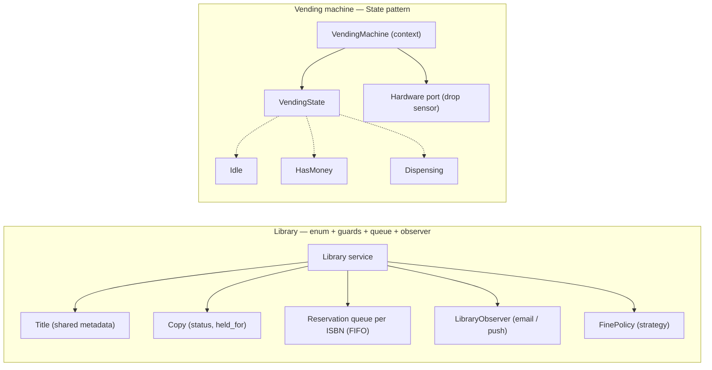
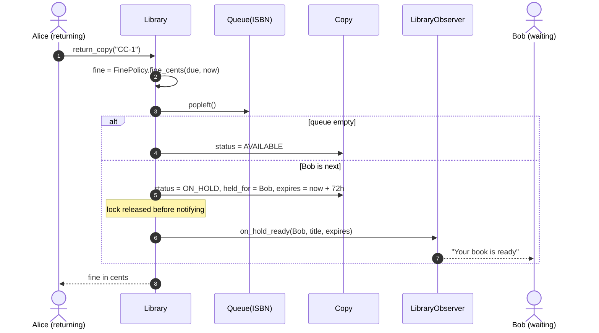
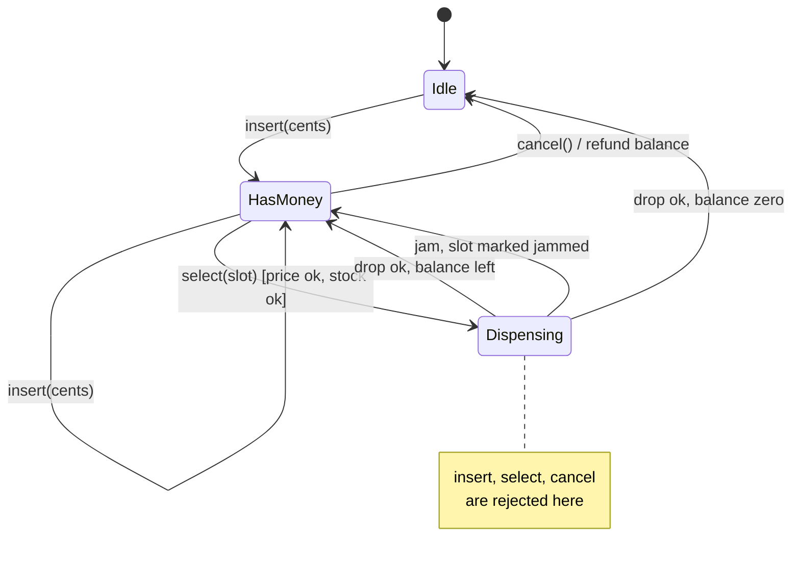
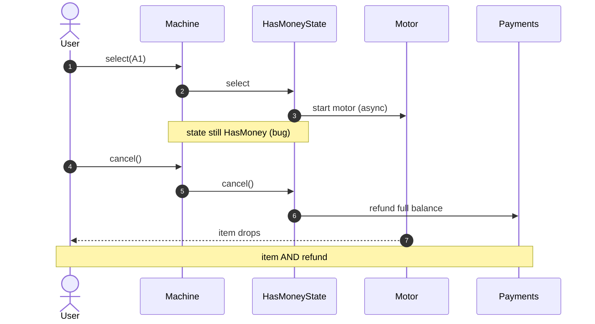

# Classic LLD: Library Management & Vending Machine

> **Prerequisites:** [08 · Behavioral Patterns I](../08-behavioral-patterns-i/README.md), [10 · Concurrency-Safe Design](../10-concurrency-safe-design/README.md), [11 · Requirements to Class Diagrams](../11-requirements-to-class-diagrams/README.md), [12 · Parking Lot & Elevator](../12-parking-lot-and-elevator/README.md)  
> **Reading time:** ~30 minutes  
> **Audience:** LLD / machine-coding rounds — "model the lifecycle without `if` soup"

> [!NOTE]
> **In one line:** The **library** is a *status + queue + observer* problem (an enum with guard clauses is enough); the **vending machine** is a *behavior-changes-with-mode* problem (the **State pattern** earns its keep). The interview is really asking: *"Can you tell which one you are looking at?"*

> [!TIP]
> **Golden rule:** Pick the lightest tool that removes the branching you actually have. Few states + same behavior → **enum + guards**. Every method behaves differently per state → **State objects**. Knowing when *not* to use a pattern is graded as hard as knowing how.

> [!TIP]
> **Try it:** Sketch both halves in [LLD Studio](/tools/lld-studio/) — a class diagram for `Title / Copy / Loan / Library` and a state diagram for the machine — then run the Python examples below.

---

## 1. Interview pressure

Interviewer: *"Design a library system: members borrow physical copies, can reserve a title that is out, get notified when it is ready, and pay late fines. Then — design a vending machine: insert money, pick a slot, get the item and change."*

Two problems, one trap. If you reach for the State pattern on the library, you create 40 classes that mostly throw. If you reach for `if status == ...` on the vending machine, every method becomes a 6-way `switch` that one engineer will eventually break.

**Clarify first (ask these out loud):**

| Question | Why it changes the design |
| :--- | :--- |
| Is a *title* the same as a *copy*? | Reservations are per title; checkouts are per copy |
| Reservation expiry? Max loans? Fine cap? | Policies must be injectable, not hard-coded |
| Do notifications block checkout? | Observer + after-lock dispatch |
| Money in coins, bills, cards? Can it give change? | Scope of the vending machine |
| Is dispensing hardware slow or fallible? | Drives the Dispensing state and jam handling |



---

## 2. Comparison matrix (memorize this)

### Enum + guard clauses vs State pattern

| Dimension | Enum + guards (Library copy) | State pattern (Vending machine) |
| :--- | :--- | :--- |
| **State count** | 3–5 flags (`Available`, `Loaned`, `OnHold`, `Lost`) | 3–8 modes with real behavior |
| **Behavior per state** | Mostly *accept / reject* | Every operation does something *different* |
| **Adding a state** | Touch a few `if`s | New class + transitions |
| **Failure mode** | Guard forgotten in one method | State explosion of classes that only throw |
| **Rule of thumb** | A status *label* | A status that *changes what methods do* |

### What lives where (library)

| Concept | Class | Pattern / idea | Why |
| :--- | :--- | :--- | :--- |
| Book metadata (ISBN, name) | `Title` | Immutable, shared (Flyweight-ish) | 50 copies must not duplicate metadata |
| One physical book | `Copy` | Entity with `status`, `held_for` | Checkout and hold apply per copy |
| Waiting members | `deque` per ISBN | FIFO queue | Fairness; reservation is per **title** |
| Late fine | `FinePolicy` | Strategy | Student vs staff vs holiday rules |
| Notify member | `LibraryObserver` | Observer | Email, push, SMS without editing `Library` |
| Time | `clock()` / `TimeProvider` | Injected dependency | Expiry and fines are untestable otherwise |

### What lives where (vending)

| Concept | Class | Pattern / idea |
| :--- | :--- | :--- |
| Mode of the machine | `Idle / HasMoney / Dispensing` | State (stateless singletons) |
| Balance, slots, selected slot | `VendingMachine` | Context owns data; states own behavior |
| Physical drop | `Hardware.drop(slot)` | Port / Adapter — fakeable in tests |
| Mutual exclusion | One lock on the machine | Coin slot, keypad, cancel all serialize |

---

## 3. Walkthrough A — Library

**Requirements**

1. A `Title` has many `Copy` objects; members borrow **copies**, reserve **titles**.
2. Max 3 loans per member, 14-day loan. Late fine via a `FinePolicy`.
3. Reserving is only allowed when **no copy is available** (otherwise just borrow).
4. On return: next member in the FIFO queue gets an `ON_HOLD` copy for 72 hours and is notified. No queue → `AVAILABLE`.
5. A lapsed hold passes to the next member. Notifications must **not** run while holding the library lock.

**Invariant to state out loud:** *an `AVAILABLE` copy implies the title's queue is empty.* Every path that frees a copy (`return`, hold expiry, `add_copy`) goes through one `_promote` method, so the invariant has one home.



````carousel
```python
from __future__ import annotations

import math
import threading
from abc import ABC, abstractmethod
from collections import defaultdict, deque
from dataclasses import dataclass
from datetime import datetime, timedelta
from enum import Enum, auto
from typing import Callable


class CopyStatus(Enum):
    AVAILABLE = auto()
    LOANED = auto()
    ON_HOLD = auto()  # waiting for one specific member to collect
    LOST = auto()


@dataclass(frozen=True)
class Title:  # immutable and shared by every copy
    isbn: str
    name: str


@dataclass
class Copy:  # one physical book
    barcode: str
    title: Title
    status: CopyStatus = CopyStatus.AVAILABLE
    held_for: str | None = None
    hold_expires: datetime | None = None


@dataclass(frozen=True)
class Loan:
    barcode: str
    member_id: str
    due: datetime


class LibraryError(Exception):
    pass


class LibraryObserver(ABC):
    @abstractmethod
    def on_hold_ready(self, member_id: str, title: Title, expires: datetime) -> None: ...


class FinePolicy(ABC):
    @abstractmethod
    def fine_cents(self, due: datetime, returned: datetime) -> int: ...


class PerDayFine(FinePolicy):
    def __init__(self, cents_per_day: int = 50, cap_cents: int = 2000) -> None:
        self._rate, self._cap = cents_per_day, cap_cents

    def fine_cents(self, due: datetime, returned: datetime) -> int:
        if returned <= due:
            return 0
        late_days = math.ceil((returned - due).total_seconds() / 86400)
        return min(late_days * self._rate, self._cap)


class Library:
    MAX_LOANS, LOAN_DAYS, HOLD_HOURS = 3, 14, 72

    def __init__(
        self,
        fines: FinePolicy,
        observers: list[LibraryObserver] | None = None,
        clock: Callable[[], datetime] = datetime.now,
    ) -> None:
        self._fines, self._observers, self._now = fines, list(observers or []), clock
        self._lock = threading.RLock()
        self._copies: dict[str, Copy] = {}
        self._loans: dict[str, Loan] = {}  # barcode -> loan
        self._member_loans: dict[str, set[str]] = defaultdict(set)
        self._queues: dict[str, deque[str]] = defaultdict(deque)  # isbn -> FIFO members

    # ── commands ────────────────────────────────────────────────────
    def add_copy(self, copy: Copy) -> None:
        events: list = []
        with self._lock:
            self._copies[copy.barcode] = copy
            self._promote(copy, events)  # a waiting member may already exist
        self._fire(events)

    def reserve(self, isbn: str, member_id: str) -> int:
        with self._lock:
            copies = [c for c in self._copies.values() if c.title.isbn == isbn]
            if not copies:
                raise LibraryError("unknown title")
            if any(c.status is CopyStatus.AVAILABLE for c in copies):
                raise LibraryError("a copy is available - borrow it instead")
            queue = self._queues[isbn]
            held = any(c.held_for == member_id for c in copies)
            if member_id in queue or held:
                raise LibraryError("already reserved")
            queue.append(member_id)
            return len(queue)  # 1-based queue position

    def checkout(self, barcode: str, member_id: str) -> Loan:
        events: list = []
        with self._lock:
            self._expire_holds(events)
            copy = self._copies.get(barcode)
            if copy is None:
                raise LibraryError("unknown copy")
            if copy.status in (CopyStatus.LOANED, CopyStatus.LOST):
                raise LibraryError(f"copy is {copy.status.name}")
            if copy.status is CopyStatus.ON_HOLD and copy.held_for != member_id:
                raise LibraryError("copy is held for another member")
            if len(self._member_loans[member_id]) >= self.MAX_LOANS:
                raise LibraryError("loan limit reached")
            loan = Loan(barcode, member_id, self._now() + timedelta(days=self.LOAN_DAYS))
            copy.status, copy.held_for, copy.hold_expires = CopyStatus.LOANED, None, None
            self._loans[barcode] = loan
            self._member_loans[member_id].add(barcode)
        self._fire(events)  # expiry may have promoted someone
        return loan

    def return_copy(self, barcode: str) -> int:
        events: list = []
        with self._lock:
            loan = self._loans.pop(barcode, None)
            if loan is None:
                raise LibraryError("copy is not on loan")
            self._member_loans[loan.member_id].discard(barcode)
            fine = self._fines.fine_cents(loan.due, self._now())
            self._promote(self._copies[barcode], events)
        self._fire(events)  # never notify while holding the lock
        return fine

    # ── internals (call with the lock held) ─────────────────────────
    def _promote(self, copy: Copy, events: list) -> None:
        queue = self._queues[copy.title.isbn]
        if queue:
            member = queue.popleft()
            expires = self._now() + timedelta(hours=self.HOLD_HOURS)
            copy.status, copy.held_for, copy.hold_expires = CopyStatus.ON_HOLD, member, expires
            events.append((member, copy.title, expires))
        else:
            copy.status, copy.held_for, copy.hold_expires = CopyStatus.AVAILABLE, None, None

    def _expire_holds(self, events: list) -> None:
        now = self._now()
        for copy in self._copies.values():
            if copy.status is CopyStatus.ON_HOLD and copy.hold_expires <= now:
                self._promote(copy, events)  # lapsed member simply drops out

    def _fire(self, events: list) -> None:
        for member, title, expires in events:
            for observer in list(self._observers):  # copy: subscribers may change
                observer.on_hold_ready(member, title, expires)


if __name__ == "__main__":
    now = [datetime(2026, 1, 1, 9, 0)]

    class Inbox(LibraryObserver):
        def __init__(self) -> None:
            self.sent: list[str] = []

        def on_hold_ready(self, member_id, title, expires) -> None:
            self.sent.append(member_id)

    inbox = Inbox()
    lib = Library(PerDayFine(), [inbox], clock=lambda: now[0])
    clean = Title("978-0132350884", "Clean Code")
    lib.add_copy(Copy("CC-1", clean))

    lib.checkout("CC-1", "alice")
    assert lib.reserve(clean.isbn, "bob") == 1
    now[0] += timedelta(days=17)  # due day 14 -> 3 days late
    assert lib.return_copy("CC-1") == 150  # 3 days x 50c
    assert inbox.sent == ["bob"]

    try:
        lib.checkout("CC-1", "carol")  # Bob's hold
        raise SystemExit("carol should be blocked")
    except LibraryError:
        pass

    now[0] += timedelta(hours=73)  # Bob never shows up
    lib.checkout("CC-1", "carol")  # lapsed hold -> AVAILABLE -> carol can borrow
    print("library ok")
```
<!-- slide -->
```csharp
using System;
using System.Collections.Generic;
using System.Linq;

namespace Lld.Library;

public enum CopyStatus { Available, Loaned, OnHold, Lost }

public sealed record Title(string Isbn, string Name);

public sealed class Copy(string barcode, Title title)
{
    public string Barcode { get; } = barcode;
    public Title Title { get; } = title;
    public CopyStatus Status { get; set; } = CopyStatus.Available;
    public string? HeldFor { get; set; }
    public DateTimeOffset? HoldExpires { get; set; }
}

public sealed record Loan(string Barcode, string MemberId, DateTimeOffset Due);

public sealed class LibraryException(string message) : Exception(message);

public interface ILibraryObserver
{
    void OnHoldReady(string memberId, Title title, DateTimeOffset expires);
}

public interface IFinePolicy
{
    int FineCents(DateTimeOffset due, DateTimeOffset returned);
}

public sealed class PerDayFine(int centsPerDay = 50, int capCents = 2000) : IFinePolicy
{
    public int FineCents(DateTimeOffset due, DateTimeOffset returned)
    {
        if (returned <= due) return 0;
        var lateDays = (int)Math.Ceiling((returned - due).TotalDays);
        return Math.Min(lateDays * centsPerDay, capCents);
    }
}

public sealed class Library(IFinePolicy fines, IEnumerable<ILibraryObserver> observers, TimeProvider time)
{
    private const int MaxLoans = 3, LoanDays = 14, HoldHours = 72;

    private readonly object _gate = new();
    private readonly Dictionary<string, Copy> _copies = new();
    private readonly Dictionary<string, Loan> _loans = new();
    private readonly Dictionary<string, HashSet<string>> _memberLoans = new();
    private readonly Dictionary<string, Queue<string>> _queues = new();

    public void AddCopy(Copy copy)
    {
        var events = new List<(string Member, Title Title, DateTimeOffset Expires)>();
        lock (_gate)
        {
            _copies[copy.Barcode] = copy;
            Promote(copy, events); // a waiting member may already exist
        }
        Fire(events);
    }

    public int Reserve(string isbn, string memberId)
    {
        lock (_gate)
        {
            var copies = _copies.Values.Where(c => c.Title.Isbn == isbn).ToList();
            if (copies.Count == 0) throw new LibraryException("unknown title");
            if (copies.Any(c => c.Status == CopyStatus.Available))
                throw new LibraryException("a copy is available - borrow it instead");

            var queue = QueueFor(isbn);
            if (queue.Contains(memberId) || copies.Any(c => c.HeldFor == memberId))
                throw new LibraryException("already reserved");
            queue.Enqueue(memberId);
            return queue.Count; // 1-based queue position
        }
    }

    public Loan Checkout(string barcode, string memberId)
    {
        var events = new List<(string, Title, DateTimeOffset)>();
        Loan loan;
        lock (_gate)
        {
            ExpireHolds(events);
            if (!_copies.TryGetValue(barcode, out var copy)) throw new LibraryException("unknown copy");
            if (copy.Status is CopyStatus.Loaned or CopyStatus.Lost)
                throw new LibraryException($"copy is {copy.Status}");
            if (copy.Status == CopyStatus.OnHold && copy.HeldFor != memberId)
                throw new LibraryException("copy is held for another member");

            var mine = MemberLoans(memberId);
            if (mine.Count >= MaxLoans) throw new LibraryException("loan limit reached");

            loan = new Loan(barcode, memberId, time.GetUtcNow().AddDays(LoanDays));
            copy.Status = CopyStatus.Loaned;
            copy.HeldFor = null;
            copy.HoldExpires = null;
            _loans[barcode] = loan;
            mine.Add(barcode);
        }
        Fire(events);
        return loan;
    }

    public int ReturnCopy(string barcode)
    {
        var events = new List<(string, Title, DateTimeOffset)>();
        int fine;
        lock (_gate)
        {
            if (!_loans.Remove(barcode, out var loan)) throw new LibraryException("copy is not on loan");
            MemberLoans(loan.MemberId).Remove(barcode);
            fine = fines.FineCents(loan.Due, time.GetUtcNow());
            Promote(_copies[barcode], events);
        }
        Fire(events); // never notify while holding the lock
        return fine;
    }

    // ── internals (call with _gate held) ────────────────────────────
    private void Promote(Copy copy, List<(string, Title, DateTimeOffset)> events)
    {
        var queue = QueueFor(copy.Title.Isbn);
        if (queue.Count > 0)
        {
            var member = queue.Dequeue();
            var expires = time.GetUtcNow().AddHours(HoldHours);
            copy.Status = CopyStatus.OnHold;
            copy.HeldFor = member;
            copy.HoldExpires = expires;
            events.Add((member, copy.Title, expires));
        }
        else
        {
            copy.Status = CopyStatus.Available;
            copy.HeldFor = null;
            copy.HoldExpires = null;
        }
    }

    private void ExpireHolds(List<(string, Title, DateTimeOffset)> events)
    {
        var now = time.GetUtcNow();
        foreach (var copy in _copies.Values)
            if (copy.Status == CopyStatus.OnHold && copy.HoldExpires <= now)
                Promote(copy, events); // lapsed member simply drops out
    }

    private Queue<string> QueueFor(string isbn) =>
        _queues.TryGetValue(isbn, out var q) ? q : _queues[isbn] = new Queue<string>();

    private HashSet<string> MemberLoans(string member) =>
        _memberLoans.TryGetValue(member, out var s) ? s : _memberLoans[member] = new HashSet<string>();

    private void Fire(IEnumerable<(string Member, Title Title, DateTimeOffset Expires)> events)
    {
        foreach (var (member, title, expires) in events)
            foreach (var observer in observers)
                observer.OnHoldReady(member, title, expires);
    }
}

public static class Program
{
    private sealed class ManualTime(DateTimeOffset start) : TimeProvider
    {
        private DateTimeOffset _now = start;
        public void Advance(TimeSpan by) => _now += by;
        public override DateTimeOffset GetUtcNow() => _now;
    }

    private sealed class Inbox : ILibraryObserver
    {
        public List<string> Sent { get; } = new();
        public void OnHoldReady(string memberId, Title title, DateTimeOffset expires) => Sent.Add(memberId);
    }

    public static void Main()
    {
        var time = new ManualTime(new DateTimeOffset(2026, 1, 1, 9, 0, 0, TimeSpan.Zero));
        var inbox = new Inbox();
        var lib = new Library(new PerDayFine(), new[] { inbox }, time);
        var clean = new Title("978-0132350884", "Clean Code");
        lib.AddCopy(new Copy("CC-1", clean));

        lib.Checkout("CC-1", "alice");
        if (lib.Reserve(clean.Isbn, "bob") != 1) throw new Exception("queue position");
        time.Advance(TimeSpan.FromDays(17)); // due day 14 -> 3 days late
        if (lib.ReturnCopy("CC-1") != 150) throw new Exception("fine");
        if (!inbox.Sent.SequenceEqual(new[] { "bob" })) throw new Exception("notify");

        try { lib.Checkout("CC-1", "carol"); throw new Exception("carol should be blocked"); }
        catch (LibraryException) { }

        time.Advance(TimeSpan.FromHours(73)); // Bob never shows up
        lib.Checkout("CC-1", "carol");
        Console.WriteLine("library ok");
    }
}
```
````

**Extension points:** weekend/holiday fines → new `FinePolicy`; SMS → new `LibraryObserver`; premium members with 10 loans → inject a `LoanLimitPolicy`. `Library` is closed to all three.

---

## 4. Walkthrough B — Vending machine (State pattern)

**Requirements**

1. Insert money, pick a slot, receive the item, keep the change.
2. `cancel` refunds the balance — but **never** once the motor is running.
3. The drop sensor can report failure (jam); the customer keeps their balance.
4. All inputs (coin slot, keypad, cancel button, sensor callback) are concurrent hardware interrupts.



**The one rule that prevents the famous bug:** the state flips to `Dispensing` **before** the hardware is touched, under the same lock that `cancel()` takes. The slow hardware call runs *outside* the lock so the machine stays responsive, but while in `Dispensing` the only legal input is the sensor result.

````carousel
```python
from __future__ import annotations

import threading
from abc import ABC, abstractmethod
from dataclasses import dataclass


class IllegalAction(Exception):
    pass


class Hardware(ABC):  # port: the optical drop sensor is real; tests fake it
    @abstractmethod
    def drop(self, slot_id: str) -> bool: ...


@dataclass
class Slot:
    price_cents: int
    qty: int
    jammed: bool = False


class VendingState(ABC):
    """Default = reject. Concrete states override only what they allow."""

    def insert(self, m: "VendingMachine", cents: int) -> None:
        raise IllegalAction(f"{type(self).__name__}: cannot insert")

    def select(self, m: "VendingMachine", slot_id: str) -> None:
        raise IllegalAction(f"{type(self).__name__}: cannot select")

    def cancel(self, m: "VendingMachine") -> int:
        raise IllegalAction(f"{type(self).__name__}: cannot cancel")

    def on_drop_result(self, m: "VendingMachine", ok: bool) -> None:
        raise IllegalAction(f"{type(self).__name__}: unexpected sensor event")


class IdleState(VendingState):
    def insert(self, m, cents):
        m.balance += cents
        m.state = HAS_MONEY

    def cancel(self, m):
        return 0  # nothing to refund


class HasMoneyState(VendingState):
    def insert(self, m, cents):
        m.balance += cents

    def select(self, m, slot_id):
        slot = m.slots.get(slot_id)
        if slot is None or slot.qty <= 0 or slot.jammed:
            raise IllegalAction("slot unavailable")
        if m.balance < slot.price_cents:
            raise IllegalAction(f"need {slot.price_cents - m.balance} more cents")
        m.selected = slot_id
        m.state = DISPENSING  # flip BEFORE any hardware call

    def cancel(self, m):
        refund, m.balance = m.balance, 0
        m.state = IDLE
        return refund


class DispensingState(VendingState):
    def on_drop_result(self, m, ok):
        slot = m.slots[m.selected]
        if ok:
            slot.qty -= 1
            m.balance -= slot.price_cents
        else:
            slot.jammed = True  # customer keeps their balance
        m.selected = None
        m.state = HAS_MONEY if m.balance > 0 else IDLE


IDLE, HAS_MONEY, DISPENSING = IdleState(), HasMoneyState(), DispensingState()  # stateless singletons


class VendingMachine:
    def __init__(self, hardware: Hardware, slots: dict[str, Slot]) -> None:
        self._hw, self.slots = hardware, slots
        self._lock = threading.Lock()
        self.balance, self.selected, self.state = 0, None, IDLE

    def insert(self, cents: int) -> None:
        if cents <= 0:
            raise ValueError("coin must be positive")
        with self._lock:
            self.state.insert(self, cents)

    def cancel(self) -> int:
        with self._lock:
            return self.state.cancel(self)

    def select(self, slot_id: str) -> bool:
        with self._lock:
            self.state.select(self, slot_id)  # already Dispensing when this returns
            job = self.selected
        ok = self._hw.drop(job)  # slow I/O outside the lock
        with self._lock:
            self.state.on_drop_result(self, ok)
        return ok


if __name__ == "__main__":
    class FakeHardware(Hardware):
        def __init__(self, ok: bool = True) -> None:
            self.ok, self.during_drop = ok, None

        def drop(self, slot_id: str) -> bool:
            if self.during_drop:
                self.during_drop()  # a button press mid-motor
            return self.ok

    hw = FakeHardware()
    vm = VendingMachine(hw, {"A1": Slot(150, 2), "B1": Slot(100, 1)})

    vm.insert(100)
    vm.insert(100)
    try:
        vm.select("ZZ")
        raise SystemExit("unknown slot must fail")
    except IllegalAction:
        pass

    blocked = []

    def press_cancel() -> None:
        try:
            vm.cancel()
        except IllegalAction:
            blocked.append(True)

    hw.during_drop = press_cancel
    assert vm.select("A1") is True
    assert blocked == [True], "cancel mid-dispense must be rejected"
    assert vm.cancel() == 50, "change after a 150c item from 200c"
    assert vm.slots["A1"].qty == 1

    hw.during_drop, hw.ok = None, False  # jam
    vm.insert(100)
    assert vm.select("B1") is False and vm.slots["B1"].jammed
    assert vm.cancel() == 100, "jam keeps the customer's money"
    print("vending ok")
```
<!-- slide -->
```csharp
using System;
using System.Collections.Generic;

namespace Lld.Vending;

public sealed class IllegalActionException(string message) : Exception(message);

public interface IHardware
{
    bool Drop(string slotId); // true = drop sensor saw the item fall
}

public sealed class Slot(int priceCents, int qty)
{
    public int PriceCents { get; } = priceCents;
    public int Qty { get; set; } = qty;
    public bool Jammed { get; set; }
}

public abstract class VendingState
{
    public virtual void Insert(VendingMachine m, int cents) => Reject("insert");
    public virtual void Select(VendingMachine m, string slotId) => Reject("select");
    public virtual int Cancel(VendingMachine m) { Reject("cancel"); return 0; }
    public virtual void OnDropResult(VendingMachine m, bool ok) => Reject("sensor event");

    private void Reject(string action) =>
        throw new IllegalActionException($"{GetType().Name}: cannot {action}");
}

public sealed class IdleState : VendingState
{
    public override void Insert(VendingMachine m, int cents)
    {
        m.Balance += cents;
        m.State = VendingMachine.HasMoney;
    }

    public override int Cancel(VendingMachine m) => 0;
}

public sealed class HasMoneyState : VendingState
{
    public override void Insert(VendingMachine m, int cents) => m.Balance += cents;

    public override void Select(VendingMachine m, string slotId)
    {
        if (!m.Slots.TryGetValue(slotId, out var slot) || slot.Qty <= 0 || slot.Jammed)
            throw new IllegalActionException("slot unavailable");
        if (m.Balance < slot.PriceCents)
            throw new IllegalActionException($"need {slot.PriceCents - m.Balance} more cents");

        m.Selected = slotId;
        m.State = VendingMachine.Dispensing; // flip BEFORE any hardware call
    }

    public override int Cancel(VendingMachine m)
    {
        var refund = m.Balance;
        m.Balance = 0;
        m.State = VendingMachine.Idle;
        return refund;
    }
}

public sealed class DispensingState : VendingState
{
    public override void OnDropResult(VendingMachine m, bool ok)
    {
        var slot = m.Slots[m.Selected!];
        if (ok)
        {
            slot.Qty--;
            m.Balance -= slot.PriceCents;
        }
        else
        {
            slot.Jammed = true; // customer keeps their balance
        }
        m.Selected = null;
        m.State = m.Balance > 0 ? VendingMachine.HasMoney : VendingMachine.Idle;
    }
}

public sealed class VendingMachine(IHardware hardware, Dictionary<string, Slot> slots)
{
    public static readonly VendingState Idle = new IdleState();
    public static readonly VendingState HasMoney = new HasMoneyState();
    public static readonly VendingState Dispensing = new DispensingState();

    private readonly object _gate = new();

    public Dictionary<string, Slot> Slots { get; } = slots;
    public VendingState State { get; set; } = Idle;
    public int Balance { get; set; }
    public string? Selected { get; set; }

    public void Insert(int cents)
    {
        if (cents <= 0) throw new ArgumentOutOfRangeException(nameof(cents));
        lock (_gate) State.Insert(this, cents);
    }

    public int Cancel()
    {
        lock (_gate) return State.Cancel(this);
    }

    public bool Select(string slotId)
    {
        string job;
        lock (_gate)
        {
            State.Select(this, slotId); // already Dispensing when this returns
            job = Selected!;
        }

        var ok = hardware.Drop(job); // slow I/O outside the lock

        lock (_gate) State.OnDropResult(this, ok);
        return ok;
    }
}

public static class Program
{
    private sealed class FakeHardware : IHardware
    {
        public bool Ok = true;
        public Action? DuringDrop;

        public bool Drop(string slotId)
        {
            DuringDrop?.Invoke(); // a button press mid-motor
            return Ok;
        }
    }

    public static void Main()
    {
        var hw = new FakeHardware();
        var vm = new VendingMachine(hw, new() { ["A1"] = new Slot(150, 2), ["B1"] = new Slot(100, 1) });

        vm.Insert(100);
        vm.Insert(100);
        try { vm.Select("ZZ"); throw new Exception("unknown slot must fail"); }
        catch (IllegalActionException) { }

        var blocked = false;
        hw.DuringDrop = () =>
        {
            try { vm.Cancel(); }
            catch (IllegalActionException) { blocked = true; }
        };
        if (!vm.Select("A1")) throw new Exception("drop failed");
        if (!blocked) throw new Exception("cancel mid-dispense must be rejected");
        if (vm.Cancel() != 50) throw new Exception("change");
        if (vm.Slots["A1"].Qty != 1) throw new Exception("stock");

        hw.DuringDrop = null;
        hw.Ok = false; // jam
        vm.Insert(100);
        if (vm.Select("B1") || !vm.Slots["B1"].Jammed) throw new Exception("jam handling");
        if (vm.Cancel() != 100) throw new Exception("jam keeps the money");
        Console.WriteLine("vending ok");
    }
}
```
````

**Why `SoldOut` is not a state here:** "slot empty" is data on `Slot`, not a different *mode of the machine*. A global sold-out state only helps if the whole machine behaves differently (for example, refuses coins). Say that trade-off aloud — it shows you are not pattern-hunting.

---

## 5. Concurrency & edge cases

| # | Scenario | Risk | Mitigation |
| :--- | :--- | :--- | :--- |
| 1 | Two members check out the same copy | Both see `AVAILABLE` | One lock around read-check-write; status flip inside it |
| 2 | Return + reserve interleave | Member queued behind an already-free copy | Invariant: `AVAILABLE ⇒ queue empty`; `reserve` rejects when a copy is free |
| 3 | Observer is slow or throws | Library lock held; checkout stalls | Collect events under the lock, fire **after** release |
| 4 | Hold lapses while nobody calls the library | Copy stuck `ON_HOLD` | Lazy `_expire_holds` on every command **plus** a periodic sweeper |
| 5 | Same member reserves twice | Double queue entry | Reject if in queue **or** already holding a copy |
| 6 | Fine uses wall clock | Untestable, DST bugs | Inject `clock` / `TimeProvider`; store UTC |
| 7 | Cancel during dispense | Item **and** refund (see war story) | State flips first; `Dispensing.cancel` rejects |
| 8 | Hardware jams | Money taken, no item | `on_drop_result(False)` keeps balance, marks slot jammed |
| 9 | Power loss mid-dispense | Unknown outcome on reboot | Write intent (`PENDING_DISPENSE`, slot, balance) to non-volatile storage before the motor; reconcile with the drop sensor on boot |
| 10 | Coin value ≤ 0 or float money | Negative balance, rounding | Validate input; store **integer cents** |

---

## 6. War story — refund while the motor runs

A kiosk fleet fired the dispense motor asynchronously and moved the machine to `Dispensing` only **after** the hardware ACK. Pressing **Cancel** inside that window ran `HasMoneyState.cancel()` — the balance was refunded to the card while the motor still dropped the item. Videos went viral; stock drained across campuses.



**Fix:** transition to `Dispensing` **synchronously, under the lock, before** touching hardware; `Dispensing.cancel` throws. Only the sensor callback may leave that state. Add a watchdog: no sensor event in N seconds → treat as jam → refund and mark the slot faulty.

---

## 7. Anti-patterns

| Smell | Fix |
| :--- | :--- |
| State pattern for `AVAILABLE / LOANED` | Enum + guards; states that only throw are noise |
| `switch (status)` in every vending method | State objects; one class per mode |
| `Library` calls `EmailService` directly | Observer interface; add channels without editing `Library` |
| Notifying inside the lock | Collect events, release, then fire |
| Hard-coded `0.50` per day | `FinePolicy` strategy; money as integer cents |
| `datetime.now()` sprinkled everywhere | Inject the clock; tests control time |
| `Book` class with `status` and `isbn` per copy | Split `Title` (shared) from `Copy` (state) |
| States hold the balance | Context owns data; states own behavior and stay stateless |

---

## 8. What you'd say in two minutes

> "I'd split the problem. In the library, a **Title** is shared metadata and a **Copy** carries status, so reservations are per title and checkouts per copy. Status has four labels with simple accept/reject rules, so I'd keep an **enum with guards** — a State class per label would just be classes that throw. Returns, expiry and new copies all go through one `_promote` that preserves the invariant *available means nobody is waiting*. Fines are a **Strategy**, notifications an **Observer** fired *after* the lock, and the clock is injected.
>
> The vending machine is different: insert, select and cancel genuinely mean different things in Idle, HasMoney and Dispensing, so I'd use the **State pattern** with the machine as the context owning balance and slots. Everything serializes on one lock. The key rule is flipping to Dispensing *before* touching hardware, with the slow drop call outside the lock, so Cancel mid-motor is rejected — that is the refund-plus-item bug. Jam keeps the balance; money is integer cents."

---

## 9. Interview questions

<details>
<summary><strong>1. Why enum for the library but State pattern for the vending machine? [BASIC]</strong></summary>

A copy's status mostly gates *whether* an action is allowed; the code for checkout is the same. The vending machine changes what `insert`, `select` and `cancel` *do* per mode. Use State when behavior diverges, an enum when it is a label.

</details>

<details>
<summary><strong>2. Why separate `Title` from `Copy`? [BASIC]</strong></summary>

Reservations apply to any copy of a title; checkouts and holds apply to one physical copy. Splitting avoids duplicated metadata and models who is waiting for *what*.

</details>

<details>
<summary><strong>3. Where do you notify the member, and why not inside `return_copy`'s lock? [TRICKY]</strong></summary>

Collect `(member, title, expires)` under the lock and fire after releasing it. An email gateway that takes seconds or throws would otherwise block every checkout and could deadlock if an observer calls back into the library.

</details>

<details>
<summary><strong>4. A member never collects their hold. What happens? [SCENARIO]</strong></summary>

`hold_expires` is stored with the copy. Every command lazily calls `_expire_holds`, and a scheduled sweeper does it proactively. The lapsed member is dropped and `_promote` offers the copy to the next in the FIFO queue or marks it `AVAILABLE`.

</details>

<details>
<summary><strong>5. User presses Cancel as the motor starts. [SCENARIO]</strong></summary>

State is `Dispensing` before hardware is touched, under the machine lock. `Dispensing.cancel` throws `IllegalAction`. The hardware call itself runs outside the lock, so the machine stays responsive but cannot be re-entered.

</details>

<details>
<summary><strong>6. How would you add card payments to the vending machine? [SCENARIO]</strong></summary>

Add a `PaymentMethod` strategy/port feeding `insert`-equivalent credit into the same `balance`, or add an `AwaitingAuthorization` state if authorization is asynchronous. Existing states do not change — only a transition from `Idle`.

</details>

<details>
<summary><strong>7. Power fails mid-dispense. What state does the machine boot into? [TRICKY]</strong></summary>

Persist an intent record before actuating (`PENDING_DISPENSE`, slot, balance). On boot, read it, check the drop sensor: item dropped → charge and return change; not dropped → retry once; jam → refund and mark the slot faulty. Never infer from RAM.

</details>

<details>
<summary><strong>8. When does State become an anti-pattern? [TRICKY]</strong></summary>

When most state classes throw `InvalidState` and differences are just allowed-transition rules (an order workflow with a dozen statuses). Use an enum plus a transition table, or a workflow engine; keep State classes where polymorphism removes real branching.

</details>

---

## 10. One-page cheat sheet

```text
LIBRARY
  Title (shared, immutable)  vs  Copy (status, held_for, hold_expires)
  Queue per ISBN (FIFO)      Reserve only if no copy AVAILABLE
  Invariant                  AVAILABLE  =>  queue empty
  Every free-up path         -> _promote(copy, events)
  Locking                    one lock; collect events; notify AFTER release
  Policies                   FinePolicy (strategy), clock injected, money in cents

VENDING
  Context        balance, slots, selected, lock
  States         Idle -> HasMoney -> Dispensing -> HasMoney|Idle   (stateless singletons)
  Rule           flip to Dispensing BEFORE hardware; slow I/O OUTSIDE the lock
  Cancel         refunds only in Idle/HasMoney; rejected in Dispensing
  Jam            keep balance, mark slot jammed;  power loss -> intent log + sensor

Decision test:  "Do the same methods behave differently per status?"
                no  -> enum + guards        yes -> State objects
```

---

## Further reading

- GoF: State, Observer, Strategy
- Refactoring.Guru: [State](https://refactoring.guru/design-patterns/state), [Observer](https://refactoring.guru/design-patterns/observer)
- Martin Fowler, *Patterns of Enterprise Application Architecture* — Lock granularity and transactions

## Next

**[14 · Tic-Tac-Toe & Chess](../14-tic-tac-toe-and-chess/README.md)** — Board vs rules, Strategy-based win checking, and polymorphic chess pieces.
