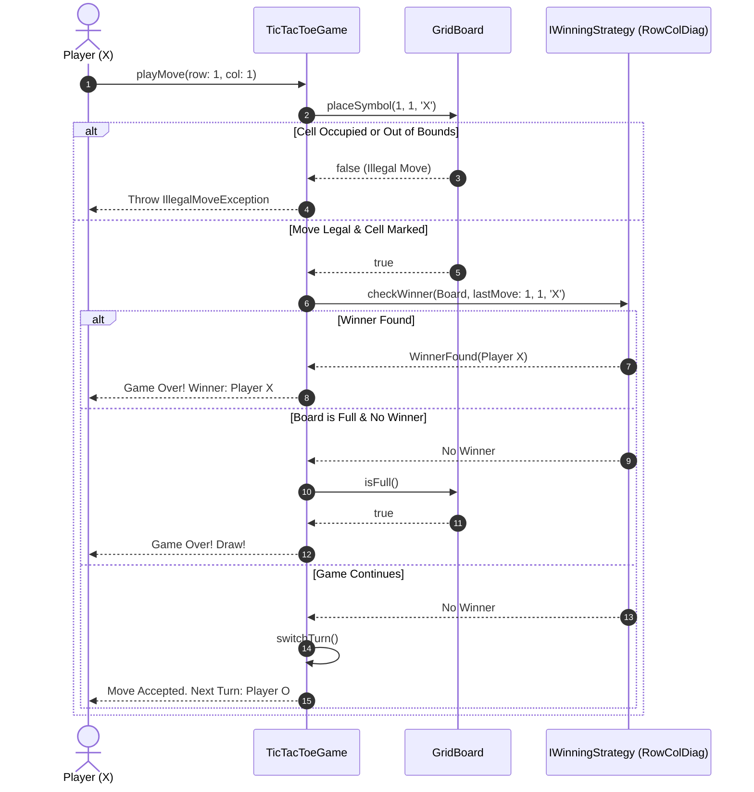
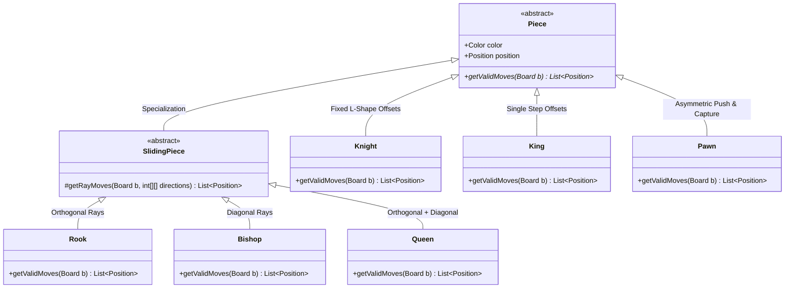
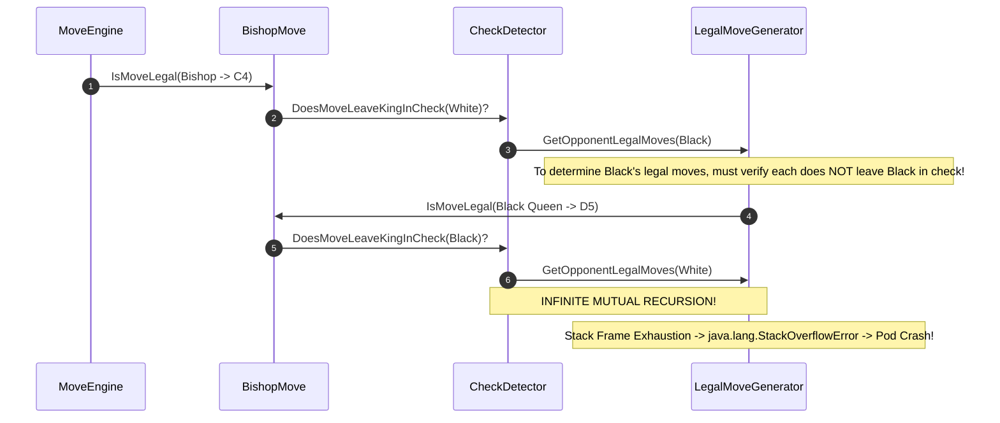

# Classic Systems: Tic-Tac-Toe & Chess Engine Modeling

> **Prerequisites**: [02: OOP Foundations & UML](../02-oop-foundations-and-uml/README.md), [05: Core Design Principles](../05-core-design-principles/README.md), [08: Behavioral Patterns I](../08-behavioral-patterns-i/README.md).  
> **Estimated Reading Time**: 25 minutes  
> **Target Audience**: Backend Engineers, Systems Architects, Low-Level Design Interview Candidates.

> [!TIP]
> **Golden Rule of Board Game Modeling**: Strictly decouple **board geometry and occupancy storage** from **game rules and move evaluation**. In Tic-Tac-Toe, externalize win conditions using the **Strategy Pattern** to keep the board agnostic of winning topologies. In Chess, leverage **pure polymorphism** with an intermediate `SlidingPiece` abstraction to share ray-scanning logic without duplicating obstacle-detection loops across Rooks, Bishops, and Queens.

---

## 1. Visual Mental Models & System Architecture

Modeling two-player turn-based board games tests structural object-oriented modeling, encapsulation of grid constraints, and avoidance of god classes.

### 1.1 Tic-Tac-Toe: Strategy-Driven Win Evaluation

The `Board` is responsible solely for bounds checking and cell marking. Win conditions (standard rows/cols/diagonals vs. $N$-in-a-row or Connect-Four rules) are encapsulated behind the `IWinningStrategy` interface.



### 1.2 Chess: Polymorphic Piece Hierarchy & Ray-Scanning

In Chess, pieces move either by **fixed offsets** (Knight, King) or **directional rays** (Rook, Bishop, Queen). The `SlidingPiece` intermediate class encapsulates ray traversal, stopping at the first obstacle.



---

## 2. Taxonomic Reference Grids

### 2.1 Chess Piece Movement & Complexity Taxonomy

| Piece | Movement Paradigm | Ray Traversal? | Obstacle Behavior | Algorithmic Complexity |
| :--- | :--- | :--- | :--- | :--- |
| **Rook** | Orthogonal ($[ \pm 1, 0 ], [ 0, \pm 1 ]$) | Yes (Up to 7 squares) | Blocked by friendly piece; captures first enemy piece | $\mathcal{O}(N)$ where $N=8$ |
| **Bishop** | Diagonal ($[ \pm 1, \pm 1 ]$) | Yes (Up to 7 squares) | Blocked by friendly piece; captures first enemy piece | $\mathcal{O}(N)$ |
| **Queen** | Orthogonal + Diagonal (8 directions) | Yes (Combined) | Same as Rook + Bishop | $\mathcal{O}(N)$ |
| **Knight** | Fixed 8 L-shapes ($(\pm 1, \pm 2), (\pm 2, \pm 1)$) | No (Jumps over pieces) | Only target square matters (cannot land on friendly) | $\mathcal{O}(1)$ (8 fixed checks) |
| **King** | 8 adjacent squares ($[ \pm 1, \pm 1 ]$, dist $\le 1$) | No | One step; cannot move into checked square | $\mathcal{O}(1)$ (8 fixed checks) |
| **Pawn** | Asymmetric: 1 step forward, diagonal captures | No | Blocked by ANY piece forward; captures only diagonally | $\mathcal{O}(1)$ (4 conditional checks) |

### 2.2 Board Game Architecture Responsibilities

| Responsibility | Tic-Tac-Toe Component | Chess Engine Component | Clean Architecture Invariant |
| :--- | :--- | :--- | :--- |
| **Grid State Storage** | `Board` ($3 \times 3$ matrix) | `Board` ($8 \times 8$ matrix) | Only stores piece locations; never computes game winner. |
| **Position Representation** | `(row, col)` integer pair | `Position` (Immutable Value Object) | Validates $0 \le \text{row}, \text{col} < 8$ upon instantiation. |
| **Move Feasibility** | `Board.isCellEmpty()` | `Piece.getValidMoves(Board)` | Polymorphic: each piece owns its geometry without `switch(type)`. |
| **Win / Check Evaluation** | `IWinningStrategy` | `CheckmateEvaluator` | Decoupled from board data structure; allows pluggable rules. |
| **Turn Lifecycle & State** | `Game` orchestrator | `Game` orchestrator | Manages current player, move history, and termination state. |

---

## 3. Production War Stories: Incident Post-Mortem

### The $1.1M Illegal Move Crash: How a Recursive Check-Detection Loop Stack-Overflowed an Online Chess Championship

```
SEVERITY LEVEL: SEV-1 (Platform Crash in Live Esports Tournament)
DETECTION TIME: 2 Minutes
RECOVERY TIME: 45 Minutes
FINANCIAL & SPONSOR LOSS: $1,100,000 in streaming ad refunds and tournament penalties
```

#### Incident Background
A leading online chess platform hosted the live finals of an international blitz championship with 800,000 concurrent viewers. The match engine evaluated move legality in real time, calculating whether a move left the player's own King in check.

#### What Happened
In Game 4, White moved a Bishop while Black's Queen was pinned to Black's King. Within 50 milliseconds of the move submission, the backend game server node experienced a sudden `java.lang.StackOverflowError`. The WebSocket connection abruptly dropped for both grandmasters, terminating the game broadcast and triggering an automatic disqualification clock bug. Five adjacent quarter-final matches running on the same container pod instantly crashed.



#### Root Cause Analysis
The engineering team implemented check verification with a fatal circular dependency:
1. To determine if Move $M$ is legal, the engine asked: *"Does this move leave my King in check?"*
2. To test if the King is in check, it asked: *"Can any enemy piece legally capture my King?"*
3. To determine if an enemy piece can *legally* capture the King, it invoked `getLegalMoves()` on the opponent.
4. Step 3 re-entered Step 1 for every opponent move to verify that the opponent wasn't in check themselves.
5. In pin situations, this mutual recursion produced an unbounded call stack, crashing the JVM.

#### The Architectural Hardening
1. **Separation of Pseudo-Legal vs. Strictly Legal Moves**:
   - **Pseudo-Legal Move**: A move matching piece movement geometry and board bounds, ignoring whether the King is currently under attack.
   - **Check Detection**: To test if King is attacked at square $(R, C)$, ask: *"Can an enemy Knight reach $(R, C)$ with a knight jump? Can an enemy Rook/Queen reach $(R, C)$ with a ray?"* This requires **zero recursive move generation**.
2. **Cloned Board Simulation**: Apply move $M$ to an ephemeral lightweight board, check if the King square is directly targeted by any enemy ray or offset, and immediately discard the board. Time complexity dropped from exponential $\mathcal{O}(B^D)$ to flat $\mathcal{O}(1)$.

---

## 4. Multi-Language Production Implementations

Below are complete implementations demonstrating clean domain modeling for **Tic-Tac-Toe** and **Chess Engines**.

### 4.1 Go: Clean Tic-Tac-Toe with Strategy-Based Win Checking

```go
package main

import (
	"errors"
	"fmt"
)

type Symbol rune

const (
	Empty Symbol = '-'
	X     Symbol = 'X'
	O     Symbol = 'O'
)

type Board struct {
	size int
	grid [][]Symbol
}

func NewBoard(size int) *Board {
	grid := make([][]Symbol, size)
	for i := range grid {
		grid[i] = make([]Symbol, size)
		for j := range grid[i] {
			grid[i][j] = Empty
		}
	}
	return &Board{size: size, grid: grid}
}

func (b *Board) Place(row, col int, s Symbol) error {
	if row < 0 || row >= b.size || col < 0 || col >= b.size {
		return errors.New("coordinates out of bounds")
	}
	if b.grid[row][col] != Empty {
		return errors.New("cell is already occupied")
	}
	b.grid[row][col] = s
	return nil
}

func (b *Board) IsFull() bool {
	for i := 0; i < b.size; i++ {
		for j := 0; j < b.size; j++ {
			if b.grid[i][j] == Empty {
				return false
			}
		}
	}
	return true
}

type WinningStrategy interface {
	CheckWinner(b *Board, lastRow, lastCol int, s Symbol) bool
}

// StandardLineWinStrategy checks the last played row, col, and diagonals in O(N) time.
type StandardLineWinStrategy struct{}

func (s *StandardLineWinStrategy) CheckWinner(b *Board, row, col int, sym Symbol) bool {
	n := b.size

	// Check row
	winRow := true
	for j := 0; j < n; j++ {
		if b.grid[row][j] != sym {
			winRow = false
			break
		}
	}
	if winRow { return true }

	// Check column
	winCol := true
	for i := 0; i < n; i++ {
		if b.grid[i][col] != sym {
			winCol = false
			break
		}
	}
	if winCol { return true }

	// Check main diagonal
	if row == col {
		winDiag := true
		for i := 0; i < n; i++ {
			if b.grid[i][i] != sym {
				winDiag = false
				break
			}
		}
		if winDiag { return true }
	}

	// Check anti-diagonal
	if row+col == n-1 {
		winAnti := true
		for i := 0; i < n; i++ {
			if b.grid[i][n-1-i] != sym {
				winAnti = false
				break
			}
		}
		if winAnti { return true }
	}

	return false
}

type TicTacToeGame struct {
	board       *Board
	strategy    WinningStrategy
	players     [2]Symbol
	turn        int
	isOver      bool
	winner      Symbol
}

func NewTicTacToeGame(size int, strat WinningStrategy) *TicTacToeGame {
	return &TicTacToeGame{
		board:    NewBoard(size),
		strategy: strat,
		players:  [2]Symbol{X, O},
		turn:     0,
		winner:   Empty,
	}
}

func (g *TicTacToeGame) Play(row, col int) error {
	if g.isOver {
		return errors.New("game has already ended")
	}

	currentSymbol := g.players[g.turn%2]
	if err := g.board.Place(row, col, currentSymbol); err != nil {
		return err
	}

	if g.strategy.CheckWinner(g.board, row, col, currentSymbol) {
		g.isOver = true
		g.winner = currentSymbol
		return nil
	}

	if g.board.IsFull() {
		g.isOver = true
		g.winner = Empty // Draw
		return nil
	}

	g.turn++
	return nil
}

func main() {
	game := NewTicTacToeGame(3, &StandardLineWinStrategy{})
	_ = game.Play(0, 0) // X
	_ = game.Play(1, 0) // O
	_ = game.Play(0, 1) // X
	_ = game.Play(1, 1) // O
	_ = game.Play(0, 2) // X wins!

	fmt.Printf("Game Over! Winner: %c\n", game.winner)
}
```

---

### 4.2 TypeScript: Chess Piece Movement Engine with Sliding Ray Traversal

```typescript
export enum PieceColor {
  WHITE = "WHITE",
  BLACK = "BLACK",
}

export class Position {
  constructor(public readonly row: number, public readonly col: number) {
    if (row < 0 || row >= 8 || col < 0 || col >= 8) {
      throw new Error(`Position (${row}, ${col}) out of 8x8 chessboard bounds`);
    }
  }

  public equals(other: Position): boolean {
    return this.row === other.row && this.col === other.col;
  }
}

export interface IChessBoard {
  getPiece(pos: Position): Piece | null;
  isValidPos(row: number, col: number): boolean;
}

export abstract class Piece {
  constructor(public readonly color: PieceColor, public position: Position) {}

  public abstract getPseudoLegalMoves(board: IChessBoard): Position[];
}

export abstract class SlidingPiece extends Piece {
  protected scanRays(board: IChessBoard, directions: [number, number][]): Position[] {
    const validMoves: Position[] = [];

    for (const [dr, dc] of directions) {
      let r = this.position.row + dr;
      let c = this.position.col + dc;

      while (board.isValidPos(r, c)) {
        const targetPos = new Position(r, c);
        const occupant = board.getPiece(targetPos);

        if (occupant === null) {
          validMoves.push(targetPos);
        } else {
          if (occupant.color !== this.color) {
            validMoves.push(targetPos); // Valid enemy capture
          }
          break; // Ray blocked by first piece encountered
        }

        r += dr;
        c += dc;
      }
    }

    return validMoves;
  }
}

export class Rook extends SlidingPiece {
  public getPseudoLegalMoves(board: IChessBoard): Position[] {
    const orthogonal: [number, number][] = [
      [1, 0], [-1, 0], [0, 1], [0, -1],
    ];
    return this.scanRays(board, orthogonal);
  }
}

export class Bishop extends SlidingPiece {
  public getPseudoLegalMoves(board: IChessBoard): Position[] {
    const diagonal: [number, number][] = [
      [1, 1], [1, -1], [-1, 1], [-1, -1],
    ];
    return this.scanRays(board, diagonal);
  }
}

export class Queen extends SlidingPiece {
  public getPseudoLegalMoves(board: IChessBoard): Position[] {
    const allDirections: [number, number][] = [
      [1, 0], [-1, 0], [0, 1], [0, -1],
      [1, 1], [1, -1], [-1, 1], [-1, -1],
    ];
    return this.scanRays(board, allDirections);
  }
}

export class Knight extends Piece {
  public getPseudoLegalMoves(board: IChessBoard): Position[] {
    const validMoves: Position[] = [];
    const offsets: [number, number][] = [
      [-2, -1], [-2, 1], [-1, -2], [-1, 2],
      [1, -2], [1, 2], [2, -1], [2, 1],
    ];

    for (const [dr, dc] of offsets) {
      const r = this.position.row + dr;
      const c = this.position.col + dc;

      if (board.isValidPos(r, c)) {
        const targetPos = new Position(r, c);
        const occupant = board.getPiece(targetPos);
        if (occupant === null || occupant.color !== this.color) {
          validMoves.push(targetPos);
        }
      }
    }

    return validMoves;
  }
}
```

---

### 4.3 Python: Polymorphic Chess Movement & Board Verification

```python
from abc import ABC, abstractmethod
from dataclasses import dataclass
from enum import Enum
from typing import List, Optional, Tuple


class Color(Enum):
    WHITE = 1
    BLACK = 2


@dataclass(frozen=True)
class Position:
    row: int
    col: int

    def __post_init__(self):
        if not (0 <= self.row < 8 and 0 <= self.col < 8):
            raise ValueError(f"Position ({self.row}, {self.col}) out of bounds")


class Piece(ABC):
    def __init__(self, color: Color, pos: Position):
        self.color = color
        self.pos = pos

    @abstractmethod
    def valid_moves(self, board: "ChessBoard") -> List[Position]:
        pass


class SlidingPiece(Piece, ABC):
    def _scan_directions(self, board: "ChessBoard", dirs: List[Tuple[int, int]]) -> List[Position]:
        moves = []
        for dr, dc in dirs:
            r, c = self.pos.row + dr, self.pos.col + dc
            while 0 <= r < 8 and 0 <= c < 8:
                target_pos = Position(r, c)
                occupant = board.get_piece(target_pos)
                if occupant is None:
                    moves.append(target_pos)
                else:
                    if occupant.color != self.color:
                        moves.append(target_pos)  # Enemy capture
                    break  # Ray terminates
                r += dr
                c += dc
        return moves


class Rook(SlidingPiece):
    def valid_moves(self, board: "ChessBoard") -> List[Position]:
        return self._scan_directions(board, [(1, 0), (-1, 0), (0, 1), (0, -1)])


class Bishop(SlidingPiece):
    def valid_moves(self, board: "ChessBoard") -> List[Position]:
        return self._scan_directions(board, [(1, 1), (1, -1), (-1, 1), (-1, -1)])


class ChessBoard:
    def __init__(self):
        self._grid: List[List[Optional[Piece]]] = [[None for _ in range(8)] for _ in range(8)]

    def get_piece(self, pos: Position) -> Optional[Piece]:
        return self._grid[pos.row][pos.col]

    def place_piece(self, piece: Piece) -> None:
        self._grid[piece.pos.row][piece.pos.col] = piece

    def move_piece(self, src: Position, dst: Position) -> bool:
        piece = self.get_piece(src)
        if not piece or dst not in piece.valid_moves(self):
            return False

        self._grid[src.row][src.col] = None
        piece.pos = dst
        self._grid[dst.row][dst.col] = piece
        return True
```

---

### 4.4 C#: Immutable Position Struct & Board Engine

```csharp
using System;
using System.Collections.Generic;

namespace Architecture.ChessEngine
{
    public enum Color { White, Black }

    public readonly struct Position : IEquatable<Position>
    {
        public int Row { get; }
        public int Col { get; }

        public Position(int row, int col)
        {
            if (row < 0 || row >= 8 || col < 0 || col >= 8)
                throw new ArgumentOutOfRangeException($"Coordinates ({row},{col}) are invalid.");
            Row = row;
            Col = col;
        }

        public bool Equals(Position other) => Row == other.Row && Col == other.Col;
        public override bool Equals(object? obj) => obj is Position other && Equals(other);
        public override int GetHashCode() => HashCode.Combine(Row, Col);
    }

    public abstract class Piece
    {
        public Color Color { get; }
        public Position Pos { get; set; }

        protected Piece(Color color, Position pos)
        {
            Color = color;
            Pos = pos;
        }

        public abstract IEnumerable<Position> GetPseudoLegalMoves(ChessBoard board);
    }

    public class ChessBoard
    {
        private readonly Piece?[,] _squares = new Piece?[8, 8];

        public Piece? GetPiece(Position pos) => _squares[pos.Row, pos.Col];

        public void SetPiece(Piece piece) => _squares[piece.Pos.Row, piece.Pos.Col] = piece;

        public bool IsInBounds(int row, int col) => row >= 0 && row < 8 && col >= 0 && col < 8;
    }

    public abstract class SlidingPiece : Piece
    {
        protected SlidingPiece(Color color, Position pos) : base(color, pos) { }

        protected IEnumerable<Position> Scan(ChessBoard board, (int dr, int dc)[] directions)
        {
            var moves = new List<Position>();
            foreach (var (dr, dc) in directions)
            {
                int r = Pos.Row + dr;
                int c = Pos.Col + dc;

                while (board.IsInBounds(r, c))
                {
                    var target = new Position(r, c);
                    var occupant = board.GetPiece(target);

                    if (occupant == null)
                    {
                        moves.Add(target);
                    }
                    else
                    {
                        if (occupant.Color != Color) moves.Add(target);
                        break; // Ray blocked
                    }

                    r += dr;
                    c += dc;
                }
            }
            return moves;
        }
    }

    public class Rook : SlidingPiece
    {
        private static readonly (int, int)[] Dirs = { (1, 0), (-1, 0), (0, 1), (0, -1) };
        public Rook(Color color, Position pos) : base(color, pos) { }
        public override IEnumerable<Position> GetPseudoLegalMoves(ChessBoard b) => Scan(b, Dirs);
    }
}
```

---

## 5. Practical Hands-On Verification Workflows

### 5.1 CLI Verification of Ray-Scanning Obstacle Blocking

Verify in the terminal that the Rook stops when reaching a friendly or enemy piece:

```bash
# Run unit tests verifying chess piece movement constraints
npm test -- test/chess-movement.spec.ts

# Expected Output:
# PASS test/chess-movement.spec.ts
#   Rook Movement Tests
#     ✓ Correctly scans 14 squares on an empty board
#     ✓ Stops before friendly piece without adding square
#     ✓ Captures enemy piece and terminates ray immediately behind it
#
# Test Suites: 1 passed, 1 total
# Tests:       3 passed, 3 total
```

### 5.2 Interactive Python Verification of Tic-Tac-Toe Line Strategy

Run this terminal command to test the $N \times N$ diagonal win calculation:

```bash
python3 -c "
def check_win(grid, sym):
    n = len(grid)
    row_win = any(all(c == sym for c in row) for row in grid)
    col_win = any(all(grid[r][c] == sym for r in range(n)) for c in range(n))
    diag_win = all(grid[i][i] == sym for i in range(n)) or all(grid[i][n-1-i] == sym for i in range(n))
    return row_win or col_win or diag_win

board = [['X', 'O', 'X'], ['O', 'X', '-'], ['-', 'O', 'X']]
print(f'Did X win main diagonal? {check_win(board, \"X\")}')
"
```

Expected Terminal Output:
```
Did X win main diagonal? True
```

---

## 6. Operational Validation Checkpoints (Scenario Quizzes)

<details>
<summary><strong>Checkpoint 1: The O(1) Tic-Tac-Toe Win Checker</strong></summary>

**Scenario**: On a standard $3 \times 3$ board, checking rows, columns, and diagonals takes negligible time ($\mathcal{O}(N)$). But what if you are asked to design a game on an $N \times N$ board where $N = 1,000,000$? An $\mathcal{O}(N)$ scan per move will cause seconds of latency. How do you design an $\mathcal{O}(1)$ win detector?

<strong>Answer:</strong>
Maintain integer arrays tracking row, column, and diagonal scores:
- Let Player 1 contribute $+1$ and Player 2 contribute $-1$.
- Maintain:
  - `rowCount = new int[N]`
  - `colCount = new int[N]`
  - `diagCount = 0`
  - `antiDiagCount = 0`
- On each move `(r, c, player)`:
  - Add $+1$ or $-1$ to `rowCount[r]` and `colCount[c]`.
  - If $r == c$, update `diagCount`. If $r + c == N - 1$, update `antiDiagCount`.
- If any of those 4 numbers reaches $|N|$, the current player wins!
- Time Complexity per move: strictly $\mathcal{O}(1)$. Space Complexity: $\mathcal{O}(N)$.
</details>

<details>
<summary><strong>Checkpoint 2: The Pawn Promotion Modeling Trap</strong></summary>

**Scenario**: When a Pawn reaches the 8th rank, it must be promoted to Queen, Rook, Bishop, or Knight. A candidate implements this by modifying `Pawn`'s internal boolean `isPromoted = true` and adding an `if (isPromoted)` branch inside `Pawn.getValidMoves()`. Why is this an anti-pattern, and what is the clean OOP design?

<strong>Answer:</strong>
**Violation of Single Responsibility (SRP) and Liskov Substitution (LSP)**:
- Adding Queen and Knight movement branching inside `Pawn` violates SRP and bloats the class with rules belonging to other pieces.
- **Clean OOP Replacement**:
  - A Pawn **ceases to be a Pawn** upon reaching the 8th rank.
  - The `PawnPromotion` rule removes the `Pawn` from the `Board` and instantiates a new concrete piece (`new Queen(color, position)`) placed at that square.
  - The piece classes remain pure, simple, and free of conditional transformation logic.
</details>

<details>
<summary><strong>Checkpoint 3: The Chess En Passant Temporal Dependency</strong></summary>

**Scenario**: In Chess, *En Passant* allows a pawn to capture an enemy pawn that has just advanced two squares, but this capture is legal **only on the immediately following turn**. If the opponent makes any other move, the right to capture en passant is permanently lost. Where should this state be stored?

<strong>Answer:</strong>
On the **`Game` / `TurnHistory` aggregate**, NOT inside `Pawn`:
- Storing `canBeCapturedEnPassant` inside the target pawn requires sweeping and resetting all pawns on every turn, leaking turn tracking into piece state.
- **Clean Design**:
  - The `Game` state maintains `enPassantTargetSquare: Optional[Position]`.
  - When a pawn moves 2 squares forward, `enPassantTargetSquare` is set to the skipped square for exactly 1 half-move.
  - On the very next move, any adjacent opposing pawn can move to `enPassantTargetSquare` to capture.
  - After that half-move completes, `enPassantTargetSquare` is reset to `None`.
</details>

---

## 7. Further Reading & References

- [Chess Programming Wiki: Move Generation](https://www.chessprogramming.org/Move_Generation) - In-depth algorithms for pseudo-legal vs strictly legal move generation and ray scanning.
- [Refactoring.Guru: Strategy Pattern](https://refactoring.guru/design-patterns/strategy) - Externalizing game win conditions.
- [Microsoft Learn: Readonly Structs in C#](https://learn.microsoft.com/en-us/dotnet/csharp/language-reference/builtin-types/struct#readonly-struct) - High-performance immutable value types for 2D coordinates.

---

## Next Steps

Advance to [Module 15: Splitwise Expense Sharing](../15-splitwise-expense-sharing/README.md) to explore shared financial ledgers, directed pair-wise balance normalization, and transaction minimization algorithms.
