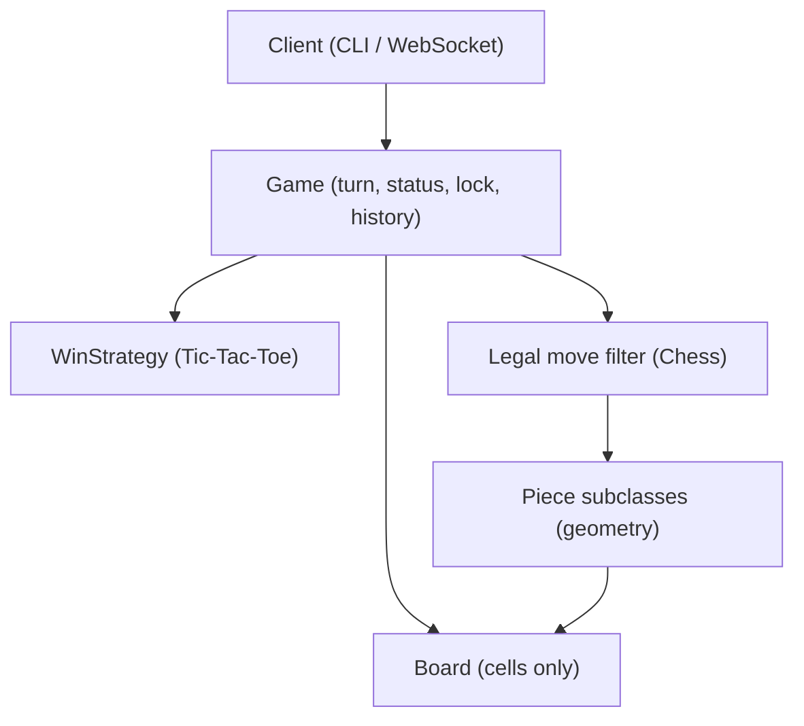
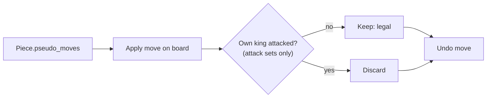
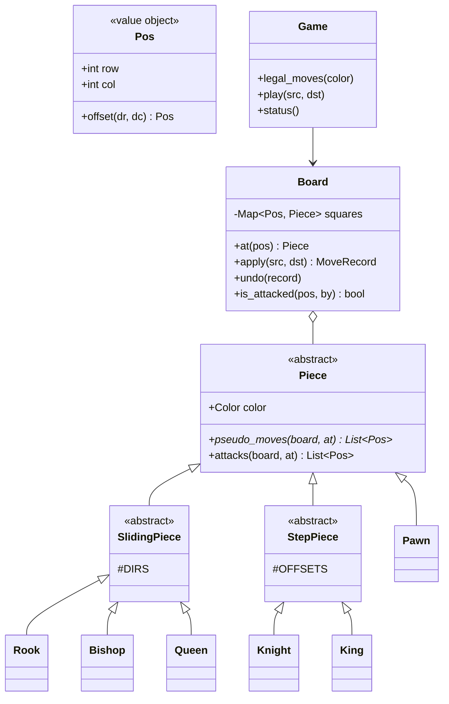
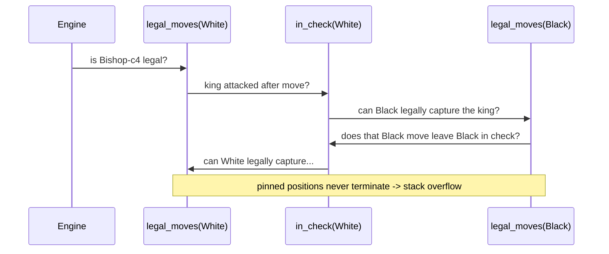

# Classic LLD: Tic-Tac-Toe & Chess

> **Prerequisites:** [02 · OOP & UML](../02-oop-foundations-and-uml/README.md), [05 · Core Design Principles](../05-core-design-principles/README.md), [08 · Behavioral Patterns I](../08-behavioral-patterns-i/README.md), [13 · Library & Vending Machine](../13-library-and-vending-machine/README.md)  
> **Reading time:** ~30 minutes  
> **Audience:** LLD / machine-coding rounds — "board games without a god class"

> [!NOTE]
> **In one line:** Keep **board storage** dumb, put **rules** in swappable objects (Strategy for win conditions, polymorphic `Piece` for movement), and let a **Game** orchestrate turns. Tic-Tac-Toe tests *Strategy and clean boundaries*; Chess tests *inheritance depth, polymorphism, and avoiding recursive legality*.

> [!TIP]
> **Golden rule:** The board answers *"what is on this square?"*. Pieces answer *"where could I go?"*. The game answers *"is this move legal right now, and whose turn is it?"*. If any one class answers all three, you have a god class.

> [!TIP]
> **Try it:** Draw `Board / Piece / SlidingPiece / Game` in [LLD Studio](/tools/lld-studio/), then run the Tic-Tac-Toe and Chess Python examples below.

---

## 1. Interview pressure

Interviewer: *"Design Tic-Tac-Toe for two players. Now make the board N×N with a win length of N. Now sketch Chess — pieces, legal moves, check and checkmate."*

They are watching for: (1) where win detection lives, (2) whether you use `switch(piece.type)`, (3) how you keep check detection from recursing forever, (4) whether turn and concurrency are handled.

**Clarify first:**

| Question | Why it changes the design |
| :--- | :--- |
| Only 3×3, or N×N? | Win detection must be O(1) per move, not O(N²) per move |
| Two humans, or AI later? | Keep `Game` free of I/O; moves are plain commands |
| Online (two clients)? | Per-game lock, turn + move-number validation, idempotent retries |
| Chess: castling, en passant, promotion, draw rules? | Which rules need **game-level** state vs piece-level logic |
| Undo / replay? | Move records → Command-style history |



---

## 2. Comparison matrix (memorize this)

| Concern | Tic-Tac-Toe | Chess | Invariant to say aloud |
| :--- | :--- | :--- | :--- |
| Storage | `Board` n×n of marks | `Board` map `Pos → Piece` | Board never decides a winner |
| Position | `(row, col)` ints | Immutable `Pos` value object | Validate bounds once, at construction |
| Move geometry | N/A | `Piece.pseudo_moves(board, at)` | No `switch(type)`; polymorphism |
| Rules / outcome | `WinStrategy.record(...)` | `Game.legal_moves` + attack tests | Rules are pluggable, not baked into the board |
| Turn + status | `Game` | `Game` | One owner of turn order and termination |
| Concurrency | Per-game lock | Per-game lock | Concurrent games are independent |

### Chess pieces by movement paradigm

| Piece | Paradigm | Shared base | Obstacle behavior |
| :--- | :--- | :--- | :--- |
| Rook, Bishop, Queen | Rays (slide until blocked) | `SlidingPiece` with direction table | Stop at first piece; capture if enemy |
| Knight, King | Fixed offsets | `StepPiece` with offset table | Jump / step; cannot land on friendly |
| Pawn | Asymmetric (push vs capture, double step) | `Piece` directly | Blocked by any piece ahead; captures diagonally only |

### Pseudo-legal vs legal (the pivotal distinction)

| Term | Meaning | Who computes it |
| :--- | :--- | :--- |
| **Pseudo-legal** | Matches piece geometry and blocking, **ignores** whether own king is left in check | `Piece.pseudo_moves` |
| **Attack set** | Squares a piece *threatens* (pawn differs from pawn *moves*) | `Piece.attacks` |
| **Legal** | Pseudo-legal **and** own king not attacked afterwards | `Game.legal_moves` (simulate → test → undo) |



---

## 3. Walkthrough A — Tic-Tac-Toe with an O(1) win strategy

**Requirements**

1. Two players alternate; `X` starts. Reject out-of-bounds, occupied cell, wrong turn, moves after the game ended.
2. Board is `n × n`; win = a full row, column, or either diagonal.
3. Win detection **per move is O(1)**, and replaceable (Connect-Four rules, wrap-around variants).
4. Online play: the same `Game` must tolerate a retried move without applying it twice.

**Idea:** X contributes `+1`, O contributes `−1`. Keep a running sum per row, column, and both diagonals. Someone wins the instant any of their sums reaches `±n`. No scanning.

```mermaid
sequenceDiagram
  autonumber
  actor P as Player X
  participant G as Game
  participant B as Board
  participant W as WinStrategy

  P->>G: play(X, row, col, expected_move_no)
  G->>G: lock; validate turn, status, move_no
  G->>B: place(row, col, X)
  alt out of bounds or occupied
    B-->>G: IllegalMove
  else placed
    G->>W: record(row, col, X)
    alt line complete
      W-->>G: true
      G->>G: status = WON
    else board full
      G->>G: status = DRAW
    else continue
      G->>G: turn = O
    end
  end
```

````carousel
```python
from __future__ import annotations

import threading
from abc import ABC, abstractmethod
from enum import Enum


class Mark(Enum):
    X = 1
    O = -1

    @property
    def other(self) -> "Mark":
        return Mark.O if self is Mark.X else Mark.X


class Status(Enum):
    IN_PROGRESS = "in_progress"
    WON = "won"
    DRAW = "draw"


class IllegalMove(Exception):
    pass


class Board:
    """Storage + bounds only. It never decides who won."""

    def __init__(self, n: int = 3) -> None:
        self.n = n
        self._cells: list[list[Mark | None]] = [[None] * n for _ in range(n)]
        self._filled = 0

    def place(self, row: int, col: int, mark: Mark) -> None:
        if not (0 <= row < self.n and 0 <= col < self.n):
            raise IllegalMove("out of bounds")
        if self._cells[row][col] is not None:
            raise IllegalMove("cell occupied")
        self._cells[row][col] = mark
        self._filled += 1

    def is_full(self) -> bool:
        return self._filled == self.n * self.n

    def render(self) -> str:
        return "\n".join(" ".join(c.name if c else "." for c in row) for row in self._cells)


class WinStrategy(ABC):
    @abstractmethod
    def record(self, row: int, col: int, mark: Mark) -> bool:
        """Register a move. Return True if it completed a winning line."""


class LineCounterStrategy(WinStrategy):
    """O(1) per move: +1 for X, -1 for O; |sum| == n means a full line."""

    def __init__(self, n: int) -> None:
        self._n = n
        self._rows, self._cols = [0] * n, [0] * n
        self._diag = self._anti = 0

    def record(self, row: int, col: int, mark: Mark) -> bool:
        d, n = mark.value, self._n
        self._rows[row] += d
        self._cols[col] += d
        if row == col:
            self._diag += d
        if row + col == n - 1:
            self._anti += d
        return n in (abs(self._rows[row]), abs(self._cols[col]), abs(self._diag), abs(self._anti))


class Game:
    def __init__(self, n: int = 3, strategy: WinStrategy | None = None) -> None:
        self.board = Board(n)
        self._win = strategy or LineCounterStrategy(n)  # one strategy instance per game
        self._lock = threading.Lock()
        self.turn, self.status, self.winner, self.move_no = Mark.X, Status.IN_PROGRESS, None, 0

    def play(self, mark: Mark, row: int, col: int, expected_move_no: int | None = None) -> Status:
        with self._lock:
            if self.status is not Status.IN_PROGRESS:
                raise IllegalMove("game is over")
            if expected_move_no is not None and expected_move_no != self.move_no:
                raise IllegalMove("stale move")  # retry / double-click guard
            if mark is not self.turn:
                raise IllegalMove("not your turn")
            self.board.place(row, col, mark)  # raises before any state changes
            self.move_no += 1
            if self._win.record(row, col, mark):
                self.status, self.winner = Status.WON, mark
            elif self.board.is_full():
                self.status = Status.DRAW
            else:
                self.turn = mark.other
            return self.status


if __name__ == "__main__":
    g = Game()
    for who, r, c in [(Mark.X, 0, 0), (Mark.O, 1, 0), (Mark.X, 0, 1), (Mark.O, 1, 1), (Mark.X, 0, 2)]:
        g.play(who, r, c)
    assert g.status is Status.WON and g.winner is Mark.X

    d = Game()  # a full-board draw
    for i, (r, c) in enumerate([(0, 0), (0, 1), (0, 2), (1, 1), (1, 0), (1, 2), (2, 1), (2, 0), (2, 2)]):
        d.play(Mark.X if i % 2 == 0 else Mark.O, r, c)
    assert d.status is Status.DRAW

    e = Game()
    e.play(Mark.X, 1, 1, expected_move_no=0)
    for bad in (lambda: e.play(Mark.X, 0, 0), lambda: e.play(Mark.O, 1, 1), lambda: e.play(Mark.O, 9, 9),
                lambda: e.play(Mark.O, 0, 0, expected_move_no=0)):
        try:
            bad()
            raise SystemExit("should be rejected")
        except IllegalMove:
            pass

    big = Game(n=5)  # anti-diagonal on a 5x5, O(1) per move
    for i in range(5):
        big.play(Mark.X, i, 4 - i)
        if i < 4:
            big.play(Mark.O, 4, i + 1)  # O dawdles on the bottom row
    assert big.status is Status.WON and big.winner is Mark.X
    print(g.board.render())
    print("tic-tac-toe ok")
```
<!-- slide -->
```csharp
using System;
using System.Collections.Generic;

namespace Lld.TicTacToe;

public enum Mark { X = 1, O = -1 }

public enum Status { InProgress, Won, Draw }

public sealed class IllegalMoveException(string message) : Exception(message);

public static class MarkExtensions
{
    public static Mark Other(this Mark m) => m == Mark.X ? Mark.O : Mark.X;
}

public sealed class Board(int n = 3)
{
    private readonly Mark?[,] _cells = new Mark?[n, n];
    private int _filled;

    public int N { get; } = n;

    public void Place(int row, int col, Mark mark)
    {
        if (row < 0 || row >= N || col < 0 || col >= N) throw new IllegalMoveException("out of bounds");
        if (_cells[row, col] is not null) throw new IllegalMoveException("cell occupied");
        _cells[row, col] = mark;
        _filled++;
    }

    public bool IsFull => _filled == N * N;
}

public interface IWinStrategy
{
    bool Record(int row, int col, Mark mark);
}

/// <summary>O(1) per move: +1 for X, -1 for O; |sum| == n means a full line.</summary>
public sealed class LineCounterStrategy(int n) : IWinStrategy
{
    private readonly int[] _rows = new int[n], _cols = new int[n];
    private int _diag, _anti;

    public bool Record(int row, int col, Mark mark)
    {
        var d = (int)mark;
        _rows[row] += d;
        _cols[col] += d;
        if (row == col) _diag += d;
        if (row + col == n - 1) _anti += d;
        return Math.Abs(_rows[row]) == n || Math.Abs(_cols[col]) == n
            || Math.Abs(_diag) == n || Math.Abs(_anti) == n;
    }
}

public sealed class Game
{
    private readonly object _gate = new();
    private readonly IWinStrategy _win;

    public Game(int n = 3, IWinStrategy? strategy = null)
    {
        Board = new Board(n);
        _win = strategy ?? new LineCounterStrategy(n);
    }

    public Board Board { get; }
    public Mark Turn { get; private set; } = Mark.X;
    public Status Status { get; private set; } = Status.InProgress;
    public Mark? Winner { get; private set; }
    public int MoveNo { get; private set; }

    public Status Play(Mark mark, int row, int col, int? expectedMoveNo = null)
    {
        lock (_gate)
        {
            if (Status != Status.InProgress) throw new IllegalMoveException("game is over");
            if (expectedMoveNo is { } e && e != MoveNo) throw new IllegalMoveException("stale move");
            if (mark != Turn) throw new IllegalMoveException("not your turn");

            Board.Place(row, col, mark); // throws before any state changes
            MoveNo++;
            if (_win.Record(row, col, mark)) { Status = Status.Won; Winner = mark; }
            else if (Board.IsFull) Status = Status.Draw;
            else Turn = mark.Other();
            return Status;
        }
    }
}

public static class Program
{
    private static void Rejects(Action a)
    {
        try { a(); throw new Exception("should be rejected"); }
        catch (IllegalMoveException) { }
    }

    public static void Main()
    {
        var g = new Game();
        foreach (var (who, r, c) in new[] { (Mark.X, 0, 0), (Mark.O, 1, 0), (Mark.X, 0, 1), (Mark.O, 1, 1), (Mark.X, 0, 2) })
            g.Play(who, r, c);
        if (g.Status != Status.Won || g.Winner != Mark.X) throw new Exception("X should win");

        var d = new Game();
        var cells = new[] { (0, 0), (0, 1), (0, 2), (1, 1), (1, 0), (1, 2), (2, 1), (2, 0), (2, 2) };
        for (var i = 0; i < cells.Length; i++)
            d.Play(i % 2 == 0 ? Mark.X : Mark.O, cells[i].Item1, cells[i].Item2);
        if (d.Status != Status.Draw) throw new Exception("draw expected");

        var e = new Game();
        e.Play(Mark.X, 1, 1, expectedMoveNo: 0);
        Rejects(() => e.Play(Mark.X, 0, 0));                    // wrong turn
        Rejects(() => e.Play(Mark.O, 1, 1));                    // occupied
        Rejects(() => e.Play(Mark.O, 9, 9));                    // bounds
        Rejects(() => e.Play(Mark.O, 0, 0, expectedMoveNo: 0)); // stale retry

        var big = new Game(5);
        for (var i = 0; i < 5; i++)
        {
            big.Play(Mark.X, i, 4 - i);
            if (i < 4) big.Play(Mark.O, 4, i + 1); // O dawdles on the bottom row
        }
        if (big.Status != Status.Won) throw new Exception("anti-diagonal win expected");
        Console.WriteLine("tic-tac-toe ok");
    }
}
```
````

**Extension points:** Connect-Four → new `WinStrategy` (needs the last move and a window scan; the board is unchanged). Computer player → a `Player` interface that returns `(row, col)`; `Game` never reads stdin. Undo → store move records and keep a `retract` that also decrements the counters.

---

## 4. Walkthrough B — Chess pieces, legality, check

**Requirements**

1. Pieces: King, Queen, Rook, Bishop, Knight, Pawn. Moves are polymorphic — **no `switch(piece.type)`**.
2. Sliding pieces share **one** ray-scan implementation; knights and kings share offset logic.
3. A move is legal only if it **does not leave your own king attacked**.
4. Detect check, checkmate, stalemate. Promote a pawn reaching the last rank.
5. Legality must **not recurse** into "is the opponent's move legal?" (see the war story).



**Design choices to defend**

- **The board owns positions; pieces do not store them.** Two sources of truth (`piece.pos` and `board[pos]`) drift apart during move simulation.
- **`attacks` ≠ `pseudo_moves` for pawns:** a pawn *pushes* forward but *attacks* diagonally, even when no enemy stands there. That is what check detection needs.
- **Simulate on the real board with apply / undo** (cheap), or on a cloned board. Never mutate and forget to restore: use `try / finally`.
- **Iterators are lazy in C#.** Materialize pseudo-legal moves (`ToList`) before applying/undoing moves, or you enumerate a collection you are mutating.

````carousel
```python
from __future__ import annotations

import threading
from abc import ABC, abstractmethod
from dataclasses import dataclass
from enum import Enum


class Color(Enum):
    WHITE = "white"
    BLACK = "black"

    @property
    def opp(self) -> "Color":
        return Color.BLACK if self is Color.WHITE else Color.WHITE


class IllegalMove(Exception):
    pass


@dataclass(frozen=True)
class Pos:
    row: int  # row 0 is rank 8 (Black's back rank)
    col: int  # col 0 is file a

    def __post_init__(self) -> None:
        if not (0 <= self.row < 8 and 0 <= self.col < 8):
            raise ValueError(f"({self.row},{self.col}) is off the board")

    @staticmethod
    def of(square: str) -> "Pos":  # "e2" -> Pos
        return Pos(8 - int(square[1]), ord(square[0]) - ord("a"))

    def offset(self, dr: int, dc: int) -> "Pos | None":
        r, c = self.row + dr, self.col + dc
        return Pos(r, c) if 0 <= r < 8 and 0 <= c < 8 else None


# ── Pieces: geometry only ───────────────────────────────────────────
class Piece(ABC):
    def __init__(self, color: Color) -> None:
        self.color = color

    @abstractmethod
    def pseudo_moves(self, board: "Board", at: Pos) -> list[Pos]:
        """Legal by geometry and blocking; ignores king safety."""

    def attacks(self, board: "Board", at: Pos) -> list[Pos]:
        return self.pseudo_moves(board, at)


class SlidingPiece(Piece):
    DIRS: tuple[tuple[int, int], ...] = ()

    def pseudo_moves(self, board, at):
        moves: list[Pos] = []
        for dr, dc in self.DIRS:
            p = at.offset(dr, dc)
            while p is not None:
                occupant = board.at(p)
                if occupant is None:
                    moves.append(p)
                else:
                    if occupant.color is not self.color:
                        moves.append(p)  # capture, then the ray stops
                    break
                p = p.offset(dr, dc)
        return moves


class StepPiece(Piece):
    OFFSETS: tuple[tuple[int, int], ...] = ()

    def pseudo_moves(self, board, at):
        moves: list[Pos] = []
        for dr, dc in self.OFFSETS:
            p = at.offset(dr, dc)
            if p is not None and (board.at(p) is None or board.at(p).color is not self.color):
                moves.append(p)
        return moves


ROOK_DIRS = ((1, 0), (-1, 0), (0, 1), (0, -1))
BISHOP_DIRS = ((1, 1), (1, -1), (-1, 1), (-1, -1))


class Rook(SlidingPiece):
    DIRS = ROOK_DIRS


class Bishop(SlidingPiece):
    DIRS = BISHOP_DIRS


class Queen(SlidingPiece):
    DIRS = ROOK_DIRS + BISHOP_DIRS


class Knight(StepPiece):
    OFFSETS = ((-2, -1), (-2, 1), (-1, -2), (-1, 2), (1, -2), (1, 2), (2, -1), (2, 1))


class King(StepPiece):
    OFFSETS = ROOK_DIRS + BISHOP_DIRS  # castling lives in Game: it needs history


class Pawn(Piece):
    def _dir(self) -> int:
        return -1 if self.color is Color.WHITE else 1

    def pseudo_moves(self, board, at):
        d, moves = self._dir(), []
        start_row = 6 if self.color is Color.WHITE else 1
        one = at.offset(d, 0)
        if one is not None and board.at(one) is None:
            moves.append(one)
            two = at.offset(2 * d, 0)
            if at.row == start_row and two is not None and board.at(two) is None:
                moves.append(two)
        for dc in (-1, 1):  # captures only when an enemy is there
            p = at.offset(d, dc)
            if p is not None and board.at(p) is not None and board.at(p).color is not self.color:
                moves.append(p)
        return moves

    def attacks(self, board, at):  # threatens diagonals even when empty
        return [p for dc in (-1, 1) if (p := at.offset(self._dir(), dc)) is not None]


# ── Board: storage + simulate/undo + attack test ────────────────────
@dataclass
class MoveRecord:
    src: Pos
    dst: Pos
    moved: Piece
    captured: Piece | None


class Board:
    def __init__(self) -> None:
        self._sq: dict[Pos, Piece] = {}

    @classmethod
    def standard(cls) -> "Board":
        b = cls()
        back = (Rook, Knight, Bishop, Queen, King, Bishop, Knight, Rook)
        for col, kind in enumerate(back):
            b.put(Pos(0, col), kind(Color.BLACK))
            b.put(Pos(7, col), kind(Color.WHITE))
            b.put(Pos(1, col), Pawn(Color.BLACK))
            b.put(Pos(6, col), Pawn(Color.WHITE))
        return b

    def at(self, p: Pos) -> Piece | None:
        return self._sq.get(p)

    def put(self, p: Pos, piece: Piece) -> None:
        self._sq[p] = piece

    def pieces(self, color: Color) -> list[tuple[Pos, Piece]]:
        return [(p, pc) for p, pc in self._sq.items() if pc.color is color]  # snapshot

    def king_pos(self, color: Color) -> Pos:
        return next(p for p, pc in self._sq.items() if isinstance(pc, King) and pc.color is color)

    def apply(self, src: Pos, dst: Pos) -> MoveRecord:
        moved, captured = self._sq.pop(src), self._sq.get(dst)
        self._sq[dst] = moved
        return MoveRecord(src, dst, moved, captured)

    def undo(self, rec: MoveRecord) -> None:
        del self._sq[rec.dst]
        self._sq[rec.src] = rec.moved
        if rec.captured is not None:
            self._sq[rec.dst] = rec.captured

    def is_attacked(self, target: Pos, by: Color) -> bool:
        """Flat check: asks attackers for their attack sets. No legal-move recursion."""
        return any(target in pc.attacks(self, p) for p, pc in self.pieces(by))


# ── Game: turn order, legality, outcome ─────────────────────────────
class Game:
    def __init__(self, board: Board | None = None, turn: Color = Color.WHITE) -> None:
        self.board, self.turn = board or Board.standard(), turn
        self._lock = threading.Lock()

    def in_check(self, color: Color) -> bool:
        return self.board.is_attacked(self.board.king_pos(color), color.opp)

    def legal_moves(self, color: Color) -> list[tuple[Pos, Pos]]:
        result = []
        for src, piece in self.board.pieces(color):
            for dst in piece.pseudo_moves(self.board, src):  # pseudo_moves returns a list (eager)
                rec = self.board.apply(src, dst)
                try:
                    safe = not self.in_check(color)
                finally:
                    self.board.undo(rec)  # always restore, even on error
                if safe:
                    result.append((src, dst))
        return result

    def outcome(self, color: Color) -> str:
        no_moves = not self.legal_moves(color)
        if self.in_check(color):
            return "checkmate" if no_moves else "check"
        return "stalemate" if no_moves else "ok"

    def play(self, src: str, dst: str) -> str:
        with self._lock:
            s, d = Pos.of(src), Pos.of(dst)
            piece = self.board.at(s)
            if piece is None or piece.color is not self.turn:
                raise IllegalMove("no piece of yours on the source square")
            if (s, d) not in self.legal_moves(self.turn):
                raise IllegalMove("illegal move")
            self.board.apply(s, d)
            if isinstance(piece, Pawn) and d.row in (0, 7):
                self.board.put(d, Queen(piece.color))  # promotion replaces the piece object
            self.turn = self.turn.opp
            return self.outcome(self.turn)


if __name__ == "__main__":
    g = Game()
    assert len(g.legal_moves(Color.WHITE)) == 20  # standard opening position

    # Fool's mate: 1. f3 e5 2. g4 Qh4#
    for s, d in [("f2", "f3"), ("e7", "e5"), ("g2", "g4")]:
        g.play(s, d)
    assert g.play("d8", "h4") == "checkmate"

    # Pinned rook may only move along the pin line
    b = Board()
    b.put(Pos.of("e1"), King(Color.WHITE))
    b.put(Pos.of("e2"), Rook(Color.WHITE))
    b.put(Pos.of("e8"), Rook(Color.BLACK))
    b.put(Pos.of("h8"), King(Color.BLACK))
    pinned = {d for s, d in Game(b).legal_moves(Color.WHITE) if s == Pos.of("e2")}
    assert pinned == {Pos.of(f"e{r}") for r in range(3, 9)}, pinned

    # Pawn promotion
    p = Board()
    p.put(Pos.of("a1"), King(Color.WHITE))
    p.put(Pos.of("h8"), King(Color.BLACK))
    p.put(Pos.of("c7"), Pawn(Color.WHITE))
    pg = Game(p)
    pg.play("c7", "c8")
    assert isinstance(p.at(Pos.of("c8")), Queen)
    print("chess ok")
```
<!-- slide -->
```csharp
using System;
using System.Collections.Generic;
using System.Linq;

namespace Lld.Chess;

public enum Color { White, Black }

public static class ColorExt
{
    public static Color Opp(this Color c) => c == Color.White ? Color.Black : Color.White;
}

public sealed class IllegalMoveException(string message) : Exception(message);

public readonly record struct Pos
{
    public int Row { get; }  // row 0 is rank 8 (Black's back rank)
    public int Col { get; }  // col 0 is file a

    public Pos(int row, int col)
    {
        if (row is < 0 or > 7 || col is < 0 or > 7)
            throw new ArgumentOutOfRangeException(nameof(row), $"({row},{col}) is off the board");
        Row = row;
        Col = col;
    }

    public static Pos Of(string sq) => new(8 - (sq[1] - '0'), sq[0] - 'a');

    public Pos? Offset(int dr, int dc)
    {
        int r = Row + dr, c = Col + dc;
        return r is >= 0 and < 8 && c is >= 0 and < 8 ? new Pos(r, c) : null;
    }
}

// ── Pieces: geometry only ───────────────────────────────────────────
public abstract class Piece(Color color)
{
    public Color Color { get; } = color;

    public abstract List<Pos> PseudoMoves(Board b, Pos at); // List => eager, safe to mutate board after

    public virtual List<Pos> Attacks(Board b, Pos at) => PseudoMoves(b, at);
}

public abstract class SlidingPiece(Color color) : Piece(color)
{
    protected abstract (int Dr, int Dc)[] Dirs { get; }

    public override List<Pos> PseudoMoves(Board b, Pos at)
    {
        var moves = new List<Pos>();
        foreach (var (dr, dc) in Dirs)
        {
            var p = at.Offset(dr, dc);
            while (p is { } sq)
            {
                var occupant = b.At(sq);
                if (occupant is null) moves.Add(sq);
                else
                {
                    if (occupant.Color != Color) moves.Add(sq); // capture, then the ray stops
                    break;
                }
                p = sq.Offset(dr, dc);
            }
        }
        return moves;
    }
}

public abstract class StepPiece(Color color) : Piece(color)
{
    protected abstract (int Dr, int Dc)[] Offsets { get; }

    public override List<Pos> PseudoMoves(Board b, Pos at)
    {
        var moves = new List<Pos>();
        foreach (var (dr, dc) in Offsets)
            if (at.Offset(dr, dc) is { } p && (b.At(p) is not { } o || o.Color != Color))
                moves.Add(p);
        return moves;
    }
}

public static class Dirs
{
    public static readonly (int, int)[] Rook = { (1, 0), (-1, 0), (0, 1), (0, -1) };
    public static readonly (int, int)[] Bishop = { (1, 1), (1, -1), (-1, 1), (-1, -1) };
    public static readonly (int, int)[] All = Rook.Concat(Bishop).ToArray();
}

public sealed class Rook(Color c) : SlidingPiece(c) { protected override (int Dr, int Dc)[] Dirs => Lld.Chess.Dirs.Rook; }
public sealed class Bishop(Color c) : SlidingPiece(c) { protected override (int Dr, int Dc)[] Dirs => Lld.Chess.Dirs.Bishop; }
public sealed class Queen(Color c) : SlidingPiece(c) { protected override (int Dr, int Dc)[] Dirs => Lld.Chess.Dirs.All; }

public sealed class Knight(Color c) : StepPiece(c)
{
    protected override (int Dr, int Dc)[] Offsets { get; } =
        { (-2, -1), (-2, 1), (-1, -2), (-1, 2), (1, -2), (1, 2), (2, -1), (2, 1) };
}

public sealed class King(Color c) : StepPiece(c) // castling lives in Game: it needs history
{
    protected override (int Dr, int Dc)[] Offsets => Dirs.All;
}

public sealed class Pawn(Color c) : Piece(c)
{
    private int Dir => Color == Color.White ? -1 : 1;

    public override List<Pos> PseudoMoves(Board b, Pos at)
    {
        var moves = new List<Pos>();
        var startRow = Color == Color.White ? 6 : 1;
        if (at.Offset(Dir, 0) is { } one && b.At(one) is null)
        {
            moves.Add(one);
            if (at.Row == startRow && at.Offset(2 * Dir, 0) is { } two && b.At(two) is null)
                moves.Add(two);
        }
        foreach (var dc in new[] { -1, 1 }) // captures only when an enemy is there
            if (at.Offset(Dir, dc) is { } p && b.At(p) is { } o && o.Color != Color)
                moves.Add(p);
        return moves;
    }

    public override List<Pos> Attacks(Board b, Pos at) => // threatens diagonals even when empty
        new[] { -1, 1 }.Select(dc => at.Offset(Dir, dc)).OfType<Pos>().ToList();
}

// ── Board: storage + simulate/undo + attack test ────────────────────
public sealed record MoveRecord(Pos Src, Pos Dst, Piece Moved, Piece? Captured);

public sealed class Board
{
    private readonly Dictionary<Pos, Piece> _sq = new();

    public static Board Standard()
    {
        var b = new Board();
        Func<Color, Piece>[] back =
            { c => new Rook(c), c => new Knight(c), c => new Bishop(c), c => new Queen(c),
              c => new King(c), c => new Bishop(c), c => new Knight(c), c => new Rook(c) };
        for (var col = 0; col < 8; col++)
        {
            b.Put(new Pos(0, col), back[col](Color.Black));
            b.Put(new Pos(7, col), back[col](Color.White));
            b.Put(new Pos(1, col), new Pawn(Color.Black));
            b.Put(new Pos(6, col), new Pawn(Color.White));
        }
        return b;
    }

    public Piece? At(Pos p) => _sq.TryGetValue(p, out var piece) ? piece : null;
    public void Put(Pos p, Piece piece) => _sq[p] = piece;

    public List<(Pos Pos, Piece Piece)> Pieces(Color c) =>
        _sq.Where(kv => kv.Value.Color == c).Select(kv => (kv.Key, kv.Value)).ToList(); // snapshot

    public Pos KingPos(Color c) => _sq.First(kv => kv.Value is King && kv.Value.Color == c).Key;

    public MoveRecord Apply(Pos src, Pos dst)
    {
        var moved = _sq[src];
        _sq.Remove(src);
        _sq.TryGetValue(dst, out var captured);
        _sq[dst] = moved;
        return new MoveRecord(src, dst, moved, captured);
    }

    public void Undo(MoveRecord r)
    {
        _sq.Remove(r.Dst);
        _sq[r.Src] = r.Moved;
        if (r.Captured is not null) _sq[r.Dst] = r.Captured;
    }

    /// <summary>Flat check over attack sets. No legal-move recursion.</summary>
    public bool IsAttacked(Pos target, Color by) =>
        Pieces(by).Any(x => x.Piece.Attacks(this, x.Pos).Contains(target));
}

// ── Game: turn order, legality, outcome ─────────────────────────────
public sealed class Game(Board? board = null, Color turn = Color.White)
{
    private readonly object _gate = new();
    public Board Board { get; } = board ?? Board.Standard();
    public Color Turn { get; private set; } = turn;

    public bool InCheck(Color c) => Board.IsAttacked(Board.KingPos(c), c.Opp());

    public List<(Pos Src, Pos Dst)> LegalMoves(Color c)
    {
        var result = new List<(Pos, Pos)>();
        foreach (var (src, piece) in Board.Pieces(c))
            foreach (var dst in piece.PseudoMoves(Board, src))
            {
                var rec = Board.Apply(src, dst);
                try { if (!InCheck(c)) result.Add((src, dst)); }
                finally { Board.Undo(rec); } // always restore
            }
        return result;
    }

    public string Outcome(Color c)
    {
        var noMoves = LegalMoves(c).Count == 0;
        if (InCheck(c)) return noMoves ? "checkmate" : "check";
        return noMoves ? "stalemate" : "ok";
    }

    public string Play(string src, string dst)
    {
        lock (_gate)
        {
            Pos s = Pos.Of(src), d = Pos.Of(dst);
            var piece = Board.At(s);
            if (piece is null || piece.Color != Turn) throw new IllegalMoveException("no piece of yours there");
            if (!LegalMoves(Turn).Contains((s, d))) throw new IllegalMoveException("illegal move");

            Board.Apply(s, d);
            if (piece is Pawn && d.Row is 0 or 7) Board.Put(d, new Queen(piece.Color)); // promotion
            Turn = Turn.Opp();
            return Outcome(Turn);
        }
    }
}

public static class Program
{
    public static void Main()
    {
        var g = new Game();
        if (g.LegalMoves(Color.White).Count != 20) throw new Exception("opening has 20 moves");

        g.Play("f2", "f3");
        g.Play("e7", "e5");
        g.Play("g2", "g4");
        if (g.Play("d8", "h4") != "checkmate") throw new Exception("fool's mate");

        var b = new Board(); // pinned rook may only move along the pin line
        b.Put(Pos.Of("e1"), new King(Color.White));
        b.Put(Pos.Of("e2"), new Rook(Color.White));
        b.Put(Pos.Of("e8"), new Rook(Color.Black));
        b.Put(Pos.Of("h8"), new King(Color.Black));
        var pinned = new Game(b).LegalMoves(Color.White).Where(m => m.Src == Pos.Of("e2")).Select(m => m.Dst).ToHashSet();
        var expected = Enumerable.Range(3, 6).Select(r => Pos.Of($"e{r}")).ToHashSet();
        if (!pinned.SetEquals(expected)) throw new Exception("pin handling");

        var p = new Board();
        p.Put(Pos.Of("a1"), new King(Color.White));
        p.Put(Pos.Of("h8"), new King(Color.Black));
        p.Put(Pos.Of("c7"), new Pawn(Color.White));
        new Game(p).Play("c7", "c8");
        if (p.At(Pos.Of("c8")) is not Queen) throw new Exception("promotion");
        Console.WriteLine("chess ok");
    }
}
```
````

**Beyond the sketch (say what is missing — it is a strength):** castling needs *has-king-moved*, *has-rook-moved*, and "does not pass through check"; en passant needs the **last move** (`en_passant_target`); the fifty-move and threefold repetition rules need a **move history / position hash**. All of these are **game-level** state — never boolean flags sprinkled on `Pawn` and `Rook`.

---

## 5. Concurrency & edge cases

| # | Scenario | Risk | Mitigation |
| :--- | :--- | :--- | :--- |
| 1 | Both clients submit a move simultaneously | Two moves applied for one turn | Per-game lock; validate `turn` **inside** the lock |
| 2 | Client retries after a timeout | Move applied twice | `expected_move_no` (or a client-generated move id); stale → reject, return current state |
| 3 | Illegal input (bounds, occupied) | Partial mutation | Validate and `place` before mutating counters / turn |
| 4 | Move after game end | State corruption | Status check first; terminal state is immutable |
| 5 | Many games in one process | Global lock = bottleneck | One lock **per game**; games share nothing |
| 6 | Check test recurses into legal moves | Stack overflow (war story) | `is_attacked` uses `attacks`, never `legal_moves` |
| 7 | Simulation mutates the board and throws | Corrupt board | `try / finally` undo, or simulate on a cloned board |
| 8 | Lazy iterators + mutation (C#) | Enumerating a mutating collection | Return `List<T>`/`ToList()` before applying moves |
| 9 | Pawn reaches last rank | `isPromoted` flag bloats `Pawn` | A pawn *becomes* a new `Queen` (or chosen piece) object |
| 10 | En passant / castling | Flags on pieces, sweeps every turn | State on `Game` (`en_passant_target`, `moved` set), reset each half-move |
| 11 | Huge N×N Tic-Tac-Toe | O(N) scan per move | Row/col/diag counters; O(1) per move, O(N) memory |

---

## 6. War story — the check test that called itself

A match engine decided "is this move legal?" by asking "does it leave my king in check?". It answered *that* by asking "can any enemy piece **legally** capture my king?" — and *legally* meant calling `legal_moves(opponent)`, which for each opponent move asked whether **it** left the opponent's king in check, which asked for *our* legal moves…



In pinned positions the mutual recursion never bottomed out and the process died mid-broadcast, dropping neighbouring games on the same pod.

**Fix:** separate **attack** from **legal**. "Is square S attacked?" only needs geometry — knight offsets, pawn diagonals, sliding rays — **never** king safety of the attacker (an enemy piece pinned to its own king still *gives check*). Legal moves = pseudo-legal moves filtered by one flat attack test after simulating the move.

---

## 7. Anti-patterns

| Smell | Fix |
| :--- | :--- |
| `if piece.type == "ROOK"` ladders | Polymorphic `Piece`; shared `SlidingPiece` base |
| `Board.has_won()` | `WinStrategy` / `Game` outcome; board only stores |
| Rook / Bishop / Queen each re-implement ray loops | One `SlidingPiece` with a direction table |
| Pieces store `(row, col)` **and** the board does | Board is the single source of truth |
| Raw `int[]` positions passed everywhere | Immutable `Pos`; validate once |
| `isPromoted` on `Pawn` | Replace the object with a `Queen` |
| `canBeEnPassantCaptured` on every pawn | `Game.en_passant_target`, cleared each half-move |
| O(N) win scan on a million-cell board | Running counters per row / col / diagonal |
| Check test that calls `legal_moves` | Attack sets only; no recursion |
| One global lock for every game | Lock per `Game` instance |

---

## 8. What you'd say in two minutes

> "I'd separate three responsibilities: the **Board** stores cells or pieces and checks bounds; **rules** are pluggable; the **Game** owns turn order, status and a lock. For Tic-Tac-Toe the rule is a **WinStrategy**: X adds +1 and O adds −1 to row, column and diagonal counters, so a win is `|sum| == n` — O(1) per move even for N×N, and Connect-Four is just another strategy. `Game.play` validates turn, move number and bounds before mutating, so a retried request is rejected as stale instead of applied twice.
>
> For Chess, `Piece` is polymorphic — no `switch` on type. Rook, Bishop and Queen share **SlidingPiece** with a direction table; Knight and King share **StepPiece** with an offset table; Pawn is special because it pushes and captures differently. The board owns positions. A move is legal if it is pseudo-legal and, after simulating it with apply/undo, the king isn't in an enemy **attack set** — pawns attack diagonally even on empty squares. Crucially, check detection never calls `legal_moves`, which prevents the infinite recursion. Castling, en passant and repetition are game-level state, and promotion replaces the pawn with a new piece."

---

## 9. Interview questions

<details>
<summary><strong>1. Where does win detection live in Tic-Tac-Toe, and why? [BASIC]</strong></summary>

In a `WinStrategy` called by `Game`. The board only stores cells, so new variants (N-in-a-row, Connect-Four) swap the strategy without touching storage — Open/Closed.

</details>

<details>
<summary><strong>2. How do you get O(1) win detection on an N×N board? [TRICKY]</strong></summary>

Keep `rows[N]`, `cols[N]`, `diag`, `anti`. Add +1 for X and −1 for O to the touched counters. If any reaches ±N, that player won. O(1) time per move, O(N) memory — instead of scanning N cells per move.

</details>

<details>
<summary><strong>3. Why a `SlidingPiece` base class? [BASIC]</strong></summary>

Rook, Bishop and Queen differ only by direction vectors. The ray-walk (stop at first piece, capture enemy) is identical, so it lives once; subclasses supply `DIRS`. That removes duplicated obstacle logic and any `switch(type)`.

</details>

<details>
<summary><strong>4. Pseudo-legal vs legal moves? [BASIC]</strong></summary>

Pseudo-legal obeys piece geometry and blocking; legal additionally leaves your own king unattacked. Generate pseudo-legal per piece, then filter by simulating the move and testing whether the king square is attacked.

</details>

<details>
<summary><strong>5. Why can naive check detection stack-overflow? [TRICKY]</strong></summary>

If `is_in_check` calls `legal_moves(opponent)`, and that filters by the opponent's own check status, the two recurse mutually. A piece *attacks* a square regardless of whether it is pinned, so use attack sets (geometry only) to test check — no recursion.

</details>

<details>
<summary><strong>6. How would you model pawn promotion and en passant? [SCENARIO]</strong></summary>

Promotion: replace the pawn object with a new `Queen` (or chosen piece) — pieces stay free of `isPromoted` flags. En passant: `Game.en_passant_target` is set when a pawn moves two squares and cleared after exactly one half-move; pawns just consult it when generating captures.

</details>

<details>
<summary><strong>7. Two players hit "move" at the same instant (online). [SCENARIO]</strong></summary>

A per-game lock serializes them; inside it, validate it is the caller's turn and (optionally) that `expected_move_no` matches. The second request fails as stale/not-your-turn. Different games never contend — locks are per `Game`.

</details>

<details>
<summary><strong>8. How do you add undo, replay, and an AI opponent? [SCENARIO]</strong></summary>

Moves become `MoveRecord`s (a Command): `apply` returns one, `undo` reverses it, and a history stack gives undo/redo/replay. An AI is a `Player` that returns a move; it uses the same `legal_moves` (and apply/undo for search), and `Game` never reads input directly.

</details>

---

## 10. One-page cheat sheet

```text
TIC-TAC-TOE
  Board       cells + bounds + is_full      (never decides winners)
  WinStrategy record(r, c, mark) -> bool    (rows/cols/diag counters, O(1))
  Game        lock, turn, status, move_no   (validate BEFORE mutating)
  Retry       expected_move_no -> stale move rejected

CHESS
  Pos         immutable, validated once;    Board owns positions
  Piece       pseudo_moves() + attacks()    (Pawn: attacks != moves)
  Sliding     direction table + ray walk    (Rook, Bishop, Queen)
  Step        offset table                  (Knight, King)
  Legal       pseudo-legal -> apply -> king attacked? -> undo (try/finally)
  Check       attack sets only, NEVER legal_moves   (no recursion)
  Game state  turn, en_passant_target, moved flags, history, repetition
  Promotion   replace object with Queen; no isPromoted flag
  Locks       one per Game

Say aloud: "Board stores, pieces move, game judges."
```

---

## Further reading

- GoF: Strategy, Command (move history), Template Method (turn skeleton)
- [Chess Programming Wiki — Move Generation](https://www.chessprogramming.org/Move_Generation) (pseudo-legal vs legal, attack maps)
- Refactoring.Guru: [Strategy](https://refactoring.guru/design-patterns/strategy)

## Next

**[15 · Splitwise Expense Sharing](../15-splitwise-expense-sharing/README.md)** — Ledgers, split strategies, and debt simplification.
