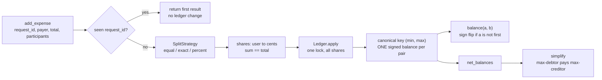

# Splitwise — Expense Sharing, Exact Money, and Debt Simplification

> **Prerequisites:** [03 · Generics, Exceptions & Value Objects](../03-generics-exceptions-and-value-objects/README.md), [04 · SOLID](../04-solid-principles/README.md), [08 · Behavioral Patterns I](../08-behavioral-patterns-i/README.md) (Strategy), [10 · Concurrency-Safe Design](../10-concurrency-safe-design/README.md)  
> **Reading time:** ~30 minutes (plus ~10 to run the demos)  
> **Audience:** LLD rounds — money, ledgers, "who owes whom," and a Strategy you can extend live

> [!NOTE]
> **In one line:** Splitwise is three small ideas stacked — **Strategy** turns a total into shares (equal, exact, percent) without losing a cent, a **canonical pair ledger** stores *one* signed number per pair of users, and a **greedy settle-up** collapses a web of debts into at most *n − 1* payments.

> [!TIP]
> **Golden rule:** A debt between Alice and Bob is a fact about the **pair**, not about either person. Store it once, under a key that sorts the two names (`min(a,b), max(a,b)`), and use **integer cents** for every amount. Two balance fields and a float are how ledgers drift.

> [!TIP]
> **Try it:** Draw `Expense → SplitStrategy → Ledger` in [LLD Studio](/tools/lld-studio/), then run the Python example below and watch $100.00 split three ways come out as `3334 + 3333 + 3333`.

---

## 1. Interview pressure

*"Design Splitwise. Users add expenses in a group, split equally or by exact amount or percent, and see who owes whom. Then: show the minimum payments to settle everyone."*

What they are listening for:

| They probe | Good answer |
| :--- | :--- |
| "Split $100 three ways." | Integer cents; remainder cents are **assigned**, not lost: `3334, 3333, 3333` |
| "Add a percentage split next week." | New `SplitStrategy` class — nothing else changes |
| "What does `balance(Alice, Bob)` return?" | One stored number; either direction is just a sign flip |
| "Two people add expenses at the same time." | Applying one expense is atomic; no half-applied splits |
| "User taps Submit three times on bad Wi-Fi." | Idempotency key per request |
| "Minimize the number of payments." | Net balances + greedy heap (at most *n − 1* transfers) |

**The smells:** `double amount`, `User.owes` *and* `User.isOwed` both stored, and a giant `if split_type == ...` ladder inside `addExpense`.



---

## 2. Walkthrough — requirements → entities → methods

**Requirements (confirm, then write them on the board)**

1. Users belong to groups; any member can add an expense paid by one person for a set of participants.
2. Split types: **equal**, **exact amounts**, **percentages**. More later.
3. Query: how much does A owe B? What is each person's net position?
4. Settle up: record a payment; or show the fewest payments that clear the group.
5. Money is exact. Duplicate submissions must not double-charge.
6. Out of scope (say it out loud): currencies and FX, receipts, notifications, persistence layer, auth.

**Entities** (nouns → keep / drop)

| Noun | Decision |
| :--- | :--- |
| `User` | Just an id string here; no balance fields on it |
| `Expense` | Immutable: id, payer, total (cents), final `shares` map |
| `SplitStrategy` | Strategy: `(total, participants, values) -> {user: cents}` |
| `Ledger` | Owns **all** balances, one number per canonical pair, one lock |
| `ExpenseService` | Validates, deduplicates by request id, calls strategy, applies to ledger |
| `Transfer` | Output of `simplify`: `(from, to, cents)` |
| `Group` | Metadata only for this problem (membership checks), not core logic |

**Methods**

| Method | Contract |
| :--- | :--- |
| `SplitStrategy.shares(total, participants, values)` | Returns cents per user. **Must sum to `total` exactly** or raise `SplitError` |
| `Ledger.add_debt(debtor, creditor, cents)` | Adds to the single pair balance (negative reduces it) |
| `Ledger.apply(expense)` | For each participant except the payer: `add_debt(participant, payer, share)`, **atomically** |
| `Ledger.balance(a, b)` | `>0` means a owes b; `<0` means b owes a |
| `Ledger.net_balances()` | `{user: net}`; `>0` is owed money, `<0` owes money; sums to zero |
| `Ledger.settle(payer, receiver, cents)` | Records an actual payment (reduces the debt) |
| `ExpenseService.add_expense(request_id, ...)` | Idempotent: same id returns the first result, no second ledger write |
| `simplify(net)` | Greedy: biggest debtor pays biggest creditor until zero |

---

## 3. The design decisions that matter (say these out loud)

### 3.1 Integer cents, always

`0.1 + 0.2 != 0.3` in binary floating point. A million tiny splits drift by pennies and the audit fails. Use `int`/`long` cents (or `decimal` if you must). Convert to dollars **only** when printing. Mention Martin Fowler's *Money* pattern if you want a type: `Money(cents, currency)`.

### 3.2 Where do the leftover cents go?

$100.00 ÷ 3 = 33.333…  Pick a deterministic rule and *say it*:

| Strategy | Rule | Example (total 10000¢) |
| :--- | :--- | :--- |
| **Equal** | `base = total // n`, the first `total % n` participants (in input order) pay +1¢ | `3334, 3333, 3333` |
| **Exact** | Caller gives cents; the sum must equal `total` or reject | `5000, 3000, 2000` |
| **Percent** (basis points, 10000 = 100%) | `floor(total × bp / 10000)` each, then hand the leftover cents to the **largest fractional remainders** | `33.34% / 33.33% / 33.33%` fits exactly |

Largest-remainder means no one is systematically shortchanged, and the sum is always exact.

### 3.3 One number per pair

```text
Naive (two sides)                         Canonical (one number)
Alice.owes[Bob] = 75                      key = ("Alice", "Bob")   # sorted
Bob.owedBy[Alice] = 75                    value = +75  # first owes second
  -> two writes, can drift                 -> ONE write; either view is a sign flip
```

Sign convention (write it in a comment): **positive means the first name in the key owes the second.** `balance(a, b)` returns the stored value if `a` is first, else its negation.

### 3.4 Atomicity

An expense touches many pairs (payer × each participant). Apply them under **one** lock so nobody ever reads a half-applied expense. In a database: one transaction, and balances updated with `UPDATE ... SET balance = balance + :delta` — never read-modify-write in application code.

### 3.5 Idempotency

Mobile retries are normal. `add_expense` takes a client-generated `request_id`. If it was seen, return the stored result and do **not** touch the ledger. The check and the apply must happen under the same lock (or be a unique constraint in the DB), otherwise two simultaneous retries both pass the check.

### 3.6 Settle-up as a graph reduction

Net each person (`sum owed to them − sum they owe`). Everyone with net 0 is out of the picture. Repeatedly match the **largest debtor** with the **largest creditor** and transfer `min(both)`; at least one of them hits zero each step, so there are at most *n − 1* transfers.

---

## 4. Code — strategies, ledger, service, simplify

````carousel
```python
from __future__ import annotations

import heapq
import threading
from abc import ABC, abstractmethod
from dataclasses import dataclass
from typing import Optional


class SplitError(ValueError):
    pass


# ── Strategy: turn a total into shares. Output MUST sum to total. ─────
class SplitStrategy(ABC):
    @abstractmethod
    def shares(self, total: int, participants: list[str],
               values: Optional[list[int]] = None) -> dict[str, int]: ...

    @staticmethod
    def _validate(total: int, participants: list[str]) -> None:
        if total <= 0:
            raise SplitError("total must be positive (in cents)")
        if not participants:
            raise SplitError("no participants")
        if len(set(participants)) != len(participants):
            raise SplitError("duplicate participant")


class EqualSplit(SplitStrategy):
    def shares(self, total, participants, values=None):
        self._validate(total, participants)
        base, extra = divmod(total, len(participants))
        # first `extra` people (in the order given) pay one cent more
        return {u: base + (1 if i < extra else 0) for i, u in enumerate(participants)}


class ExactSplit(SplitStrategy):
    def shares(self, total, participants, values=None):
        self._validate(total, participants)
        if values is None or len(values) != len(participants):
            raise SplitError("need one amount per participant")
        if any(v < 0 for v in values) or sum(values) != total:
            raise SplitError(f"amounts must be >= 0 and sum to {total}, got {sum(values)}")
        return dict(zip(participants, values))


class PercentSplit(SplitStrategy):
    """values are basis points (10000 = 100%). Largest-remainder rounding."""

    def shares(self, total, participants, values=None):
        self._validate(total, participants)
        if values is None or len(values) != len(participants):
            raise SplitError("need one percentage per participant")
        if any(v < 0 for v in values) or sum(values) != 10_000:
            raise SplitError("basis points must be >= 0 and sum to 10000")
        floors = [total * bp // 10_000 for bp in values]
        remainders = [total * bp % 10_000 for bp in values]
        leftover = total - sum(floors)                       # always < len(participants)
        by_remainder = sorted(range(len(values)), key=lambda i: (-remainders[i], i))
        for i in by_remainder[:leftover]:
            floors[i] += 1
        return dict(zip(participants, floors))


@dataclass(frozen=True)
class Expense:
    id: str
    payer: str
    total: int                       # cents
    shares: dict[str, int]           # user -> cents; sums to total


# ── Ledger: ONE signed number per canonical pair ─────────────────────
class Ledger:
    """Stored value > 0 means key[0] owes key[1]. All access under one lock."""

    def __init__(self) -> None:
        self._lock = threading.Lock()
        self._owes: dict[tuple[str, str], int] = {}

    @staticmethod
    def _key(a: str, b: str) -> tuple[str, str]:
        return (a, b) if a < b else (b, a)

    def _add_locked(self, debtor: str, creditor: str, cents: int) -> None:
        if debtor == creditor or cents == 0:
            return
        key = self._key(debtor, creditor)
        delta = cents if debtor == key[0] else -cents
        new = self._owes.get(key, 0) + delta
        if new == 0:
            self._owes.pop(key, None)                        # keep the map small
        else:
            self._owes[key] = new

    def add_debt(self, debtor: str, creditor: str, cents: int) -> None:
        with self._lock:
            self._add_locked(debtor, creditor, cents)

    def apply(self, e: Expense) -> None:
        with self._lock:                                     # all shares or none visible
            for user, cents in e.shares.items():
                self._add_locked(user, e.payer, cents)

    def settle(self, payer: str, receiver: str, cents: int) -> None:
        if cents <= 0:
            raise SplitError("settlement must be positive")
        self.add_debt(payer, receiver, -cents)               # payer owes receiver less

    def balance(self, a: str, b: str) -> int:
        """> 0: a owes b. < 0: b owes a."""
        key = self._key(a, b)
        with self._lock:
            v = self._owes.get(key, 0)
        return v if a == key[0] else -v

    def net_balances(self) -> dict[str, int]:
        """> 0: is owed money. < 0: owes money. Values always sum to zero."""
        net: dict[str, int] = {}
        with self._lock:
            for (a, b), v in self._owes.items():             # v > 0: a owes b
                net[a] = net.get(a, 0) - v
                net[b] = net.get(b, 0) + v
        return net


class ExpenseService:
    def __init__(self, ledger: Ledger) -> None:
        self._ledger = ledger
        self._lock = threading.Lock()
        self._seen: dict[str, Expense] = {}                  # request_id -> first result

    def add_expense(self, request_id: str, payer: str, total: int,
                    participants: list[str], strategy: SplitStrategy,
                    values: Optional[list[int]] = None) -> Expense:
        shares = strategy.shares(total, participants, values)    # pure; validate before locking
        with self._lock:                                         # check + apply = one step
            if request_id in self._seen:
                return self._seen[request_id]                    # retry: no second write
            expense = Expense(request_id, payer, total, shares)
            self._ledger.apply(expense)
            self._seen[request_id] = expense
            return expense


# ── Settle-up: biggest debtor pays biggest creditor ──────────────────
def simplify(net: dict[str, int]) -> list[tuple[str, str, int]]:
    debtors = [(amt, u) for u, amt in net.items() if amt < 0]       # most negative first
    creditors = [(-amt, u) for u, amt in net.items() if amt > 0]    # most positive first
    heapq.heapify(debtors)
    heapq.heapify(creditors)
    transfers: list[tuple[str, str, int]] = []
    while debtors and creditors:
        d_amt, d = heapq.heappop(debtors)
        c_amt, c = heapq.heappop(creditors)
        pay = min(-d_amt, -c_amt)
        transfers.append((d, c, pay))
        if -d_amt > pay:
            heapq.heappush(debtors, (d_amt + pay, d))
        if -c_amt > pay:
            heapq.heappush(creditors, (c_amt + pay, c))
    return transfers


if __name__ == "__main__":
    print(EqualSplit().shares(10_000, ["a", "b", "c"]))               # {'a': 3334, 'b': 3333, 'c': 3333}
    print(PercentSplit().shares(10_000, ["a", "b", "c"], [3334, 3333, 3333]))
    print(ExactSplit().shares(10_000, ["a", "b"], [7_000, 3_000]))

    ledger = Ledger()
    svc = ExpenseService(ledger)
    svc.add_expense("e1", "alice", 10_000, ["alice", "bob", "carol"], EqualSplit())
    print(ledger.balance("bob", "alice"), ledger.balance("alice", "bob"))   # 3333 -3333

    # Same request submitted 20 times concurrently: applied exactly once.
    threads = [threading.Thread(target=svc.add_expense,
                                args=("e2", "bob", 3_000, ["alice", "bob"], EqualSplit()))
               for _ in range(20)]
    for t in threads: t.start()
    for t in threads: t.join()
    print(ledger.balance("bob", "alice"))   # 1833: bob owed 3333, then Alice's 1500 share of e2 (once) cancels part

    # Settle-up: a -50, d -20 owe; c +40, b +30 are owed
    print(simplify({"a": -5000, "d": -2000, "c": 4000, "b": 3000}))
    # [('a', 'c', 4000), ('d', 'b', 2000), ('a', 'b', 1000)]
```
<!-- slide -->
```csharp
using System;
using System.Collections.Generic;
using System.Linq;

public sealed class SplitException : Exception { public SplitException(string m) : base(m) { } }

// ── Strategy: output MUST sum to total ───────────────────────────────
public interface ISplitStrategy
{
    IReadOnlyDictionary<string, long> Shares(long total, IReadOnlyList<string> participants,
                                             IReadOnlyList<long>? values = null);
}

public static class SplitGuard
{
    public static void Validate(long total, IReadOnlyList<string> p)
    {
        if (total <= 0) throw new SplitException("total must be positive (cents)");
        if (p.Count == 0) throw new SplitException("no participants");
        if (p.Distinct().Count() != p.Count) throw new SplitException("duplicate participant");
    }
}

public sealed class EqualSplit : ISplitStrategy
{
    public IReadOnlyDictionary<string, long> Shares(long total, IReadOnlyList<string> p, IReadOnlyList<long>? values = null)
    {
        SplitGuard.Validate(total, p);
        long baseShare = total / p.Count;
        long extra = total % p.Count;                             // first `extra` people pay +1 cent
        return p.Select((u, i) => (User: u, Cents: baseShare + (i < extra ? 1 : 0)))
                .ToDictionary(x => x.User, x => x.Cents);
    }
}

public sealed class ExactSplit : ISplitStrategy
{
    public IReadOnlyDictionary<string, long> Shares(long total, IReadOnlyList<string> p, IReadOnlyList<long>? values = null)
    {
        SplitGuard.Validate(total, p);
        if (values is null || values.Count != p.Count) throw new SplitException("need one amount per participant");
        if (values.Any(v => v < 0) || values.Sum() != total) throw new SplitException($"amounts must sum to {total}");
        return p.Zip(values).ToDictionary(x => x.First, x => x.Second);
    }
}

public sealed class PercentSplit : ISplitStrategy                 // values are basis points (10000 = 100%)
{
    public IReadOnlyDictionary<string, long> Shares(long total, IReadOnlyList<string> p, IReadOnlyList<long>? values = null)
    {
        SplitGuard.Validate(total, p);
        if (values is null || values.Count != p.Count) throw new SplitException("need one percentage per participant");
        if (values.Any(v => v < 0) || values.Sum() != 10_000) throw new SplitException("basis points must sum to 10000");

        var floors = values.Select(bp => total * bp / 10_000).ToArray();
        var rem = values.Select(bp => total * bp % 10_000).ToArray();
        long leftover = total - floors.Sum();                     // < participants
        foreach (var i in Enumerable.Range(0, p.Count).OrderByDescending(i => rem[i]).ThenBy(i => i).Take((int)leftover))
            floors[i]++;                                          // largest remainders get the extra cent
        return p.Zip(floors).ToDictionary(x => x.First, x => x.Second);
    }
}

public sealed record Expense(string Id, string Payer, long Total, IReadOnlyDictionary<string, long> Shares);
public sealed record Transfer(string From, string To, long Cents);

// ── Ledger: ONE signed number per canonical pair (> 0: key.A owes key.B) ──
public sealed class Ledger
{
    private readonly object _gate = new();
    private readonly Dictionary<(string A, string B), long> _owes = new();

    private static (string A, string B) Key(string x, string y) =>
        string.CompareOrdinal(x, y) < 0 ? (x, y) : (y, x);

    private void AddLocked(string debtor, string creditor, long cents)
    {
        if (debtor == creditor || cents == 0) return;
        var key = Key(debtor, creditor);
        long delta = debtor == key.A ? cents : -cents;
        long next = _owes.GetValueOrDefault(key) + delta;
        if (next == 0) _owes.Remove(key); else _owes[key] = next;
    }

    public void AddDebt(string debtor, string creditor, long cents) { lock (_gate) AddLocked(debtor, creditor, cents); }

    public void Apply(Expense e)
    {
        lock (_gate)                                              // all shares or none visible
            foreach (var (user, cents) in e.Shares) AddLocked(user, e.Payer, cents);
    }

    public void Settle(string payer, string receiver, long cents)
    {
        if (cents <= 0) throw new SplitException("settlement must be positive");
        AddDebt(payer, receiver, -cents);
    }

    public long Balance(string a, string b)                       // > 0: a owes b
    {
        var key = Key(a, b);
        long v; lock (_gate) v = _owes.GetValueOrDefault(key);
        return a == key.A ? v : -v;
    }

    public Dictionary<string, long> NetBalances()                 // > 0: is owed; < 0: owes
    {
        var net = new Dictionary<string, long>();
        lock (_gate)
            foreach (var ((a, b), v) in _owes)
            {
                net[a] = net.GetValueOrDefault(a) - v;
                net[b] = net.GetValueOrDefault(b) + v;
            }
        return net;
    }
}

public sealed class ExpenseService
{
    private readonly Ledger _ledger;
    private readonly object _gate = new();
    private readonly Dictionary<string, Expense> _seen = new();   // requestId -> first result

    public ExpenseService(Ledger ledger) => _ledger = ledger;

    public Expense AddExpense(string requestId, string payer, long total, IReadOnlyList<string> participants,
                              ISplitStrategy strategy, IReadOnlyList<long>? values = null)
    {
        var shares = strategy.Shares(total, participants, values);    // pure; validate before locking
        lock (_gate)                                                  // check + apply = one step
        {
            if (_seen.TryGetValue(requestId, out var first)) return first;
            var expense = new Expense(requestId, payer, total, shares);
            _ledger.Apply(expense);
            _seen[requestId] = expense;
            return expense;
        }
    }
}

public static class SettleUp
{
    public static IReadOnlyList<Transfer> Simplify(IReadOnlyDictionary<string, long> net)
    {
        var cmp = Comparer<(long Neg, string Name)>.Create((x, y) =>
            x.Neg != y.Neg ? x.Neg.CompareTo(y.Neg) : string.CompareOrdinal(x.Name, y.Name));
        var debtors = new PriorityQueue<string, (long Neg, string Name)>(cmp);
        var creditors = new PriorityQueue<string, (long Neg, string Name)>(cmp);
        var left = new Dictionary<string, long>();

        foreach (var (user, amt) in net)
        {
            if (amt < 0) { left[user] = -amt; debtors.Enqueue(user, (amt, user)); }
            else if (amt > 0) { left[user] = amt; creditors.Enqueue(user, (-amt, user)); }
        }

        var result = new List<Transfer>();
        while (debtors.Count > 0 && creditors.Count > 0)
        {
            var d = debtors.Dequeue();
            var c = creditors.Dequeue();
            long pay = Math.Min(left[d], left[c]);
            result.Add(new Transfer(d, c, pay));
            left[d] -= pay; left[c] -= pay;
            if (left[d] > 0) debtors.Enqueue(d, (-left[d], d));
            if (left[c] > 0) creditors.Enqueue(c, (-left[c], c));
        }
        return result;
    }
}
```
````

**Worked example for `simplify`:** nets are `a −50, d −20, c +40, b +30` (dollars). Largest debtor `a` pays largest creditor `c` 40 → `a` still owes 10. Next largest debtor is `d` (20) and largest creditor is `b` (30) → `d` pays `b` 20. Finally `a` pays `b` 10. Three transfers for four people (≤ n − 1).

---

## 5. Edges — and when not to use the fancy version

- **Payer not in participants.** Allowed (Alice buys a gift for Bob and Carol). The ledger code handles it naturally — the payer simply has no share.
- **Payer is a participant.** Their own share is skipped by `debtor == creditor`.
- **Editing or deleting an expense.** Do not mutate the ledger by hand. Keep expenses as an append-only list; to undo one, apply its negation (`shares` with negative cents) or store a `reversal` expense. Balances are a *derived cache* of the log.
- **Percent that doesn't add up.** Reject with a clear error; never "fix" it silently.
- **Currencies.** Out of scope unless asked. If asked: balances are per currency; never add across them.
- **Distributed version.** Balance updates are `balance = balance + :delta` in one transaction; unique key `(user_a, user_b)` with `user_a < user_b`; unique `request_id`. The in-memory lock becomes a DB transaction.
- **Greedy is not truly minimal.** Finding the *absolute* fewest transfers is NP-hard (it is a subset-sum partition problem). Greedy gives ≤ *n − 1*, which is what interviews want. Say so.
- **Very large groups.** `net_balances` is O(pairs). Maintain per-user nets incrementally if you need O(1).

| Situation | Do this instead |
| :--- | :--- |
| Only equal splits, forever | One method, no Strategy hierarchy |
| Two users only | A single running number; no canonical key needed |
| Single-threaded interview, 20 minutes | Skip locks; **name** where the lock goes |

---

## 6. War story (short)

A fintech app stored `owesMe` on one user record and `iOwe` on the other. A request updated Alice's record, timed out on Bob's, and returned an error. Alice's app said "paid," Bob's said "nothing owed." 1,200 pairs drifted; weeks of disputes and $340K of manual adjustments.

**Fix:** one canonical row per pair with a unique constraint; atomic `balance + delta` updates; a nightly job that recomputes each pair from the expense log and alerts on mismatch.

---

## 7. What you'd say in two minutes

> "Money is integer cents, so no float drift. A `SplitStrategy` turns a total into per-person cents and must sum exactly to the total — equal split hands the leftover cents to the first participants, percent uses basis points with largest-remainder rounding, exact validates the sum. New split type is a new class.
>
> Balances live in one `Ledger`. I store a single signed number per *pair*, keyed by the sorted pair of ids, so `balance(a, b)` is just a sign flip and there is no second copy to drift. Applying an expense takes one lock and updates all pairs together, so nobody sees half an expense. `add_expense` takes a request id so a retried tap doesn't double-charge.
>
> For settle-up I compute each person's net, then repeatedly have the largest debtor pay the largest creditor with a heap. That's at most *n − 1* transfers; truly minimal is NP-hard, which I'd mention but not chase. If this were a real service, the lock becomes a DB transaction with atomic increments and a unique key per pair."

---

## 8. Anti-patterns

1. **`double` / `float` for money** — drift, failed audits.
2. **Balance stored on both users** — the dual-write bug. Store it once per pair.
3. **`if split_type == "EQUAL" ... elif "PERCENT" ...`** inside `add_expense` — the Strategy you didn't write.
4. **Silently "fixing" splits that don't sum** — reject; the caller must know their input was wrong.
5. **Applying shares one lock at a time** — readers see half an expense.
6. **Idempotency check outside the lock** — two retries both pass and both apply.
7. **Mutating the ledger to "edit" an expense** — keep the log, append a reversal.
8. **Rounding leftover to "the last person"** — it works but shortchanges them systematically; be deterministic *and* fair.
9. **Computing settle-up by trying every combination** — exponential; use greedy and say why.

---

## 9. Interview questions

<details>
<summary><strong>1. Why store money as integer cents? [BASIC]</strong></summary>

Binary floating point cannot represent most decimal fractions exactly (`0.1`), so errors accumulate. Integers are exact; you only format as dollars at the edge. `decimal` is fine if you can't use cents, but never `float`/`double`.

</details>

<details>
<summary><strong>2. Where does Strategy appear, and what does it buy? [BASIC]</strong></summary>

`SplitStrategy` (equal/exact/percent). Adding "by shares" or "by weights" is a new class; `ExpenseService` and `Ledger` don't change. That is Open/Closed in one sentence.

</details>

<details>
<summary><strong>3. $100.00 is split three ways. What do you return? [BASIC]</strong></summary>

`3334, 3333, 3333` (cents). `divmod(10000, 3) = (3333, 1)`, so the first participant gets the extra cent. The sum is exactly 10000 — I assert that in tests.

</details>

<details>
<summary><strong>4. Add a "by shares" split (ratio 2:1:1). [SCENARIO]</strong></summary>

New `SharesSplit(SplitStrategy)`: `values` are positive integer weights. Floor `total × w / Σw`, then largest-remainder for leftover cents — same trick as percent. Nothing else in the system changes.

</details>

<details>
<summary><strong>5. A user taps Submit three times on a bad network. [SCENARIO]</strong></summary>

Client sends one idempotency key (`request_id`). Service checks-and-applies under one lock (or a unique DB constraint). Duplicates return the first result and make no ledger writes. Test it with 20 threads sending the same id — balance changes once.

</details>

<details>
<summary><strong>6. Alice owes Bob $50, Bob owes Carol $50, Carol owes Alice $50. What does settle-up do? [SCENARIO]</strong></summary>

Nets are all zero, so `simplify` returns **no transfers**. The cycle cancels. This is why you reduce to net balances instead of settling pairwise.

</details>

<details>
<summary><strong>7. Is your greedy settle-up optimal? [TRICKY]</strong></summary>

It guarantees at most *n − 1* transfers and clears every balance, but the absolute minimum number of transfers is NP-hard (it reduces to partitioning into zero-sum subgroups). For interviews, greedy plus saying that out loud is the right answer. If groups are tiny, a subset-sum DP can find the optimum.

</details>

<details>
<summary><strong>8. Two services both update Alice↔Bob at the same moment. What goes wrong without a canonical key? [TRICKY]</strong></summary>

If each side is a separate record with its own lock, service 1 locks Alice then Bob while service 2 locks Bob then Alice → deadlock. With a canonical key you always lock/update in `(min, max)` order, or just use one row with an atomic `balance + delta`. The canonical key is both a data-model rule and a deadlock-avoidance rule.

</details>

---

## 10. Try it

1. Run the Python example. Change `EqualSplit` to hand leftover cents to the **last** participants and see which tests you need to update.
2. Add `SharesSplit` (weights). Prove `sum(shares.values()) == total` for 1,000 random totals and weight lists.
3. Write a property test: after any sequence of `add_expense`/`settle`, `sum(ledger.net_balances().values()) == 0`.
4. Break idempotency on purpose: move the `_seen` check outside the lock and run the 20-thread test. How often is the balance wrong?
5. Draw `Expense → SplitStrategy → Ledger` in [LLD Studio](/tools/lld-studio/). Mark which object owns the lock.

---

## 11. One-page cheat sheet

```text
MONEY      integer cents. Never float. Format at the edge.
SPLIT      Strategy: shares(total, participants, values) -> {user: cents}, sum == total
  equal    divmod; first `extra` people +1 cent
  exact    validate sum
  percent  basis points; floor + largest remainder
LEDGER     one signed number per sorted pair. > 0: first owes second.
           balance(a, b) = v if a is first else -v.  apply(expense) = one lock.
IDEMPOTENT request_id; check + apply under the same lock / unique DB key
NET        net[u] = owed to u - u owes.  Always sums to 0.
SIMPLIFY   max-debtor pays max-creditor (heaps). <= n-1 transfers. Not truly minimal (NP-hard).
EDIT       append a reversal; never hand-edit balances.

Say aloud: "One fact, one place, exact integers."
```

---

## Next

**[16 · Movie Ticket Booking](../16-movie-ticket-booking/README.md)** — seat holds, atomic multi-seat booking, and expiry.
