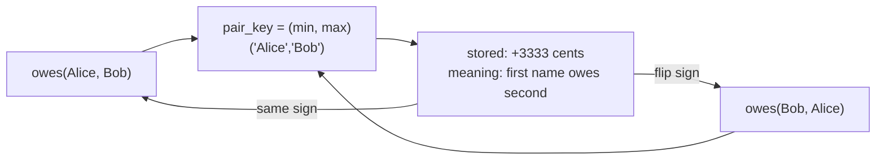
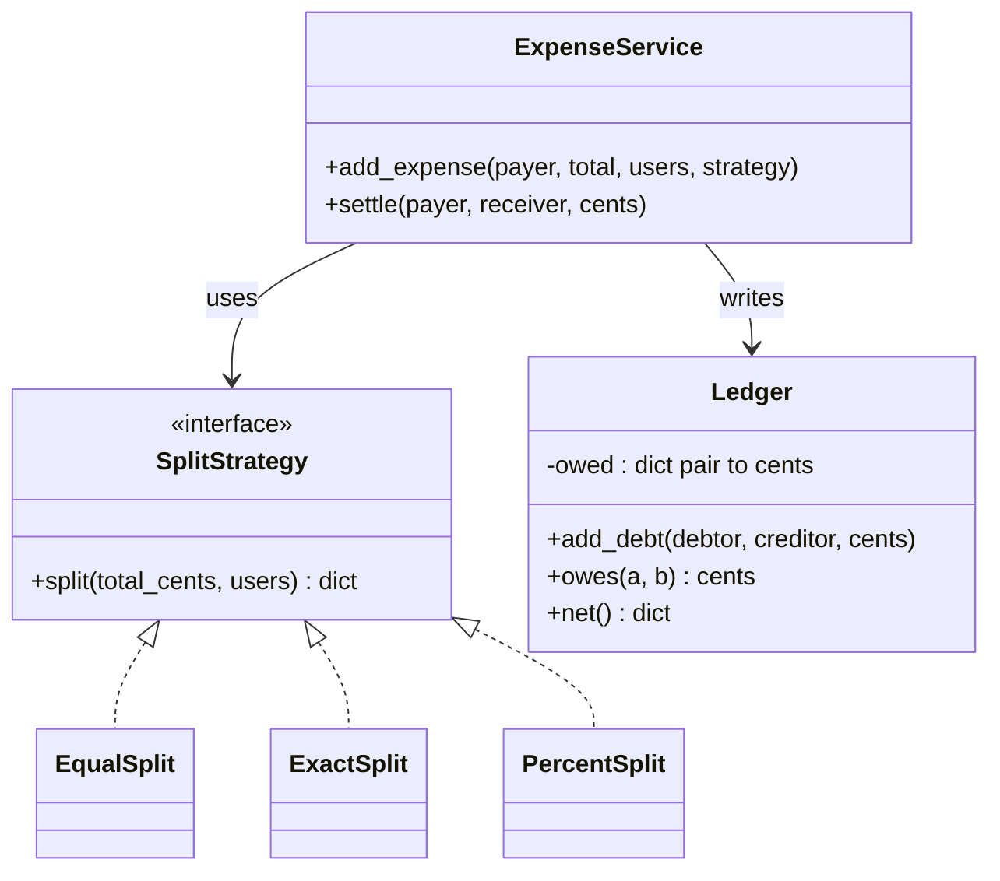

# Splitwise — Expense Sharing & Settle Up

> **Prerequisites:** [03 · Generics, Exceptions & Value Objects](../03-generics-exceptions-and-value-objects/README.md), [04 · SOLID](../04-solid-principles/README.md), [08 · Behavioral Patterns I](../08-behavioral-patterns-i/README.md)  
> **Reading time:** ~30 minutes (plus ~10 to run the demo)  
> **Audience:** LLD rounds — money, ledgers, "who owes whom," and a Strategy you can extend live

> [!NOTE]
> **In one line:** Store money as **integer cents**, keep **one number per pair of people** (keyed in a canonical order), plug in **Strategy** classes for equal / exact / percent splits, and compute **net balances → a short list of transfers** to settle up.

> [!TIP]
> **Golden rule:** A debt belongs to the *pair*, not to either person. If you keep `alice.owes` **and** `bob.isOwed`, the two copies will drift — and then the app says Alice owes `$30` while Bob is owed `$20`. One number, one canonical key, integer cents.

> [!TIP]
> **Try it:** Draw `Expense → SplitStrategy → Ledger` in [LLD Studio](/tools/lld-studio/), then run the Python demo below and break it on purpose (change the percentages so they do not add up to 100).

---

## 1. Interview pressure

Interviewer: *"Design Splitwise. Alice pays `$100` for dinner with Bob and Charlie. Support equal, exact, and percent splits. Show who owes whom, and add a 'settle up' that uses as few payments as possible."*

The first trap is arithmetic, and you can show it in ten seconds:

```python
>>> 100.00 / 3
33.333333333333336
>>> round(100.00 / 3, 2) * 3
99.99          # one cent vanished — the books no longer balance
>>> 0.1 + 0.2
0.30000000000000004
```

Say this out loud before drawing a single class: *"Money is integer cents. `$100.00` divided three ways is `3334 + 3333 + 3333`. The sum must equal the total exactly, and I'll assert it."*

The second trap is **dual bookkeeping** — storing a balance on both users. The third is **settle up**: showing five payments when two would do.

---

## 2. Mental model

One ledger entry per pair. Both directions of the question read the **same** cell.



How the pieces fit:



---

## 3. Walkthrough

**Requirements (say them, then write them on the board):**

- Add an expense: one payer, a total, participants, a split rule.
- Query: how much does A owe B (and vice versa)?
- Group view: net position per person.
- Settle up: minimum-ish list of payments that clears everyone.

**Entities and what each one owns:**

| Entity | Responsibility | Not its job |
| :--- | :--- | :--- |
| `SplitStrategy` | Turn `(total, users)` into `{user: cents}` that sums to `total` | Touching the ledger |
| `Ledger` | One signed number per canonical pair; `add_debt`, `owes`, `net` | Knowing about equal vs percent |
| `ExpenseService` | Orchestrates: split → write debts; `settle` | Rounding rules |
| `minimize_transfers` | Pure function: `net → [(from, to, cents)]` | Mutating anything |

**Key methods, in the order you'd write them:**

1. `pair_key(a, b)` → `(min, max)`. The sign convention: **stored value > 0 means the first name owes the second**.
2. `Ledger.add_debt(debtor, creditor, cents)` → pick the key, add `+cents` if the debtor is the first name, else `-cents`.
3. `Ledger.owes(a, b)` → read the cell, flip the sign if `a` is the second name.
4. `EqualSplit.split` → `divmod(total, n)`; give the leftover cents one each to the first few people.
5. `ExpenseService.add_expense` → shares from the strategy; for every participant except the payer, `add_debt(user, payer, share)`.
6. `Ledger.net()` → derive per-person net from the pairs (never store it separately).
7. `minimize_transfers(net)` → repeatedly match the biggest debtor with the biggest creditor.

**Extension point:** a new split rule (by shares, by item) is a new `SplitStrategy`. `ExpenseService` and `Ledger` do not change. That is the whole Open/Closed story for this problem.

**Settle up, by example.** Net balances: Alice `+7000` (is owed), Bob `-2000`, Charlie `-5000`. Pairwise debts might be three payments. Greedy: Charlie (biggest debtor) pays Alice `5000`; Bob pays Alice `2000`. Two payments — at most `n − 1` for `n` people.

---

## 4. Code

Python is the one to run. The C# tab is the same design — `long` cents, a tuple key, a lock.

````carousel
```python
from __future__ import annotations

import heapq
import threading
from abc import ABC, abstractmethod
from collections import defaultdict

Cents = int


def fmt(c: Cents) -> str:
    sign = "-" if c < 0 else ""
    c = abs(c)
    return f"{sign}${c // 100}.{c % 100:02d}"


class SplitError(ValueError):
    pass


def _check(total: Cents, users: list[str]) -> None:
    if total <= 0:
        raise SplitError("total must be positive cents")
    if not users or len(set(users)) != len(users):
        raise SplitError("users must be non-empty and unique")


# ── Strategy: three ways to turn a total into shares ──────────────────
class SplitStrategy(ABC):
    @abstractmethod
    def split(self, total: Cents, users: list[str]) -> dict[str, Cents]:
        """Return {user: cents}. Contract: values are >= 0 and sum to total."""


class EqualSplit(SplitStrategy):
    def __init__(self, rotate: int = 0) -> None:
        self.rotate = rotate          # rotate the "extra cent" so it is not always the same person

    def split(self, total: Cents, users: list[str]) -> dict[str, Cents]:
        _check(total, users)
        base, rem = divmod(total, len(users))
        out = {u: base for u in users}
        for i in range(rem):
            out[users[(self.rotate + i) % len(users)]] += 1
        return out


class ExactSplit(SplitStrategy):
    def __init__(self, amounts: dict[str, Cents]) -> None:
        self.amounts = amounts

    def split(self, total: Cents, users: list[str]) -> dict[str, Cents]:
        _check(total, users)
        if set(self.amounts) != set(users):
            raise SplitError("exact amounts must cover exactly the participants")
        if any(v < 0 for v in self.amounts.values()):
            raise SplitError("negative share")
        if sum(self.amounts.values()) != total:
            raise SplitError(f"exact shares sum to {sum(self.amounts.values())}, expected {total}")
        return dict(self.amounts)


class PercentSplit(SplitStrategy):
    """Percentages in basis points (10000 = 100%). Integers only: no 33.33 floats."""

    def __init__(self, bps: dict[str, int]) -> None:
        self.bps = bps

    def split(self, total: Cents, users: list[str]) -> dict[str, Cents]:
        _check(total, users)
        if set(self.bps) != set(users):
            raise SplitError("percentages must cover exactly the participants")
        if sum(self.bps.values()) != 10_000:
            raise SplitError(f"percentages sum to {sum(self.bps.values()) / 100}%, expected 100%")
        out = {u: total * self.bps[u] // 10_000 for u in users}              # floor
        leftover = total - sum(out.values())                                 # 0..n-1 cents
        by_remainder = sorted(users, key=lambda u: -((total * self.bps[u]) % 10_000))
        for u in by_remainder[:leftover]:                                    # largest-remainder method
            out[u] += 1
        return out


# ── Ledger: ONE signed number per canonical pair ──────────────────────
def pair_key(a: str, b: str) -> tuple[str, str]:
    return (a, b) if a <= b else (b, a)


class Ledger:
    """_owed[(lo, hi)] > 0  means  lo owes hi.  < 0 means hi owes lo."""

    def __init__(self) -> None:
        self._owed: dict[tuple[str, str], Cents] = defaultdict(int)
        self._lock = threading.Lock()

    def add_debt(self, debtor: str, creditor: str, cents: Cents) -> None:
        if cents < 0:
            raise SplitError("debt must be non-negative; use settle() to reduce")
        if debtor == creditor or cents == 0:
            return
        lo, hi = pair_key(debtor, creditor)
        delta = cents if debtor == lo else -cents
        with self._lock:
            self._owed[(lo, hi)] += delta

    def owes(self, a: str, b: str) -> Cents:
        """What a owes b. Negative means b owes a."""
        lo, hi = pair_key(a, b)
        with self._lock:
            v = self._owed.get((lo, hi), 0)
        return v if a == lo else -v

    def net(self) -> dict[str, Cents]:
        """Positive = is owed overall. Negative = owes overall. Always sums to 0."""
        out: dict[str, Cents] = defaultdict(int)
        with self._lock:
            for (lo, hi), v in self._owed.items():
                out[lo] -= v
                out[hi] += v
        return {u: c for u, c in out.items() if c != 0}

    def pair_count(self) -> int:
        with self._lock:
            return sum(1 for v in self._owed.values() if v != 0)


class ExpenseService:
    def __init__(self, ledger: Ledger) -> None:
        self.ledger = ledger

    def add_expense(self, payer: str, total: Cents, users: list[str],
                    strategy: SplitStrategy) -> dict[str, Cents]:
        shares = strategy.split(total, users)
        assert sum(shares.values()) == total, "strategy broke the sum invariant"
        for user, share in shares.items():          # validate first, write after
            self.ledger.add_debt(user, payer, share)   # payer's own share is skipped inside
        return shares

    def settle(self, payer: str, receiver: str, cents: Cents) -> None:
        """payer hands cash to receiver: receiver now owes payer less / payer owes receiver less."""
        if cents <= 0:
            raise SplitError("settlement must be positive")
        self.ledger.add_debt(receiver, payer, cents)


# ── Settle up: greedy biggest-debtor -> biggest-creditor ──────────────
def minimize_transfers(net: dict[str, Cents]) -> list[tuple[str, str, Cents]]:
    creditors = [(-v, u) for u, v in net.items() if v > 0]    # max-heap via negation
    debtors = [(v, u) for u, v in net.items() if v < 0]       # most negative first
    heapq.heapify(creditors)
    heapq.heapify(debtors)
    transfers: list[tuple[str, str, Cents]] = []
    while creditors and debtors:
        c, cu = heapq.heappop(creditors)
        d, du = heapq.heappop(debtors)
        c, d = -c, -d                                          # both positive now
        pay = min(c, d)
        transfers.append((du, cu, pay))
        if c > pay:
            heapq.heappush(creditors, (-(c - pay), cu))
        if d > pay:
            heapq.heappush(debtors, (-(d - pay), du))
    return transfers


if __name__ == "__main__":
    ledger = Ledger()
    svc = ExpenseService(ledger)

    print("1) $100.00 three ways, Alice paid")
    shares = svc.add_expense("Alice", 10_000, ["Alice", "Bob", "Charlie"], EqualSplit())
    print("  shares:", {u: fmt(c) for u, c in shares.items()}, "sum =", fmt(sum(shares.values())))
    assert sorted(shares.values()) == [3333, 3333, 3334] and sum(shares.values()) == 10_000
    print("  Bob owes Alice:", fmt(ledger.owes("Bob", "Alice")),
          "| Alice owes Bob:", fmt(ledger.owes("Alice", "Bob")))
    assert ledger.owes("Bob", "Alice") == -ledger.owes("Alice", "Bob") == 3333

    print("2) Percent: 50/30/20 of $100.01, then 33.33/33.33/33.34")
    p1 = PercentSplit({"A": 5000, "B": 3000, "C": 2000}).split(10_001, ["A", "B", "C"])
    p2 = PercentSplit({"A": 3333, "B": 3333, "C": 3334}).split(10_001, ["A", "B", "C"])
    print("  ", p1, sum(p1.values()))
    print("  ", p2, sum(p2.values()))
    assert sum(p1.values()) == sum(p2.values()) == 10_001

    print("3) Bad input is rejected, not silently fixed")
    for label, strat, users in [
        ("exact off by a cent", ExactSplit({"A": 5000, "B": 4999}), ["A", "B"]),
        ("percent sums to 99%", PercentSplit({"A": 5000, "B": 4900}), ["A", "B"]),
    ]:
        try:
            strat.split(10_000, users)
        except SplitError as exc:
            print(f"  {label}: rejected -> {exc}")

    print("4) Group: Alice paid 100 (above); Bob pays 60 for all; Charlie pays 30 with Alice")
    svc.add_expense("Bob", 6_000, ["Alice", "Bob", "Charlie"], EqualSplit(rotate=1))
    svc.add_expense("Charlie", 3_000, ["Alice", "Charlie"], ExactSplit({"Alice": 1000, "Charlie": 2000}))
    net = ledger.net()
    print("  net:", {u: fmt(c) for u, c in sorted(net.items())})
    assert sum(net.values()) == 0
    plan = minimize_transfers(net)
    for debtor, creditor, cents in plan:
        print(f"  {debtor} pays {creditor} {fmt(cents)}")
    print(f"  {ledger.pair_count()} pair debts -> {len(plan)} transfers")
    assert len(plan) <= len(net) - 1

    print("5) Settle up using the plan: everyone ends at zero")
    for debtor, creditor, cents in plan:
        svc.settle(debtor, creditor, cents)
    print("  net after:", ledger.net() or "all zero")
    assert ledger.net() == {}
    print("OK")
```
<!-- slide -->
```csharp
using System;
using System.Collections.Generic;

public interface ISplitStrategy
{
    IReadOnlyDictionary<string, long> Split(long totalCents, IReadOnlyList<string> users);
}

public sealed class EqualSplit : ISplitStrategy
{
    public IReadOnlyDictionary<string, long> Split(long total, IReadOnlyList<string> users)
    {
        if (total <= 0 || users.Count == 0)
            throw new ArgumentException("positive total and at least one user required");
        long baseShare = total / users.Count, rem = total % users.Count;
        var shares = new Dictionary<string, long>();
        for (int i = 0; i < users.Count; i++)
            shares[users[i]] = baseShare + (i < rem ? 1 : 0);   // first `rem` people get one extra cent
        return shares;
    }
}

public sealed class Ledger
{
    // > 0: Lo owes Hi.  < 0: Hi owes Lo.  One entry per pair.
    private readonly Dictionary<(string Lo, string Hi), long> _owed = new();
    private readonly object _gate = new();

    public static (string Lo, string Hi) Key(string a, string b) =>
        string.CompareOrdinal(a, b) <= 0 ? (a, b) : (b, a);

    public void AddDebt(string debtor, string creditor, long cents)
    {
        if (cents < 0) throw new ArgumentOutOfRangeException(nameof(cents));
        if (debtor == creditor || cents == 0) return;
        var key = Key(debtor, creditor);
        long delta = debtor == key.Lo ? cents : -cents;
        lock (_gate)
        {
            _owed[key] = _owed.GetValueOrDefault(key) + delta;
        }
    }

    public long Owes(string a, string b)
    {
        var key = Key(a, b);
        long v;
        lock (_gate) { v = _owed.GetValueOrDefault(key); }
        return a == key.Lo ? v : -v;
    }
}

public static class Demo
{
    public static void Main()
    {
        var users = new List<string> { "Alice", "Bob", "Charlie" };
        var shares = new EqualSplit().Split(10_000, users);
        var ledger = new Ledger();
        foreach (var (user, share) in shares) ledger.AddDebt(user, "Alice", share);

        Console.WriteLine(string.Join(", ", shares));                      // [Alice, 3334], [Bob, 3333], [Charlie, 3333]
        Console.WriteLine($"Bob owes Alice {ledger.Owes("Bob", "Alice")}");   // 3333
        Console.WriteLine($"Alice owes Bob {ledger.Owes("Alice", "Bob")}");   // -3333
    }
}
```
````

Expected Python output (verified, exit code 0):

```text
1) $100.00 three ways, Alice paid
  shares: {'Alice': '$33.34', 'Bob': '$33.33', 'Charlie': '$33.33'} sum = $100.00
  Bob owes Alice: $33.33 | Alice owes Bob: -$33.33
2) Percent: 50/30/20 of $100.01, then 33.33/33.33/33.34
   {'A': 5001, 'B': 3000, 'C': 2000} 10001
   {'A': 3333, 'B': 3333, 'C': 3335} 10001
3) Bad input is rejected, not silently fixed
  exact off by a cent: rejected -> exact shares sum to 9999, expected 10000
  percent sums to 99%: rejected -> percentages sum to 99.0%, expected 100%
4) Group: Alice paid 100 (above); Bob pays 60 for all; Charlie pays 30 with Alice
  net: {'Alice': '$36.66', 'Bob': '$6.67', 'Charlie': '-$43.33'}
  Charlie pays Alice $36.66
  Charlie pays Bob $6.67
  3 pair debts -> 2 transfers
5) Settle up using the plan: everyone ends at zero
  net after: all zero
OK
```

Why those numbers: Alice is owed `$66.66` from the dinner, owes Bob `$20.00` and Charlie `$10.00`, so her net is `+$36.66`. Three pair debts collapse into **two** transfers.

What to point at when you present it:

- **Contract on the interface:** every `SplitStrategy` returns shares that sum to `total`. `add_expense` asserts it, so a buggy new strategy fails loudly instead of leaking a cent.
- **Largest-remainder rounding** (`PercentSplit`): floor everyone, then hand the leftover cents to whoever lost the most to flooring. Deterministic, fair, sums exactly.
- **`rotate` on `EqualSplit`:** "first person always pays the extra cent" is a real fairness bug over thousands of bills. Rotate by expense id.
- **`net()` is derived**, never stored — one source of truth, nothing to drift.
- **`settle` is just a negative expense** written through the same `add_debt`, so history and balances stay consistent.

---

## 5. Edges

| Risk | What to say / do |
| :--- | :--- |
| **Floats** | Never for money. Integer minor units (cents; yen has 0 decimals, dinar has 3 — store the currency's minor unit). |
| **Shares that don't sum** | Validate in the strategy; assert in the service. Reject, don't "fix by dumping the difference on someone." |
| **Percent rounding** | Basis points + largest remainder. Don't accept `33.33 + 33.33 + 33.33`. |
| **Payer not in the participant list** | Allowed (paid for others). `add_debt` skips debtor == creditor, so a payer who is in the list owes nothing to themselves. |
| **Concurrency** | Two expenses touching the same pair race on `+=`. Lock in the ledger (above) or make it a DB row with `UPDATE ... SET owed = owed + :delta`. Never read-modify-write across two calls. |
| **Multi-currency** | One ledger per currency. Do not add USD cents to EUR cents; conversion is a separate, explicit, timestamped step. |
| **Greedy isn't always optimal** | Minimizing the number of transfers in the general case is NP-hard (subset-sum shaped). Greedy gives ≤ `n − 1` and is what interviewers expect. Say "good enough, not provably minimal." |
| **Audit** | Keep an append-only list of expenses and settlements; the pair map is a cache you can rebuild. |

**When *not* to use all this:** a two-person IOU app needs one signed integer, not strategies and a heap. Add the Strategy when a *second* split rule shows up.

---

## 6. What you'd say in two minutes

> "Money is integer cents — never floats — so `$100` three ways is `3334, 3333, 3333` and I assert the sum. For balances I store **one signed number per pair**, keyed by `(min, max)` of the two ids, so `owes(A, B)` and `owes(B, A)` read the same cell and can't drift. Split rules are a `SplitStrategy` — equal, exact, percent — each returning shares that sum to the total; percent uses basis points and largest-remainder rounding. `ExpenseService` asks the strategy for shares and writes a debt from each participant to the payer. For group settle-up I derive each person's net from the pairs, then repeatedly match the biggest debtor to the biggest creditor with two heaps — at most `n − 1` payments. It's greedy, so I'd call it good-enough rather than optimal. For concurrency I'd lock per pair, or do an atomic `owed = owed + delta` in the database. A new split type is just a new strategy; the ledger doesn't change."

---

## 7. Anti-patterns

1. **`float` / `double` money** — fix: integer cents (or `Decimal` with an explicit rounding mode).
2. **Balance stored on both users** (`alice.owes[bob]` and `bob.owed_by[alice]`) — fix: one canonical pair cell; derive the other view.
3. **Split logic inside `add_expense` as `if type == "percent"`** — fix: `SplitStrategy`; the service stays closed to new types.
4. **"Fix" the rounding by giving the leftover to the payer** — silently shifts money. Fix: deterministic largest-remainder or rotation, and say so.
5. **Storing net balances as the source of truth** — you lose *who* owes *whom*. Fix: store pairs (or the expense log); net is a view.
6. **Settling with all pairwise payments** — `n(n−1)/2` transfers. Fix: net + greedy matching.

---

## 8. Interview questions

<details>
<summary><strong>1. Why integer cents instead of float or double? [BASIC]</strong></summary>

Binary floats cannot represent most decimal fractions (`0.1 + 0.2 != 0.3`) and errors accumulate, so books stop balancing. Integer minor units are exact and cheap. If you need division (percent), define the rounding rule explicitly.

</details>

<details>
<summary><strong>2. Why a canonical pair key? [BASIC]</strong></summary>

Without it, `(Alice, Bob)` and `(Bob, Alice)` are two cells that can disagree. Sorting the two ids gives one cell; the sign encodes direction. Both queries read the same number.

</details>

<details>
<summary><strong>3. Split `10000` cents three ways. [BASIC]</strong></summary>

`divmod(10000, 3) = (3333, 1)`. Everyone gets `3333`, the one leftover cent goes to one person: `3334 + 3333 + 3333 = 10000`. Rotate who gets the extra cent across expenses so it is fair over time.

</details>

<details>
<summary><strong>4. Add "split by shares" (Alice 2 shares, Bob 1). [SCENARIO]</strong></summary>

New `ShareSplit(SplitStrategy)`: total weight = sum of shares; floor `total * w // W`, then distribute leftover cents with largest remainder (same helper as percent). No change to `Ledger` or `ExpenseService`.

</details>

<details>
<summary><strong>5. Alice, Bob, Charlie each paid for others. Minimize settle-up payments. [SCENARIO]</strong></summary>

Compute net per person from the ledger (credits minus debts; sums to zero). Put creditors and debtors in two heaps, repeatedly match the largest of each, pay `min(c, d)`, push back the remainder. At most `n − 1` transfers. Mention it is greedy.

</details>

<details>
<summary><strong>6. Two requests add expenses between Alice and Bob at the same time. [SCENARIO]</strong></summary>

Each does read-modify-write on the same cell → lost update. Lock around the update (per pair or global in an interview), or push the increment into the database as one atomic statement (`owed = owed + :delta`) inside the transaction that also inserts the expense row.

</details>

<details>
<summary><strong>7. Is greedy debt simplification optimal? [TRICKY]</strong></summary>

Not always. It guarantees at most `n − 1` transfers, but the true minimum equals `n − (number of zero-sum subgroups)` and finding the maximum number of zero-sum subgroups is NP-hard. For real groups (a handful of people) you can brute-force subsets; otherwise greedy is the pragmatic answer.

</details>

<details>
<summary><strong>8. A user is deleted but still has a balance. What now? [TRICKY]</strong></summary>

Don't delete ledger rows. Soft-delete (deactivate) the user, block new expenses, and require settle-up first. The expense log is the audit trail; removing one side of a pair would silently create or destroy money.

</details>

---

## 9. Try it

1. Run the Python block. Confirm the output matches `3334 / 3333 / 3333`, `sum(net) == 0`, and that every balance is zero after applying the plan.
2. Add `ShareSplit` (weighted shares) without touching `Ledger` or `ExpenseService`. Reuse the largest-remainder helper from `PercentSplit`.
3. Break it: make `EqualSplit` return `total // n` for everyone (no remainder handling). Which assertion fires first?
4. Add `Expense` records (id, payer, total, shares) and rebuild the ledger from the log. Check it equals the live ledger.
5. Model `Expense → SplitStrategy → Ledger` in [LLD Studio](/tools/lld-studio/), then compare how this "one number per pair" idea shows up in [Movie Ticket Booking](../16-movie-ticket-booking/README.md) (atomic claim) and the [LLD practice sheet](../PRACTICE.md).

---

## 10. One-page cheat sheet

```text
Money        integer cents. Never float. Format only at the edge.
Pair key     (min(a,b), max(a,b)); stored > 0 means first owes second.
add_debt     debtor == first ? +cents : -cents   (skip debtor == creditor)
Equal        divmod(total, n); first `rem` people get +1 cent; rotate who.
Exact        shares must sum to total, else reject.
Percent      basis points (sum 10000); floor + largest remainder.
Invariants   sum(shares) == total ; sum(net) == 0 ; owes(a,b) == -owes(b,a)
Settle up    net -> two heaps -> pay min(c,d) -> <= n-1 transfers (greedy)
Concurrency  lock per pair, or DB: owed = owed + :delta in one txn
Extend       new split = new SplitStrategy. Ledger unchanged.

Say aloud: "One number per pair, in integer cents, and every split must sum to the total."
```

---

## Next

**[16 · Movie Ticket Booking](../16-movie-ticket-booking/README.md)** — seats as scarce resources, holds with expiry, and claiming atomically.
