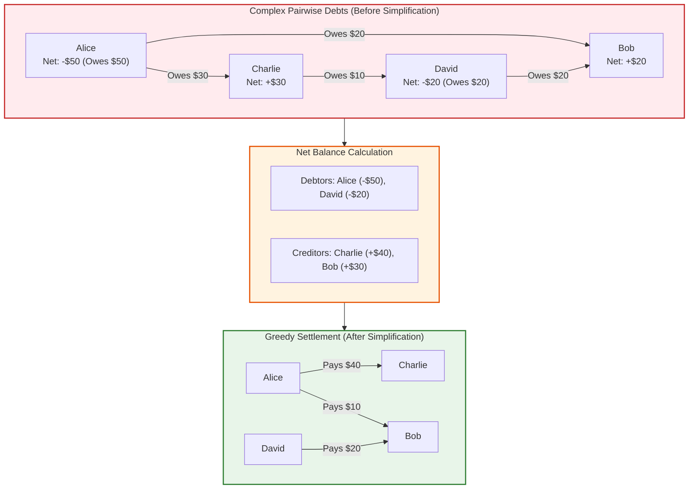
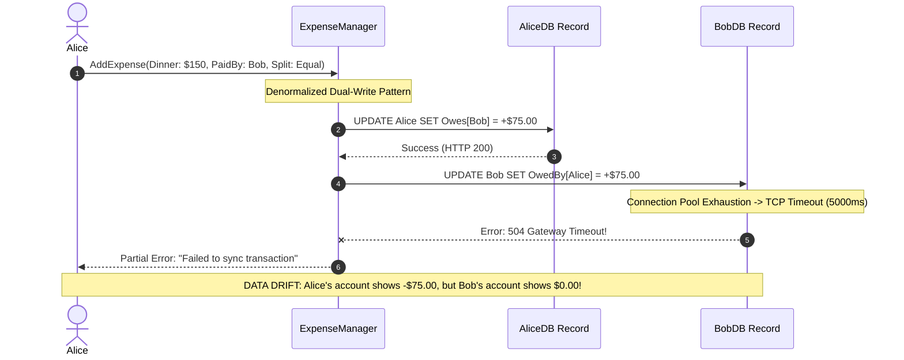

# Classic Systems: Splitwise Expense Sharing & Debt Simplification

> **Prerequisites**: [03: Generics, Exceptions & Value Objects](../03-generics-exceptions-and-value-objects/README.md), [04: SOLID Principles](../04-solid-principles/README.md), [08: Behavioral Patterns I](../08-behavioral-patterns-i/README.md).  
> **Estimated Reading Time**: 25 minutes  
> **Target Audience**: Backend Engineers, Fintech Architects, Low-Level Design Interview Candidates.

> [!TIP]
> **Golden Rule of Financial Ledgers**: A balance between two parties is an invariant property of the **pair**, not of either individual. Never store balances redundantly on both user records (e.g., `Alice.owes` and `Bob.isOwed`). Store exactly one number per pair keyed by a canonical deterministic sort order ($\min(\text{ID}_A, \text{ID}_B) \rightarrow \max(\text{ID}_A, \text{ID}_B)$). Never use floating-point types (`float`, `double`) for money; represent currency in atomic integer cents or decimal value objects.

---

## 1. Visual Mental Models & System Architecture

Expense-sharing engines (like Splitwise) must balance two demanding constraints:
1. **Financial Exactness**: Splitting \$100.00 three ways must sum to exactly \$100.00 without losing or inventing pennies ($33.34 + 33.33 + 33.33 = 100.00$).
2. **Deterministic Pairwise Accounting**: Querying balances in either direction (`getBalance(A, B)` vs `getBalance(B, A)`) must return symmetrical results without dual-entry state drift.

### 1.1 Canonical Pairwise Ledger Keying

Instead of storing two separate ledger entries for every transaction, the ledger indexes balances by a sorted canonical key. The sign of the stored balance dictates the direction of debt.

```mermaid
flowchart LR
    subgraph Input["Queries from Callers"]
        Q1["getBalance(Alice, Bob)"]
        Q2["getBalance(Bob, Alice)"]
    end

    subgraph Canonicalizer["Canonical Key Normalizer"]
        K["Key: min(Alice, Bob) : max(Alice, Bob)<br/>'Alice:Bob'"]
    end

    subgraph Store["Single Source of Truth Ledger"]
        Val["Stored Balance: +$30.00<br/>(Convention: First user owes Second user)"]
    end

    Q1 --> K
    Q2 --> K
    K --> Store
    Store -->|+30.00 (Alice owes Bob $30)| Q1
    Store -->|-30.00 (Bob is owed $30 by Alice)| Q2

    style Input fill:#e1f5fe,stroke:#0288d1,stroke-width:2px
    style Canonicalizer fill:#f3e5f5,stroke:#7b1fa2,stroke-width:2px
    style Store fill:#e8f5e9,stroke:#2e7d32,stroke-width:2px
```

---

### 1.2 Group Debt Simplification (Minimum Cash Flow)

Without simplification, a 4-person group might have 6 individual pairwise debt transactions. By computing net balances and greedily matching the largest creditor to the largest debtor, transactions are reduced from $\mathcal{O}(V^2)$ to at most $V - 1$.



---

## 2. Taxonomic Reference Grids

### 2.1 Split Strategy Comparison Matrix

| Strategy | Mathematical Invariant | Remainder / Penny Allocation | Validation Invariant |
| :--- | :--- | :--- | :--- |
| **Equal Split** | $\text{Share} = \lfloor \frac{\text{Total}}{N} \rfloor$ | First $R$ participants receive $+1$ cent ($R = \text{Total} \pmod N$) | $N > 0$ and $\text{Total} > 0$ |
| **Exact Split** | $\sum_{i=1}^N \text{Amount}_i == \text{Total}$ | Exact user input; no automated remainder | Throw `InvalidSplitException` if $\sum \text{Amount} \ne \text{Total}$ |
| **Percentage Split** | $\sum_{i=1}^N \text{Pct}_i == 100.00\%$ | Last participant absorbs rounding penny differences | Reject if $\sum \text{Pct} \ne 100\%$ |
| **Share / Ratio Split** | $\text{Share}_i = \frac{\text{Ratio}_i}{\sum \text{Ratio}} \times \text{Total}$ | Largest ratio absorbs integer division remainder | All ratios $> 0$ |

### 2.2 Ledger Data Model Architecture

| Architectural Dimension | Naive Double-Entry | Canonical Single-Entry Pair |
| :--- | :--- | :--- |
| **Storage Keys** | `Alice.balances["Bob"]` AND `Bob.balances["Alice"]` | `balances["Alice:Bob"]` |
| **Update Mechanism** | Two separate writes (Risk of partial failure) | Single atomic memory write / DB row |
| **Query Symmetrical Consistency** | Requires distributed transaction or lock | Guaranteed by definition ($-\text{Balance}$) |
| **Memory Footprint** | $2 \times$ entries | $1 \times$ entry |
| **Locking Strategy** | Requires acquiring both User locks (Deadlock risk) | Lock key `min(idA, idB) : max(idA, idB)` |

---

## 3. Production War Stories: Incident Post-Mortem

### The $340K Dual-Ledger Drift: How Independent User Balances Caused a Phantom Debt Run

```
SEVERITY LEVEL: SEV-1 (Financial Ledger Discrepancy & Overpayment)
DETECTION TIME: 8 Hours (During nightly reconciliation)
RECOVERY TIME: 360 Minutes
TOTAL LOSS PREVENTED / ADJUSTED: $340,000 in disputed user balances
```

#### Incident Background
A social fintech app enabled users to split restaurant meals and rent. To support fast mobile profile loading, user balances were denormalized: each `User` record stored a dictionary `Map<UserId, Decimal> OwesMe` and `Map<UserId, Decimal> IOwe`.

#### What Happened
During a high-concurrency weekend surge, thousands of dinner tabs were settled simultaneously. Under a microservice database connection timeout, an HTTP request to `POST /expenses` succeeded in updating Alice's record (`Alice owes Bob $150`) but timed out before updating Bob's record (`Bob is owed $150 by Alice`). When Bob opened his app, his balance showed \$0.00. Bob requested Alice pay him again, and Alice showed proof that her ledger was already updated. Over 1,200 user pairs drifted out of sync, triggering a flood of customer support disputes and account freezes.



#### Root Cause Analysis
1. **Denormalized Symmetrical State**: Storing symmetrical debt facts in two independent records broke single-source-of-truth invariants.
2. **Missing Distributed Transaction**: The system attempted dual writes without an atomic commit or transactional outbox pattern.
3. **Absence of Canonical Keys**: Queries could not resolve conflicts because neither record knew which timestamp was authoritative.

#### The Architectural Hardening
1. **Single Canonical Pairwise Ledger**: Eliminated `OwesMe` on the user entity. All balances are stored in a dedicated `LedgerEntry` table with unique constraint `(user_a_id, user_b_id)` where `user_a_id < user_b_id`.
2. **Idempotent Atomic Ledger Mutations**: Balance updates are applied using atomic SQL increments:
   $$\text{UPDATE ledger SET balance = balance + :delta WHERE user\_a = :a AND user\_b = :b}$$
3. **Self-Healing Reconciliation Engine**: Added a background worker verifying that the sum of all expense splits for any pair exactly equals their stored ledger balance.

---

## 4. Multi-Language Production Implementations

Below are four enterprise implementations of the **Splitwise Expense Engine** with canonical pairwise balances and split strategies.

### 4.1 Go: Canonical Pairwise Ledger with Integer-Cent Math

```go
package main

import (
	"errors"
	"fmt"
	"sync"
)

type SplitType int

const (
	SplitEqual SplitType = iota
	SplitExact
	SplitPercent
)

type Split struct {
	UserID      string
	AmountCents int64
}

type SplitStrategy interface {
	ComputeSplits(totalCents int64, payerID string, participants []string, values []int64) ([]Split, error)
}

type EqualSplitStrategy struct{}

func (s *EqualSplitStrategy) ComputeSplits(totalCents int64, payerID string, participants []string, _ []int64) ([]Split, error) {
	n := len(participants)
	if n == 0 {
		return nil, errors.New("participants cannot be empty")
	}

	baseShare := totalCents / int64(n)
	remainder := totalCents % int64(n)

	splits := make([]Split, n)
	for i, uid := range participants {
		share := baseShare
		// Distribute remainder penny by penny to the first remainder participants
		if int64(i) < remainder {
			share++
		}
		splits[i] = Split{UserID: uid, AmountCents: share}
	}
	return splits, nil
}

type CanonicalLedger struct {
	mu       sync.RWMutex
	balances map[string]int64 // Key: "UserA:UserB" where UserA < UserB
}

func NewCanonicalLedger() *CanonicalLedger {
	return &CanonicalLedger{balances: make(map[string]int64)}
}

func (l *CanonicalLedger) getCanonicalKey(u1, u2 string) (string, bool) {
	if u1 < u2 {
		return fmt.Sprintf("%s:%s", u1, u2), true // u1 is first
	}
	return fmt.Sprintf("%s:%s", u2, u1), false // u2 is first
}

// AdjustBalance adds debt: positive delta means u1 owes u2.
func (l *CanonicalLedger) AdjustBalance(u1, u2 string, deltaCents int64) {
	if u1 == u2 || deltaCents == 0 {
		return
	}

	key, isFirst := l.getCanonicalKey(u1, u2)

	l.mu.Lock()
	defer l.mu.Unlock()

	if isFirst {
		l.balances[key] += deltaCents
	} else {
		l.balances[key] -= deltaCents
	}
}

// GetBalance returns positive if u1 owes u2, negative if u2 owes u1.
func (l *CanonicalLedger) GetBalance(u1, u2 string) int64 {
	key, isFirst := l.getCanonicalKey(u1, u2)

	l.mu.RLock()
	defer l.mu.RUnlock()

	val := l.balances[key]
	if isFirst {
		return val
	}
	return -val
}

type ExpenseManager struct {
	ledger   *CanonicalLedger
	equalStr SplitStrategy
}

func NewExpenseManager() *ExpenseManager {
	return &ExpenseManager{
		ledger:   NewCanonicalLedger(),
		equalStr: &EqualSplitStrategy{},
	}
}

func (em *ExpenseManager) AddExpense(payerID string, totalCents int64, participants []string) error {
	splits, err := em.equalStr.ComputeSplits(totalCents, payerID, participants, nil)
	if err != nil {
		return err
	}

	for _, sp := range splits {
		if sp.UserID != payerID {
			// Participant owes payer
			em.ledger.AdjustBalance(sp.UserID, payerID, sp.AmountCents)
		}
	}
	return nil
}

func main() {
	em := NewExpenseManager()
	
	// Alice pays $100.00 (10000 cents) for Alice, Bob, Charlie
	_ = em.AddExpense("Alice", 10000, []string{"Alice", "Bob", "Charlie"})

	// Verify Bob owes Alice $33.33 (3333 cents)
	bobOwesAlice := em.ledger.GetBalance("Bob", "Alice")
	aliceOwesBob := em.ledger.GetBalance("Alice", "Bob")

	fmt.Printf("Bob owes Alice: $%.2f\n", float64(bobOwesAlice)/100.0)
	fmt.Printf("Alice owes Bob: $%.2f\n", float64(aliceOwesBob)/100.0)
}
```

---

### 4.2 TypeScript: Domain-Driven Splitwise Engine with Debt Simplification

```typescript
export class Money {
  constructor(public readonly cents: number) {
    if (!Number.isInteger(cents)) {
      throw new Error("Money must be represented as an integer number of cents");
    }
  }

  public static fromDollars(dollars: number): Money {
    return new Money(Math.round(dollars * 100));
  }

  public toDollars(): number {
    return this.cents / 100;
  }
}

export class CanonicalLedger {
  private balances: Map<string, number> = new Map();

  private canonicalKey(u1: string, u2: string): { key: string; isFirst: boolean } {
    return u1 < u2
      ? { key: `${u1}#${u2}`, isFirst: true }
      : { key: `${u2}#${u1}`, isFirst: false };
  }

  public recordDebt(debtorId: string, creditorId: string, cents: number): void {
    if (debtorId === creditorId || cents === 0) return;

    const { key, isFirst } = this.canonicalKey(debtorId, creditorId);
    const current = this.balances.get(key) ?? 0;
    const delta = isFirst ? cents : -cents;
    this.balances.set(key, current + delta);
  }

  public getBalance(u1: string, u2: string): number {
    const { key, isFirst } = this.canonicalKey(u1, u2);
    const val = this.balances.get(key) ?? 0;
    return isFirst ? val : -val;
  }

  // Minimum Cash Flow Settlement Algorithm
  public simplifyDebts(): Array<{ from: string; to: string; amount: number }> {
    const netBalances = new Map<string, number>();

    // Compute net balance per participant
    for (const [key, balance] of this.balances.entries()) {
      const [u1, u2] = key.split("#");
      netBalances.set(u1, (netBalances.get(u1) ?? 0) - balance);
      netBalances.set(u2, (netBalances.get(u2) ?? 0) + balance);
    }

    const debtors: Array<{ id: string; amount: number }> = [];
    const creditors: Array<{ id: string; amount: number }> = [];

    for (const [id, net] of netBalances.entries()) {
      if (net < 0) debtors.push({ id, amount: -net });
      else if (net > 0) creditors.push({ id, amount: net });
    }

    const settlements: Array<{ from: string; to: string; amount: number }> = [];
    let dIdx = 0;
    let cIdx = 0;

    while (dIdx < debtors.length && cIdx < creditors.length) {
      const debtor = debtors[dIdx];
      const creditor = creditors[cIdx];

      const settleAmount = Math.min(debtor.amount, creditor.amount);
      settlements.push({ from: debtor.id, to: creditor.id, amount: settleAmount / 100 });

      debtor.amount -= settleAmount;
      creditor.amount -= settleAmount;

      if (debtor.amount === 0) dIdx++;
      if (creditor.amount === 0) cIdx++;
    }

    return settlements;
  }
}
```

---

### 4.3 Python: Splitwise Engine with Percentage & Exact Split Strategies

```python
from abc import ABC, abstractmethod
from typing import Dict, List, Tuple


class SplitStrategy(ABC):
    @abstractmethod
    def calculate_shares(self, total_cents: int, participants: List[str], values: List[float]) -> Dict[str, int]:
        pass


class EqualSplitStrategy(SplitStrategy):
    def calculate_shares(self, total_cents: int, participants: List[str], _values: List[float]) -> Dict[str, int]:
        n = len(participants)
        base = total_cents // n
        remainder = total_cents % n

        shares = {}
        for i, uid in enumerate(participants):
            shares[uid] = base + (1 if i < remainder else 0)
        return shares


class PercentSplitStrategy(SplitStrategy):
    def calculate_shares(self, total_cents: int, participants: List[str], percentages: List[float]) -> Dict[str, int]:
        if sum(percentages) != 100.0:
            raise ValueError(f"Percentages must sum to 100.0, got {sum(percentages)}")

        shares = {}
        allocated = 0
        for i in range(len(participants) - 1):
            cents = round(total_cents * (percentages[i] / 100.0))
            shares[participants[i]] = cents
            allocated += cents

        # Last participant absorbs rounding penny differences
        shares[participants[-1]] = total_cents - allocated
        return shares


class Ledger:
    def __init__(self):
        self._balances: Dict[Tuple[str, str], int] = {}

    def _canonical(self, u1: str, u2: str) -> Tuple[Tuple[str, str], bool]:
        return ((u1, u2), True) if u1 < u2 else (((u2, u1), False))

    def record_debt(self, debtor: str, creditor: str, cents: int) -> None:
        if debtor == creditor or cents == 0:
            return
        pair, is_first = self._canonical(debtor, creditor)
        curr = self._balances.get(pair, 0)
        self._balances[pair] = curr + (cents if is_first else -cents)

    def get_balance(self, u1: str, u2: str) -> int:
        pair, is_first = self._canonical(u1, u2)
        val = self._balances.get(pair, 0)
        return val if is_first else -val
```

---

### 4.4 C#: Enterprise Splitwise Manager with Canonical Thread-Safe Storage

```csharp
using System;
using System.Collections.Concurrent;
using System.Collections.Generic;

namespace Architecture.Splitwise
{
    public readonly struct Money : IEquatable<Money>
    {
        public long Cents { get; }

        public Money(long cents) => Cents = cents;
        public static Money FromDollars(decimal dollars) => new((long)Math.Round(dollars * 100m));
        public decimal ToDollars() => Cents / 100m;

        public bool Equals(Money other) => Cents == other.Cents;
    }

    public class CanonicalLedger
    {
        private readonly ConcurrentDictionary<string, long> _balances = new();

        private (string Key, bool IsFirst) GetKey(string u1, string u2)
        {
            return string.CompareOrdinal(u1, u2) < 0
                ? ($"{u1}:{u2}", true)
                : ($"{u2}:{u1}", false);
        }

        public void AddDebt(string debtor, string creditor, long cents)
        {
            if (debtor == creditor || cents == 0) return;

            var (key, isFirst) = GetKey(debtor, creditor);
            long delta = isFirst ? cents : -cents;

            _balances.AddOrUpdate(key, delta, (_, existing) => existing + delta);
        }

        public long GetBalance(string u1, string u2)
        {
            var (key, isFirst) = GetKey(u1, u2);
            if (!_balances.TryGetValue(key, out long val)) return 0;
            return isFirst ? val : -val;
        }
    }
}
```

---

## 5. Practical Hands-On Verification Workflows

### 5.1 CLI Verification of Remainder Penny Distribution

Validate that dividing \$100.00 across 3 users preserves total financial invariant:

```bash
# Execute Python inline test verifying zero-penny loss invariant
python3 -c "
total = 10000 # $100.00 in cents
n = 3
base = total // n
rem = total % n

splits = [base + (1 if i < rem else 0) for i in range(n)]
print(f'Splits in Cents: {splits}')
print(f'Sum of Splits: {sum(splits)} (Must equal {total})')
assert sum(splits) == total, 'Invariant broken!'
"
```

Expected Terminal Output:
```
Splits in Cents: [3334, 3333, 3333]
Sum of Splits: 10000 (Must equal 10000)
```

---

## 6. Operational Validation Checkpoints (Scenario Quizzes)

<details>
<summary><strong>Checkpoint 1: The Floating-Point Accounting Drift</strong></summary>

**Scenario**: A Junior developer models money as `double balance = 0.0`. After 1,000,000 equal splits of \$0.10, the ledger outputs: `Total: 99999.9999999482`. An audit fails with a \$0.05 fiscal variance. Why did this occur and what is the strict design requirement?

<strong>Answer:</strong>
**Binary Floating-Point Imprecision**:
- Binary floating-point types (`float`, `double` / IEEE 754) cannot precisely represent decimal base-10 fractions (like $0.10 = \frac{1}{10}$). They produce periodic binary approximations that accumulate error under repetitive arithmetic.
- **Strict Invariant**:
  - Store all monetary values as **integer cents** (`int64`, `long`, `BigInt`) or arbitrary-precision decimals (`decimal` in C#, `Decimal` in Python, `BigDecimal` in Java).
  - Floating-point types are strictly forbidden in financial domain architectures.
</details>

<details>
<summary><strong>Checkpoint 2: Settling Debts in Cycles</strong></summary>

**Scenario**: In a group of three roommates:
- Alice owes Bob \$50.
- Bob owes Charlie \$50.
- Charlie owes Alice \$50.
A naive billing system prompts each person to make external bank transfers. How does graph-based debt simplification resolve this?

<strong>Answer:</strong>
**Net Zero Cycle Elimination**:
- The debt simplification algorithm evaluates the net balance of each user:
  - $\text{Net}(\text{Alice}) = -50 + 50 = \$0$.
  - $\text{Net}(\text{Bob}) = -50 + 50 = \$0$.
  - $\text{Net}(\text{Charlie}) = -50 + 50 = \$0$.
- Because every participant's net position is exactly \$0, the entire circular debt is canceled out without requiring a single bank transfer!
</details>

<details>
<summary><strong>Checkpoint 3: The Idempotent Expense Submission Race</strong></summary>

**Scenario**: A mobile app user splits a \$300 bar tab. Experiencing a spotty cellular connection, they tap "Submit" three times in rapid succession. Three concurrent HTTP requests reach the `ExpenseManager`. Without proper design, the ledger charges participants \$900. How do you prevent this at the LLD domain layer?

<strong>Answer:</strong>
**Idempotency Keys with Transaction Deduplication**:
1. The client generates a unique UUID `Idempotency-Key` (e.g., `expense_hash_user_timestamp`).
2. The `ExpenseManager` checks an in-memory thread-safe `Set<string>` or DB unique constraint on `idempotency_key` inside the write transaction.
3. If an expense with that key already exists or is currently processing, subsequent duplicate calls return the cached response of the first execution with zero additional mutations to the `Ledger`.
</details>

---

## 7. Further Reading & References

- [IEEE 754 Floating-Point Arithmetic Pitfalls](https://docs.python.org/3/tutorial/floatingpoint.html) - Technical overview of binary floating point rounding.
- [GeeksforGeeks: Minimize Cash Flow among a Given Set of Friends](https://www.geeksforgeeks.org/minimize-cash-flow-among-given-set-friends-borrowed-money/) - Algorithmic analysis of greedy debt settlement.
- [Martin Fowler: Money Pattern](https://martinfowler.com/eaaCatalog/money.html) - Industry standard Domain-Driven Design pattern for currency representation.

---

## Next Steps

Advance to [Module 16: Movie Ticket Booking](../16-movie-ticket-booking/README.md) to explore multi-seat concurrency locking, atomic booking transactions, and seat category pricing.
