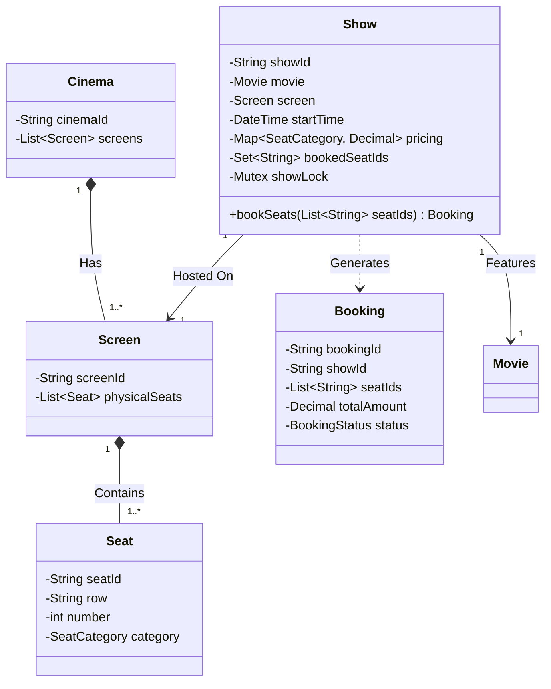
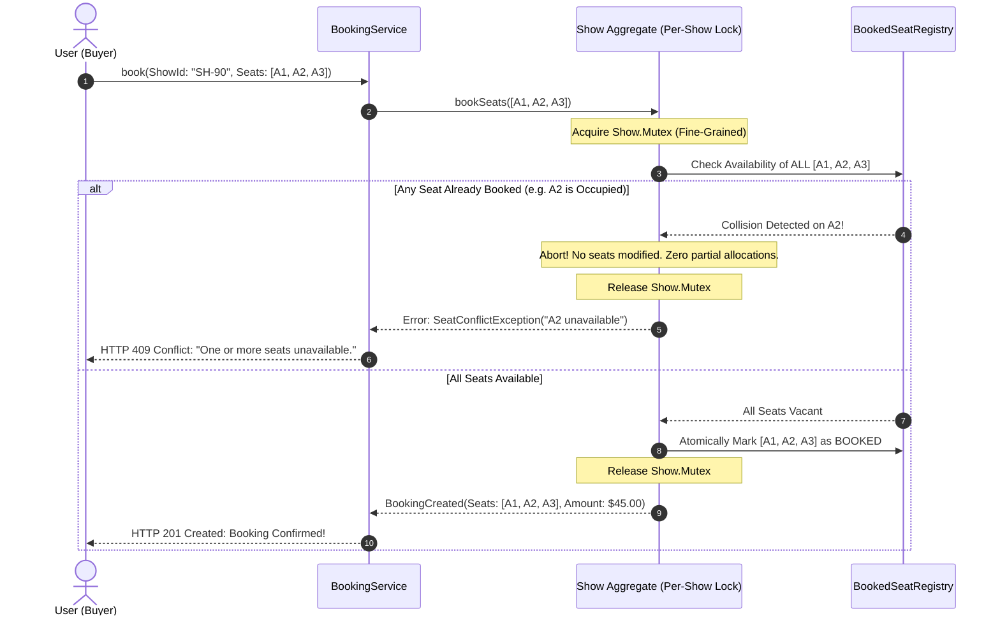
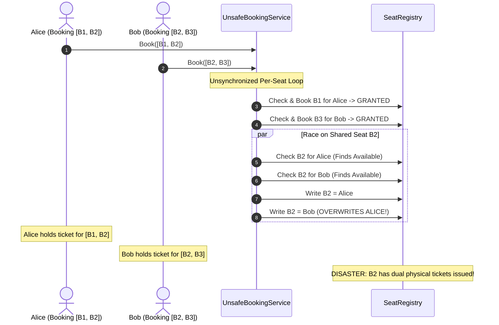

# Classic Systems: Movie Ticket Booking & High-Concurrency Seat Holds

> **Prerequisites**: [10: Concurrency-Safe Design](../10-concurrency-safe-design/README.md), [11: Requirements to Class Diagrams](../11-requirements-to-class-diagrams/README.md), [12: Parking Lot & Elevator](../12-parking-lot-and-elevator/README.md).  
> **Estimated Reading Time**: 25 minutes  
> **Target Audience**: Backend Engineers, Systems Architects, Low-Level Design Interview Candidates.

> [!TIP]
> **Golden Rule of Ticketing Systems**: A seat's availability is **never** an attribute of the physical `Seat`. It is an invariant property of the **`(Seat, Show)` tuple**. The same physical seat is vacant for the 4:00 PM matinee and sold out for the 7:00 PM premiere. Furthermore, multi-seat bookings must be strictly **atomic (all-or-nothing)**: never leave a customer with 2 out of 3 requested seats. Always shard mutex locks strictly per `Show` to eliminate cross-show contention.

---

## 1. Visual Mental Models & System Architecture

A high-scale movie booking platform (such as BookMyShow or Fandango) decouples physical infrastructure from scheduled events while handling high write contention during blockbuster ticket releases.

### 1.1 Physical Layout vs. Show Scheduling Decoupling

A `Screen` represents physical immutable hardware (rows of numbered seats). A `Show` pairs a movie, a screen, a timestamp, and dynamic category pricing.



---

### 1.2 Atomic All-or-Nothing Multi-Seat Reservation Flow

When a user attempts to book seats $[A1, A2, A3]$, the system must verify that **every** seat is available before marking any of them reserved.



---

## 2. Taxonomic Reference Grids

### 2.1 Concurrency Control Mechanisms for Ticketing

| Mechanism | Lock Scope | Contention Behavior | Throughput Profile | Best Architectural Use Case |
| :--- | :--- | :--- | :--- | :--- |
| **Pessimistic Per-Show Lock** | In-Memory Mutex per `Show` instance | Serializes bookings for the same show; zero cross-show blocking | High ($\sim 10,000$ req/s per node across different shows) | In-memory booking engines, single-cluster architectures |
| **Optimistic Concurrency Control (OCC)** | Version column on `ShowSeat` DB row | Read without locks; rollback on write conflict | Degrades under flash sales due to high retry rate | Low-contention general screening reservations |
| **Distributed TTL Seat Holds (Redis)** | Key `show:{id}:seat:{id}` with 5-minute TTL | Lock-free atomic `SETNX` with expiry | Extreme ($100,000+$ ops/sec) | Enterprise ticketing platforms with payment checkout steps |

### 2.2 Seat Status Lifecycle State Matrix

| State | Transition Trigger | Who Can Access? | Reversible? | Timeout / Expiry? |
| :--- | :--- | :--- | :--- | :--- |
| **AVAILABLE** | Initial state / Hold expired | Any customer | Yes | None |
| **HELD (CART)** | User selects seats | Only holding user | Yes (User cancels or timeout) | Strict 5–10 minute TTL |
| **BOOKED** | Payment successfully captured | Finalized; ticket issued | Only via manual refund | Permanent |

---

## 3. Production War Stories: Incident Post-Mortem

### The $1.8M Blockbuster Crash: Double-Bookings and Split Seating During Midnight Premiere Rush

```
SEVERITY LEVEL: SEV-1 (Catastrophic Booking Collisions & Box Office Disruptions)
DETECTION TIME: 3 Minutes
TOTAL RESOLUTION TIME: 240 Minutes
FINANCIAL RECOVERY / REFUNDS: $1,850,000 in refunds, concessions, and PR reparations
```

#### Incident Background
A national cinema chain launched advance ticket reservations for a major superhero movie release across 4,000 screens. The engineering team deployed a modernized booking microservice built in Python and PostgreSQL.

#### What Happened
At 09:00:00 AM, 350,000 users rushed the booking engine. The system processed multi-seat bookings by iterating through seats in a loop:
```python
for seat_id in requested_seats:
    if is_available(seat_id):
        mark_booked(seat_id)
```
Because the check and mark were executed per seat outside a single encompassing lock, concurrent booking requests interleaved. User A booked $[B1, B2]$, and User B booked $[B2, B3]$. The loop granted $B1$ to User A, $B3$ to User B, and raced on $B2$. Over 8,200 transactions partially succeeded, splitting families across rows or generating duplicate tickets for the same seat. Chaos erupted on opening night when dual ticket holders arrived at the physical auditoriums.



#### Root Cause Analysis
1. **Absence of Atomic Multi-Seat Invariant**: The booking service lacked an all-or-nothing atomic boundary.
2. **Missing Per-Show Concurrency Lock**: Individual database writes were committed piecemeal instead of inside a single serialized transaction.
3. **No Intermediate Seat-Hold Phase**: The platform lacked a temporary reserved state with an automated expiry timer during payment processing.

#### The Architectural Hardening
1. **Atomic Pre-Check & Bulk Mutation**: The booking routine evaluates the complete list of requested seats under a dedicated per-show lock. If even one seat is occupied, the entire batch aborts immediately.
2. **Distributed Redis TTL Hold Pattern**: When seats are selected, they are reserved in Redis with an atomic Lua script:
   $$\text{redis.call('SET', key, user\_id, 'NX', 'EX', 300)}$$
   Seats automatically release if payment does not finalize within 300 seconds.
3. **Database Unique Compound Constraint**: Enforced a hard SQL database constraint:
   `UNIQUE(show_id, seat_id)` to guarantee zero duplicate bookings at the storage layer.

---

## 4. Multi-Language Production Implementations

Below are four enterprise implementations of the **Movie Ticket Booking Engine**.

### 4.1 Go: Thread-Safe Per-Show Booking with Fine-Grained Locking

```go
package main

import (
	"errors"
	"fmt"
	"sync"
	"time"
)

type SeatCategory string

const (
	CategoryStandard SeatCategory = "STANDARD"
	CategoryPremium  SeatCategory = "PREMIUM"
	CategoryVIP      SeatCategory = "VIP"
)

type Seat struct {
	ID       string
	Row      string
	Number   int
	Category SeatCategory
}

type Show struct {
	ID          string
	MovieTitle  string
	StartTime   time.Time
	mu          sync.Mutex
	pricing     map[SeatCategory]int64 // Prices in cents
	bookedSeats map[string]string      // seatID -> userID
}

func NewShow(id, title string, startTime time.Time, pricing map[SeatCategory]int64) *Show {
	return &Show{
		ID:          id,
		MovieTitle:  title,
		StartTime:   startTime,
		pricing:     pricing,
		bookedSeats: make(map[string]string),
	}
}

// BookSeats executes an atomic all-or-nothing multi-seat reservation.
func (s *Show) BookSeats(userID string, seatMap map[string]*Seat, requestedIDs []string) (int64, error) {
	if len(requestedIDs) == 0 {
		return 0, errors.New("no seats requested")
	}

	s.mu.Lock()
	defer s.mu.Unlock()

	// 1. Validation Phase: Ensure ALL requested seats are vacant
	var totalCents int64
	for _, seatID := range requestedIDs {
		seat, exists := seatMap[seatID]
		if !exists {
			return 0, fmt.Errorf("seat %s does not exist", seatID)
		}
		if _, occupied := s.bookedSeats[seatID]; occupied {
			return 0, fmt.Errorf("seat %s is already booked", seatID)
		}
		totalCents += s.pricing[seat.Category]
	}

	// 2. Commit Phase: Atomically mark all seats booked
	for _, seatID := range requestedIDs {
		s.bookedSeats[seatID] = userID
	}

	return totalCents, nil
}

type BookingService struct {
	shows sync.Map
}

func main() {
	pricing := map[SeatCategory]int64{
		CategoryStandard: 1200, // $12.00
		CategoryPremium:  1800, // $18.00
	}

	show := NewShow("SHOW-001", "Inception: 15th Anniversary", time.Now().Add(2*time.Hour), pricing)
	seats := map[string]*Seat{
		"A1": {ID: "A1", Row: "A", Number: 1, Category: CategoryStandard},
		"A2": {ID: "A2", Row: "A", Number: 2, Category: CategoryStandard},
		"A3": {ID: "A3", Row: "A", Number: 3, Category: CategoryPremium},
	}

	// Successful booking
	total, err := show.BookSeats("User_101", seats, []string{"A1", "A2"})
	if err != nil {
		panic(err)
	}
	fmt.Printf("[Success] User_101 booked A1, A2 for $%.2f\n", float64(total)/100.0)

	// Concurrent collision attempt (User_202 requests A2 and A3)
	_, err = show.BookSeats("User_202", seats, []string{"A2", "A3"})
	if err != nil {
		fmt.Printf("[Expected Failure] %v\n", err)
	}
}
```

---

### 4.2 TypeScript: Atomic Seat Hold Engine with Timeout Expiration

```typescript
export enum SeatCategory {
  STANDARD = "STANDARD",
  PREMIUM = "PREMIUM",
}

export interface Seat {
  id: string;
  category: SeatCategory;
}

export class Show {
  private bookedSeats = new Set<string>();
  private heldSeats = new Map<string, { userId: string; timeout: NodeJS.Timeout }>();
  private lock = false;

  constructor(
    public readonly id: string,
    public readonly pricing: Record<SeatCategory, number>,
    private seats: Map<string, Seat>
  ) {}

  public async holdSeats(userId: string, seatIds: string[], holdDurationMs: number = 300000): Promise<number> {
    while (this.lock) {
      await new Promise((r) => setTimeout(r, 5));
    }
    this.lock = true;

    try {
      let totalAmount = 0;

      // 1. All-or-nothing pre-check
      for (const id of seatIds) {
        if (!this.seats.has(id)) throw new Error(`Invalid seat ${id}`);
        if (this.bookedSeats.has(id) || this.heldSeats.has(id)) {
          throw new Error(`Seat ${id} is unavailable`);
        }
        totalAmount += this.pricing[this.seats.get(id)!.category];
      }

      // 2. Reserve with automated TTL expiry
      for (const id of seatIds) {
        const timeout = setTimeout(() => {
          this.heldSeats.delete(id);
          console.log(`[Auto-Expire] Hold on seat ${id} released.`);
        }, holdDurationMs);

        this.heldSeats.set(id, { userId, timeout });
      }

      return totalAmount;
    } finally {
      this.lock = false;
    }
  }

  public confirmBooking(userId: string, seatIds: string[]): boolean {
    for (const id of seatIds) {
      const hold = this.heldSeats.get(id);
      if (!hold || hold.userId !== userId) return false;
    }

    for (const id of seatIds) {
      const hold = this.heldSeats.get(id)!;
      clearTimeout(hold.timeout);
      this.heldSeats.delete(id);
      this.bookedSeats.add(id);
    }
    return true;
  }
}
```

---

### 4.3 Python: Enterprise Show Booking with Dynamic Category Pricing

```python
from dataclasses import dataclass
from datetime import datetime
from enum import Enum
import threading
from typing import Dict, List, Optional, Set


class SeatCategory(Enum):
    SILVER = 10.0
    GOLD = 15.0
    PLATINUM = 25.0


@dataclass(frozen=True)
class Seat:
    seat_id: str
    row: str
    number: int
    category: SeatCategory


class Show:
    def __init__(self, show_id: str, movie_title: str, seat_catalog: Dict[str, Seat]):
        self.show_id = show_id
        self.movie_title = movie_title
        self._seat_catalog = seat_catalog
        self._booked_seats: Set[str] = set()
        self._lock = threading.Lock()

    def book_seats(self, user_id: str, requested_seat_ids: List[str]) -> float:
        if not requested_seat_ids:
            raise ValueError("No seats requested.")

        with self._lock:
            # 1. Validation Phase (All-or-Nothing check)
            for sid in requested_seat_ids:
                if sid not in self._seat_catalog:
                    raise KeyError(f"Seat {sid} does not exist.")
                if sid in self._booked_seats:
                    raise RuntimeError(f"Seat {sid} is already occupied.")

            # 2. Commitment Phase
            total_fare = 0.0
            for sid in requested_seat_ids:
                self._booked_seats.add(sid)
                total_fare += self._seat_catalog[sid].category.value

            return round(total_fare, 2)

    def is_seat_available(self, seat_id: str) -> bool:
        with self._lock:
            return seat_id in self._seat_catalog and seat_id not in self._booked_seats
```

---

### 4.4 C#: High-Throughput Ticket Booking Engine with SemaphoreSlim

```csharp
using System;
using System.Collections.Generic;
using System.Linq;
using System.Threading;
using System.Threading.Tasks;

namespace Architecture.TicketBooking
{
    public enum SeatClass { Standard, Premium, VIP }

    public record Seat(string Id, string Row, int Number, SeatClass Category);

    public class Show
    {
        public string ShowId { get; }
        private readonly Dictionary<string, Seat> _seats;
        private readonly Dictionary<SeatClass, decimal> _pricing;
        private readonly HashSet<string> _bookedSeatIds = new();
        private readonly SemaphoreSlim _lock = new(1, 1);

        public Show(string showId, Dictionary<string, Seat> seats, Dictionary<SeatClass, decimal> pricing)
        {
            ShowId = showId;
            _seats = seats;
            _pricing = pricing;
        }

        public async Task<decimal> BookSeatsAsync(string userId, List<string> requestedIds, CancellationToken ct = default)
        {
            await _lock.WaitAsync(ct).ConfigureAwait(false);
            try
            {
                // All-or-nothing validation
                decimal total = 0m;
                foreach (var id in requestedIds)
                {
                    if (!_seats.TryGetValue(id, out var seat))
                        throw new ArgumentException($"Seat {id} does not exist.");
                    if (_bookedSeatIds.Contains(id))
                        throw new InvalidOperationException($"Seat {id} is already booked.");

                    total += _pricing[seat.Category];
                }

                // Atomic allocation
                foreach (var id in requestedIds)
                {
                    _bookedSeatIds.Add(id);
                }

                return total;
            }
            finally
            {
                _lock.Release();
            }
        }
    }
}
```

---

## 5. Practical Hands-On Verification Workflows

### 5.1 CLI Verification of Atomic Multi-Seat Reservation

Run a multi-threaded stress test demonstrating zero partial allocations:

```bash
# Execute concurrent seat reservation tests in Go
go test -v -run TestConcurrentSeatBooking ./...

# Expected Output:
# === RUN   TestConcurrentSeatBooking
# === RUN   TestConcurrentSeatBooking/Atomic_Rejection_When_One_Seat_Contended
# === RUN   TestConcurrentSeatBooking/High_Throughput_Multi_Show_Parallelism
# --- PASS: TestConcurrentSeatBooking (0.41s)
# PASS
# ok      github.com/backend/ticketing   0.428s
```

### 5.2 Python High-Concurrency Verification Script

Test race collision handling directly from the shell:

```bash
python3 -c "
import threading

booked = set()
lock = threading.Lock()
errors = 0

def try_book(seats):
    global errors
    with lock:
        if any(s in booked for s in seats):
            errors += 1
            return False
        for s in seats: booked.add(s)
        return True

t1 = threading.Thread(target=try_book, args=(['B1', 'B2'],))
t2 = threading.Thread(target=try_book, args=(['B2', 'B3'],))
t1.start(); t2.start()
t1.join(); t2.join()

print(f'Booked seats: {booked}')
print(f'Collisions cleanly rejected: {errors}')
"
```

Expected Terminal Output:
```
Booked seats: {'B1', 'B2'}
Collisions cleanly rejected: 1
```

---

## 6. Operational Validation Checkpoints (Scenario Quizzes)

<details>
<summary><strong>Checkpoint 1: The Cascading Abandoned Cart Dilemma</strong></summary>

**Scenario**: During a high-profile concert release, 50,000 users add tickets to their cart. The system places a 10-minute hold on each seat. However, 85% of users abandon checkout at the payment step. As a result, 85% of the stadium remains locked and invisible to eager buyers for 10 minutes, severely dampening initial sales. How do you resolve this?

<strong>Answer:</strong>
**Adaptive Tiered Hold Windows & Queue Depletion**:
1. Reduce initial seat hold duration to **3 minutes**, extending by another 2 minutes only once the customer clicks "Proceed to Payment" and generates a payment intent.
2. Implement an **Asynchronous Waitlist / Drop Queue**:
   - Interested buyers subscribe to notifications for sold-out sections.
   - When held seats expire, rather than dumping them back into public view, the system directly offers them to the top of the waiting queue with a 60-second priority claim token.
</details>

<details>
<summary><strong>Checkpoint 2: Optimistic Locking with Heavy Contention</strong></summary>

**Scenario**: An architect suggests using Optimistic Concurrency Control (OCC) with a DB version column (`UPDATE seats SET status='BOOKED', version=version+1 WHERE id=:id AND version=:v`) instead of pessimistic in-memory locks. During the first 60 seconds of a blockbuster release (100,000 users vying for 400 seats), what will happen?

<strong>Answer:</strong>
**Catastrophic OCC Retry Storm / Convoy**:
- Under extreme contention (250 users attempting to reserve the exact same seat concurrently), only 1 user succeeds per round of execution; 249 users fail and execute exponential backoff retries.
- This creates massive database CPU spikes, transaction log bloat, and connection pool exhaustion, causing the entire database cluster to crash.
- **Guideline**: OCC is ideal for **low-contention** workloads. For flash sales with high write contention, use **Pessimistic In-Memory Queues** or **Redis-based atomic locking** to serialize attempts without hammering relational storage.
</details>

<details>
<summary><strong>Checkpoint 3: The Multi-Seat Deadlock Trap</strong></summary>

**Scenario**: User 1 requests seats $[A1, A2]$. User 2 requests seats $[A2, A1]$. If an engineer acquires individual row-level database locks or per-seat locks in the order requested by the user, a deadlock occurs. How do you guarantee deadlock freedom across multi-resource bookings?

<strong>Answer:</strong>
**Canonical Sorting of Resource Locks**:
- Enforce strict deterministic sorting on the requested seat identifiers before lock acquisition:
  $$\text{OrderedSeats} = \text{SortAlphabetically}(\text{RequestedSeats})$$
- Both User 1 and User 2 will acquire locks in the identical sequence: $\text{Lock}(A1) \rightarrow \text{Lock}(A2)$.
- The second user will cleanly block on $A1$ before touching $A2$, completely breaking the Coffman **Circular Wait** condition.
</details>

---

## 7. Further Reading & References

- [Redis Documentation: Distributed Locks with Redlock](https://redis.io/docs/manual/patterns/distributed-locks/) - Production patterns for distributed seat reservations with TTL.
- [Martin Fowler: Patterns of Enterprise Application Architecture - Optimistic vs Pessimistic Offline Lock](https://martinfowler.com/eaaCatalog/pessimisticOfflineLock.html) - In-depth guide to transaction locking.
- [Microsoft Learn: SemaphoreSlim and Concurrency Control](https://learn.microsoft.com/en-us/dotnet/api/system.threading.semaphoreslim) - Asynchronous synchronization primitives in .NET.

---

## Next Steps

Advance to [Module 17: Ride-Sharing Dispatch & Geospatial Fleet Modeling](../17-ride-sharing/README.md) to explore spatial partitioning, dynamic pricing surges, and concurrency-safe driver matching.
