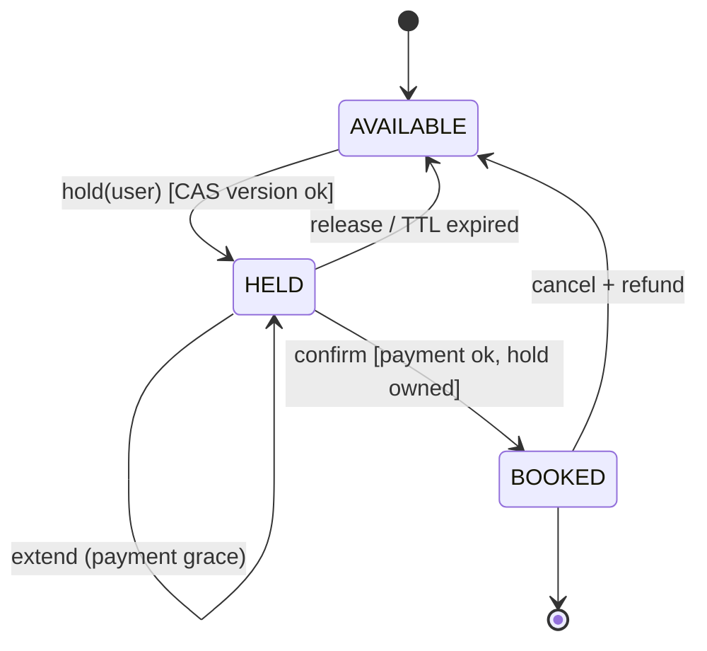
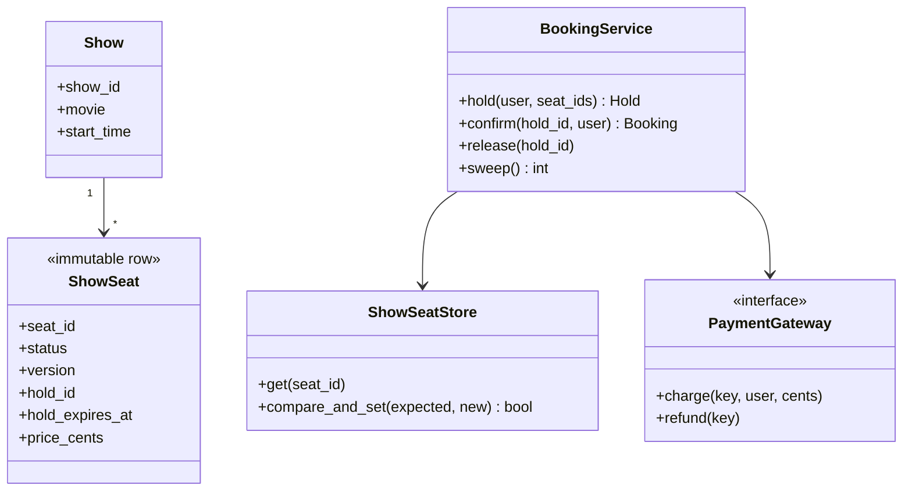
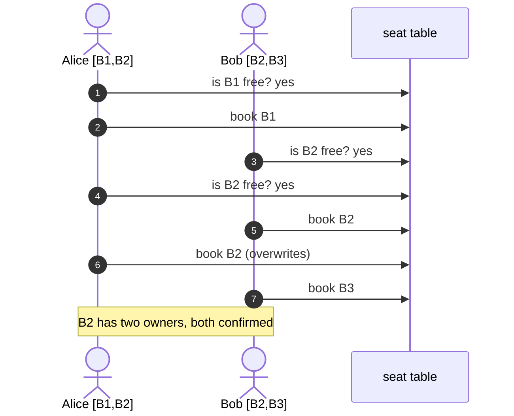

# Classic LLD: Movie Ticket Booking — Seat Holds & Optimistic Locking

> **Prerequisites:** [10 · Concurrency-Safe Design](../10-concurrency-safe-design/README.md), [11 · Requirements to Class Diagrams](../11-requirements-to-class-diagrams/README.md), [12 · Parking Lot & Elevator](../12-parking-lot-and-elevator/README.md), [13 · Library & Vending Machine](../13-library-and-vending-machine/README.md)  
> **Reading time:** ~35 minutes  
> **Audience:** LLD / machine-coding rounds — the classic "two people click the same seat" question

> [!NOTE]
> **In one line:** Seat availability belongs to the **`(Show, Seat)` pair**, not the physical seat. Selecting seats creates a **temporary hold with a TTL**; paying converts the hold to a booking. Race-safety comes from an **atomic compare-and-set on a versioned row** (optimistic locking), multi-seat requests are **all-or-nothing**, and expiry is evaluated **lazily** so correctness never depends on a background job.

> [!TIP]
> **Golden rule:** Never "check availability, then write" as two steps. The check and the write are **one atomic operation** — a conditional `UPDATE ... WHERE version = :v` in SQL, a CAS in memory, `SET NX EX` in Redis. Everything else in this module is a consequence of that sentence.

> [!TIP]
> **Try it:** Draw `Show → ShowSeat (status, version, hold_id, expires_at) → Booking` in [LLD Studio](/tools/lld-studio/), then run the Python example and watch the 16-thread race produce exactly one winner.

---

## 1. Interview pressure

Interviewer: *"Design BookMyShow. Users pick seats, pay, and get tickets. Two users must never get the same seat. People abandon carts — their seats must come back. Booking 3 seats must not leave someone with 2."*

**Clarify first:**

| Question | Why it changes the design |
| :--- | :--- |
| Hold seats before payment? For how long? | Introduces a `HELD` state, TTL, extension, expiry |
| Multi-seat booking — all or nothing? | Atomic multi-row claim, ordering, compensation |
| Single server or many app nodes? | In-process lock vs **shared** store (DB / Redis) |
| Expected contention (flash sale vs normal)? | Optimistic vs pessimistic vs queue |
| Payment async or slow? | Hold must outlive the charge (grace extension) |
| Retries from client / payment webhook? | Idempotency key = `hold_id` |



```mermaid
sequenceDiagram
  autonumber
  actor U as User
  participant S as BookingService
  participant R as ShowSeat rows (versioned)
  participant P as PaymentGateway

  U->>S: hold([A1, A2])
  S->>R: sort ids; CAS A1 AVAILABLE->HELD
  S->>R: CAS A2 AVAILABLE->HELD
  alt any CAS loses
    S->>R: release seats this hold already took
    S-->>U: 409 SeatUnavailable
  else all won
    S-->>U: Hold(id, expires_at, total)
  end
  U->>S: confirm(hold_id)
  S->>R: extend expiry (payment grace)
  S->>P: charge(key = hold_id)
  S->>R: CAS HELD->BOOKED (owned by hold)
  S-->>U: Booking
```

---

## 2. Comparison matrix (memorize this)

### Concurrency control options

| Mechanism | Where the guard lives | Behavior under contention | Best for | Watch out |
| :--- | :--- | :--- | :--- | :--- |
| **In-process per-show lock** | One mutex per `Show` | Serializes bookings of one show; shows are parallel | Single node, interview baseline | Does not work across app nodes |
| **Optimistic locking (version CAS)** | `version` column per `ShowSeat` | No waiting; losers get a clean failure | Many nodes + normal/high read:write | Retry only when the version moved for a *benign* reason; a taken seat is a final answer |
| **Pessimistic row lock** | `SELECT ... FOR UPDATE` on seat rows | Waiters block, lock order matters | Strong guarantees, moderate load | Deadlocks → **sort seat ids**; long lock = hurt throughput |
| **Redis `SET NX EX` hold** | Key per seat with TTL | Atomic, expires automatically | Flash sales, millions of holds | Two stores (Redis + DB) must agree on `BOOKED`; multi-seat needs Lua |
| **DB unique constraint** | `UNIQUE(show_id, seat_id)` on booked rows | Second insert fails | **Always** — last line of defense | Not a hold mechanism by itself |

### Core model

| Class | Responsibility | Note |
| :--- | :--- | :--- |
| `Screen` / `Seat` | Immutable physical layout | Never carries booking state |
| `Show` | Movie + screen + start time + pricing | Aggregate root for its seats |
| `ShowSeat` | `(show, seat)` state: `status`, `version`, `hold_id`, `hold_expires_at`, `price` | **This** is what gets locked/CAS'd |
| `Hold` | `hold_id`, user, seat ids, expiry, total | Also the payment idempotency key |
| `Booking` | Confirmed seats + amount | Created only after payment |
| `PaymentGateway` | Port (`charge`, `refund`) | Fakeable; idempotent by key |



---

## 3. Walkthrough — holds with optimistic locking

**Requirements**

1. `hold(user, seats)` — all seats or none. Returns a `Hold` with a TTL (5 minutes).
2. Two users racing for the same seat: **exactly one** wins; the loser gets a clear `SeatUnavailable`.
3. Overlapping requests (`[A1, A2]` vs `[A2, A3]`) never leave stray holds behind.
4. `confirm(hold_id)` charges payment **once** (idempotent), then flips seats to `BOOKED`.
5. Abandoned holds free themselves. **Lazily** (an expired hold counts as free) and **eagerly** (a sweeper cleans the rows).
6. If the hold expires *while* a slow payment is running, the customer is **refunded**, never charged for seats they do not own.

**The algorithm in five lines**

1. Sort the seat ids (deterministic order).
2. For each seat: read row → if not free → fail; else `CAS(version)` to `HELD`.
3. If any seat fails → release the seats **this hold** already took (CAS back), raise `SeatUnavailable`.
4. `confirm`: extend expiry (payment grace) → charge with `hold_id` as the key → CAS each seat to `BOOKED`.
5. If a seat was lost in between → **refund**.

> In SQL this is one statement and one transaction: `UPDATE show_seat SET status='HELD', ... WHERE show_id=:s AND seat_id IN (:ids) AND <free predicate>` and **roll back unless `rowcount == len(ids)`**. The per-seat CAS + compensation below is the same invariant expressed in a form you can code in an interview.

````carousel
```python
from __future__ import annotations

import threading
import uuid
from abc import ABC, abstractmethod
from dataclasses import dataclass, replace
from datetime import datetime, timedelta
from enum import Enum
from typing import Callable


class SeatStatus(Enum):
    AVAILABLE = "available"
    HELD = "held"
    BOOKED = "booked"


class SeatUnavailable(Exception):
    def __init__(self, seat_id: str) -> None:
        super().__init__(f"seat {seat_id} unavailable")
        self.seat_id = seat_id


class HoldExpired(Exception):
    pass


class PaymentFailed(Exception):
    pass


@dataclass(frozen=True)
class ShowSeat:
    """One row per (show, seat). Immutable: every change is a new row with version+1."""

    seat_id: str
    price_cents: int
    status: SeatStatus = SeatStatus.AVAILABLE
    version: int = 0
    hold_id: str | None = None
    held_by: str | None = None
    hold_expires_at: datetime | None = None

    def is_free(self, now: datetime) -> bool:
        # Lazy expiry: an expired hold is free the instant its TTL passes.
        if self.status is SeatStatus.AVAILABLE:
            return True
        return self.status is SeatStatus.HELD and self.hold_expires_at <= now


@dataclass(frozen=True)
class Hold:
    hold_id: str
    user_id: str
    seat_ids: tuple[str, ...]
    expires_at: datetime
    total_cents: int


@dataclass(frozen=True)
class Booking:
    booking_id: str
    hold_id: str
    user_id: str
    seat_ids: tuple[str, ...]
    total_cents: int


class ShowSeatStore:
    """Stand-in for the table. compare_and_set == UPDATE ... WHERE seat_id=? AND version=?  (rowcount == 1)."""

    def __init__(self, seats: list[ShowSeat]) -> None:
        self._rows = {s.seat_id: s for s in seats}
        self._row_lock = threading.Lock()  # guards ONE row update, like the DB's row latch

    def get(self, seat_id: str) -> ShowSeat:
        return self._rows[seat_id]

    def compare_and_set(self, expected: ShowSeat, new: ShowSeat) -> bool:
        with self._row_lock:
            if self._rows[expected.seat_id].version != expected.version:
                return False  # someone else changed the row since we read it
            self._rows[expected.seat_id] = replace(new, version=expected.version + 1)
            return True

    def snapshot(self) -> list[ShowSeat]:
        return list(self._rows.values())


class PaymentGateway(ABC):
    @abstractmethod
    def charge(self, idempotency_key: str, user_id: str, cents: int) -> bool: ...

    @abstractmethod
    def refund(self, idempotency_key: str) -> None: ...


class BookingService:
    HOLD_TTL = timedelta(minutes=5)
    PAYMENT_GRACE = timedelta(minutes=2)
    MAX_SEATS = 10
    CAS_RETRIES = 3  # only for benign version bumps; a taken seat is a final answer

    def __init__(self, store: ShowSeatStore, payments: PaymentGateway,
                 clock: Callable[[], datetime] = datetime.now) -> None:
        self._store, self._payments, self._now = store, payments, clock
        self._reg_lock = threading.Lock()
        self._holds: dict[str, Hold] = {}
        self._bookings: dict[str, Booking] = {}  # by hold_id: confirm is idempotent
        self._confirm_locks: dict[str, threading.Lock] = {}

    # ── hold: all-or-nothing ───────────────────────────────────────
    def hold(self, user_id: str, seat_ids: list[str]) -> Hold:
        ids = sorted(set(seat_ids))  # deterministic order => no mutual-loss livelock
        if not ids or len(ids) > self.MAX_SEATS:
            raise ValueError(f"choose 1..{self.MAX_SEATS} seats")
        hold_id = uuid.uuid4().hex[:8]
        expires = self._now() + self.HOLD_TTL
        claimed: list[str] = []
        total = 0
        try:
            for sid in ids:
                total += self._claim(sid, hold_id, user_id, expires)
                claimed.append(sid)
        except SeatUnavailable:
            self._release(claimed, hold_id)  # compensate: nothing partial survives
            raise
        hold = Hold(hold_id, user_id, tuple(ids), expires, total)
        with self._reg_lock:
            self._holds[hold_id] = hold
        return hold

    def _claim(self, seat_id: str, hold_id: str, user_id: str, expires: datetime) -> int:
        for _ in range(self.CAS_RETRIES):
            row = self._store.get(seat_id)
            if not row.is_free(self._now()):
                raise SeatUnavailable(seat_id)  # taken: do NOT retry
            held = replace(row, status=SeatStatus.HELD, hold_id=hold_id,
                           held_by=user_id, hold_expires_at=expires)
            if self._store.compare_and_set(row, held):
                return row.price_cents
            # CAS lost: re-read. It is either still free (retry) or now taken (fail next loop).
        raise SeatUnavailable(seat_id)

    def _release(self, seat_ids, hold_id: str) -> None:
        for sid in seat_ids:
            for _ in range(self.CAS_RETRIES):
                row = self._store.get(sid)
                if row.hold_id != hold_id:
                    break  # not ours (anymore): never steal someone else's seat
                freed = replace(row, status=SeatStatus.AVAILABLE, hold_id=None,
                                held_by=None, hold_expires_at=None)
                if self._store.compare_and_set(row, freed):
                    break

    def release(self, hold_id: str, user_id: str) -> None:
        with self._reg_lock:
            hold = self._holds.get(hold_id)
            if hold is None or hold.user_id != user_id:
                return
            del self._holds[hold_id]
        self._release(hold.seat_ids, hold_id)

    # ── confirm: pay, then commit ──────────────────────────────────
    def confirm(self, hold_id: str, user_id: str) -> Booking:
        with self._reg_lock:
            lock = self._confirm_locks.setdefault(hold_id, threading.Lock())
        with lock:  # serialize duplicate confirm calls for ONE hold
            with self._reg_lock:
                done = self._bookings.get(hold_id)
                hold = self._holds.get(hold_id)
            if done is not None and done.user_id == user_id:
                return done  # idempotent replay
            if hold is None or hold.user_id != user_id:
                raise HoldExpired("unknown or already released hold")
            if self._now() >= hold.expires_at:
                self._drop(hold)
                raise HoldExpired("hold expired before payment")

            self._extend(hold)  # keep the seats alive while the (slow) charge runs
            if not self._payments.charge(hold_id, user_id, hold.total_cents):
                self._drop(hold)
                raise PaymentFailed("card declined")
            try:
                self._commit(hold)
            except HoldExpired:
                self._payments.refund(hold_id)  # seats were lost mid-payment
                raise
            booking = Booking(uuid.uuid4().hex[:8], hold_id, user_id, hold.seat_ids, hold.total_cents)
            with self._reg_lock:
                self._bookings[hold_id] = booking
                self._holds.pop(hold_id, None)
            return booking

    def _drop(self, hold: Hold) -> None:
        with self._reg_lock:
            self._holds.pop(hold.hold_id, None)
        self._release(hold.seat_ids, hold.hold_id)

    def _transition(self, hold: Hold, change: Callable[[ShowSeat], ShowSeat]) -> None:
        """CAS every seat of the hold (still HELD and owned by it) to change(row)."""
        for sid in hold.seat_ids:
            for _ in range(self.CAS_RETRIES):
                row = self._store.get(sid)
                if row.status is not SeatStatus.HELD or row.hold_id != hold.hold_id:
                    raise HoldExpired(f"lost seat {sid}")  # expired and re-held by someone else
                if self._store.compare_and_set(row, change(row)):
                    break
            else:
                raise HoldExpired(f"lost seat {sid}")

    def _extend(self, hold: Hold) -> None:
        until = max(hold.expires_at, self._now() + self.PAYMENT_GRACE)
        self._transition(hold, lambda r: replace(r, hold_expires_at=until))

    def _commit(self, hold: Hold) -> None:
        self._transition(hold, lambda r: replace(r, status=SeatStatus.BOOKED, hold_expires_at=None))

    # ── housekeeping ───────────────────────────────────────────────
    def sweep(self) -> int:
        """Eagerly free expired holds. Optional for correctness, good for the UI and metrics."""
        now, freed = self._now(), 0
        for row in self._store.snapshot():
            if row.status is SeatStatus.HELD and row.hold_expires_at <= now:
                if self._store.compare_and_set(row, replace(
                        row, status=SeatStatus.AVAILABLE, hold_id=None, held_by=None, hold_expires_at=None)):
                    freed += 1
        return freed


if __name__ == "__main__":
    class Clock:
        def __init__(self) -> None:
            self.t = datetime(2026, 1, 1, 18, 0)

        def __call__(self) -> datetime:
            return self.t

        def advance(self, **kw) -> None:
            self.t += timedelta(**kw)

    class FakePayments(PaymentGateway):
        def __init__(self) -> None:
            self.charges: dict[str, int] = {}
            self.refunds: list[str] = []
            self.during_charge: Callable[[], None] | None = None

        def charge(self, key, user_id, cents) -> bool:
            if self.during_charge:
                self.during_charge()
            self.charges.setdefault(key, cents)  # idempotent by key
            return True

        def refund(self, key) -> None:
            self.refunds.append(key)

    def fresh(n: int = 6):
        clock, pay = Clock(), FakePayments()
        seats = [ShowSeat(f"A{i}", 1200) for i in range(1, n + 1)]
        return BookingService(ShowSeatStore(seats), pay, clock), pay, clock

    # 1) happy path + idempotent confirm (charged once)
    svc, pay, clock = fresh()
    h = svc.hold("alice", ["A2", "A1"])
    assert h.seat_ids == ("A1", "A2") and h.total_cents == 2400
    b1 = svc.confirm(h.hold_id, "alice")
    assert svc.confirm(h.hold_id, "alice") == b1 and len(pay.charges) == 1

    # 2) 16 threads race for ONE seat: exactly one winner
    svc, pay, clock = fresh()
    wins, barrier = [], threading.Barrier(16)

    def racer(i: int) -> None:
        barrier.wait()
        try:
            wins.append(svc.hold(f"user{i}", ["A1"]))
        except SeatUnavailable:
            pass

    ts = [threading.Thread(target=racer, args=(i,)) for i in range(16)]
    [t.start() for t in ts]
    [t.join() for t in ts]
    assert len(wins) == 1, len(wins)

    # 3) overlapping multi-seat holds: one winner, NO stray holds, 200 rounds
    for _ in range(200):
        svc, pay, clock = fresh()
        results, gate = [], threading.Barrier(2)

        def attempt(user: str, seats: list[str]) -> None:
            gate.wait()
            try:
                results.append(svc.hold(user, seats))
            except SeatUnavailable:
                results.append(None)

        a = threading.Thread(target=attempt, args=("u1", ["A1", "A2"]))
        b = threading.Thread(target=attempt, args=("u2", ["A3", "A2"]))
        a.start(); b.start(); a.join(); b.join()
        winners = [r for r in results if r is not None]
        held = [s.seat_id for s in svc._store.snapshot() if s.status is SeatStatus.HELD]
        assert len(winners) == 1, results
        assert sorted(held) == sorted(winners[0].seat_ids), held  # loser left nothing behind

    # 4) lazy expiry: no sweeper needed; stale confirm fails and is never charged
    svc, pay, clock = fresh()
    h = svc.hold("alice", ["A1"])
    clock.advance(minutes=6)
    h2 = svc.hold("bob", ["A1"])  # the expired hold is invisible
    try:
        svc.confirm(h.hold_id, "alice")
        raise SystemExit("expired hold must not confirm")
    except HoldExpired:
        assert not pay.charges
    svc.confirm(h2.hold_id, "bob")

    # 5) sweeper frees rows eagerly
    svc, pay, clock = fresh()
    svc.hold("alice", ["A1", "A2"])
    clock.advance(minutes=6)
    assert svc.sweep() == 2

    # 6) slow payment outlives the hold and the seat is re-held: refund, no booking
    svc, pay, clock = fresh()
    h = svc.hold("alice", ["A1"])
    clock.advance(minutes=4)

    def slow_payment_then_sniper() -> None:
        clock.advance(minutes=3)  # past the payment grace
        svc.hold("bob", ["A1"])   # bob legitimately takes the free seat

    pay.during_charge = slow_payment_then_sniper
    try:
        svc.confirm(h.hold_id, "alice")
        raise SystemExit("alice lost the seat")
    except HoldExpired:
        assert pay.refunds == [h.hold_id]

    # 7) declined card releases the seats
    svc, pay, clock = fresh()
    pay.charge = lambda *a: False
    h = svc.hold("alice", ["A1"])
    try:
        svc.confirm(h.hold_id, "alice")
    except PaymentFailed:
        svc.hold("bob", ["A1"])
    print("booking ok")
```
<!-- slide -->
```csharp
using System;
using System.Collections.Concurrent;
using System.Collections.Generic;
using System.Linq;
using System.Threading;
using System.Threading.Tasks;

namespace Lld.MovieBooking;

public enum SeatStatus { Available, Held, Booked }

public sealed class SeatUnavailableException(string seatId) : Exception($"seat {seatId} unavailable");
public sealed class HoldExpiredException(string message) : Exception(message);
public sealed class PaymentFailedException(string message) : Exception(message);

/// <summary>Immutable row. Record equality includes Version, so TryUpdate IS compare-and-set.</summary>
public sealed record ShowSeat(
    string SeatId,
    int PriceCents,
    SeatStatus Status = SeatStatus.Available,
    int Version = 0,
    string? HoldId = null,
    string? HeldBy = null,
    DateTimeOffset? HoldExpiresAt = null)
{
    public bool IsFree(DateTimeOffset now) =>
        Status == SeatStatus.Available || (Status == SeatStatus.Held && HoldExpiresAt <= now); // lazy expiry
}

public sealed record Hold(string HoldId, string UserId, string[] SeatIds, DateTimeOffset ExpiresAt, int TotalCents);
public sealed record Booking(string BookingId, string HoldId, string UserId, string[] SeatIds, int TotalCents);

public interface IPaymentGateway
{
    bool Charge(string idempotencyKey, string userId, int cents);
    void Refund(string idempotencyKey);
}

/// <summary>Stand-in for the table: CompareAndSet == UPDATE ... WHERE seat_id=? AND version=? (rowcount == 1).</summary>
public sealed class ShowSeatStore(IEnumerable<ShowSeat> seats)
{
    private readonly ConcurrentDictionary<string, ShowSeat> _rows =
        new(seats.ToDictionary(s => s.SeatId));

    public ShowSeat Get(string seatId) => _rows[seatId];

    public bool CompareAndSet(ShowSeat expected, ShowSeat update) =>
        _rows.TryUpdate(expected.SeatId, update with { Version = expected.Version + 1 }, expected);

    public IReadOnlyList<ShowSeat> Snapshot() => _rows.Values.ToList();
}

public sealed class BookingService(ShowSeatStore store, IPaymentGateway payments, TimeProvider time)
{
    private static readonly TimeSpan HoldTtl = TimeSpan.FromMinutes(5);
    private static readonly TimeSpan PaymentGrace = TimeSpan.FromMinutes(2);
    private const int MaxSeats = 10, CasRetries = 3; // retry only benign version bumps

    private readonly ConcurrentDictionary<string, Hold> _holds = new();
    private readonly ConcurrentDictionary<string, Booking> _bookings = new(); // by hold id: confirm is idempotent
    private readonly ConcurrentDictionary<string, object> _confirmLocks = new();

    private DateTimeOffset Now => time.GetUtcNow();

    // ── hold: all-or-nothing ───────────────────────────────────────
    public Hold Hold(string userId, IEnumerable<string> seatIds)
    {
        var ids = seatIds.Distinct().OrderBy(s => s, StringComparer.Ordinal).ToArray(); // deterministic order
        if (ids.Length is 0 or > MaxSeats) throw new ArgumentException($"choose 1..{MaxSeats} seats");

        var holdId = Guid.NewGuid().ToString("N")[..8];
        var expires = Now + HoldTtl;
        var claimed = new List<string>();
        var total = 0;
        try
        {
            foreach (var id in ids)
            {
                total += Claim(id, holdId, userId, expires);
                claimed.Add(id);
            }
        }
        catch (SeatUnavailableException)
        {
            Release(claimed, holdId); // compensate: nothing partial survives
            throw;
        }

        var hold = new Hold(holdId, userId, ids, expires, total);
        _holds[holdId] = hold;
        return hold;
    }

    private int Claim(string seatId, string holdId, string userId, DateTimeOffset expires)
    {
        for (var i = 0; i < CasRetries; i++)
        {
            var row = store.Get(seatId);
            if (!row.IsFree(Now)) throw new SeatUnavailableException(seatId); // taken: do NOT retry
            var held = row with { Status = SeatStatus.Held, HoldId = holdId, HeldBy = userId, HoldExpiresAt = expires };
            if (store.CompareAndSet(row, held)) return row.PriceCents;
            // CAS lost: re-read. Either still free (retry) or now taken (fail next loop).
        }
        throw new SeatUnavailableException(seatId);
    }

    private void Release(IEnumerable<string> seatIds, string holdId)
    {
        foreach (var id in seatIds)
            for (var i = 0; i < CasRetries; i++)
            {
                var row = store.Get(id);
                if (row.HoldId != holdId) break; // not ours (anymore): never steal someone else's seat
                var freed = row with { Status = SeatStatus.Available, HoldId = null, HeldBy = null, HoldExpiresAt = null };
                if (store.CompareAndSet(row, freed)) break;
            }
    }

    public void ReleaseHold(string holdId, string userId)
    {
        if (_holds.TryGetValue(holdId, out var hold) && hold.UserId == userId && _holds.TryRemove(holdId, out _))
            Release(hold.SeatIds, holdId);
    }

    // ── confirm: pay, then commit ──────────────────────────────────
    public Booking Confirm(string holdId, string userId)
    {
        var gate = _confirmLocks.GetOrAdd(holdId, _ => new object());
        lock (gate) // serialize duplicate confirm calls for ONE hold
        {
            if (_bookings.TryGetValue(holdId, out var done) && done.UserId == userId) return done; // idempotent replay
            if (!_holds.TryGetValue(holdId, out var hold) || hold.UserId != userId)
                throw new HoldExpiredException("unknown or already released hold");
            if (Now >= hold.ExpiresAt)
            {
                Drop(hold);
                throw new HoldExpiredException("hold expired before payment");
            }

            Extend(hold); // keep the seats alive while the (slow) charge runs
            if (!payments.Charge(holdId, userId, hold.TotalCents))
            {
                Drop(hold);
                throw new PaymentFailedException("card declined");
            }

            try { Commit(hold); }
            catch (HoldExpiredException)
            {
                payments.Refund(holdId); // seats were lost mid-payment
                throw;
            }

            var booking = new Booking(Guid.NewGuid().ToString("N")[..8], holdId, userId, hold.SeatIds, hold.TotalCents);
            _bookings[holdId] = booking;
            _holds.TryRemove(holdId, out _);
            return booking;
        }
    }

    private void Drop(Hold hold)
    {
        _holds.TryRemove(hold.HoldId, out _);
        Release(hold.SeatIds, hold.HoldId);
    }

    private void Transition(Hold hold, Func<ShowSeat, ShowSeat> change)
    {
        foreach (var id in hold.SeatIds)
        {
            var ok = false;
            for (var i = 0; i < CasRetries && !ok; i++)
            {
                var row = store.Get(id);
                if (row.Status != SeatStatus.Held || row.HoldId != hold.HoldId)
                    throw new HoldExpiredException($"lost seat {id}"); // expired and re-held by someone else
                ok = store.CompareAndSet(row, change(row));
            }
            if (!ok) throw new HoldExpiredException($"lost seat {id}");
        }
    }

    private void Extend(Hold hold)
    {
        var until = hold.ExpiresAt > Now + PaymentGrace ? hold.ExpiresAt : Now + PaymentGrace;
        Transition(hold, r => r with { HoldExpiresAt = until });
    }

    private void Commit(Hold hold) =>
        Transition(hold, r => r with { Status = SeatStatus.Booked, HoldExpiresAt = null });

    // ── housekeeping ───────────────────────────────────────────────
    public int Sweep()
    {
        var now = Now;
        var freed = 0;
        foreach (var row in store.Snapshot())
            if (row.Status == SeatStatus.Held && row.HoldExpiresAt <= now &&
                store.CompareAndSet(row, row with { Status = SeatStatus.Available, HoldId = null, HeldBy = null, HoldExpiresAt = null }))
                freed++;
        return freed;
    }
}

public static class Program
{
    private sealed class ManualTime : TimeProvider
    {
        private long _ticks = new DateTimeOffset(2026, 1, 1, 18, 0, 0, TimeSpan.Zero).UtcTicks;
        public void Advance(TimeSpan by) => Interlocked.Add(ref _ticks, by.Ticks);
        public override DateTimeOffset GetUtcNow() => new(Interlocked.Read(ref _ticks), TimeSpan.Zero);
    }

    private sealed class FakePayments : IPaymentGateway
    {
        public ConcurrentDictionary<string, int> Charges { get; } = new();
        public List<string> Refunds { get; } = new();
        public Action? DuringCharge;
        public bool Approve = true;

        public bool Charge(string key, string user, int cents)
        {
            DuringCharge?.Invoke();
            if (!Approve) return false;
            Charges.TryAdd(key, cents); // idempotent by key
            return true;
        }

        public void Refund(string key) => Refunds.Add(key);
    }

    private static (BookingService Svc, FakePayments Pay, ManualTime Time, ShowSeatStore Store) Fresh(int n = 6)
    {
        var time = new ManualTime();
        var pay = new FakePayments();
        var store = new ShowSeatStore(Enumerable.Range(1, n).Select(i => new ShowSeat($"A{i}", 1200)));
        return (new BookingService(store, pay, time), pay, time, store);
    }

    private static void Check(bool ok, string what) { if (!ok) throw new Exception(what); }

    public static void Main()
    {
        // 1) happy path + idempotent confirm
        var (svc, pay, _, _) = Fresh();
        var h = svc.Hold("alice", new[] { "A2", "A1" });
        Check(h.SeatIds.SequenceEqual(new[] { "A1", "A2" }) && h.TotalCents == 2400, "hold shape");
        var b1 = svc.Confirm(h.HoldId, "alice");
        Check(ReferenceEquals(svc.Confirm(h.HoldId, "alice"), b1) && pay.Charges.Count == 1, "idempotent confirm");

        // 2) 16 threads race for ONE seat: exactly one winner
        (svc, pay, _, _) = Fresh();
        var wins = 0;
        using (var barrier = new Barrier(16))
        {
            Task.WaitAll(Enumerable.Range(0, 16).Select(i => Task.Factory.StartNew(() =>
            {
                barrier.SignalAndWait();
                try { svc.Hold($"user{i}", new[] { "A1" }); Interlocked.Increment(ref wins); }
                catch (SeatUnavailableException) { }
            }, TaskCreationOptions.LongRunning)).ToArray());
        }
        Check(wins == 1, $"one winner expected, got {wins}");

        // 3) overlapping multi-seat holds: one winner, NO stray holds
        for (var round = 0; round < 200; round++)
        {
            var (s, _, _, store) = Fresh();
            var results = new Hold?[2];
            using var gate = new Barrier(2);
            Hold? Try(string user, string[] seats)
            {
                gate.SignalAndWait();
                try { return s.Hold(user, seats); } catch (SeatUnavailableException) { return null; }
            }
            var t1 = Task.Factory.StartNew(() => results[0] = Try("u1", new[] { "A1", "A2" }), TaskCreationOptions.LongRunning);
            var t2 = Task.Factory.StartNew(() => results[1] = Try("u2", new[] { "A3", "A2" }), TaskCreationOptions.LongRunning);
            Task.WaitAll(t1, t2);

            var winners = results.Where(r => r is not null).ToList();
            var held = store.Snapshot().Where(r => r.Status == SeatStatus.Held).Select(r => r.SeatId).OrderBy(x => x).ToArray();
            Check(winners.Count == 1, "exactly one overlapping winner");
            Check(held.SequenceEqual(winners[0]!.SeatIds), "loser left a stray hold");
        }

        // 4) lazy expiry: no sweeper needed; stale confirm fails and is never charged
        var (s4, p4, t4, _) = Fresh();
        var old = s4.Hold("alice", new[] { "A1" });
        t4.Advance(TimeSpan.FromMinutes(6));
        var fresh = s4.Hold("bob", new[] { "A1" }); // the expired hold is invisible
        try { s4.Confirm(old.HoldId, "alice"); throw new Exception("expired hold must not confirm"); }
        catch (HoldExpiredException) { Check(p4.Charges.IsEmpty, "no charge for an expired hold"); }
        s4.Confirm(fresh.HoldId, "bob");

        // 5) sweeper frees rows eagerly
        var (s5, _, t5, _) = Fresh();
        s5.Hold("alice", new[] { "A1", "A2" });
        t5.Advance(TimeSpan.FromMinutes(6));
        Check(s5.Sweep() == 2, "sweeper");

        // 6) slow payment outlives the hold and the seat is re-held: refund, no booking
        var (s6, p6, t6, _) = Fresh();
        var h6 = s6.Hold("alice", new[] { "A1" });
        t6.Advance(TimeSpan.FromMinutes(4));
        p6.DuringCharge = () => { t6.Advance(TimeSpan.FromMinutes(3)); s6.Hold("bob", new[] { "A1" }); };
        try { s6.Confirm(h6.HoldId, "alice"); throw new Exception("alice lost the seat"); }
        catch (HoldExpiredException) { Check(p6.Refunds.SequenceEqual(new[] { h6.HoldId }), "refund on lost seat"); }

        // 7) declined card releases the seats
        var (s7, p7, _, _) = Fresh();
        p7.Approve = false;
        var h7 = s7.Hold("alice", new[] { "A1" });
        try { s7.Confirm(h7.HoldId, "alice"); }
        catch (PaymentFailedException) { s7.Hold("bob", new[] { "A1" }); }
        Console.WriteLine("booking ok");
    }
}
```
````

**Why the loser does not retry:** a failed CAS has two causes. (a) *Benign*: an unrelated field of the same row changed (price tweak, sweeper), so re-reading shows it is still free → retry is correct. (b) *Real*: someone else now holds it → re-reading shows it is not free → fail with `409`. Blind retry loops on a hot seat turn one lost race into a retry storm against the database; classify, then retry or fail.

**Why sorted order matters even with CAS:** without it, `A` asks `[A1, A2]` and `B` asks `[A2, A1]`. A claims A1, B claims A2, each then loses the second seat, each releases — **both fail** though the show had free seats. Sorted order means the lowest contested seat decides the winner deterministically.

---

## 4. Concurrency & edge cases

| # | Scenario | Risk | Mitigation |
| :--- | :--- | :--- | :--- |
| 1 | Two users click the same seat | Check-then-write race → double book | Versioned CAS; loser gets `409` |
| 2 | Multi-seat request partially wins | Family split across rows | Compensate (release what this hold took); in SQL: one statement + `rowcount == n` |
| 3 | Overlapping requests in opposite order | Both lose (or deadlock if pessimistic) | Sort seat ids before locking/claiming |
| 4 | User abandons checkout | Seats stuck forever | TTL on the hold; lazy expiry in `is_free` + sweeper |
| 5 | Sweeper is down | Seats look held | Correctness never depends on it — expiry is evaluated on read |
| 6 | Payment slower than the hold | Charged but seat re-sold | Extend expiry (grace) before charging; on lost seat → **refund** |
| 7 | Client double-clicks "Pay" / webhook retries | Charged twice | `hold_id` is the idempotency key; per-hold confirm lock; replay returns the same `Booking` |
| 8 | Expired holder tries to confirm | Steals a seat now held by someone else | Commit CAS requires `HELD` **and** `hold_id` match |
| 9 | Release by a stranger | Cancels someone else's hold | `release` checks owner; `_release` only touches rows with *this* `hold_id` |
| 10 | Price changes after hold | Customer charged a different amount | Price frozen in `ShowSeat`/`Hold.total` at hold time |
| 11 | Many app nodes | In-process mutex no longer protects | Version CAS lives in the **shared DB** (or Redis); in-memory lock is only a single-node optimization |
| 12 | Show already started | Selling a dead show | `hold` rejects when `now >= show.start_time` |
| 13 | Flash sale: 100k users, 400 seats | OCC conflicts hammer the DB | Admission queue/waiting room, Redis hold in front, only winners reach the DB |
| 14 | One user hoarding seats | Denial of inventory | One active hold per user per show; max seats per hold |
| 15 | Clock skew between nodes | Hold seen as expired on one node only | Use the **DB/Redis clock** (`now()`) for TTL decisions |

**SQL shape (what the in-memory CAS stands for):**

```sql
-- claim one or many seats atomically; free = available OR hold expired
UPDATE show_seat
   SET status = 'HELD', hold_id = :hold, held_by = :user,
       hold_expires_at = now() + interval '5 minutes', version = version + 1
 WHERE show_id = :show AND seat_id IN (:ids)
   AND (status = 'AVAILABLE' OR (status = 'HELD' AND hold_expires_at <= now()));
-- application: if rowcount <> :n  ->  ROLLBACK  and return 409

-- safety net no application bug can bypass
ALTER TABLE booking_seat ADD CONSTRAINT uq_show_seat UNIQUE (show_id, seat_id);
```

---

## 5. War story — the per-seat loop

A launch-day booking service stored seats in a table and implemented multi-seat booking as the sketch below. **ANTI-PATTERN — not runnable:** it is a pseudocode fragment (`requested`, `is_available`, `mark_booked` are deliberately undefined). The runnable lesson code is the single Python block in section 3.

```text
# ANTI-PATTERN — sketch only (not runnable): check-then-act without a transaction
for seat_id in requested:        # no transaction, no lock, no version
    if is_available(seat_id):
        mark_booked(seat_id)
```

Alice asked for `[B1, B2]`, Bob for `[B2, B3]`. Each loop interleaved with the other: Alice got B1, Bob got B3, and both passed the availability check for B2 before either wrote it. The last writer won B2, but both received confirmation emails. Thousands of requests split groups across rows or issued duplicate tickets; support spent the weekend issuing refunds.



**Fix, in order of importance:**

1. **Conditional write** — the availability test is part of the `UPDATE` (version/`status` predicate), so "free" is decided by the database at write time.
2. **All-or-nothing** — one statement/transaction for the whole seat list; compensate on failure.
3. **Hold state with TTL** — payment time is no longer a race window.
4. **`UNIQUE(show_id, seat_id)`** on the bookings table — the bug that slipped through application code is stopped by storage.

---

## 6. Anti-patterns

| Smell | Fix |
| :--- | :--- |
| `Seat.is_booked` on the physical seat | State lives on `ShowSeat` (per show) |
| `if available: book` as two calls | One conditional/atomic write |
| Per-seat loop with no rollback | All-or-nothing + compensation (or single SQL statement) |
| Global lock for all shows | Per-show lock in-process; CAS rows across nodes |
| Unbounded retry on CAS failure | Retry only benign conflicts; "taken" is a final `409` |
| Locks acquired in request order | Sort ids first |
| Hold without expiry | TTL + lazy expiry; sweeper is an optimization |
| Correctness depends on the sweeper | Evaluate expiry on read (`is_free(now)`) |
| Charge then hope the seats are still there | Extend → charge → commit; refund if commit loses |
| Confirm not idempotent | Idempotency key = `hold_id`; per-hold lock |
| Redis hold and DB booking can disagree | DB is the source of truth for `BOOKED`; unique constraint |

---

## 7. What you'd say in two minutes

> "Availability belongs to the **ShowSeat**, the `(show, seat)` row — the physical `Seat` is immutable. Flow is `AVAILABLE → HELD → BOOKED`, with a five-minute TTL on holds. Every transition is an **optimistic compare-and-set on a version column**: `UPDATE ... WHERE version = :v`; if the row count isn't one, I lost. A multi-seat request sorts the ids, claims each seat, and if any claim loses I release the ones this hold took — in SQL that's one statement with `rowcount == n` or rollback. Sorting prevents the opposite-order mutual failure.
>
> Expiry is evaluated lazily — an expired hold counts as free — so correctness never depends on a sweeper; the sweeper only keeps the data tidy. For payment I extend the hold, charge with the **hold id as the idempotency key**, then CAS to `BOOKED`; if I lost the seat in between, I refund. On hot seats a failed CAS isn't retried: that's a real `409`. Under flash-sale load I'd put a queue or Redis `SET NX EX` holds in front, keep the DB as source of truth, and add `UNIQUE(show_id, seat_id)` as the last line of defense."

---

## 8. Interview questions

<details>
<summary><strong>1. Why is availability a property of `(Show, Seat)` rather than `Seat`? [BASIC]</strong></summary>

The same physical seat is free for the 4 PM show and sold for the 7 PM show. `Seat` is immutable layout; `ShowSeat` carries `status`, `version`, `hold_id` and `price` for one show.

</details>

<details>
<summary><strong>2. How does optimistic locking prevent a double booking? [BASIC]</strong></summary>

Each row has a `version`. Readers remember it; the write is `UPDATE ... WHERE version = :v`. If another writer committed first the version differs, the update affects zero rows, and the caller knows it lost — no lock held while the user thought about it.

</details>

<details>
<summary><strong>3. Optimistic vs pessimistic for seat booking? [TRICKY]</strong></summary>

Optimistic: no waiting, great when conflicts are occasional; on a hot seat, losers just fail fast. Pessimistic (`FOR UPDATE`): conflicts wait, which holds connections and risks deadlock — sort lock order. For flash sales put a queue/Redis in front so only a few attempts reach the DB.

</details>

<details>
<summary><strong>4. Booking 3 seats must be atomic. How? [SCENARIO]</strong></summary>

In SQL: one `UPDATE ... WHERE seat_id IN (...) AND free` inside a transaction; if `rowcount != 3` roll back. In memory/Redis: claim each seat in sorted order and compensate (release those already taken) on the first failure. Never expose a partial result.

</details>

<details>
<summary><strong>5. What happens when a hold expires during payment? [SCENARIO]</strong></summary>

Before charging, extend the hold by a payment grace window. If the extension or the final `HELD → BOOKED` CAS fails (the seat was re-held), refund using the same idempotency key and return `HoldExpired`. Never keep money for seats the customer does not own.

</details>

<details>
<summary><strong>6. How do you make `confirm` safe against retries? [SCENARIO]</strong></summary>

`hold_id` is the idempotency key for the payment gateway; a per-hold lock serializes duplicates; the service stores the `Booking` by `hold_id` and returns the same object on replay. Webhooks and double-clicks cannot double-charge.

</details>

<details>
<summary><strong>7. Why not rely on a background job to release expired holds? [TRICKY]</strong></summary>

Jobs lag, crash, and skew. Treat `HELD and expires_at <= now` as free **inside the read/CAS path**, so the system is correct with zero sweepers; the sweeper just cleans rows and drives metrics.

</details>

<details>
<summary><strong>8. This runs on 20 app servers. What changes? [SCENARIO]</strong></summary>

In-process mutexes stop protecting anything. The CAS must happen in shared storage (DB row version or Redis `SET NX EX`/Lua), TTL decisions use the store's clock, and `UNIQUE(show_id, seat_id)` backs it up. The per-show in-memory lock may remain as a node-local contention optimization only.

</details>

---

## 9. One-page cheat sheet

```text
MODEL      Seat (immutable)  ->  ShowSeat(status, version, hold_id, expires_at, price)
STATES     AVAILABLE -> HELD(ttl) -> BOOKED      HELD -> AVAILABLE on release/expiry

HOLD       sort ids -> CAS each (version) -> any loss => release own claims, 409
           taken seat = final answer (no retry);  benign version bump = retry <= 3
CONFIRM    extend (grace) -> charge(key = hold_id) -> CAS HELD->BOOKED
           lost seat in between => refund
EXPIRY     is_free(now): AVAILABLE or (HELD and expires_at <= now)   <- lazy, correct without a job
SWEEPER    optional tidy-up, never required for correctness
IDEMPOTENT per-hold lock + booking stored by hold_id
SQL        UPDATE ... WHERE version=:v / free predicate;  rowcount != n => ROLLBACK
SAFETY NET UNIQUE(show_id, seat_id) on booked seats
SCALE      many nodes: CAS in DB/Redis;  flash sale: queue/waiting room in front
Say aloud: "Check and write are ONE atomic step, for ALL the seats, or none."
```

---

## Further reading

- Martin Fowler — [Optimistic Offline Lock](https://martinfowler.com/eaaCatalog/optimisticOfflineLock.html) and [Pessimistic Offline Lock](https://martinfowler.com/eaaCatalog/pessimisticOfflineLock.html)
- Redis — [`SET` with `NX` and `EX`](https://redis.io/docs/latest/commands/set/) and [distributed locks](https://redis.io/docs/latest/develop/use/patterns/distributed-locks/)
- Microsoft Learn — [`ConcurrentDictionary.TryUpdate`](https://learn.microsoft.com/dotnet/api/system.collections.concurrent.concurrentdictionary-2.tryupdate)

## Next

**[17 · Ride-Sharing](../17-ride-sharing/README.md)** — Matching and pricing strategies, location updates as an Observer, and claiming a driver atomically.
