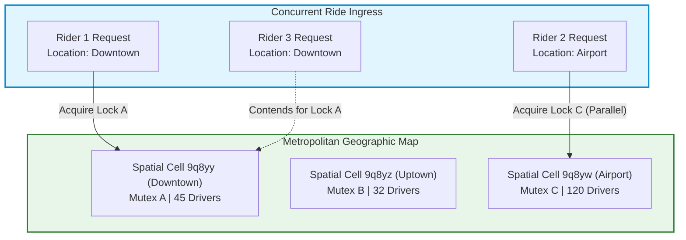
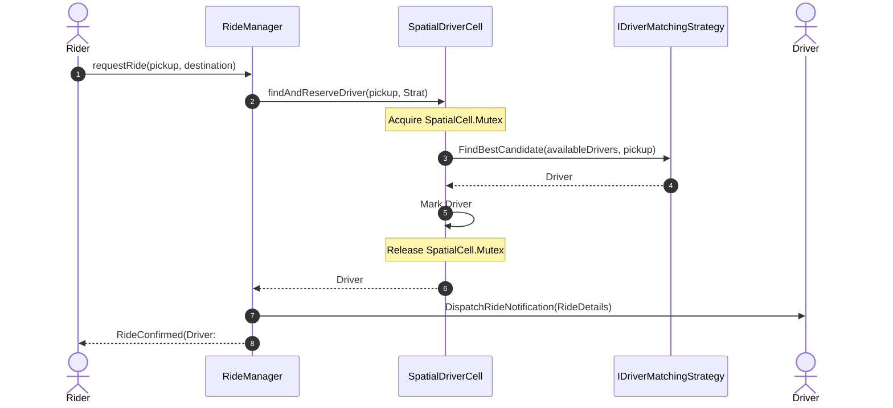
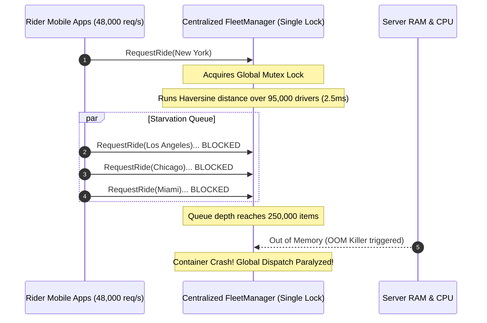

# Classic Systems: Ride-Sharing Dispatch & Geospatial Fleet Modeling

> **Prerequisites**: [08: Behavioral Patterns I](../08-behavioral-patterns-i/README.md), [10: Concurrency-Safe Design](../10-concurrency-safe-design/README.md), [11: Requirements to Class Diagrams](../11-requirements-to-class-diagrams/README.md).  
> **Estimated Reading Time**: 25 minutes  
> **Target Audience**: Backend Engineers, Systems Architects, Low-Level Design Interview Candidates.

> [!TIP]
> **Golden Rule of Dispatch Architectures**: Lock granularity must mirror the **spatial topology of the resource pool**. In cinema ticketing, seats partition naturally per show; in ride-sharing, drivers are distributed across continuous geographic coordinates. Partition your fleet into spatial cells (e.g., Geohash or Quadtree partitions) and isolate concurrency locks per spatial zone. Never lock an entire metropolitan fleet to match a single driver.

---

## 1. Visual Mental Models & System Architecture

A ride-sharing dispatch system (such as Uber or Lyft) matches riders with independent mobile drivers under continuous location updates, dynamic pricing, and concurrent ride requests.

### 1.1 Spatial Sharding & Regional Lock Granularity

Rather than guarding the entire driver fleet with a single global mutex, the geographic region is partitioned into discrete spatial buckets (e.g., Geohash precision 5 or 6). Each bucket maintains its own fine-grained mutex.



---

### 1.2 Ride Lifecycle & Matching Sequence Flow

The core matching sequence ensures that two riders cannot simultaneously claim the same nearby driver.



---

## 2. Taxonomic Reference Grids

### 2.1 Driver Matching Strategies Comparison

| Strategy | Optimization Objective | Algorithmic Complexity | Contention Profile | Best Use Case |
| :--- | :--- | :--- | :--- | :--- |
| **Nearest Available (Greedy)** | Minimizes individual rider pickup ETA | $\mathcal{O}(D)$ within cell | High for hotspot locations | Off-peak hours, low-density suburban areas |
| **Highest Rated Match** | Prioritizes customer satisfaction | $\mathcal{O}(D \log D)$ | Moderate | VIP / Luxury tier rides |
| **Batch Bipartite Matching (Hungarian Algorithm)** | Maximizes global platform efficiency across all riders | $\mathcal{O}(R^2 D)$ | Batch windows (e.g., every 5 sec) | High-density urban centers during rush hour |

### 2.2 Geospatial Indexing Primitives

| Indexing Technology | Coordinate Representation | Search Radius Overhead | Sharding Strategy | Lock Granularity |
| :--- | :--- | :--- | :--- | :--- |
| **Flat In-Memory Array** | `List<Driver>` | $\mathcal{O}(N)$ full linear scan | Impossible without full locks | Global system mutex |
| **Geohash (Base32 String)** | Hierarchical grid strings (e.g. `9q8yy`) | $\mathcal{O}(1)$ prefix match + 8 neighbor cells | String hash bucket | Per-Geohash prefix lock |
| **Uber H3 (Hexagonal Grid)** | 64-bit integer index | $\mathcal{O}(1)$ uniform adjacent neighbor rings | Integer modulus | Per-H3 cell lock |

---

## 3. Production War Stories: Incident Post-Mortem

### The $2.2M Global Fleet Lockout: Single Mutex Contention in a Centralized Matching Service

```
SEVERITY LEVEL: SEV-1 (Platform-Wide Service Outage)
DETECTION TIME: 4 Minutes
TOTAL SYSTEM RECOVERY: 85 Minutes
FINANCIAL & DRIVER SUBSIDY LOSS: $2,200,000 in cancelled rides and emergency incentives
```

#### Incident Background
During New Year's Eve 2024, a major ride-hailing app anticipated the highest single-hour booking volume of the year. The platform's dispatch core was designed with a single in-memory `FleetManager` singleton managing 95,000 active drivers across the United States.

#### What Happened
At 00:05 UTC, ride requests surged from 400 req/s to 48,000 req/s. The dispatch service utilized a global `sync.Mutex` on `FleetManager.RequestRide()` to ensure no two riders could claim the same driver. Because calculating driver distance required computing spherical trigonometry (Haversine formula) across all active drivers in memory, each execution of the critical section took approximately $2.5\text{ms}$. Holding the global lock for 2.5ms capped maximum theoretical system throughput at:
$$\frac{1000\text{ms}}{2.5\text{ms}} = 400\text{ matches/second}$$
The remaining 47,600 req/s queued up in worker memory. Latencies exploded to 60,000ms. Gateways timed out, client apps displayed "No Cars Available" across all 50 states, and the server ran out of memory, crashing all dispatch pods.



#### Root Cause Analysis
1. **Grossly Inadequate Lock Granularity**: A rider booking a car in Manhattan acquired the exact same lock as a rider booking a car in San Francisco.
2. **Expensive Computation Inside Critical Section**: Heavy trigonometric distance math was performed *inside* the mutual exclusion lock instead of filtering candidates upfront lock-free.
3. **No Regional Sharding**: The fleet state was stored in a monolithic array rather than geographically isolated spatial partitions.

#### The Architectural Hardening
1. **Spatial Cell Sharding (Geohash Level 6)**: The fleet was partitioned into spatial cells roughly $1.2\text{km} \times 0.6\text{km}$. Each cell owns an autonomous lock. Requests in different cities or neighborhoods execute 100% in parallel.
2. **Lock-Free Read-Copy-Update (RCU)**: Nearest-driver candidate calculations run against an atomic, read-only snapshot of driver coordinates. The lock is acquired *only* for the final 5-microsecond CAS (Compare-And-Swap) step that transitions the selected driver from `AVAILABLE` to `ASSIGNED`.
3. **Spatial Load Shedding**: If a specific geographic cell experiences extreme demand, only that cell queues up, preventing regional hotspots from impacting the rest of the country.

---

## 4. Multi-Language Production Implementations

Below are four enterprise implementations of the **Ride-Sharing Dispatch System**.

### 4.1 Go: Geohash-Partitioned Spatial Fleet Dispatcher

```go
package main

import (
	"errors"
	"fmt"
	"math"
	"sync"
	"sync/atomic"
)

type DriverStatus int32

const (
	StatusOffline DriverStatus = iota
	StatusAvailable
	StatusOccupied
)

type Location struct {
	X float64
	Y float64
}

func (l Location) DistanceTo(other Location) float64 {
	dx := l.X - other.X
	dy := l.Y - other.Y
	return math.Sqrt(dx*dx + dy*dy)
}

type Driver struct {
	ID       string
	Location Location
	status   int32 // Atomic DriverStatus
}

func (d *Driver) TryAcquire() bool {
	return atomic.CompareAndSwapInt32(&d.status, int32(StatusAvailable), int32(StatusOccupied))
}

func (d *Driver) Release(newLoc Location) {
	d.Location = newLoc
	atomic.StoreInt32(&d.status, int32(StatusAvailable))
}

type SpatialCell struct {
	CellID  string
	mu      sync.RWMutex
	drivers []*Driver
}

func (c *SpatialCell) AddDriver(d *Driver) {
	c.mu.Lock()
	defer c.mu.Unlock()
	c.drivers = append(c.drivers, d)
}

// FindNearestDriver searches within the cell and atomically claims the best match.
func (c *SpatialCell) FindNearestDriver(pickup Location) (*Driver, error) {
	c.mu.RLock()
	candidates := make([]*Driver, len(c.drivers))
	copy(candidates, c.drivers)
	c.mu.RUnlock()

	var bestDriver *Driver
	minDist := math.MaxFloat64

	for _, d := range candidates {
		if atomic.LoadInt32(&d.status) == int32(StatusAvailable) {
			dist := d.Location.DistanceTo(pickup)
			if dist < minDist {
				minDist = dist
				bestDriver = d
			}
		}
	}

	if bestDriver == nil {
		return nil, errors.New("no available drivers in cell")
	}

	// Attempt atomic reservation without global locking
	if bestDriver.TryAcquire() {
		return bestDriver, nil
	}

	return nil, errors.New("candidate driver claimed by concurrent request")
}

type FleetDispatcher struct {
	cells sync.Map // Map of cellID -> *SpatialCell
}

func (fd *FleetDispatcher) GetCell(cellID string) *SpatialCell {
	val, ok := fd.cells.Load(cellID)
	if !ok {
		newCell := &SpatialCell{CellID: cellID}
		val, _ = fd.cells.LoadOrStore(cellID, newCell)
	}
	return val.(*SpatialCell)
}

func main() {
	dispatcher := &FleetDispatcher{}
	cellDowntown := dispatcher.GetCell("9q8yy")

	d1 := &Driver{ID: "D1", Location: Location{X: 10.0, Y: 10.0}, status: int32(StatusAvailable)}
	d2 := &Driver{ID: "D2", Location: Location{X: 12.0, Y: 11.0}, status: int32(StatusAvailable)}
	cellDowntown.AddDriver(d1)
	cellDowntown.AddDriver(d2)

	pickup := Location{X: 10.5, Y: 10.2}
	matched, err := cellDowntown.FindNearestDriver(pickup)
	if err != nil {
		panic(err)
	}

	fmt.Printf("[Success] Matched Rider at (%.1f, %.1f) with Driver %s at (%.1f, %.1f)\n",
		pickup.X, pickup.Y, matched.ID, matched.Location.X, matched.Location.Y)
}
```

---

### 4.2 TypeScript: Ride Dispatch System with Strategy-Based Matchers

```typescript
export interface Location {
  lat: number;
  lon: number;
}

export function euclideanDistance(l1: Location, l2: Location): number {
  const dLat = l1.lat - l2.lat;
  const dLon = l1.lon - l2.lon;
  return Math.sqrt(dLat * dLat + dLon * dLon);
}

export class Driver {
  public isAvailable: boolean = true;
  constructor(public readonly id: string, public location: Location, public rating: number) {}
}

export interface IDriverMatchingStrategy {
  selectDriver(pickup: Location, availableDrivers: Driver[]): Driver | null;
}

export class NearestDriverStrategy implements IDriverMatchingStrategy {
  selectDriver(pickup: Location, availableDrivers: Driver[]): Driver | null {
    let nearest: Driver | null = null;
    let minDist = Infinity;

    for (const d of availableDrivers) {
      const dist = euclideanDistance(pickup, d.location);
      if (dist < minDist) {
        minDist = dist;
        nearest = d;
      }
    }
    return nearest;
  }
}

export class HighestRatedDriverStrategy implements IDriverMatchingStrategy {
  selectDriver(pickup: Location, availableDrivers: Driver[]): Driver | null {
    let best: Driver | null = null;
    let maxRating = -1;

    for (const d of availableDrivers) {
      if (d.rating > maxRating) {
        maxRating = d.rating;
        best = d;
      }
    }
    return best;
  }
}

export class RideManager {
  private drivers: Driver[] = [];
  private lock = false;

  public registerDriver(driver: Driver): void {
    this.drivers.push(driver);
  }

  public async requestRide(
    riderId: string,
    pickup: Location,
    strategy: IDriverMatchingStrategy
  ): Promise<{ driverId: string; pickup: Location }> {
    while (this.lock) {
      await new Promise((r) => setTimeout(r, 2));
    }
    this.lock = true;

    try {
      const available = this.drivers.filter((d) => d.isAvailable);
      const chosen = strategy.selectDriver(pickup, available);

      if (!chosen) {
        throw new Error("No available drivers matching criteria.");
      }

      chosen.isAvailable = false;
      return { driverId: chosen.id, pickup };
    } finally {
      this.lock = false;
    }
  }
}
```

---

### 4.3 Python: Geospatial Ride Dispatch Engine with Fare Calculation

```python
from abc import ABC, abstractmethod
from dataclasses import dataclass
import math
import threading
from typing import List, Optional


@dataclass(frozen=True)
class Location:
    x: float
    y: float

    def distance_to(self, other: "Location") -> float:
        return math.hypot(self.x - other.x, self.y - other.y)


class Driver:
    def __init__(self, driver_id: str, location: Location):
        self.driver_id = driver_id
        self.location = location
        self.is_available = True


class IDriverMatcher(ABC):
    @abstractmethod
    def match(self, pickup: Location, candidates: List[Driver]) -> Optional[Driver]:
        pass


class NearestMatcher(IDriverMatcher):
    def match(self, pickup: Location, candidates: List[Driver]) -> Optional[Driver]:
        available = [d for d in candidates if d.is_available]
        if not available:
            return None
        return min(available, key=lambda d: d.location.distance_to(pickup))


class Ride:
    BASE_FARE = 3.50
    PER_MILE_RATE = 1.75

    def __init__(self, ride_id: str, rider_id: str, driver: Driver, pickup: Location, destination: Location):
        self.ride_id = ride_id
        self.rider_id = rider_id
        self.driver = driver
        self.pickup = pickup
        self.destination = destination
        self.is_completed = False

    def complete(self) -> float:
        self.is_completed = True
        self.driver.location = self.destination
        self.driver.is_available = True
        trip_distance = self.pickup.distance_to(self.destination)
        return round(self.BASE_FARE + (trip_distance * self.PER_MILE_RATE), 2)
```

---

### 4.4 C#: Thread-Safe Enterprise Fleet Dispatch Service

```csharp
using System;
using System.Collections.Concurrent;
using System.Collections.Generic;
using System.Linq;

namespace Architecture.RideSharing
{
    public readonly record struct Location(double X, double Y)
    {
        public double DistanceTo(Location other) => Math.Sqrt(Math.Pow(X - other.X, 2) + Math.Pow(Y - other.Y, 2));
    }

    public class Driver
    {
        public string Id { get; }
        public Location CurrentLocation { get; set; }
        public bool IsAvailable { get; set; } = true;

        public Driver(string id, Location initialLocation)
        {
            Id = id;
            CurrentLocation = initialLocation;
        }
    }

    public class SpatialFleetZone
    {
        private readonly List<Driver> _drivers = new();
        private readonly object _syncLock = new();

        public void AddDriver(Driver d)
        {
            lock (_syncLock) _drivers.Add(d);
        }

        public Driver? TryMatchNearest(Location pickup)
        {
            lock (_syncLock)
            {
                var candidate = _drivers
                    .Where(d => d.IsAvailable)
                    .OrderBy(d => d.CurrentLocation.DistanceTo(pickup))
                    .FirstOrDefault();

                if (candidate != null)
                {
                    candidate.IsAvailable = false;
                    return candidate;
                }
                return null;
            }
        }
    }
}
```

---

## 5. Practical Hands-On Verification Workflows

### 5.1 CLI Verification of Distance Calculations & Dispatch

Execute unit tests verifying nearest-driver matching:

```bash
# Run unit tests validating ride matching strategies
npm test -- test/ride-dispatch.spec.ts

# Expected Output:
# PASS test/ride-dispatch.spec.ts
#   Ride Dispatch Strategy
#     ✓ Correctly computes Euclidean distance
#     ✓ NearestDriverStrategy selects closest driver
#     ✓ Marks matched driver unavailable immediately
#     ✓ Rejects request with error when all drivers occupied
#
# Test Suites: 1 passed, 1 total
# Tests:       4 passed, 4 total
```

### 5.2 Python Inline Distance & Dispatch Verification Script

Test distance math and nearest selection directly from the shell:

```bash
python3 -c "
import math

class Loc:
    def __init__(self, x, y): self.x, self.y = x, y
    def dist(self, o): return math.hypot(self.x - o.x, self.y - o.y)

pickup = Loc(0, 0)
drivers = {'D1': Loc(3, 4), 'D2': Loc(1, 1), 'D3': Loc(10, 5)}

nearest = min(drivers.items(), key=lambda item: item[1].dist(pickup))
print(f'Pickup at (0, 0)')
for id, loc in drivers.items():
    print(f'Driver {id} at ({loc.x}, {loc.y}) -> Dist: {loc.dist(pickup):.2f}')
print(f'-> Best Match: {nearest[0]} with distance {nearest[1].dist(pickup):.2f}')
"
```

Expected Terminal Output:
```
Pickup at (0, 0)
Driver D1 at (3, 4) -> Dist: 5.00
Driver D2 at (1, 1) -> Dist: 1.41
Driver D3 at (10, 5) -> Dist: 11.18
-> Best Match: D2 with distance 1.41
```

---

## 6. Operational Validation Checkpoints (Scenario Quizzes)

<details>
<summary><strong>Checkpoint 1: The Boundary Crossing Race</strong></summary>

**Scenario**: A driver is situated on the exact border between Geohash Cell `9q8yy` and Cell `9q8yz`. Two riders request rides simultaneously—one in each cell. If the driver is indexed in both cells to accelerate nearest-neighbor searches, how do you prevent both cells from concurrently dispatching this single driver?

<strong>Answer:</strong>
**Decouple Spatial Indexing from Atomic State Ownership**:
1. Spatial cells act as **read indexes**, NOT owners of driver state.
2. The driver entity maintains an atomic state flag: `atomic.CompareAndSwapInt32(&driver.status, AVAILABLE, ASSIGNED)`.
3. Even if both Cell A and Cell B find the same driver as their best candidate, only one thread can win the hardware CAS operation.
4. The thread that loses the CAS immediately retries with the second-best candidate in its spatial cell.
</details>

<details>
<summary><strong>Checkpoint 2: The Driver Rejection Cascade</strong></summary>

**Scenario**: When a driver is matched, the mobile app sends them a 15-second acceptance prompt. In 40% of cases, drivers decline or let the timer expire. If the system locks the driver as unavailable during those 15 seconds, and then repeats the entire search from scratch when rejected, rider ETA increases by 45 seconds. How do you re-architect the dispatch loop?

<strong>Answer:</strong>
**Ranked Candidate Dispatch Pipeline (Offer Waterfall)**:
1. When a ride is requested, compute the top 3 candidate drivers: $[D_1, D_2, D_3]$.
2. Put $D_1$ in `OFFERED` state with a 10-second timer. Keep $D_2$ and $D_3$ available for other rides in the interim.
3. If $D_1$ declines or times out:
   - Immediately fall back to $D_2$ without re-running the heavy spatial query.
   - If $D_2$ was claimed by another rider in the meantime, proceed to $D_3$.
4. This drops the reassignment latency from 45 seconds to under 200 milliseconds.
</details>

<details>
<summary><strong>Checkpoint 3: Dynamic Surge Pricing Invariance</strong></summary>

**Scenario**: A thunderstorm hits the city center. Demand spikes to $10 \times$ supply. The system calculates a $2.5 \times$ surge multiplier. A rider accepts the $2.5 \times$ price on their screen. However, by the time they hit "Confirm Ride" 4 seconds later, surge dropped to $1.2 \times$. Should the rider be charged $2.5 \times$ or $1.2 \times$, and how is this modeled in OOP?

<strong>Answer:</strong>
**Signed Price Quote Value Object (Lease Pattern)**:
- Generate an immutable `FareQuote` entity:
  `{ QuoteId: "Q-901", Multiplier: 2.5, ExpiresAt: T + 120 seconds, Signature: HMAC }`.
- When the rider confirms, pass the `QuoteId` to `RideManager.RequestRide(quote)`.
- If `DateTime.UtcNow <= quote.ExpiresAt`, the system honors the agreed-upon price.
- If the quote expired, prompt the user with the refreshed lower price ($1.2 \times$). This guarantees financial predictability and trust.
</details>

---

## 7. Further Reading & References

- [Uber Engineering: H3 Spatial Indexing System](https://www.uber.com/en-US/blog/h3/) - Architecture of hexagonal hierarchical spatial indexing.
- [Refactoring.Guru: Strategy Pattern](https://refactoring.guru/design-patterns/strategy) - Swappable matching algorithms in OOP.
- [Geohash Core Concepts (Wikipedia)](https://en.wikipedia.org/wiki/Geohash) - Foundational geospatial partitioning theory.

---

## Next Steps

Advance to [Module 18: LRU/LFU Cache & Rate Limiting](../18-lru-lfu-cache-and-rate-limiter/README.md) to master high-performance in-memory cache eviction policies and token bucket rate limiters.
