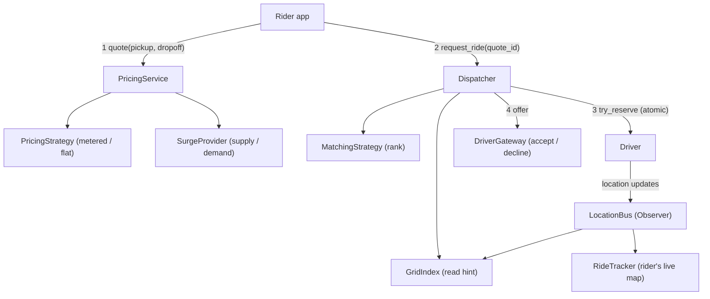
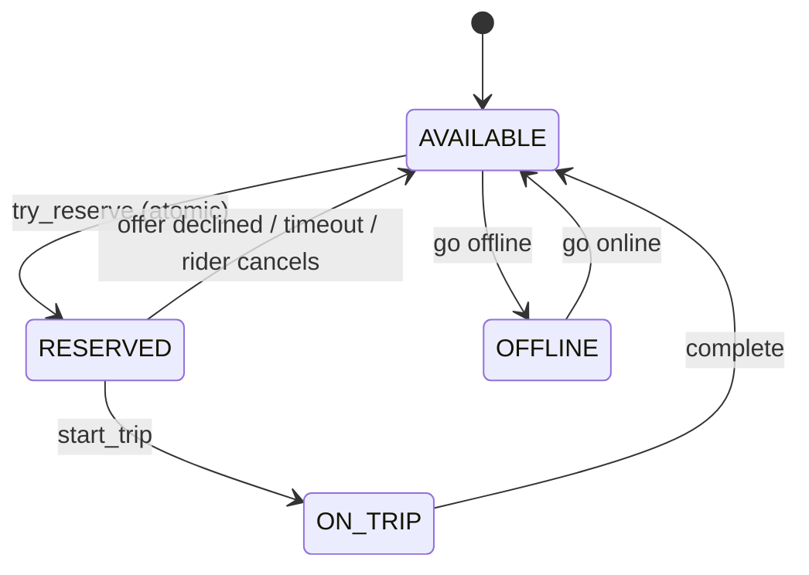
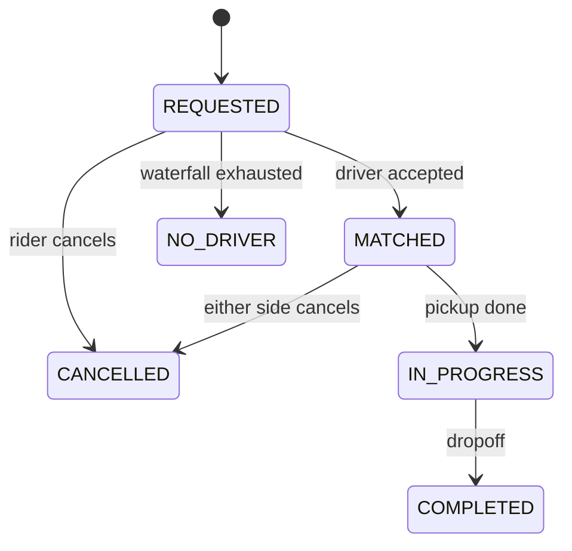
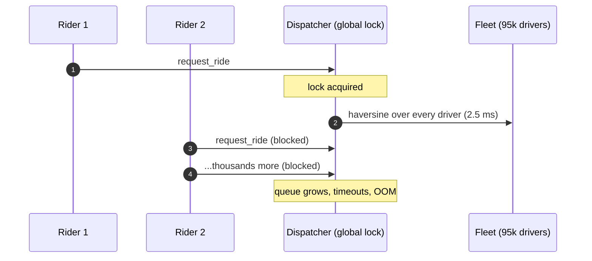

# Classic LLD: Ride-Sharing — Matching, Pricing & Live Locations

> **Prerequisites:** [08 · Behavioral Patterns I](../08-behavioral-patterns-i/README.md), [10 · Concurrency-Safe Design](../10-concurrency-safe-design/README.md), [11 · Requirements to Class Diagrams](../11-requirements-to-class-diagrams/README.md), [16 · Movie Ticket Booking](../16-movie-ticket-booking/README.md)  
> **Reading time:** ~35 minutes  
> **Audience:** LLD / machine-coding rounds — "design Uber" without drowning in maps

> [!NOTE]
> **In one line:** A ride request is **price → find nearby drivers → rank → claim one atomically → track**. *Ranking* is a **Strategy** (nearest, scored), *pricing* is a **Strategy** plus a surge provider whose result is frozen in an **expiring quote**, *location updates* are an **Observer** feed (spatial index and rider tracking both subscribe), and the "two riders, one driver" race is solved by an **atomic claim on the driver**, not by a global lock.

> [!TIP]
> **Golden rule:** The spatial index is a **hint**, never the owner. It may be stale or list a driver in two cells; the driver object's own atomic `try_reserve()` is the single point that decides who gets them. Search lock-free, claim atomically.

> [!TIP]
> **Try it:** Draw `Dispatcher → MatchingStrategy / PricingService / LocationBus → Driver` in [LLD Studio](/tools/lld-studio/), then run the Python example below and watch 20 riders fight over 3 drivers with zero double assignments.

---

## 1. Interview pressure

Interviewer: *"Design a ride-sharing backend. Riders request a ride, nearby drivers get matched, drivers stream their location, the fare may surge. Support different matching and pricing rules."*

Mixing these concerns is the trap: a `RideService` with `if surge`, `if premium`, `for driver in all_drivers`, and a global lock.

**Clarify first:**

| Question | Why it changes the design |
| :--- | :--- |
| Matching goal: nearest, rating, or global optimum? | Strategy interface returns a **ranked list** (supports fallbacks) |
| Does the driver accept/decline? Timeout? | Offer **waterfall**: reserve → offer → release → next |
| Price shown vs charged? | **Quote** with expiry; price is locked before the search |
| How often do locations update (every 4 s)? | Don't lock the fleet; cheap fan-out + index updates |
| Scale: one city or global? | Partition the index (cells/geohash/H3); one lock per driver |
| Pool / premium / airport flat rate? | Pricing is a Strategy; don't `if tier ==` |



---

## 2. Comparison matrix (memorize this)

### Strategies and what they optimize

| Strategy | Optimizes | Input | Complexity | When |
| :--- | :--- | :--- | :--- | :--- |
| `NearestFirst` | Pickup ETA for this rider | Distance | O(D log D) on D nearby drivers | Default, off-peak |
| `ScoredMatch` | Blend of distance and rating | `w_d·km − w_r·rating` | O(D log D) | Premium tier |
| Batch bipartite (Hungarian) | Fleet-wide wait time | All riders × drivers in a window | O(n³) per batch | Rush hour, mention only |
| `MeteredPricing` | Cost recovery | base + km + minutes, minimum | O(1) | Standard rides |
| `FlatRatePricing` | Predictability | fixed amount | O(1) | Airport routes |
| `SupplyDemandSurge` | Balance supply and demand | demand / supply in the cell | O(D) | Peaks, weather |

### Observer vs polling vs queue for locations

| Approach | Good for | Cost |
| :--- | :--- | :--- |
| In-process Observer (`LocationBus`) | Index updates, a tracker per active ride | Subscribers must be removed (lapsed listener) |
| Poll the driver table | Simple admin screens | Stale, wasteful |
| Message queue / stream between services | Durable fan-out, replay | Latency, infra; use *between* services |

### Spatial index options

| Index | Search | Notes |
| :--- | :--- | :--- |
| Flat list | O(N) scan | Fine only for demos; **never** inside a global lock |
| Grid cells (this module) | Neighbor-ring scan, near O(1) | Easy to explain and code |
| Geohash / H3 | Same idea with hierarchical cells | Production; shard by cell |
| Quadtree | Adapts to density | Rebalancing cost |





---

## 3. Walkthrough — match, price, track

**Requirements**

1. `quote(pickup, dropoff)` returns an **immutable, expiring** `FareQuote` (price × surge). It is single-use: `request_ride` redeems it.
2. Pricing algorithm and surge source are **pluggable**. Adding airport flat rate is a new class.
3. `request_ride` finds nearby available drivers from a **spatial index**, ranks them with a **MatchingStrategy**, and offers to the best few in order (waterfall) until one accepts.
4. A driver can only be reserved by **one** rider at a time. Under 20 concurrent riders and 3 drivers, exactly 3 rides match.
5. Drivers stream locations through a `LocationBus`. The index and a per-ride `RideTracker` are **subscribers**. Trackers are unsubscribed when the ride ends.
6. Rides follow a guarded state machine; illegal transitions raise.

**Design choices to defend**

- **`rank()` returns a list, not one driver** — decline/timeouts need the next candidate without re-querying.
- **Claim before offer** — `try_reserve()` makes the driver invisible to other riders while the offer is outstanding.
- **Price locked before search** — the rider never sees a different amount than they accepted (surge can change in 4 seconds).
- **Observers are isolated** — a failing subscriber must not break the publish loop; the subscriber list is **copied** before notifying.
- **Lock per driver, not per fleet** — contention is limited to riders that want the *same* driver.

````carousel
```python
from __future__ import annotations

import logging
import math
import threading
import uuid
from abc import ABC, abstractmethod
from collections import defaultdict
from dataclasses import dataclass
from datetime import datetime, timedelta
from enum import Enum
from typing import Callable

log = logging.getLogger("ride")
AVG_KMH = 30.0


# ── Value objects ───────────────────────────────────────────────────
@dataclass(frozen=True)
class Location:
    lat: float
    lon: float

    def km_to(self, other: "Location") -> float:  # haversine
        p1, p2 = math.radians(self.lat), math.radians(other.lat)
        a = (math.sin((p2 - p1) / 2) ** 2
             + math.cos(p1) * math.cos(p2) * math.sin(math.radians(other.lon - self.lon) / 2) ** 2)
        return 2 * 6371.0088 * math.asin(math.sqrt(a))


@dataclass(frozen=True)
class FareQuote:
    quote_id: str
    base_cents: int
    multiplier: float
    amount_cents: int
    expires_at: datetime


# ── Observer: location feed ─────────────────────────────────────────
class LocationListener(ABC):
    @abstractmethod
    def on_location(self, driver_id: str, loc: Location) -> None: ...


class LocationBus:
    """Topic = a driver id, or '*' for every driver."""

    def __init__(self) -> None:
        self._lock = threading.Lock()
        self._subs: dict[str, list[LocationListener]] = defaultdict(list)

    def subscribe(self, topic: str, listener: LocationListener) -> Callable[[], None]:
        with self._lock:
            self._subs[topic].append(listener)

        def unsubscribe() -> None:
            with self._lock:
                if listener in self._subs[topic]:
                    self._subs[topic].remove(listener)

        return unsubscribe

    def publish(self, driver_id: str, loc: Location) -> None:
        with self._lock:  # copy: listeners may unsubscribe while we notify
            targets = list(self._subs[driver_id]) + list(self._subs["*"])
        for listener in targets:
            try:
                listener.on_location(driver_id, loc)
            except Exception:  # one bad observer must not starve the others
                log.exception("location listener failed")


# ── Driver: owns its own atomic status ──────────────────────────────
class DriverStatus(Enum):
    OFFLINE = "offline"
    AVAILABLE = "available"
    RESERVED = "reserved"
    ON_TRIP = "on_trip"


class Driver:
    def __init__(self, driver_id: str, loc: Location, rating: float, bus: LocationBus) -> None:
        self.id, self.rating, self._bus = driver_id, rating, bus
        self._loc, self._status = loc, DriverStatus.AVAILABLE
        self._lock = threading.Lock()

    @property
    def location(self) -> Location:
        return self._loc

    @property
    def status(self) -> DriverStatus:
        return self._status

    def update_location(self, loc: Location) -> None:
        with self._lock:
            self._loc = loc
        self._bus.publish(self.id, loc)  # publish OUTSIDE the lock

    def _move(self, expected: DriverStatus, new: DriverStatus) -> bool:
        with self._lock:
            if self._status is not expected:
                return False
            self._status = new
            return True

    def try_reserve(self) -> bool:  # the one point that decides who gets this driver
        return self._move(DriverStatus.AVAILABLE, DriverStatus.RESERVED)

    def release(self) -> bool:
        return self._move(DriverStatus.RESERVED, DriverStatus.AVAILABLE)

    def start_trip(self) -> bool:
        return self._move(DriverStatus.RESERVED, DriverStatus.ON_TRIP)

    def finish_trip(self) -> bool:
        return self._move(DriverStatus.ON_TRIP, DriverStatus.AVAILABLE)


# ── Spatial index: a HINT, subscribed to the bus ────────────────────
class GridIndex(LocationListener):
    KM_PER_DEG = 111.195

    def __init__(self, cell_deg: float = 0.01) -> None:  # ~1.1 km cells
        self._deg, self._lock = cell_deg, threading.RLock()
        self._cells: dict[tuple[int, int], dict[str, Driver]] = {}
        self._cell_of: dict[str, tuple[int, int]] = {}
        self._drivers: dict[str, Driver] = {}

    def _key(self, loc: Location) -> tuple[int, int]:
        return math.floor(loc.lat / self._deg), math.floor(loc.lon / self._deg)

    def add(self, driver: Driver) -> None:
        with self._lock:
            key = self._key(driver.location)
            self._drivers[driver.id] = driver
            self._cell_of[driver.id] = key
            self._cells.setdefault(key, {})[driver.id] = driver

    def on_location(self, driver_id: str, loc: Location) -> None:
        with self._lock:
            old, new = self._cell_of.get(driver_id), self._key(loc)
            if old is None or old == new:
                return
            self._cells[old].pop(driver_id, None)
            self._cells.setdefault(new, {})[driver_id] = self._drivers[driver_id]
            self._cell_of[driver_id] = new

    def nearby(self, loc: Location, radius_km: float) -> list[Driver]:
        lat_rings = math.ceil(radius_km / (self._deg * self.KM_PER_DEG))
        lon_km = max(self.KM_PER_DEG * math.cos(math.radians(loc.lat)), 1e-6)
        lon_rings = math.ceil(radius_km / (self._deg * lon_km))
        ci, cj = self._key(loc)
        with self._lock:  # short critical section: copy candidates, compute outside
            found = [d for di in range(-lat_rings, lat_rings + 1) for dj in range(-lon_rings, lon_rings + 1)
                     for d in self._cells.get((ci + di, cj + dj), {}).values()]
        return [d for d in found if d.status is DriverStatus.AVAILABLE and d.location.km_to(loc) <= radius_km]

    def supply_near(self, loc: Location, radius_km: float) -> int:
        return len(self.nearby(loc, radius_km))


# ── Strategy 1: matching ────────────────────────────────────────────
class MatchingStrategy(ABC):
    @abstractmethod
    def rank(self, pickup: Location, candidates: list[Driver]) -> list[Driver]:
        """Best first. Returns a LIST so the dispatcher can fall back on decline."""


class NearestFirst(MatchingStrategy):
    def rank(self, pickup, candidates):
        return sorted(candidates, key=lambda d: d.location.km_to(pickup))


class ScoredMatch(MatchingStrategy):
    def __init__(self, distance_weight: float = 1.0, rating_weight: float = 0.5) -> None:
        self._wd, self._wr = distance_weight, rating_weight

    def rank(self, pickup, candidates):  # lower score is better
        return sorted(candidates, key=lambda d: self._wd * d.location.km_to(pickup) - self._wr * d.rating)


# ── Strategy 2: pricing (+ surge provider + expiring quote) ─────────
@dataclass(frozen=True)
class Trip:
    pickup: Location
    dropoff: Location

    @property
    def km(self) -> float:
        return self.pickup.km_to(self.dropoff)

    @property
    def minutes(self) -> float:
        return self.km / AVG_KMH * 60


class PricingStrategy(ABC):
    @abstractmethod
    def fare_cents(self, trip: Trip) -> int: ...


class MeteredPricing(PricingStrategy):
    def __init__(self, base=250, per_km=120, per_min=30, minimum=500) -> None:
        self._base, self._km, self._min, self._floor = base, per_km, per_min, minimum

    def fare_cents(self, trip):
        return max(self._floor, round(self._base + self._km * trip.km + self._min * trip.minutes))


class FlatRatePricing(PricingStrategy):
    def __init__(self, flat_cents: int) -> None:
        self._flat = flat_cents

    def fare_cents(self, trip):
        return self._flat


class SurgeProvider(ABC):
    @abstractmethod
    def multiplier(self, pickup: Location) -> float: ...


class FixedSurge(SurgeProvider):
    def __init__(self, value: float = 1.0) -> None:
        self._v = value

    def multiplier(self, pickup):
        return self._v


class SupplyDemandSurge(SurgeProvider):
    """Asking for a price is the demand signal. Real systems window and decay this."""

    def __init__(self, index: GridIndex, radius_km: float = 3.0, cap: float = 3.0) -> None:
        self._index, self._radius, self._cap = index, radius_km, cap
        self._demand: dict[tuple[int, int], int] = defaultdict(int)
        self._lock = threading.Lock()

    def multiplier(self, pickup):
        cell = (round(pickup.lat / 0.05), round(pickup.lon / 0.05))
        with self._lock:
            self._demand[cell] += 1
            demand = self._demand[cell]
        ratio = demand / max(self._index.supply_near(pickup, self._radius), 1)
        return 1.0 if ratio <= 1 else round(min(self._cap, 1 + 0.5 * (ratio - 1)), 1)


class QuoteExpired(Exception):
    pass


class PricingService:
    def __init__(self, strategy: PricingStrategy, surge: SurgeProvider,
                 clock: Callable[[], datetime] = datetime.now, ttl: timedelta = timedelta(minutes=2)) -> None:
        self._strategy, self._surge, self._now, self._ttl = strategy, surge, clock, ttl
        self._quotes: dict[str, FareQuote] = {}
        self._lock = threading.Lock()

    def quote(self, pickup: Location, dropoff: Location) -> FareQuote:
        base = self._strategy.fare_cents(Trip(pickup, dropoff))
        mult = self._surge.multiplier(pickup)
        q = FareQuote(uuid.uuid4().hex[:8], base, mult, round(base * mult), self._now() + self._ttl)
        with self._lock:
            self._quotes[q.quote_id] = q
        return q

    def redeem(self, quote_id: str) -> FareQuote:  # single use; expired quotes are rejected
        with self._lock:
            q = self._quotes.pop(quote_id, None)
        if q is None or self._now() > q.expires_at:
            raise QuoteExpired("price expired - request a new quote")
        return q


# ── Ride: guarded state machine ─────────────────────────────────────
class RideState(Enum):
    REQUESTED = "requested"
    MATCHED = "matched"
    IN_PROGRESS = "in_progress"
    COMPLETED = "completed"
    CANCELLED = "cancelled"
    NO_DRIVER = "no_driver"


_ALLOWED = {
    RideState.REQUESTED: {RideState.MATCHED, RideState.NO_DRIVER, RideState.CANCELLED},
    RideState.MATCHED: {RideState.IN_PROGRESS, RideState.CANCELLED},
    RideState.IN_PROGRESS: {RideState.COMPLETED},
}


class IllegalTransition(Exception):
    pass


class NoDriverAvailable(Exception):
    pass


class Ride:
    def __init__(self, rider_id: str, pickup: Location, dropoff: Location, quote: FareQuote) -> None:
        self.id, self.rider_id = uuid.uuid4().hex[:8], rider_id
        self.pickup, self.dropoff, self.quote = pickup, dropoff, quote
        self.driver: Driver | None = None
        self.state = RideState.REQUESTED
        self._lock = threading.Lock()

    def move(self, to: RideState) -> None:
        with self._lock:
            if to not in _ALLOWED.get(self.state, set()):
                raise IllegalTransition(f"{self.state.name} -> {to.name}")
            self.state = to


class RideTracker(LocationListener):
    """The rider's live map: one per active ride, unsubscribed when the ride ends."""

    def __init__(self, ride: Ride, sink: Callable[[str, Location, float], None]) -> None:
        self._ride, self._sink = ride, sink

    def on_location(self, driver_id: str, loc: Location) -> None:
        target = self._ride.pickup if self._ride.state is RideState.MATCHED else self._ride.dropoff
        self._sink(self._ride.id, loc, round(loc.km_to(target) / AVG_KMH * 60, 1))  # ETA minutes


class DriverGateway(ABC):  # port: push notification + accept/decline within a timeout
    @abstractmethod
    def offer(self, driver: Driver, ride: Ride) -> bool: ...


# ── Dispatcher: orchestration only ──────────────────────────────────
class Dispatcher:
    RADIUS_KM, MAX_OFFERS = 5.0, 3

    def __init__(self, index: GridIndex, pricing: PricingService, gateway: DriverGateway,
                 bus: LocationBus, matcher: MatchingStrategy,
                 sink: Callable[[str, Location, float], None] = lambda *_: None) -> None:
        self._index, self._pricing, self._gateway, self._bus = index, pricing, gateway, bus
        self._matcher, self._sink = matcher, sink
        self._unsubscribe: dict[str, Callable[[], None]] = {}
        self._lock = threading.Lock()

    def request_ride(self, rider_id: str, pickup: Location, dropoff: Location, quote_id: str) -> Ride:
        quote = self._pricing.redeem(quote_id)  # price is locked BEFORE the search
        ride = Ride(rider_id, pickup, dropoff, quote)
        ranked = self._matcher.rank(pickup, self._index.nearby(pickup, self.RADIUS_KM))
        for driver in ranked[: self.MAX_OFFERS]:
            if not driver.try_reserve():  # lost the race to another rider: next candidate
                continue
            if self._gateway.offer(driver, ride):
                ride.driver = driver
                ride.move(RideState.MATCHED)
                unsub = self._bus.subscribe(driver.id, RideTracker(ride, self._sink))
                with self._lock:
                    self._unsubscribe[ride.id] = unsub
                return ride
            driver.release()  # declined / timed out: back to the pool, try the next
        ride.move(RideState.NO_DRIVER)
        raise NoDriverAvailable(ride.id)

    def start(self, ride: Ride) -> None:
        ride.move(RideState.IN_PROGRESS)
        ride.driver.start_trip()

    def complete(self, ride: Ride) -> int:
        ride.move(RideState.COMPLETED)
        self._end(ride)
        ride.driver.finish_trip()
        ride.driver.update_location(ride.dropoff)
        return ride.quote.amount_cents  # the locked price, not a recomputed one

    def cancel(self, ride: Ride) -> None:
        ride.move(RideState.CANCELLED)  # only legal from REQUESTED / MATCHED
        self._end(ride)
        if ride.driver is not None:
            ride.driver.release()

    def _end(self, ride: Ride) -> None:
        with self._lock:
            unsub = self._unsubscribe.pop(ride.id, None)
        if unsub:
            unsub()  # avoid the lapsed-listener leak


if __name__ == "__main__":
    HOME = Location(12.9716, 77.5946)

    def north(km: float) -> Location:
        return Location(HOME.lat + km / 111.195, HOME.lon)

    class ScriptedGateway(DriverGateway):
        def __init__(self) -> None:
            self.decline: set[str] = set()
            self.offered: list[str] = []

        def offer(self, driver, ride) -> bool:
            self.offered.append(driver.id)
            return driver.id not in self.decline

    def world(drivers: dict[str, tuple[float, float]], surge: SurgeProvider | None = None, matcher=None):
        bus, index = LocationBus(), GridIndex()
        bus.subscribe("*", index)
        objs = {}
        for did, (km, rating) in drivers.items():
            objs[did] = Driver(did, north(km), rating, bus)
            index.add(objs[did])
        now = [datetime(2026, 1, 1, 9, 0)]
        pricing = PricingService(MeteredPricing(), surge or FixedSurge(1.0), clock=lambda: now[0])
        gw, updates = ScriptedGateway(), []
        disp = Dispatcher(index, pricing, gw, bus, matcher or NearestFirst(), sink=lambda *a: updates.append(a))
        return disp, pricing, gw, objs, index, now, updates

    # 1) matching strategies disagree: nearest vs distance+rating
    pickup = HOME
    _, _, _, objs, idx, _, _ = world({"A": (1.0, 4.0), "B": (1.4, 5.0)})
    cands = idx.nearby(pickup, 5)
    assert NearestFirst().rank(pickup, cands)[0].id == "A"
    assert ScoredMatch(1.0, 0.5).rank(pickup, cands)[0].id == "B"

    # 2) offer waterfall: nearest declines -> next driver gets it; decliner is released
    disp, pricing, gw, objs, _, _, _ = world({"A": (1.0, 4.0), "B": (1.4, 4.0)})
    gw.decline.add("A")
    q = pricing.quote(pickup, north(10))
    ride = disp.request_ride("r1", pickup, north(10), q.quote_id)
    assert ride.driver.id == "B" and gw.offered == ["A", "B"]
    assert objs["A"].status is DriverStatus.AVAILABLE and objs["B"].status is DriverStatus.RESERVED

    # 3) lifecycle + locked price + location observer (tracker) + unsubscribe
    disp, pricing, gw, objs, idx, _, updates = world({"A": (1.0, 4.0)})
    q = pricing.quote(pickup, north(10))
    ride = disp.request_ride("r1", pickup, north(10), q.quote_id)
    objs["A"].update_location(north(0.5))
    assert updates and updates[-1][0] == ride.id and updates[-1][2] > 0  # rider sees driver + ETA
    disp.start(ride)
    objs["A"].update_location(north(5))
    assert disp.complete(ride) == q.amount_cents
    seen = len(updates)
    objs["A"].update_location(north(9))
    assert len(updates) == seen, "tracker must be unsubscribed after the ride"
    assert objs["A"].status is DriverStatus.AVAILABLE
    try:
        disp.cancel(ride)
        raise SystemExit("cannot cancel a completed ride")
    except IllegalTransition:
        pass

    # 4) location observer keeps the index current: a far driver drives into range
    disp, pricing, gw, objs, idx, _, _ = world({"far": (30.0, 4.0)})
    assert idx.nearby(pickup, 5) == []
    objs["far"].update_location(north(2.0))
    assert [d.id for d in idx.nearby(pickup, 5)] == ["far"]

    # 5) atomic claim: 20 riders, 3 drivers -> exactly 3 matches, no driver twice
    disp, pricing, gw, objs, _, _, _ = world({"D1": (1.0, 4.5), "D2": (1.2, 4.5), "D3": (1.4, 4.5)})
    quotes = [pricing.quote(pickup, north(5)) for _ in range(20)]
    rides, misses, start = [], [], threading.Barrier(20)

    def rider(i: int) -> None:
        start.wait()
        try:
            rides.append(disp.request_ride(f"r{i}", pickup, north(5), quotes[i].quote_id))
        except NoDriverAvailable:
            misses.append(i)

    ts = [threading.Thread(target=rider, args=(i,)) for i in range(20)]
    [t.start() for t in ts]
    [t.join() for t in ts]
    assert len(rides) == 3 and len(misses) == 17, (len(rides), len(misses))
    assert len({r.driver.id for r in rides}) == 3

    # 6) surge: demand outruns supply, quote is frozen, then expires
    disp, pricing, gw, objs, idx, now, _ = world({"A": (1.0, 4.0)})
    pricing._surge = SupplyDemandSurge(idx)
    qs = [pricing.quote(pickup, north(10)) for _ in range(5)]
    assert [q.multiplier for q in qs] == [1.0, 1.5, 2.0, 2.5, 3.0]
    assert qs[-1].amount_cents == round(qs[-1].base_cents * 3.0)
    now[0] += timedelta(minutes=3)
    try:
        disp.request_ride("r1", pickup, north(10), qs[0].quote_id)
        raise SystemExit("expired quote must be rejected")
    except QuoteExpired:
        pass

    # 7) flat-rate strategy plugs in without touching Dispatcher
    flat = PricingService(FlatRatePricing(1500), FixedSurge(1.0))
    assert flat.quote(pickup, north(30)).amount_cents == 1500
    print("ride-sharing ok")
```
<!-- slide -->
```csharp
using System;
using System.Collections.Concurrent;
using System.Collections.Generic;
using System.Linq;
using System.Threading;
using System.Threading.Tasks;

namespace Lld.RideSharing;

public static class Const { public const double AvgKmh = 30.0; }

// ── Value objects ───────────────────────────────────────────────────
public readonly record struct Location(double Lat, double Lon)
{
    public double KmTo(Location o) // haversine
    {
        double r(double d) => d * Math.PI / 180;
        var a = Math.Pow(Math.Sin((r(o.Lat) - r(Lat)) / 2), 2)
              + Math.Cos(r(Lat)) * Math.Cos(r(o.Lat)) * Math.Pow(Math.Sin(r(o.Lon - Lon) / 2), 2);
        return 2 * 6371.0088 * Math.Asin(Math.Sqrt(a));
    }
}

public sealed record FareQuote(string QuoteId, int BaseCents, double Multiplier, int AmountCents, DateTimeOffset ExpiresAt);

// ── Observer: location feed ─────────────────────────────────────────
public interface ILocationListener
{
    void OnLocation(string driverId, Location loc);
}

public sealed class LocationBus
{
    private readonly object _gate = new();
    private readonly Dictionary<string, List<ILocationListener>> _subs = new();

    public IDisposable Subscribe(string topic, ILocationListener listener) // topic = driver id or "*"
    {
        lock (_gate)
        {
            if (!_subs.TryGetValue(topic, out var list)) _subs[topic] = list = new();
            list.Add(listener);
        }
        return new Unsub(() => { lock (_gate) _subs[topic].Remove(listener); });
    }

    public void Publish(string driverId, Location loc)
    {
        List<ILocationListener> targets;
        lock (_gate) // copy: listeners may unsubscribe while we notify
            targets = Get(driverId).Concat(Get("*")).ToList();
        foreach (var l in targets)
            try { l.OnLocation(driverId, loc); }
            catch (Exception e) { Console.Error.WriteLine($"listener failed: {e.Message}"); } // isolate observers
    }

    private IEnumerable<ILocationListener> Get(string topic) =>
        _subs.TryGetValue(topic, out var l) ? l : Enumerable.Empty<ILocationListener>();

    private sealed class Unsub(Action a) : IDisposable { public void Dispose() => a(); }
}

// ── Driver: owns its own atomic status ──────────────────────────────
public enum DriverStatus { Offline, Available, Reserved, OnTrip }

public sealed class Driver(string id, Location loc, double rating, LocationBus bus)
{
    private readonly object _locGate = new();
    private int _status = (int)DriverStatus.Available;
    private Location _loc = loc;

    public string Id { get; } = id;
    public double Rating { get; } = rating;
    public Location Location { get { lock (_locGate) return _loc; } }
    public DriverStatus Status => (DriverStatus)Volatile.Read(ref _status);

    public void UpdateLocation(Location l)
    {
        lock (_locGate) _loc = l;
        bus.Publish(Id, l); // publish OUTSIDE the lock
    }

    private bool Move(DriverStatus from, DriverStatus to) =>
        Interlocked.CompareExchange(ref _status, (int)to, (int)from) == (int)from; // lock-free CAS

    public bool TryReserve() => Move(DriverStatus.Available, DriverStatus.Reserved); // decides who gets this driver
    public bool Release() => Move(DriverStatus.Reserved, DriverStatus.Available);
    public bool StartTrip() => Move(DriverStatus.Reserved, DriverStatus.OnTrip);
    public bool FinishTrip() => Move(DriverStatus.OnTrip, DriverStatus.Available);
}

// ── Spatial index: a HINT, subscribed to the bus ────────────────────
public sealed class GridIndex(double cellDeg = 0.01) : ILocationListener
{
    private const double KmPerDeg = 111.195;
    private readonly object _gate = new();
    private readonly Dictionary<(int, int), Dictionary<string, Driver>> _cells = new();
    private readonly Dictionary<string, (int, int)> _cellOf = new();
    private readonly Dictionary<string, Driver> _drivers = new();

    private (int, int) Key(Location l) => ((int)Math.Floor(l.Lat / cellDeg), (int)Math.Floor(l.Lon / cellDeg));

    public void Add(Driver d)
    {
        lock (_gate)
        {
            var k = Key(d.Location);
            _drivers[d.Id] = d;
            _cellOf[d.Id] = k;
            Cell(k)[d.Id] = d;
        }
    }

    public void OnLocation(string driverId, Location loc)
    {
        lock (_gate)
        {
            if (!_cellOf.TryGetValue(driverId, out var old)) return;
            var next = Key(loc);
            if (old == next) return;
            Cell(old).Remove(driverId);
            Cell(next)[driverId] = _drivers[driverId];
            _cellOf[driverId] = next;
        }
    }

    public List<Driver> Nearby(Location loc, double radiusKm)
    {
        var latRings = (int)Math.Ceiling(radiusKm / (cellDeg * KmPerDeg));
        var lonKm = Math.Max(KmPerDeg * Math.Cos(loc.Lat * Math.PI / 180), 1e-6);
        var lonRings = (int)Math.Ceiling(radiusKm / (cellDeg * lonKm));
        var (ci, cj) = Key(loc);
        List<Driver> found = new();
        lock (_gate) // short critical section: copy candidates, compute outside
            for (var di = -latRings; di <= latRings; di++)
                for (var dj = -lonRings; dj <= lonRings; dj++)
                    if (_cells.TryGetValue((ci + di, cj + dj), out var cell)) found.AddRange(cell.Values);
        return found.Where(d => d.Status == DriverStatus.Available && d.Location.KmTo(loc) <= radiusKm).ToList();
    }

    public int SupplyNear(Location loc, double radiusKm) => Nearby(loc, radiusKm).Count;

    private Dictionary<string, Driver> Cell((int, int) k) =>
        _cells.TryGetValue(k, out var c) ? c : _cells[k] = new();
}

// ── Strategy 1: matching ────────────────────────────────────────────
public interface IMatchingStrategy
{
    /// <summary>Best first. Returns a list so the dispatcher can fall back on decline.</summary>
    List<Driver> Rank(Location pickup, IEnumerable<Driver> candidates);
}

public sealed class NearestFirst : IMatchingStrategy
{
    public List<Driver> Rank(Location pickup, IEnumerable<Driver> c) =>
        c.OrderBy(d => d.Location.KmTo(pickup)).ToList();
}

public sealed class ScoredMatch(double distanceWeight = 1.0, double ratingWeight = 0.5) : IMatchingStrategy
{
    public List<Driver> Rank(Location pickup, IEnumerable<Driver> c) => // lower score is better
        c.OrderBy(d => distanceWeight * d.Location.KmTo(pickup) - ratingWeight * d.Rating).ToList();
}

// ── Strategy 2: pricing (+ surge provider + expiring quote) ─────────
public sealed record Trip(Location Pickup, Location Dropoff)
{
    public double Km => Pickup.KmTo(Dropoff);
    public double Minutes => Km / Const.AvgKmh * 60;
}

public interface IPricingStrategy
{
    int FareCents(Trip trip);
}

public sealed class MeteredPricing(int baseC = 250, int perKm = 120, int perMin = 30, int minimum = 500) : IPricingStrategy
{
    public int FareCents(Trip t) =>
        Math.Max(minimum, (int)Math.Round(baseC + perKm * t.Km + perMin * t.Minutes));
}

public sealed class FlatRatePricing(int flatCents) : IPricingStrategy
{
    public int FareCents(Trip t) => flatCents;
}

public interface ISurgeProvider
{
    double Multiplier(Location pickup);
}

public sealed class FixedSurge(double value = 1.0) : ISurgeProvider
{
    public double Multiplier(Location pickup) => value;
}

/// <summary>Asking for a price is the demand signal. Real systems window and decay this.</summary>
public sealed class SupplyDemandSurge(GridIndex index, double radiusKm = 3.0, double cap = 3.0) : ISurgeProvider
{
    private readonly ConcurrentDictionary<(int, int), int> _demand = new();

    public double Multiplier(Location p)
    {
        var cell = ((int)Math.Round(p.Lat / 0.05), (int)Math.Round(p.Lon / 0.05));
        var demand = _demand.AddOrUpdate(cell, 1, (_, v) => v + 1);
        var ratio = demand / (double)Math.Max(index.SupplyNear(p, radiusKm), 1);
        return ratio <= 1 ? 1.0 : Math.Round(Math.Min(cap, 1 + 0.5 * (ratio - 1)), 1);
    }
}

public sealed class QuoteExpiredException() : Exception("price expired - request a new quote");

public sealed class PricingService(IPricingStrategy strategy, ISurgeProvider surge, TimeProvider time)
{
    private readonly ConcurrentDictionary<string, FareQuote> _quotes = new();
    public ISurgeProvider Surge { get; set; } = surge;

    public FareQuote Quote(Location pickup, Location dropoff)
    {
        var baseCents = strategy.FareCents(new Trip(pickup, dropoff));
        var mult = Surge.Multiplier(pickup);
        var q = new FareQuote(Guid.NewGuid().ToString("N")[..8], baseCents, mult,
            (int)Math.Round(baseCents * mult), time.GetUtcNow().AddMinutes(2));
        _quotes[q.QuoteId] = q;
        return q;
    }

    public FareQuote Redeem(string quoteId) // single use; expired quotes are rejected
    {
        if (!_quotes.TryRemove(quoteId, out var q) || time.GetUtcNow() > q.ExpiresAt)
            throw new QuoteExpiredException();
        return q;
    }
}

// ── Ride: guarded state machine ─────────────────────────────────────
public enum RideState { Requested, Matched, InProgress, Completed, Cancelled, NoDriver }

public sealed class IllegalTransitionException(string m) : Exception(m);
public sealed class NoDriverAvailableException(string rideId) : Exception($"no driver for {rideId}");

public sealed class Ride(string riderId, Location pickup, Location dropoff, FareQuote quote)
{
    private static readonly Dictionary<RideState, RideState[]> Allowed = new()
    {
        [RideState.Requested] = new[] { RideState.Matched, RideState.NoDriver, RideState.Cancelled },
        [RideState.Matched] = new[] { RideState.InProgress, RideState.Cancelled },
        [RideState.InProgress] = new[] { RideState.Completed },
    };
    private readonly object _gate = new();

    public string Id { get; } = Guid.NewGuid().ToString("N")[..8];
    public string RiderId { get; } = riderId;
    public Location Pickup { get; } = pickup;
    public Location Dropoff { get; } = dropoff;
    public FareQuote Quote { get; } = quote;
    public Driver? Driver { get; set; }
    public RideState State { get; private set; } = RideState.Requested;

    public void Move(RideState to)
    {
        lock (_gate)
        {
            if (!Allowed.TryGetValue(State, out var next) || !next.Contains(to))
                throw new IllegalTransitionException($"{State} -> {to}");
            State = to;
        }
    }
}

/// <summary>The rider's live map: one per active ride, disposed when the ride ends.</summary>
public sealed class RideTracker(Ride ride, Action<string, Location, double> sink) : ILocationListener
{
    public void OnLocation(string driverId, Location loc)
    {
        var target = ride.State == RideState.Matched ? ride.Pickup : ride.Dropoff;
        sink(ride.Id, loc, Math.Round(loc.KmTo(target) / Const.AvgKmh * 60, 1)); // ETA minutes
    }
}

public interface IDriverGateway // port: push notification + accept/decline within a timeout
{
    bool Offer(Driver driver, Ride ride);
}

// ── Dispatcher: orchestration only ──────────────────────────────────
public sealed class Dispatcher(GridIndex index, PricingService pricing, IDriverGateway gateway,
    LocationBus bus, IMatchingStrategy matcher, Action<string, Location, double>? sink = null)
{
    private const double RadiusKm = 5.0;
    private const int MaxOffers = 3;
    private readonly ConcurrentDictionary<string, IDisposable> _subs = new();

    public Ride RequestRide(string riderId, Location pickup, Location dropoff, string quoteId)
    {
        var quote = pricing.Redeem(quoteId); // price is locked BEFORE the search
        var ride = new Ride(riderId, pickup, dropoff, quote);
        var ranked = matcher.Rank(pickup, index.Nearby(pickup, RadiusKm)).Take(MaxOffers);
        foreach (var driver in ranked)
        {
            if (!driver.TryReserve()) continue; // lost the race to another rider: next candidate
            if (gateway.Offer(driver, ride))
            {
                ride.Driver = driver;
                ride.Move(RideState.Matched);
                _subs[ride.Id] = bus.Subscribe(driver.Id, new RideTracker(ride, sink ?? ((_, _, _) => { })));
                return ride;
            }
            driver.Release(); // declined / timed out: back to the pool, try the next
        }
        ride.Move(RideState.NoDriver);
        throw new NoDriverAvailableException(ride.Id);
    }

    public void Start(Ride ride) { ride.Move(RideState.InProgress); ride.Driver!.StartTrip(); }

    public int Complete(Ride ride)
    {
        ride.Move(RideState.Completed);
        End(ride);
        ride.Driver!.FinishTrip();
        ride.Driver.UpdateLocation(ride.Dropoff);
        return ride.Quote.AmountCents; // the locked price, not a recomputed one
    }

    public void Cancel(Ride ride)
    {
        ride.Move(RideState.Cancelled); // only legal from Requested / Matched
        End(ride);
        ride.Driver?.Release();
    }

    private void End(Ride ride)
    {
        if (_subs.TryRemove(ride.Id, out var sub)) sub.Dispose(); // avoid the lapsed-listener leak
    }
}

public static class Program
{
    private static readonly Location Home = new(12.9716, 77.5946);
    private static Location North(double km) => new(Home.Lat + km / 111.195, Home.Lon);
    private static void Check(bool ok, string what) { if (!ok) throw new Exception(what); }

    private sealed class ManualTime : TimeProvider
    {
        private long _ticks = new DateTimeOffset(2026, 1, 1, 9, 0, 0, TimeSpan.Zero).UtcTicks;
        public void Advance(TimeSpan by) => Interlocked.Add(ref _ticks, by.Ticks);
        public override DateTimeOffset GetUtcNow() => new(Interlocked.Read(ref _ticks), TimeSpan.Zero);
    }

    private sealed class ScriptedGateway : IDriverGateway
    {
        public HashSet<string> Decline { get; } = new();
        public List<string> Offered { get; } = new();
        public bool Offer(Driver d, Ride r) { lock (Offered) Offered.Add(d.Id); return !Decline.Contains(d.Id); }
    }

    private sealed class World
    {
        public required Dispatcher Disp; public required PricingService Pricing; public required ScriptedGateway Gw;
        public required Dictionary<string, Driver> Drivers; public required GridIndex Index; public required ManualTime Time;
        public required List<(string, Location, double)> Updates;
    }

    private static World Build(Dictionary<string, (double Km, double Rating)> drivers, IMatchingStrategy? matcher = null)
    {
        var bus = new LocationBus();
        var index = new GridIndex();
        bus.Subscribe("*", index);
        var objs = drivers.ToDictionary(k => k.Key, k => new Driver(k.Key, North(k.Value.Km), k.Value.Rating, bus));
        foreach (var d in objs.Values) index.Add(d);
        var time = new ManualTime();
        var pricing = new PricingService(new MeteredPricing(), new FixedSurge(), time);
        var gw = new ScriptedGateway();
        var updates = new List<(string, Location, double)>();
        return new World
        {
            Disp = new Dispatcher(index, pricing, gw, bus, matcher ?? new NearestFirst(),
                (a, b, c) => { lock (updates) updates.Add((a, b, c)); }),
            Pricing = pricing, Gw = gw, Drivers = objs, Index = index, Time = time, Updates = updates,
        };
    }

    public static void Main()
    {
        // 1) matching strategies disagree: nearest vs distance+rating
        var w = Build(new() { ["A"] = (1.0, 4.0), ["B"] = (1.4, 5.0) });
        var cands = w.Index.Nearby(Home, 5);
        Check(new NearestFirst().Rank(Home, cands)[0].Id == "A", "nearest");
        Check(new ScoredMatch(1.0, 0.5).Rank(Home, cands)[0].Id == "B", "scored");

        // 2) offer waterfall: nearest declines -> next driver gets it; decliner is released
        w = Build(new() { ["A"] = (1.0, 4.0), ["B"] = (1.4, 4.0) });
        w.Gw.Decline.Add("A");
        var q = w.Pricing.Quote(Home, North(10));
        var ride = w.Disp.RequestRide("r1", Home, North(10), q.QuoteId);
        Check(ride.Driver!.Id == "B" && w.Gw.Offered.SequenceEqual(new[] { "A", "B" }), "waterfall");
        Check(w.Drivers["A"].Status == DriverStatus.Available && w.Drivers["B"].Status == DriverStatus.Reserved, "statuses");

        // 3) lifecycle + locked price + location observer (tracker) + unsubscribe
        w = Build(new() { ["A"] = (1.0, 4.0) });
        var updates = w.Updates;
        q = w.Pricing.Quote(Home, North(10));
        ride = w.Disp.RequestRide("r1", Home, North(10), q.QuoteId);
        w.Drivers["A"].UpdateLocation(North(0.5));
        Check(updates.Count > 0 && updates[^1].Item1 == ride.Id && updates[^1].Item3 > 0, "tracker update");
        w.Disp.Start(ride);
        w.Drivers["A"].UpdateLocation(North(5));
        Check(w.Disp.Complete(ride) == q.AmountCents, "locked price");
        var seen = updates.Count;
        w.Drivers["A"].UpdateLocation(North(9));
        Check(updates.Count == seen, "tracker must be unsubscribed after the ride");
        Check(w.Drivers["A"].Status == DriverStatus.Available, "driver freed");
        try { w.Disp.Cancel(ride); throw new Exception("cannot cancel a completed ride"); }
        catch (IllegalTransitionException) { }

        // 4) location observer keeps the index current: a far driver drives into range
        w = Build(new() { ["far"] = (30.0, 4.0) });
        Check(w.Index.Nearby(Home, 5).Count == 0, "out of range");
        w.Drivers["far"].UpdateLocation(North(2.0));
        Check(w.Index.Nearby(Home, 5).Select(d => d.Id).SequenceEqual(new[] { "far" }), "index follows the bus");

        // 5) atomic claim: 20 riders, 3 drivers -> exactly 3 matches, no driver twice
        w = Build(new() { ["D1"] = (1.0, 4.5), ["D2"] = (1.2, 4.5), ["D3"] = (1.4, 4.5) });
        var quotes = Enumerable.Range(0, 20).Select(_ => w.Pricing.Quote(Home, North(5))).ToArray();
        var rides = new ConcurrentBag<Ride>();
        var misses = 0;
        using (var start = new Barrier(20))
            Task.WaitAll(Enumerable.Range(0, 20).Select(i => Task.Factory.StartNew(() =>
            {
                start.SignalAndWait();
                try { rides.Add(w.Disp.RequestRide($"r{i}", Home, North(5), quotes[i].QuoteId)); }
                catch (NoDriverAvailableException) { Interlocked.Increment(ref misses); }
            }, TaskCreationOptions.LongRunning)).ToArray());
        Check(rides.Count == 3 && misses == 17, $"matches={rides.Count} misses={misses}");
        Check(rides.Select(r => r.Driver!.Id).Distinct().Count() == 3, "driver assigned twice");

        // 6) surge: demand outruns supply, quote is frozen, then expires
        w = Build(new() { ["A"] = (1.0, 4.0) });
        w.Pricing.Surge = new SupplyDemandSurge(w.Index);
        var qs = Enumerable.Range(0, 5).Select(_ => w.Pricing.Quote(Home, North(10))).ToArray();
        Check(qs.Select(x => x.Multiplier).SequenceEqual(new[] { 1.0, 1.5, 2.0, 2.5, 3.0 }), "surge ladder");
        Check(qs[^1].AmountCents == (int)Math.Round(qs[^1].BaseCents * 3.0), "surge amount");
        w.Time.Advance(TimeSpan.FromMinutes(3));
        try { w.Disp.RequestRide("r1", Home, North(10), qs[0].QuoteId); throw new Exception("expired quote must be rejected"); }
        catch (QuoteExpiredException) { }

        // 7) flat-rate strategy plugs in without touching Dispatcher
        var flat = new PricingService(new FlatRatePricing(1500), new FixedSurge(), TimeProvider.System);
        Check(flat.Quote(Home, North(30)).AmountCents == 1500, "flat rate");
        Console.WriteLine("ride-sharing ok");
    }
}
```
````

**Reading the code once:** `Dispatcher` contains no distance math, no price math, and no `if tier ==`. Everything that varies is behind an interface (`MatchingStrategy`, `PricingStrategy`, `SurgeProvider`, `DriverGateway`), and everything shared-mutable (`Driver.status`, `GridIndex`, `LocationBus`) owns its own small lock.

**Extension points:** premium tier → inject `ScoredMatch`; airport route → `FlatRatePricing` selected by a pricing router; pooling → a new `MatchingStrategy` that returns drivers already on a compatible route; driver cancellation penalty → a new observer on ride events.

---

## 4. Concurrency & edge cases

| # | Scenario | Risk | Mitigation |
| :--- | :--- | :--- | :--- |
| 1 | Two riders pick the same nearest driver | Driver double-assigned | `Driver.try_reserve()` is an atomic compare-and-set; loser moves to the next candidate |
| 2 | Global fleet lock around search | Throughput = 1 / (search time) | Search a **snapshot** from the index; hold only the per-driver CAS |
| 3 | Driver sits on a cell boundary | Listed in two cells / stale cell | Index is a **hint**; ownership lives on `Driver.status`; losers retry next candidate |
| 4 | Driver declines or times out | Rider waits for a full re-search | `rank()` returns a list; waterfall to candidate 2, 3 without re-querying |
| 5 | Offer outstanding, rider cancels | Driver stuck `RESERVED` | `cancel` releases the driver; offer expiry also releases |
| 6 | Surge changes between display and confirm | Price dispute | Immutable `FareQuote`, expiry, single use; final fare is the quote |
| 7 | Quote reused or replayed | Free re-priced rides | `redeem` pops the quote (single use) |
| 8 | Location update storm (every 4 s per driver) | Index lock + fan-out overload | Short critical sections; publish outside driver lock; throttle/coalesce; shard by cell |
| 9 | Tracker never unsubscribed | Lapsed-listener leak, pushes to dead sessions | Unsubscribe in `complete` / `cancel`; scoped lifetimes |
| 10 | One observer throws | Other observers never notified | Catch per listener; **copy** subscriber list before notifying |
| 11 | Illegal state jump (complete a cancelled ride) | Corrupt billing | Transition table in `Ride.move`; raise `IllegalTransition` |
| 12 | Driver finishes trip but update arrives late | Index shows old cell | Next location publish repairs it; matching re-checks status and distance |
| 13 | Multiple dispatcher nodes | In-memory CAS no longer sufficient | Move `status` CAS into shared storage (Redis/DB conditional update); keep the same logic |
| 14 | Money as floats | Rounding drift | Integer cents; round once, when applying surge |
| 15 | Ride is created but no driver exists | Dangling state | Terminal `NO_DRIVER`; release the redeemed quote policy (re-issue or void) |

---

## 5. War story — one driver, two riders, then no drivers at all

A dispatch service first did the obvious thing. **ANTI-PATTERN — not runnable:** the sketch below is a pseudocode fragment (`pickup`, `nearest_available` are deliberately undefined). The runnable lesson code is the single Python block in section 3.

```text
# ANTI-PATTERN — sketch only (not runnable): read then write without a CAS/claim
driver = nearest_available(pickup)     # step 1: read
driver.available = False               # step 2: write
```

Two riders in the same block read the **same** driver before either wrote; both received a confirmation, and the driver's phone was overloaded with conflicting trips. The quick fix was a single global mutex around the whole function. It was correct — and the scan over every driver (with trigonometry per driver) now ran *inside* that lock. During a New Year's surge the lock capped throughput at a few hundred matches per second; queues grew, gateways timed out, apps showed "no cars available" everywhere.



**Fix:** (1) shard drivers by spatial cell and **search without any lock** against the index; (2) make the *claim* a tiny atomic `AVAILABLE → RESERVED` on the driver; (3) rank to a short list so a lost claim falls through to candidate #2 instantly. Throughput scales with the number of cells, and contention only occurs between riders who want the *same* driver.

---

## 6. Anti-patterns

| Smell | Fix |
| :--- | :--- |
| `if tier == "premium"` inside `RideService` | `MatchingStrategy` / `PricingStrategy` injected |
| `find_nearest()` returns one driver | Return a **ranked list**; waterfall on decline |
| Check `available` then set it (two steps) | Atomic `try_reserve` (CAS) |
| One global lock over the fleet | Per-driver CAS + sharded spatial index |
| Heavy math inside the critical section | Compute on a snapshot; lock only the state flip |
| Recomputing price at completion | Locked `FareQuote` with expiry, single use |
| Float money | Integer cents |
| Dispatcher notifies riders directly | `LocationBus` observers; the dispatcher knows only the bus |
| Observers never removed | Unsubscribe on ride end; avoid lapsed listeners |
| One failing observer kills the feed | Isolate each listener; copy the subscriber list |
| Index treated as source of truth | Index is a hint; `Driver.status` owns availability |
| Boolean `is_busy` | Explicit `DriverStatus` and `RideState` transitions |

---

## 7. What you'd say in two minutes

> "A request is: **price, search, rank, claim, track**. Pricing is a **Strategy** — metered or flat — plus a **SurgeProvider** based on demand over supply. The result is an immutable **FareQuote** with an expiry that the rider redeems once, so the price they accepted is the price they pay. Matching is another **Strategy** whose `rank()` returns an ordered list, not a single driver, so a decline or timeout falls through to the next candidate without a new search.
>
> Drivers publish locations onto a **LocationBus** — an Observer. The spatial grid index and a per-ride tracker both subscribe; trackers are unsubscribed when the ride ends, listeners are isolated, and the subscriber list is copied before notifying. The index is only a hint: it may be stale at cell boundaries. The decisive step is `driver.try_reserve()` — an atomic compare-and-set from `AVAILABLE` to `RESERVED` — so two riders can never get the same driver and there's no fleet-wide lock. Rides follow a guarded state machine, and at scale I'd shard by cell and move that CAS into shared storage."

---

## 8. Interview questions

<details>
<summary><strong>1. Why does `rank()` return a list instead of the best driver? [BASIC]</strong></summary>

Offers can be declined or time out, and another rider may claim your first choice. A ranked list lets the dispatcher fall through to candidates 2 and 3 immediately, without repeating the spatial search.

</details>

<details>
<summary><strong>2. How do you prevent two riders getting the same driver? [TRICKY]</strong></summary>

Make the state change atomic on the driver: `try_reserve()` does a compare-and-set `AVAILABLE → RESERVED` under the driver's own lock (or `Interlocked.CompareExchange`). Only one caller wins; the loser tries the next ranked driver. No fleet-wide lock needed.

</details>

<details>
<summary><strong>3. Why is the spatial index "a hint"? [TRICKY]</strong></summary>

Location updates arrive asynchronously, so the index can be a few seconds stale or list a driver in a neighboring cell. Correctness must not depend on it: ownership is the driver's atomic status, and the dispatcher re-checks status during the claim. A stale index only costs a slightly worse ranking.

</details>

<details>
<summary><strong>4. How do you add airport flat-rate or pool pricing? [BASIC]</strong></summary>

Add a `PricingStrategy` implementation (e.g. `FlatRatePricing`) and select it at the composition root or by route. `Dispatcher` and `PricingService` do not change — Open/Closed.

</details>

<details>
<summary><strong>5. Surge dropped between "show price" and "confirm". Which price applies? [SCENARIO]</strong></summary>

The price shown. `quote()` returns an immutable `FareQuote` with `expires_at`; `request_ride` redeems it (single use). If it expired, the client must fetch a fresh quote and re-confirm. The completed ride is charged the quote's amount, never a recomputation.

</details>

<details>
<summary><strong>6. Where is the Observer pattern used, and what are its pitfalls here? [SCENARIO]</strong></summary>

`LocationBus` publishes driver locations to the index (all drivers) and to a per-ride tracker (one driver). Pitfalls: lapsed listeners (unsubscribe when the ride ends), mutation during notify (copy the list), slow or failing observers (isolate with try/catch, or hand off to a queue), and ordering (no guarantee across listeners).

</details>

<details>
<summary><strong>7. Location updates arrive every 4 seconds from 100k drivers. What breaks first? [SCENARIO]</strong></summary>

The index lock and fan-out. Keep critical sections tiny (swap one cell entry), publish outside the driver lock, drop updates when the cell hasn't changed, throttle/coalesce per driver, and shard the index by cell/region. Between services, move this stream onto a durable queue instead of in-process Observer calls.

</details>

<details>
<summary><strong>8. Rider cancels while an offer is outstanding. What state is the driver in? [TRICKY]</strong></summary>

`RESERVED`. `cancel()` moves the ride to `CANCELLED` (only allowed from `REQUESTED/MATCHED`) and calls `driver.release()` which does the guarded `RESERVED → AVAILABLE`. If the driver accepts at the same instant, the guarded transitions make exactly one of `start_trip` / `release` succeed, and the ride's own state machine rejects the loser.

</details>

---

## 9. One-page cheat sheet

```text
FLOW       quote -> request_ride(quote_id) -> index.nearby -> rank -> try_reserve -> offer -> MATCHED -> track
STRATEGY   MatchingStrategy.rank() -> LIST (waterfall)      NearestFirst | ScoredMatch | (batch)
           PricingStrategy.fare_cents()                     Metered | FlatRate
           SurgeProvider.multiplier()                       supply/demand (windowed in prod)
QUOTE      immutable FareQuote(amount, multiplier, expires_at); single use; final fare == quote
OBSERVER   LocationBus(topic = driver id | "*")  ->  GridIndex, RideTracker
           copy list before notify; isolate failures; unsubscribe on ride end
INDEX      grid / geohash / H3 cells = HINT (stale OK);  Driver.status owns availability
CLAIM      Driver.try_reserve(): AVAILABLE -> RESERVED  (CAS)  -> offer -> accept | release()
LOCKS      per driver (CAS) + short index critical sections;  NO fleet-wide lock;  no math under a lock
STATE      Driver: AVAILABLE/RESERVED/ON_TRIP/OFFLINE    Ride: REQUESTED/MATCHED/IN_PROGRESS/COMPLETED/CANCELLED/NO_DRIVER
MONEY      integer cents; round once when applying surge
SCALE      shard by cell; move status CAS to Redis/DB for multi-node; location stream -> queue between services

Say aloud: "Search is lock-free and approximate; the claim is atomic and exact."
```

---

## Further reading

- Uber Engineering — [H3: Uber's Hexagonal Hierarchical Spatial Index](https://www.uber.com/blog/h3/)
- [Geohash](https://en.wikipedia.org/wiki/Geohash) — cell-based partitioning
- GoF: Strategy, Observer, State; Refactoring.Guru: [Strategy](https://refactoring.guru/design-patterns/strategy), [Observer](https://refactoring.guru/design-patterns/observer)

## Next

**[18 · LRU / LFU Cache & Rate Limiter](../18-lru-lfu-cache-and-rate-limiter/README.md)** — Eviction policies, O(1) data structures, and token buckets.
