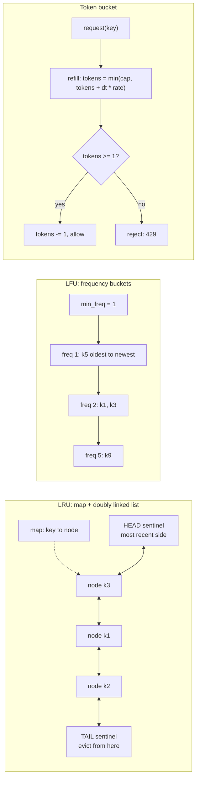

# LRU / LFU Cache & Rate Limiter — O(1) Eviction, Token Bucket, Sliding Window

> **Prerequisites:** [08 · Behavioral Patterns I](../08-behavioral-patterns-i/README.md) (Strategy for eviction policy), [10 · Concurrency-Safe Design](../10-concurrency-safe-design/README.md), [11 · Requirements to Class Diagrams](../11-requirements-to-class-diagrams/README.md)  
> **Reading time:** ~30 minutes (plus ~10 to run the demos)  
> **Audience:** LLD rounds — "implement an LRU cache in O(1)" and "design a rate limiter," the two most-asked small systems

> [!NOTE]
> **In one line:** A cache is a **hash map plus an ordering structure** (doubly linked list for LRU, frequency buckets for LFU) so both lookup and eviction are O(1); a rate limiter is **a tiny per-key state machine** (tokens, or timestamps) that must update atomically and read time from an **injected clock**.

> [!TIP]
> **Golden rule:** If two structures must stay in sync, put them behind **one lock** and one method. For caches, `get` is a *write* (it reorders), so it needs the same exclusive lock as `put`. For limiters, read-the-clock → refill → decide → update must be a single atomic step.

> [!TIP]
> **Try it:** See the four rate-limit algorithms side by side in the [Rate Limiting simulator](/tools/rate-limiting/), sketch `Cache → EvictionPolicy` in [LLD Studio](/tools/lld-studio/), then run the Python demos below.

---

## 1. Interview pressure

*"Implement an LRU cache with O(1) get and put."* → then: *"Now LFU."* → then: *"Make it thread-safe."* → then: *"Design a rate limiter: 100 requests per minute per user."* → then: *"Now across 10 servers."*

That ladder is the interview. Each rung adds one idea:

| Rung | The idea they want to hear |
| :--- | :--- |
| LRU O(1) | Hash map **+** doubly linked list; map points at nodes |
| LFU O(1) | Frequency → bucket of keys; track `min_freq` incrementally |
| Thread-safe | One lock; `get` mutates order so it is a write |
| Pluggable policy | `EvictionPolicy` interface — Strategy |
| Rate limiter | Token bucket (bursts OK) vs sliding window (strict) — and say why |
| Testable | Inject the clock; never `sleep()` in tests |
| Distributed | Atomic read-modify-write in Redis (Lua), not GET then SET |

**The smells:** a `list.remove(key)` in the cache (O(n)); `time.time()` baked into the limiter; `GET tokens` → compute → `SET tokens` against Redis.



---

## 2. Quick comparison

### Eviction policies

| Policy | Evicts | Structure | get / put | Best for | Weakness |
| :--- | :--- | :--- | :--- | :--- | :--- |
| **LRU** | Least recently used | map + doubly linked list | O(1) / O(1) | Sessions, general app caches | Scan pollution (one big scan flushes the cache) |
| **LFU** | Least frequently used (ties: oldest) | map + freq → ordered bucket + `min_freq` | O(1) / O(1) | Stable hot set (CDN, catalog) | Old popular items never leave; new items evicted instantly |
| **FIFO** | Oldest inserted | map + queue | O(1) | Simple buffers | Ignores usage entirely |
| **TinyLFU / ARC** | Adaptive | Sketches / 4 lists | O(1) | Production caches (Caffeine, Postgres) | Complex — mention, don't implement |

### Rate-limiting algorithms

| Algorithm | State per key | Bursts | Boundary problem | Precision | Use when |
| :--- | :--- | :--- | :--- | :--- | :--- |
| **Token bucket** | `tokens`, `last_refill` | Yes, up to capacity | None | Good | Default for APIs: allows short bursts, bounds average rate |
| **Leaky bucket** | queue + drain rate | Smoothed out | None | Good | You need a **steady** output rate (e.g. calling a fragile downstream) |
| **Fixed window counter** | `count`, `window_id` | Yes | **2× burst across the boundary** | Poor | Cheap and rough |
| **Sliding window log** | every timestamp | No | None | Exact | Small limits, strict fairness; memory O(limit) per key |
| **Sliding window counter** | two counters | Mostly no | ~none (approximate) | Close | Large limits at scale; O(1) memory |

---

## 3. Walkthrough — requirements → entities → methods

### Cache

**Requirements:** fixed capacity; `get(key)` and `put(key, value)` in O(1); evict by a policy when full; safe under concurrent callers; policy replaceable.

| Entity | Role |
| :--- | :--- |
| `Cache<K,V>` | Public API; owns the lock and the key→value map |
| `EvictionPolicy<K>` | Strategy: `on_access`, `on_insert`, `on_remove`, `victim` |
| `Node` (LRU) / bucket (LFU) | Internal bookkeeping |

| Method | Contract |
| :--- | :--- |
| `get(key)` | Returns value or default; **counts as an access** (reorders / bumps frequency) |
| `put(key, value)` | Insert or update (update also counts as access); if full, evict `victim()` first |
| `size()` | For tests and metrics |

### Rate limiter

**Requirements:** at most *N* requests per window per key; allow short bursts (token bucket); deterministic tests; thread-safe; per-key isolation.

| Entity | Role |
| :--- | :--- |
| `RateLimiter` | Interface: `allow(key) -> bool` |
| `TokenBucketLimiter`, `SlidingWindowLogLimiter`, … | Strategies |
| `Clock` | Injected time source (`now()`), faked in tests |
| per-key state | `(tokens, last_refill)` or a deque of timestamps |

| Method | Contract |
| :--- | :--- |
| `allow(key)` | One atomic step: read clock → update state → return decision |
| `Clock.now()` | **Monotonic** time (not wall clock) so NTP jumps can't refill buckets |

---

## 4. The design decisions that matter (say these out loud)

1. **Why map + list?** Map gives O(1) lookup but no order. List gives O(1) move/remove *if you hold the node*. The map stores node pointers, so you get both.
2. **Sentinels.** Dummy `HEAD` and `TAIL` nodes remove every "is it the first/last?" branch. Fewer branches, fewer bugs.
3. **`get` is a write.** It moves the node. A read–write lock does not help: all readers become writers. Use one mutex (or shard keys across N independent caches, as real libraries do).
4. **LFU `min_freq` is incremental.** When a key leaves bucket `f` and that bucket empties, delete the bucket; if `f == min_freq`, then `min_freq = f + 1`. A new key always resets `min_freq = 1`. Never *scan* for the minimum.
5. **LFU ties break by LRU.** Each bucket is ordered; evict the oldest key in the `min_freq` bucket.
6. **Policy as Strategy.** If asked "support both LRU and LFU," move ordering logic into an `EvictionPolicy`; `Cache` keeps the map and lock.
7. **Inject the clock.** `limiter = TokenBucket(5, 1, clock)`. Tests call `clock.advance(2)` instead of `sleep(2)`.
8. **Use monotonic time.** Wall clocks jump (NTP, DST). A backwards jump would give negative refill; clamp `elapsed` at 0 anyway.
9. **Refill lazily.** No background thread. On each `allow`, compute `tokens = min(cap, tokens + elapsed × rate)`. State is just two numbers.
10. **Per-key state grows.** Mention eviction of idle keys (TTL, or put the state in an LRU cache — a nice callback to the first half).

---

## 5. Code — LRU, LFU, and pluggable eviction

````carousel
```python
from __future__ import annotations

import threading
from abc import ABC, abstractmethod
from collections import OrderedDict
from typing import Generic, Hashable, Optional, TypeVar

K = TypeVar("K", bound=Hashable)
V = TypeVar("V")


# ── LRU: dict + doubly linked list with sentinels ─────────────────────
class _Node(Generic[K, V]):
    __slots__ = ("key", "value", "prev", "next")

    def __init__(self, key: Optional[K] = None, value: Optional[V] = None) -> None:
        self.key, self.value = key, value
        self.prev: Optional[_Node] = None
        self.next: Optional[_Node] = None


class LRUCache(Generic[K, V]):
    def __init__(self, capacity: int) -> None:
        if capacity <= 0:
            raise ValueError("capacity must be positive")
        self._cap = capacity
        self._lock = threading.Lock()              # get() reorders, so get() needs it too
        self._map: dict[K, _Node] = {}
        self._head, self._tail = _Node(), _Node()  # sentinels: no first/last special cases
        self._head.next, self._tail.prev = self._tail, self._head

    def _unlink(self, n: _Node) -> None:
        n.prev.next, n.next.prev = n.next, n.prev

    def _push_front(self, n: _Node) -> None:
        n.prev, n.next = self._head, self._head.next
        self._head.next.prev = n
        self._head.next = n

    def get(self, key: K, default: Optional[V] = None) -> Optional[V]:
        with self._lock:
            node = self._map.get(key)
            if node is None:
                return default
            self._unlink(node)
            self._push_front(node)                 # now most recently used
            return node.value

    def put(self, key: K, value: V) -> None:
        with self._lock:
            node = self._map.get(key)
            if node is not None:
                node.value = value
                self._unlink(node)
                self._push_front(node)
                return
            if len(self._map) >= self._cap:
                lru = self._tail.prev              # least recently used
                self._unlink(lru)
                del self._map[lru.key]
            node = _Node(key, value)
            self._map[key] = node
            self._push_front(node)

    def __len__(self) -> int:
        with self._lock:
            return len(self._map)


# ── LFU: freq -> ordered bucket, min_freq tracked incrementally ───────
class LFUCache(Generic[K, V]):
    def __init__(self, capacity: int) -> None:
        if capacity <= 0:
            raise ValueError("capacity must be positive")
        self._cap = capacity
        self._lock = threading.Lock()
        self._vals: dict[K, V] = {}
        self._freq: dict[K, int] = {}
        self._buckets: dict[int, OrderedDict[K, None]] = {}   # oldest first within a bucket
        self._min = 0

    def _touch(self, key: K) -> None:
        f = self._freq[key]
        bucket = self._buckets[f]
        del bucket[key]
        if not bucket:
            del self._buckets[f]                   # never leave empty buckets behind
            if self._min == f:
                self._min = f + 1                  # O(1): no scanning for the minimum
        self._freq[key] = f + 1
        self._buckets.setdefault(f + 1, OrderedDict())[key] = None

    def get(self, key: K, default: Optional[V] = None) -> Optional[V]:
        with self._lock:
            if key not in self._vals:
                return default
            self._touch(key)
            return self._vals[key]

    def put(self, key: K, value: V) -> None:
        with self._lock:
            if key in self._vals:
                self._vals[key] = value
                self._touch(key)
                return
            if len(self._vals) >= self._cap:
                bucket = self._buckets[self._min]
                victim, _ = bucket.popitem(last=False)   # lowest freq, oldest in that bucket
                if not bucket:
                    del self._buckets[self._min]
                del self._vals[victim], self._freq[victim]
            self._vals[key] = value
            self._freq[key] = 1
            self._buckets.setdefault(1, OrderedDict())[key] = None
            self._min = 1                                # a new key always has frequency 1


# ── Strategy: pluggable eviction policy ──────────────────────────────
class EvictionPolicy(ABC, Generic[K]):
    @abstractmethod
    def on_insert(self, key: K) -> None: ...
    @abstractmethod
    def on_access(self, key: K) -> None: ...
    @abstractmethod
    def on_remove(self, key: K) -> None: ...
    @abstractmethod
    def victim(self) -> K: ...


class LruPolicy(EvictionPolicy[K]):
    def __init__(self) -> None:
        self._order: OrderedDict[K, None] = OrderedDict()   # oldest first

    def on_insert(self, key: K) -> None: self._order[key] = None
    def on_access(self, key: K) -> None: self._order.move_to_end(key)
    def on_remove(self, key: K) -> None: self._order.pop(key, None)
    def victim(self) -> K: return next(iter(self._order))


class Cache(Generic[K, V]):
    """Map + lock live here. Ordering knowledge lives in the policy."""

    def __init__(self, capacity: int, policy: EvictionPolicy[K]) -> None:
        self._cap, self._policy = capacity, policy
        self._data: dict[K, V] = {}
        self._lock = threading.Lock()

    def get(self, key: K, default: Optional[V] = None) -> Optional[V]:
        with self._lock:
            if key not in self._data:
                return default
            self._policy.on_access(key)
            return self._data[key]

    def put(self, key: K, value: V) -> None:
        with self._lock:
            if key in self._data:
                self._data[key] = value
                self._policy.on_access(key)
                return
            if len(self._data) >= self._cap:
                victim = self._policy.victim()
                self._policy.on_remove(victim)
                del self._data[victim]
            self._data[key] = value
            self._policy.on_insert(key)


if __name__ == "__main__":
    lru = LRUCache[str, int](2)
    lru.put("k1", 1); lru.put("k2", 2)
    lru.get("k1")                       # k2 is now least recent
    lru.put("k3", 3)                    # evicts k2
    print("lru:", lru.get("k2"), lru.get("k1"), lru.get("k3"))     # None 1 3

    lfu = LFUCache[str, int](2)
    lfu.put("a", 1); lfu.put("b", 2)
    lfu.get("a")                        # a: freq 2, b: freq 1
    lfu.put("c", 3)                     # evicts b (lowest frequency)
    print("lfu:", lfu.get("b"), lfu.get("a"), lfu.get("c"))        # None 1 3

    lfu2 = LFUCache[str, int](2)
    lfu2.put("a", 1); lfu2.put("b", 2)  # both freq 1; a is older
    lfu2.put("c", 3)                    # tie -> evict the oldest (a)
    print("tie:", lfu2.get("a"), lfu2.get("b"), lfu2.get("c"))     # None 2 3

    plug = Cache[str, int](2, LruPolicy())
    plug.put("x", 1); plug.put("y", 2); plug.get("x"); plug.put("z", 3)
    print("policy:", plug.get("y"), plug.get("x"), plug.get("z"))  # None 1 3
```
<!-- slide -->
```csharp
using System;
using System.Collections.Generic;
using System.Linq;

// ── LRU: Dictionary + LinkedList (framework's doubly linked list) ─────
public sealed class LruCache<K, V> where K : notnull
{
    private readonly int _cap;
    private readonly object _gate = new();                 // TryGet reorders => needs the lock too
    private readonly Dictionary<K, LinkedListNode<KeyValuePair<K, V>>> _map = new();
    private readonly LinkedList<KeyValuePair<K, V>> _order = new();   // First = most recent

    public LruCache(int capacity)
    {
        if (capacity <= 0) throw new ArgumentOutOfRangeException(nameof(capacity));
        _cap = capacity;
    }

    public bool TryGet(K key, out V value)
    {
        lock (_gate)
        {
            if (!_map.TryGetValue(key, out var node)) { value = default!; return false; }
            _order.Remove(node);
            _order.AddFirst(node);                         // reuse the node: no allocation
            value = node.Value.Value;
            return true;
        }
    }

    public void Put(K key, V value)
    {
        lock (_gate)
        {
            if (_map.TryGetValue(key, out var node))
            {
                node.Value = new KeyValuePair<K, V>(key, value);
                _order.Remove(node);
                _order.AddFirst(node);
                return;
            }
            if (_map.Count >= _cap)
            {
                var lru = _order.Last!;                    // least recently used
                _order.RemoveLast();
                _map.Remove(lru.Value.Key);
            }
            _map[key] = _order.AddFirst(new KeyValuePair<K, V>(key, value));
        }
    }

    public int Count { get { lock (_gate) return _map.Count; } }
}

// ── LFU: freq -> LinkedList of keys (front = newest), min_freq incremental ──
public sealed class LfuCache<K, V> where K : notnull
{
    private sealed class Entry
    {
        public V Value = default!;
        public int Freq = 1;
        public LinkedListNode<K> Node = null!;
    }

    private readonly int _cap;
    private readonly object _gate = new();
    private readonly Dictionary<K, Entry> _items = new();
    private readonly Dictionary<int, LinkedList<K>> _buckets = new();
    private int _minFreq;

    public LfuCache(int capacity)
    {
        if (capacity <= 0) throw new ArgumentOutOfRangeException(nameof(capacity));
        _cap = capacity;
    }

    private void Touch(Entry e)
    {
        var old = _buckets[e.Freq];
        old.Remove(e.Node);
        if (old.Count == 0)
        {
            _buckets.Remove(e.Freq);                       // never keep empty buckets
            if (_minFreq == e.Freq) _minFreq++;            // O(1) min tracking
        }
        e.Freq++;
        if (!_buckets.TryGetValue(e.Freq, out var next)) _buckets[e.Freq] = next = new LinkedList<K>();
        next.AddFirst(e.Node);                             // newest at the front
    }

    public bool TryGet(K key, out V value)
    {
        lock (_gate)
        {
            if (!_items.TryGetValue(key, out var e)) { value = default!; return false; }
            Touch(e);
            value = e.Value;
            return true;
        }
    }

    public void Put(K key, V value)
    {
        lock (_gate)
        {
            if (_items.TryGetValue(key, out var existing))
            {
                existing.Value = value;
                Touch(existing);
                return;
            }
            if (_items.Count >= _cap)
            {
                var bucket = _buckets[_minFreq];
                var victim = bucket.Last!;                 // oldest within the lowest frequency
                bucket.RemoveLast();
                if (bucket.Count == 0) _buckets.Remove(_minFreq);
                _items.Remove(victim.Value);
            }
            var entry = new Entry { Value = value };
            entry.Node = new LinkedListNode<K>(key);
            if (!_buckets.TryGetValue(1, out var ones)) _buckets[1] = ones = new LinkedList<K>();
            ones.AddFirst(entry.Node);
            _items[key] = entry;
            _minFreq = 1;
        }
    }
}

// ── Strategy: pluggable eviction policy ──────────────────────────────
public interface IEvictionPolicy<K> where K : notnull
{
    void OnInsert(K key);
    void OnAccess(K key);
    void OnRemove(K key);
    K Victim();
}

public sealed class LruPolicy<K> : IEvictionPolicy<K> where K : notnull
{
    private readonly LinkedList<K> _order = new();         // First = most recent
    private readonly Dictionary<K, LinkedListNode<K>> _nodes = new();

    public void OnInsert(K key) => _nodes[key] = _order.AddFirst(key);
    public void OnAccess(K key) { var n = _nodes[key]; _order.Remove(n); _order.AddFirst(n); }
    public void OnRemove(K key) { if (_nodes.Remove(key, out var n)) _order.Remove(n); }
    public K Victim() => _order.Last!.Value;
}

public sealed class Cache<K, V> where K : notnull
{
    private readonly int _cap;
    private readonly IEvictionPolicy<K> _policy;
    private readonly Dictionary<K, V> _data = new();
    private readonly object _gate = new();

    public Cache(int capacity, IEvictionPolicy<K> policy) { _cap = capacity; _policy = policy; }

    public bool TryGet(K key, out V value)
    {
        lock (_gate)
        {
            if (!_data.TryGetValue(key, out value!)) return false;
            _policy.OnAccess(key);
            return true;
        }
    }

    public void Put(K key, V value)
    {
        lock (_gate)
        {
            if (_data.ContainsKey(key)) { _data[key] = value; _policy.OnAccess(key); return; }
            if (_data.Count >= _cap)
            {
                var victim = _policy.Victim();
                _policy.OnRemove(victim);
                _data.Remove(victim);
            }
            _data[key] = value;
            _policy.OnInsert(key);
        }
    }
}
```
````

---

## 6. Code — token bucket, sliding window, injected clock

````carousel
```python
from __future__ import annotations

import threading
import time
from abc import ABC, abstractmethod
from collections import deque
from typing import Callable

Clock = Callable[[], float]           # returns seconds; use a MONOTONIC source in production


class FakeClock:
    """Tests call advance(); nobody sleeps."""

    def __init__(self, start: float = 0.0) -> None:
        self.t = start

    def __call__(self) -> float:
        return self.t

    def advance(self, seconds: float) -> None:
        self.t += seconds


class RateLimiter(ABC):
    @abstractmethod
    def allow(self, key: str) -> bool: ...


class TokenBucketLimiter(RateLimiter):
    """Bursts up to `capacity`; long-run average = `refill_per_sec`."""

    def __init__(self, capacity: int, refill_per_sec: float, clock: Clock = time.monotonic) -> None:
        self._cap, self._rate, self._clock = float(capacity), refill_per_sec, clock
        self._lock = threading.Lock()
        self._state: dict[str, tuple[float, float]] = {}      # key -> (tokens, last_refill)

    def allow(self, key: str) -> bool:
        with self._lock:                                      # read clock INSIDE the lock
            now = self._clock()
            tokens, last = self._state.get(key, (self._cap, now))
            tokens = min(self._cap, tokens + max(0.0, now - last) * self._rate)
            allowed = tokens >= 1.0
            if allowed:
                tokens -= 1.0
            self._state[key] = (tokens, now)
            return allowed


class FixedWindowLimiter(RateLimiter):
    """Cheap, but allows 2x the limit around a window boundary."""

    def __init__(self, limit: int, window_sec: float, clock: Clock = time.monotonic) -> None:
        self._limit, self._window, self._clock = limit, window_sec, clock
        self._lock = threading.Lock()
        self._state: dict[str, tuple[int, int]] = {}          # key -> (window_id, count)

    def allow(self, key: str) -> bool:
        with self._lock:
            window_id = int(self._clock() // self._window)
            wid, count = self._state.get(key, (window_id, 0))
            if wid != window_id:
                count = 0
            if count >= self._limit:
                self._state[key] = (window_id, count)
                return False
            self._state[key] = (window_id, count + 1)
            return True


class SlidingWindowLogLimiter(RateLimiter):
    """Exact. Memory O(limit) per key."""

    def __init__(self, limit: int, window_sec: float, clock: Clock = time.monotonic) -> None:
        self._limit, self._window, self._clock = limit, window_sec, clock
        self._lock = threading.Lock()
        self._log: dict[str, deque[float]] = {}

    def allow(self, key: str) -> bool:
        with self._lock:
            now = self._clock()
            q = self._log.setdefault(key, deque())
            cutoff = now - self._window
            while q and q[0] <= cutoff:                       # drop timestamps outside the window
                q.popleft()
            if len(q) >= self._limit:
                return False
            q.append(now)
            return True


class SlidingWindowCounterLimiter(RateLimiter):
    """Approximate: weighs the previous fixed window by how much of it still overlaps."""

    def __init__(self, limit: int, window_sec: float, clock: Clock = time.monotonic) -> None:
        self._limit, self._window, self._clock = limit, window_sec, clock
        self._lock = threading.Lock()
        self._state: dict[str, tuple[int, int, int]] = {}     # key -> (window_id, current, previous)

    def allow(self, key: str) -> bool:
        with self._lock:
            now = self._clock()
            wid = int(now // self._window)
            cur_id, cur, prev = self._state.get(key, (wid, 0, 0))
            if wid != cur_id:
                prev = cur if wid == cur_id + 1 else 0        # skipped windows => previous is 0
                cur, cur_id = 0, wid
            overlap = 1.0 - (now % self._window) / self._window
            estimated = prev * overlap + cur
            if estimated + 1 > self._limit:
                self._state[key] = (cur_id, cur, prev)
                return False
            self._state[key] = (cur_id, cur + 1, prev)
            return True


if __name__ == "__main__":
    clock = FakeClock()
    tb = TokenBucketLimiter(capacity=5, refill_per_sec=1, clock=clock)
    print([tb.allow("u") for _ in range(6)])        # [True x5, False]
    clock.advance(2)
    print([tb.allow("u") for _ in range(3)])        # [True, True, False]  (2 tokens refilled)
    clock.advance(1000)
    print(sum(tb.allow("u") for _ in range(10)))    # 5  (never exceeds capacity)

    # Boundary burst: limit 5 per 10 s. 5 hits at t=9.9, 5 more at t=10.1.
    for name, lim in [("fixed", FixedWindowLimiter(5, 10, FakeClock())),
                      ("log", SlidingWindowLogLimiter(5, 10, FakeClock())),
                      ("counter", SlidingWindowCounterLimiter(5, 10, FakeClock()))]:
        c = lim._clock
        c.t = 9.9
        first = sum(lim.allow("u") for _ in range(5))
        c.t = 10.1
        second = sum(lim.allow("u") for _ in range(5))
        print(f"{name:8s} allowed {first} + {second} = {first + second} within 0.2 s")
```
<!-- slide -->
```csharp
using System;
using System.Collections.Generic;

public interface IClock { long NowMs { get; } }                    // monotonic milliseconds

public sealed class SystemClock : IClock { public long NowMs => Environment.TickCount64; }

public sealed class FakeClock : IClock
{
    public long NowMs { get; private set; }
    public void Advance(long ms) => NowMs += ms;                   // tests: no sleeping
}

public interface IRateLimiter { bool Allow(string key); }

public sealed class TokenBucketLimiter : IRateLimiter
{
    private readonly double _capacity, _refillPerSec;
    private readonly IClock _clock;
    private readonly object _gate = new();
    private readonly Dictionary<string, (double Tokens, long LastMs)> _state = new();

    public TokenBucketLimiter(int capacity, double refillPerSec, IClock? clock = null)
    {
        _capacity = capacity;
        _refillPerSec = refillPerSec;
        _clock = clock ?? new SystemClock();
    }

    public bool Allow(string key)
    {
        lock (_gate)                                                // clock read, refill, decide, store: one step
        {
            long now = _clock.NowMs;
            var (tokens, last) = _state.TryGetValue(key, out var s) ? s : (_capacity, now);
            double elapsedSec = Math.Max(0, now - last) / 1000.0;
            tokens = Math.Min(_capacity, tokens + elapsedSec * _refillPerSec);
            bool allowed = tokens >= 1.0;
            if (allowed) tokens -= 1.0;
            _state[key] = (tokens, now);
            return allowed;
        }
    }
}

public sealed class SlidingWindowLogLimiter : IRateLimiter
{
    private readonly int _limit;
    private readonly long _windowMs;
    private readonly IClock _clock;
    private readonly object _gate = new();
    private readonly Dictionary<string, Queue<long>> _log = new();

    public SlidingWindowLogLimiter(int limit, TimeSpan window, IClock? clock = null)
    {
        _limit = limit;
        _windowMs = (long)window.TotalMilliseconds;
        _clock = clock ?? new SystemClock();
    }

    public bool Allow(string key)
    {
        lock (_gate)
        {
            long now = _clock.NowMs;
            if (!_log.TryGetValue(key, out var q)) _log[key] = q = new Queue<long>();
            while (q.Count > 0 && q.Peek() <= now - _windowMs) q.Dequeue();   // drop expired
            if (q.Count >= _limit) return false;
            q.Enqueue(now);
            return true;
        }
    }
}
```
````

**Distributed version — the one line that matters:** `GET` tokens → compute → `SET` tokens across pods is a check-then-act race (two pods read `5`, both write `4`, two requests allowed for one token). Do the whole thing in **one Redis Lua script**; Redis runs scripts one at a time, so there is no interleaving:

```lua
-- KEYS[1] = bucket key; ARGV = capacity, refill_per_sec, now_ms
local data   = redis.call('HMGET', KEYS[1], 'tokens', 'ts')
local cap    = tonumber(ARGV[1])
local rate   = tonumber(ARGV[2])
local now    = tonumber(ARGV[3])
local tokens = tonumber(data[1]) or cap
local ts     = tonumber(data[2]) or now
tokens = math.min(cap, tokens + math.max(0, now - ts) / 1000 * rate)
local allowed = 0
if tokens >= 1 then tokens = tokens - 1; allowed = 1 end
redis.call('HSET', KEYS[1], 'tokens', tokens, 'ts', now)
redis.call('PEXPIRE', KEYS[1], math.ceil(cap / rate * 1000) * 2)   -- idle keys clean themselves up
return allowed
```

---

## 7. Edges — and when not to use these

- **Cache `None`/null values.** `get` returning `None` is ambiguous (missing vs stored `None`). Use a sentinel or a `(found, value)` return (`TryGet` in C#).
- **TTL.** Store an expiry timestamp per entry; check on `get` (lazy expiry) and sweep occasionally. TTL and capacity eviction are *independent* — expired entries should leave first.
- **Cache stampede.** 1,000 requests miss the same key and all hit the DB. Fix with single-flight (one loader per key, others wait) plus jittered TTLs.
- **LFU staleness.** An item hit 10,000 times last week never leaves; a brand-new hot item is evicted immediately. Fixes: **aging** (periodically halve all counts) or **TinyLFU** with an admission filter.
- **Scan pollution in LRU.** One big sequential scan flushes the hot set. Mention segmented LRU / 2Q / ARC.
- **Limiter state growth.** One entry per key forever. Expire idle keys, or keep limiter state in an LRU cache.
- **Clock.** Monotonic only; clamp elapsed ≥ 0.
- **Cost-based limits.** `allow(key, cost=3)`: take *n* tokens at once; the same code path.
- **Fail open or closed?** If the limiter's backing store (Redis) is down: *open* (allow) protects availability, *closed* (reject) protects the backend. Decide per endpoint, and say it.

| Situation | Do this instead |
| :--- | :--- |
| Python and "just LRU" | `functools.lru_cache` / `OrderedDict.move_to_end` — then still explain the map + list |
| One process, 10 req/s limit | A semaphore or a sleep-based throttle is fine; no per-key state |
| Need strictly smooth outflow to a fragile service | Leaky bucket (a queue + fixed drain), not token bucket |
| Huge scale, small accuracy loss OK | Sliding window **counter** (O(1) memory), not the log |

---

## 8. War story (short)

A flash-sale catalog cache used a hand-rolled LFU. Two bugs: empty frequency buckets were never deleted, and `min_freq` was found by **scanning** every bucket key on eviction. With 500,000 distinct counts, `put` went from microseconds to ~2 s. Pods ran out of memory and crash-looped; all traffic fell through to Postgres at once and took it down (a stampede).

**Fix:** delete empty buckets; update `min_freq` incrementally (the `_touch` method above); wrap loads in single-flight; add a circuit breaker so a sick cache can't take down the database.

---

## 9. What you'd say in two minutes

> "For LRU I keep a hash map from key to node plus a doubly linked list ordered by recency, with sentinel head and tail so there are no edge cases. `get` moves the node to the front; `put` inserts at the front and, when full, removes the node before the tail sentinel and its map entry. Both are O(1). Because `get` reorders, it needs the same lock as `put` — a read-write lock doesn't help.
>
> LFU is a map from key to frequency, plus buckets from frequency to an ordered set of keys, plus `min_freq`. Touching a key moves it from bucket *f* to *f+1*; if bucket *f* empties I delete it and, if it was the minimum, bump `min_freq`. Eviction pops the oldest key from the `min_freq` bucket, so ties go to LRU. I'd also mention LFU's staleness problem and TinyLFU.
>
> For rate limiting I'd default to token bucket: two numbers per key, lazy refill, burst up to capacity, long-run rate bounded. Time comes from an injected monotonic clock so tests don't sleep. Fixed window has the boundary double-burst; sliding window log is exact but costs memory; the sliding window counter is the cheap approximation. Across servers, the read-modify-write must be one atomic Redis Lua script — GET-then-SET is a race."

---

## 10. Anti-patterns

1. **`list.remove(key)` / `list.index` in the cache** — O(n); defeats the whole point.
2. **Reading with no lock because "it's just a get"** — `get` reorders; you will corrupt the list.
3. **Scanning for `min_freq`** — O(buckets) on every eviction. Track it incrementally.
4. **Leaving empty LFU buckets** — slow memory leak.
5. **`time.time()` / `DateTime.Now` inside the limiter** — flaky tests, NTP jumps. Inject a monotonic clock.
6. **`time.sleep` in tests** — slow and nondeterministic; advance a fake clock.
7. **`GET` then `SET` on Redis** — race across pods. Lua / `INCR` + `EXPIRE` / atomic script.
8. **Fixed window and calling it "100/min"** — a client gets 200 in two seconds around the boundary.
9. **Unbounded per-key limiter state** — an attacker with a million keys is a memory attack.
10. **Cache key built by string concatenation** (`user_id + lang`) — `"12"+"en_US"` collides with `"12e"+"n_US"`. Use a structured key or a delimiter that cannot appear in parts.

---

## 11. Interview questions

<details>
<summary><strong>1. Why a hash map and a doubly linked list for LRU? [BASIC]</strong></summary>

The map gives O(1) lookup of a node; the list gives O(1) "move to front" and "remove from tail" *if* you already hold the node pointer. The map stores that pointer. Singly linked would make removal O(n) because you need the previous node. Sentinels remove first/last special cases.

</details>

<details>
<summary><strong>2. LRU or LFU — which would you pick for X? [BASIC]</strong></summary>

LRU for session-like or "recent is relevant" workloads; it adapts quickly. LFU for a stable popular set (product catalog, CDN assets). LFU risks keeping stale popular items and evicting new ones; LRU risks scan pollution. If you need both, say "TinyLFU or ARC — production libraries do that" and move on.

</details>

<details>
<summary><strong>3. Can I use a read-write lock so `get`s run in parallel? [TRICKY]</strong></summary>

Not for a strict LRU: `get` mutates the list, so it is a writer. Options: (a) one mutex (fine for most services); (b) shard keys across N independent caches, each with its own lock; (c) approximate recency — record accesses into a buffer and apply them in batches (what Caffeine does). Also note per-node locks bring deadlock risk when relinking neighbors.

</details>

<details>
<summary><strong>4. Add TTL to the LRU cache. [SCENARIO]</strong></summary>

Store `expires_at` in each node. On `get`, if expired, remove and treat as a miss (lazy expiry). Add a periodic sweep (or a min-heap on expiry) so dead entries don't occupy capacity. Inject the clock again. Expired entries should be evicted before live LRU victims.

</details>

<details>
<summary><strong>5. 100 requests/min per user across 10 API pods. [SCENARIO]</strong></summary>

Shared state in Redis, updated by one atomic Lua script (token bucket or sliding-window counter). Key per user with `PEXPIRE` so idle users disappear. Optionally keep a small local token allowance per pod to cut Redis round-trips (accepting slight over-admission). Decide fail-open vs fail-closed if Redis is down. Mention clock skew: use Redis `TIME` or pass one app-side time source consistently.

</details>

<details>
<summary><strong>6. 5,000 requests miss the same cache key at once. What happens, and how do you stop it? [SCENARIO]</strong></summary>

A cache stampede: all 5,000 go to the database. Use single-flight — the first caller loads, the rest wait on the same future — plus TTL jitter so many keys don't expire together, and optionally serve-stale-while-revalidate. A circuit breaker protects the DB if the load itself is failing.

</details>

<details>
<summary><strong>7. Fixed window counter allows 200 requests in a "100/minute" limiter. How? [TRICKY]</strong></summary>

Send 100 at 12:00:59 (end of window 1) and 100 at 12:01:00 (start of window 2). Both windows are within the limit, but the real elapsed time is one second. Sliding window log removes it exactly (memory O(limit)); sliding window counter approximates it by weighting the previous window; token bucket bounds the rate by construction.

</details>

<details>
<summary><strong>8. Your LFU keeps evicting the newest hot item. Why? [TRICKY]</strong></summary>

A new key has frequency 1, so it is always the cheapest to evict — meanwhile old items carry huge historical counts. Fixes: age counts (halve periodically), cap the maximum frequency, or use TinyLFU: a small LRU "window" admits new keys and a frequency sketch decides whether a newcomer deserves to replace a victim.

</details>

---

## 12. Try it

1. Play with the [Rate Limiting simulator](/tools/rate-limiting/): fire a burst at the boundary of a fixed window, then at a token bucket and a sliding window. Match what you see to the boundary demo above.
2. Run the Python demos. Then delete the line `del self._buckets[f]` in `_touch` and write a test that shows the memory leak (count `len(lfu._buckets)` after 1,000 gets on one key).
3. Add TTL to `LRUCache` using the injected clock. Test expiry with `FakeClock`, no sleeping.
4. Add `allow(key, cost=3)` to the token bucket.
5. Write a 20-thread test: 20 threads call `limiter.allow("u")` 1,000 times each against capacity 100 and a frozen clock. Exactly 100 should succeed. Then remove the lock and watch it fail.
6. Draw `Cache → EvictionPolicy → {LruPolicy, LfuPolicy}` in [LLD Studio](/tools/lld-studio/) and mark where the lock lives.

---

## 13. One-page cheat sheet

```text
LRU        map(key -> node) + doubly linked list, sentinels. get/put = unlink + push_front.
           Evict tail.prev. get() REORDERS -> needs the lock.
LFU        key->value, key->freq, freq->OrderedDict(keys), min_freq.
           touch: bucket[f] -> bucket[f+1]; empty bucket deleted; min_freq++ if it was min.
           put new: evict oldest in bucket[min_freq]; min_freq = 1.
Policy     Cache(map + lock) + EvictionPolicy(on_insert/on_access/on_remove/victim)  [Strategy]

TOKEN BUCKET   tokens = min(cap, tokens + dt*rate); allow if tokens >= 1. Bursts OK.
LEAKY BUCKET   queue drained at fixed rate. Smooth output.
FIXED WINDOW   cheap; 2x burst at the boundary.
SLIDING LOG    exact; O(limit) memory.   SLIDING COUNTER  prev*overlap + cur; O(1) memory.
CLOCK          inject it; monotonic; clamp elapsed >= 0; tests advance(), never sleep().
DISTRIBUTED    one atomic Redis Lua script. Never GET then SET. Decide fail-open/closed.

Say aloud: "Which two structures must stay in sync, and what is the single lock?"
```

---

## Next

**[19 · API & Library Design, Dependency Injection](../19-api-library-design-and-di/README.md)** — fluent APIs, versioning, and constructor injection.
