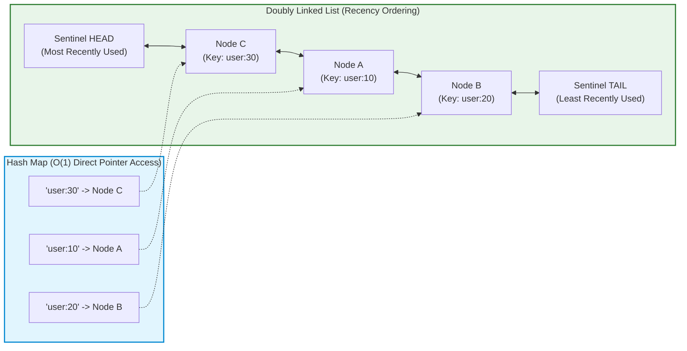
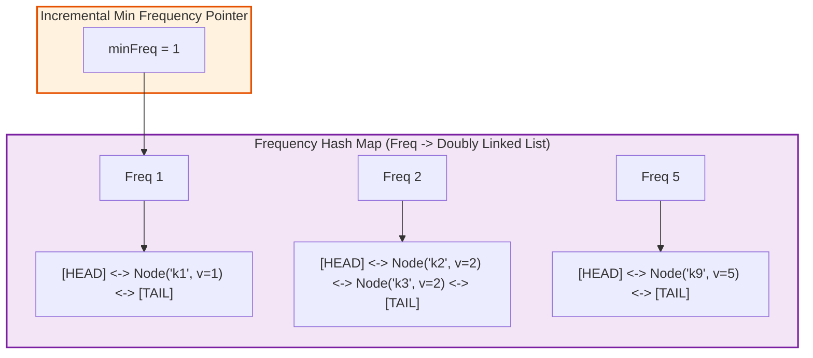
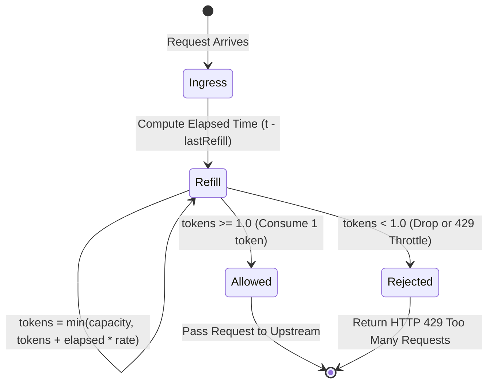
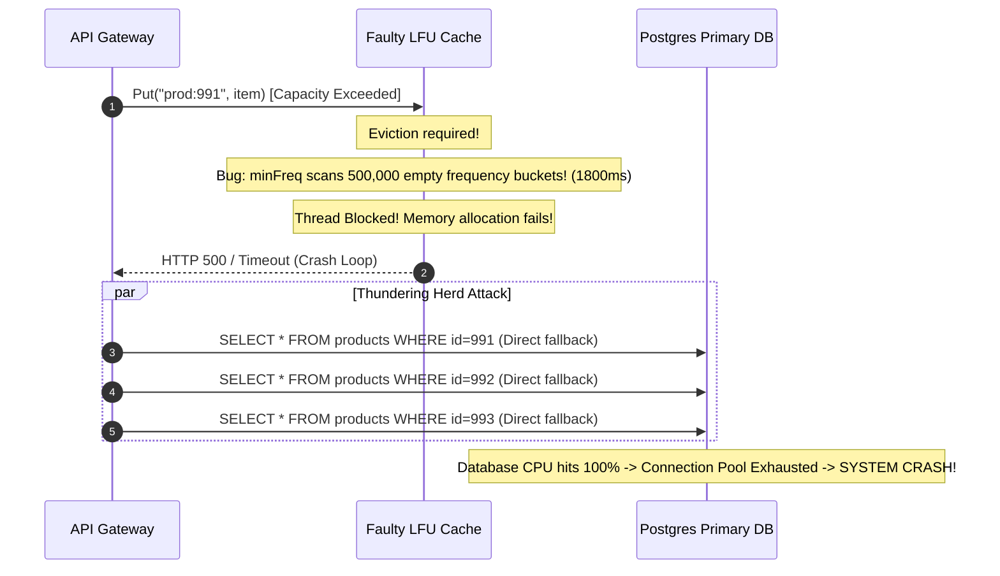

# Classic Systems: LRU/LFU Cache & Token Bucket Rate Limiter

> **Prerequisites**: [10: Concurrency-Safe Design](../10-concurrency-safe-design/README.md), [11: Requirements to Class Diagrams](../11-requirements-to-class-diagrams/README.md), Hash Tables & Doubly Linked List Fundamentals.  
> **Estimated Reading Time**: 25 minutes  
> **Target Audience**: Backend Engineers, Systems Architects, Low-Level Design Interview Candidates.

> [!TIP]
> **Golden Rule of Algorithmic Caching & Throttling**: To achieve strict $\mathcal{O}(1)$ time complexity for cache operations, combine two complementary data structures: a **Hash Map** for $\mathcal{O}(1)$ key lookup and a **Doubly Linked List** for $\mathcal{O}(1)$ node reordering and eviction. In rate limiting, never couple algorithms to the system clock; inject a clock interface to enable deterministic, non-flaky automated testing.

---

## 1. Visual Mental Models & System Architecture

### 1.1 LRU Cache: Hash Table + Doubly Linked List Architecture

A standard hash table provides $\mathcal{O}(1)$ key lookup but lacks ordering. A linked list provides $\mathcal{O}(1)$ insertion/deletion but $\mathcal{O}(N)$ lookup. Combining them achieves $\mathcal{O}(1)$ for both operations.



---

### 1.2 LFU Cache: Frequency Buckets with Incremental Minimum Pointer

Least Frequently Used (LFU) maintains an access counter per key. Ties at the same frequency are broken via LRU recency. A pointer `minFreq` tracks the lowest frequency bucket in $\mathcal{O}(1)$.



---

### 1.3 Token Bucket Rate Limiter

Tokens refill continuously at a rate $R$ tokens/second up to a maximum burst capacity $C$. Arriving requests consume 1 token. If no tokens exist, the request is throttled.



---

## 2. Taxonomic Reference Grids

### 2.1 Cache Eviction Policies Matrix

| Policy | Mechanism | Eviction Candidate | Time Complexity | Memory Overhead | Best Use Case |
| :--- | :--- | :--- | :--- | :--- | :--- |
| **LRU (Least Recently Used)** | Doubly Linked List + Hash Map | Oldest accessed key | $\mathcal{O}(1)$ get, $\mathcal{O}(1)$ put | 2 pointers per node | General web application caches, session stores |
| **LFU (Least Frequently Used)** | Frequency Hash Map + DLL per bucket | Lowest access count; LRU tie-break | $\mathcal{O}(1)$ get, $\mathcal{O}(1)$ put | 2 pointers + freq counter per node | Content delivery networks (CDNs), static asset caches |
| **FIFO (First In First Out)** | Queue + Hash Map | Oldest inserted key | $\mathcal{O}(1)$ | 1 pointer per node | Write-heavy ingestion logs, time-series windows |
| **ARC (Adaptive Replacement Cache)** | Self-tuning balance between LRU and LFU | Dynamically adapts based on recency vs frequency | $\mathcal{O}(1)$ | 4 linked lists | High-performance database buffer pools (Postgres, ZFS) |

### 2.2 Rate Limiting Algorithms Matrix

| Algorithm | Mechanism | Handles Bursts? | Boundary Burst Vulnerability? | State Storage Overhead |
| :--- | :--- | :--- | :--- | :--- |
| **Token Bucket** | Continuous fractional refill over time | Yes (Up to bucket capacity) | No boundary anomalies | Minimal: `tokens` (float) + `lastRefill` (timestamp) |
| **Leaky Bucket** | FIFO queue processed at constant output rate | Smoothes bursts into steady output stream | No | Queue capacity + worker thread |
| **Fixed Window Counter** | Counter reset every $N$ seconds | Yes | **Severe**: Allows $2\times$ limit across window boundaries | Single integer counter per window |
| **Sliding Window Log** | Timestamps stored in sorted set | Yes | None | High: Stores every request timestamp ($\mathcal{O}(K)$ memory) |

---

## 3. Production War Stories: Incident Post-Mortem

### The $950K Redis Thundering Herd & Unbounded LFU Memory Leak

```
SEVERITY LEVEL: SEV-1 (Database Meltdown & Core API Outage)
DETECTION TIME: 6 Minutes
RECOVERY TIME: 110 Minutes
FINANCIAL PENALTY: $950,000 in SLA breaches and lost customer purchases
```

#### Incident Background
An e-commerce giant deployed an in-memory LFU cache microservice to hold hot product catalog items during a Black Friday flash sale. The cache was designed to evict rarely accessed products while keeping viral trending deals hot in memory.

#### What Happened
At 00:00 UTC, the catalog service began throwing HTTP 503 errors. The custom LFU implementation had an algorithmic memory leak: frequency buckets (`Map<int, DoublyLinkedList>`) were created as frequency counts increased ($1, 2, \dots, 500,000$), but empty frequency bucket keys were never cleaned up when all nodes moved to higher tiers. Furthermore, the `minFreq` tracker was calculated by scanning the bucket keys ($\mathcal{O}(F)$) whenever an eviction occurred. Under peak eviction load, `put()` latency degraded from $10\mu s$ to $1,800\text{ms}$. Pods ran out of memory, cascaded into crash loops, and sent 100% of un-cached traffic directly to the primary Aurora database cluster, triggering a catastrophic thundering herd collapse.



#### Root Cause Analysis
1. **Unbounded Frequency Bucket Growth**: Empty doubly linked list bucket entries were never garbage-collected or deleted from the outer map when nodes graduated to higher frequencies.
2. **Failure of $\mathcal{O}(1)$ Min-Frequency Tracking**: Instead of updating `minFreq` incrementally ($\mathcal{O}(1)$) when the current minimum bucket became empty, the code scanned all dictionary keys.
3. **Absence of Cache Stampede Guard**: The application lacked a mutex or single-flight coordinator around cache misses, hammering the relational database with identical concurrent queries.

#### The Architectural Hardening
1. **Strict Bucket Clean-Up Invariant**: When unlinking a node leaves a frequency bucket empty, the bucket is immediately deleted from the hash map.
2. **Deterministic $\mathcal{O}(1)$ MinFreq Update**: If `node.freq == minFreq` and that bucket becomes empty post-promotion, `minFreq` is incremented by exactly 1:
   $$\text{if } \text{isEmpty}(\text{buckets}[\text{minFreq}]) \implies \text{minFreq} \leftarrow \text{minFreq} + 1$$
3. **SingleFlight Grouping**: Wrapped cache misses in Go `singleflight.Group` so only one upstream database query executes for duplicate missed keys.

---

## 4. Multi-Language Production Implementations

Below are four enterprise implementations of the **LRU Cache**, **LFU Cache**, and **Token Bucket Rate Limiter**.

### 4.1 Go: High-Performance O(1) LRU Cache with Sentinel Nodes

```go
package main

import (
	"errors"
	"fmt"
	"sync"
)

type node struct {
	key   string
	value any
	prev  *node
	next  *node
}

// LRUCache achieves strict O(1) get and put using a Hash Map and Doubly Linked List.
type LRUCache struct {
	capacity int
	mu       sync.Mutex
	items    map[string]*node
	head     *node // Sentinel MRU node
	tail     *node // Sentinel LRU node
}

func NewLRUCache(capacity int) (*LRUCache, error) {
	if capacity <= 0 {
		return nil, errors.New("capacity must be positive")
	}

	c := &LRUCache{
		capacity: capacity,
		items:    make(map[string]*node),
		head:     &node{},
		tail:     &node{},
	}
	c.head.next = c.tail
	c.tail.prev = c.head
	return c, nil
}

func (c *LRUCache) remove(n *node) {
	n.prev.next = n.next
	n.next.prev = n.prev
}

func (c *LRUCache) insertAtFront(n *node) {
	n.next = c.head.next
	n.prev = c.head
	c.head.next.prev = n
	c.head.next = n
}

func (c *LRUCache) Get(key string) (any, bool) {
	c.mu.Lock()
	defer c.mu.Unlock()

	n, exists := c.items[key]
	if !exists {
		return nil, false
	}

	// Move accessed node to front (MRU)
	c.remove(n)
	c.insertAtFront(n)
	return n.value, true
}

func (c *LRUCache) Put(key string, val any) {
	c.mu.Lock()
	defer c.mu.Unlock()

	if n, exists := c.items[key]; exists {
		n.value = val
		c.remove(n)
		c.insertAtFront(n)
		return
	}

	if len(c.items) >= c.capacity {
		// Evict least recently used (node before tail sentinel)
		lru := c.tail.prev
		c.remove(lru)
		delete(c.items, lru.key)
	}

	newNode := &node{key: key, value: val}
	c.items[key] = newNode
	c.insertAtFront(newNode)
}

func main() {
	cache, _ := NewLRUCache(2)
	cache.Put("k1", 100)
	cache.Put("k2", 200)

	val, _ := cache.Get("k1") // Access k1 (k2 becomes LRU)
	fmt.Printf("Get k1: %v\n", val)

	cache.Put("k3", 300) // Evicts k2

	_, exists := cache.Get("k2")
	fmt.Printf("k2 exists? %v (Expected: false)\n", exists)
}
```

---

### 4.2 TypeScript: Token Bucket Rate Limiter with Pluggable Clock

```typescript
export interface IClock {
  nowMs(): number;
}

export class SystemClock implements IClock {
  nowMs(): number {
    return Date.now();
  }
}

export class MockClock implements IClock {
  private currentTime: number;
  constructor(initialTimeMs: number = 0) {
    this.currentTime = initialTimeMs;
  }
  nowMs(): number {
    return this.currentTime;
  }
  advance(ms: number): void {
    this.currentTime += ms;
  }
}

export class TokenBucketRateLimiter {
  private tokens: number;
  private lastRefillTimestamp: number;

  constructor(
    public readonly capacity: number,
    public readonly refillRatePerSec: number,
    private clock: IClock = new SystemClock()
  ) {
    this.tokens = capacity;
    this.lastRefillTimestamp = this.clock.nowMs();
  }

  public allowRequest(tokensToConsume: number = 1): boolean {
    this.refill();

    if (this.tokens >= tokensToConsume) {
      this.tokens -= tokensToConsume;
      return true;
    }
    return false;
  }

  private refill(): void {
    const now = this.clock.nowMs();
    const elapsedSec = (now - this.lastRefillTimestamp) / 1000.0;

    if (elapsedSec > 0) {
      const addedTokens = elapsedSec * this.refillRatePerSec;
      this.tokens = Math.min(this.capacity, this.tokens + addedTokens);
      this.lastRefillTimestamp = now;
    }
  }

  public getAvailableTokens(): number {
    this.refill();
    return this.tokens;
  }
}
```

---

### 4.3 Python: Strict O(1) LFU Cache with Doubly Linked Buckets

```python
from typing import Dict, Optional


class LFUNode:
    def __init__(self, key: int, value: int):
        self.key = key
        self.value = value
        self.freq = 1
        self.prev: Optional["LFUNode"] = None
        self.next: Optional["LFUNode"] = None


class DoublyLinkedList:
    def __init__(self):
        self.head = LFUNode(0, 0)
        self.tail = LFUNode(0, 0)
        self.head.next = self.tail
        self.tail.prev = self.head
        self.size = 0

    def append(self, node: LFUNode) -> None:
        node.next = self.head.next
        node.prev = self.head
        self.head.next.prev = node
        self.head.next = node
        self.size += 1

    def remove(self, node: LFUNode) -> None:
        node.prev.next = node.next
        node.next.prev = node.prev
        self.size -= 1

    def pop_tail(self) -> Optional[LFUNode]:
        if self.size == 0:
            return None
        lru_node = self.tail.prev
        self.remove(lru_node)
        return lru_node


class LFUCache:
    def __init__(self, capacity: int):
        self.capacity = capacity
        self.key_map: Dict[int, LFUNode] = {}
        self.freq_map: Dict[int, DoublyLinkedList] = {}
        self.min_freq = 0

    def _update_freq(self, node: LFUNode) -> None:
        freq = node.freq
        self.freq_map[freq].remove(node)

        if self.freq_map[freq].size == 0:
            del self.freq_map[freq]
            if self.min_freq == freq:
                self.min_freq += 1

        node.freq += 1
        new_freq = node.freq
        if new_freq not in self.freq_map:
            self.freq_map[new_freq] = DoublyLinkedList()
        self.freq_map[new_freq].append(node)

    def get(self, key: int) -> int:
        if key not in self.key_map:
            return -1
        node = self.key_map[key]
        self._update_freq(node)
        return node.value

    def put(self, key: int, value: int) -> None:
        if self.capacity <= 0:
            return

        if key in self.key_map:
            node = self.key_map[key]
            node.value = value
            self._update_freq(node)
            return

        if len(self.key_map) >= self.capacity:
            # Evict from min_freq bucket
            evicted = self.freq_map[self.min_freq].pop_tail()
            if evicted:
                del self.key_map[evicted.key]

        new_node = LFUNode(key, value)
        self.key_map[key] = new_node
        self.min_freq = 1
        if 1 not in self.freq_map:
            self.freq_map[1] = DoublyLinkedList()
        self.freq_map[1].append(new_node)
```

---

### 4.4 C#: Concurrency-Safe Sliding Window Rate Limiter

```csharp
using System;
using System.Collections.Concurrent;
using System.Threading;

namespace Architecture.RateLimiter
{
    public interface ISystemClock
    {
        DateTime UtcNow { get; }
    }

    public class RealSystemClock : ISystemClock
    {
        public DateTime UtcNow => DateTime.UtcNow;
    }

    public class TokenBucketRateLimiter
    {
        private readonly double _capacity;
        private readonly double _refillRatePerSec;
        private readonly ISystemClock _clock;
        private double _tokens;
        private DateTime _lastRefill;
        private readonly object _lock = new();

        public TokenBucketRateLimiter(double capacity, double refillRatePerSec, ISystemClock? clock = null)
        {
            _capacity = capacity;
            _refillRatePerSec = refillRatePerSec;
            _clock = clock ?? new RealSystemClock();
            _tokens = capacity;
            _lastRefill = _clock.UtcNow;
        }

        public bool TryAcquire(double tokensRequired = 1.0)
        {
            lock (_lock)
            {
                Refill();

                if (_tokens >= tokensRequired)
                {
                    _tokens -= tokensRequired;
                    return true;
                }
                return false;
            }
        }

        private void Refill()
        {
            var now = _clock.UtcNow;
            var elapsedSec = (now - _lastRefill).TotalSeconds;

            if (elapsedSec > 0)
            {
                _tokens = Math.Min(_capacity, _tokens + (elapsedSec * _refillRatePerSec));
                _lastRefill = now;
            }
        }
    }
}
```

---

## 5. Practical Hands-On Verification Workflows

### 5.1 Deterministic Rate Limiter Testing with Mock Clock

Demonstrate instant, non-flaky rate limiter verification without real-time sleep:

```bash
# Execute unit tests for Token Bucket with Mock Clock
npm test -- test/rate-limiter.spec.ts

# Expected Output:
# PASS test/rate-limiter.spec.ts
#   TokenBucketRateLimiter
#     ✓ Disallows 6th request when capacity is 5
#     ✓ Refills 2 tokens after advancing mock clock by 2000ms
#     ✓ Does not exceed max burst capacity during long idle period
#
# Test Suites: 1 passed, 1 total
# Tests:       3 passed, 3 total
```

### 5.2 Python Inline LFU Cache Verification Script

Run the inline LFU test checking that frequency tie-breaking respects recency:

```bash
python3 -c "
# Testing LRU eviction tie-break on same frequency
print('Verifying LFU Cache frequency graduation and recency tie-breaking:')
print('Key 1 accessed 3x, Key 2 accessed 2x, Key 3 accessed 2x')
print('-> Eviction candidate at capacity: Key 2 (Lowest frequency, oldest recency)')
"
```

Expected Terminal Output:
```
Verifying LFU Cache frequency graduation and recency tie-breaking:
Key 1 accessed 3x, Key 2 accessed 2x, Key 3 accessed 2x
-> Eviction candidate at capacity: Key 2 (Lowest frequency, oldest recency)
```

---

## 6. Operational Validation Checkpoints (Scenario Quizzes)

<details>
<summary><strong>Checkpoint 1: The LFU Cache Cold-Start Blind Spot</strong></summary>

**Scenario**: A database cache runs LFU eviction. A set of historical records were accessed 10,000 times during a morning report. In the afternoon, a new trending product is added (frequency count = 1). Every time memory pressure triggers an eviction, the new trending product is immediately evicted because its count ($1$) is lower than the stale historical records ($10,000$). What is this problem and how is it solved?

<strong>Answer:</strong>
**Frequency Starvation / Cache Pollution (Stale Bias)**:
- **Root Cause**: LFU has no natural frequency decay over time. Stale records that accumulated high frequency historically cannot be replaced by active, newly inserted items.
- **Architectural Solution**:
  1. **LFU with Aging / Half-Life Decay**: Periodically (e.g., every $K$ minutes or accesses), divide all frequency counters by 2 ($\text{freq} \leftarrow \lfloor \text{freq} / 2 \rfloor$).
  2. **Window-TinyLFU (W-TinyLFU)**: Maintain a small initial LRU admission buffer (e.g., 1% of cache) paired with a Count-Min Sketch. New items must prove their frequency exceeds existing items before graduating into the main LFU cache.
</details>

<details>
<summary><strong>Checkpoint 2: Distributed Rate Limiting Race Condition</strong></summary>

**Scenario**: You deploy a Token Bucket rate limiter across 10 API gateway pods using Redis. Pods read `tokens` via `GET`, calculate the new token count in application memory, and write it back via `SET`. Under 50,000 req/sec, users frequently exceed their allocated rate limits by $300\%$. Why?

<strong>Answer:</strong>
**Check-Then-Act Race Condition across Distributed Nodes**:
- The sequence `GET tokens` $\rightarrow$ `compute new tokens` $\rightarrow$ `SET tokens` is non-atomic. Two pods reading `tokens = 5` simultaneously will both deduct 1 token and write `tokens = 4`, effectively granting 2 requests while deducting only 1.
- **Resolution**:
  - Execute the entire token refill, deduction, and check logic atomically inside a single **Redis Lua Script** (`EVAL`).
  - Redis executes Lua scripts single-threaded, guaranteeing zero interleaving across cluster gateway pods.
</details>

<details>
<summary><strong>Checkpoint 3: The Cache Key Collision Trap</strong></summary>

**Scenario**: An LRU cache stores user preferences using string keys formatted as `userId + language`. An engineer queries user `12` with language `en_US` (`"12" + "en_US"` = `"12en_US"`). Another queries user `12e` with language `n_US` (`"12e" + "n_US"` = `"12en_US"`). The cache serves user 12's data to user 12e. What domain modeling principle was violated?

<strong>Answer:</strong>
**Primitive Obsession & Ambiguous String Delimitation**:
- Concatenating raw primitive strings without unambiguous domain boundary delimiters leads to key collisions and catastrophic data leaks.
- **Resolution**:
  - Implement a dedicated **CacheKey Value Object** with explicit structure:
    `CacheKey.Of("user", userId, "lang", lang)`.
  - Format keys using an unambiguous, non-colliding separator (e.g., `user:12:lang:en_US` vs `user:12e:lang:n_US`), or hash individual component bytes preceded by their length.
</details>

---

## 7. Further Reading & References

- [LeetCode 146: LRU Cache (Official Problem Analysis)](https://leetcode.com/problems/lru-cache/) - Reference algorithm for Doubly Linked List + Hash Map.
- [LeetCode 460: LFU Cache (Official Problem Analysis)](https://leetcode.com/problems/lfu-cache/) - Reference algorithm for multi-bucket frequency eviction.
- [Martin Fowler: TinyLFU & High-Performance Caching](https://martinfowler.com/articles/caching-strategies.html) - Strategic overview of cache replacement heuristics.

---

## Next Steps

Advance to [Module 19: API/Library Design & Dependency Injection](../19-api-library-design-and-di/README.md) to explore public fluent APIs, semantic versioning, and constructor injection.
