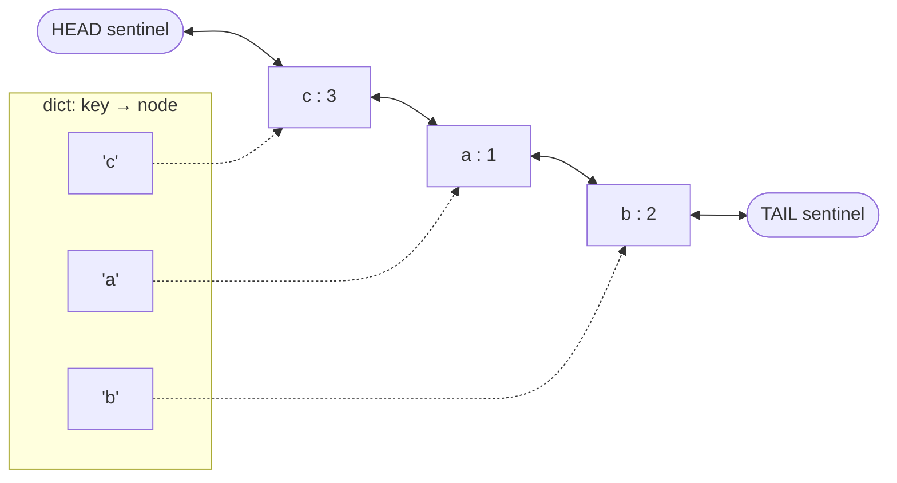
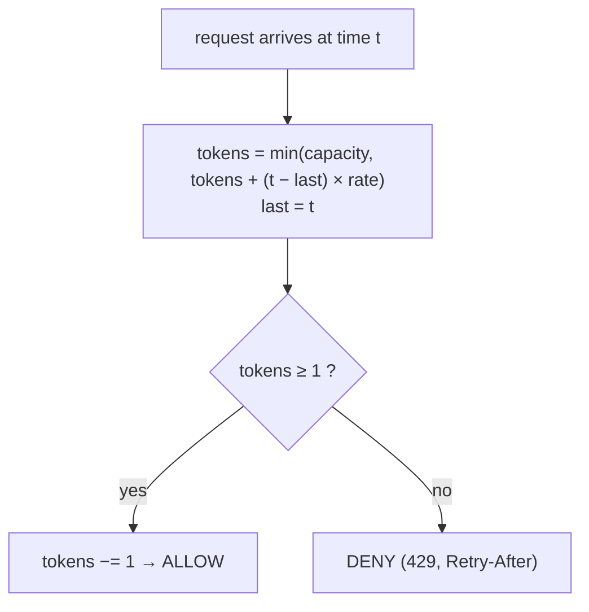

# LRU / LFU Cache & Rate Limiter

> **Prerequisites:** [10 · Concurrency-Safe Design](../10-concurrency-safe-design/README.md), [11 · Requirements to Class Diagrams](../11-requirements-to-class-diagrams/README.md), [08 · Behavioral Patterns I](../08-behavioral-patterns-i/README.md) (Strategy)  
> **Reading time:** ~30 minutes (plus ~10 to run the demos)  
> **Audience:** LLD rounds — "implement an LRU cache in O(1)" and "design a rate limiter," the two most-asked data-structure-flavored designs

> [!NOTE]
> **In one line:** **LRU** = a hash map for lookup + a doubly linked list for recency order, so `get` and `put` are O(1); **LFU** = the same idea with one recency list *per frequency*; a **token bucket** refills at a steady rate and spends one token per request, which allows controlled bursts.

> [!TIP]
> **Golden rule:** Neither structure alone is O(1). The map finds the node fast but cannot reorder; the list reorders fast but cannot find. Say *"hash map points into the list"* in the first minute — it is the answer they are waiting for. For limiters: **inject the clock**, or you cannot test any of it.

> [!TIP]
> **Try it:** Sketch `Cache → EvictionPolicy` in [LLD Studio](/tools/lld-studio/), then play with the four algorithms in the [Rate Limiting simulator](/tools/rate-limiting/) and run the Python demo below.

---

## 1. Interview pressure

Two prompts, same family:

1. *"Implement an LRU cache with `get(key)` and `put(key, value)`, both O(1), fixed capacity."*
2. *"Design a rate limiter: 100 requests per minute per user. Which algorithm, and how do you test it?"*

Wrong first answers that cost points:

- `dict` + "scan for the oldest" on eviction → O(n). Python's `OrderedDict` makes it O(1) but interviewers usually say *"pretend that doesn't exist"* — know the manual version.
- Calling `time.time()` inside the limiter → tests that sleep, flaky CI, and a limiter that breaks when the wall clock jumps.
- Fixed-window counter and calling it done → a user fires 100 requests at `12:00:59` and 100 more at `12:01:00`: **200 in two seconds**, "within the limit."

---

## 2. Mental model

LRU: the map gives you the node; the list keeps the order. Head = most recently used, tail = next to evict. Sentinel head/tail nodes mean no `if node is None` special cases.



> `get('a')` → look up node, unlink it, push it behind HEAD. `put('d', 4)` at capacity → evict `TAIL.prev` (`b`), delete `'b'` from the map, insert `d` behind HEAD.

Token bucket: tokens drip in at `rate` per second up to `capacity`; each request spends one.



### Pick the right one

| Eviction policy | Evicts | Wins when | Weakness |
| :--- | :--- | :--- | :--- |
| **LRU** | Least recently used | Recent access predicts next access (most apps) | One big scan flushes the whole cache |
| **LFU** | Least frequently used (ties → LRU) | Stable "hot set" (CDN, popular products) | Old hot items stay forever unless you age counts |
| **FIFO** | Oldest inserted | Dead simple, small caches | Ignores access entirely |

| Limiter | Idea | Memory | Burst behavior | Say this |
| :--- | :--- | :--- | :--- | :--- |
| **Fixed window** | Counter per time bucket | O(1) | 2× limit at the boundary | "Cheap but leaky at edges" |
| **Sliding window log** | Timestamps in a deque | O(limit) per key | Exact | "Precise, costs memory" |
| **Sliding window counter** | Weighted blend of 2 windows | O(1) | Approximate, smooth | "Good balance at scale" |
| **Token bucket** | Refill + spend | O(1) | Allows bursts up to `capacity` | "What most APIs use" |
| **Leaky bucket** | Queue drained at fixed rate | O(queue) | Smooths output, no bursts | "Traffic shaping" |

---

## 3. Walkthrough

**Requirements (LRU):** fixed capacity; `get` returns value or "missing" and marks it recently used; `put` inserts/updates and evicts the least recently used when full; both O(1); thread-safe.

**Entities:**

| Entity | Responsibility |
| :--- | :--- |
| `_Node` | `key, value, prev, next`. Stores the **key** too — eviction must delete it from the map |
| `LRUCache` | `dict[key → node]`, sentinel `head`/`tail`, `get`, `put`, private `_unlink` / `_push_front` |
| `LFUCache` | `key → value`, `key → freq`, `freq → OrderedDict[key]` (recency inside a frequency), `min_freq` |
| `TokenBucket` | `capacity`, `rate`, `tokens`, `last`, injected `clock` |
| `SlidingWindowLog` | `deque` of timestamps; drop the old ones, count the rest |
| `PerKeyLimiter` | One limiter per user id, *held in an LRU cache* so idle users don't leak memory |

**Order you'd code it:** node → `_unlink` / `_push_front` → `get` → `put` (update path, evict path, insert path) → capacity check → lock. Then say "same shape, extra bookkeeping" for LFU.

**LFU sketch (how to explain it in 30 seconds):** on every access, move the key from bucket `f` to bucket `f+1`. If bucket `f` was the minimum and is now empty, `min_freq` becomes `f+1`. A new key always goes to bucket 1 and resets `min_freq = 1`. To evict, pop the **oldest** key from bucket `min_freq` (ties broken by LRU). Everything is O(1).

**Extension point:** an `EvictionPolicy` strategy (`on_access`, `on_insert`, `victim`) lets the same `Cache` class host LRU, LFU, or FIFO. Mention it; don't build it unless asked.

---

## 4. Code

````carousel
```python
from __future__ import annotations

import threading
import time
from collections import OrderedDict, defaultdict, deque
from typing import Callable, Generic, Hashable, TypeVar

K = TypeVar("K", bound=Hashable)
V = TypeVar("V")


# ── LRU: dict + doubly linked list, sentinels, O(1) ────────────────────
class _Node(Generic[K, V]):
    __slots__ = ("key", "val", "prev", "next")

    def __init__(self, key: K | None, val: V | None) -> None:
        self.key, self.val = key, val
        self.prev: _Node | None = None
        self.next: _Node | None = None


class LRUCache(Generic[K, V]):
    def __init__(self, capacity: int) -> None:
        if capacity <= 0:
            raise ValueError("capacity must be positive")
        self._cap = capacity
        self._map: dict[K, _Node[K, V]] = {}
        self._head: _Node = _Node(None, None)       # MRU side
        self._tail: _Node = _Node(None, None)       # LRU side
        self._head.next, self._tail.prev = self._tail, self._head
        self._lock = threading.Lock()                # get() mutates order, so reads need the lock too

    def _unlink(self, n: _Node) -> None:
        n.prev.next, n.next.prev = n.next, n.prev

    def _push_front(self, n: _Node) -> None:
        n.prev, n.next = self._head, self._head.next
        self._head.next.prev = n
        self._head.next = n

    def get(self, key: K, default=None):
        with self._lock:
            node = self._map.get(key)
            if node is None:
                return default
            self._unlink(node)
            self._push_front(node)
            return node.val

    def put(self, key: K, val: V) -> None:
        with self._lock:
            node = self._map.get(key)
            if node is not None:                      # update: refresh value AND recency
                node.val = val
                self._unlink(node)
                self._push_front(node)
                return
            if len(self._map) == self._cap:           # evict BEFORE inserting
                victim = self._tail.prev
                self._unlink(victim)
                del self._map[victim.key]             # this is why nodes store their key
            node = _Node(key, val)
            self._map[key] = node
            self._push_front(node)

    def keys_mru_first(self) -> list[K]:
        with self._lock:
            out, n = [], self._head.next
            while n is not self._tail:
                out.append(n.key)
                n = n.next
            return out

    def __len__(self) -> int:
        return len(self._map)


# ── LFU: frequency buckets, each an OrderedDict for LRU tie-break ──────
class LFUCache(Generic[K, V]):
    def __init__(self, capacity: int) -> None:
        if capacity <= 0:
            raise ValueError("capacity must be positive")
        self._cap = capacity
        self._vals: dict[K, V] = {}
        self._freq: dict[K, int] = {}
        self._buckets: dict[int, OrderedDict[K, None]] = defaultdict(OrderedDict)
        self._min = 0
        self._lock = threading.Lock()

    def _touch(self, key: K) -> None:
        f = self._freq[key]
        del self._buckets[f][key]
        if not self._buckets[f]:
            del self._buckets[f]
            if self._min == f:
                self._min = f + 1                    # bucket f is gone, next smallest is f+1
        self._freq[key] = f + 1
        self._buckets[f + 1][key] = None

    def get(self, key: K, default=None):
        with self._lock:
            if key not in self._vals:
                return default
            self._touch(key)
            return self._vals[key]

    def put(self, key: K, val: V) -> None:
        with self._lock:
            if key in self._vals:
                self._vals[key] = val
                self._touch(key)
                return
            if len(self._vals) == self._cap:
                victim, _ = self._buckets[self._min].popitem(last=False)   # oldest in lowest freq
                if not self._buckets[self._min]:
                    del self._buckets[self._min]
                del self._vals[victim], self._freq[victim]
            self._vals[key] = val
            self._freq[key] = 1
            self._buckets[1][key] = None
            self._min = 1                            # a new key is always the least frequent

    def keys(self) -> list[K]:
        with self._lock:
            return sorted(self._vals)


# ── Rate limiters: the clock is injected ───────────────────────────────
Clock = Callable[[], float]


class FakeClock:
    def __init__(self, t: float = 0.0) -> None:
        self.t = t

    def __call__(self) -> float:
        return self.t

    def advance(self, seconds: float) -> None:
        self.t += seconds


class TokenBucket:
    def __init__(self, capacity: float, refill_per_sec: float, clock: Clock = time.monotonic) -> None:
        self._cap, self._rate, self._clock = capacity, refill_per_sec, clock
        self._tokens, self._last = float(capacity), clock()
        self._lock = threading.Lock()

    def allow(self, cost: float = 1.0) -> bool:
        with self._lock:
            now = self._clock()
            elapsed = max(0.0, now - self._last)          # never refill backwards if the clock hiccups
            self._tokens = min(self._cap, self._tokens + elapsed * self._rate)
            self._last = now
            if self._tokens >= cost:
                self._tokens -= cost
                return True
            return False


class FixedWindow:
    def __init__(self, limit: int, window: float, clock: Clock = time.monotonic) -> None:
        self._limit, self._window, self._clock = limit, window, clock
        self._bucket_id, self._count = None, 0

    def allow(self) -> bool:
        b = int(self._clock() // self._window)
        if b != self._bucket_id:
            self._bucket_id, self._count = b, 0
        if self._count < self._limit:
            self._count += 1
            return True
        return False


class SlidingWindowLog:
    def __init__(self, limit: int, window: float, clock: Clock = time.monotonic) -> None:
        self._limit, self._window, self._clock = limit, window, clock
        self._hits: deque[float] = deque()
        self._lock = threading.Lock()

    def allow(self) -> bool:
        with self._lock:
            now = self._clock()
            while self._hits and self._hits[0] <= now - self._window:   # drop expired
                self._hits.popleft()
            if len(self._hits) < self._limit:
                self._hits.append(now)
                return True
            return False


class PerKeyLimiter:
    """One bucket per user. Buckets live in an LRU cache so idle users get evicted."""

    def __init__(self, capacity: int, rate: float, max_keys: int, clock: Clock) -> None:
        self._cap, self._rate, self._clock = capacity, rate, clock
        self._buckets: LRUCache[str, TokenBucket] = LRUCache(max_keys)
        self._create_lock = threading.Lock()

    def allow(self, user: str) -> bool:
        bucket = self._buckets.get(user)
        if bucket is None:
            with self._create_lock:                       # two first requests must share ONE bucket
                bucket = self._buckets.get(user)
                if bucket is None:
                    bucket = TokenBucket(self._cap, self._rate, self._clock)
                    self._buckets.put(user, bucket)
        return bucket.allow()


if __name__ == "__main__":
    print("LRU (capacity 2)")
    lru: LRUCache[str, int] = LRUCache(2)
    lru.put("a", 1); lru.put("b", 2)
    print("  get a ->", lru.get("a"), "| order (MRU first):", lru.keys_mru_first())
    lru.put("c", 3)                                       # evicts b, the least recently used
    print("  put c  -> b evicted:", lru.get("b") is None, "| order:", lru.keys_mru_first())
    lru.put("a", 10)                                      # update refreshes recency too
    print("  put a=10 -> order:", lru.keys_mru_first(), "| a =", lru.get("a"))
    assert lru.keys_mru_first() == ["a", "c"] and len(lru) == 2

    print("LFU (capacity 2)")
    lfu: LFUCache[str, int] = LFUCache(2)
    lfu.put("a", 1); lfu.put("b", 2)
    lfu.get("a")                                          # a: freq 2, b: freq 1
    lfu.put("c", 3)                                       # evicts b (lowest freq)
    print("  after put c   :", lfu.keys())
    lfu.get("c")                                          # now a: freq 2, c: freq 2 (tie)
    lfu.put("d", 4)                                       # tie on freq -> evict the LEAST RECENT of them: a
    print("  after put d   :", lfu.keys(), "(a and c tied at freq 2; a was older)")
    assert lfu.keys() == ["c", "d"]

    print("Token bucket (capacity 5, 2 tokens/sec, fake clock)")
    clock = FakeClock()
    tb = TokenBucket(5, 2, clock)
    burst = [tb.allow() for _ in range(7)]
    print("  burst of 7 at t=0     :", burst)
    clock.advance(1.0)
    print("  after +1s (2 refilled):", [tb.allow() for _ in range(3)])
    clock.advance(100.0)
    print("  after +100s (capped)  :", sum(tb.allow() for _ in range(10)), "of 10 allowed (capacity 5)")
    assert burst == [True] * 5 + [False] * 2

    print("Fixed window vs sliding window log (limit 3 per 10s) at the boundary")
    c1, c2 = FakeClock(9.0), FakeClock(9.0)
    fw, sw = FixedWindow(3, 10, c1), SlidingWindowLog(3, 10, c2)
    fw_hits = sum(fw.allow() for _ in range(3)); sw_hits = sum(sw.allow() for _ in range(3))
    c1.advance(2.0); c2.advance(2.0)                      # t = 11: new fixed window, old hits still in range
    fw_hits += sum(fw.allow() for _ in range(3)); sw_hits += sum(sw.allow() for _ in range(3))
    print(f"  fixed: {fw_hits} allowed in 2s | sliding log: {sw_hits} allowed in 2s")
    assert fw_hits == 6 and sw_hits == 3

    print("Per-user limiter backed by an LRU of buckets")
    pk = PerKeyLimiter(capacity=2, rate=1, max_keys=2, clock=FakeClock())
    print("  alice x3:", [pk.allow("alice") for _ in range(3)], "| bob x1:", pk.allow("bob"))
    print("OK")
```
<!-- slide -->
```csharp
using System;
using System.Collections.Generic;

public sealed class LruCache<TKey, TValue> where TKey : notnull
{
    private readonly int _capacity;
    private readonly Dictionary<TKey, LinkedListNode<(TKey Key, TValue Value)>> _map = new();
    private readonly LinkedList<(TKey Key, TValue Value)> _order = new();   // First = MRU, Last = LRU
    private readonly object _gate = new();

    public LruCache(int capacity)
    {
        if (capacity <= 0) throw new ArgumentOutOfRangeException(nameof(capacity));
        _capacity = capacity;
    }

    public bool TryGet(TKey key, out TValue value)
    {
        lock (_gate)                                   // reads reorder the list, so they lock too
        {
            if (!_map.TryGetValue(key, out var node)) { value = default!; return false; }
            _order.Remove(node);
            _order.AddFirst(node);
            value = node.Value.Value;
            return true;
        }
    }

    public void Put(TKey key, TValue value)
    {
        lock (_gate)
        {
            if (_map.TryGetValue(key, out var existing))
            {
                _order.Remove(existing);
                _map.Remove(key);
            }
            else if (_map.Count == _capacity)
            {
                var victim = _order.Last!;
                _order.RemoveLast();
                _map.Remove(victim.Value.Key);
            }
            _map[key] = _order.AddFirst((key, value));
        }
    }
}

public sealed class TokenBucket
{
    private readonly double _capacity, _ratePerSec;
    private readonly Func<double> _clock;               // seconds; inject for tests
    private double _tokens, _last;
    private readonly object _gate = new();

    public TokenBucket(double capacity, double ratePerSec, Func<double> clock)
    {
        _capacity = capacity; _ratePerSec = ratePerSec; _clock = clock;
        _tokens = capacity; _last = clock();
    }

    public bool Allow(double cost = 1)
    {
        lock (_gate)
        {
            var now = _clock();
            _tokens = Math.Min(_capacity, _tokens + Math.Max(0, now - _last) * _ratePerSec);
            _last = now;
            if (_tokens < cost) return false;
            _tokens -= cost;
            return true;
        }
    }
}

public static class Demo
{
    public static void Main()
    {
        var cache = new LruCache<string, int>(2);
        cache.Put("a", 1); cache.Put("b", 2);
        cache.TryGet("a", out _);
        cache.Put("c", 3);                                   // evicts b
        Console.WriteLine($"b present: {cache.TryGet("b", out _)}");   // False

        double now = 0;
        var bucket = new TokenBucket(5, 2, () => now);
        int allowed = 0;
        for (int i = 0; i < 7; i++) if (bucket.Allow()) allowed++;
        Console.WriteLine($"burst allowed: {allowed}");      // 5
        now += 1.0;
        Console.WriteLine($"after +1s: {bucket.Allow()} {bucket.Allow()} {bucket.Allow()}");   // True True False
    }
}
```
````

Expected Python output (verified, exit code 0):

```text
LRU (capacity 2)
  get a -> 1 | order (MRU first): ['a', 'b']
  put c  -> b evicted: True | order: ['c', 'a']
  put a=10 -> order: ['a', 'c'] | a = 10
LFU (capacity 2)
  after put c   : ['a', 'c']
  after put d   : ['c', 'd'] (a and c tied at freq 2; a was older)
Token bucket (capacity 5, 2 tokens/sec, fake clock)
  burst of 7 at t=0     : [True, True, True, True, True, False, False]
  after +1s (2 refilled): [True, True, False]
  after +100s (capped)  : 5 of 10 allowed (capacity 5)
Fixed window vs sliding window log (limit 3 per 10s) at the boundary
  fixed: 6 allowed in 2s | sliding log: 3 allowed in 2s
Per-user limiter backed by an LRU of buckets
  alice x3: [True, True, False] | bob x1: True
OK
```

What to point at when you present it:

- **Sentinels** (`_head`, `_tail`) remove every "is this the first/last node?" branch from `_unlink` and `_push_front`.
- **Nodes store their key**, so evicting `tail.prev` can `del self._map[victim.key]`. Forgetting this is the classic bug: the list shrinks, the map leaks.
- **`get` takes the lock** because it reorders. A read-only lock (`RWLock`) is wrong here.
- **Evict before insert** at capacity, and the update path never evicts.
- **LFU `_min`** is only ever reset to 1 on insert, or bumped by one when its bucket empties — that is why everything stays O(1) with no scanning.
- **Limiters take a `Clock`**: the fake clock turns "wait 1 second" into `clock.advance(1.0)` and the test is instant and exact.
- **`PerKeyLimiter`** reuses the LRU: idle users' buckets age out, so the limiter's memory is bounded by `max_keys`, not by how many users ever hit you.

---

## 5. Edges

| Risk | What to say / do |
| :--- | :--- |
| **Reads mutate order** | `get` must be under the same lock as `put`. This is the #1 concurrency question on LRU. |
| **`None` as a value** | `get(key, default=None)` can't tell "cached `None`" from "missing." Pass a private sentinel as `default` (or return a `(hit, value)` pair / `TryGet` in C#). |
| **Capacity 0 or negative** | Reject in the constructor. |
| **Lock contention at scale** | Shard: `hash(key) % N` independent LRUs, each with its own lock. Accept that eviction is per-shard approximate. |
| **Cache stampede** | 1000 requests miss the same key at once and all hit the DB. Fix: per-key single-flight, TTL jitter, or serve stale while refreshing. |
| **LFU never forgets** | A once-hot key outlives its usefulness. Fix: periodic halving of counts (aging), or TinyLFU-style admission. |
| **TTL** | Store `expires_at` on the node; check on `get`; evict lazily plus a background sweep. |
| **Clock for limiters** | Use a monotonic clock. Wall-clock jumps (NTP) would refill tokens wrongly or freeze them. |
| **Distributed limiting** | In-process buckets give N× the limit across N servers. Use a shared store (Redis: atomic script or `INCR` + `EXPIRE`) or accept per-node limits with a lower number. |
| **Limiter state growth** | One bucket per user id grows forever. Bound it (LRU of buckets, as above) or expire idle keys. |

**When *not* to hand-roll:** in production use the platform cache (`functools.lru_cache`, `MemoryCache`, Caffeine, Redis) and a gateway/limiter library. Hand-rolling is the interview — and the way to learn what those libraries do.

---

## 6. What you'd say in two minutes

> "For an O(1) LRU I combine a hash map and a doubly linked list. The map goes from key to node, so lookup is O(1); the list keeps recency order — head is most recent, tail is next to evict. `get` finds the node, unlinks it, and pushes it to the front. `put` updates in place or, at capacity, evicts `tail.prev` and deletes its key from the map — so nodes store their key. I use sentinel head and tail nodes to avoid null checks. Because `get` reorders the list, it takes the same lock as `put`. LFU is the same idea with a frequency-to-ordered-bucket map and a `min_freq` pointer: touching a key moves it from bucket `f` to `f+1`; evicting pops the oldest key from the lowest bucket. For rate limiting I'd use a token bucket — refill by elapsed time times rate, capped at capacity, spend one per request — because it allows controlled bursts and is O(1) per key. I'd inject the clock so tests are deterministic, and hold per-user buckets in an LRU so memory is bounded. If I need exact limits I'd use a sliding window log; at scale, a sliding window counter or Redis."

---

## 7. Anti-patterns

1. **Scan-for-oldest eviction** (`min(cache, key=last_used)`) — O(n). Fix: linked list, or `OrderedDict.move_to_end`.
2. **Singly linked list** — removing a middle node needs the previous pointer. Fix: doubly linked.
3. **Node without a key** — you cannot delete the victim from the map. Fix: store `key` in the node.
4. **`get` without a lock** — "reads are safe" is false when reads reorder. Fix: one lock for both.
5. **`time.time()` in the limiter** — untestable and NTP-sensitive. Fix: injected monotonic clock.
6. **Fixed window as "the" answer** — boundary double burst. Fix: sliding window or token bucket; say why.
7. **Unbounded per-user limiter map** — memory grows with every user ever seen. Fix: LRU/TTL of limiter state.

---

## 8. Interview questions

<details>
<summary><strong>1. Why a doubly linked list and not a singly linked one? [BASIC]</strong></summary>

You jump to a node via the map, then must unlink it in O(1). Unlinking needs the node's `prev` pointer; with a singly linked list you would have to walk from the head to find it.

</details>

<details>
<summary><strong>2. What does each structure do in LRU? [BASIC]</strong></summary>

The hash map gives O(1) key → node lookup. The linked list gives O(1) "move to front" and "remove tail" and encodes recency order. Neither alone achieves O(1) for both lookup and eviction.

</details>

<details>
<summary><strong>3. Token bucket vs leaky bucket? [BASIC]</strong></summary>

Token bucket lets bursts through up to `capacity`, then limits to the refill rate. Leaky bucket queues requests and drains them at a constant rate, smoothing output (no bursts). Use token bucket for API limits; leaky bucket for traffic shaping.

</details>

<details>
<summary><strong>4. Make the cache thread-safe without a global lock. [SCENARIO]</strong></summary>

Shard the cache: `N` independent LRUs chosen by `hash(key) % N`, each with its own lock. Contention drops roughly N×. Trade-off: eviction is per shard, so global recency is approximate. For read-mostly hot keys, consider a concurrent cache library with approximate LRU (e.g., sampled or buffered recency updates).

</details>

<details>
<summary><strong>5. 100 requests/min per user, across 5 servers. [SCENARIO]</strong></summary>

In-process limiters would allow up to 500. Put the state in a shared store: Redis with a Lua script (atomic refill + spend) or sliding-window counters with `INCR` + `EXPIRE`. Trade-off: one network hop per request; mitigate by local pre-checks or giving each node a share of the quota and rebalancing.

</details>

<details>
<summary><strong>6. Test the token bucket without sleeping. [SCENARIO]</strong></summary>

Inject a clock (`Callable[[], float]`). Tests use a `FakeClock` and call `advance(1.0)`. Assert: burst of `capacity` allowed, next denied, `+1s` allows `rate` more, and a long idle period never exceeds `capacity`.

</details>

<details>
<summary><strong>7. LRU or LFU for a product-page cache with one-time bot crawls? [TRICKY]</strong></summary>

A crawl touches thousands of pages once each. LRU would flush the real hot set; LFU keeps pages with high counts and evicts the one-hit crawl pages. But LFU also keeps stale favorites forever, so add aging (periodically halve counts) or use an admission filter (TinyLFU). Say you'd measure hit rate on real traces.

</details>

<details>
<summary><strong>8. In LFU, why is `min_freq = 1` correct after inserting a new key? [TRICKY]</strong></summary>

A brand-new key has frequency 1, which is the lowest possible. Any eviction needed before the next insert must come from the lowest non-empty bucket, which is now guaranteed to be bucket 1. On touch, `min_freq` only moves up when its bucket empties, and the key moved to `f+1`, so `min_freq = f+1` is exactly the next lowest.

</details>

---

## 9. Try it

1. Run the Python block. Confirm the order lists, the burst result `[True ×5, False ×2]`, and `fixed: 6 / sliding: 3`.
2. Add `delete(key)` to `LRUCache`. Which two structures must you update?
3. Add a TTL: store `expires_at` on `_Node`; treat expired entries as misses in `get` using an injected clock.
4. Replace the `LFUCache` tie-break with FIFO instead of LRU. Which line changes?
5. Add a **sliding window counter** limiter (two fixed windows blended by overlap).
6. Compare your results with the live algorithms in the [Rate Limiting simulator](/tools/rate-limiting/), sketch `Cache → EvictionPolicy` in [LLD Studio](/tools/lld-studio/), then use these ideas in [API & Library Design](../19-api-library-design-and-di/README.md) and the [LLD practice sheet](../PRACTICE.md).

---

## 10. One-page cheat sheet

```text
LRU         dict[key→node] + doubly linked list; head=MRU, tail=LRU. Sentinels.
get         lookup → unlink → push_front → return        (reads mutate → LOCK)
put         exists? update+move : (full? evict tail.prev + del map[key]) ; insert front
Node        stores KEY (needed to delete the victim from the map)
LFU         key→val, key→freq, freq→OrderedDict(keys), min_freq
touch       move key f → f+1; if bucket f empty and min==f → min = f+1
LFU insert  freq 1, min_freq = 1.  Evict: oldest key in bucket min_freq.
Token bkt   tokens = min(cap, tokens + Δt·rate); if ≥ cost: spend, ALLOW else DENY
Sliding log deque of timestamps; drop ≤ now−window; allow if len < limit
Fixed win   cheap but 2× burst at boundary
Testing     inject Clock (monotonic). FakeClock.advance().
Scale       shard LRU by hash(key); share limiter state in Redis; bound per-user maps

Say aloud: "Hash map finds it, doubly linked list reorders it — and reads reorder, so reads lock."
```

---

## Next

**[19 · API & Library Design, DI](../19-api-library-design-and-di/README.md)** — public surfaces, injection, and keeping your cache/limiter swappable.
