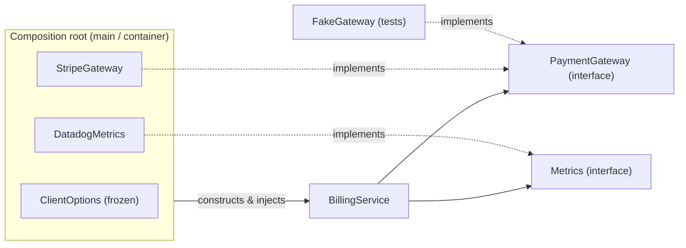

# Public API & Library Design: Builders, Options and Dependency Injection

> **Prerequisites:** [04 · SOLID](../04-solid-principles/README.md), [06 · Creational Patterns](../06-creational-patterns/README.md), [18 · LRU/LFU Cache & Rate Limiter](../18-lru-lfu-cache-and-rate-limiter/README.md)  
> **Reading time:** ~25 minutes  
> **Audience:** Anyone asked to "design an SDK / client library / shared service" in an LLD round, or who owns code that other teams import

> [!NOTE]
> **In one line:** A public API is a promise to strangers — make objects hard to construct wrongly (builders / options objects, required things in the constructor), hand them their collaborators from outside (constructor injection), and change the surface only with a version number that tells the truth.

> [!TIP]
> **Golden rule:** Required collaborators go in the **constructor**; optional settings go in a **named, immutable options object**; the concrete wiring happens in **one composition root**. If a caller must remember to call `set_x()` before `do_y()`, or a library `new`s its own HTTP client, the design is leaking.

> [!TIP]
> **Try it:** Sketch `BillingService → PaymentGateway / Metrics` in [LLD Studio](/tools/lld-studio/), then run the Python example below and swap the fake for a second fake.

---

## 1. The smell: when this topic shows up

Interviewer: *"Design a small HTTP client library other teams will import. It needs timeouts, retries, headers, and it must be easy to test."*

They are probing three things at once:

1. **Construction ergonomics** — can I build it without a 9-argument constructor and a `true, false, null` call that nobody can read?
2. **Dependency direction** — does my business class create its own network client, or receive one?
3. **Evolvability** — if you add a setting next quarter, do 300 services break?

Smells that give it away:

```text
HttpClient("https://api", "POST", None, 30, 3, True, False, "{}")   # boolean blindness
class Billing:  def __init__(self): self.gw = StripeGateway()        # hidden concrete dependency
client = PaymentClient(); client.charge(100)                          # forgot set_api_key() -> crash
```



`BillingService` only knows two interfaces. Production wires Stripe + Datadog; tests wire fakes. Nothing inside `BillingService` changes.

---

## 2. Which tool for which problem

| Problem | Tool | Why |
| :--- | :--- | :--- |
| Many optional settings | **Options object** (frozen dataclass) or **fluent builder** | Self-documenting, order-free, add a field without breaking callers |
| Settings must be validated together | Builder with `build()` that validates | Object can never exist half-configured |
| Business class needs a network / DB / clock | **Constructor injection** of an interface | Visible dependencies, trivially fakeable |
| Many collaborators (6+) in one constructor | Split the class (SRP) — **not** a service locator | Long constructor is a smell, not a reason to hide dependencies |
| Library must keep working for old callers | **SemVer** + deprecation window | Breaking change = MAJOR, additive = MINOR |

### DI flavors compared

| Flavor | How | Verdict |
| :--- | :--- | :--- |
| **Constructor injection** | Dependencies are `__init__` parameters | Default choice: object is valid from the first instant |
| **Setter / method injection** | `set_gateway(g)` after construction | Temporal coupling; use only for truly optional collaborators |
| **Service Locator** | `Locator.get(IGateway)` inside the class | Hidden dependencies, runtime-only failure — avoid |
| **Container (framework)** | Registers types, builds the graph | Fine, as long as classes stay container-agnostic |

---

## 3. Walkthrough: a small payments client

**Requirements (keep tiny):** a `BillingService` charges invoices through a gateway, records a metric, and takes `timeout` / `retries` / `user_agent` settings. Tomorrow we add `idempotency_prefix`; yesterday's callers must not break.

**Entities:**

- `ClientOptions` — immutable settings with defaults.
- `PaymentGateway` (Protocol) — what billing needs, nothing more.
- `Metrics` (Protocol) — `increment(name)`.
- `BillingService` — orchestrates; receives both via constructor.
- `ClientOptionsBuilder` — optional fluent façade that validates in `build()`.

**Key methods:** `ClientOptions.replace(...)` (copy-with-change, since the object is frozen), `BillingService.process_invoice(...)`.

**Extension point:** add a field to `ClientOptions` with a default → existing callers compile and run unchanged. Add a second gateway → new class implementing `PaymentGateway`; `BillingService` untouched.

````carousel
```python
from __future__ import annotations

from dataclasses import dataclass, replace
from typing import Protocol


# ── Options object: immutable, defaults for everything optional ─────────
@dataclass(frozen=True)
class ClientOptions:
    timeout_s: float = 30.0
    retries: int = 3
    user_agent: str = "billing/1.0"

    def __post_init__(self) -> None:
        if self.timeout_s <= 0:
            raise ValueError("timeout_s must be > 0")
        if self.retries < 0:
            raise ValueError("retries must be >= 0")

    def with_(self, **changes) -> "ClientOptions":
        return replace(self, **changes)  # re-runs validation


# ── Optional fluent builder over the options (nice for many settings) ───
class ClientOptionsBuilder:
    def __init__(self) -> None:
        self._values: dict = {}

    def timeout(self, seconds: float) -> "ClientOptionsBuilder":
        self._values["timeout_s"] = seconds
        return self

    def retries(self, count: int) -> "ClientOptionsBuilder":
        self._values["retries"] = count
        return self

    def build(self) -> ClientOptions:
        return ClientOptions(**self._values)  # validation happens here


# ── Abstractions the business code depends on (DIP) ─────────────────────
class PaymentGateway(Protocol):
    def charge(self, amount_cents: int, options: ClientOptions) -> str: ...


class Metrics(Protocol):
    def increment(self, name: str, value: int = 1) -> None: ...


class BillingService:
    """Receives collaborators; never constructs them."""

    def __init__(
        self,
        gateway: PaymentGateway,
        metrics: Metrics,
        options: ClientOptions | None = None,
    ) -> None:
        self._gateway = gateway
        self._metrics = metrics
        self._options = options or ClientOptions()

    def process_invoice(self, invoice_id: str, amount_cents: int) -> str:
        tx = self._gateway.charge(amount_cents, self._options)
        self._metrics.increment("invoices.processed")
        return f"{invoice_id}:{tx}"


# ── Test doubles (fakes) ────────────────────────────────────────────────
class FakeGateway:
    def __init__(self) -> None:
        self.calls: list[tuple[int, ClientOptions]] = []

    def charge(self, amount_cents: int, options: ClientOptions) -> str:
        self.calls.append((amount_cents, options))
        return f"tx_{len(self.calls)}"


class FakeMetrics:
    def __init__(self) -> None:
        self.counts: dict[str, int] = {}

    def increment(self, name: str, value: int = 1) -> None:
        self.counts[name] = self.counts.get(name, 0) + value


if __name__ == "__main__":
    # Composition root: the ONLY place that knows concrete types.
    gateway, metrics = FakeGateway(), FakeMetrics()
    opts = ClientOptionsBuilder().timeout(5).retries(2).build()
    billing = BillingService(gateway, metrics, opts)

    print(billing.process_invoice("inv-1", 9900))
    print(metrics.counts)
    print(gateway.calls[0][1])

    try:
        ClientOptionsBuilder().timeout(-1).build()
    except ValueError as err:
        print("rejected:", err)

    # Frozen: mutation is impossible, copy-with-change is the way
    try:
        opts.retries = 9  # type: ignore[misc]
    except Exception as err:
        print("frozen:", type(err).__name__)
    print(opts.with_(retries=5).retries, opts.retries)
```
<!-- slide -->
```csharp
public sealed record ClientOptions
{
    public TimeSpan Timeout { get; init; } = TimeSpan.FromSeconds(30);
    public int Retries { get; init; } = 3;
    public string UserAgent { get; init; } = "billing/1.0";
}

public sealed class ClientOptionsBuilder
{
    private TimeSpan _timeout = TimeSpan.FromSeconds(30);
    private int _retries = 3;

    public ClientOptionsBuilder WithTimeout(TimeSpan t)
    {
        if (t <= TimeSpan.Zero) throw new ArgumentOutOfRangeException(nameof(t));
        _timeout = t;
        return this;
    }

    public ClientOptionsBuilder WithRetries(int n)
    {
        if (n < 0) throw new ArgumentOutOfRangeException(nameof(n));
        _retries = n;
        return this;
    }

    public ClientOptions Build() => new() { Timeout = _timeout, Retries = _retries };
}

public interface IPaymentGateway
{
    Task<string> ChargeAsync(int amountCents, ClientOptions options);
}

public interface IMetrics
{
    void Increment(string name, int value = 1);
}

public sealed class BillingService
{
    private readonly IPaymentGateway _gateway;
    private readonly IMetrics _metrics;
    private readonly ClientOptions _options;

    public BillingService(IPaymentGateway gateway, IMetrics metrics, ClientOptions? options = null)
    {
        _gateway = gateway ?? throw new ArgumentNullException(nameof(gateway));
        _metrics = metrics ?? throw new ArgumentNullException(nameof(metrics));
        _options = options ?? new ClientOptions();
    }

    public async Task<string> ProcessInvoiceAsync(string invoiceId, int amountCents)
    {
        var tx = await _gateway.ChargeAsync(amountCents, _options);
        _metrics.Increment("invoices.processed");
        return $"{invoiceId}:{tx}";
    }
}

// Composition root (Program.cs) — idiomatic .NET exposes one extension method:
public static class BillingRegistration
{
    public static IServiceCollection AddBilling(
        this IServiceCollection services, Action<ClientOptionsBuilder>? configure = null)
    {
        var builder = new ClientOptionsBuilder();
        configure?.Invoke(builder);
        services.AddSingleton(builder.Build());
        services.AddScoped<BillingService>();
        return services;
    }
}
```
````

**What this buys you**

| Decision | Payoff |
| :--- | :--- |
| `frozen=True` options | Safe to share across threads; no caller can mutate shared config |
| Validation in `__post_init__` / `Build()` | An invalid `ClientOptions` can never exist |
| Protocols for gateway and metrics | Tests inject fakes; no mocking framework needed |
| One composition root | Swapping Stripe for Adyen is a one-line change in `main` |
| Defaulted fields | New option = MINOR release; old callers untouched |

---

## 4. Edges: where this goes wrong

- **Setter injection and temporal coupling.** `client = PaymentClient(); client.charge(100)` with a forgotten `set_api_key` fails at the *worst* time. Mandatory things go in the constructor; if there are too many, the class has too many jobs.
- **Service Locator.** `Locator.get(IDatabase)` inside a method hides dependencies and fails at runtime, not at construction. Tests must set global state, which breaks parallel test runs.
- **Mutable default arguments.** `def __init__(self, headers={})` shares one dict across all instances. Use `None` or a frozen options object.
- **Captive dependency (containers).** Registering a *scoped* service inside a *singleton* freezes the first request's instance forever. Rule: a service may only depend on services with the same or a longer lifetime — a singleton must never depend on a scoped one.
- **Optional parameters are not binary-safe (C#).** Adding `compress = false` to `Export(path)` is source-compatible but changes the compiled signature; already-built callers throw `MissingMethodException`. Keep the old overload and delegate.
- **Over-abstraction.** One implementation and no test pain? A plain class is fine. Add the interface when you have a second implementation *or* need to fake it.
- **Leaky builders.** A builder whose `build()` can return a half-valid object is just a setter bag with extra steps.

### SemVer in one table

| Change | Bump | Example |
| :--- | :--- | :--- |
| Bug fix, internals only | PATCH `1.4.x` | Fix a race inside the cache |
| Backward-compatible addition | MINOR `1.x.0` | New optional `idempotency_prefix` with a default |
| Remove / rename / change signature or semantics | MAJOR `x.0.0` | `charge(int)` → `charge(Money)` |

**War story (compressed):** a shared auth SDK added a *required* `region` constructor argument and shipped it as a PATCH. Every service on `^1.4.0` picked it up on the next build; ~240 pipelines failed at once and restarting pods crash-looped. Fixes: options object with defaults, a CI check that diffs the public API against the last release, and a deprecation window (mark old surface `@deprecated` for two minors before removal).

---

## 5. What you'd say in two minutes

> "I'd make construction impossible to get wrong. Required collaborators — the gateway and metrics — are constructor parameters typed as small interfaces, so the service is valid the moment it exists and tests can inject fakes. Optional settings live in an immutable options object with defaults, optionally built through a fluent builder that validates in `build()`. That way adding a setting is additive. All concrete wiring happens in one composition root — `main` or the DI container — not inside the library. I'd avoid a service locator because it hides dependencies, and avoid setter injection for anything mandatory because of temporal coupling. For evolution, I'd follow SemVer: additive is minor, breaking is major with a deprecation window, and I'd diff the public API in CI so nobody ships a breaking change as a patch."

---

## 6. Anti-patterns

| Anti-pattern | Why it hurts | Fix |
| :--- | :--- | :--- |
| Telescoping constructor with positional booleans | Unreadable, order-sensitive, breaks on every new flag | Options object / builder with named setters |
| `self.gw = StripeGateway()` inside the service | Untestable, welded to one vendor | Inject `PaymentGateway` |
| Service Locator in domain code | Hidden dependencies, runtime failures | Constructor injection |
| Mutable shared config | One caller changes timeouts for everyone | `frozen=True` + `with_()` |
| Breaking change in a PATCH | Mass build failures | SemVer + API-diff gate in CI |
| Interface for every noun | Noise, indirection | Interface at real boundaries only |

---

## 7. Interview questions

<details>
<summary><strong>1. Why prefer constructor injection over setter injection? [BASIC]</strong></summary>

Constructor injection makes the object valid from the first instant and makes dependencies visible in the signature. Setter injection allows half-configured objects and temporal coupling (`charge()` before `set_api_key()`). Use setters only for genuinely optional collaborators.

</details>

<details>
<summary><strong>2. DIP vs IoC vs DI? [BASIC]</strong></summary>

**DIP** is the design rule: depend on abstractions. **IoC** means a framework or caller owns the control flow / object creation. **DI** is the technique that supplies the concrete collaborators, usually through the constructor.

</details>

<details>
<summary><strong>3. When do you pick a builder vs an options object? [BASIC]</strong></summary>

Options object (frozen dataclass or record) when settings are independent and defaulted. Builder when you need ordering, cross-field validation, or a readable multi-step construction. They compose: a builder can produce an options object.

</details>

<details>
<summary><strong>4. Why is Service Locator considered an anti-pattern? [TRICKY]</strong></summary>

The class's constructor no longer reveals what it needs, missing registrations fail at runtime inside a method rather than at construction, and tests must mutate global state. Constructor injection fixes all three.

</details>

<details>
<summary><strong>5. You must add a required setting to a published SDK. How? [SCENARIO]</strong></summary>

Don't make it required in a minor. Add it as an optional field with a sensible default (MINOR). If it truly must be required, ship a MAJOR, keep the old path with a `DeprecationWarning` / `[Obsolete]` for at least two minors, and publish a migration note.

</details>

<details>
<summary><strong>6. A singleton service depends on a scoped DB context and returns stale data. Why? [SCENARIO]</strong></summary>

Captive dependency: the singleton captured the first scope's instance and keeps it forever. Make the consumer scoped, or inject a factory (`IServiceScopeFactory` / a `Callable`) and create a short-lived instance per operation.

</details>

<details>
<summary><strong>7. Python: why does `def __init__(self, tags=[])` bite library authors? [TRICKY]</strong></summary>

The default list is created once at function-definition time and shared by every instance. Use `tags: list | None = None` and build a fresh list inside, or a frozen options object.

</details>

<details>
<summary><strong>8. Your constructor now takes seven collaborators. What do you do? [SCENARIO]</strong></summary>

Treat it as an SRP smell: split the class by responsibility, or group cohesive collaborators behind a facade. Hiding them behind a service locator doesn't fix the design, it just hides the symptom.

</details>

---

## 8. One-page cheat sheet

```text
Required deps     -> constructor, typed as small interfaces (Protocol / interface)
Optional settings -> frozen options object with defaults; builder only if validation/ordering
Wiring            -> ONE composition root (main / container). Domain never news collaborators.
Immutability      -> frozen=True / record; copy with replace()/with
Avoid             -> setter-injection for mandatory deps, Service Locator, mutable defaults
SemVer            -> PATCH fix, MINOR additive, MAJOR breaking (+ deprecate first)
C# trap           -> optional params are call-site constants; keep old overloads
Containers        -> singleton must not depend on scoped (captive dependency)

Opener: "Required in the constructor, optional in an options object, wired at the root."
```

---

## Further reading

- [Semantic Versioning 2.0.0](https://semver.org/)
- [Martin Fowler — Inversion of Control Containers and the Dependency Injection pattern](https://martinfowler.com/articles/injection.html)
- [Mark Seemann — Service Locator is an Anti-Pattern](https://blog.ploeh.dk/2010/02/03/ServiceLocatorisanAnti-Pattern/)

## Next

**[20 · Anti-Patterns & Code Smells](../20-anti-patterns-and-code-smells/README.md)** — God objects, anemic models, train wrecks, and how to name the principle you're fixing.
