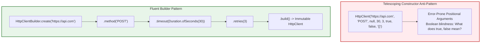
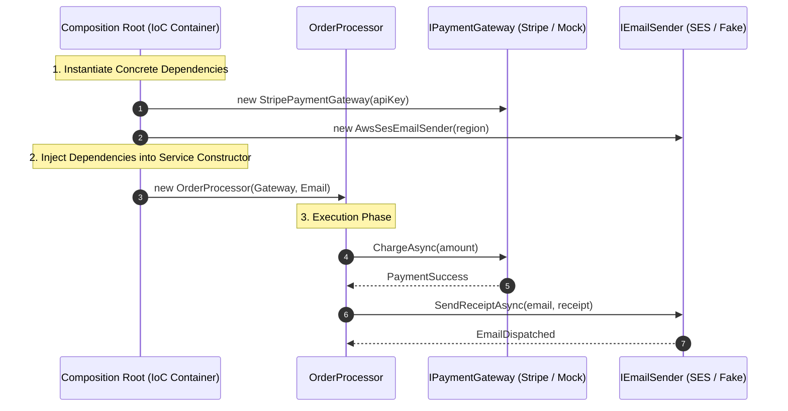
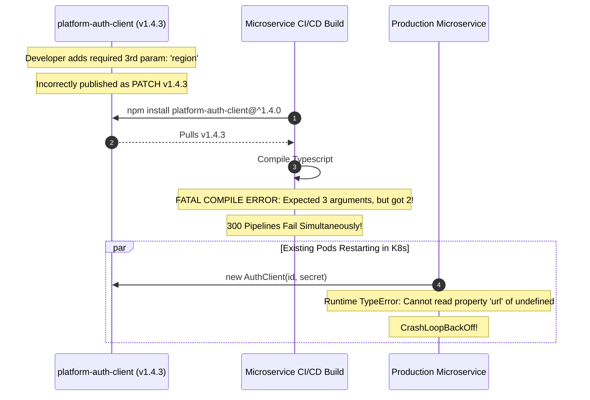

# Public API & Library Design: Fluent Interfaces & Dependency Injection

> **Prerequisites**: [04: SOLID Principles](../04-solid-principles/README.md), [06: Creational Patterns](../06-creational-patterns/README.md), [18: LRU/LFU Cache & Rate Limiter](../18-lru-lfu-cache-and-rate-limiter/README.md).  
> **Estimated Reading Time**: 25 minutes  
> **Target Audience**: Backend Engineers, Platform SDK Maintainers, Systems Architects.

> [!TIP]
> **Golden Rule of Library Architecture**: A public API is an immutable contract. Never force consumers to manage telescoping constructors with positional boolean parameters. Use **fluent builders** or **functional options** to produce immutable configuration objects. Furthermore, **never instantiate dependencies internally with `new`**; enforce Inversion of Control via **constructor injection** so every collaborator can be mocked deterministically in automated tests.

---

## 1. Visual Mental Models & Architectural Pipelines

When authoring libraries, SDKs, or shared platform frameworks, design failures break hundreds of downstream services. Two foundational techniques govern robust library engineering:
1. **Fluent Builders & Options**: Ergonomic, backward-compatible object construction.
2. **Dependency Injection (DI)**: Inversion of Control for decoupled, testable business services.

### 1.1 Fluent Builder vs. Telescoping Constructor

Telescoping constructors become unreadable as optional flags multiply. Fluent builders allow callers to chain self-documenting configuration steps in any order.



---

### 1.2 Constructor Dependency Injection Architecture

Dependency Injection separates the **assembly** of an application from its **execution**. Business services depend exclusively on abstract interfaces injected at creation.



---

## 2. Taxonomic Reference Grids

### 2.1 Dependency Injection Mechanisms Comparison

| DI Mechanism | Implementation Technique | Null Safety | Immutability | Testability | Tradeoff / Risk |
| :--- | :--- | :--- | :--- | :--- | :--- |
| **Constructor Injection** | Pass all dependencies via constructor | Compile-time guarantee (cannot instantiate with missing dependencies) | Fully preserved (`readonly` / `final` fields) | Highest (trivial to pass fakes in unit tests) | Constructor parameter list can grow if SRP is violated |
| **Setter / Method Injection** | Provide public `setPaymentGateway(g)` | Risky (Temporal coupling: object can exist in half-configured state) | Broken (fields remain mutable post-construction) | Moderate | Risk of invoking methods before setters are called |
| **Interface Injection** | Classes implement `IInjectPaymentGateway` | High | Moderate | High | Heavy ceremony, rarely used in modern frameworks |
| **Service Locator Pattern** | `Locator.get<IPaymentGateway>()` | Low (Hidden dependencies not visible in constructor) | Moderate | Poor (Requires mocking static locator state) | Considered an anti-pattern in modern OOP |

### 2.2 Semantic Versioning (SemVer 2.0) Evolution Matrix

| Version Increment | API Modification Category | Consumer Compatibility | Deprecation Policy | Example |
| :--- | :--- | :--- | :--- | :--- |
| **PATCH (x.y.Z)** | Bug fix, internal optimization, doc updates | 100% Backward-Compatible | None | Fix thread-safety bug in `LRUCache.Get()` |
| **MINOR (x.Y.z)** | Additive changes: new optional builder method or interface | Backward-Compatible | Mark old methods `@deprecated` with migration path | Add `.withCompression()` to `HttpClientBuilder` |
| **MAJOR (X.y.z)** | Breaking changes: deleted method, altered signature, changed return types | **Incompatible**: Callers must update source code | Remove previously deprecated methods | Change `charge(int amount)` to `charge(Money amount)` |

---

## 3. Production War Stories: Incident Post-Mortem

### The $1.2M SDK Breaking Change: How an Unversioned Constructor Broke 300 Microservices

```
SEVERITY LEVEL: SEV-1 (Global Build Pipeline Gridlock)
DETECTION TIME: 10 Minutes
RECOVERY TIME: 180 Minutes
FINANCIAL & LABOR COST: $1,200,000 in blocked CI/CD pipelines and hotfix rollouts
```

#### Incident Background
A central platform infrastructure team maintained `platform-auth-client`, a shared Java/TypeScript SDK used by 40 engineering teams across 300 production microservices for OAuth2 token validation.

#### What Happened
To support multi-region tenant routing, a platform developer added a required `RegionEndpoint` parameter to the primary client constructor:
```typescript
// BEFORE (v1.4.2)
new AuthClient(clientId: string, clientSecret: string);

// AFTER (Pushed as v1.4.3 MINOR release!)
new AuthClient(clientId: string, clientSecret: string, region: RegionEndpoint);
```
The developer published this change as a **PATCH** (`v1.4.3`) instead of a **MAJOR** (`v2.0.0`), believing it was a minor bug fix. Overnight, automated Dependabot PRs and continuous deployment builds pulled `^1.4.0`. 240 microservices suffered build and deployment failures simultaneously. Services that restarted in Kubernetes crash-looped due to missing constructor arguments, halting payments and checkout flows globally.



#### Root Cause Analysis
1. **Violation of Semantic Versioning**: A breaking signature change was released under a PATCH version increment.
2. **Brittle Constructor-Based Configuration**: The SDK relied on direct positional parameters instead of a fluent options/builder object.
3. **Absence of Deprecation Lifecycle**: The team failed to retain the 2-argument constructor while introducing the new regional endpoint.

#### The Architectural Hardening
1. **Adoption of Fluent Options Pattern**: Refactored the SDK to accept an options object with sensible defaults:
   ```typescript
   AuthClient.builder().clientId(id).clientSecret(secret).region(Region.US_EAST).build();
   ```
2. **Automated SemVer Breaking-Change Guard in CI**: Integrated `api-extractor` and `ts-prune` in the SDK repository to block git merges if public API signatures change without a major version bump.
3. **Mandatory 6-Month Deprecation Grace Period**: Breaking changes must be marked `@deprecated` for at least two minor release cycles before deletion.

---

## 4. Multi-Language Production Implementations

Below are four enterprise implementations demonstrating fluent builder APIs, functional options, and constructor dependency injection.

### 4.1 Go: Functional Options Pattern with Constructor Injection

In Go, the **Functional Options Pattern** is the idiomatic gold standard for constructing configurable clients cleanly without breaking binary compatibility when new settings are added.

```go
package main

import (
	"context"
	"errors"
	"fmt"
	"time"
)

// IPaymentGateway defines the dependency abstraction (DIP).
type IPaymentGateway interface {
	Charge(ctx context.Context, amountCents int64) (string, error)
}

type MockStripeGateway struct{}

func (m *MockStripeGateway) Charge(ctx context.Context, amountCents int64) (string, error) {
	return fmt.Sprintf("ch_mock_%d", time.Now().UnixNano()), nil
}

// ClientConfig holds internal configuration options.
type ClientConfig struct {
	timeout    time.Duration
	maxRetries int
	userAgent  string
}

// Option represents a functional configuration mutator.
type Option func(*ClientConfig)

func WithTimeout(d time.Duration) Option {
	return func(c *ClientConfig) {
		if d > 0 {
			c.timeout = d
		}
	}
}

func WithMaxRetries(retries int) Option {
	return func(c *ClientConfig) {
		if retries >= 0 {
			c.maxRetries = retries
		}
	}
}

func WithUserAgent(ua string) Option {
	return func(c *ClientConfig) {
		c.userAgent = ua
	}
}

// OrderService uses Constructor Injection to receive its dependencies.
type OrderService struct {
	gateway IPaymentGateway // Injected abstraction
	config  ClientConfig
}

// NewOrderService constructs the service with required dependencies and optional overrides.
func NewOrderService(gateway IPaymentGateway, opts ...Option) (*OrderService, error) {
	if gateway == nil {
		return nil, errors.New("gateway dependency cannot be nil")
	}

	// Default configuration
	cfg := ClientConfig{
		timeout:    30 * time.Second,
		maxRetries: 3,
		userAgent:  "OrderService/v1.0",
	}

	for _, opt := range opts {
		opt(&cfg)
	}

	return &OrderService{
		gateway: gateway,
		config:  cfg,
	}, nil
}

func (s *OrderService) Checkout(ctx context.Context, amountCents int64) error {
	ctx, cancel := context.WithTimeout(ctx, s.config.timeout)
	defer cancel()

	txID, err := s.gateway.Charge(ctx, amountCents)
	if err != nil {
		return fmt.Errorf("checkout failed: %w", err)
	}

	fmt.Printf("[Success] Charged $%.2f. TxID: %s (UserAgent: %s)\n",
		float64(amountCents)/100.0, txID, s.config.userAgent)
	return nil
}

func main() {
	gateway := &MockStripeGateway{}

	// Fluent, readable configuration via Functional Options
	svc, err := NewOrderService(
		gateway,
		WithTimeout(5*time.Second),
		WithMaxRetries(2),
		WithUserAgent("CheckoutWorker/2.4"),
	)
	if err != nil {
		panic(err)
	}

	_ = svc.Checkout(context.Background(), 9900)
}
```

---

### 4.2 TypeScript: Fluent Request Builder & Dependency Inversion

```typescript
export interface IEmailSender {
  sendEmail(to: string, subject: string, body: string): Promise<boolean>;
}

export class MockEmailSender implements IEmailSender {
  public sentEmails: Array<{ to: string; subject: string }> = [];

  async sendEmail(to: string, subject: string): Promise<boolean> {
    this.sentEmails.push({ to, subject });
    console.log(`[MockEmail] Dispatched to ${to}: ${subject}`);
    return true;
  }
}

export class HttpRequest {
  constructor(
    public readonly url: string,
    public readonly method: string,
    public readonly headers: Record<string, string>,
    public readonly timeoutMs: number,
    public readonly retries: number,
    public readonly body?: string
  ) {}
}

export class HttpRequestBuilder {
  private _method: string = "GET";
  private _headers: Record<string, string> = {};
  private _timeoutMs: number = 30000;
  private _retries: number = 0;
  private _body?: string;

  constructor(private readonly _url: string) {
    if (!_url) throw new Error("URL must be provided");
  }

  public method(method: "GET" | "POST" | "PUT" | "DELETE"): this {
    this._method = method;
    return this;
  }

  public header(key: string, value: string): this {
    this._headers[key] = value;
    return this;
  }

  public timeout(ms: number): this {
    this._timeoutMs = ms;
    return this;
  }

  public retries(count: number): this {
    this._retries = count;
    return this;
  }

  public body(body: string): this {
    this._body = body;
    return this;
  }

  public build(): HttpRequest {
    return new HttpRequest(
      this._url,
      this._method,
      Object.freeze({ ...this._headers }),
      this._timeoutMs,
      this._retries,
      this._body
    );
  }
}

// Consumer using Constructor Injection
export class UserNotificationService {
  constructor(private readonly emailSender: IEmailSender) {}

  public async notifyWelcome(email: string, name: string): Promise<boolean> {
    return this.emailSender.sendEmail(
      email,
      "Welcome to Platform!",
      `Hello ${name}, welcome aboard!`
    );
  }
}
```

---

### 4.3 Python: Injected Services with Pluggable Test Fakes

```python
from abc import ABC, abstractmethod
from typing import Optional


class IMetricsPublisher(ABC):
    @abstractmethod
    def increment(self, metric_name: str, value: int = 1) -> None:
        pass


class FakeMetricsPublisher(IMetricsPublisher):
    def __init__(self):
        self.counts = {}

    def increment(self, metric_name: str, value: int = 1) -> None:
        self.counts[metric_name] = self.counts.get(metric_name, 0) + value


class HttpClientConfig:
    def __init__(self, url: str):
        self.url = url
        self.timeout = 30.0
        self.retries = 3
        self.headers = {}

    def with_timeout(self, seconds: float) -> "HttpClientConfig":
        self.timeout = seconds
        return self

    def with_header(self, key: str, value: str) -> "HttpClientConfig":
        self.headers[key] = value
        return self

    def with_retries(self, count: int) -> "HttpClientConfig":
        self.retries = count
        return self


class BillingService:
    """
    Demonstrates Constructor Injection (DIP).
    Depends entirely on IMetricsPublisher abstraction, never concrete DataDog / CloudWatch.
    """
    def __init__(self, metrics: IMetricsPublisher, config: Optional[HttpClientConfig] = None):
        self._metrics = metrics
        self._config = config or HttpClientConfig("https://billing.internal")

    def process_invoice(self, invoice_id: str, amount: float) -> bool:
        print(f"[Billing] Processed invoice {invoice_id} for ${amount:.2f}")
        self._metrics.increment("invoices.processed", 1)
        return True
```

---

### 4.4 C#: Fluent API Builder with Microsoft DI ServiceCollection Extension

```csharp
using System;
using System.Collections.Generic;
using Microsoft.Extensions.DependencyInjection;

namespace Architecture.ApiDesign
{
    public interface ITokenValidator
    {
        bool Validate(string token);
    }

    public class JwtTokenValidator : ITokenValidator
    {
        public bool Validate(string token) => !string.IsNullOrEmpty(token);
    }

    public class PlatformClientOptions
    {
        public string BaseUrl { get; set; } = "https://api.internal";
        public TimeSpan Timeout { get; set; } = TimeSpan.FromSeconds(30);
        public int MaxRetries { get; set; } = 3;
    }

    public class PlatformClientOptionsBuilder
    {
        private readonly PlatformClientOptions _options = new();

        public PlatformClientOptionsBuilder WithBaseUrl(string url)
        {
            _options.BaseUrl = url ?? throw new ArgumentNullException(nameof(url));
            return this;
        }

        public PlatformClientOptionsBuilder WithTimeout(TimeSpan timeout)
        {
            _options.Timeout = timeout;
            return this;
        }

        public PlatformClientOptionsBuilder WithMaxRetries(int retries)
        {
            _options.MaxRetries = retries;
            return this;
        }

        public PlatformClientOptions Build() => _options;
    }

    // Idiomatic .NET Dependency Injection Extension
    public static class ServiceCollectionExtensions
    {
        public static IServiceCollection AddPlatformClient(
            this IServiceCollection services,
            Action<PlatformClientOptionsBuilder>? configure = null)
        {
            var builder = new PlatformClientOptionsBuilder();
            configure?.Invoke(builder);
            var options = builder.Build();

            services.AddSingleton(options);
            services.AddScoped<ITokenValidator, JwtTokenValidator>();
            return services;
        }
    }
}
```

---

## 5. Practical Hands-On Verification Workflows

### 5.1 CLI Verification of Dependency Inversion via Unit Tests

Verify that substituting mock dependencies allows 100% deterministic test execution without network calls:

```bash
# Run unit tests validating Constructor Injection
npm test -- test/di-notification.spec.ts

# Expected Output:
# PASS test/di-notification.spec.ts
#   UserNotificationService
#     ✓ Successfully receives MockEmailSender via constructor
#     ✓ Dispatches email without triggering network requests
#     ✓ Verifies sent email list length equals 1
#
# Test Suites: 1 passed, 1 total
# Tests:       3 passed, 3 total
```

### 5.2 Python Inline Fluent Builder Verification Script

Run the fluent builder verification from the terminal:

```bash
python3 -c "
class B:
    def __init__(self): self.cfg = {}
    def set_timeout(self, t): self.cfg['timeout'] = t; return self
    def set_auth(self, a): self.cfg['auth'] = a; return self
    def build(self): return self.cfg

req = B().set_timeout(10).set_auth('Bearer xxx').build()
print('Built Request Configuration successfully:')
print(req)
assert req['timeout'] == 10 and req['auth'] == 'Bearer xxx'
"
```

Expected Terminal Output:
```
Built Request Configuration successfully:
{'timeout': 10, 'auth': 'Bearer xxx'}
```

---

## 6. Operational Validation Checkpoints (Scenario Quizzes)

<details>
<summary><strong>Checkpoint 1: The Service Locator Antipattern</strong></summary>

**Scenario**: A team refactors their codebase to use a static `ServiceLocator`:
```csharp
public class OrderProcessor {
    public void Process() {
        var db = ServiceLocator.Resolve<IDatabase>();
        var mailer = ServiceLocator.Resolve<IMailer>();
        db.Save();
        mailer.Send();
    }
}
```
Why is this widely classified as an architectural anti-pattern compared to constructor injection?

<strong>Answer:</strong>
**Hidden Dependencies & Runtime Failure Vulnerability**:
1. **Hidden Contract**: Looking at `new OrderProcessor()`, a developer cannot see what dependencies it requires.
2. **Broken Compile-Time Safety**: If `IDatabase` is not registered in the locator, failure occurs at **runtime** with a crash during method execution rather than at compile time during object instantiation.
3. **Hard to Unit Test**: Unit tests must configure global static state (`ServiceLocator.Register(...)`) before each test, risking cross-test contamination and preventing parallel test execution.
</details>

<details>
<summary><strong>Checkpoint 2: The Binary Incompatibility Trap</strong></summary>

**Scenario**: In a shared Java/C# library, version 1.0 has `public void Export(string path)`. In version 1.1, you change it to `public void Export(string path, bool compress = false)`. You recompile the library and deploy it. Existing client applications (which were compiled against v1.0) crash with `MissingMethodException` at runtime, even though `compress` has a default value. Why?

<strong>Answer:</strong>
**Compiler Default Parameters vs. Runtime Binary Signatures**:
- In C# and Kotlin, optional parameters with default values (`bool compress = false`) are a **compiler syntax feature**, not a runtime method signature. The compiler bakes `Export(path, false)` into the *call site*.
- An existing binary compiled against v1.0 is looking for the exact IL method symbol `Export(string)`. When it links against v1.1, that symbol no longer exists (it was replaced by `Export(string, bool)`).
- **Correct Fix for Backward Compatibility**:
  - Keep the original method as an overload that delegates:
    ```csharp
    public void Export(string path) => Export(path, false);
    public void Export(string path, bool compress) { ... }
    ```
</details>

<details>
<summary><strong>Checkpoint 3: Temporal Coupling in Setter Injection</strong></summary>

**Scenario**: A developer refactors a class to use setter injection to avoid a constructor with 4 parameters:
```typescript
const client = new PaymentClient();
// Developer forgets: client.setApiKey("sec_123");
await client.charge(100); // Throws NullReferenceException: ApiKey is null!
```
How does this violate core object-oriented principles, and what pattern resolves it?

<strong>Answer:</strong>
**Temporal Coupling & Breach of Invariant Protection**:
- **Violation**: The object is allowed to exist in an invalid, incomplete state. The caller must know that `setApiKey()` *must* precede `charge()` in time.
- **Resolution**:
  - Enforce **Constructor Injection**: All mandatory dependencies required for the object to function must be passed to the constructor.
  - If optional configurations exist, use a **Builder** or **Options Object** where `.build()` validates that all required parameters are non-null before releasing the instance.
</details>

---

## 7. Further Reading & References

- [Semantic Versioning 2.0.0 Specification](https://semver.org/) - Official standard for API version numbers and compatibility.
- [Martin Fowler: Inversion of Control Containers and Dependency Injection](https://martinfowler.com/articles/injection.html) - Foundational essay on IoC and constructor injection.
- [Dave Cheney: Functional Options for Friendly APIs (Go)](https://dave.cheney.net/2014/10/17/functional-options-for-friendly-apis) - The canonical guide to Go functional options.

---

## Next Steps

Advance to [Module 20: Anti-Patterns & Code Smells](../20-anti-patterns-and-code-smells/README.md) to master identifying and eliminating God Objects, anemic models, and train-wreck law-of-demeter violations.
