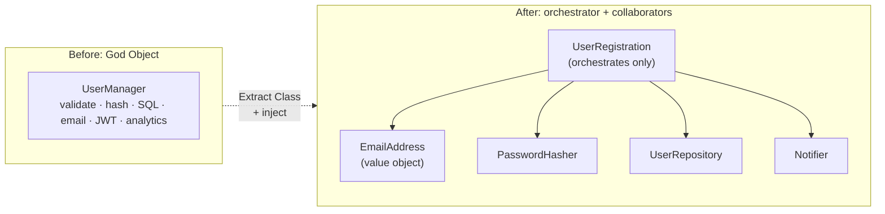

# Anti-Patterns & Code Smells: Name It, Then Fix It

> **Prerequisites:** [02 · OOP & UML](../02-oop-foundations-and-uml/README.md), [04 · SOLID](../04-solid-principles/README.md), [05 · Core Design Principles](../05-core-design-principles/README.md)  
> **Reading time:** ~25 minutes  
> **Audience:** Candidates who get "here's a class — what's wrong with it?", reviewers, and anyone inheriting a codebase

> [!NOTE]
> **In one line:** A code smell is a surface symptom of a deeper design problem — **name the principle it violates first** (SRP, encapsulation, Law of Demeter, cohesion), then apply the matching refactoring in small, test-backed steps.

> [!TIP]
> **Golden rule:** Don't say "this is messy." Say "this is a **God Object** — it has four reasons to change — I'd extract `PasswordHasher` and `UserRepository` and leave it as an orchestrator." Smell → principle → refactoring is the three-beat answer interviewers want.

> [!TIP]
> **Try it:** Paste the "before" `UserManager` into [LLD Studio](/tools/lld-studio/) as a class diagram and count arrows out of it. Then run the Python refactoring below and watch the dependencies become injectable.

---

## 1. The smell: how this shows up in an interview

Variant A — *code review round:* "Here's a 300-line `OrderManager`. Review it."  
Variant B — *design round, mid-way:* "Your `Order` class is just getters and setters, and `OrderService` has all the rules. Is that okay?"  
Variant C — *follow-up:* "How would you test this without a database?"

The expected move: scan for a small number of high-signal smells, name the violated principle, say what you'd extract, and say *what you would not touch yet*.



Each arrow on the right is an interface you can fake in a test. On the left, one change to email formatting risks the SQL.

---

## 2. The smell catalogue (the ones that actually come up)

| Smell | Symptom you can spot in 10 seconds | Principle violated | Refactoring |
| :--- | :--- | :--- | :--- |
| **God Object / Blob** | 30+ methods, many unrelated fields, name ends in `Manager` / `Helper` / `Util` | SRP, cohesion | **Extract Class**, inject collaborators |
| **Anemic Domain Model** | Entity = fields + getters/setters; rules live in `*Service` | Encapsulation | **Move Method** into the entity; make invariants unbreakable |
| **Train Wreck** | `a.b().c().d().zip()` | Law of Demeter | **Hide Delegate** / Tell, Don't Ask |
| **Primitive Obsession** | `str` for email, `float` for money, `int` for id | Type safety, DRY validation | **Value Object** |
| **Shotgun Surgery** | One feature = small edits in 12 files | Cohesion, OCP | **Move Method/Field**, Strategy to centralise |
| **Feature Envy** | Method uses another class's data more than its own | Information Expert | Move the method to the data owner |
| **Flag Argument** | `process(user, is_vip: bool)` with `if is_vip` all over | SRP | Split methods or use polymorphism |
| **Speculative Generality** | 14 abstract classes for one console logger | YAGNI / KISS | Delete; add abstraction at the *second* use |
| **Switch on type** | `if kind == "card" … elif kind == "upi" …` in many places | OCP | **Replace Conditional with Polymorphism** |

### Anemic vs rich model

| | Anemic | Rich |
| :--- | :--- | :--- |
| Entity | Data bag (public set/get) | Private state + behaviour methods |
| Rules live | In `OrderService`, `OrderHelper`… | Next to the data they protect |
| Invariants | Any caller can set `status = "SHIPPED"` | `order.ship()` throws unless paid |
| Test | Mock 5 collaborators to test 1 rule | Plain unit test, no mocks |

Not every anemic model is wrong — DTOs and read models are *meant* to be data bags. It's a smell when **domain rules** are scattered outside the entity.

---

## 3. Walkthrough: one refactoring, four smells

**Starting point (what you're handed):** a `UserManager.register(email, password)` that validates a raw string, hashes inline, writes to a dict pretending to be a database, and prints an email. Plus an `Order` that is a bag of fields, and a caller doing `order.customer.profile.address.zip`.

**Steps (say these aloud):**

1. **Characterise first.** Write one test that pins current behaviour — refactor under a safety net.
2. **Primitive obsession** → `EmailAddress` value object that validates once, at construction.
3. **God Object** → extract `PasswordHasher`, `UserRepository`, `Notifier`; leave `UserRegistration` to orchestrate.
4. **Anemic model** → `Order.ship()` / `pay()` own the status rules.
5. **Train wreck** → `order.delivery_zip()` hides the chain; `Customer` returns a safe default when there's no postal address.

**Extension point:** a new channel (Slack) is a new `Notifier`; the orchestrator doesn't change.

````carousel
```python
from __future__ import annotations

import re
from dataclasses import dataclass, field
from typing import Optional, Protocol


# ── Primitive obsession → value object ──────────────────────────────────
@dataclass(frozen=True)
class EmailAddress:
    value: str

    def __post_init__(self) -> None:
        if not re.fullmatch(r"[^@\s]+@[^@\s]+\.[^@\s]+", self.value):
            raise ValueError(f"invalid email: {self.value!r}")
        object.__setattr__(self, "value", self.value.lower())


# ── God Object → small collaborators behind Protocols ───────────────────
class PasswordHasher(Protocol):
    def hash(self, password: str) -> str: ...


class UserRepository(Protocol):
    def save(self, email: EmailAddress, password_hash: str) -> None: ...


class Notifier(Protocol):
    def welcome(self, email: EmailAddress) -> None: ...


class UserRegistration:
    """Orchestrates only: no SQL, no hashing algorithm, no SMTP."""

    def __init__(self, hasher: PasswordHasher, repo: UserRepository, notifier: Notifier) -> None:
        self._hasher, self._repo, self._notifier = hasher, repo, notifier

    def register(self, raw_email: str, password: str) -> None:
        email = EmailAddress(raw_email)          # fail fast, once
        if len(password) < 8:
            raise ValueError("password too short")
        self._repo.save(email, self._hasher.hash(password))
        self._notifier.welcome(email)


class FakeHasher:
    def hash(self, password: str) -> str:
        return f"h({password})"


class MemoryRepo:
    def __init__(self) -> None:
        self.rows: dict[str, str] = {}

    def save(self, email: EmailAddress, password_hash: str) -> None:
        self.rows[email.value] = password_hash


class PrintNotifier:
    def welcome(self, email: EmailAddress) -> None:
        print(f"welcome sent to {email.value}")


# ── Anemic → rich: the entity protects its own invariants ───────────────
class Order:
    def __init__(self, order_id: str) -> None:
        self.order_id = order_id
        self._items: list[int] = []   # prices in cents
        self._status = "CREATED"

    @property
    def status(self) -> str:
        return self._status

    def add_item(self, price_cents: int) -> None:
        if self._status != "CREATED":
            raise ValueError("cannot modify a non-created order")
        if price_cents <= 0:
            raise ValueError("price must be positive")
        self._items.append(price_cents)

    def pay(self) -> None:
        if self._status != "CREATED" or not self._items:
            raise ValueError("cannot pay for this order")
        self._status = "PAID"

    def ship(self) -> None:
        if self._status != "PAID":
            raise ValueError(f"cannot ship an order in status {self._status}")
        self._status = "SHIPPED"


# ── Train wreck → Tell, Don't Ask ───────────────────────────────────────
@dataclass
class Address:
    postal_code: str


@dataclass
class Customer:
    address: Optional[Address] = None

    def delivery_zip(self) -> str:           # hides Address; handles None
        return self.address.postal_code if self.address else "DIGITAL"


@dataclass
class Shipment:
    customer: Customer = field(default_factory=Customer)

    def delivery_zip(self) -> str:           # caller asks ONE object
        return self.customer.delivery_zip()


if __name__ == "__main__":
    repo = MemoryRepo()
    svc = UserRegistration(FakeHasher(), repo, PrintNotifier())
    svc.register("Ada@Example.com", "s3cret-pass")
    print(repo.rows)

    try:
        svc.register("not-an-email", "s3cret-pass")
    except ValueError as err:
        print("rejected:", err)

    order = Order("o-1")
    try:
        order.ship()
    except ValueError as err:
        print("rejected:", err)
    order.add_item(2500)
    order.pay()
    order.ship()
    print(order.status)

    print(Shipment(Customer(Address("94105"))).delivery_zip(), Shipment().delivery_zip())
```
<!-- slide -->
```csharp
public readonly record struct EmailAddress
{
    public string Value { get; }

    public EmailAddress(string value)
    {
        if (!Regex.IsMatch(value ?? "", @"^[^@\s]+@[^@\s]+\.[^@\s]+$"))
            throw new ArgumentException($"invalid email: {value}");
        Value = value.ToLowerInvariant();
    }
}

public interface IPasswordHasher { string Hash(string password); }
public interface IUserRepository { void Save(EmailAddress email, string hash); }
public interface INotifier { void Welcome(EmailAddress email); }

public sealed class UserRegistration(
    IPasswordHasher hasher, IUserRepository repo, INotifier notifier)
{
    public void Register(string rawEmail, string password)
    {
        var email = new EmailAddress(rawEmail);
        if (password.Length < 8) throw new ArgumentException("password too short");
        repo.Save(email, hasher.Hash(password));
        notifier.Welcome(email);
    }
}

public sealed class Order(string id)
{
    private readonly List<int> _items = new();
    public string Id { get; } = id;
    public string Status { get; private set; } = "CREATED";

    public void AddItem(int cents)
    {
        if (Status != "CREATED") throw new InvalidOperationException("order is closed");
        if (cents <= 0) throw new ArgumentOutOfRangeException(nameof(cents));
        _items.Add(cents);
    }

    public void Pay()
    {
        if (Status != "CREATED" || _items.Count == 0)
            throw new InvalidOperationException("cannot pay");
        Status = "PAID";
    }

    public void Ship()
    {
        if (Status != "PAID")
            throw new InvalidOperationException($"cannot ship from {Status}");
        Status = "SHIPPED";
    }
}
```
````

**What you can say about the result**

| Smell fixed | Payoff |
| :--- | :--- |
| Primitive obsession | `EmailAddress` is validated once; everywhere else it is trustworthy |
| God Object | Each collaborator can be faked; email change can't break SQL |
| Anemic model | `Order` cannot be forced into `SHIPPED` without `PAID` |
| Train wreck | A missing postal address no longer null-crashes five callers |

---

## 4. Edges: when *not* to refactor

- **No tests, no refactor.** Add a characterisation test first; otherwise you're changing behaviour blind.
- **Don't extract for tiny classes.** A 40-line class with two reasons to change is fine. Split when change pressure or test pain shows up.
- **DTOs and read models are allowed to be anemic.** The smell is domain *rules* living outside the entity.
- **Law of Demeter is about collaborators, not data structures.** `df.groupby(...).sum().head()` is a fluent API, not a train wreck.
- **Null chains.** Real incident: a nullable `address` (for digital-only customers) hit a five-dot chain in an insurance pipeline; thousands of `NullPointerException`s clogged the queue. Cure: ask the owner (`claim.is_eligible_for_auto_settlement()`), model absence explicitly (Optional / Null Object).
- **Over-correcting.** Don't replace one God class with 14 one-method classes plus a factory for each. Smell fix = fewer reasons to change, not more files.
- **Concurrency.** Moving rules into entities helps — a single place to guard invariants with a lock or optimistic version — but extracting classes doesn't make shared state thread-safe by itself.

---

## 5. What you'd say in two minutes

> "First I'd look for the three or four smells that matter. Here `UserManager` validates, hashes, persists, and sends email — that's a God Object with four reasons to change, so Extract Class: a hasher, a repository, a notifier, injected through the constructor; the manager keeps orchestration only. The email is a raw string validated in five places — primitive obsession — so I'd introduce an `EmailAddress` value object that validates at construction. `Order` is just getters and setters while `OrderService` enforces the rules — an anemic model — so I'd move `pay()` and `ship()` onto `Order` so an invalid state can't be created. And `order.customer.profile.address.zip` is a Law of Demeter violation: I'd add `order.delivery_zip()` and let each object hide its delegate. I'd do this under a characterisation test, one smell at a time, and I wouldn't split things that don't hurt yet."

---

## 6. Anti-patterns (the refactoring mistakes)

| Mistake | Why it hurts | Better |
| :--- | :--- | :--- |
| "Big bang" rewrite | No safety net, lost behaviour | Small steps under tests |
| Extracting a class per method | Navigation overhead, no cohesion gain | Extract by *reason to change* |
| Hiding the God Object behind a `Facade` only | Same coupling, nicer name | Actually move responsibilities |
| Getter/setter everywhere ("it's a bean") | Anemic by construction | Expose behaviour, not fields |
| Boolean flag parameters | Hidden second function | Two methods or polymorphism |
| Abstractions "just in case" | Speculative generality | Wait for the second implementation |

---

## 7. Interview questions

<details>
<summary><strong>1. What is a God Object and how do you fix it? [BASIC]</strong></summary>

A class that knows and does too much — many unrelated fields and methods, many reasons to change. Fix with **Extract Class** by responsibility, inject the collaborators, and leave the original as an orchestrator. Verify under tests as you go.

</details>

<details>
<summary><strong>2. What's an anemic domain model and why is it a smell? [BASIC]</strong></summary>

Entities with only data and accessors, with business rules in services. Invariants can't be enforced because any caller can set any state. Move behaviour onto the entity (`order.ship()` checks `PAID`) so invalid states are unrepresentable.

</details>

<details>
<summary><strong>3. What does "Tell, Don't Ask" mean? [BASIC]</strong></summary>

Tell an object what to do instead of reading its state and deciding for it. `order.ship()` instead of `if order.status == "PAID": order.status = "SHIPPED"`. It keeps the rule in one place.

</details>

<details>
<summary><strong>4. Is `a.b.c.d` always a Law of Demeter violation? [TRICKY]</strong></summary>

No. It's a violation when each hop is a different collaborator whose structure you're coupling to. Fluent APIs and chains over the *same* type (`"a b".strip().split()`, builders, LINQ) are fine.

</details>

<details>
<summary><strong>5. Spot the smell: `process(user, is_vip)` with eight `if is_vip` blocks. [SCENARIO]</strong></summary>

Flag argument — the method does two things. Split into `process_standard` / `process_vip`, or inject a strategy / use subtypes. The flag moves from every branch into one decision at the edge.

</details>

<details>
<summary><strong>6. You're asked to refactor a 2,000-line class with no tests. First move? [SCENARIO]</strong></summary>

Add characterisation tests around the behaviour you intend to touch (even coarse ones), then refactor in tiny steps — rename, extract method, then extract class — running tests after each. Never mix refactoring with feature changes in one commit.

</details>

<details>
<summary><strong>7. When is an interface/abstract class over-engineering? [TRICKY]</strong></summary>

When there's exactly one implementation, no test pain, and no architectural boundary. Rule of thumb: introduce the abstraction at the second use, or at a boundary you must fake (network, clock, disk).

</details>

<details>
<summary><strong>8. Feature Envy — what is it and what's the fix? [BASIC]</strong></summary>

A method that uses another class's data more than its own (`InvoiceCalculator` looping over `order.items` and reading each item's tax rate). Move it to the data owner (`item.tax()`, `order.total_tax()`), which also removes train-wreck access.

</details>

---

## 8. One-page cheat sheet

```text
God Object            -> Extract Class by reason-to-change; inject; orchestrate only
Anemic Domain Model   -> Move behaviour into entity; unrepresentable invalid states
Train Wreck           -> Hide Delegate / Tell, Don't Ask  (a.b().c().d() -> a.do_it())
Primitive Obsession   -> Value Object (Email, Money, UserId), validate at construction
Shotgun Surgery       -> Gather scattered logic (Strategy / one module)
Feature Envy          -> Move method to the data owner
Flag Argument         -> Split method or polymorphism
Speculative Generality-> Delete. Abstract at the 2nd use.

Order of attack: tests -> name the smell -> name the principle -> smallest refactoring -> re-run tests
```

---

## Further reading

- [Refactoring.Guru — Code smells catalogue](https://refactoring.guru/refactoring/smells)
- [Martin Fowler — Anemic Domain Model](https://martinfowler.com/bliki/AnemicDomainModel.html)
- [Law of Demeter (Wikipedia)](https://en.wikipedia.org/wiki/Law_of_Demeter)

## Next

**[21 · LLD Interview Playbook](../21-lld-interview-playbook/README.md)** — the 45-minute clock: clarify, model, code, extend, and talk through trade-offs.
