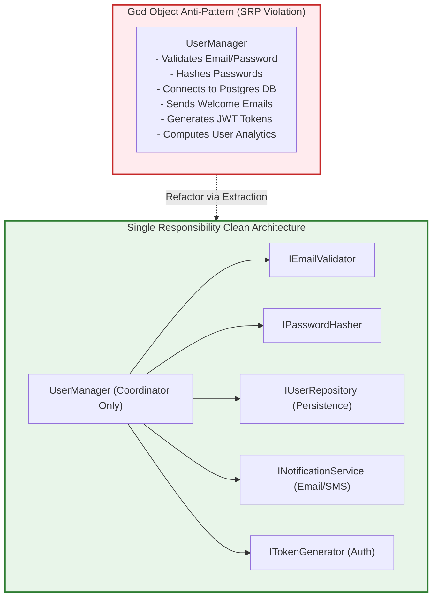
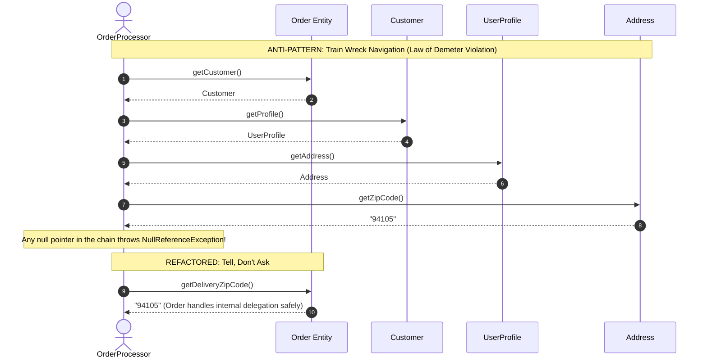
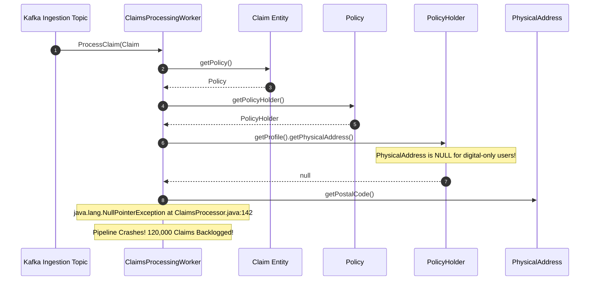

# Anti-Patterns & Code Smells: Diagnosis & Refactoring Playbook

> **Prerequisites**: [02: OOP Foundations & UML](../02-oop-foundations-and-uml/README.md), [04: SOLID Principles](../04-solid-principles/README.md), [05: Core Design Principles](../05-core-design-principles/README.md).  
> **Estimated Reading Time**: 25 minutes  
> **Target Audience**: Backend Engineers, Code Reviewers, Systems Architects, Low-Level Design Interview Candidates.

> [!TIP]
> **Golden Rule of Code Smells**: Code smells are structural early-warning sirens, not cosmetic style preferences. A **God Object** violates SRP by merging multiple failure domains into one fatal blast radius; an **Anemic Domain Model** reduces OOP to procedural data manipulation by stripping business rules from entities; a **Train Wreck** violates the Law of Demeter by coupling callers to deep internal graphs. Name the specific violated principle before writing the refactoring fix.

---

## 1. Visual Mental Models & Architectural Pipelines

In LLD interviews and code reviews, identifying flaws in existing code ("Here is a class—what is wrong with it?") is as common as designing from scratch.

### 1.1 Deconstructing the God Object

A **God Object (The Blob)** accumulates unrelated responsibilities until it knows too much and does too much. Refactoring extracts focused, single-responsibility collaborators, reducing the original class to an orchestrator.



---

### 1.2 The Law of Demeter (Train Wreck vs. Tell, Don't Ask)

Navigating multiple object boundaries (`order.getCustomer().getProfile().getAddress().getZipCode()`) couples the caller to the entire internal graph topology of collaborators.



---

## 2. Taxonomic Reference Grids

### 2.1 Anti-Pattern Diagnostic & Refactoring Matrix

| Code Smell / Anti-Pattern | Violated Principle | Diagnostic Symptoms | Architectural Blast Radius | Clean Refactoring Solution |
| :--- | :--- | :--- | :--- | :--- |
| **God Object (The Blob)** | Single Responsibility Principle (SRP) | Class with 2,000+ lines, 30+ methods, dozens of injected fields | Modifying email formatting breaks database queries | **Extract Class**: Split into focused services; coordinator delegates |
| **Anemic Domain Model** | Encapsulation / Real OOP | Entities have only getters/setters; business logic lives in giant `Service` classes | Invariants cannot be enforced; invalid states proliferate | **Rich Domain Model**: Move validation and business logic inside entity methods |
| **Train Wreck Chains** | Law of Demeter (LoD) | Chains of dot calls: `a.getB().getC().getD().doSomething()` | Changes to class B's structure break unrelated callers | **Tell, Don't Ask**: Add direct delegation methods on collaborator A |
| **Primitive Obsession** | Domain-Driven Design / Type Safety | Using `string` for phone numbers, `float` for money, `int` for IDs | Validation duplicated everywhere; format bugs runtime-only | **Value Objects**: Encapsulate in immutable types (`Money`, `EmailAddress`) |
| **Shotgun Surgery** | High Cohesion / Open-Closed (OCP) | Adding 1 feature requires small edits across 12 different files | High bug regression risk; merge conflicts in git | Consolidate related logic into one module via Strategy or Factory |

### 2.2 Anemic vs. Rich Domain Model Comparison

| Evaluation Metric | Anemic Domain Model | Rich Domain Model |
| :--- | :--- | :--- |
| **Entity Structure** | Pure data bag / DTO (`public get/set` on everything) | Encapsulated private state + expressive domain methods |
| **Business Logic Location** | Scattered across `*Manager`, `*Service`, `*Helper` classes | Colocated directly with the data it governs |
| **Invariant Enforcement** | Weak: Any caller can set `order.status = "SHIPPED"` without payment | Absolute: `order.ship()` throws if `!isPaid` |
| **Testability** | Requires mocking 5 services to test 1 business rule | Plain domain unit test without mocks |
| **Object Orientation** | Degrades into procedural programming with classes | True object-oriented modeling |

---

## 3. Production War Stories: Incident Post-Mortem

### The $1.6M Train-Wreck Cascade: How a Deep Property Navigation Bug Null-Pointered an Insurance Claims Pipeline

```
SEVERITY LEVEL: SEV-1 (Automated Claims Processing Halt)
DETECTION TIME: 8 Minutes
RECOVERY TIME: 160 Minutes
FINANCIAL PENALTY: $1,600,000 in statutory late-settlement interest and regulatory audits
```

#### Incident Background
A Fortune 500 health insurance company ingested automated hospital claim batches (over 120,000 claims/hour) using an asynchronous pipeline written in Java and Spring Boot.

#### What Happened
During a release to support paperless digital policies, the database schema made the physical mailing address optional for policyholders who opted for 100% digital billing (`address` column became nullable). Within 3 minutes of deployment, the automated claims underwriting consumer threw thousands of `NullPointerException` errors per second. A core fraud-detection check executed this train-wreck chain:
```java
String zip = claim.getPolicy().getPolicyHolder().getProfile().getPhysicalAddress().getPostalCode();
```
Because the `physicalAddress` was `null` for digital-first users, the pipeline crashed, poison-pill messages clogged Kafka dead-letter queues, and claim settlement statutory deadlines were breached across 14 US states.



#### Root Cause Analysis
1. **Egregious Violation of Law of Demeter**: `ClaimsProcessingWorker` navigated 5 hops deep into the object graph to inspect an internal property.
2. **Missing Invariant Guard / Null Object Pattern**: The system assumed the entire graph hierarchy was non-nullable.
3. **No Domain Encapsulation**: The worker should have asked the `Claim` directly whether it satisfied domestic fraud criteria rather than pulling strings from internal child entities.

#### The Architectural Hardening
1. **Refactoring to Tell, Don't Ask**: Replaced the 5-dot traversal with an encapsulated domain query on `Claim`:
   ```java
   if (claim.isEligibleForDomesticAutoSettlement()) { ... }
   ```
2. **Value Object Protection with Optionals**: Wrapped all optional domain properties in `Optional<PostalCode>`. The `PhysicalAddress` entity cannot be queried without handling the absent case.
3. **Poison-Pill Resilient Consumer**: Added non-blocking error routing in Kafka so unhandled domain exceptions route to an inspection queue rather than blocking the partition consumer loop.

---

## 4. Multi-Language Production Implementations

Below are complete refactoring examples converting anti-patterns into clean, production-grade object-oriented code.

### 4.1 Go: Refactoring a God Object into a Decoupled Coordinator

```go
package main

import (
	"errors"
	"fmt"
	"strings"
)

// --- BAD ARCHITECTURE: GOD STRUCT ---
// UserManagerBad handles validation, hashing, database saving, and email dispatch all in one.
type UserManagerBad struct {
	db map[string]string
}

func (m *UserManagerBad) Register(email, password string) error {
	if !strings.Contains(email, "@") { // Validation logic
		return errors.New("invalid email")
	}
	hash := fmt.Sprintf("sha256_%s", password) // Security hashing logic
	m.db[email] = hash                         // Persistence logic
	fmt.Printf("Sending email to %s\n", email) // External notification
	return nil
}

// --- CLEAN REFACTORED ARCHITECTURE (SRP + DIP) ---

type Validator interface {
	ValidateEmail(email string) error
}

type Hasher interface {
	HashPassword(password string) (string, error)
}

type Repository interface {
	SaveUser(email, passwordHash string) error
}

type Notifier interface {
	SendWelcomeEmail(email string) error
}

type SimpleEmailValidator struct{}

func (v *SimpleEmailValidator) ValidateEmail(email string) error {
	if !strings.Contains(email, "@") {
		return errors.New("invalid email: missing @ symbol")
	}
	return nil
}

type SHA256Hasher struct{}

func (h *SHA256Hasher) HashPassword(password string) (string, error) {
	if len(password) < 8 {
		return "", errors.New("password must be at least 8 characters")
	}
	return fmt.Sprintf("hashed_%s", password), nil
}

type InMemoryUserRepository struct {
	storage map[string]string
}

func NewInMemoryUserRepository() *InMemoryUserRepository {
	return &InMemoryUserRepository{storage: make(map[string]string)}
}

func (r *InMemoryUserRepository) SaveUser(email, passwordHash string) error {
	r.storage[email] = passwordHash
	return nil
}

type ConsoleNotifier struct{}

func (n *ConsoleNotifier) SendWelcomeEmail(email string) error {
	fmt.Printf("[Email Service] Welcome email dispatched to: %s\n", email)
	return nil
}

// UserManager now solely coordinates independent collaborators (SRP).
type UserManager struct {
	validator  Validator
	hasher     Hasher
	repository Repository
	notifier   Notifier
}

func NewUserManager(v Validator, h Hasher, r Repository, n Notifier) *UserManager {
	return &UserManager{
		validator:  v,
		hasher:     h,
		repository: r,
		notifier:   n,
	}
}

func (m *UserManager) Register(email, password string) error {
	if err := m.validator.ValidateEmail(email); err != nil {
		return err
	}

	hash, err := m.hasher.HashPassword(password)
	if err != nil {
		return err
	}

	if err := m.repository.SaveUser(email, hash); err != nil {
		return err
	}

	return m.notifier.SendWelcomeEmail(email)
}

func main() {
	mgr := NewUserManager(
		&SimpleEmailValidator{},
		&SHA256Hasher{},
		NewInMemoryUserRepository(),
		&ConsoleNotifier{},
	)

	err := mgr.Register("user@domain.com", "superSecurePass123")
	if err != nil {
		panic(err)
	}
	fmt.Println("[Success] User registration clean and decoupled.")
}
```

---

### 4.2 TypeScript: Converting an Anemic Domain Model to a Rich Domain Model

```typescript
// --- BAD: ANEMIC DOMAIN MODEL (Data bag without invariants) ---
export class OrderAnemic {
  public id: string = "";
  public status: "CREATED" | "PAID" | "SHIPPED" | "CANCELLED" = "CREATED";
  public items: Array<{ sku: string; price: number }> = [];
  public totalAmount: number = 0;
}

// Business logic lives outside the class in a service that manipulates raw state
export class OrderServiceBad {
  public shipOrder(order: OrderAnemic): void {
    // Nothing stopped someone from setting order.status = "SHIPPED" directly without paying!
    if (order.status !== "PAID") {
      throw new Error("Cannot ship unpaid order");
    }
    order.status = "SHIPPED";
  }
}

// --- GOOD: RICH DOMAIN MODEL (Encapsulated state and invariants) ---
export class Order {
  private _status: "CREATED" | "PAID" | "SHIPPED" | "CANCELLED" = "CREATED";
  private _items: Array<{ sku: string; price: number }> = [];

  constructor(public readonly orderId: string) {}

  public get status(): string {
    return this._status;
  }

  public addItem(sku: string, price: number): void {
    if (this._status !== "CREATED") {
      throw new Error("Cannot modify items after order has moved past creation");
    }
    if (price <= 0) {
      throw new Error("Item price must be positive");
    }
    this._items.push({ sku, price });
  }

  public calculateTotal(): number {
    return this._items.reduce((sum, item) => sum + item.price, 0);
  }

  public pay(): void {
    if (this._status !== "CREATED") {
      throw new Error(`Cannot pay for order in status: ${this._status}`);
    }
    if (this._items.length === 0) {
      throw new Error("Cannot pay for empty order");
    }
    this._status = "PAID";
  }

  public ship(): void {
    if (this._status !== "PAID") {
      throw new Error(`Invariant Violation: Cannot ship order in status: ${this._status}`);
    }
    this._status = "SHIPPED";
  }

  public cancel(): void {
    if (this._status === "SHIPPED") {
      throw new Error("Cannot cancel an order that has already shipped");
    }
    this._status = "CANCELLED";
  }
}
```

---

### 4.3 Python: Refactoring Train Wrecks with Law of Demeter & Value Objects

```python
import re
from typing import Optional


# --- PRIMITIVE OBSESSION FIX: VALUE OBJECT ---
class EmailAddress:
    _REGEX = re.compile(r"^[^@]+@[^@]+\.[^@]+$")

    def __init__(self, value: str):
        if not self._REGEX.match(value):
            raise ValueError(f"Invalid email address format: {value}")
        self._value = value.lower()

    @property
    def value(self) -> str:
        return self._value

    def __eq__(self, other) -> bool:
        return isinstance(other, EmailAddress) and self._value == other._value


# --- LAW OF DEMETER REFACTORING ---
class Address:
    def __init__(self, postal_code: str, country: str):
        self.postal_code = postal_code
        self.country = country


class Customer:
    def __init__(self, email: EmailAddress, address: Optional[Address] = None):
        self.email = email
        self._address = address

    # Tell, Don't Ask: Customer provides capability directly, concealing Address
    def get_destination_postal_code(self) -> str:
        if not self._address:
            return "DIGITAL_DELIVERY"
        return self._address.postal_code

    def is_domestic(self, base_country: str) -> bool:
        if not self._address:
            return True
        return self._address.country == base_country


class Order:
    def __init__(self, customer: Customer):
        self._customer = customer

    # Order delegates to Customer; caller never needs to know Address exists
    def get_shipping_postal_code(self) -> str:
        return self._customer.get_destination_postal_code()
```

---

### 4.4 C#: Eliminating Shotgun Surgery with Strategy Pattern

```csharp
using System;
using System.Collections.Generic;

namespace Architecture.AntiPatterns
{
    // ANTI-PATTERN FIX: Moving scattered switch statements into clean polymorphic strategies
    public interface IDiscountStrategy
    {
        decimal ApplyDiscount(decimal total);
    }

    public class RegularCustomerDiscount : IDiscountStrategy
    {
        public decimal ApplyDiscount(decimal total) => total;
    }

    public class PremiumCustomerDiscount : IDiscountStrategy
    {
        public decimal ApplyDiscount(decimal total) => total * 0.90m; // 10% off
    }

    public class VIPCustomerDiscount : IDiscountStrategy
    {
        public decimal ApplyDiscount(decimal total) => total * 0.80m; // 20% off
    }

    public class Order
    {
        public decimal Subtotal { get; }
        private readonly IDiscountStrategy _discountStrategy;

        public Order(decimal subtotal, IDiscountStrategy discountStrategy)
        {
            Subtotal = subtotal;
            _discountStrategy = discountStrategy ?? throw new ArgumentNullException(nameof(discountStrategy));
        }

        public decimal CalculateFinalTotal()
        {
            return _discountStrategy.ApplyDiscount(Subtotal);
        }
    }
}
```

---

## 5. Practical Hands-On Verification Workflows

### 5.1 CLI Verification of Rich Domain Invariant Protection

Execute unit tests verifying that an invalid domain state cannot be forced on an Order entity:

```bash
# Execute unit tests for Rich Domain Model invariants
npm test -- test/rich-domain-order.spec.ts

# Expected Output:
# PASS test/rich-domain-order.spec.ts
#   Order Rich Domain Model
#     ✓ Disallows shipping an unpaid order
#     ✓ Disallows adding items after order is marked PAID
#     ✓ Disallows cancelling an already SHIPPED order
#
# Test Suites: 1 passed, 1 total
# Tests:       3 passed, 3 total
```

### 5.2 Python Value Object Invariant Verification Script

Test email validation invariant from the command line:

```bash
python3 -c "
import re

class Email:
    def __init__(self, v):
        if not re.match(r'^[^@]+@[^@]+\.[^@]+$', v):
            raise ValueError(f'Invalid email: {v}')
        self.val = v

try:
    e1 = Email('valid@company.com')
    print(f'Constructed valid email: {e1.val}')
    e2 = Email('invalid-email-missing-at')
except ValueError as err:
    print(f'Caught expected invariant protection: {err}')
"
```

Expected Terminal Output:
```
Constructed valid email: valid@company.com
Caught expected invariant protection: Invalid email: invalid-email-missing-at
```

---

## 6. Operational Validation Checkpoints (Scenario Quizzes)

<details>
<summary><strong>Checkpoint 1: The Subtle "Feature Envy" Code Smell</strong></summary>

**Scenario**: You review a pull request containing this code:
```csharp
public class InvoiceCalculator {
    public decimal CalculateTax(Order order) {
        decimal tax = 0;
        foreach (var item in order.GetItems()) {
            if (item.GetTaxRate() > 0) {
                tax += item.GetPrice() * item.GetTaxRate();
            }
        }
        return tax;
    }
}
```
Which code smell is present, what principle is violated, and how should it be refactored?

<strong>Answer:</strong>
**Feature Envy (Violation of High Cohesion and Information Expert)**:
- **Diagnostic**: `InvoiceCalculator` reaches deeply into `Order` and its `LineItem` objects, interrogating their internal data to perform a calculation that `LineItem` and `Order` are perfectly equipped to perform themselves. The method "envies" the data of another class.
- **Refactoring**:
  - Move calculation to the data owners: `item.CalculateTax()` calculates tax for a single line.
  - `order.CalculateTotalTax()` sums the tax across all its items.
  - `InvoiceCalculator` simply calls `order.CalculateTotalTax()`.
</details>

<details>
<summary><strong>Checkpoint 2: Premature Generalization (Speculative Generality)</strong></summary>

**Scenario**: A candidate is asked to design a basic in-memory logger. They submit:
`ILoggerFactory`, `AbstractAsyncLogDispatcherPool`, `ILogFilterStrategy`, `PluggableLogSerializerBridge`, and 14 abstract classes. The code has only 1 concrete destination (`Console.WriteLine`). What anti-pattern is this, and what is the interviewer's critique?

<strong>Answer:</strong>
**Speculative Generality & Over-Engineering (Violation of YAGNI & KISS)**:
- **Critique**: The candidate built speculative abstraction layers for hypothetical future requirements that do not currently exist. This creates code bloat, increases cognitive load, and slows down system modifications without providing business value.
- **Rule of Thumb**: Do not introduce an interface or factory pattern until you have at least **two concrete implementations** or a strict architectural boundary requirement (such as unit test mocking).
</details>

<details>
<summary><strong>Checkpoint 3: The Boolean Flag Method Antipattern</strong></summary>

**Scenario**: A service method has the signature `public void processUser(User u, bool isVip)`. Inside the method, 8 separate `if (isVip)` blocks split the logic. How does this violate clean OOP, and how should it be structured?

<strong>Answer:</strong>
**Flag Argument Anti-Pattern (Violation of Single Responsibility & Clean Code)**:
- **Diagnostic**: A boolean flag in a method signature explicitly declares that the method does **more than one thing** depending on the boolean flag.
- **Refactoring**:
  1. Split into two clear, distinct methods: `processStandardUser(u)` and `processVipUser(u)`.
  2. Or better, use **Polymorphism**: Treat `VipUser` and `StandardUser` as subtypes implementing a shared interface, or pass an injected `IUserProcessingStrategy`.
</details>

---

## 7. Further Reading & References

- [Refactoring.Guru: Code Smells Catalog](https://refactoring.guru/refactoring/smells) - Complete taxonomic guide to code smells and refactoring moves.
- [Martin Fowler: Anemic Domain Model](https://martinfowler.com/bliki/AnemicDomainModel.html) - Foundational critique of data-only entities.
- [Law of Demeter Official Principles](https://en.wikipedia.org/wiki/Law_of_Demeter) - Deep dive on the principle of least knowledge.

---

## Next Steps

Advance to [Module 21: LLD Interview Playbook](../21-lld-interview-playbook/README.md) to master running the 45-minute timed interview clock, communicating tradeoffs out loud, and pacing live design rounds.
