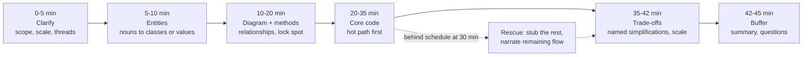

# LLD Interview Playbook — The 45-Minute Protocol

> **Prerequisites:** [11 · Requirements to Class Diagrams](../11-requirements-to-class-diagrams/README.md), [12 · Parking Lot & Elevator](../12-parking-lot-and-elevator/README.md), [20 · Anti-Patterns & Code Smells](../20-anti-patterns-and-code-smells/README.md)  
> **Reading time:** ~25 minutes (plus one timed dry run)  
> **Audience:** Anyone with an LLD / machine-coding round in the next few weeks

> [!NOTE]
> **In one line:** An LLD interview is graded on **how you think out loud** more than on how fast you type — so run a fixed 45-minute protocol: clarify (5) → entities (5) → diagram + methods (10) → core code (15) → trade-offs (7) → buffer (3), and narrate every step.

> [!TIP]
> **Golden rule:** The interviewer can only grade what they hear or see. Silent coding for 25 minutes scores as *"unknown."* Say your assumptions, name your simplifications, and say what you would do with more time. Out loud. Every phase.

> [!TIP]
> **Try it:** Draw your next practice problem in [LLD Studio](/tools/lld-studio/) in 7 minutes flat (entities + relationships + the one method that needs a lock), then run the timed dry run in section 12.

---

## 1. Interview pressure

*"Design a meeting-room booking system."* (or a parking lot, a rate limiter, an LRU cache, Splitwise…) You have 45 minutes, a shared editor or whiteboard, and someone watching quietly.

**What they actually score** (typical rubric — know it, then feed it):

| Signal | What earns it | What loses it |
| :--- | :--- | :--- |
| **Requirements** | 3–5 targeted questions; written assumptions | Coding on unverified guesses |
| **Modeling** | Clean entities; value objects vs entities; sensible ownership | A class for every noun; anemic data bags |
| **Design judgment** | Pattern chosen *because of a stated pain* | Pattern name-dropping |
| **Correctness** | Edge cases named; concurrency spot identified | "It works on my machine" with a race inside |
| **Code quality** | Small, readable, compiling-ish code | 200 lines of boilerplate; no core logic |
| **Communication** | Narration, trade-offs, handling pushback | Silence; defensiveness |
| **Time management** | Reaches a working core and a trade-off discussion | Out of time with half a class |

**The smells interviewers write down:** started typing in the first minute; no questions; one 300-line class; says "singleton" for everything; never mentions threads; claims the design is "done" with zero trade-offs.



---

## 2. The protocol — minute by minute

| Phase | Minutes | Deliverable on the board | Say out loud | Common fail |
| :--- | :--- | :--- | :--- | :--- |
| **1 · Clarify** | 0–5 | 4–6 bullet requirements, 2–3 assumptions, out-of-scope list | "Before I design, let me confirm scope and a few assumptions." | Jumping to code |
| **2 · Entities** | 5–10 | Noun list marked *entity / value object / drop*; main actor | "These are the core entities; this one is a value object because…" | Class per noun |
| **3 · Diagram + methods** | 10–20 | Boxes + arrows, public method signatures, **where the lock goes** | "Level owns its spots, so the lock lives there." | Drawing silently |
| **4 · Core code** | 20–35 | Types, signatures, then the **one hot method** fully written | "I'm writing the hard method first; getters I'll skip." | Boilerplate first |
| **5 · Trade-offs** | 35–42 | 3 named simplifications + 2 extensions | "I simplified X; here's how I'd extend it." | "It's complete." |
| **6 · Buffer** | 42–45 | One-sentence summary | "To recap: …" | Silence / panic |

### Phase checklists (copy these into your head)

```text
PHASE 1  CLARIFY (5 min)
[ ] Core use cases (2-3 verbs: book, cancel, list)?
[ ] Scale: one process or distributed?  Threads?
[ ] Who are the actors? (user, admin, system)
[ ] What is OUT of scope? (payments, auth, persistence) -> say it
[ ] Write 3 assumptions on the board and get a nod

PHASE 2  ENTITIES (5 min)
[ ] List nouns, then circle: Entity (has identity)  /  Value object (immutable)  /  Drop
[ ] Pick the aggregate that will own the invariant (and the lock)
[ ] Money = integer cents. Time = injected clock.

PHASE 3  DIAGRAM + METHODS (10 min)
[ ] Boxes with 1-line responsibilities (no fields yet)
[ ] Relationships: has-a (composition) vs uses (association)
[ ] Public method signatures only
[ ] Mark the ONE critical section ("check + act together")
[ ] State the pattern + the pain it removes (or say "no pattern needed")

PHASE 4  CORE CODE (15 min)
[ ] Types and signatures first (2 min)
[ ] Hot-path method fully written (8 min)
[ ] One quick test or trace by hand (2 min)
[ ] Edge cases listed even if not coded (2 min)

PHASE 5  TRADE-OFFS (7 min)
[ ] 3 named simplifications ("I used a coarse lock because...")
[ ] Scale story: what changes with 100x load / many machines
[ ] One extension you'd do next, and which class it touches
[ ] Testing: how you'd inject time / fake dependencies

PHASE 6  BUFFER (3 min)
[ ] 20-second recap
[ ] Ask one question about their system
```

### What "compressed code" means

| Aspect | Reading-material code (this repo) | Interview code (live) |
| :--- | :--- | :--- |
| Docstrings | Full | Spoken, not written |
| Error handling | Custom exception hierarchy | Guard clause + standard exception |
| Getters/setters | Full | Public fields / records / dataclasses |
| Concurrency | Complete | One lock in the right class, **explained** |
| Tests | Suites | A 3-line demo or hand trace |

---

## 3. Walkthrough — requirements → entities → methods (one problem, live)

The prompt: **"Design a meeting-room booking system."** Here is exactly what ends up on the board.

### Phase 1 — Clarify (what you ask, what you write)

| You ask | Typical answer | You write |
| :--- | :--- | :--- |
| "Rooms have capacities, and people book by time slot?" | Yes | Rooms have capacity; booking = `[start, end)` |
| "Single process or many servers?" | One service, many threads | In-memory, thread-safe |
| "Back-to-back OK (10:00–11:00 then 11:00–12:00)?" | Yes | **Half-open intervals** |
| "Recurring meetings, equipment, calendars?" | Not now | Out of scope |
| "Cancel?" | Yes | `cancel(booking_id)` |

**Board:** *Assumptions: in-memory, concurrent callers, times are integer minutes, half-open `[start, end)`. Out: recurrence, auth, persistence.*

### Phase 2 — Entities (noun triage)

| Noun | Decision |
| :--- | :--- |
| `Room` | **Entity** — id, capacity, **owns its bookings and its lock** |
| `Booking` | Immutable record (id, room, start, end) |
| `TimeSlot` | Fold into `Booking` (two ints) — not worth a class yet |
| `User` / `Attendee` | Out of scope (just a count) |
| `Scheduler` | Orchestrator: picks a room, calls `Room.try_book` |

### Phase 3 — Methods and the critical section

| Method | Contract |
| :--- | :--- |
| `Room.try_book(booking) -> bool` | Check overlap **and** insert, atomically, under the room's lock |
| `Room.cancel(booking_id) -> bool` | Remove |
| `Scheduler.book(attendees, start, end) -> Booking \| None` | Try fitting rooms smallest-first |
| `Scheduler.cancel(booking_id) -> bool` | Delegate |

**Say it:** *"The race is check-then-insert on one room, so the lock lives in `Room` — not a global lock on the scheduler. Two requests for different rooms never block each other. Picking the smallest fitting room is a policy; if asked, I'd make it a `RoomSelectionStrategy`."*

**Tiny diagram on the board:**

```text
Scheduler --uses--> Room (lock, sorted bookings) --has--> Booking*
   |
   +-- RoomSelectionStrategy (only if asked)
```

---

## 4. Code — Phase 4, the "hot method first" shape

Write in this order: **types → signatures → the one method that matters → a 3-line demo.** The core is the overlap check on a sorted list.

````carousel
```python
from __future__ import annotations

import threading
import uuid
from bisect import bisect_left
from dataclasses import dataclass
from typing import Optional


@dataclass(frozen=True)
class Booking:
    id: str
    room_id: str
    start: int            # minutes; half-open interval [start, end)
    end: int


class Room:
    def __init__(self, room_id: str, capacity: int) -> None:
        self.id, self.capacity = room_id, capacity
        self._lock = threading.Lock()               # the invariant lives here, so the lock does too
        self._starts: list[int] = []                # sorted starts
        self._bookings: list[Booking] = []          # same order as _starts

    def try_book(self, b: Booking) -> bool:
        if b.start >= b.end:
            raise ValueError("end must be after start")
        with self._lock:                            # check + insert = ONE step
            i = bisect_left(self._starts, b.start)
            if i > 0 and self._bookings[i - 1].end > b.start:           # previous runs into us
                return False
            if i < len(self._bookings) and self._bookings[i].start < b.end:  # we run into next
                return False
            self._starts.insert(i, b.start)
            self._bookings.insert(i, b)
            return True

    def cancel(self, booking_id: str) -> bool:
        with self._lock:
            for i, b in enumerate(self._bookings):
                if b.id == booking_id:
                    del self._bookings[i]
                    del self._starts[i]
                    return True
            return False


class Scheduler:
    def __init__(self, rooms: list[Room]) -> None:
        self._rooms = sorted(rooms, key=lambda r: r.capacity)   # smallest fitting room first

    def book(self, attendees: int, start: int, end: int) -> Optional[Booking]:
        for room in self._rooms:
            if room.capacity < attendees:
                continue
            booking = Booking(uuid.uuid4().hex[:8], room.id, start, end)
            if room.try_book(booking):
                return booking
        return None                                  # nothing free: say "no", don't throw

    def cancel(self, booking_id: str) -> bool:
        return any(r.cancel(booking_id) for r in self._rooms)


if __name__ == "__main__":
    s = Scheduler([Room("small", 4), Room("big", 12)])
    a = s.book(3, 600, 660)             # 10:00-11:00 -> small
    b = s.book(3, 660, 720)             # back-to-back is fine -> small
    c = s.book(3, 630, 690)             # overlaps small twice -> goes to big
    print(a.room_id, b.room_id, c.room_id)          # small small big

    # 50 threads fight for the same 1-hour slot on a single room: exactly one wins.
    only = Scheduler([Room("r", 10)])
    wins: list[Booking] = []
    def go() -> None:
        got = only.book(2, 900, 960)
        if got:
            wins.append(got)
    ts = [threading.Thread(target=go) for _ in range(50)]
    for t in ts: t.start()
    for t in ts: t.join()
    print("winners:", len(wins))                     # 1
```
<!-- slide -->
```csharp
using System;
using System.Collections.Generic;
using System.Linq;

public sealed record Booking(string Id, string RoomId, int Start, int End);   // half-open [Start, End)

public sealed class Room
{
    private static readonly Comparer<Booking> ByStart =
        Comparer<Booking>.Create((x, y) => x.Start.CompareTo(y.Start));

    private readonly object _gate = new();               // the invariant lives here, so the lock does too
    private readonly List<Booking> _bookings = new();    // sorted by Start

    public string Id { get; }
    public int Capacity { get; }
    public Room(string id, int capacity) { Id = id; Capacity = capacity; }

    public bool TryBook(Booking b)
    {
        if (b.Start >= b.End) throw new ArgumentException("end must be after start");
        lock (_gate)                                     // check + insert = ONE step
        {
            int i = _bookings.BinarySearch(b, ByStart);
            if (i >= 0) return false;                    // same start => overlap
            i = ~i;                                      // insertion point
            if (i > 0 && _bookings[i - 1].End > b.Start) return false;               // previous runs into us
            if (i < _bookings.Count && _bookings[i].Start < b.End) return false;      // we run into next
            _bookings.Insert(i, b);
            return true;
        }
    }

    public bool Cancel(string bookingId)
    {
        lock (_gate) return _bookings.RemoveAll(x => x.Id == bookingId) > 0;
    }
}

public sealed class Scheduler
{
    private readonly IReadOnlyList<Room> _rooms;
    public Scheduler(IEnumerable<Room> rooms) => _rooms = rooms.OrderBy(r => r.Capacity).ToList();

    public Booking? Book(int attendees, int start, int end)
    {
        foreach (var room in _rooms)
        {
            if (room.Capacity < attendees) continue;
            var booking = new Booking(Guid.NewGuid().ToString("N")[..8], room.Id, start, end);
            if (room.TryBook(booking)) return booking;
        }
        return null;                                     // nothing free: say "no", don't throw
    }

    public bool Cancel(string bookingId) => _rooms.Any(r => r.Cancel(bookingId));
}
```
````

**Narration while typing the hot method** (this is the part that scores):

> "Bookings per room are kept sorted by start, so I binary-search the insertion point. With half-open intervals, a new booking overlaps only if the previous one ends after it starts, or the next one starts before it ends — two neighbor checks, O(log n) search. The lock wraps check and insert together; if I locked them separately, two threads could both pass the check."

---

## 5. Rescue moves (scripts you can borrow)

| Situation | What to say / do |
| :--- | :--- |
| **Minute 28 and you only have half the code** | "I want to protect time for trade-offs. Let me stub the remaining methods with signatures and walk through the flow verbally." Then do it. |
| **Twist at minute 30** ("now add VIP rooms / recurrence") | "Good — that's an extension point. This is the seam: `RoomSelectionStrategy`. I'd add a new strategy; `Room` and `Scheduler` don't change." Don't erase the board. |
| **Interviewer challenges your pattern** | "Fair point — for one rule a plain `if` is simpler (YAGNI). I'd use Strategy once there are two policies or they change independently." Concede the valid part, restate the reason. |
| **Blank mind on an API** | "Let me write the contract first: inputs, outputs, failure." Writing the signature unblocks you. |
| **Interviewer is silent** | Ask: "Does this level of detail work, or should I go deeper on concurrency / extensibility?" |
| **You spot your own bug** | Say it immediately: "I see a bug — check and insert aren't atomic." Self-correction is a *positive* signal. |
| **You don't know the answer** | "I haven't used X; here's how I'd reason about it." Then reason from first principles. |

---

## 6. Edges — when the protocol bends

| Format | Adjust |
| :--- | :--- |
| **60–90 min machine-coding (runnable code expected)** | Compress phases 1–3 to ~15 min; spend ~45 min on *working, runnable* code with a `main` that demonstrates it; finish with 10 min on extensions. Write a few tests early. |
| **Whiteboard, no compiler** | Pseudocode is fine, but keep real names and types. Hand-trace one example. |
| **Take-home** | Same design thinking, plus tests, a README with assumptions, and a short "what I'd do next" list. |
| **"Just design the classes" (no code)** | Spend phase 4 time on sequence diagrams and invariants instead. |
| **Language constraints** | Pick the one you can type fastest. Mention the equivalent idiom if the interviewer prefers another. |
| **Very senior role** | Spend more time on trade-offs, failure modes, and scaling (phase 5 gets 12–15 min). |
| **Junior / new-grad** | Show clean OOP, a correct core, and tests; concurrency is a bonus unless asked. |
| **Interviewer takes over** | Follow their path. The protocol is a safety net, not a script. |

**Don't over-engineer:** if a question can be answered with one class and a dictionary, do that and mention how it would grow.

---

## 7. War story (short)

A strong engineer with eight years of experience got the prompt *"design an in-memory cache with eviction."* He typed a thread-safe LRU for 28 minutes without a word. At minute 35 the interviewer asked, *"How does this work across servers?"* He had assumed one process and never said so. Feedback: *"strong coder, no visible design process, unverified assumptions."* Reject.

**Fix:** three questions up front, one diagram, narration at every transition, and a closing paragraph of named simplifications. The same code would have passed.

---

## 8. What you'd say in two minutes (the opener)

> "Before I design anything, let me confirm scope. I'm assuming in-memory, multiple threads, times in integer minutes, and half-open intervals so back-to-back meetings are fine. Out of scope: recurrence, auth, persistence — tell me if that's wrong.
>
> Core entities: `Room` owns its bookings and its lock; `Booking` is an immutable record; a `Scheduler` picks a room. The one race is check-then-insert on a room, so the lock goes inside `Room`, and different rooms never contend. I'll write that method first, then a quick demo, then spend the last ten minutes on trade-offs: coarse per-room lock, linear room scan, and how I'd extend to recurring meetings or a selection strategy."

Practice this opener until it takes **under 90 seconds**, then swap the nouns for any problem.

---

## 9. Anti-patterns

1. **Typing in the first minute** — you will solve the wrong problem.
2. **Silent coding** — the interviewer can't grade thinking they can't hear.
3. **Class per noun** — dropping nouns is a skill; say which you dropped and why.
4. **Pattern bingo** — "Singleton, Factory, Observer!" without a pain. Say the problem first.
5. **Gold-plating** — recurrence, payments, and auth before the core works.
6. **Boilerplate first** — 10 minutes of getters; zero minutes on the hot path.
7. **Ignoring concurrency when asked "multiple users"** — at least name the critical section.
8. **Claiming "done" with no trade-offs** — read as inexperience.
9. **Defending instead of discussing** — pushback is a design review, not an attack.
10. **No clock / no tests mentioned** — one sentence about injecting time and faking dependencies earns easy credit.

---

## 10. Interview questions

<details>
<summary><strong>1. How do you split 45 minutes? [BASIC]</strong></summary>

Clarify 5 · entities 5 · diagram + method signatures 10 · core code 15 · trade-offs 7 · buffer 3. Adjust by format: runnable-code rounds shift time from diagrams to code.

</details>

<details>
<summary><strong>2. What do you ask in the first five minutes? [BASIC]</strong></summary>

Core use cases, scale (one process or distributed), concurrency (multiple threads?), actors, and what's out of scope. Then write three assumptions down and get a nod.

</details>

<details>
<summary><strong>3. What does "named simplification" mean and why does it help? [BASIC]</strong></summary>

Explicitly saying what you skipped and what you'd do instead: "I used a per-room lock; at scale I'd shard by room id across nodes." It turns an omission into a visible judgment call.

</details>

<details>
<summary><strong>4. At minute 30 you're far behind. What now? [SCENARIO]</strong></summary>

Stop writing boilerplate. Say "I'm protecting time for trade-offs," stub remaining methods with signatures, walk through the main flow verbally, and make sure the hot method and the critical section are complete. Then do phase 5.

</details>

<details>
<summary><strong>5. The interviewer adds a big new requirement mid-way. [SCENARIO]</strong></summary>

Identify the seam: "this is an extension point." Name the class or interface that absorbs it (new Strategy, new State, new handler). Implement it in a few minutes without rewriting existing classes. If you can't, say what would have to change and why — that's honest and informative.

</details>

<details>
<summary><strong>6. Interviewer says "why Strategy? An `if` would be simpler." [SCENARIO]</strong></summary>

Agree on what's true: for one fixed rule, `if` wins (YAGNI). Then give the concrete pain: policies change independently, we need to add them without editing the class, and we want to test each in isolation. Offer to simplify if requirements are static.

</details>

<details>
<summary><strong>7. Should you write tests in a 45-minute interview? [TRICKY]</strong></summary>

Not a full suite. Do a 3-line demo or a hand trace that covers the happy path and one edge (overlap, last spot, empty input). Mention *how* you'd test (inject clock, fake dependencies, concurrency test with many threads). In a runnable machine-coding round, write a couple of real tests early.

</details>

<details>
<summary><strong>8. You realize mid-code that your design has a flaw. [TRICKY]</strong></summary>

Say it out loud right away, state the smallest fix, and apply it. "Check and insert must be one atomic step; I'll move both inside the lock." Interviewers read quick, calm self-correction as seniority; hiding the bug reads as the opposite.

</details>

---

## 11. Problem → pattern quick map

| Prompt | Core idea | Where to review |
| :--- | :--- | :--- |
| Parking lot / elevator | Atomic reserve per level; Strategy + State | [12](../12-parking-lot-and-elevator/README.md) |
| Library / vending machine | State machine; inventory invariants | [13](../13-library-and-vending-machine/README.md) |
| Tic-tac-toe / chess | Board model, rules per piece, win detection | [14](../14-tic-tac-toe-and-chess/README.md) |
| Splitwise | Integer cents, canonical pair ledger, greedy settle-up | [15](../15-splitwise-expense-sharing/README.md) |
| Movie tickets | Seat holds with expiry, atomic multi-seat booking | [16](../16-movie-ticket-booking/README.md) |
| Ride sharing | Matching Strategy, trip State, location indexing | [17](../17-ride-sharing/README.md) |
| LRU / LFU / rate limiter | Map + list, frequency buckets, token bucket, injected clock | [18](../18-lru-lfu-cache-and-rate-limiter/README.md) |
| SDK / library API | Fluent builders, DI, versioning | [19](../19-api-library-design-and-di/README.md) |
| Code review / smell round | Name the smell, pick the refactor | [20](../20-anti-patterns-and-code-smells/README.md) |

---

## 12. Try it

**The timed dry run (45 minutes, once a week):**

1. Pick a prompt from section 11 (or ask someone to pick one).
2. Set a countdown and say each phase transition out loud: "Phase 2: entities."
3. Draw the model in [LLD Studio](/tools/lld-studio/) in 7 minutes (phase 3 rehearsal).
4. Write code at the pace of section 4: signatures first, then the hot method.
5. Record yourself (voice is enough). In the replay, count silent stretches longer than 30 seconds.
6. Self-grade with the signal table in section 1. Fix the lowest score first.

**Drills:**

- Say the two-minute opener for three different problems; keep each under 90 seconds.
- Take any module in this repo and list its *named simplifications* in one breath.
- Break your own design: "what if two threads call this at once?" — find the check-then-act.

---

## 13. One-page cheat sheet

```text
CLOCK     0-5 clarify | 5-10 entities | 10-20 diagram+methods | 20-35 code | 35-42 trade-offs | 42-45 buffer
CLARIFY   use cases? scale (1 process / distributed)? threads? actors? OUT of scope? -> write 3 assumptions
ENTITIES  noun -> entity (identity) / value object (immutable) / drop.  Money = cents.  Time = injected clock.
DIAGRAM   boxes + 1-line responsibilities, signatures only, MARK the critical section, name pattern + its pain
CODE      types -> signatures -> hot method -> 3-line demo.  Skip getters and docstrings (say them).
TRADEOFFS 3 named simplifications + 1 scale story + 1 extension (which class it touches)
RESCUE    behind? stub + narrate.  twist? "this is the seam".  pushback? concede the true part.  bug? say it first.

NEVER     silent coding | class per noun | pattern bingo | "it's done" | defending instead of discussing
ALWAYS    narrate | state assumptions | name the lock | name what you skipped

Say aloud: "Here's my assumption... here's the invariant... here's where the lock lives... here's what I skipped."
```

---

## Next

**[22 · Capstone Project](../22-capstone-project/README.md)** — put the full protocol to work on an unguided, end-to-end design.
