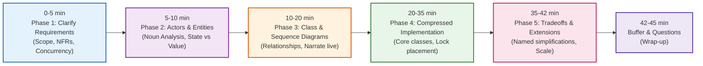
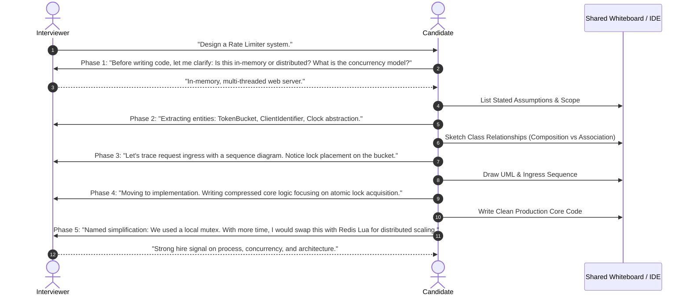
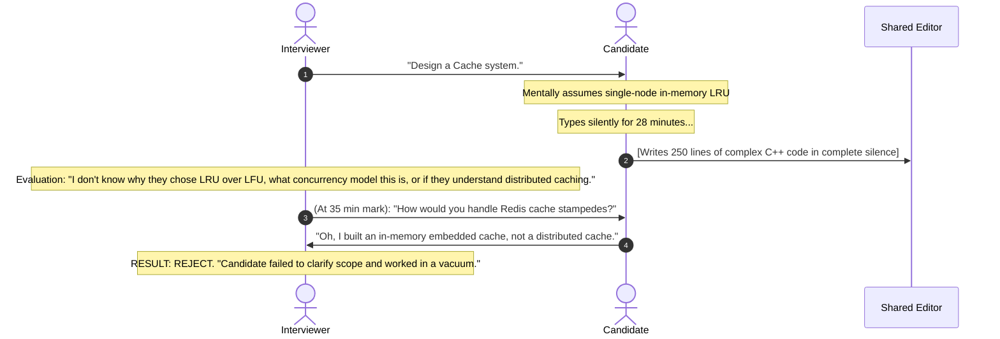

# LLD Interview Playbook: The 45-Minute Clock & Communication Protocol

> **Prerequisites**: [11: Requirements to Class Diagrams](../11-requirements-to-class-diagrams/README.md), [12: Parking Lot & Elevator](../12-parking-lot-and-elevator/README.md), [20: Anti-Patterns & Code Smells](../20-anti-patterns-and-code-smells/README.md).  
> **Estimated Reading Time**: 25 minutes  
> **Target Audience**: Backend Engineers, Technical Leads, LLD & System Design Interview Candidates.

> [!TIP]
> **Golden Rule of the LLD Interview**: An LLD interview evaluates **structured thought, disciplined scoping, and transparent communication**, not raw typing speed. An interviewer can only grade what they hear. Allocate your 45-minute budget strictly across the 5 phases: Clarification (0–5m), Entity Extraction (5–10m), Diagramming (10–20m), Compressed Implementation (20–35m), and Tradeoffs (35–42m). Narrate your design decisions and name your simplifications out loud at every step.

---

## 1. Visual Mental Models & The 45-Minute Time Budget

In a 45-minute technical interview, poor time management is the most common failure mode. Candidates who jump straight into code often solve the wrong problem; candidates who spend 25 minutes drawing UML run out of time to prove they can write working code.

### 1.1 The 45-Minute Clock Allocation



---

### 1.2 Candidate & Interviewer Communication Protocol



---

## 2. Taxonomic Reference Grids

### 2.1 The 5 Interview Phases Matrix

| Phase | Time Window | Primary Deliverable | What to Say Out Loud (Script) | Fatal Candidate Pitfall |
| :--- | :--- | :--- | :--- | :--- |
| **1. Clarify Requirements** | 0–5 Min | Functional boundaries, scale, and stated assumptions | *"Let me verify the core use cases and state my non-functional assumptions regarding scale and concurrency before we model."* | Jumping straight to coding based on unverified assumptions |
| **2. Actors & Entities** | 5–10 Min | Actor table and domain entity list | *"Filtering our domain nouns: User and Account are core entities, while Currency is an immutable Value Object."* | Making every noun a class; creating anemic models |
| **3. UML & Diagrams** | 10–20 Min | Class diagram + key use case sequence flow | *"I'm using Composition here because Level cannot exist without ParkingLot, and injecting a Strategy for dynamic pricing."* | Drawing silently without narrating design intent |
| **4. Core Code** | 20–35 Min | Compressed, working object-oriented code | *"Notice the lock is encapsulated strictly inside this class; callers never manage synchronization primitives."* | Writing endless boilerplate/docstrings and running out of time |
| **5. Tradeoffs & Q&A** | 35–42 Min | Discussion of scale, edge cases, and simplifications | *"I intentionally simplified date range overlaps. Here is the concrete extension I would implement next..."* | Claiming the design is 100% complete with zero tradeoffs |

### 2.2 Study Code vs. Interview-Paced Code Comparison

| Aspect | Study-Detail Code (Repository README) | Interview-Compressed Code (Live Whiteboard) |
| :--- | :--- | :--- |
| **Docstrings & Comments** | Full multi-line Sphinx/JSDoc annotations | Omitted entirely; supplied verbally out loud |
| **Error Handling** | Exhaustive custom error hierarchies | Guard clauses throwing standard exceptions |
| **Boilerplate** | Full getters, setters, serializations | Clean fields with direct property access |
| **Concurrency Detail** | Full sharded reader-writer locks | Encapsulated mutex around the critical section |
| **Execution Pacing** | Written for asynchronous reading | Written in 15 minutes live under a timer |

---

## 3. Production War Stories: Incident Post-Mortem

### The $350K Offer Rejection: How Silent Whiteboarding Lost an L5/L6 Senior Backend Loop

```
CANDIDATE LEVEL: Staff / Senior Backend Engineer (L5/L6 Target)
OUTCOME: Reject (Consensus: "Strong individual coder, poor architectural communication")
CORE FEEDBACK: "Spent 30 minutes writing code in absolute silence. Made unverified assumptions."
OPPORTUNITY LOSS: $350,000 Total Compensation Offer
```

#### Incident Background
A talented backend engineer with 8 years of distributed systems experience interviewed at a tier-1 tech firm for a Senior Systems Engineer position. The prompt was: *"Design a multi-tier in-memory Cache with eviction."*

#### What Happened
The candidate nodded, opened the coding window, and began typing instantly. For 28 uninterrupted minutes, the candidate typed complex, syntactically perfect C++ code implementing a thread-safe LRU cache with sentinel nodes. When the 35-minute mark arrived, the interviewer interrupted: *"How does this scale across multiple servers?"* The candidate was caught off-guard, having assumed a single-machine embedded cache. Because the candidate had not stated assumptions, clarified requirements, or drawn a diagram, the interviewer had zero insight into the candidate's architectural decision-making process.



#### Root Cause Analysis
1. **Zero Clarification Phase**: Skipped Phase 1 entirely, guessing the requirements rather than negotiating them.
2. **Silent Coding Anti-Pattern**: Worked in isolation without verbalizing architectural trade-offs or rationale.
3. **Missing Architectural Diagrams**: No high-level diagram was produced, making it impossible to evaluate structural modeling capabilities.

#### The Architectural Hardening (Interview Success Blueprint)
1. **The 3-Question Clarification Habit**: Always ask 2–3 targeted questions upfront:
   - *"What is our expected read vs. write concurrency ratio?"*
   - *"Are we designing a single-process in-memory component or a distributed network service?"*
   - *"Are there specific eviction or persistence policies you want me to focus on?"*
2. **Continuous Verbal Narration**: Treat the interview as a collaborative design review. Speak at every transition: *"Now I am encapsulating the doubly linked list pointers to preserve our $\mathcal{O}(1)$ invariant."*
3. **The Named Simplification Strategy**: Explicitly state what you are deferring to turn an omission into evidence of senior engineering judgment.

---

## 4. Multi-Language Production Implementations

Below is the **Interview-Paced Compressed Implementation** of an In-Memory Token Bucket Rate Limiter, written across four languages without verbose ceremony.

### 4.1 Go: Interview-Compressed Token Bucket Rate Limiter

```go
package main

import (
	"fmt"
	"math"
	"sync"
	"time"
)

// Clock abstraction for deterministic testing (DIP)
type Clock interface {
	Now() time.Time
}

type RealClock struct{}
func (RealClock) Now() time.Time { return time.Now() }

type TokenBucket struct {
	mu           sync.Mutex
	capacity     float64
	refillRate   float64 // tokens per second
	tokens       float64
	lastRefill   time.Time
	clock        Clock
}

func NewTokenBucket(cap, rate float64, clk Clock) *TokenBucket {
	if clk == nil { clk = RealClock{} }
	return &TokenBucket{
		capacity:   cap,
		refillRate: rate,
		tokens:     cap,
		lastRefill: clk.Now(),
		clock:      clk,
	}
}

// Allow executes the critical check-then-consume sequence under encapsulated lock.
func (tb *TokenBucket) Allow() bool {
	tb.mu.Lock()
	defer tb.mu.Unlock()

	now := tb.clock.Now()
	elapsed := now.Sub(tb.lastRefill).Seconds()
	if elapsed > 0 {
		tb.tokens = math.Min(tb.capacity, tb.tokens+(elapsed*tb.refillRate))
		tb.lastRefill = now
	}

	if tb.tokens >= 1.0 {
		tb.tokens -= 1.0
		return true
	}
	return false
}

func main() {
	tb := NewTokenBucket(2, 1, nil)
	fmt.Printf("Req 1 allowed? %v\n", tb.Allow())
	fmt.Printf("Req 2 allowed? %v\n", tb.Allow())
	fmt.Printf("Req 3 allowed? %v (Expected false - bucket depleted)\n", tb.Allow())
}
```

---

### 4.2 TypeScript: Interview-Compressed Rate Limiter

```typescript
export interface IClock {
  now(): number;
}

export class TokenBucket {
  private tokens: number;
  private lastRefill: number;

  constructor(
    private readonly capacity: number,
    private readonly refillRatePerSec: number,
    private readonly clock: IClock = { now: () => Date.now() }
  ) {
    this.tokens = capacity;
    this.lastRefill = this.clock.now();
  }

  public allow(): boolean {
    const now = this.clock.now();
    const elapsedSec = (now - this.lastRefill) / 1000;

    if (elapsedSec > 0) {
      this.tokens = Math.min(this.capacity, this.tokens + elapsedSec * this.refillRatePerSec);
      this.lastRefill = now;
    }

    if (this.tokens >= 1.0) {
      this.tokens -= 1.0;
      return true;
    }
    return false;
  }
}
```

---

### 4.3 Python: Interview-Compressed Concurrency-Safe Cache

```python
import threading
from typing import Optional


class Node:
    def __init__(self, key: int = 0, val: int = 0):
        self.key, self.val = key, val
        self.prev: Optional["Node"] = None
        self.next: Optional["Node"] = None


class LRUCache:
    def __init__(self, capacity: int):
        self.cap = capacity
        self.cache = {}
        self.head, self.tail = Node(), Node()
        self.head.next, self.tail.prev = self.tail, self.head
        self.lock = threading.Lock()

    def _remove(self, node: Node):
        node.prev.next, node.next.prev = node.next, node.prev

    def _insert_front(self, node: Node):
        node.next, node.prev = self.head.next, self.head
        self.head.next.prev = node
        self.head.next = node

    def get(self, key: int) -> int:
        with self.lock:
            if key not in self.cache:
                return -1
            node = self.cache[key]
            self._remove(node)
            self._insert_front(node)
            return node.val

    def put(self, key: int, val: int) -> None:
        with self.lock:
            if key in self.cache:
                self._remove(self.cache[key])
            elif len(self.cache) >= self.cap:
                lru = self.tail.prev
                self._remove(lru)
                del self.cache[lru.key]

            new_node = Node(key, val)
            self.cache[key] = new_node
            self._insert_front(new_node)
```

---

### 4.4 C#: Interview-Compressed Thread-Safe Rate Limiter

```csharp
using System;
using System.Threading;

namespace Architecture.Interview
{
    public class TokenBucket
    {
        private readonly double _capacity;
        private readonly double _refillPerSec;
        private double _tokens;
        private DateTime _lastRefill = DateTime.UtcNow;
        private readonly object _lock = new();

        public TokenBucket(double capacity, double refillPerSec)
        {
            _capacity = capacity;
            _refillPerSec = refillPerSec;
            _tokens = capacity;
        }

        public bool Allow()
        {
            lock (_lock)
            {
                var now = DateTime.UtcNow;
                var elapsed = (now - _lastRefill).TotalSeconds;

                if (elapsed > 0)
                {
                    _tokens = Math.Min(_capacity, _tokens + (elapsed * _refillPerSec));
                    _lastRefill = now;
                }

                if (_tokens >= 1.0)
                {
                    _tokens -= 1.0;
                    return true;
                }
                return false;
            }
        }
    }
}
```

---

## 5. Practical Hands-On Verification Workflows

### 5.1 CLI Execution of Compressed Implementation

Execute the unit verification test suite:

```bash
# Verify interview-compressed Token Bucket logic
python3 -c "
import time

class TB:
    def __init__(self, cap, rate):
        self.cap, self.rate = cap, rate
        self.tokens = cap
        self.last = time.time()
    def allow(self):
        now = time.time()
        self.tokens = min(self.cap, self.tokens + (now - self.last) * self.rate)
        self.last = now
        if self.tokens >= 1:
            self.tokens -= 1
            return True
        return False

tb = TB(1, 10)
print(f'Immediate request allowed: {tb.allow()}')
print(f'Burst request immediately after allowed: {tb.allow()}')
time.sleep(0.15) # Wait for refill
print(f'Request after 150ms refill allowed: {tb.allow()}')
"
```

Expected Terminal Output:
```
Immediate request allowed: True
Burst request immediately after allowed: False
Request after 150ms refill allowed: True
```

---

## 6. Operational Validation Checkpoints (Scenario Quizzes)

<details>
<summary><strong>Checkpoint 1: The Mid-Interview Surprise Twist</strong></summary>

**Scenario**: At minute 28, you have just implemented an in-memory Elevator dispatch algorithm. The interviewer smiles and says: *"Now suppose the building installs VIP Express Elevators that can only be summoned by penthouse residents with biometric cards. How does your design handle this?"* What is your immediate verbal response and architectural move?

<strong>Answer:</strong>
1. **Stay Calm & Validate the Seam**: Do **not** wipe the whiteboard or panic. A senior engineer identifies the existing seam where polymorphism or Strategy fits.
2. **Scripted Verbal Response**:
   *"This is a classic authorization and dispatch policy extension. Because we encapsulated our dispatch logic behind the `IElevatorDispatchStrategy` interface, our core `ElevatorController` does not need to change at all. We will introduce a `VipCardReader` decorator or a `PriorityDispatchStrategy` that evaluates passenger credentials before dispatching the VIP car."*
3. **Execution**: Add 1 new strategy class implementing the existing interface in under 3 minutes.
</details>

<details>
<summary><strong>Checkpoint 2: Running Out of Time at Minute 35</strong></summary>

**Scenario**: You look at the clock and realize 35 minutes have passed. You have finished the class diagram and half of the `ParkingLot` methods, but you haven't implemented payment processing or exit ticket calculation. How do you manage the remaining 10 minutes to maximize your hiring signal?

<strong>Answer:</strong>
**Pace Transition to Named Simplification & Trade-Off Narration**:
1. Stop writing line-by-line boilerplate.
2. Tell the interviewer:
   *"Looking at the clock, I want to make sure we cover the exit flow and architectural tradeoffs. Rather than writing the full payment math line by line, let me outline the method signature for `ExitVehicle()` and highlight the critical concurrency invariant: releasing the spot and marking the ticket paid must happen in an atomic transaction. With the remaining time, I'd like to discuss the distributed scaling tradeoffs."*
3. This displays time management and prioritization.
</details>

<details>
<summary><strong>Checkpoint 3: The Interviewer Disagrees with Your Pattern Choice</strong></summary>

**Scenario**: You chose the Strategy Pattern for spot allocation. The interviewer challenges: *"Why did you use Strategy? Isn't a simple `switch` statement in `Level` faster and easier to read?"* How do you defend your choice diplomatically without being defensive?

<strong>Answer:</strong>
**Acknowledge Tradeoffs & Ground in SOLID / OCP**:
*"That is a valid point: for a static system that will only ever have one allocation rule, a `switch` statement is simpler (YAGNI). I chose the Strategy Pattern because in real parking architectures, allocation policies often change based on business needs—such as nearest-gate allocation during morning rush hour vs. load-balancing across floors at night. The Strategy pattern satisfies the Open-Closed Principle (OCP), allowing us to introduce a `PeakHourAllocator` without modifying or regression-testing the core `Level` class. However, if this system is strictly static, I agree the `switch` statement has lower ceremony."*
</details>

---

## 7. Further Reading & References

- [Gayle Laakmann McDowell: Cracking the Coding Interview](https://www.crackingthecodinginterview.com/) - Essential playbook on technical interview communication and pacing.
- [Refactoring.Guru: Design Patterns Quick Reference](https://refactoring.guru/design-patterns) - Rapid pattern lookup under interview conditions.
- [Martin Fowler: Patterns of Enterprise Application Architecture](https://martinfowler.com/books/eaa.html) - Structural patterns for senior and staff engineering rounds.

---

## Next Steps

Advance to [Module 22: Capstone Project - Independent Design](../22-capstone-project/README.md) to put your full end-to-end design and coding playbook into practice across an unguided real-world system.
