# LLD Interview Playbook — The 45-Minute Protocol

> **Prerequisites:** [11 · Requirements to Class Diagrams](../11-requirements-to-class-diagrams/README.md), [12 · Parking Lot & Elevator](../12-parking-lot-and-elevator/README.md), [20 · Anti-Patterns & Code Smells](../20-anti-patterns-and-code-smells/README.md)  
> **Reading time:** ~25 minutes (plus ~10 to run the timer simulator and one timed dry run)  
> **Audience:** Anyone with an LLD / machine-coding round in the next few weeks

> [!NOTE]
> **In one line:** A 45-minute LLD round is won by **pace and narration**: clarify (5) → model (7) → code the core (18) → extend (8) → edges and tests (5) → wrap (2) — talking the whole time, with working code by about minute 12–15.

> [!TIP]
> **Golden rule:** The interviewer cannot grade thinking they cannot hear. A good design explained badly scores below a decent design explained well. If you are silent for more than ~30 seconds, say what you are weighing.

> [!TIP]
> **Try it:** Draw your next practice problem in [LLD Studio](/tools/lld-studio/) in 7 minutes flat, then run the timer simulator below and do one full dry run from the [LLD practice sheet](../PRACTICE.md).

---

## 1. Interview pressure

You know SOLID, you know Strategy, you can code an LRU. And you still fail, because:

- You spent **22 minutes** on a beautiful UML diagram and wrote 15 lines of code.
- You asked no questions, built the wrong thing, and discovered it at minute 30.
- You coded in silence; the interviewer wrote "unclear communication."
- The extension arrived ("now add surge pricing") and your only plan was to edit three classes.
- At minute 44 you had no tests, no concurrency answer, and no summary.

None of these are knowledge gaps. They are **clock gaps**. This module is the clock.

---

## 2. Mental model

```mermaid
gantt
  title 45-minute LLD round (minute marks)
  dateFormat HH:mm
  axisFormat %H:%M
  section Talk
  Clarify requirements        :a1, 00:00, 5m
  Model entities and API      :a2, after a1, 7m
  section Code
  Code the core path          :a3, after a2, 18m
  section Grow
  Handle the extension        :a4, after a3, 8m
  Edges and one test          :a5, after a4, 5m
  Wrap up                     :a6, after a5, 2m
```



Checkpoints you can glance at:

| Minute | You should have |
| :--- | :--- |
| **5** | A short written requirements list and 1–2 stated assumptions |
| **12** | Classes/interfaces named, one diagram, one pattern you can justify |
| **15** | You are typing real code (hard stop for "still drawing") |
| **30** | The main use case runs end to end on one example |
| **38** | The extension is in, without editing the old classes much |
| **43** | You've said concurrency, invalid input, and shown one test |

When you are behind, you do not speed up everything — you **cut scope out loud** (see section 5).

---

## 3. Walkthrough — the protocol, phase by phase

### Phase 1 · Clarify (0–5 min)

**Goal:** agree on a *small* problem. Ask 4–6 questions, then restate.

**Checklist**

- [ ] 3–4 core use cases (the "must haves")
- [ ] Actors (who calls the system)
- [ ] Single process vs. distributed; concurrent callers?
- [ ] Explicitly out of scope (payments, auth, persistence...)
- [ ] One example input/output you'll code against

**What to say**

> "Before I design, let me make sure I'm solving the right problem. Core flows I'll cover are A, B, C. I'll assume single process with multiple threads, in-memory storage, and I'll leave out auth and payments — shout if you want any of those in."

### Phase 2 · Model (5–12 min)

**Goal:** nouns → classes, verbs → methods, who owns the state, one pattern with a reason.

**Checklist**

- [ ] Nouns become entities; verbs become methods on the entity that owns the data
- [ ] One box-and-arrow diagram (not a UML essay)
- [ ] Interfaces only where a second implementation is plausible
- [ ] Name the pattern **and the reason** ("Strategy because pricing varies")

**What to say**

> "The nouns are Vehicle, Spot, Ticket, and a Lot that owns the spots. Pricing varies, so `PricingStrategy` is an interface; everything else stays concrete. I'll start with the entry flow: find spot, issue ticket."

### Phase 3 · Code the core (12–30 min)

**Goal:** the main use case working end to end. Interfaces first, then the happy path, then one example.

**Checklist**

- [ ] Signatures/interfaces first (30 seconds — shows the design)
- [ ] Happy path fully written, not pseudocode
- [ ] Invariants enforced in one place (constructor / one method)
- [ ] Walk one example through the code out loud

**What to say**

> "I'll write the interface first so you can see the contract, then the happy path. I'm keeping validation in the constructor so no one can build an invalid ticket. Let me trace `park(car)` with an empty lot..."

### Phase 4 · Extend (30–38 min)

**Goal:** show the design bends. The extension should be a **new class**, not edits to three old ones.

**Checklist**

- [ ] Restate the new requirement in one sentence
- [ ] Say where it plugs in *before* typing
- [ ] Add it; count how many existing classes you touched
- [ ] Name the principle (OCP, Strategy, DIP)

**What to say**

> "Surge pricing is just another `PricingStrategy`. I add one class and inject it. Nothing in `Lot` or `Ticket` changes — that's the Open/Closed payoff."

### Phase 5 · Edges and a test (38–43 min)

**Goal:** show you think about failure, not just success.

**Checklist**

- [ ] Concurrency: where is the lock / atomic step?
- [ ] Invalid input and "not found" behavior (exception vs result)
- [ ] One concrete test or example run, including a failure case

**What to say**

> "Two cars could claim the last spot, so claiming is one atomic step under a lock. Invalid plate raises at construction. Here's a quick test: fill the lot, the next car gets `LotFull`."

### Phase 6 · Wrap (43–45 min)

**Checklist**

- [ ] 30-second recap of the design
- [ ] Trade-offs and what you'd do with more time (persistence, distribution)
- [ ] Ask the interviewer something real

**What to say**

> "Summary: entities own their state, pricing is a Strategy, claiming is atomic. With more time I'd add persistence behind a repository interface and an event for ticket issued. Anything you'd like me to go deeper on?"

---

## 4. Code — a timer you can rehearse with

Run a mock round against a fake clock. It tracks budget vs. actual per phase, checklist coverage, live advice ("you're 3 minutes over — start coding"), and the red flags an interviewer would write down.

````carousel
```python
from __future__ import annotations

from dataclasses import dataclass
from typing import Callable


@dataclass(frozen=True)
class Phase:
    key: str
    title: str
    minutes: int
    checklist: tuple[str, ...]
    say: str


PHASES: tuple[Phase, ...] = (
    Phase("clarify", "Clarify", 5,
          ("core use cases", "actors", "scale and threads", "out of scope", "example io"),
          "Core flows are A, B, C. I assume single process, in-memory. Shout if you want more."),
    Phase("model", "Model", 7,
          ("nouns to classes", "owner of state", "one diagram", "pattern with reason"),
          "Pricing varies, so Strategy. Everything else stays concrete."),
    Phase("code", "Code core", 18,
          ("interfaces first", "happy path", "invariant in one place", "trace one example"),
          "Contract first, then the happy path. Tracing park(car) on an empty lot."),
    Phase("extend", "Extension", 8,
          ("restate requirement", "say where it plugs in", "count touched classes", "name principle"),
          "Surge pricing is one new Strategy. Lot and Ticket do not change."),
    Phase("edges", "Edges + test", 5,
          ("concurrency point", "invalid input", "one test with a failure"),
          "Claiming the last spot is atomic. Full lot raises LotFull."),
    Phase("wrap", "Wrap up", 2,
          ("recap", "trade-offs", "ask a question"),
          "Entities own state, pricing is a Strategy, claiming is atomic."),
)
BY_KEY = {p.key: p for p in PHASES}
TOTAL_MINUTES = sum(p.minutes for p in PHASES)


def deadlines() -> dict[str, int]:
    """Minute by which each phase should be finished."""
    t, out = 0, {}
    for p in PHASES:
        t += p.minutes
        out[p.key] = t
    return out


DEADLINE = deadlines()


class Clock:
    """Fake clock in minutes so a mock round runs instantly."""

    def __init__(self) -> None:
        self.t = 0.0

    def __call__(self) -> float:
        return self.t

    def advance(self, minutes: float) -> None:
        self.t += minutes


class Coach:
    def __init__(self, clock: Callable[[], float]) -> None:
        self._clock = clock
        self._t0 = clock()
        self._current: str | None = None
        self._start: dict[str, float] = {}
        self._end: dict[str, float] = {}
        self._done: dict[str, set[str]] = {p.key: set() for p in PHASES}

    def now(self) -> float:
        return self._clock() - self._t0

    def start(self, key: str) -> None:
        if key not in BY_KEY:
            raise KeyError(f"unknown phase {key!r}")
        if self._current is not None:
            self.end()
        self._current = key
        self._start[key] = self.now()

    def tick(self, item: str) -> None:
        if self._current is None:
            raise RuntimeError("no active phase")
        if item not in BY_KEY[self._current].checklist:
            raise ValueError(f"{item!r} is not on the {self._current} checklist")
        self._done[self._current].add(item)

    def end(self) -> None:
        if self._current is not None:
            self._end[self._current] = self.now()
            self._current = None

    def advice(self) -> str:
        if self._current is None:
            return "no active phase"
        key = self._current
        late = self.now() - DEADLINE[key]
        if late <= 0:
            return f"on pace ({max(0.0, -late):.0f} min of slack to the {key} deadline)"
        if key == "model":
            return f"{late:.0f} min over: stop drawing. Say 'I'll start coding the core now.'"
        if key == "code":
            return f"{late:.0f} min over: stub the rest and move to the extension."
        return f"{late:.0f} min over: wrap this phase now."

    def report(self) -> list[str]:
        lines = []
        for p in PHASES:
            if p.key not in self._start:
                lines.append(f"{p.title:<14} not reached  (budget {p.minutes} min)")
                continue
            spent = self._end.get(p.key, self.now()) - self._start[p.key]
            done = len(self._done[p.key])
            flag = "OVER" if spent > p.minutes + 1 else "ok"
            lines.append(f"{p.title:<14} {spent:3.0f}/{p.minutes:<2} min  "
                         f"{done}/{len(p.checklist)} items  {flag}")
        return lines

    def red_flags(self) -> list[str]:
        flags = []
        if "code" not in self._start or self._start["code"] > 15:
            flags.append("coding started after minute 15 (or never)")
        if "extend" not in self._start:
            flags.append("never reached the extension")
        if not self._done["edges"]:
            flags.append("no edge cases or tests mentioned")
        if not self._done["clarify"]:
            flags.append("no clarifying questions")
        return flags


def simulate(title: str, plan: list[tuple[str, float, int]]) -> Coach:
    """plan = [(phase_key, minutes_spent, checklist_items_covered)]"""
    clock = Clock()
    coach = Coach(clock)
    print(title)
    for key, spend, covered in plan:
        coach.start(key)
        for item in BY_KEY[key].checklist[:covered]:
            coach.tick(item)
        clock.advance(spend)
        print(f"  min {coach.now():4.0f}  [{key:<7}] {coach.advice()}")
    coach.end()
    for line in coach.report():
        print("   ", line)
    print("    red flags:", coach.red_flags() or "none")
    return coach


if __name__ == "__main__":
    assert TOTAL_MINUTES == 45
    print("Deadlines (minute):", DEADLINE)

    rushed = simulate("A) Over-drew the diagram, skipped edges", [
        ("clarify", 1, 1), ("model", 16, 4), ("code", 17, 3), ("extend", 8, 1), ("wrap", 3, 1),
    ])
    assert len(rushed.red_flags()) == 2

    paced = simulate("B) On pace, all checklists covered", [
        ("clarify", 5, 5), ("model", 7, 4), ("code", 18, 4),
        ("extend", 8, 4), ("edges", 5, 3), ("wrap", 2, 3),
    ])
    assert paced.red_flags() == []

    try:
        paced.tick("make coffee")
    except RuntimeError as exc:
        print("guard:", exc)
    print("OK")
```
<!-- slide -->
```csharp
using System;
using System.Collections.Generic;
using System.Linq;

public sealed record Phase(string Key, string Title, int Minutes);

public static class Playbook
{
    public static readonly IReadOnlyList<Phase> Phases = new[]
    {
        new Phase("clarify", "Clarify", 5),
        new Phase("model",   "Model",   7),
        new Phase("code",    "Code core", 18),
        new Phase("extend",  "Extension", 8),
        new Phase("edges",   "Edges + test", 5),
        new Phase("wrap",    "Wrap up", 2),
    };

    public static int Total => Phases.Sum(p => p.Minutes);

    /// Minute by which the phase should be finished.
    public static int Deadline(string key)
    {
        int t = 0;
        foreach (var p in Phases)
        {
            t += p.Minutes;
            if (p.Key == key) return t;
        }
        throw new ArgumentException($"unknown phase {key}");
    }

    public static string Advice(string key, double elapsedMinutes)
    {
        double late = elapsedMinutes - Deadline(key);
        if (late <= 0) return $"on pace ({Math.Max(0, -late):0} min slack)";
        return key switch
        {
            "model" => $"{late:0} min over: stop drawing, start coding.",
            "code"  => $"{late:0} min over: stub the rest, move to the extension.",
            _       => $"{late:0} min over: wrap this phase now.",
        };
    }
}

public static class Demo
{
    public static void Main()
    {
        Console.WriteLine($"Total: {Playbook.Total} min");                       // 45
        Console.WriteLine($"Code core deadline: {Playbook.Deadline("code")}");   // 30
        Console.WriteLine(Playbook.Advice("model", 15));                          // 3 min over
        Console.WriteLine(Playbook.Advice("code", 28));                           // on pace
    }
}
```
````

Expected Python output (verified, exit code 0):

```text
Deadlines (minute): {'clarify': 5, 'model': 12, 'code': 30, 'extend': 38, 'edges': 43, 'wrap': 45}
A) Over-drew the diagram, skipped edges
  min    1  [clarify] on pace (4 min of slack to the clarify deadline)
  min   17  [model  ] 5 min over: stop drawing. Say 'I'll start coding the core now.'
  min   34  [code   ] 4 min over: stub the rest and move to the extension.
  min   42  [extend ] 4 min over: wrap this phase now.
  min   45  [wrap   ] on pace (0 min of slack to the wrap deadline)
    Clarify          1/5  min  1/5 items  ok
    Model           16/7  min  4/4 items  OVER
    Code core       17/18 min  3/4 items  ok
    Extension        8/8  min  1/4 items  ok
    Edges + test   not reached  (budget 5 min)
    Wrap up          3/2  min  1/3 items  ok
    red flags: ['coding started after minute 15 (or never)', 'no edge cases or tests mentioned']
B) On pace, all checklists covered
  min    5  [clarify] on pace (0 min of slack to the clarify deadline)
  min   12  [model  ] on pace (0 min of slack to the model deadline)
  min   30  [code   ] on pace (0 min of slack to the code deadline)
  min   38  [extend ] on pace (0 min of slack to the extend deadline)
  min   43  [edges  ] on pace (0 min of slack to the edges deadline)
  min   45  [wrap   ] on pace (0 min of slack to the wrap deadline)
    Clarify          5/5  min  5/5 items  ok
    Model            7/7  min  4/4 items  ok
    Code core       18/18 min  4/4 items  ok
    Extension        8/8  min  4/4 items  ok
    Edges + test     5/5  min  3/3 items  ok
    Wrap up          2/2  min  3/3 items  ok
    red flags: none
guard: no active phase
OK
```

What to notice:

- The **fake clock** makes a 45-minute round run in milliseconds — the same trick as an injected clock in a rate limiter ([18](../18-lru-lfu-cache-and-rate-limiter/README.md)).
- `advice()` encodes the **recovery moves**: over on *model* → stop drawing; over on *code* → stub and move on.
- `red_flags()` is what a hiring committee writes down: coding late, no extension, no edges, no questions.
- Real practice: use your phone timer with phase alarms at **5, 12, 30, 38, 43** and compare against your own checklist.

---

## 5. Edges — when the plan breaks

| Situation | Move |
| :--- | :--- |
| **You blank on the design** | Say it: "Two options: A is simpler, B is more extensible. I'll start with A and keep a seam for B." Then write code. |
| **You're behind at minute 12** | Cut scope out loud: "I'll cover booking and cancel; I'll leave waitlists as a bullet." |
| **Interviewer says "just code it"** | Skip the diagram. Write interfaces → code. Keep the narration. |
| **Extension arrives at minute 10** | Note it ("I'll make sure this plugs in"), finish the model, handle it in Phase 4 — or earlier if they insist. |
| **Interviewer interrupts with a different design** | Don't defend, evaluate: "That works if X. The trade-off I see is Y. Happy to go that way." |
| **Language/syntax slip** | Say "pseudo-Python here" and move on; correctness of idea > semicolon. |
| **Running out of time at minute 40** | Skip new code; verbally cover concurrency + tests, then wrap. A clean ending beats a half-finished feature. |
| **60-minute or 90-minute format** | Same shape, scale code and edges up; keep clarify at ~10% and wrap at ~5%. |

**When *not* to follow this exactly:** a machine-coding round (runnable program, 90+ min, graded on tests) shifts the weight to code and tests. A design-discussion-only round shifts it to diagrams and trade-offs. Ask the format in the first 30 seconds.

---

## 6. What you'd say in two minutes (the opener)

> "Thanks — before I jump in I'd like to confirm scope. I'll restate: we're designing a [system] that supports [use cases A, B, C]. I'll assume in-memory, single process, multiple threads, and I'll leave out [auth, payments]. If that's right, I'll spend about five minutes on requirements, seven on the model, then write the core flow, and leave time for an extension and edge cases at the end. I'll narrate as I go — please interrupt whenever you want a different direction. The nouns I'm seeing are [X, Y, Z]; I'll start with a Strategy for [the thing that varies] and keep everything else concrete."

Then the **closer**:

> "To recap: [entities] own their state, [varying behavior] is a Strategy so new variants are new classes, and [critical operation] is atomic. If I had more time I'd add persistence behind a repository and events for [X]. What would you like to dig into?"

---

## 7. Common fails (anti-patterns)

1. **Silent whiteboarding** — you think for 3 minutes and write nothing. Fix: narrate options, even half-formed.
2. **The 20-minute UML** — a diagram with 14 classes and no code. Fix: 7-minute cap; start typing by minute 15.
3. **Skipping clarification** — you solve the wrong problem confidently. Fix: five questions, then restate.
4. **Pattern name-dropping** — "I'll use Abstract Factory" with no reason. Fix: *"Because X varies and I want Y closed."*
5. **Everything is an interface** — `IUserService` with one implementation and no plan for a second. Fix: interface when a second implementation is plausible.
6. **Over-engineering up front** — microservices and Kafka for an in-memory parking lot. Fix: simplest design that handles the stated scope; mention scale as a follow-up.
7. **Concurrency as an afterthought** — "oh, and we'd add a lock." Fix: name the *critical section* in the model phase.
8. **No test, no summary** — the round ends mid-sentence. Fix: protect the last 5 minutes.

---

## 8. Interview questions

<details>
<summary><strong>1. How do you split 45 minutes? [BASIC]</strong></summary>

About 5 clarify, 7 model, 18 code, 8 extension, 5 edges/tests, 2 wrap. Code should start by minute 12–15 at the latest.

</details>

<details>
<summary><strong>2. What do you ask first? [BASIC]</strong></summary>

Scope and constraints: the 3–4 core use cases, who the actors are, single process vs distributed, concurrency expectations, what's explicitly out of scope, and one concrete example. Then restate before designing.

</details>

<details>
<summary><strong>3. Why narrate while coding? [BASIC]</strong></summary>

The interviewer grades reasoning and collaboration, not just the final code. Narration shows design intent, lets them redirect you early, and turns a bug into a visible, recoverable moment.

</details>

<details>
<summary><strong>4. You have 10 minutes left and the core isn't done. [SCENARIO]</strong></summary>

Stub the rest explicitly ("`cancel()` is the same shape — I'll leave it"), get one path runnable, then spend two minutes on concurrency and a test, and one on the summary. A working, narrated core beats a complete, untested sprawl.

</details>

<details>
<summary><strong>5. Mid-round the interviewer adds "now support surge pricing." [SCENARIO]</strong></summary>

Restate it, say where it plugs in (a new `PricingStrategy`), add one class, inject it, and point out nothing else changed. If you can't plug it in cleanly, say so and describe the refactor that would make it clean — that's also a good answer.

</details>

<details>
<summary><strong>6. The interviewer proposes a design you think is worse. [SCENARIO]</strong></summary>

Don't argue; evaluate. "That works well if X. The trade-off I'd flag is Y. I can go with it — here's how I'd mitigate Y." Disagreeing with data and staying flexible is a senior signal.

</details>

<details>
<summary><strong>7. Class diagram first, or code first? [TRICKY]</strong></summary>

A small diagram (or just a list of classes and one-line responsibilities) first — cap it at ~7 minutes — then code. A giant UML with no code scores badly; code with no model risks restructuring at minute 30. If the interviewer says "show me code," go to interfaces immediately.

</details>

<details>
<summary><strong>8. How many patterns should I use? [TRICKY]</strong></summary>

As few as the problem demands — usually one or two, each with a stated reason. Forcing five patterns signals pattern-hunting. The best answer names the thing that varies, picks the simplest seam for it, and leaves everything else concrete.

</details>

---

## 9. Try it

1. Run the Python simulator. Change the "rushed" plan so it still passes all red-flag checks — what's the minimum you must change?
2. Pick one problem — [Parking Lot](../12-parking-lot-and-elevator/README.md), [Library & Vending Machine](../13-library-and-vending-machine/README.md), [Splitwise](../15-splitwise-expense-sharing/README.md), or [LRU & Rate Limiter](../18-lru-lfu-cache-and-rate-limiter/README.md) — and do a **real timed dry run**: phone timer, alarms at 5/12/30/38/43, talk out loud, record yourself.
3. In [LLD Studio](/tools/lld-studio/), draw the model for your problem in 7 minutes. Stop when the timer stops.
4. Replay your recording and count: seconds of silence over 30, number of clarifying questions, minute you started coding, whether you mentioned concurrency and a test.
5. Work the speed-run checklist and drills in the [LLD practice sheet](../PRACTICE.md), then finish with the [Capstone](../22-capstone-project/README.md).

---

## 10. One-page cheat sheet

```text
CLOCK     0-5 clarify | 5-12 model | 12-30 code | 30-38 extend | 38-43 edges+test | 43-45 wrap
CHECKS    min 5: requirements list | min 12: classes + 1 diagram | min 15: typing code
          min 30: core runs on 1 example | min 38: extension in | min 43: concurrency + test said
ASK       use cases (3-4) / actors / threads? / out of scope / one example -> restate
MODEL     nouns -> classes, verbs -> owner's methods, ONE pattern + reason, interface only if a 2nd impl is plausible
CODE      interfaces first -> happy path -> invariant in one place -> trace one example aloud
EXTEND    restate -> where it plugs in -> new class -> count touched classes -> name the principle
EDGES     critical section / lock | invalid input | one failing test
BEHIND?   cut scope OUT LOUD. Stub the rest. Protect the last 5 minutes.
STUCK?    "Two options: A simple, B extensible. Starting with A, leaving a seam for B."
NEVER     silent > 30s | UML > 7 min | pattern without a reason | no summary

Say aloud: "Here's what I'm assuming, here's what I'm building first, here's where it plugs in next."
```

---

## Next

**[22 · Capstone Project](../22-capstone-project/README.md)** — a full end-to-end design under the clock you just practiced.
