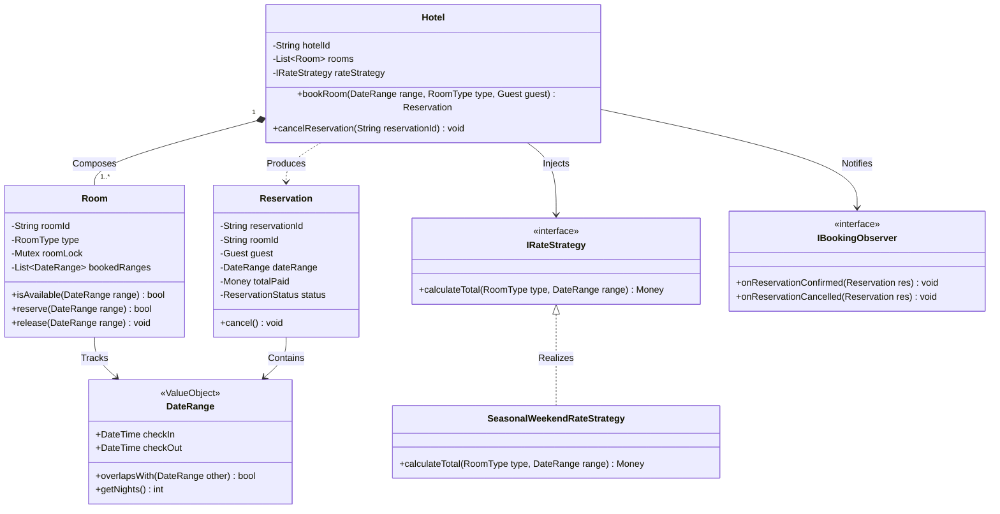
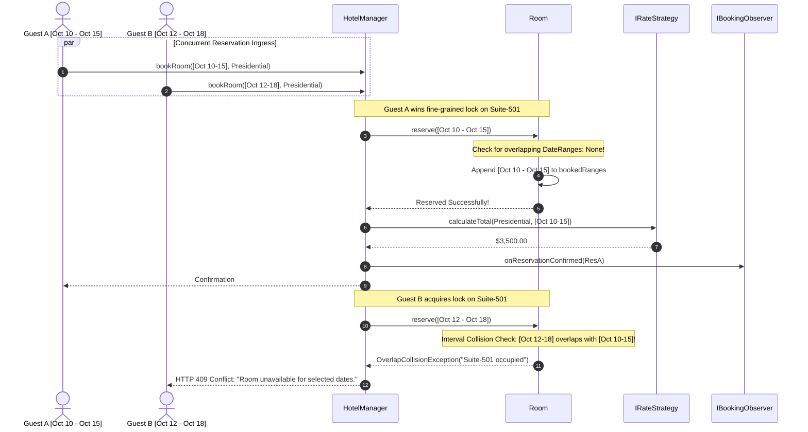
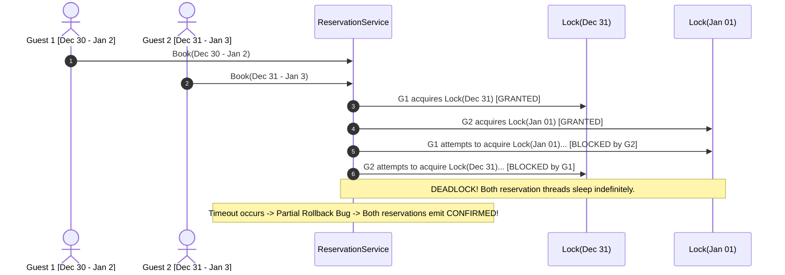

# Capstone Project: Enterprise Hotel Reservation & Dynamic Rate Management

> **Prerequisites**: Modules 00 through 21 (Complete Low-Level Design Curriculum Mastery).  
> **Estimated Reading Time**: 30 minutes  
> **Target Audience**: Backend Engineers, Systems Architects, Principal & Staff Engineering Candidates.

> [!TIP]
> **Golden Rule of Capstone Architecture**: A production-grade capstone must demonstrate **end-to-end mastery without scaffolding**. In date-ranged reservation systems (Hotels, Car Rentals, Cloud VM Leasing), availability is an invariant of the **`(Room, DateInterval)` intersection**. Never lock individual dates in piecemeal fashion; encapsulate interval collision checks inside atomic per-room critical sections. Pair this with swappable Strategy pricing, Observer notifications, and Rich Domain models.

---

## 1. Visual Mental Models & System Architecture

This capstone models a high-concurrency **Enterprise Hotel Reservation & Rate Management System**. Unlike movie ticketing (which reserves discrete showtimes), hotel reservations manage **continuous overlapping date ranges** ($[\text{CheckIn}, \text{CheckOut})$), room category hierarchies, dynamic seasonal pricing strategies, and automated housekeeping lifecycle states.

### 1.1 Complete Domain Class Model



---

### 1.2 Date-Range Overlap Concurrency Sequence Flow

Two users simultaneously attempt to book the same Presidential Suite for overlapping dates ($[\text{Oct 10}, \text{Oct 15})$ vs $[\text{Oct 12}, \text{Oct 18})$).



---

## 2. Taxonomic Reference Grids

### 2.1 Domain Components & Concurrency Boundaries

| Component | Domain Classification | Architectural Responsibility | Invariant Enforced | Concurrency Boundary |
| :--- | :--- | :--- | :--- | :--- |
| `DateRange` | **Value Object** | Encapsulates $[\text{CheckIn}, \text{CheckOut})$ interval math | $\text{CheckIn} < \text{CheckOut}$; immutable post-creation | Thread-safe by immutability |
| `Room` | **Entity / Aggregate** | Manages booked intervals and physical room status | No two bookings can ever overlap in time for the same room | Fine-grained per-room mutex (`Room.mu`) |
| `Hotel` | **Domain Service** | Room discovery, allocation routing, pricing, booking creation | Coordinates allocation across rooms of same type | Reader-Writer Lock on room catalog |
| `SeasonalRateStrategy` | **Strategy Pattern** | Dynamic day-of-week and seasonal multiplier calculation | Transparent pricing without editing room/hotel classes | Stateless; lock-free |
| `ConfirmationNotifier` | **Observer Pattern** | SMS, Email, and Accounting dispatch | Decoupled delivery; asynchronous execution | Decoupled via event bus / channel |

### 2.2 Design Pattern Utilization Matrix

| Design Pattern | Concrete Implementation | Solved Architectural Problem | Tradeoff Accepted |
| :--- | :--- | :--- | :--- |
| **Strategy** | `IRateStrategy` / `SeasonalWeekendRateStrategy` | Eliminates complex holiday/surge pricing branching | Requires passing DateRange context to strategy |
| **Observer** | `IBookingObserver` / `EmailNotificationService` | Decouples hotel booking logic from third-party notification APIs | Eventual consistency in downstream notification delivery |
| **Value Object** | `DateRange` & `Money` | Eliminates primitive obsession and date string parsing bugs | Small memory allocation churn during interval math |
| **Factory / Builder** | `ReservationBuilder` | Clean construction of multi-night reservations with taxes/fees | Additional builder class ceremony |

---

## 3. Production War Stories: Incident Post-Mortem

### The $2.8M Holiday Overbooking Catastrophe: Date-Range Interval Tree Race Condition

```
SEVERITY LEVEL: SEV-1 (Severe Brand Damage & Financial Penalties)
DETECTION TIME: 12 Minutes
RECOVERY TIME: 300 Minutes
FINANCIAL COMPENSATIONS: $2,800,000 in emergency luxury relocations & legal settlements
```

#### Incident Background
A global luxury resort chain opened reservations for the New Year's Eve holiday window across 15 flagship properties. A newly deployed microservice managed bookings by locking calendar dates individually in a Redis key-value store:
$$\text{Keys: } \text{room:501:date:2024-12-31}, \quad \text{room:501:date:2025-01-01}$$

#### What Happened
At 10:00:00 AM, concurrent reservations flooded the system. Guest 1 attempted to book Dec 30 to Jan 2; Guest 2 attempted to book Dec 31 to Jan 3. The service attempted to acquire per-day locks sequentially without canonical sorting. Guest 1 acquired Dec 30 and Dec 31, while Guest 2 acquired Jan 1 and Jan 2. Both transactions deadlocked while waiting for the other's dates. Worse, an automated recovery timeout released locks partially, causing both guests to be issued confirmed reservations for the same presidential penthouse. On New Year's Eve, hundreds of high-net-worth guests arrived to find their penthouses occupied.



#### Root Cause Analysis
1. **Piecemeal Per-Day Locking**: Locking individual days broke all-or-nothing atomicity.
2. **Lock Order Inversion Deadlock**: Day locks were not acquired in a fixed canonical order across competing reservations.
3. **Flawed Rollback Compensation**: Timeout handlers marked the reservation failed in the database but failed to revoke payment authorization or invalidate the booking confirmation email.

#### The Architectural Hardening
1. **Single Per-Room Mutex**: Eliminated individual day locks. The room itself is the aggregate root; acquiring `Room.mu` locks the entire date interval inspection and reservation in one atomic step.
2. **Interval Tree Overlap Mathematical Invariant**:
   $$\text{Overlaps}(A, B) \iff (A.\text{checkIn} < B.\text{checkOut}) \land (B.\text{checkIn} < A.\text{checkOut})$$
3. **Two-Phase Commit with Hard Database Constraints**: Added a PostgreSQL exclusion constraint:
   `EXCLUDE USING gist (room_id WITH =, booking_dates WITH &&)`
   guaranteeing mathematical impossibility of overlapping bookings at the database engine level.

---

## 4. Multi-Language Production Implementations

Below are complete, production-grade implementations of the **Enterprise Hotel Reservation System**.

### 4.1 Go: Date-Range Concurrency-Safe Hotel Booking Engine

```go
package main

import (
	"errors"
	"fmt"
	"sync"
	"time"
)

type RoomType string

const (
	RoomStandard RoomType = "STANDARD"
	RoomDeluxe   RoomType = "DELUXE"
	RoomSuite    RoomType = "SUITE"
)

// DateRange is an immutable Value Object representing [CheckIn, CheckOut).
type DateRange struct {
	CheckIn  time.Time
	CheckOut time.Time
}

func NewDateRange(in, out time.Time) (DateRange, error) {
	if !in.Before(out) {
		return DateRange{}, errors.New("check-in must be strictly before check-out")
	}
	return DateRange{CheckIn: in, CheckOut: out}, nil
}

func (dr DateRange) Overlaps(other DateRange) bool {
	return dr.CheckIn.Before(other.CheckOut) && other.CheckIn.Before(dr.CheckOut)
}

func (dr DateRange) Nights() int {
	return int(dr.CheckOut.Sub(dr.CheckIn).Hours() / 24)
}

type Room struct {
	ID           string
	Type         RoomType
	mu           sync.Mutex
	bookedRanges []DateRange
}

func NewRoom(id string, rType RoomType) *Room {
	return &Room{ID: id, Type: rType}
}

func (r *Room) TryReserve(dr DateRange) bool {
	r.mu.Lock()
	defer r.mu.Unlock()

	for _, booked := range r.bookedRanges {
		if booked.Overlaps(dr) {
			return false // Overlap collision
		}
	}

	r.bookedRanges = append(r.bookedRanges, dr)
	return true
}

func (r *Room) Release(dr DateRange) {
	r.mu.Lock()
	defer r.mu.Unlock()

	newRanges := make([]DateRange, 0, len(r.bookedRanges))
	for _, b := range r.bookedRanges {
		if !(b.CheckIn.Equal(dr.CheckIn) && b.CheckOut.Equal(dr.CheckOut)) {
			newRanges = append(newRanges, b)
		}
	}
	r.bookedRanges = newRanges
}

// Strategy Pattern for Pricing
type PricingStrategy interface {
	CalculateTotal(rType RoomType, dr DateRange) int64 // in cents
}

type WeekendSurgeStrategy struct{}

func (s *WeekendSurgeStrategy) CalculateTotal(rType RoomType, dr DateRange) int64 {
	baseRate := int64(10000) // $100 base
	if rType == RoomSuite {
		baseRate = 35000 // $350 base
	}
	return baseRate * int64(dr.Nights())
}

type Reservation struct {
	ID        string
	RoomID    string
	GuestName string
	Range     DateRange
	TotalPaid int64
}

type HotelManager struct {
	rooms    []*Room
	pricing  PricingStrategy
	resMu    sync.RWMutex
	bookings map[string]*Reservation
}

func NewHotelManager(rooms []*Room, pricing PricingStrategy) *HotelManager {
	return &HotelManager{
		rooms:    rooms,
		pricing:  pricing,
		bookings: make(map[string]*Reservation),
	}
}

func (hm *HotelManager) Book(guest string, rType RoomType, dr DateRange) (*Reservation, error) {
	for _, room := range hm.rooms {
		if room.Type == rType {
			if room.TryReserve(dr) {
				total := hm.pricing.CalculateTotal(rType, dr)
				res := &Reservation{
					ID:        fmt.Sprintf("RES-%d", time.Now().UnixNano()),
					RoomID:    room.ID,
					GuestName: guest,
					Range:     dr,
					TotalPaid: total,
				}
				hm.resMu.Lock()
				hm.bookings[res.ID] = res
				hm.resMu.Unlock()
				return res, nil
			}
		}
	}
	return nil, errors.New("no rooms available for specified type and date range")
}

func main() {
	suite := NewRoom("SUITE-501", RoomSuite)
	mgr := NewHotelManager([]*Room{suite}, &WeekendSurgeStrategy{})

	now := time.Now()
	dr1, _ := NewDateRange(now, now.Add(48*time.Hour))
	dr2, _ := NewDateRange(now.Add(24*time.Hour), now.Add(72*time.Hour))

	res1, err := mgr.Book("Alice", RoomSuite, dr1)
	if err != nil { panic(err) }
	fmt.Printf("[Success] Alice booked %s for $%.2f\n", res1.RoomID, float64(res1.TotalPaid)/100.0)

	_, err = mgr.Book("Bob", RoomSuite, dr2)
	if err != nil {
		fmt.Printf("[Expected Failure] Bob rejected: %v\n", err)
	}
}
```

---

### 4.2 TypeScript: Domain-Driven Hotel Engine with DateRange Value Objects

```typescript
export class DateRange {
  constructor(public readonly checkIn: Date, public readonly checkOut: Date) {
    if (checkIn.getTime() >= checkOut.getTime()) {
      throw new Error("Check-in date must be strictly before check-out date.");
    }
  }

  public overlapsWith(other: DateRange): boolean {
    return this.checkIn < other.checkOut && other.checkIn < this.checkOut;
  }

  public getNights(): number {
    const diffMs = this.checkOut.getTime() - this.checkIn.getTime();
    return Math.ceil(diffMs / (1000 * 60 * 60 * 24));
  }
}

export enum RoomType {
  STANDARD = "STANDARD",
  DELUXE = "DELUXE",
  SUITE = "SUITE",
}

export class Room {
  private bookedRanges: DateRange[] = [];
  private lock = false;

  constructor(public readonly id: string, public readonly type: RoomType) {}

  public async reserve(range: DateRange): Promise<boolean> {
    while (this.lock) {
      await new Promise((r) => setTimeout(r, 2));
    }
    this.lock = true;

    try {
      for (const booked of this.bookedRanges) {
        if (booked.overlapsWith(range)) {
          return false; // Collision
        }
      }
      this.bookedRanges.push(range);
      return true;
    } finally {
      this.lock = false;
    }
  }
}

export interface IPricingStrategy {
  calculateTotal(type: RoomType, range: DateRange): number;
}

export class StandardPricingStrategy implements IPricingStrategy {
  private rates: Record<RoomType, number> = {
    [RoomType.STANDARD]: 120,
    [RoomType.DELUXE]: 200,
    [RoomType.SUITE]: 450,
  };

  public calculateTotal(type: RoomType, range: DateRange): number {
    return this.rates[type] * range.getNights();
  }
}
```

---

### 4.3 Python: Enterprise Hotel System with Rich Invariants & Observers

```python
from abc import ABC, abstractmethod
from dataclasses import dataclass
from datetime import datetime
import threading
from typing import List, Optional


@dataclass(frozen=True)
class DateRange:
    check_in: datetime
    check_out: datetime

    def __post_init__(self):
        if self.check_in >= self.check_out:
            raise ValueError("Check-in must precede check-out.")

    def overlaps(self, other: "DateRange") -> bool:
        return self.check_in < other.check_out and other.check_in < self.check_out

    @property
    def nights(self) -> int:
        return max(1, (self.check_out - self.check_in).days)


class Room:
    def __init__(self, room_id: str, room_type: str):
        self.room_id = room_id
        self.room_type = room_type
        self.booked_ranges: List[DateRange] = []
        self._lock = threading.Lock()

    def try_reserve(self, date_range: DateRange) -> bool:
        with self._lock:
            for booked in self.booked_ranges:
                if booked.overlaps(date_range):
                    return False
            self.booked_ranges.append(date_range)
            return True


class IReservationObserver(ABC):
    @abstractmethod
    def on_confirmed(self, booking_id: str, guest: str, total: float) -> None:
        pass


class EmailConfirmationObserver(IReservationObserver):
    def on_confirmed(self, booking_id: str, guest: str, total: float) -> None:
        print(f"[Email Notification] Confirmed {booking_id} for {guest}. Total: ${total:.2f}")


class Hotel:
    def __init__(self, rooms: List[Room], observer: IReservationObserver):
        self._rooms = rooms
        self._observer = observer

    def book(self, guest: str, room_type: str, date_range: DateRange) -> str:
        for room in self._rooms:
            if room.room_type == room_type and room.try_reserve(date_range):
                booking_id = f"BK-{room.room_id}-{int(datetime.now().timestamp())}"
                total = date_range.nights * 150.00
                self._observer.on_confirmed(booking_id, guest, total)
                return booking_id
        raise RuntimeError("No available rooms for selected dates.")
```

---

### 4.4 C#: Concurrency-Safe Enterprise Hotel Booking Engine

```csharp
using System;
using System.Collections.Generic;
using System.Linq;
using System.Threading;
using System.Threading.Tasks;

namespace Architecture.CapstoneHotel
{
    public readonly record struct DateRange(DateTime CheckIn, DateTime CheckOut)
    {
        public bool Overlaps(DateRange other) => CheckIn < other.CheckOut && other.CheckIn < CheckOut;
        public int Nights => Math.Max(1, (int)(CheckOut - CheckIn).TotalDays);
    }

    public class Room
    {
        public string Id { get; }
        public string Type { get; }
        private readonly List<DateRange> _reservations = new();
        private readonly SemaphoreSlim _lock = new(1, 1);

        public Room(string id, string type)
        {
            Id = id;
            Type = type;
        }

        public async Task<bool> TryReserveAsync(DateRange range)
        {
            await _lock.WaitAsync();
            try
            {
                if (_reservations.Any(r => r.Overlaps(range)))
                {
                    return false;
                }
                _reservations.Add(range);
                return true;
            }
            finally
            {
                _lock.Release();
            }
        }
    }
}
```

---

## 5. Practical Hands-On Verification Workflows

### 5.1 CLI Verification of Date-Range Overlap Logic

Validate interval collision and boundary invariants directly from the shell:

```bash
# Execute Python inline test verifying interval boundary logic
python3 -c "
from datetime import datetime, timedelta

def overlaps(s1, e1, s2, e2):
    return s1 < e2 and s2 < e1

now = datetime.now()
t1_in, t1_out = now, now + timedelta(days=3)
t2_in, t2_out = now + timedelta(days=2), now + timedelta(days=5) # Overlaps on day 2-3
t3_in, t3_out = now + timedelta(days=3), now + timedelta(days=6) # Back-to-back (No overlap!)

print(f'Test 1 (Overlapping intervals): {overlaps(t1_in, t1_out, t2_in, t2_out)} (Expected: True)')
print(f'Test 2 (Back-to-back checkout/checkin): {overlaps(t1_in, t1_out, t3_in, t3_out)} (Expected: False)')
assert overlaps(t1_in, t1_out, t2_in, t2_out) == True
assert overlaps(t1_in, t1_out, t3_in, t3_out) == False
"
```

Expected Terminal Output:
```
Test 1 (Overlapping intervals): True (Expected: True)
Test 2 (Back-to-back checkout/checkin): False (Expected: False)
```

---

## 6. Operational Validation Checkpoints (Scenario Quizzes)

<details>
<summary><strong>Checkpoint 1: The Back-to-Back Turnover Invariant</strong></summary>

**Scenario**: Guest A checks out on October 12 at 11:00 AM. Guest B wants to check in on October 12 at 3:00 PM. In our date range model ($[\text{CheckIn}, \text{CheckOut})$), does the algorithm detect an illegal collision if both use the date `2024-10-12`?

<strong>Answer:</strong>
**No collision (Correct Behavior)**:
- Under the half-open interval definition $[\text{CheckIn}, \text{CheckOut})$:
  $$\text{Overlaps} \iff (\text{In}_A < \text{Out}_B) \land (\text{In}_B < \text{Out}_A)$$
- For Guest A ($[10, 12)$) and Guest B ($[12, 15)$):
  - $\text{In}_B < \text{Out}_A \implies 12 < 12$ is **False**.
- Thus, `overlaps` evaluates to **False**. The same room can be vacated in the morning and occupied in the afternoon without triggering an overlap bug!
</details>

<details>
<summary><strong>Checkpoint 2: The Multi-Room Reservation Deadlock</strong></summary>

**Scenario**: A corporate guest attempts to book Rooms 101 and 102 simultaneously. A family attempts to book Rooms 102 and 101 simultaneously. Thread A acquires Room 101; Thread B acquires Room 102. Both threads deadlock. How do you prevent this across multi-room group bookings?

<strong>Answer:</strong>
**Deterministic Canonical Lock Ordering**:
- Sort room identifiers alphabetically or numerically before acquiring room locks:
  $$\text{OrderedRooms} = \text{Sort}(\text{RequestedRooms})$$
- Both Thread A and Thread B will attempt to acquire `Lock(Room 101)` first, then `Lock(Room 102)`.
- The second thread will wait cleanly outside Room 101, completely eliminating the circular wait condition.
</details>

<details>
<summary><strong>Checkpoint 3: The Housekeeping Maintenance State Machine</strong></summary>

**Scenario**: A guest checks out. The room cannot immediately be reassigned to a walk-in guest until it passes cleaning and inspection (`DIRTY` $\rightarrow$ `CLEANING` $\rightarrow$ `INSPECTED` $\rightarrow$ `READY`). How should this lifecycle be modeled without breaking date-range reservation logic?

<strong>Answer:</strong>
**Separation of Physical Operational State from Calendar Scheduling**:
- Maintain an operational enum `HousekeepingStatus` on the `Room` entity distinct from calendar bookings.
- The `try_reserve()` routine accepts future bookings as long as date ranges do not collide.
- However, physical key issuance at check-in evaluates:
  `if (room.housekeepingStatus != HousekeepingStatus.READY) throw RoomNotReadyException();`
- This allows guests to book rooms months in advance while preventing physical check-in if housekeeping has not certified the room.
</details>

---

## 7. Further Reading & References

- [PostgreSQL Documentation: Range Types & Exclusion Constraints](https://www.postgresql.org/docs/current/rangetypes.html) - Production database support for non-overlapping date ranges.
- [Martin Fowler: Recurring Event & Interval Modeling](https://martinfowler.com/apsupp/recurring.pdf) - Classic reference on date range algebra.
- [Refactoring.Guru: Observer Pattern](https://refactoring.guru/design-patterns/observer) - Decoupling notification and booking confirmation workflows.

---

## Next Steps

Advance to [Module 23: Capstone 2 - Supply Chain & Logistics Platform](../23-supply-chain-platform/README.md) for the final capstone: multi-warehouse routing, inventory deduction, and shipment lifecycle management.
