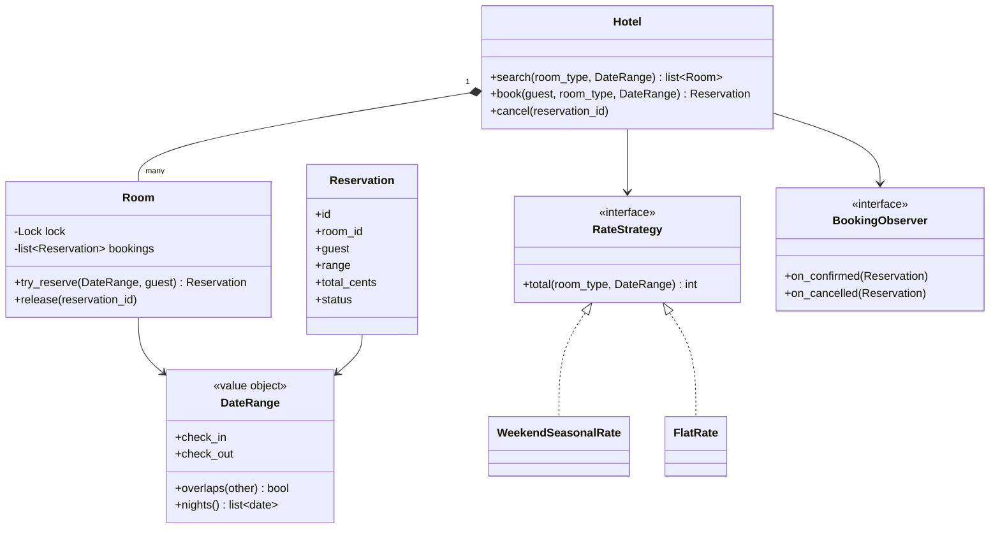

# Capstone: Hotel Reservation & Dynamic Rates

> **Prerequisites:** [04 · SOLID](../04-solid-principles/README.md), [08 · Behavioral Patterns I](../08-behavioral-patterns-i/README.md), [10 · Concurrency-Safe Design](../10-concurrency-safe-design/README.md), [16 · Movie Ticket Booking](../16-movie-ticket-booking/README.md), [21 · LLD Interview Playbook](../21-lld-interview-playbook/README.md)  
> **Reading time:** ~30 minutes  
> **Audience:** Candidates who want one end-to-end design they can reproduce on a whiteboard — domain model, concurrency, pricing, notifications, and extension

> [!NOTE]
> **In one line:** Hotels, car rentals and VM leases all reserve a **resource over a date interval** — model `DateRange` as an immutable value object, guard each `Room` with its own lock so "check overlap + insert" is one atomic step, and keep pricing and notifications behind Strategy and Observer.

> [!TIP]
> **Golden rule:** Never lock individual *days*. Lock the **room** (the aggregate that owns the invariant "no two bookings overlap") and compare intervals with `a.start < b.end and b.start < a.end`. Half-open intervals `[check_in, check_out)` make back-to-back stays legal.

> [!TIP]
> **Try it:** Draw `Hotel → Room → DateRange` and `Hotel → RateStrategy / BookingObserver` in [LLD Studio](/tools/lld-studio/), then run the Python below — it fires 20 threads at the same suite and shows exactly one winner.

---

## 1. The prompt and the trap

Interviewer: *"Design a hotel reservation system. Guests search by room type and dates, book, and cancel. Rates vary by season and weekend. Two guests must never get the same room on overlapping nights."*

The trap is **availability as a flag** (`room.is_booked = True`). That's right for a movie seat at one showtime; a hotel room is booked for *ranges*, and ranges overlap partially. The invariant lives on the pair **(room, interval)**.



---

## 2. Component roles at a glance

| Component | Kind | Responsibility | Invariant | Concurrency story |
| :--- | :--- | :--- | :--- | :--- |
| `DateRange` | Value object | Interval math | `check_in < check_out`; immutable | Safe by immutability |
| `Room` | Entity / aggregate | Owns its bookings | No overlapping bookings | **One lock per room** |
| `Hotel` | Domain service | Search, pick room, price, notify | Never double-books via `Room` | Catalogue read-mostly |
| `RateStrategy` | Strategy | Price a stay | Pure function of type + range | Stateless |
| `BookingObserver` | Observer | Email / SMS / ledger | Failures must not undo a booking | Called *after* the lock is released |

| Pattern | Where | Problem it removes |
| :--- | :--- | :--- |
| Strategy | `RateStrategy` | `if season == …` ladders inside `Hotel` |
| Observer | `BookingObserver` | Hotel code knowing about Twilio / SES |
| Value Object | `DateRange`, money in cents | Date-string parsing bugs, float money |
| Aggregate lock | `Room.lock` | Piecemeal per-day locking and deadlocks |

---

## 3. Walkthrough: requirements → entities → methods → extension

**Requirements (say them back):**

1. Search rooms of a type free for `[check_in, check_out)`.
2. Book exactly one room; price comes from a swappable rate rule.
3. Cancel frees the room for those dates.
4. Two concurrent bookings of the same room/overlap → one succeeds, one gets a clear conflict.
5. Notify the guest on confirm / cancel without coupling the hotel to a provider.

**Out of scope (state it):** payments, partial refunds, overbooking policy, multi-hotel search.

**Key methods:**

- `DateRange.overlaps(other)` → `self.check_in < other.check_out and other.check_in < self.check_out`.
- `Room.try_reserve(range, guest)` → under `self.lock`: scan bookings, raise on overlap, append.
- `Hotel.book(...)` → for each candidate room of the type, `try_reserve`; first success wins; price; notify **outside** the lock.

**Extension points:** new pricing → new `RateStrategy`; new channel → new `BookingObserver`; new room type → data, not code; overbooking → subclass/strategy at `Hotel.book`.

````carousel
```python
from __future__ import annotations

import itertools
import threading
from concurrent.futures import ThreadPoolExecutor
from dataclasses import dataclass, field
from datetime import date, timedelta
from typing import Protocol


# ── Value object ────────────────────────────────────────────────────────
@dataclass(frozen=True)
class DateRange:
    check_in: date
    check_out: date  # exclusive: the guest leaves this morning

    def __post_init__(self) -> None:
        if self.check_in >= self.check_out:
            raise ValueError("check_out must be after check_in")

    def overlaps(self, other: "DateRange") -> bool:
        return self.check_in < other.check_out and other.check_in < self.check_out

    def nights(self) -> list[date]:
        return [self.check_in + timedelta(days=i)
                for i in range((self.check_out - self.check_in).days)]


class RoomUnavailable(Exception):
    pass


# ── Strategy: pricing ───────────────────────────────────────────────────
class RateStrategy(Protocol):
    def total_cents(self, room_type: str, stay: DateRange) -> int: ...


class WeekendSeasonalRate:
    BASE = {"standard": 10_000, "suite": 35_000}

    def total_cents(self, room_type: str, stay: DateRange) -> int:
        total = 0
        for night in stay.nights():
            rate = self.BASE[room_type]
            if night.weekday() in (4, 5):  # Fri/Sat nights
                rate = int(rate * 1.25)
            if night.month in (12, 1):    # peak season
                rate = int(rate * 1.40)
            total += rate
        return total


# ── Domain ──────────────────────────────────────────────────────────────
@dataclass
class Reservation:
    id: str
    room_id: str
    guest: str
    stay: DateRange
    total_cents: int = 0
    status: str = "CONFIRMED"


class BookingObserver(Protocol):
    def on_confirmed(self, res: Reservation) -> None: ...
    def on_cancelled(self, res: Reservation) -> None: ...


class Room:
    def __init__(self, room_id: str, room_type: str) -> None:
        self.room_id, self.room_type = room_id, room_type
        self._lock = threading.Lock()            # one lock = one aggregate
        self._bookings: dict[str, Reservation] = {}

    def try_reserve(self, res: Reservation) -> None:
        with self._lock:                         # check + insert is atomic
            for existing in self._bookings.values():
                if existing.status == "CONFIRMED" and existing.stay.overlaps(res.stay):
                    raise RoomUnavailable(self.room_id)
            self._bookings[res.id] = res

    def release(self, reservation_id: str) -> Reservation | None:
        with self._lock:
            res = self._bookings.get(reservation_id)
            if res and res.status == "CONFIRMED":
                res.status = "CANCELLED"
                return res
            return None

    def is_free(self, stay: DateRange) -> bool:  # advisory only (may go stale)
        with self._lock:
            return all(b.status != "CONFIRMED" or not b.stay.overlaps(stay)
                       for b in self._bookings.values())


class Hotel:
    def __init__(self, rooms: list[Room], rates: RateStrategy,
                 observers: list[BookingObserver] | None = None) -> None:
        self._rooms = rooms
        self._rates = rates
        self._observers = observers or []
        self._ids = itertools.count(1)
        self._by_id: dict[str, Reservation] = {}
        self._rooms_by_id = {r.room_id: r for r in rooms}

    def search(self, room_type: str, stay: DateRange) -> list[Room]:
        return [r for r in self._rooms if r.room_type == room_type and r.is_free(stay)]

    def book(self, guest: str, room_type: str, stay: DateRange) -> Reservation:
        total = self._rates.total_cents(room_type, stay)
        for room in (r for r in self._rooms if r.room_type == room_type):
            res = Reservation(f"RES-{next(self._ids)}", room.room_id, guest, stay, total)
            try:
                room.try_reserve(res)
            except RoomUnavailable:
                continue                           # try the next room of that type
            self._by_id[res.id] = res
            for obs in self._observers:            # outside the room lock
                obs.on_confirmed(res)
            return res
        raise RoomUnavailable(f"no {room_type} free for {stay.check_in}..{stay.check_out}")

    def cancel(self, reservation_id: str) -> None:
        res = self._by_id[reservation_id]
        released = self._rooms_by_id[res.room_id].release(reservation_id)
        if released:
            for obs in self._observers:
                obs.on_cancelled(released)


class PrintObserver:
    def on_confirmed(self, res: Reservation) -> None:
        print(f"[notify] {res.guest}: {res.id} confirmed, ${res.total_cents / 100:.2f}")

    def on_cancelled(self, res: Reservation) -> None:
        print(f"[notify] {res.guest}: {res.id} cancelled")


if __name__ == "__main__":
    hotel = Hotel([Room("S-501", "suite")], WeekendSeasonalRate(), [PrintObserver()])
    oct10_15 = DateRange(date(2026, 10, 10), date(2026, 10, 15))
    oct12_18 = DateRange(date(2026, 10, 12), date(2026, 10, 18))
    oct15_17 = DateRange(date(2026, 10, 15), date(2026, 10, 17))   # back-to-back: allowed

    a = hotel.book("Ada", "suite", oct10_15)
    try:
        hotel.book("Bob", "suite", oct12_18)
    except RoomUnavailable as err:
        print("conflict:", err)
    hotel.book("Cy", "suite", oct15_17)

    hotel.cancel(a.id)
    print("free after cancel:", len(hotel.search("suite", oct10_15)))

    # Concurrency: 20 threads, 1 suite, same dates -> exactly one winner
    hotel2 = Hotel([Room("S-1", "suite")], WeekendSeasonalRate())
    stay = DateRange(date(2026, 12, 30), date(2027, 1, 2))

    def attempt(i: int) -> bool:
        try:
            hotel2.book(f"guest-{i}", "suite", stay)
            return True
        except RoomUnavailable:
            return False

    with ThreadPoolExecutor(max_workers=20) as pool:
        wins = sum(pool.map(attempt, range(20)))
    print("winners:", wins)
```
<!-- slide -->
```csharp
public readonly record struct DateRange
{
    public DateOnly CheckIn { get; }
    public DateOnly CheckOut { get; }   // exclusive

    public DateRange(DateOnly checkIn, DateOnly checkOut)
    {
        if (checkIn >= checkOut) throw new ArgumentException("check-out must follow check-in");
        (CheckIn, CheckOut) = (checkIn, checkOut);
    }

    public bool Overlaps(DateRange other) =>
        CheckIn < other.CheckOut && other.CheckIn < CheckOut;
}

public sealed class Room
{
    private readonly object _gate = new();               // one lock per room
    private readonly List<Reservation> _bookings = new();
    public string Id { get; }
    public string Type { get; }

    public Room(string id, string type) => (Id, Type) = (id, type);

    public bool TryReserve(Reservation r)
    {
        lock (_gate)
        {
            if (_bookings.Any(b => b.Status == "CONFIRMED" && b.Stay.Overlaps(r.Stay)))
                return false;
            _bookings.Add(r);
            return true;
        }
    }
}

public interface IRateStrategy
{
    int TotalCents(string roomType, DateRange stay);
}

public interface IBookingObserver
{
    void OnConfirmed(Reservation r);
}

public sealed class Hotel(IEnumerable<Room> rooms, IRateStrategy rates,
                          IEnumerable<IBookingObserver> observers)
{
    private int _next;

    public Reservation Book(string guest, string roomType, DateRange stay)
    {
        var total = rates.TotalCents(roomType, stay);
        foreach (var room in rooms.Where(r => r.Type == roomType))
        {
            var res = new Reservation($"RES-{Interlocked.Increment(ref _next)}",
                                      room.Id, guest, stay, total, "CONFIRMED");
            if (!room.TryReserve(res)) continue;
            foreach (var o in observers) o.OnConfirmed(res);   // outside the room lock
            return res;
        }
        throw new InvalidOperationException("no room available");
    }
}

public sealed record Reservation(string Id, string RoomId, string Guest,
                                 DateRange Stay, int TotalCents, string Status);
```
````

Output you should see (prices are deterministic; thread count aside):

```text
[notify] Ada: RES-1 confirmed, $1837.50
conflict: no suite free for 2026-10-12..2026-10-18
[notify] Cy: RES-3 confirmed, $787.50
[notify] Ada: RES-1 cancelled
free after cancel: 1
winners: 1
```

Ada's stay is Sat + Sun + three weekdays: one Saturday night at $437.50 plus four nights at $350. (Bob's failed attempt burned `RES-2`, which is why Cy gets `RES-3`.)

---

## 4. Edges: concurrency, nulls, and "when not to"

- **Lock granularity.** One lock per room is the sweet spot: bookings of *different* rooms never contend, and all overlap checks for one room are atomic. A single global lock is correct but serialises the whole hotel; per-day locks are the classic deadlock.
- **Stale search results.** `search()` is advisory — a room can be taken between search and book. Always re-check inside `try_reserve`; never trust the earlier answer.
- **Notify outside the lock.** Observer code does I/O; holding a room lock across an SMS call turns a slow provider into a booking outage. Better still: enqueue an event (outbox) and let a worker send it.
- **Observer failures.** A throwing observer must not undo a confirmed booking — catch/log per observer or push to a queue.
- **Money.** Cents as integers (or `Decimal`), never floats. Currency as a field of a `Money` value object if you go international.
- **Time.** Use dates, not datetimes, for nights; define check-in/out times separately. Store UTC if you need instants; beware DST for "nights" computed from datetimes.
- **Multi-process / multi-node.** An in-process lock is useless once two servers run. The real invariant lives in the database: a PostgreSQL exclusion constraint (`EXCLUDE USING gist (room_id WITH =, daterange(check_in, check_out) WITH &&)`) or optimistic versioning on the room row. Say this out loud — it is the senior answer.
- **When not to over-build.** Overbooking, loyalty tiers, and channel managers are follow-ups. Mention the extension point and move on.

**Illustrative failure (a common pattern, not a named incident):** a booking service takes one Redis lock *per date* for New Year's Eve. Two overlapping stays acquire locks in different orders, deadlock, and a timeout handler rolls back halfway — both guests get confirmations for the same penthouse. The fix was one lock per room (the aggregate), the overlap formula above, and a database exclusion constraint as the last line of defence.

---

## 5. What you'd say in two minutes

> "A hotel room is reserved for a date *range*, so the invariant is no overlap on the same room. I'd model `DateRange` as an immutable value object with half-open `[check_in, check_out)` and an `overlaps` check — `a.start < b.end and b.start < a.end` — which lets back-to-back stays through. `Room` owns its reservations and a lock, and `try_reserve` does check-and-insert inside it, so concurrent bookings for the same room are serialised while other rooms are untouched. `Hotel` finds candidate rooms, tries each, prices through an injected `RateStrategy`, and notifies `BookingObserver`s *after* releasing the lock. Search is advisory; booking re-checks. In a multi-node deployment I'd push the invariant into the database with an exclusion constraint, keep the in-process lock as an optimisation. Extension: new price rule is a new strategy, new channel is a new observer."

---

## 6. Anti-patterns

| Anti-pattern | Why it fails | Fix |
| :--- | :--- | :--- |
| `room.is_booked` boolean | Can't represent overlapping partial ranges | `list[Reservation]` with `DateRange` |
| Lock per day | Lock-order deadlocks, partial rollbacks | One lock per room |
| Inclusive end date | Same-day turnaround looks like a conflict | Half-open `[in, out)` |
| Pricing `if` ladder in `Hotel` | Every promo edits the core | `RateStrategy` |
| Calling email inside the lock | Slow SMTP stalls bookings | Observer after unlock / outbox |
| Trust search then book | TOCTOU double booking | Re-check inside `try_reserve` |
| Float money | `0.1 + 0.2` surprises in totals | Integer cents or `Decimal` |

---

## 7. Interview questions

<details>
<summary><strong>1. How do you detect overlapping date ranges? [BASIC]</strong></summary>

For half-open intervals, `A` and `B` overlap iff `A.start < B.end and B.start < A.end`. Back-to-back (`A.end == B.start`) does *not* overlap, which matches same-day checkout/check-in.

</details>

<details>
<summary><strong>2. Why lock the room rather than each date? [BASIC]</strong></summary>

The invariant belongs to the room; per-day locks need ordering to avoid deadlock and make all-or-nothing multi-night booking hard. One room lock makes check-and-insert atomic with no ordering problem.

</details>

<details>
<summary><strong>3. Where do Strategy and Observer apply here? [BASIC]</strong></summary>

Strategy for pricing (weekend, season, promo) and Observer for notifications (email, SMS, ledger). Both keep the booking path closed to modification when rules or channels change.

</details>

<details>
<summary><strong>4. Two servers handle bookings. Is your lock enough? [TRICKY]</strong></summary>

No — it only protects one process. Enforce the invariant in the database: an exclusion constraint on `(room_id, daterange)`, or a transaction with `SELECT … FOR UPDATE` on the room row, or optimistic concurrency (version column) with retry. Keep the in-process lock only as a fast path.

</details>

<details>
<summary><strong>5. A guest searched, waited 10 minutes, then booked. What happens? [SCENARIO]</strong></summary>

`book` re-validates inside the room's critical section, so it either succeeds or raises `RoomUnavailable`; the UI shows "someone just booked it, here are alternatives". Optionally add a short *hold* (TTL) at search/checkout time.

</details>

<details>
<summary><strong>6. How would you add overbooking (sell 105% of rooms)? [SCENARIO]</strong></summary>

Move the capacity rule behind a strategy (`AvailabilityPolicy`): strict = zero overlaps per room; overbook = count overlapping bookings per room *type* against `capacity * 1.05`. The room-level lock becomes a room-type-level lock.

</details>

<details>
<summary><strong>7. Cancel arrives twice (network retry). [SCENARIO]</strong></summary>

Make cancel **idempotent**: if the reservation is already `CANCELLED`, return success without a second refund or notification. In the code, `release` returns `None` the second time, so observers aren't called again.

</details>

<details>
<summary><strong>8. Why integer cents, and what about taxes? [TRICKY]</strong></summary>

Binary floats can't represent most decimals exactly; summing nightly rates drifts. Use integer minor units (or `Decimal`) and apply rounding rules once, at a defined point (per night vs on the total) — and document it, because auditors will ask.

</details>

---

## 8. One-page cheat sheet

```text
Invariant      no two CONFIRMED bookings of one room overlap
Interval       [check_in, check_out)   overlap: a.in < b.out and b.in < a.out
Value objects  DateRange (frozen), money in cents
Lock           one per Room; try_reserve = check + insert, atomic
Hotel          search (advisory) -> book (re-check) -> price (Strategy) -> notify (Observer, after unlock)
Cancel         idempotent; release returns None if already cancelled
Multi-node     DB exclusion constraint / FOR UPDATE / optimistic version
Extend         RateStrategy, BookingObserver, AvailabilityPolicy (overbooking), HoldService (TTL)

Opener: "The invariant is (room, interval), so I lock the room, not the day."
```

---

## Further reading

- [PostgreSQL — range types and exclusion constraints](https://www.postgresql.org/docs/current/rangetypes.html#RANGETYPES-CONSTRAINT)
- [Martin Fowler — Value Object](https://martinfowler.com/bliki/ValueObject.html)
- [Python `threading` documentation](https://docs.python.org/3/library/threading.html)

## Next

**[23 · Supply Chain Platform](../23-supply-chain-platform/README.md)** — a multi-subsystem capstone: inventory, allocation across warehouses, purchase orders, and a shipment state machine.
