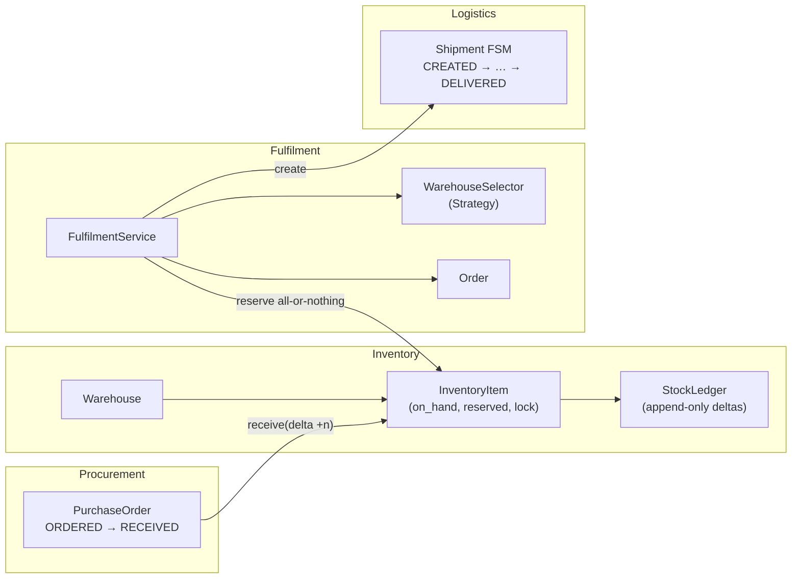

# Capstone 2: Supply Chain & Multi-Warehouse Fulfilment

> **Prerequisites:** [07 · Structural Patterns](../07-structural-patterns/README.md), [08 · Behavioral Patterns I](../08-behavioral-patterns-i/README.md), [10 · Concurrency-Safe Design](../10-concurrency-safe-design/README.md), [22 · Capstone: Hotel Reservation](../22-capstone-project/README.md)  
> **Reading time:** ~30 minutes  
> **Audience:** Candidates facing a "design an inventory / order fulfilment platform" round, or any prompt with several cooperating subsystems

> [!NOTE]
> **In one line:** Split the platform into small subsystems — **Inventory, Procurement, Fulfilment, Logistics (shipments)** — guard stock with a lock per **(warehouse, SKU)**, pick the warehouse through a **Strategy**, make multi-item reservation **all-or-nothing**, and model shipments as an explicit **state machine**.

> [!TIP]
> **Golden rule:** Never write a `SupplyChainManager`. Each subsystem owns its own state and invariant (`reserved <= on_hand`, "no shipping a cancelled order"); the fulfilment service only *coordinates*. And never write stock as an absolute value — apply **deltas**, ideally appended to a ledger.

> [!TIP]
> **Try it:** Sketch the four subsystems in [LLD Studio](/tools/lld-studio/), then run the Python below: 50 threads fight over 10 units and exactly 10 win; a two-item order that can't be fully reserved rolls back cleanly.

---

## 1. The smell: why one class cannot hold this

Interviewer: *"Design a system that receives purchase orders from suppliers, keeps stock across warehouses, fulfils customer orders from the best warehouse, and tracks shipments."*

Signals that this is a **multi-subsystem** prompt:

- More than one aggregate (stock, purchase order, order, shipment) with *different* invariants.
- Different concurrency stories (many readers of stock, rare writers to a PO).
- Words like "best warehouse" (Strategy) and "status" (State machine).



Subsystems talk through narrow methods (`receive`, `try_reserve`, `create_shipment`), never by reaching into each other's fields.

---

## 2. Subsystem map

| Subsystem | State it owns | Invariant | Concurrency boundary | Mechanism |
| :--- | :--- | :--- | :--- | :--- |
| **Inventory** | `on_hand`, `reserved` per `(warehouse, sku)` | `0 ≤ reserved ≤ on_hand` | The `(warehouse, sku)` pair | One lock per item (or atomic SQL delta) |
| **Procurement** | Purchase order status | Receive only once, never when cancelled | The PO aggregate | State guard / optimistic version |
| **Fulfilment** | Order status | Never reserve twice; all lines or none | The order | Idempotency key + rollback |
| **Logistics** | Shipment status | Only legal transitions | The tracking number | FSM table, idempotent events |

### Warehouse selection strategies

| Strategy | Goal | Multi-item behaviour | Trade-off |
| :--- | :--- | :--- | :--- |
| **Nearest single warehouse** | Fast, cheap delivery | Needs one warehouse to cover *all* lines | May reject orders a split shipment could serve |
| **Most stock first** | Balance inventory | Same as above, picks the fullest | Longer transit |
| **Split shipment (min warehouses)** | Always fulfil | Partition lines across warehouses | More parcels, higher cost |

Start with nearest-single and name split-shipment as an extension — that's the usual interview boundary.

---

## 3. Walkthrough: requirements → entities → methods → extension

**Requirements (say back):**

1. Suppliers deliver goods against a **purchase order**; receiving increases stock exactly once.
2. A customer order has several lines; reserve **all** lines from **one** warehouse or fail cleanly.
3. The warehouse is chosen by a swappable rule.
4. A shipment moves through `CREATED → MANIFESTED → IN_TRANSIT → OUT_FOR_DELIVERY → DELIVERED` (with `EXCEPTION` from transit).
5. Stock never goes negative, even with concurrent receipts and checkouts.

**Entities:** `InventoryItem`, `Warehouse`, `PurchaseOrder`, `Order`/`OrderLine`, `WarehouseSelector` (Strategy), `FulfilmentService`, `Shipment`.

**Key methods:**

- `InventoryItem.try_reserve(qty) -> bool` and `release(qty)`, `receive(qty)` — each under the item's lock; every change recorded as a signed delta.
- `Warehouse.try_reserve_all(lines)` — reserve line by line, **roll back** the earlier lines if a later one fails.
- `FulfilmentService.place(order)` — ask the selector for candidates, try them in order, create a shipment on success.
- `Shipment.advance(to)` — validates the transition against a table; repeating the same event is a no-op (idempotent).

**Extension points:** new routing rule → new `WarehouseSelector`; split shipments → a selector returning a *plan*; new carrier events → new FSM edges.

````carousel
```python
from __future__ import annotations

import threading
from collections import defaultdict
from concurrent.futures import ThreadPoolExecutor
from dataclasses import dataclass, field
from enum import Enum
from typing import Protocol


# ── Inventory subsystem ─────────────────────────────────────────────────
class InventoryItem:
    """One (warehouse, sku) pair. The lock guards on_hand and reserved together."""

    def __init__(self, sku: str, on_hand: int = 0) -> None:
        self.sku = sku
        self._on_hand = on_hand
        self._reserved = 0
        self._lock = threading.Lock()
        self.ledger: list[tuple[str, int]] = []   # append-only deltas

    @property
    def available(self) -> int:
        with self._lock:
            return self._on_hand - self._reserved

    def receive(self, qty: int) -> None:
        if qty <= 0:
            raise ValueError("qty must be positive")
        with self._lock:
            self._on_hand += qty                   # delta, never an absolute write
            self.ledger.append(("RECEIPT", qty))

    def try_reserve(self, qty: int) -> bool:
        with self._lock:
            if self._on_hand - self._reserved < qty:
                return False
            self._reserved += qty
            self.ledger.append(("RESERVE", qty))
            return True

    def release(self, qty: int) -> None:
        with self._lock:
            self._reserved -= qty
            self.ledger.append(("RELEASE", qty))


@dataclass(frozen=True)
class OrderLine:
    sku: str
    qty: int


class Warehouse:
    def __init__(self, name: str, distance_km: int) -> None:
        self.name, self.distance_km = name, distance_km
        self._items: dict[str, InventoryItem] = {}
        self._create_lock = threading.Lock()

    def item(self, sku: str) -> InventoryItem:
        with self._create_lock:                    # create-if-missing must be atomic
            return self._items.setdefault(sku, InventoryItem(sku))

    def total_available(self) -> int:
        with self._create_lock:
            items = list(self._items.values())
        return sum(i.available for i in items)

    def try_reserve_all(self, lines: list[OrderLine]) -> bool:
        done: list[OrderLine] = []
        for line in lines:
            if self.item(line.sku).try_reserve(line.qty):
                done.append(line)
            else:
                for d in done:                     # all-or-nothing: undo
                    self.item(d.sku).release(d.qty)
                return False
        return True


# ── Procurement subsystem ───────────────────────────────────────────────
class PurchaseOrder:
    def __init__(self, po_id: str, warehouse: Warehouse, lines: list[OrderLine]) -> None:
        self.po_id, self._warehouse, self._lines = po_id, warehouse, lines
        self.status = "ORDERED"
        self._lock = threading.Lock()

    def receive(self) -> None:
        with self._lock:
            if self.status == "RECEIVED":
                return                              # idempotent: second scan is a no-op
            if self.status != "ORDERED":
                raise ValueError(f"cannot receive a {self.status} PO")
            for line in self._lines:
                self._warehouse.item(line.sku).receive(line.qty)
            self.status = "RECEIVED"


# ── Logistics subsystem: explicit FSM ───────────────────────────────────
class ShipmentStatus(Enum):
    CREATED = "CREATED"
    MANIFESTED = "MANIFESTED"
    IN_TRANSIT = "IN_TRANSIT"
    OUT_FOR_DELIVERY = "OUT_FOR_DELIVERY"
    DELIVERED = "DELIVERED"
    EXCEPTION = "EXCEPTION"


S = ShipmentStatus
ALLOWED = {
    S.CREATED: {S.MANIFESTED},
    S.MANIFESTED: {S.IN_TRANSIT},
    S.IN_TRANSIT: {S.OUT_FOR_DELIVERY, S.EXCEPTION},
    S.EXCEPTION: {S.IN_TRANSIT},
    S.OUT_FOR_DELIVERY: {S.DELIVERED},
    S.DELIVERED: set(),
}


class Shipment:
    def __init__(self, tracking: str, order_id: str) -> None:
        self.tracking, self.order_id = tracking, order_id
        self.status = S.CREATED

    def advance(self, to: ShipmentStatus) -> None:
        if to == self.status:
            return                                  # idempotent carrier webhook
        if to not in ALLOWED[self.status]:
            raise ValueError(f"illegal transition {self.status.name} -> {to.name}")
        self.status = to


# ── Fulfilment subsystem: Strategy + coordination ───────────────────────
class WarehouseSelector(Protocol):
    def candidates(self, warehouses: list[Warehouse]) -> list[Warehouse]: ...


class NearestFirst:
    def candidates(self, warehouses: list[Warehouse]) -> list[Warehouse]:
        return sorted(warehouses, key=lambda w: w.distance_km)


class MostStockFirst:
    def candidates(self, warehouses: list[Warehouse]) -> list[Warehouse]:
        return sorted(warehouses, key=lambda w: -w.total_available())


@dataclass
class Order:
    order_id: str
    lines: list[OrderLine]
    status: str = "NEW"
    warehouse: str | None = None


class FulfilmentService:
    def __init__(self, warehouses: list[Warehouse], selector: WarehouseSelector) -> None:
        self._warehouses, self._selector = warehouses, selector
        self._shipments: dict[str, Shipment] = {}
        self._placed: set[str] = set()
        self._lock = threading.Lock()

    def place(self, order: Order) -> Shipment | None:
        with self._lock:                            # successful places only — rejected stays retryable
            if order.order_id in self._placed:
                return self._shipments.get(order.order_id)
        for wh in self._selector.candidates(self._warehouses):
            if wh.try_reserve_all(order.lines):
                with self._lock:
                    if order.order_id in self._placed:  # lost the race — undo and return winner
                        for line in order.lines:
                            wh.item(line.sku).release(line.qty)
                        return self._shipments.get(order.order_id)
                    order.status, order.warehouse = "RESERVED", wh.name
                    shipment = Shipment(f"TRK-{order.order_id}", order.order_id)
                    self._shipments[order.order_id] = shipment
                    self._placed.add(order.order_id)
                    return shipment
        order.status = "REJECTED"
        return None


if __name__ == "__main__":
    east, west = Warehouse("east", 100), Warehouse("west", 900)
    PurchaseOrder("PO-1", east, [OrderLine("LAPTOP", 10), OrderLine("MOUSE", 1)]).receive()
    po2 = PurchaseOrder("PO-2", west, [OrderLine("LAPTOP", 5), OrderLine("MOUSE", 20)])
    po2.receive(); po2.receive()                    # duplicate scan: still +5/+20 once
    print("east laptops:", east.item("LAPTOP").available, "| west mice:", west.item("MOUSE").available)

    svc = FulfilmentService([west, east], NearestFirst())

    # all-or-nothing: east has 1 mouse; the order wants 1 laptop + 2 mice -> falls to west
    o1 = Order("o-1", [OrderLine("LAPTOP", 1), OrderLine("MOUSE", 2)])
    svc.place(o1)
    print(o1.status, "from", o1.warehouse, "| east laptops still:", east.item("LAPTOP").available)

    # nobody can cover 100 laptops -> rejected, nothing reserved anywhere
    o2 = Order("o-2", [OrderLine("LAPTOP", 100)])
    print(svc.place(o2), o2.status)

    # concurrency: 50 buyers, 10 units in one warehouse -> exactly 10 win
    solo = Warehouse("solo", 1)
    solo.item("TV").receive(10)
    def buy(_: int) -> bool:
        return solo.try_reserve_all([OrderLine("TV", 1)])
    with ThreadPoolExecutor(max_workers=25) as pool:
        print("buyers who got a TV:", sum(pool.map(buy, range(50))), "| left:", solo.item("TV").available)

    ship = svc.place(Order("o-3", [OrderLine("MOUSE", 1)]))
    for s in (S.MANIFESTED, S.IN_TRANSIT, S.IN_TRANSIT, S.OUT_FOR_DELIVERY, S.DELIVERED):
        ship.advance(s)
    print("shipment:", ship.status.name)
    try:
        ship.advance(S.CREATED)
    except ValueError as err:
        print("rejected:", err)
```
<!-- slide -->
```csharp
public sealed class InventoryItem
{
    private readonly object _gate = new();
    private int _onHand, _reserved;

    public int Available { get { lock (_gate) return _onHand - _reserved; } }

    public void Receive(int qty)
    {
        if (qty <= 0) throw new ArgumentOutOfRangeException(nameof(qty));
        lock (_gate) _onHand += qty;                 // delta, not an absolute write
    }

    public bool TryReserve(int qty)
    {
        lock (_gate)
        {
            if (_onHand - _reserved < qty) return false;
            _reserved += qty;
            return true;
        }
    }

    public void Release(int qty) { lock (_gate) _reserved -= qty; }
}

public sealed record OrderLine(string Sku, int Qty);

public sealed class Warehouse(string name, int distanceKm)
{
    private readonly ConcurrentDictionary<string, InventoryItem> _items = new();
    public string Name { get; } = name;
    public int DistanceKm { get; } = distanceKm;

    public InventoryItem Item(string sku) => _items.GetOrAdd(sku, _ => new InventoryItem());

    public bool TryReserveAll(IEnumerable<OrderLine> lines)
    {
        var done = new List<OrderLine>();
        foreach (var line in lines)
        {
            if (Item(line.Sku).TryReserve(line.Qty)) { done.Add(line); continue; }
            foreach (var d in done) Item(d.Sku).Release(d.Qty);   // all-or-nothing
            return false;
        }
        return true;
    }
}

public enum ShipmentStatus { Created, Manifested, InTransit, OutForDelivery, Delivered, Exception }

public sealed class Shipment
{
    private static readonly Dictionary<ShipmentStatus, ShipmentStatus[]> Allowed = new()
    {
        [ShipmentStatus.Created]        = [ShipmentStatus.Manifested],
        [ShipmentStatus.Manifested]     = [ShipmentStatus.InTransit],
        [ShipmentStatus.InTransit]      = [ShipmentStatus.OutForDelivery, ShipmentStatus.Exception],
        [ShipmentStatus.Exception]      = [ShipmentStatus.InTransit],
        [ShipmentStatus.OutForDelivery] = [ShipmentStatus.Delivered],
        [ShipmentStatus.Delivered]      = [],
    };

    public ShipmentStatus Status { get; private set; } = ShipmentStatus.Created;

    public void Advance(ShipmentStatus to)
    {
        if (to == Status) return;                    // idempotent webhook
        if (!Allowed[Status].Contains(to))
            throw new InvalidOperationException($"illegal {Status} -> {to}");
        Status = to;
    }
}

public interface IWarehouseSelector
{
    IEnumerable<Warehouse> Candidates(IEnumerable<Warehouse> all);
}

public sealed class NearestFirst : IWarehouseSelector
{
    public IEnumerable<Warehouse> Candidates(IEnumerable<Warehouse> all) =>
        all.OrderBy(w => w.DistanceKm);
}
```
````

Expected output of the Python:

```text
east laptops: 10 | west mice: 20
RESERVED from west | east laptops still: 10
None REJECTED
buyers who got a TV: 10 | left: 0
shipment: DELIVERED
rejected: illegal transition DELIVERED -> CREATED
```

---

## 4. Edges: where supply-chain designs go wrong

- **Read-modify-write on stock.** Illustrative failure (a common pattern, not a named incident): a receiving worker writes `on_hand = 5010` while checkout writes `on_hand = 9` from a stale read; 5,000 delivered monitors vanish and the item shows "sold out" at peak traffic. Cure: apply **relative deltas** (`UPDATE … SET on_hand = on_hand + :d`), guard with a per-item lock or row lock, and keep an append-only **ledger** so balance = sum of movements and you can audit it.
- **Partial reservation.** Reserving line 1 then failing on line 2 leaves phantom reserved stock. Roll back, or reserve in a transaction.
- **Lock ordering.** If you ever need two locks (transfer between warehouses), always acquire in a canonical order (e.g., sorted by warehouse id) — otherwise A→B and B→A deadlock.
- **Idempotency.** Duplicate "PO received" scans, duplicate checkout retries, duplicate carrier webhooks. Each subsystem needs an idempotency rule: ignore an event that doesn't change state; remember order ids.
- **Out-of-order events.** Carrier says `DELIVERED` before `IN_TRANSIT` arrives. The FSM rejects (or queues) the illegal jump — it does not silently overwrite.
- **Reservations that never expire.** An abandoned checkout holds stock forever. Give reservations a TTL and a sweeper, or release on order timeout.
- **Cross-subsystem calls inside locks.** Don't call a carrier API while holding an inventory lock; commit the reservation, *then* create the shipment (outbox/event).
- **When not to over-model.** Split shipments, backorders, cross-docking, and returns are follow-ups. Name the extension point; don't build them unprompted.

---

## 5. What you'd say in two minutes

> "I'd split this into four subsystems with their own invariants: Inventory, Procurement, Fulfilment and Logistics, and keep a thin `FulfilmentService` that only coordinates. Inventory is keyed by (warehouse, SKU); each item has its own lock and keeps `reserved ≤ on_hand`, and changes are *deltas* appended to a ledger, never absolute writes — that's what prevents lost updates between receiving and checkout. A purchase order's `receive` is idempotent. For an order, the selector — a Strategy, nearest first by default — returns candidate warehouses; `try_reserve_all` reserves every line or rolls back, so we never leave phantom reservations. Success creates a shipment, which is an explicit state machine with a transition table, so out-of-order carrier events are rejected and repeated ones are no-ops. Extensions are a split-shipment selector, reservation TTLs, and moving the stock invariant into the database for multi-node deployments."

---

## 6. Anti-patterns

| Anti-pattern | Why it fails | Fix |
| :--- | :--- | :--- |
| `SupplyChainManager` God class | One change touches everything | Four subsystems + thin coordinator |
| `stock = read(); write(stock - 1)` | Lost updates | Atomic delta or per-item lock |
| Status as free string | Impossible states, silent overwrites | Enum + transition table |
| Reserve lines one by one without rollback | Phantom reservations | `try_reserve_all` with undo |
| Strategy `if warehouse.region == …` in the service | Every new rule edits the core | `WarehouseSelector` |
| Calling carrier API under a stock lock | Slow I/O blocks all buyers | Commit, then publish an event |
| Global lock for all inventory | Correct but serialises the company | Lock per `(warehouse, sku)` |

---

## 7. Interview questions

<details>
<summary><strong>1. Why lock per (warehouse, SKU) rather than globally? [BASIC]</strong></summary>

The invariant `reserved ≤ on_hand` is per item, so contention should be per item. A global lock is correct but throttles unrelated products; a per-item lock lets thousands of SKUs proceed in parallel.

</details>

<details>
<summary><strong>2. How do you make multi-item reservation all-or-nothing? [BASIC]</strong></summary>

Reserve each line in turn, remembering what succeeded; on the first failure release those and return false. In SQL, do it in one transaction. Either way no partial state is visible afterwards.

</details>

<details>
<summary><strong>3. Which pattern chooses the warehouse? [BASIC]</strong></summary>

Strategy — a `WarehouseSelector` interface with `NearestFirst`, `MostStockFirst`, and later a split-shipment planner. `FulfilmentService` depends only on the interface.

</details>

<details>
<summary><strong>4. A PO "received" message is delivered twice. What happens? [SCENARIO]</strong></summary>

Nothing extra — `receive()` checks status under a lock and returns if already `RECEIVED`. Idempotency matters because brokers deliver at-least-once.

</details>

<details>
<summary><strong>5. Carrier webhooks arrive out of order. [SCENARIO]</strong></summary>

The FSM has a transition table. `DELIVERED` arriving while `CREATED` is illegal — reject or park it until the missing events arrive; don't overwrite. Repeats of the *current* status are ignored. For strict ordering, include a sequence number or timestamp from the carrier.

</details>

<details>
<summary><strong>6. Why a ledger instead of just updating a counter? [TRICKY]</strong></summary>

A counter loses history and hides bugs. An append-only ledger of signed movements (`RECEIPT`, `RESERVE`, `DISPATCH`, `ADJUSTMENT`) lets you recompute and audit the balance, replay after a failure, and detect drift. You can still keep a cached counter for speed.

</details>

<details>
<summary><strong>7. Transfer 20 units from warehouse A to B concurrently with a reverse transfer. [TRICKY]</strong></summary>

Two locks means deadlock risk. Acquire them in a canonical order (sort by warehouse id) every time, or avoid holding both: decrement A, enqueue a "in-transit" record, increment B later.

</details>

<details>
<summary><strong>8. How would you support split shipments? [SCENARIO]</strong></summary>

Change the selector contract from "ordered warehouses" to a **plan**: `list[(warehouse, lines)]`. Reserve every part atomically (or compensate), create one shipment per part, and the order is `RESERVED` only when all parts are. The FSM and inventory code stay unchanged.

</details>

---

## 8. One-page cheat sheet

```text
Subsystems   Inventory | Procurement | Fulfilment | Logistics   (no SupplyChainManager)
Inventory    lock per (warehouse, sku); reserved <= on_hand; deltas + append-only ledger
Procurement  PO.receive() idempotent; status guard
Fulfilment   selector (Strategy) -> try_reserve_all (rollback) -> create shipment
Logistics    Enum + ALLOWED table; same-status = no-op; illegal = reject
Idempotency  order id set, PO status, webhook same-state
Deadlock     canonical lock order for multi-warehouse transfers
Multi-node   DB atomic delta / row lock / optimistic version; outbox for events

Opener: "Four subsystems, each owning one invariant; locks and deltas at the (warehouse, SKU) level."
```

---

## Further reading

- [Martin Fowler — Event Sourcing (the ledger idea)](https://martinfowler.com/eaaDev/EventSourcing.html)
- [Microservices.io — Transactional outbox](https://microservices.io/patterns/data/transactional-outbox.html)
- [Python `threading` documentation](https://docs.python.org/3/library/threading.html)

## Conclusion

You've now designed a booking system (22) and a multi-subsystem platform (23) with the same toolkit: **name the invariant, choose the smallest aggregate that owns it, lock or version at that boundary, keep rules behind Strategy/State, and say what you'd add next.** Take that into the [LLD Interview Playbook](../21-lld-interview-playbook/README.md) and the question banks in tracks [24](../24-oop-interview-questions/README.md) – [27](../27-python-interview/README.md).
