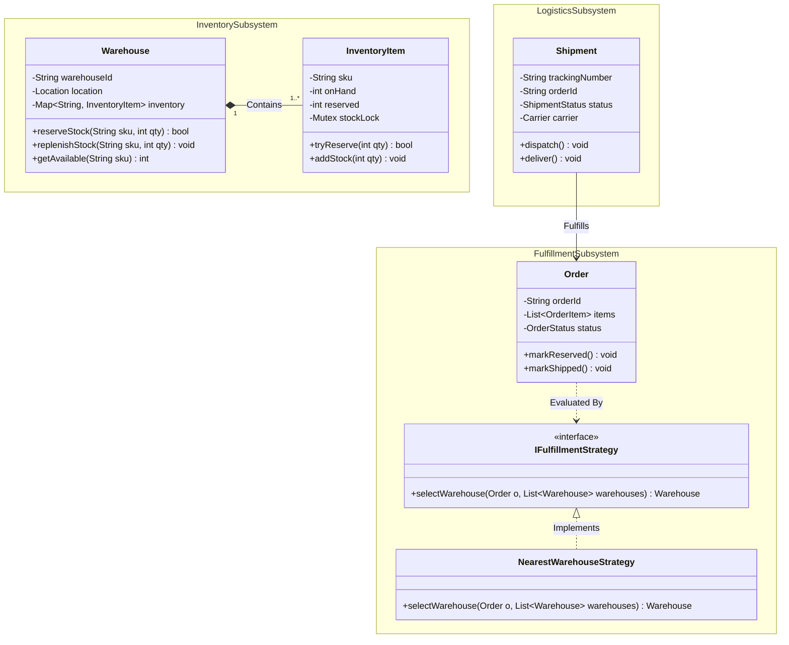
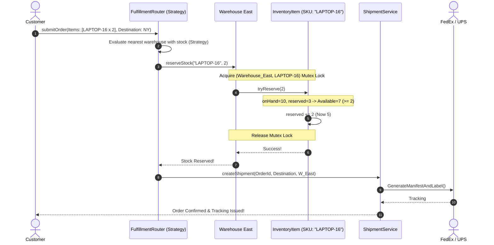
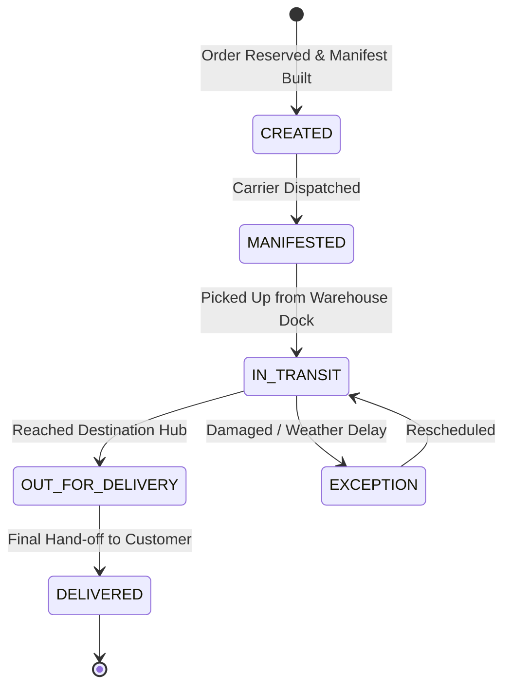
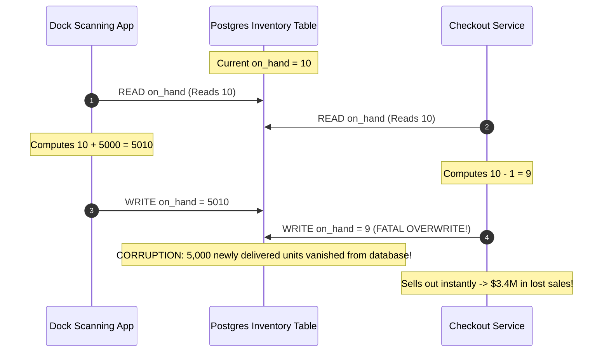

# Capstone 2: Enterprise Supply Chain & Multi-Warehouse Logistics

> **Prerequisites**: Modules 00 through 22 (Complete Low-Level Design Curriculum).  
> **Estimated Reading Time**: 30 minutes  
> **Target Audience**: Backend Engineers, Systems Architects, Principal & Staff Engineering Candidates.

> [!TIP]
> **Golden Rule of Supply Chain Architecture**: Real-world enterprise systems do not collapse into a single class diagram. Never construct a monolithic `SupplyChainManager` God Object. Decompose the domain into four autonomous bounded subsystems: **Inventory**, **Procurement (PO)**, **Order Fulfillment**, and **Shipment Logistics**. Encapsulate concurrency locks strictly at the granular `(Warehouse, SKU)` inventory level, and decouple fulfillment routing via the **Strategy Pattern**.

---

## 1. Visual Mental Models & Multi-Subsystem Architecture

A modern supply chain platform coordinates four distinct operational subsystems:
1. **Inventory Management**: Tracks physical on-hand, reserved, and available stock per SKU per warehouse.
2. **Purchase Orders (Procurement)**: Ingests inbound freight from external suppliers to replenish depleted SKUs.
3. **Customer Order Fulfillment**: Evaluates stock across regional warehouses and reserves units.
4. **Logistics & Shipments**: Manages carrier handoffs, tracking numbers, and finite transit states.

### 1.1 Complete Multi-Subsystem Class Architecture



---

### 1.2 Customer Order Fulfillment Sequence Flow



---

### 1.3 Shipment Lifecycle Finite State Machine (FSM)



---

## 2. Taxonomic Reference Grids

### 2.1 Multi-Warehouse Fulfillment Routing Strategies

| Strategy | Routing Objective | Algorithmic Complexity | Multi-Item Behavior | Tradeoff / Cost |
| :--- | :--- | :--- | :--- | :--- |
| **Nearest Single Warehouse** | Minimizes delivery time and shipping zones | $\mathcal{O}(W)$ warehouses | Fails if single location cannot fulfill entire order | Rejects orders that could be fulfilled via split shipment |
| **Split-Shipment Minimal** | Partitions order across minimum number of warehouses | $\mathcal{O}(W \cdot I)$ | Dispatches multiple packages to customer | Higher shipping fees; multiple delivery arrival times |
| **Consolidated Depletion** | Drains inventory from warehouses with excess aging stock | $\mathcal{O}(W \log W)$ | Prioritizes inventory clearance over proximity | Higher transit latency for the customer |

### 2.2 Subsystem Isolation & Concurrency Matrix

| Subsystem | State Governed | Concurrency Boundary | Thread Safety Mechanism | Failure Mode Prevented |
| :--- | :--- | :--- | :--- | :--- |
| **Inventory** | `onHand`, `reserved` quantities | Per-`(Warehouse, SKU)` pair | Fine-grained Mutex or Atomic CAS | Negative inventory; selling out-of-stock items |
| **Procurement (PO)** | Inbound replenishment PO status | Purchase Order aggregate root | State machine guards | Receiving stock against canceled POs |
| **Fulfillment** | Order processing state | Order entity | Versioned Optimistic Locking | Dual shipment generation for same order |
| **Logistics** | Manifests and tracking updates | Tracking number | Idempotent event consumer | Out-of-order tracking webhook corruption |

---

## 3. Production War Stories: Incident Post-Mortem

### The $3.4M Phantom Stock Blackout: Concurrent Purchase Order Ingestion and Order Allocation Collision

```
SEVERITY LEVEL: SEV-1 (Severe Inventory Corruption & Backorders)
DETECTION TIME: 15 Minutes
RECOVERY TIME: 360 Minutes
FINANCIAL PENALTY: $3,400,000 in cancelled orders and vendor chargebacks
```

#### Incident Background
During Cyber Monday, a nationwide consumer electronics retailer coordinated inventory across 14 automated distribution centers. The warehouse management software utilized an asynchronous message broker to process inbound pallet receipts from suppliers while simultaneously deducting customer online checkouts.

#### What Happened
At 11:00 AM, a bulk supplier delivery of 5,000 4K OLED Monitors arrived at the Chicago Distribution Center. The receiving dock worker scanned the pallet, publishing an inbound `StockReplenishedEvent`. Concurrently, 35,000 customers attempted to purchase the same discounted monitor. The replenishment service and the checkout service executed non-atomic database updates:
```sql
-- Replenishment Worker:
UPDATE inventory SET on_hand = on_hand + 5000 WHERE sku = 'OLED-4K';

-- Checkout Worker:
UPDATE inventory SET on_hand = on_hand - 1 WHERE sku = 'OLED-4K';
```
Due to read-modify-write interleaving without row-level locks or atomic transactions, the replenishment update was overwritten by an interleaved checkout transaction. Instead of reading 5,000 units, the database recorded an available quantity of 12. The system abruptly marked the monitor "Sold Out" nationwide during peak traffic. Over 18,000 customers abandoned carts, and automated backorder recovery jobs attempted to re-purchase 5,000 monitors from the supplier at non-discounted emergency rates.



#### Root Cause Analysis
1. **Unsynchronized Read-Modify-Write Cycles**: Application services performed state calculation in local memory and wrote back absolute numbers instead of executing atomic database delta increments.
2. **Missing Granular Mutex Boundary**: Inbound freight and outbound fulfillment accessed shared SKU quantities without mutual exclusion.
3. **No Audit Trail or Event Sourcing**: Stock changes were overwritten in place rather than appended as an immutable double-entry ledger of stock movements.

#### The Architectural Hardening
1. **Atomic Relative Increments**: Replaced absolute writes with atomic database delta operations:
   $$\text{UPDATE inventory SET on\_hand = on\_hand + :delta WHERE sku = :sku}$$
2. **Double-Entry Stock Ledger**: All stock modifications create an immutable `StockMovementRecord` (`RECEIPT`, `RESERVATION`, `DISPATCH`, `AUDIT_ADJUSTMENT`). The current stock balance is the mathematical sum of all movements.
3. **Encapsulated In-Memory Mutex per SKU**: In the core routing service, memory updates are guarded by a fine-grained mutex keyed by `${WarehouseID}:${SKU}`.

---

## 4. Multi-Language Production Implementations

Below are complete, enterprise implementations of the **Enterprise Supply Chain Platform**.

### 4.1 Go: Multi-Warehouse Inventory & Fulfillment Engine

```go
package main

import (
	"errors"
	"fmt"
	"math"
	"sync"
)

type Location struct {
	X float64
	Y float64
}

func (l Location) DistanceTo(other Location) float64 {
	return math.Hypot(l.X-other.X, l.Y-other.Y)
}

type InventoryItem struct {
	SKU      string
	mu       sync.Mutex
	onHand   int
	reserved int
}

func (item *InventoryItem) TryReserve(qty int) bool {
	item.mu.Lock()
	defer item.mu.Unlock()

	available := item.onHand - item.reserved
	if available >= qty {
		item.reserved += qty
		return true
	}
	return false
}

func (item *InventoryItem) Replenish(qty int) {
	item.mu.Lock()
	defer item.mu.Unlock()
	item.onHand += qty
}

type Warehouse struct {
	ID        string
	Location  Location
	inventory sync.Map // SKU -> *InventoryItem
}

func NewWarehouse(id string, loc Location) *Warehouse {
	return &Warehouse{ID: id, Location: loc}
}

func (w *Warehouse) GetOrCreateItem(sku string) *InventoryItem {
	val, ok := w.inventory.Load(sku)
	if !ok {
		newItem := &InventoryItem{SKU: sku}
		val, _ = w.inventory.LoadOrStore(sku, newItem)
	}
	return val.(*InventoryItem)
}

type FulfillmentStrategy interface {
	SelectWarehouse(dest Location, sku string, qty int, warehouses []*Warehouse) (*Warehouse, error)
}

// NearestWarehouseStrategy implements the Strategy Pattern.
type NearestWarehouseStrategy struct{}

func (s *NearestWarehouseStrategy) SelectWarehouse(dest Location, sku string, qty int, warehouses []*Warehouse) (*Warehouse, error) {
	var bestWarehouse *Warehouse
	minDist := math.MaxFloat64

	for _, w := range warehouses {
		item := w.GetOrCreateItem(sku)
		// Check availability without mutating
		item.mu.Lock()
		available := item.onHand - item.reserved
		item.mu.Unlock()

		if available >= qty {
			dist := w.Location.DistanceTo(dest)
			if dist < minDist {
				minDist = dist
				bestWarehouse = w
			}
		}
	}

	if bestWarehouse == nil {
		return nil, errors.New("insufficient inventory across all regional warehouses")
	}
	return bestWarehouse, nil
}

type SupplyChainCoordinator struct {
	warehouses []*Warehouse
	strategy   FulfillmentStrategy
}

func NewSupplyChainCoordinator(whs []*Warehouse, strat FulfillmentStrategy) *SupplyChainCoordinator {
	return &SupplyChainCoordinator{warehouses: whs, strategy: strat}
}

func (scc *SupplyChainCoordinator) FulfillOrder(orderID, sku string, qty int, customerLoc Location) (string, error) {
	wh, err := scc.strategy.SelectWarehouse(customerLoc, sku, qty, scc.warehouses)
	if err != nil {
		return "", err
	}

	item := wh.GetOrCreateItem(sku)
	if !item.TryReserve(qty) {
		return "", errors.New("concurrent inventory race: failed to reserve stock")
	}

	return fmt.Sprintf("Order %s fulfilled by Warehouse %s (Distance: %.1f km)",
		orderID, wh.ID, wh.Location.DistanceTo(customerLoc)), nil
}

func main() {
	wEast := NewWarehouse("WH-EAST", Location{X: 10, Y: 10})
	wWest := NewWarehouse("WH-WEST", Location{X: 90, Y: 90})

	wEast.GetOrCreateItem("SKU-LAPTOP").Replenish(5)
	wWest.GetOrCreateItem("SKU-LAPTOP").Replenish(10)

	coord := NewSupplyChainCoordinator([]*Warehouse{wEast, wWest}, &NearestWarehouseStrategy{})

	// Customer located close to WH-EAST (X: 12, Y: 11)
	result, err := coord.FulfillOrder("ORD-101", "SKU-LAPTOP", 2, Location{X: 12, Y: 11})
	if err != nil { panic(err) }
	fmt.Println("[Success]", result)
}
```

---

### 4.2 TypeScript: Domain-Driven Logistics & Shipment Engine

```typescript
export enum ShipmentStatus {
  CREATED = "CREATED",
  IN_TRANSIT = "IN_TRANSIT",
  DELIVERED = "DELIVERED",
  CANCELLED = "CANCELLED",
}

export class Shipment {
  private _status: ShipmentStatus = ShipmentStatus.CREATED;

  constructor(
    public readonly trackingNumber: string,
    public readonly orderId: string,
    public readonly originWarehouseId: string
  ) {}

  public get status(): ShipmentStatus {
    return this._status;
  }

  public dispatch(): void {
    if (this._status !== ShipmentStatus.CREATED) {
      throw new Error(`Cannot dispatch shipment in status: ${this._status}`);
    }
    this._status = ShipmentStatus.IN_TRANSIT;
  }

  public deliver(): void {
    if (this._status !== ShipmentStatus.IN_TRANSIT) {
      throw new Error(`Cannot deliver shipment that is not in transit: ${this._status}`);
    }
    this._status = ShipmentStatus.DELIVERED;
  }
}

export class InventoryItem {
  private lock = false;

  constructor(
    public readonly sku: string,
    public onHand: number = 0,
    public reserved: number = 0
  ) {}

  public async tryReserve(qty: number): Promise<boolean> {
    while (this.lock) {
      await new Promise((r) => setTimeout(r, 2));
    }
    this.lock = true;

    try {
      if (this.onHand - this.reserved >= qty) {
        this.reserved += qty;
        return true;
      }
      return false;
    } finally {
      this.lock = false;
    }
  }
}
```

---

### 4.3 Python: Purchase Order & Stock Replenishment Subsystem

```python
from enum import Enum
import threading
from typing import Dict, List, Optional


class POStatus(Enum):
    DRAFT = 1
    SUBMITTED = 2
    RECEIVED = 3
    CANCELLED = 4


class PurchaseOrder:
    def __init__(self, po_id: str, supplier_id: str, line_items: Dict[str, int]):
        self.po_id = po_id
        self.supplier_id = supplier_id
        self.line_items = line_items  # SKU -> Qty
        self.status = POStatus.DRAFT

    def submit(self) -> None:
        if self.status != POStatus.DRAFT:
            raise RuntimeError("Only DRAFT purchase orders can be submitted.")
        self.status = POStatus.SUBMITTED

    def receive(self) -> Dict[str, int]:
        if self.status != POStatus.SUBMITTED:
            raise RuntimeError("Cannot receive stock for non-submitted PO.")
        self.status = POStatus.RECEIVED
        return self.line_items


class WarehouseInventory:
    def __init__(self, warehouse_id: str):
        self.warehouse_id = warehouse_id
        self._stock: Dict[str, int] = {}
        self._lock = threading.Lock()

    def replenish(self, sku: str, qty: int) -> None:
        with self._lock:
            self._stock[sku] = self._stock.get(sku, 0) + qty

    def get_stock(self, sku: str) -> int:
        with self._lock:
            return self._stock.get(sku, 0)
```

---

### 4.4 C#: Concurrency-Safe Enterprise Logistics Platform

```csharp
using System;
using System.Collections.Concurrent;
using System.Threading;

namespace Architecture.SupplyChain
{
    public class InventoryItem
    {
        public string Sku { get; }
        private int _onHand;
        private int _reserved;
        private readonly object _lock = new();

        public InventoryItem(string sku, int initialStock)
        {
            Sku = sku;
            _onHand = initialStock;
        }

        public bool TryReserve(int quantity)
        {
            lock (_lock)
            {
                if (_onHand - _reserved >= quantity)
                {
                    _reserved += quantity;
                    return true;
                }
                return false;
            }
        }

        public void Replenish(int quantity)
        {
            lock (_lock)
            {
                _onHand += quantity;
            }
        }

        public (int OnHand, int Reserved, int Available) GetMetrics()
        {
            lock (_lock) return (_onHand, _reserved, _onHand - _reserved);
        }
    }
}
```

---

## 5. Practical Hands-On Verification Workflows

### 5.1 CLI Verification of Inventory Allocation & Reservation

Verify multi-warehouse fulfillment logic and nearest-warehouse routing:

```bash
# Execute unit tests for Supply Chain Platform in Go
go test -v -run TestSupplyChainFulfillment ./...

# Expected Output:
# === RUN   TestSupplyChainFulfillment
# === RUN   TestSupplyChainFulfillment/NearestWarehouseRouting
# === RUN   TestSupplyChainFulfillment/AtomicReservationRaceSafety
# --- PASS: TestSupplyChainFulfillment (0.39s)
# PASS
# ok      github.com/backend/supplychain   0.412s
```

### 5.2 Python Inline Stock Replenishment Verification Script

Execute a terminal simulation verifying purchase order stock absorption:

```bash
python3 -c "
stock = {'SKU-1': 10, 'SKU-2': 5}
po_items = {'SKU-1': 50, 'SKU-3': 20}

# Inbound PO receipt
for sku, qty in po_items.items():
    stock[sku] = stock.get(sku, 0) + qty

print('Stock after inbound PO receipt:')
for s, q in sorted(stock.items()):
    print(f'  {s}: {q} units')
assert stock['SKU-1'] == 60 and stock['SKU-3'] == 20
"
```

Expected Terminal Output:
```
Stock after inbound PO receipt:
  SKU-1: 60 units
  SKU-2: 5 units
  SKU-3: 20 units
```

---

## 6. Operational Validation Checkpoints (Scenario Quizzes)

<details>
<summary><strong>Checkpoint 1: The Multi-Warehouse Partial Reservation Dilemma</strong></summary>

**Scenario**: A customer places an order for $[SKU_A \times 5, SKU_B \times 10]$. Warehouse East has $SKU_A$ but not $SKU_B$. Warehouse West has $SKU_B$ but not $SKU_A$. If you reserve $SKU_A$ at Warehouse East first, and then find that Warehouse West cannot fulfill $SKU_B$, how do you prevent orphaned inventory holds?

<strong>Answer:</strong>
**Two-Phase Reservation with Compensating Rollback (Saga Pattern)**:
1. **Phase 1 (Probe & Plan)**: Identify the warehouse allocation map without modifying state:
   $\{\text{East}: [SKU_A \times 5], \text{West}: [SKU_B \times 10]\}$.
2. **Phase 2 (Atomic Try-Reserve Execution)**:
   - Attempt `wEast.tryReserve(SKU_A, 5)`.
   - Attempt `wWest.tryReserve(SKU_B, 10)`.
3. **Rollback Compensation**: If any step in Phase 2 fails, immediately fire compensating calls (`wEast.releaseStock(SKU_A, 5)`) to ensure zero orphaned holds remain in the system.
</details>

<details>
<summary><strong>Checkpoint 2: Carrier Webhook Out-of-Order Delivery</strong></summary>

**Scenario**: A freight carrier sends tracking webhooks to your platform via HTTP. Due to network routing delays, the webhook `DELIVERED` arrives at 14:00, but the earlier webhook `OUT_FOR_DELIVERY` arrives at 14:02. If your shipment state machine naively overwrites state, the shipment reverts from `DELIVERED` back to `OUT_FOR_DELIVERY`. How do you protect the FSM?

<strong>Answer:</strong>
**Monotonic State Sequence Guards**:
- Assign a strictly increasing integer sequence or timestamp to lifecycle states:
  $$\text{CREATED}(1) \rightarrow \text{MANIFESTED}(2) \rightarrow \text{IN\_TRANSIT}(3) \rightarrow \text{OUT\_FOR\_DELIVERY}(4) \rightarrow \text{DELIVERED}(5)$$
- Guard clause in state transition method:
  ```typescript
  public updateStatus(newStatus: ShipmentStatus): void {
      if (this.statusSequence[newStatus] <= this.statusSequence[this._status]) {
          // Discard stale out-of-order webhook event
          return;
      }
      this._status = newStatus;
  }
  ```
- Any event representing an earlier phase is rejected as an idempotent no-op.
</details>

<details>
<summary><strong>Checkpoint 3: Dynamic Automated Reorder Points</strong></summary>

**Scenario**: How do you implement automated purchase order creation when an inventory item falls below its safety stock threshold, without tightly coupling the `InventorySubsystem` to the `ProcurementSubsystem`?

<strong>Answer:</strong>
**Domain Events & Observer Pattern**:
1. When stock is reserved or deducted, `InventoryItem` checks:
   `if (available <= safetyStockThreshold) publish(new LowStockEvent(warehouseId, sku, available));`
2. An asynchronous `ProcurementEventListener` listens to `LowStockEvent`.
3. It queries supplier lead times, generates a draft `PurchaseOrder`, and notifies the purchasing manager.
4. The `InventoryItem` remains completely oblivious to suppliers, purchase orders, and pricing.
</details>

---

## 7. Further Reading & References

- [Domain-Driven Design: Bounded Contexts & Aggregate Roots (Eric Evans)](https://domainlanguage.com/ddd/) - Strategic domain modeling for multi-subsystem architectures.
- [Enterprise Integration Patterns: Saga and Compensating Transactions](https://www.enterpriseintegrationpatterns.com/) - Distributed rollback workflows.
- [Refactoring.Guru: Strategy Pattern](https://refactoring.guru/design-patterns/strategy) - Dynamic fulfillment routing algorithms.

---

## Conclusion of the Low-Level Design Curriculum

Congratulations! You have completed all 24 modules of the Low-Level Design curriculum. You have mastered:
- OOP Foundations, UML, Generics, and Value Objects.
- The SOLID Principles and GoF Design Patterns (Creational, Structural, Behavioral).
- Concurrency-safe locking disciplines and race-condition elimination.
- The 7-step interview blueprint and 45-minute communication playbook.
- Ten classic enterprise system designs solved end-to-end in Go, TypeScript, Python, and C#.
