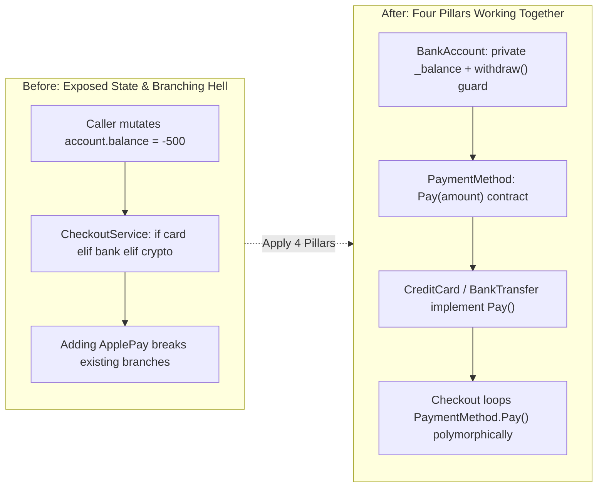
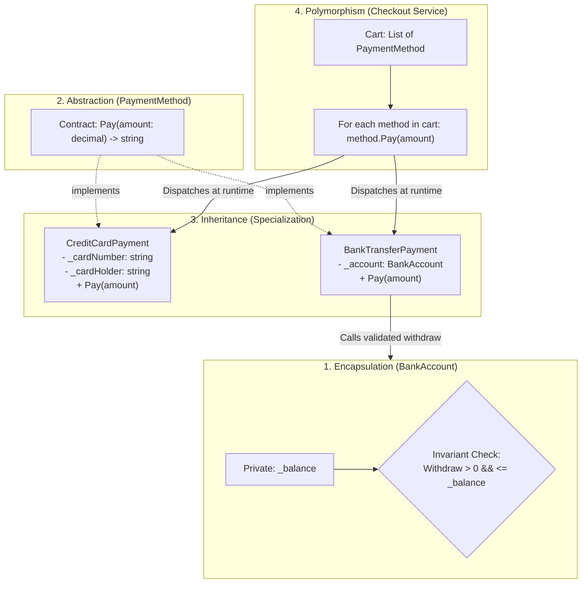

# Lesson 01: The Four Pillars, Answered Well

> **Prerequisites:** [Track 24 Overview](../README.md) and basic knowledge of classes in Python or C#.  
> **Estimated Reading Time:** 18 minutes  
> **Target Audience:** Engineers preparing for LLD, OOP, C#, or Python technical screening and architecture rounds.

> [!NOTE]
> **In one line:** Four pillars = **encapsulation** (guard state), **abstraction** (hide detail behind a contract), **inheritance** (reuse an is-a base), **polymorphism** (one call, many behaviours) — and the interviewer grades your *example*, not the definition.

> [!TIP]
> **The One Rule of the Four Pillars:** Encapsulation protects **invariants** (data safety), Abstraction hides **complexity** (interface design), Inheritance shares **mechanics** (code reuse), and Polymorphism enables **pluggability** (uniform substitution). Never mix up abstraction with encapsulation: encapsulation is a lock on a bank vault; abstraction is the keypad on the door.

---

## 1. Why This Matters: The Interview Trap

"What are the four pillars of object-oriented programming?" is the quintessential interview opener. Junior candidates recite textbook dictionary definitions from college: *"Encapsulation is data hiding, abstraction is showing essential features, inheritance is inheriting parent classes, and polymorphism is taking many forms."*

Interviewers hate this answer because it proves memorization, not engineering judgment.

A senior engineer answers with **purpose and architectural trade-offs**:
- **Encapsulation:** "Bundling state with behavior to guarantee invariants. Nothing outside this object can put it into an illegal state (e.g., negative bank account balance or raw invalid credit card)."
- **Abstraction:** "Reducing cognitive load and coupling by exposing *what* an entity does through a minimal contract, hiding *how* it does it behind an interface or abstract class."
- **Inheritance:** "An 'is-a' relationship for code reuse and subtyping, though modern design heavily favors composition to prevent brittle base class hierarchies."
- **Polymorphism:** "The ability to treat different concrete implementations uniformly behind a shared abstraction at runtime without branching logic."

### The #1 Distinguishing Question: Abstraction vs. Encapsulation

| Question Dimension | Encapsulation | Abstraction |
| :--- | :--- | :--- |
| **Core Question** | *How is the internal state protected?* | *What does the caller need to know to use this?* |
| **Focus** | Implementation and internal boundaries. | Interface and external contracts. |
| **Mechanism** | Access modifiers (`private`, `protected`, `_`), properties, invariant validations. | Abstract classes (`ABC`), interfaces (`interface`), method signatures without bodies. |
| **Real-World Analogy** | The sealed casing of an ATM and the secure vault locking the physical banknotes inside. | The screen and 10-digit keypad on the front of the ATM: you press "Withdraw $100", unaware of the motor gears. |
| **Failure Mode** | Public mutable fields allowing unauthorized modification, corrupted state. | Leaky abstraction: forcing caller to manage low-level HTTP retry loops or database connection handles. |

---

## 1A. The Visual Story: Problem -> Analogy -> Solution

### The Problem (Why Naive Code Breaks)

Imagine an e-commerce checkout service built as a single procedural script with public structs/dictionaries. Any module can directly mutate `account.balance = -500`, and `checkout()` contains a 120-line `if/elif` chain checking `payment_type == "card"`, `"bank"`, `"crypto"`, `"wallet"`. When Product asks to add Apple Pay, three engineers touch the same `checkout()` function, a race condition leaves an order marked `PAID` with a negative balance, and unit-testing Apple Pay requires spinning up the entire credit-card gateway SDK.

### Real-World Analogy

Think of **an ATM and its swappable cash-dispenser cassette**:
- **Encapsulation:** The steel vault around the cash—nobody can reach in and grab bills without going through the validated dispenser slot.
- **Abstraction:** The touchscreen and 10-digit keypad—you tap "Withdraw $100" without knowing anything about stepper motors or optical bill counters.
- **Inheritance:** Standard ATM vs. Drive-Up ATM—both share the core `ATMSession` authentication flow, while Drive-Up adds a pneumatic tube step.
- **Polymorphism:** The ATM motherboard calls `cartridge.dispense(100)` identically whether the slot holds a USD, EUR, or JPY cassette.

### Visual Problem -> Solution Diagram



### Where It Is Used & Progressive Buildup

| Ecosystem / Context | Real-World Usage |
| :--- | :--- |
| **.NET** | `System.IO.Stream` (abstraction + inheritance), `HttpClient` + `DelegatingHandler` (polymorphic pipeline), `BankAccount` value invariants via `private set`. |
| **Python** | `abc.ABC` + `@property` descriptors in Django/FastAPI models, `collections.abc.Mapping` (polymorphic containers). |
| **Go** | Unexported fields (`balance int`) for encapsulation, small interfaces (`io.Reader`, `http.Handler`) + struct embedding instead of class inheritance. |
| **TypeScript** | `private`/`readonly` fields, `interface` contracts for NestJS dependency injection, discriminated unions + polymorphic strategy classes. |
| **LLD Interviews** | Payment Gateway, Parking Lot (`Vehicle` -> `Car`/`Truck`), Elevator System, Notification Service, Chess Pieces. |

**Progressive Buildup:**
1. **Simple:** Guard mutable fields behind methods/properties (`BankAccount.withdraw`) so invalid state cannot be constructed or mutated.
2. **Modular:** Extract a minimal contract (`PaymentMethod.pay`) so callers depend on *what* happens, not *how*.
3. **Production:** Compose polymorphic implementations behind DI/registries so new payment rails ship as isolated plugins with zero edits to `CheckoutService`.

---

## 2. Visual Mental Model: The Running Payment System

Every pillar works together in one cohesive workflow: an e-commerce checkout.



---

## 3. Code Implementation: The Unified Payment Pipeline

````carousel
```python
from abc import ABC, abstractmethod
from typing import List


# 1. ENCAPSULATION: Hiding internal state, exposing validated invariants
class BankAccount:

  def __init__(self, owner: str, initial_balance: float = 0.0) -> None:
    self.owner: str = owner
    if initial_balance < 0:
      raise ValueError("Initial balance cannot be negative.")
    self._balance: float = initial_balance  # Encapsulated private state

  @property
  def balance(self) -> float:
    """Read-only access: external code cannot set _balance = -9999."""
    return self._balance

  def deposit(self, amount: float) -> None:
    if amount <= 0:
      raise ValueError("Deposit amount must be positive.")
    self._balance += amount

  def withdraw(self, amount: float) -> bool:
    """Enforces business invariant: balance cannot drop below zero."""
    if amount <= 0:
      raise ValueError("Withdrawal amount must be positive.")
    if amount > self._balance:
      return False
    self._balance -= amount
    return True


# 2. ABSTRACTION: Exposing *what* to do, hiding *how* it is done
class PaymentMethod(ABC):

  def __init__(self, currency: str = "USD") -> None:
    self.currency: str = currency  # Shared attribute via inheritance

  @abstractmethod
  def pay(self, amount: float) -> str:
    """Contract: Any payment method must be able to pay."""
    pass


# 3. INHERITANCE: Code reuse & specialization from PaymentMethod base
class CreditCardPayment(PaymentMethod):

  def __init__(self, card_number: str, card_holder: str) -> None:
    super().__init__("USD")
    self._card_number: str = card_number
    self._card_holder: str = card_holder

  def pay(self, amount: float) -> str:
    # Hides card processing details and returns an audit receipt
    masked = f"****-****-****-{self._card_number[-4:]}"
    return f"Charged ${amount:.2f} to Card {masked} ({self._card_holder})"


class BankTransferPayment(PaymentMethod):

  def __init__(self, account: BankAccount) -> None:
    super().__init__("USD")
    self._account: BankAccount = account

  def pay(self, amount: float) -> str:
    # Coordinates with encapsulated BankAccount
    if self._account.withdraw(amount):
      return f"Debited ${amount:.2f} from {self._account.owner} (Remaining: ${self._account.balance:.2f})"
    return f"Failed: Insufficient funds in {self._account.owner}'s account"


# 4. POLYMORPHISM: Uniform interface treating diverse types identically
def checkout(cart: List[tuple[PaymentMethod, float]]) -> None:
  for method, amount in cart:
    # Caller does not care whether method is Card, Bank, or Crypto
    receipt = method.pay(amount)
    print(receipt)


if __name__ == "__main__":
  account = BankAccount("Alice", 150.00)
  card = CreditCardPayment("4111222233334444", "Alice")
  transfer = BankTransferPayment(account)

  payments: List[tuple[PaymentMethod, float]] = [
      (card, 45.50),
      (transfer, 75.00),
      (transfer, 100.00),  # Encapsulation stops this safely
  ]
  checkout(payments)
```
<!-- slide -->
```csharp
using System;
using System.Collections.Generic;

// 1. ENCAPSULATION: Hiding internal state, exposing validated invariants
public class BankAccount
{
    public string Owner { get; }
    private decimal _balance; // Encapsulated private state

    public decimal Balance => _balance; // Read-only property

    public BankAccount(string owner, decimal initialBalance = 0.0m)
    {
        if (initialBalance < 0)
            throw new ArgumentException("Initial balance cannot be negative.");
        Owner = owner;
        _balance = initialBalance;
    }

    public void Deposit(decimal amount)
    {
        if (amount <= 0)
            throw new ArgumentException("Deposit amount must be positive.");
        _balance += amount;
    }

    public bool Withdraw(decimal amount)
    {
        // Enforces business invariant: balance cannot drop below zero
        if (amount <= 0)
            throw new ArgumentException("Withdrawal amount must be positive.");
        if (amount > _balance)
            return false;
        _balance -= amount;
        return true;
    }
}

// 2. ABSTRACTION: Exposing *what* to do, hiding *how* it is done
public abstract class PaymentMethod
{
    public string Currency { get; }

    protected PaymentMethod(string currency = "USD")
    {
        Currency = currency;
    }

    public abstract string Pay(decimal amount);
}

// 3. INHERITANCE: Code reuse & specialization from PaymentMethod base
public class CreditCardPayment : PaymentMethod
{
    private readonly string _cardNumber;
    private readonly string _cardHolder;

    public CreditCardPayment(string cardNumber, string cardHolder) : base("USD")
    {
        _cardNumber = cardNumber;
        _cardHolder = cardHolder;
    }

    public override string Pay(decimal amount)
    {
        // Hides card processing details and returns an audit receipt
        string masked = $"****-****-****-{_cardNumber[^4..]}";
        return $"Charged ${amount:F2} to Card {masked} ({_cardHolder})";
    }
}

public class BankTransferPayment : PaymentMethod
{
    private readonly BankAccount _account;

    public BankTransferPayment(BankAccount account) : base("USD")
    {
        _account = account;
    }

    public override string Pay(decimal amount)
    {
        // Coordinates with encapsulated BankAccount
        if (_account.Withdraw(amount))
            return $"Debited ${amount:F2} from {_account.Owner} (Remaining: ${_account.Balance:F2})";
        return $"Failed: Insufficient funds in {_account.Owner}'s account";
    }
}

// 4. POLYMORPHISM: Uniform interface treating diverse types identically
public class Program
{
    public static void Checkout(IEnumerable<(PaymentMethod Method, decimal Amount)> cart)
    {
        foreach (var (method, amount) in cart)
        {
            // Caller does not care whether method is Card, Bank, or Crypto
            string receipt = method.Pay(amount);
            Console.WriteLine(receipt);
        }
    }

    public static void Main()
    {
        var account = new BankAccount("Alice", 150.00m);
        var card = new CreditCardPayment("4111222233334444", "Alice");
        var transfer = new BankTransferPayment(account);

        var payments = new List<(PaymentMethod, decimal)>
        {
            (card, 45.50m),
            (transfer, 75.00m),
            (transfer, 100.00m) // Encapsulation stops this safely
        };

        Checkout(payments);
    }
}
```
````

**Expected Output (Both Languages):**

```text
Charged $45.50 to Card ****-****-****-4444 (Alice)
Debited $75.00 from Alice (Remaining: $75.00)
Failed: Insufficient funds in Alice's account
```

---

## 4. Where You Already Use It

Every standard framework you touch in production relies on the four pillars:

- **In .NET / C#:**
  - `Stream` is an **abstraction**: whether you write to a `FileStream`, `MemoryStream`, `GZipStream`, or `NetworkStream`, you invoke `stream.Write(bytes)`. That is runtime **polymorphism**.
  - `List<T>` uses **encapsulation**: its internal array `T[] _items` and `int _size` are private. You cannot set `_size = 9999` without allocating space; the `Add()` method maintains the array expansion invariant.
  - `DbContext` in EF Core: hides SQL generation, connection pooling, and change-tracking behind the `DbSet<T>` abstraction.

- **In Python:**
  - File-like objects (`io.StringIO`, `io.BytesIO`, open file handles) are **polymorphic abstractions**: anything implementing `.read()` or `.write()` satisfies the contract (duck typing / structural subtyping via `typing.Protocol`).
  - `datetime.datetime` encapsulates year, month, day, and tzinfo, throwing `ValueError: day is out of range for month` if you try to pass February 31.
  - `collections.abc.Sequence` and `Mapping`: standard abstract base classes providing reusable collection behaviors via inheritance.

---

## 5. Pitfalls and When Not to Use It

1. **Deep Inheritance Hierarchies (The Fragile Base Class Problem):**
   - Subclassing 5 levels deep (`BaseEntity -> AuditableEntity -> SecurableEntity -> UserEntity -> AdminUserEntity`) tightly couples all subclasses to every internal implementation decision of the ancestors. A single change in `BaseEntity` breaks 30 subclasses.
   - *Fix:* Favor composition over inheritance. Inject small focused components (`IAuditor`, `IAuthorizer`) rather than inheriting them.

2. **Anemic Domain Models (Getter/Setter Syndrome):**
   - Creating a class where every single field has a public getter and setter (`public decimal Balance { get; set; }`) is **not encapsulation**. It is a C struct disguised as a class. External services bypass business logic and write `account.Balance = -500`.
   - *Fix:* Make setters private or `init`-only. Expose intention-revealing methods (`account.Withdraw(amount)`), not raw data mutators.

3. **Leaky Abstractions:**
   - Hiding an HTTP call inside a simple method `userRepo.GetUser(id)` without accounting for network timeouts, retries, or partial failures. If the caller assumes the operation is instantaneous like an in-memory dictionary lookup, latency spikes will exhaust thread pools.

---

## 6. Exercises & Practical Drills

### Exercise 1: Spot the Pillar Violation
Review this code snippet:
```csharp
public class Order
{
    public decimal TotalAmount;
    public string Status;
    public List<OrderItem> Items = new List<OrderItem>();
}
```
Which pillars are violated, and how would you fix it?

<details>
<summary>Answer</summary>

**Violations:**
1. **Encapsulation is completely absent:** `TotalAmount` and `Status` are public mutable fields. External code can change `order.Status = "Shipped"` without charging payment, or set `order.TotalAmount = -50`. The `Items` list can be cleared directly from the outside without recalculating `TotalAmount`.
2. **Abstraction is missing:** The caller must manually compute totals and manipulate items rather than calling high-level domain operations like `order.AddItem(product, quantity)`.

**Remediation:**
- Make fields private with private setters.
- Expose `IReadOnlyList<OrderItem> Items => _items.AsReadOnly();`.
- Add an `AddItem(product, quantity)` method that validates stock, appends to `_items`, and recalculates `TotalAmount` atomically.
</details>

### Exercise 2: Refactor Branching Logic to Polymorphism
Given:
```python
def calculate_shipping(order_type: str, weight: float) -> float:
  if order_type == "Standard":
    return weight * 1.5
  elif order_type == "Express":
    return weight * 3.0 + 10.0
  elif order_type == "Overnight":
    return weight * 5.0 + 25.0
  else:
    raise ValueError("Unknown order type")
```
How do you redesign this using polymorphism to satisfy the Open/Closed Principle?

<details>
<summary>Answer</summary>

Define a `ShippingStrategy` interface/base class with an abstract method `calculate(weight: float) -> float`. Implement `StandardShipping`, `ExpressShipping`, and `OvernightShipping`. The client code accepts a `ShippingStrategy` and simply calls `strategy.calculate(weight)`. Adding a new shipping method (e.g., `DroneShipping`) now requires adding a new class without modifying existing conditional logic.
</details>

---

## 7. Interview Questions & Model Answers

<details>
<summary><strong>1. What are the four pillars of OOP? Give an example of each. [BASIC]</strong></summary>

The four pillars are Encapsulation, Abstraction, Inheritance, and Polymorphism.
1. **Encapsulation** bundles state and behavior, restricting direct access to safeguard business invariants. For example, a `BankAccount` keeps its `_balance` private and only permits withdrawals through a method that checks for sufficient funds.
2. **Abstraction** separates the public contract from internal implementation complexity. For example, a `PaymentGateway` interface exposes a single `ProcessPayment(amount)` method, hiding cryptographic keys, JSON formatting, and HTTP retry policies.
3. **Inheritance** enables code reuse and subtyping. For example, `CreditCardPayment` inherits currency and transaction logging from a `PaymentMethod` base class.
4. **Polymorphism** allows different concrete types to be treated uniformly through a shared abstraction at runtime. For example, an e-commerce checkout loops over a list of `PaymentMethod` instances and calls `.Pay()` on each without caring whether an item is a credit card, PayPal, or crypto payment.

</details>

<details>
<summary><strong>2. What is the difference between abstraction and encapsulation? [BASIC]</strong></summary>

Encapsulation is about **containment and data hiding**—bundling data and methods together and restricting direct access to protect internal invariants. It solves the problem of *'How do I keep my object's state valid and safe from outside tampering?'*

Abstraction is about **simplification and interface design**—hiding background implementation details and exposing only the essential operations needed by the consumer. It solves the problem of *'How do I use this service without needing to understand its internal complexity?'*

In short: Encapsulation hides the *data* behind private boundaries. Abstraction hides the *implementation* behind an interface.

</details>

<details>
<summary><strong>3. Is OOP possible without inheritance? [BASIC]</strong></summary>

Yes, absolutely. In fact, modern software architecture heavily encourages composition over inheritance. Languages like **Go** and **Rust** are fully object-oriented in practice without supporting classical class inheritance at all.

They achieve encapsulation through structs and private fields, abstraction through interfaces and traits, and polymorphism through structural subtyping or trait implementations. Classical inheritance is only one specific mechanism for subtyping and code reuse; encapsulation, abstraction, and polymorphism are the true foundations of object-oriented design.

</details>

<details>
<summary><strong>4. Which pillar does an interface give you? [SCENARIO]</strong></summary>

An interface primarily provides **Abstraction** and enables **Polymorphism**.

- It delivers **Abstraction** because it specifies a pure contract—*what* an implementing class must do—without providing any implementation details or internal state.
- It enables **Polymorphism** because callers can write code against the interface type (e.g., `ILogger`), allowing any implementing class (`FileLogger`, `ConsoleLogger`, `CloudWatchLogger`) to be substituted at runtime without changing the consuming code.

An interface does *not* provide encapsulation (it holds no private state) nor classical inheritance (it provides no reusable implementation, excluding modern default interface methods).

</details>

<details>
<summary><strong>5. Your checkout has `if type == 'card' ... elif 'upi' ...`. Which pillar fixes it? [SCENARIO]</strong></summary>

Polymorphism, enabled by abstraction: define `Payment.pay()`, give each method its own subclass, and let checkout call `payment.pay(amount)`. New payment types are added without editing checkout (Open/Closed).

</details>

<details>
<summary><strong>6. A class has public getters and setters for every field. Is it encapsulated? [TRICKY]</strong></summary>

No. Encapsulation is not "fields are private"; it is *the object protects its invariants*. A setter that accepts any value is a public field in disguise. Expose behaviour (`deposit`, `withdraw`) that validates, and keep the state private.

</details>

---

## Try it

Run this, then name which pillar each line demonstrates. Re-draw it in [LLD Studio](/tools/lld-studio/); the [track hub](../README.md) has the full 2-minute template.

```python
from abc import ABC, abstractmethod

class Account:                                   # encapsulation: balance guarded
    def __init__(self): self._balance = 0
    def deposit(self, n):
        if n <= 0: raise ValueError("positive only")
        self._balance += n
    @property
    def balance(self): return self._balance

class Payment(ABC):                              # abstraction: callers see pay()
    @abstractmethod
    def pay(self, amt): ...

class Card(Payment):                             # inheritance + polymorphism
    def pay(self, amt): return f"card {amt}"
class Upi(Payment):
    def pay(self, amt): return f"upi {amt}"

a = Account(); a.deposit(50); assert a.balance == 50
assert [p.pay(5) for p in (Card(), Upi())] == ["card 5", "upi 5"]   # no type branching
```

---

## One-page cheat sheet

```text
ENCAPSULATION  guard state, expose behaviour     _balance + deposit()
ABSTRACTION    hide *how*, show *what*            abstract Payment.pay()
INHERITANCE    is-a reuse (shallow, stable)       Card(Payment)
POLYMORPHISM   one call, many behaviours          for p in payments: p.pay()
Abstraction vs encapsulation: design-level contract vs data-level protection
OOP without inheritance? Yes - interfaces + composition + polymorphism
Answer shape: definition -> 1 example -> trade-off -> follow-up
```

---

## 8. Sources & Further Reading

- [Microsoft Learn: Object-Oriented Programming in C#](https://learn.microsoft.com/en-us/dotnet/csharp/fundamentals/tutorials/oop)
- [Microsoft Learn: Polymorphism in C#](https://learn.microsoft.com/en-us/dotnet/csharp/fundamentals/object-oriented/polymorphism)
- [Python 3 Documentation: Classes and Data Model](https://docs.python.org/3/tutorial/classes.html)
- [PEP 544: Protocols: Structural subtyping (static duck typing)](https://peps.python.org/pep-0544/)

---

Track overview: [Track 24: OOP Interview Questions](../README.md) · Next: [Classes, Objects, Constructors and Object Lifetime](../02-classes-objects-constructors-and-lifetime/README.md)
