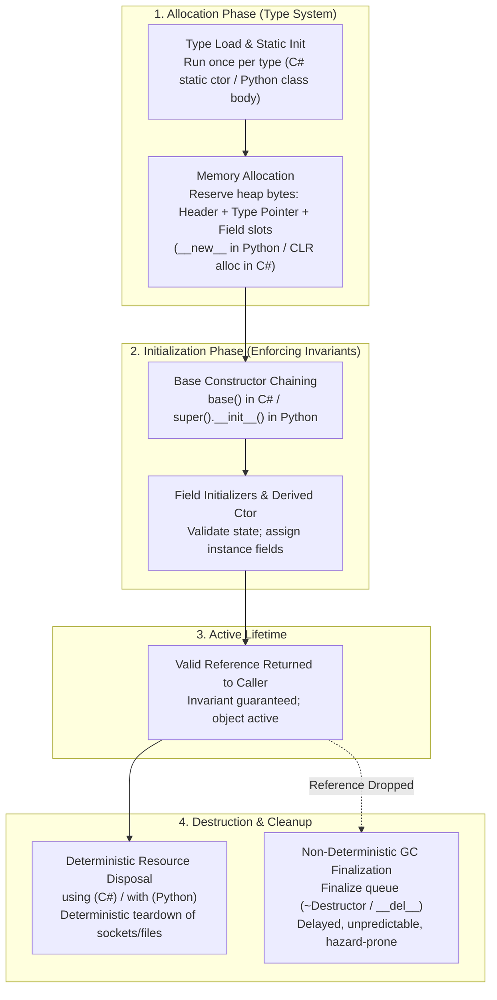

# Lesson 02: Classes, Objects, Constructors and Object Lifetime

> **Prerequisites:** [Lesson 01: The Four Pillars, Answered Well](../01-the-four-pillars-answered-well/README.md) and [Track 24 Overview](../README.md).  
> **Estimated Reading Time:** 20 minutes  
> **Target Audience:** Engineers preparing for LLD, OOP, C#, or Python technical screening and architecture rounds.

> [!NOTE]
> **In one line:** A **class** is the blueprint, an **object** is one instance with its own state; constructors establish valid state, and lifetime (GC, `Dispose`, `__del__`) decides when resources are released — not when memory is.

> [!TIP]
> **The One Rule of Object Lifetime:** Object construction is a strict two-phase contract: **allocation** reserves memory and establishes type identity, while **initialization** validates and binds state to enforce invariants before a reference escapes. Never leak references (`this` / `self`) before initialization finishes, and never delegate cleanup to non-deterministic garbage collector finalizers (`__del__` / `~Class()`)—always manage critical unmanaged resources deterministically using disposal scopes (`using` / `with`).

---

## 1. Why This Matters: The Interview Trap

"What really happens under the hood when you instantiate a class, and how does the runtime manage its lifecycle?" is a premier discriminator in technical interviews.

Junior candidates offer surface-level textbook answers:
> *"A class is a blueprint, and an object is a house built from the blueprint. The constructor initializes the variables, and the garbage collector deletes it when you are done."*

Interviewers probe deeper to uncover critical architectural gaps:
- Do you understand **memory layout** and the separation between **allocation** and **initialization**?
- Can you explain why calling virtual methods inside a constructor is a catastrophic bug in C#?
- Do you know how static type initializers behave under concurrent thread execution?
- Can you articulate why relying on Python's `__del__` or C#'s finalizer (`~Destructor()`) causes memory leaks, thread pool starvation, and process deadlocks?

A senior engineer answers with **runtime mechanics, invariant guarantees, and resource determinism**:
- **Class vs. Object vs. Instance:** A class is immutable type metadata (method tables, type descriptors, class object in memory) stored in the process runtime. An object is a concrete, contiguous block of heap memory containing an object header (sync block index, type method table pointer in CLR; reference count and `ob_type` pointer in CPython) alongside instance fields. An *instance* is that specific allocated object evaluated in relation to its declaring type.
- **Two-Phase Construction:** Instantiation separates physical allocation (`__new__` in Python or CLR memory allocation) from logical initialization (`__init__` in Python or the constructor body in C#).
- **Invariants & Chaining:** Constructors exist solely to guarantee that an object can **never** enter an illegal state. Constructor chaining (`this()` or `base()` in C#; `super().__init__()` in Python) ensures that base class invariants execute in topological order before derived specializations run.
- **Controlled Instantiation:** Private constructors restrict uncontrolled public instantiation, enforcing rigorous patterns like Singletons, Value Objects, and Static Factory Methods.
- **Resource Cleanup:** Garbage collection is asynchronous and non-deterministic. Systems requiring guaranteed cleanup of database sockets, file descriptors, or OS handles must enforce deterministic disposal patterns (`IDisposable` with `using` in C#; Context Managers `__enter__`/`__exit__` with `with` in Python).

---

## 2. Visual Mental Model & Taxonomic Comparison

### The Object Lifecycle Workflow

The following flowchart demonstrates how memory allocation, constructor chaining, invariant validation, active usage, and deterministic cleanup execute across an object's complete lifecycle.



### Taxonomic Comparison Matrix

| Lifecycle Dimension | C# (.NET Core / CLR) | Python (CPython Data Model) |
| :--- | :--- | :--- |
| **Allocation Mechanism** | Handled natively by CLR engine via `new` operator. Allocates header, method table pointer (`TypeHandle`), and fields. | Controlled explicitly via `__new__(cls, *args, **kwargs)`. Returns a newly created raw instance of `cls`. |
| **State Initialization** | Instance constructors: `public ClassName(...)`. | Instance initializer: `__init__(self, ...)`. Mutates the instance allocated by `__new__`. |
| **Constructor Overloading** | Native compile-time support: multiple constructors with distinct parameter lists. | No native overloading. Handled via default arguments, `*args`/`**kwargs`, `@classmethod` factories. |
| **Constructor Chaining** | Intra-class: `this(...)`. Inter-class: `base(...)`. Must be the first statement in the constructor declaration. | Intra-class: helper delegation or default args. Inter-class: `super().__init__(...)` explicitly in the method body. |
| **Type Initializers (Static Ctors)** | `static ClassName()`: Thread-safe, lazily executed by CLR exactly once before first instance creation or static member access. | Class body executes top-to-bottom at module import time; class attributes are bound immediately. |
| **Private Constructors** | `private ClassName(...)`: Prevents external `new`. Essential for static utility classes, singletons, and factory methods. | Convention-based: prefix `_ClassName` or raise an exception in `__init__` unless invoked from a trusted factory classmethod. |
| **Deterministic Cleanup** | `IDisposable` contract coupled with `using` declaration / block. Suppresses finalizer via `GC.SuppressFinalize`. | Context Management Protocol (`__enter__` and `__exit__`) coupled with the `with` statement. |
| **Finalizer / Destructor** | Finalizer: `~ClassName()`. Scheduled on CLR finalizer thread; non-deterministic, high performance overhead. | `__del__(self)`. Invoked when reference count hits 0; delayed during circular references or process shutdown. |

---

## 3. Code Implementation: Lifecycle, Chaining, and Memory Control

The following implementation contrasts lifecycle management in Python and C#. Both implementations showcase:
1. **Type initialization / static constructors.**
2. **Allocation vs. initialization (`__new__` vs. `__init__` / private singleton allocation).**
3. **Constructor chaining across base and derived types.**
4. **Enforcing private instantiation using Static Factory Methods.**
5. **Deterministic cleanup scopes (`with` / `using`) vs. dangerous finalizers.**

````carousel
```python
"""Demonstrates Object Lifecycle, Allocation vs Initialization, Chaining,

Static Setup, Private Constructor Pattern, and Deterministic Cleanup.
"""

from typing import Dict, Optional


class DatabaseConnection:
  _default_timeout: int = 30
  _active_connections: int = 0
  _type_initialized: bool = False

  def __new__(cls, *args, **kwargs):
    # Simulating static type initialization on first type access
    if not cls._type_initialized:
      print(
          f"[Type Init] DatabaseConnection registered (Default timeout:"
          f" {cls._default_timeout}s)"
      )
      cls._type_initialized = True
    return super().__new__(cls)

  def __init__(self, connection_id: str, timeout: int = 30) -> None:
    # 2. Initialization Phase: Enforce invariants
    if timeout <= 0:
      raise ValueError("Timeout must be strictly positive.")
    self.connection_id: str = connection_id
    self.timeout: int = timeout
    self.is_open: bool = True
    DatabaseConnection._active_connections += 1
    print(
        f"  [Init] Connection '{self.connection_id}' initialized (Timeout:"
        f" {self.timeout}s)"
    )

  def close(self) -> None:
    if self.is_open:
      self.is_open = False
      DatabaseConnection._active_connections -= 1
      print(
          f"  [Close] Connection '{self.connection_id}' closed. Active:"
          f" {DatabaseConnection._active_connections}"
      )

  # Deterministic Context Manager Protocol (__enter__ and __exit__)
  def __enter__(self) -> "DatabaseConnection":
    return self

  def __exit__(self, exc_type, exc_val, exc_tb) -> None:
    print(f"  [Exit] Releasing resource for '{self.connection_id}'")
    self.close()


# Allocation vs Initialization: Singleton Pattern via __new__
class ConfigurationRegistry:
  _instance: Optional["ConfigurationRegistry"] = None
  _settings: Dict[str, str] = {}

  def __new__(cls, *args, **kwargs) -> "ConfigurationRegistry":
    # __new__ controls raw heap memory allocation
    if cls._instance is None:
      print("  [Alloc] Allocating new memory for ConfigurationRegistry singleton")
      cls._instance = super().__new__(cls)
    else:
      print("  [Alloc] Returning existing ConfigurationRegistry instance")
    return cls._instance

  def __init__(self, app_name: str) -> None:
    # Note: __init__ executes every time ConfigurationRegistry() is called!
    self.app_name: str = app_name

  def set(self, key: str, value: str) -> None:
    self._settings[key] = value

  def get(self, key: str) -> Optional[str]:
    return self._settings.get(key)


# Constructor Chaining and Private Constructor (Factory Method)
class DbSession:

  def __init__(
      self, session_id: str, isolation_level: str = "READ_COMMITTED"
  ) -> None:
    self.session_id: str = session_id
    self.isolation_level: str = isolation_level
    print(
        f"  [Base Init] DbSession '{self.session_id}' with Isolation:"
        f" {self.isolation_level}"
    )


class SecureDbSession(DbSession):
  _ALLOW_CREATION: bool = False

  def __init__(
      self,
      session_id: str,
      user_role: str,
      isolation_level: str = "SERIALIZABLE",
  ) -> None:
    # Enforcing private instantiation: direct call raises exception
    if not SecureDbSession._ALLOW_CREATION:
      raise RuntimeError(
          "Direct instantiation forbidden. Use"
          " SecureDbSession.create_for_role()."
      )
    # Constructor chaining: call base class initializer
    super().__init__(session_id, isolation_level)
    self.user_role: str = user_role
    print(
        f"  [Derived Init] SecureDbSession initialized for Role:"
        f" {self.user_role}"
    )

  @classmethod
  def create_for_role(cls, session_id: str, user_role: str) -> "SecureDbSession":
    """Static factory method acting as the sole public construction entry point."""
    cls._ALLOW_CREATION = True
    try:
      return cls(session_id, user_role)
    finally:
      cls._ALLOW_CREATION = False


if __name__ == "__main__":
  print("--- 1. Static Initialization & Deterministic Cleanup ---")
  with DatabaseConnection("conn-001", 15) as conn:
    print(f"  [Work] Using connection: {conn.connection_id}")

  print("\n--- 2. Allocation (__new__) vs Initialization (__init__) ---")
  c1 = ConfigurationRegistry("PaymentApp")
  c1.set("env", "production")
  c2 = ConfigurationRegistry("PaymentApp")
  print(f"  Identical instance reference: {c1 is c2}")
  print(f"  Read key 'env' from c2: {c2.get('env')}")

  print("\n--- 3. Constructor Chaining & Static Factory ---")
  secure = SecureDbSession.create_for_role("sess-99", "Admin")
  print(f"  Session ready: {secure.session_id} ({secure.user_role})")
```
<!-- slide -->
```csharp
using System;
using System.Collections.Generic;

// 1. Static Constructor & Deterministic Cleanup (IDisposable)
public class DatabaseConnection : IDisposable
{
    private static readonly int _defaultTimeout;
    private static int _activeConnections;

    public string ConnectionId { get; }
    public int Timeout { get; }
    public bool IsOpen { get; private set; }

    // Static constructor (Type Initializer) runs exactly once before first use
    static DatabaseConnection()
    {
        _defaultTimeout = 30;
        _activeConnections = 0;
        Console.WriteLine($"[Type Init] DatabaseConnection registered (Default timeout: {_defaultTimeout}s)");
    }

    public DatabaseConnection(string connectionId, int timeout)
    {
        if (timeout <= 0)
            throw new ArgumentException("Timeout must be strictly positive.");
        ConnectionId = connectionId;
        Timeout = timeout;
        IsOpen = true;
        _activeConnections++;
        Console.WriteLine($"  [Init] Connection '{ConnectionId}' initialized (Timeout: {Timeout}s)");
    }

    // Intra-class constructor chaining using this(...)
    public DatabaseConnection(string connectionId) : this(connectionId, _defaultTimeout)
    {
    }

    public void Close()
    {
        if (IsOpen)
        {
            IsOpen = false;
            _activeConnections--;
            Console.WriteLine($"  [Close] Connection '{ConnectionId}' closed. Active: {_activeConnections}");
        }
    }

    // Deterministic disposal via IDisposable
    public void Dispose()
    {
        Console.WriteLine($"  [Exit] Releasing resource for '{ConnectionId}'");
        Close();
        // Suppress finalization to relieve the Garbage Collector finalizer thread
        GC.SuppressFinalize(this);
    }
}

// 2. Allocation vs Initialization: Singleton Pattern with Thread-Safe Allocation
public class ConfigurationRegistry
{
    private static ConfigurationRegistry? _instance;
    private static readonly object _lock = new();
    private readonly Dictionary<string, string> _settings = new();

    public string AppName { get; }

    // Private constructor blocks external `new ConfigurationRegistry(...)`
    private ConfigurationRegistry(string appName)
    {
        AppName = appName;
    }

    public static ConfigurationRegistry GetInstance(string appName)
    {
        lock (_lock)
        {
            if (_instance == null)
            {
                Console.WriteLine("  [Alloc] Allocating new memory for ConfigurationRegistry singleton");
                _instance = new ConfigurationRegistry(appName);
            }
            else
            {
                Console.WriteLine("  [Alloc] Returning existing ConfigurationRegistry instance");
            }
            return _instance;
        }
    }

    public void Set(string key, string value) => _settings[key] = value;
    public string? Get(string key) => _settings.TryGetValue(key, out var val) ? val : null;
}

// 3. Constructor Chaining across inheritance hierarchy (base(...)) and Static Factory
public class DbSession
{
    public string SessionId { get; }
    public string IsolationLevel { get; }

    public DbSession(string sessionId, string isolationLevel = "READ_COMMITTED")
    {
        SessionId = sessionId;
        IsolationLevel = isolationLevel;
        Console.WriteLine($"  [Base Init] DbSession '{SessionId}' with Isolation: {IsolationLevel}");
    }
}

public class SecureDbSession : DbSession
{
    public string UserRole { get; }

    // Private constructor: callers cannot instantiate directly
    private SecureDbSession(string sessionId, string userRole, string isolationLevel)
        : base(sessionId, isolationLevel) // Constructor chaining to base class
    {
        UserRole = userRole;
        Console.WriteLine($"  [Derived Init] SecureDbSession initialized for Role: {UserRole}");
    }

    // Static Factory Method
    public static SecureDbSession CreateForRole(string sessionId, string userRole)
    {
        return new SecureDbSession(sessionId, userRole, "SERIALIZABLE");
    }
}

public class Program
{
    public static void Main()
    {
        Console.WriteLine("--- 1. Static Initialization & Deterministic Cleanup ---");
        // Static constructor runs automatically before the first instance is created
        using (var conn = new DatabaseConnection("conn-001", 15))
        {
            Console.WriteLine($"  [Work] Using connection: {conn.ConnectionId}");
        }

        Console.WriteLine("\n--- 2. Allocation (__new__) vs Initialization (__init__) ---");
        var c1 = ConfigurationRegistry.GetInstance("PaymentApp");
        c1.Set("env", "production");
        var c2 = ConfigurationRegistry.GetInstance("PaymentApp");
        Console.WriteLine($"  Identical instance reference: {ReferenceEquals(c1, c2)}");
        Console.WriteLine($"  Read key 'env' from c2: {c2.Get("env")}");

        Console.WriteLine("\n--- 3. Constructor Chaining & Static Factory ---");
        var secure = SecureDbSession.CreateForRole("sess-99", "Admin");
        Console.WriteLine($"  Session ready: {secure.SessionId} ({secure.UserRole})");
    }
}
```
````

**Expected Output (Both Languages):**

```text
--- 1. Static Initialization & Deterministic Cleanup ---
[Type Init] DatabaseConnection registered (Default timeout: 30s)
  [Init] Connection 'conn-001' initialized (Timeout: 15s)
  [Work] Using connection: conn-001
  [Exit] Releasing resource for 'conn-001'
  [Close] Connection 'conn-001' closed. Active: 0

--- 2. Allocation (__new__) vs Initialization (__init__) ---
  [Alloc] Allocating new memory for ConfigurationRegistry singleton
  [Alloc] Returning existing ConfigurationRegistry instance
  Identical instance reference: True
  Read key 'env' from c2: production

--- 3. Constructor Chaining & Static Factory ---
  [Base Init] DbSession 'sess-99' with Isolation: SERIALIZABLE
  [Derived Init] SecureDbSession initialized for Role: Admin
  Session ready: sess-99 (Admin)
```

---

## 4. Where You Already Use It

Production backend architectures rely heavily on object lifetime semantics:

- **In .NET / C#:**
  - `HttpClient`: Instantiating `new HttpClient()` per request exhausts OS TCP sockets in high-throughput services. ASP.NET Core relies on a single long-lived instance managed via `IHttpClientFactory` or static initialization.
  - `System.Math` and `System.Convert`: Fully static classes whose IL metadata contains a `private` parameterless constructor, rendering `new Math()` a compile-time error.
  - `FileStream`, `SqlConnection`, `MemoryStream`: Core implementations of `IDisposable`. Their finalizer exists merely as a fallback to prevent native handle leaks if a developer neglects `using`. Calling `Dispose()` invokes `GC.SuppressFinalize(this)`, removing the object from the GC finalization queue and boosting throughput.
  - C# 12 Primary Constructors: `public class CustomerService(IRepository repo, ILogger logger)` generates compiler-managed private fields and constructor parameter capture directly on the class declaration.

- **In Python:**
  - Immutable Types (`tuple`, `str`, `int`, `float`, `frozenset`): Cannot be initialized in `__init__` because once allocated, their state cannot be mutated. Python standard libraries override `__new__` to calculate value hashes and memory offsets before returning the instance.
  - `enum.Enum`: Overrides `__new__` to intercept instantiation and return pre-allocated, unique singleton enum members rather than creating new objects.
  - `threading.Lock` and file descriptors (`open()`): Rely on context managers (`__enter__` and `__exit__`) to guarantee lock release and file closure even if unhandled exceptions crash the stack frame.
  - `@dataclass`: Synthesizes an optimized `__init__` and handles inheritance chaining (`__post_init__`) behind the scenes.

---

## 5. Pitfalls and When Not to Use It

### 1. The Virtual Method in Constructor Antipattern
In C#, invoking a `virtual` method from inside a base class constructor is hazardous. The CLR executes base constructors **before** derived constructors. If the virtual method is overridden in the derived class, the derived implementation executes **before the derived class constructor has initialized its own fields**!

```csharp
public class Base
{
    public Base()
    {
        // VIRTUAL METHOD CALL IN CONSTRUCTOR: Catastrophic in C#!
        Init();
    }
    public virtual void Init() { }
}

public class Derived : Base
{
    private readonly List<string> _items;

    public Derived()
    {
        _items = new List<string>();
    }

    public override void Init()
    {
        // THROWS NullReferenceException: _items is null! Derived constructor hasn't executed yet!
        _items.Add("Initialized");
    }
}
```
*Rule:* Keep constructors purely responsible for invariant assignment. Never call virtual or overridable methods inside a constructor.

### 2. Leaking `this` / `self` Before Construction Completes
Publishing an instance reference to an external registry, event bus, or background thread before the constructor finishes exposes partially initialized state to concurrent consumers:
```csharp
public class OrderProcessor
{
    public OrderProcessor(EventBus bus)
    {
        bus.Register(this); // BUG: Listener can invoke methods on `this` before the constructor finishes!
        // Remaining invariant initialization...
    }
}
```

### 3. Heavy I/O or Asynchronous Work in Constructors
Constructors cannot be declared `async`. Running blocking synchronous I/O (`File.ReadAllText()`, HTTP requests, DB queries) inside a constructor blocks caller threads, prevents timeout cancellations, and makes unit testing impossible.
*Fix:* Use the **Asynchronous Factory Method Pattern**:
```csharp
public class DocumentIndex
{
    private DocumentIndex() { } // Private constructor

    public static async Task<DocumentIndex> LoadAsync(string path)
    {
        var data = await File.ReadAllBytesAsync(path);
        var index = new DocumentIndex();
        index.Initialize(data);
        return index;
    }
}
```

### 4. Relying on `__del__` or Finalizers for Critical Teardown
Garbage collection is asynchronous. In C#, finalizers execute on a single dedicated finalizer thread; if a finalizer blocks or crashes, the entire runtime halts. In Python, objects with circular references historically prevented garbage collection if `__del__` was defined, and interpreter shutdown does not guarantee that `__del__` executes for living objects.
*Rule:* Finalizers are safety nets for unmanaged memory, not substitutes for deterministic resource cleanup (`Dispose()` / `with`).

---

## 6. Exercises & Practical Drills

### Drill 1: The Subclass Initialization Sequence
Examine the following C# code. What is printed to the console when `new Child()` is executed?

```csharp
public class Parent
{
    public Parent()
    {
        Console.Write("A");
        Print();
    }
    public virtual void Print() => Console.Write("B");
}

public class Child : Parent
{
    private string _tag = "C";

    public Child()
    {
        Console.Write("D");
    }
    public override void Print() => Console.Write(_tag ?? "Null");
}
```

<details>
<summary>Answer</summary>

**Output:** `ACD` (in C# 6+, or `ANullD` if field initializers run prior).

**Detailed Execution Mechanics:**
1. Field initializers for `Child` run first (`_tag = "C"`).
2. `Parent` base constructor executes. It prints `"A"`.
3. `Parent` constructor calls `Print()`. Because the actual runtime type is `Child`, the CLR vtable resolves to `Child.Print()`.
4. `Child.Print()` prints `_tag` (`"C"`). Note: While `_tag` was initialized by the field initializer, the body of `Child()` constructor has **not** executed yet!
5. Control returns to `Child()` constructor body, which prints `"D"`.

*Interview Takeaway:* This highlights why calling virtual methods inside constructors is an antipattern—derived methods execute before derived constructor bodies run.
</details>

---

### Drill 2: Implement a Thread-Safe Bounded Object Pool with Private Construction
Design a reusable `ConnectionPool` in Python or C# that restricts client code from instantiating connections directly. Only the pool should be capable of creating connection instances up to a maximum limit of 5.

<details>
<summary>Answer</summary>

**Python Implementation:**
```python
class PooledConnection:
  _ALLOW_CREATION = False

  def __init__(self, id: int):
    if not PooledConnection._ALLOW_CREATION:
      raise PermissionError(
          "Direct instantiation forbidden. Acquire from ConnectionPool."
      )
    self.id = id

  @classmethod
  def _create(cls, id: int) -> "PooledConnection":
    cls._ALLOW_CREATION = True
    try:
      return cls(id)
    finally:
      cls._ALLOW_CREATION = False


class ConnectionPool:

  def __init__(self, max_size: int = 5):
    self._max_size = max_size
    self._pool = [
        PooledConnection._create(i) for i in range(max_size)
    ]  # Pre-allocate

  def acquire(self) -> PooledConnection:
    if not self._pool:
      raise RuntimeError("Pool exhausted.")
    return self._pool.pop()

  def release(self, conn: PooledConnection) -> None:
    if len(self._pool) < self._max_size:
      self._pool.append(conn)
```
</details>

---

## 7. Interview Questions & Model Answers

<details>
<summary><strong>1. What is the difference between a class and an object? [BASIC]</strong></summary>

A **class** is a static compile-time and runtime type definition—a blueprint stored in runtime metadata containing field layouts, method tables (vtables), and access constraints. It occupies meta-space or type-descriptor memory and exists independently of whether any instances are created.

An **object** is a dynamic, concrete instance of a class allocated on the managed heap. It possesses identity (a distinct memory address or object ID), state (its own copy of instance fields), and behavior (dispatched via the type's method table pointer in its object header).

In short: a class defines the *type contract and structure*; an object is an *individual, stateful instantiation* of that structure residing in memory.

</details>

<details>
<summary><strong>2. What is constructor chaining? [SCENARIO]</strong></summary>

Constructor chaining is the practice of having one constructor invoke another constructor within the same class or across an inheritance hierarchy before executing its own body.

In C#, intra-class chaining uses `this(...)` to route multiple overloaded constructors to a single canonical master constructor, eliminating duplicated invariant validation. Inter-class chaining uses `base(...)` to guarantee that base class state is fully initialized before the derived class executes.

In Python, constructor chaining is achieved using `super().__init__(*args, **kwargs)`, which traverses the class's Method Resolution Order (MRO) to guarantee cooperative multiple inheritance. Chaining enforces DRY principles and guarantees that class invariants are validated top-down without skipping ancestor guarantees.

</details>

<details>
<summary><strong>3. What is a static constructor and when does it run? [SCENARIO]</strong></summary>

In C#, a **static constructor** (or type initializer) is a parameterless constructor declared with the `static` keyword used to initialize static fields or execute one-off type-level configuration.

The CLR guarantees that a static constructor is thread-safe and runs **exactly once** per application domain. It is triggered lazily: right before the first instance of the class is created or any static member of that class is accessed. If a static constructor throws an unhandled exception, the type remains uninitialized and unusable for the remainder of the AppDomain's lifetime, throwing a `TypeInitializationException` on all subsequent attempts.

In Python, there is no formal static constructor keyword. Instead, the entire class body is executed dynamically line-by-line when the module is imported, achieving equivalent one-time type initialization.

</details>

<details>
<summary><strong>4. What is the difference between `__new__` and `__init__`? [BASIC]</strong></summary>

In Python's data model, `__new__` and `__init__` represent the separation of **allocation** and **initialization**:

1. `__new__(cls, *args, **kwargs)` is the actual **constructor**. It is a static method (implicitly treated as such) that receives the class `cls` and is responsible for allocating raw memory on the heap and returning a new instance of `cls` (usually by delegating to `super().__new__(cls)`). It runs **first**.
2. `__init__(self, *args, **kwargs)` is the **initializer**. It receives the newly allocated instance `self` returned by `__new__` and mutates it by binding instance attributes and enforcing invariants.

You override `__new__` when you need to control the instantiation process itself—such as implementing the Singleton pattern, returning cached/flyweight instances, or subclassing immutable built-in types like `tuple`, `str`, or `int` where state must be defined at the moment of creation.

</details>

<details>
<summary><strong>5. Can a constructor be private? Why would you want one? [SCENARIO]</strong></summary>

Yes, a constructor can be marked `private`. When all constructors of a class are private, external consumers cannot invoke `new ClassName()`.

You use private constructors in three major architectural scenarios:
1. **Static Utility Classes:** Preventing instantiation of classes that only contain static utility methods (e.g., `System.Math`).
2. **Controlled Lifetime & Singletons:** Enforcing that only a single instance exists by restricting construction to an internal static accessor (`GetInstance()`).
3. **Static Factory Methods:** Forcing callers to use descriptive, intention-revealing factory methods (e.g., `ComplexNumber.FromCartesian(x, y)` vs. `ComplexNumber.FromPolar(r, theta)`), or running asynchronous setup logic before returning an initialized instance.

</details>

<details>
<summary><strong>6. A class opens a file in its constructor. How do you make sure it is closed? [SCENARIO]</strong></summary>

Do not rely on the finalizer or `__del__`; timing is non-deterministic. Implement `IDisposable` + `using` in C#, or `__enter__`/`__exit__` + `with` in Python, so cleanup runs at a known point even when exceptions happen.

</details>

---

## Try it

Run this to see `__new__` run before `__init__`, and why a "private constructor" is a convention in Python. Then sketch it in [LLD Studio](/tools/lld-studio/); see the [track hub](../README.md) for the constructor-chaining answer.

```python
order = []
class Config:
    _inst = None
    def __new__(cls):
        order.append("new")
        if cls._inst is None:
            cls._inst = super().__new__(cls)
        return cls._inst
    def __init__(self):
        order.append("init")

a, b = Config(), Config()
assert a is b                                   # one object
assert order == ["new", "init", "new", "init"]  # __init__ still runs each call
```

---

## One-page cheat sheet

```text
class = blueprint   object/instance = one concrete thing with its own state
__new__  creates the object   __init__  initialises it   (C#: ctor only)
Ctor chaining   C#: : base(...) / : this(...)    Py: super().__init__(...)
Static ctor (C#) runs once, before first use; Python: class body / metaclass
Private ctor -> factories, singletons, static helpers
Finalizer/__del__ = timing not guaranteed -> use Dispose / with-statement
Order (C#): field inits -> base ctor -> ctor body
```

---

## 8. Sources & Further Reading

- [Microsoft Learn: Constructors (C# Programming Guide)](https://learn.microsoft.com/en-us/dotnet/csharp/programming-guide/classes-and-structs/constructors)
- [Microsoft Learn: Static Constructors in C#](https://learn.microsoft.com/en-us/dotnet/csharp/programming-guide/classes-and-structs/static-constructors)
- [Microsoft Learn: Object Lifetime and Garbage Collection (.NET Fundamentals)](https://learn.microsoft.com/en-us/dotnet/standard/garbage-collection/fundamentals)
- [Python 3 Documentation: Data Model — Basic Customization (`__new__`, `__init__`, `__del__`)](https://docs.python.org/3/reference/datamodel.html#basic-customization)
- [PEP 343: The "with" Statement](https://peps.python.org/pep-0343/)

---

Previous: [The Four Pillars, Answered Well](../01-the-four-pillars-answered-well/README.md) · Next: [Abstract Class vs Interface](../03-abstract-class-vs-interface/README.md)
