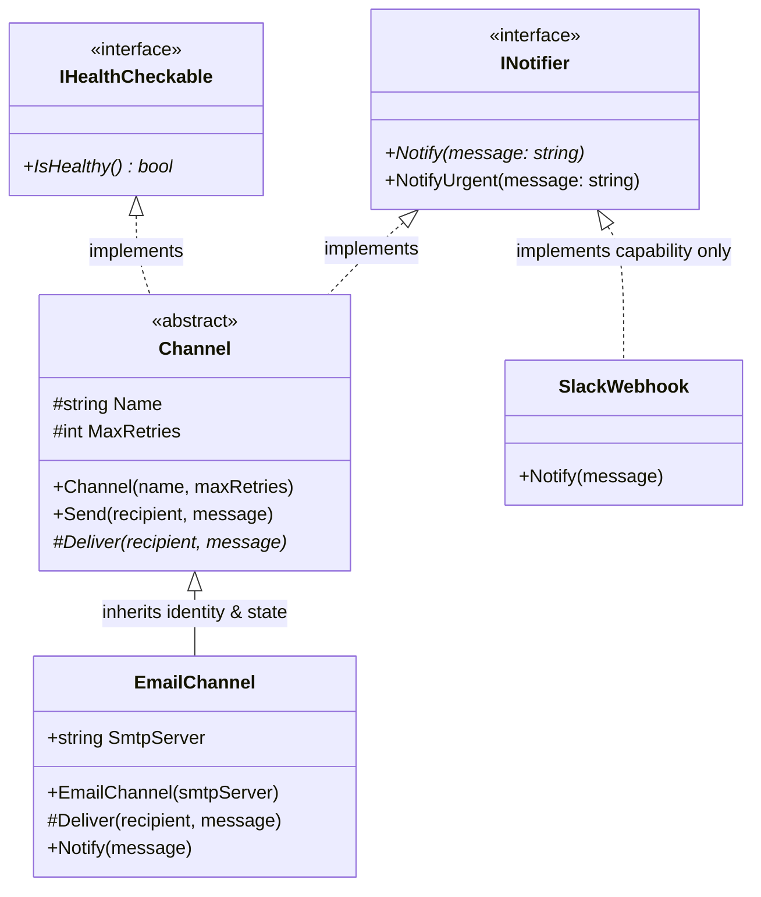

# Lesson 03: Abstract Class vs Interface

> **Prerequisites:** [Lesson 01: The Four Pillars, Answered Well](../01-the-four-pillars-answered-well/README.md) and [Track 24 Overview](../README.md).  
> **Estimated Reading Time:** 20 minutes  
> **Target Audience:** Engineers preparing for LLD, OOP, C#, or Python technical screening and architecture rounds.

> [!TIP]
> **The One Rule of Abstract Classes vs. Interfaces:** Use an **interface** to define a **capability or contract** (*"what an object can do"*, e.g., `IDisposable`, `IComparable`, `Iterable`); use an **abstract class** to define an **identity and reusable foundation** (*"what an object is"*, e.g., `Stream`, `DbConnection`, `Channel`), especially when subclasses must share mutable state, constructors, or template method algorithms.

---

## 1. Why This Matters: The Interview Trap

"What is the difference between an abstract class and an interface, and when do you choose which?" is asked in nearly every senior backend and LLD interview. 

A junior candidate recites syntax trivia:
> *"An abstract class has the `abstract` keyword and can have method implementations, while an interface only has method declarations without code."*

This answer is both outdated and shallow:
1. Since C# 8, interfaces **can** have method bodies (Default Interface Methods).
2. Python didn't historically have formal interfaces at all—it uses Abstract Base Classes (`abc.ABC`), duck typing, and structural subtyping (`typing.Protocol`).
3. It fails to answer the actual architectural question: **how do they impact coupling, memory, and evolution?**

A senior candidate answers with **structural capability and evolution**:
- **Interface:** Defines an **is-capable-of** contract. A class can implement multiple interfaces without inheriting implementation baggage. It has no instance fields, no constructors, and promotes loose coupling.
- **Abstract Class:** Defines an **is-a** core identity. A class can only inherit from one base class. It can maintain protected state, enforce constructor validation, and execute template method workflows.

---

## 2. Taxonomic Comparison: Decision Matrix

| Dimension | Interface (`interface` / `Protocol`) | Abstract Class (`abstract class` / `ABC`) |
| :--- | :--- | :--- |
| **Relationship** | **Can-do** capability (`IPrintable`, `IComparable`). | **Is-a** core identity (`Stream`, `Vehicle`). |
| **Multiple Inheritance** | **Yes:** A class can implement unlimited interfaces in C# and Python. | **No in C#:** Single class inheritance only. (Python allows multiple, but introduces MRO complexity). |
| **State / Fields** | **No instance state.** Cannot define instance fields (`int _count;`). | **Yes:** Can define protected/private instance fields, state, and backing variables. |
| **Constructors** | **No constructors.** Cannot be initialized with parameters. | **Yes:** Can define parameterized constructors to enforce invariant initialization in subclasses. |
| **Access Modifiers** | Historically public only. C# 8+ allows private/internal helper methods for default implementations. | Full support (`public`, `protected`, `private`, `internal`). |
| **Speed / Dispatch** | Interface dispatch (`itable` lookup) has a minor indirection cost compared to direct vtable calls. | Class dispatch (`vtable` slot index) is direct and JIT-optimized. |
| **API Evolution** | Adding a method historically broke all implementers. (C# 8 default methods mitigate this). | Adding a concrete method with a default implementation does not break subclasses. |

---

## 3. Visual Mental Model: Capabilities vs. Core Identity



Notice how `EmailChannel` is a full-fledged `Channel` (inheriting state, retry logic, and constructor invariants), while `SlackWebhook` is an independent lightweight entity that simply fulfills the `INotifier` capability without inheriting `Channel` state.

---

## 4. Code Implementation: Protocols, ABCs, and Interfaces

````carousel
```python
from abc import ABC, abstractmethod
from typing import Protocol, runtime_checkable


# 1. INTERFACE: Defined via typing.Protocol (PEP 544 Structural Subtyping)
@runtime_checkable
class Notifier(Protocol):
  """Interface contract: any class providing notify() qualifies automatically."""

  def notify(self, message: str) -> None:
    ...


# 2. ABSTRACT BASE CLASS: Encapsulates state, constructor, and template method
class Channel(ABC):

  def __init__(self, name: str, max_retries: int = 3) -> None:
    self.name: str = name  # Abstract classes can hold instance state
    self.max_retries: int = max_retries

  def send(self, recipient: str, message: str) -> None:
    """Concrete template method shared by all subclasses."""
    print(
        f"[{self.name}] Initiating send to {recipient} (max retries:"
        f" {self.max_retries})"
    )
    self._deliver(recipient, message)

  @abstractmethod
  def _deliver(self, recipient: str, message: str) -> None:
    """Abstract hook: subclasses MUST implement."""
    pass


# 3. CONCRETE SUBCLASS: Inherits state from Channel, conforms to Notifier
class EmailChannel(Channel):

  def __init__(self, smtp_server: str) -> None:
    super().__init__("Email", max_retries=2)
    self.smtp_server: str = smtp_server

  def _deliver(self, recipient: str, message: str) -> None:
    print(f"  SMTP {self.smtp_server} -> Sending '{message}' to {recipient}")

  def notify(self, message: str) -> None:
    self.send("admin@company.com", message)


# 4. PURE DUCK-TYPED IMPLEMENTER: Satisfies Notifier with zero inheritance
class SlackWebhook:

  def notify(self, message: str) -> None:
    print(f"[SlackWebhook] Posting to #alerts: '{message}'")


def broadcast(notifiers: list[Notifier], alert: str) -> None:
  for n in notifiers:
    n.notify(alert)


if __name__ == "__main__":
  email = EmailChannel("smtp.corp.internal")
  slack = SlackWebhook()

  # Verify structural subtyping conformance
  print(f"EmailChannel is Notifier: {isinstance(email, Notifier)}")
  print(f"SlackWebhook is Notifier: {isinstance(slack, Notifier)}")

  broadcast([email, slack], "High CPU load detected")
```
<!-- slide -->
```csharp
using System;
using System.Collections.Generic;

// 1. INTERFACE: Pure contract (what to do, no instance fields)
public interface INotifier
{
    void Notify(string message);

    // C# 8+ Default Interface Method (DIM) for non-breaking API evolution
    void NotifyUrgent(string message)
    {
        Notify($"[URGENT] {message}");
    }
}

public interface IHealthCheckable
{
    bool IsHealthy();
}

// 2. ABSTRACT BASE CLASS: Holds state, constructor, and partial template implementation
public abstract class Channel : INotifier, IHealthCheckable
{
    public string Name { get; }
    public int MaxRetries { get; }

    protected Channel(string name, int maxRetries = 3)
    {
        Name = name;
        MaxRetries = maxRetries;
    }

    public void Send(string recipient, string message)
    {
        Console.WriteLine($"[{Name}] Initiating send to {recipient} (max retries: {MaxRetries})");
        Deliver(recipient, message);
    }

    protected abstract void Deliver(string recipient, string message);

    public void Notify(string message)
    {
        Send("admin@company.com", message);
    }

    public virtual bool IsHealthy() => true;
}

// 3. CONCRETE SUBCLASS: Single inheritance from Channel, multiple interfaces allowed
public class EmailChannel : Channel
{
    public string SmtpServer { get; }

    public EmailChannel(string smtpServer) : base("Email", maxRetries: 2)
    {
        SmtpServer = smtpServer;
    }

    protected override void Deliver(string recipient, string message)
    {
        Console.WriteLine($"  SMTP {SmtpServer} -> Sending '{message}' to {recipient}");
    }
}

// 4. ANOTHER IMPLEMENTATION OF INotifier WITHOUT INHERITING Channel
public class SlackWebhook : INotifier
{
    public void Notify(string message)
    {
        Console.WriteLine($"[SlackWebhook] Posting to #alerts: '{message}'");
    }
}

public class Program
{
    public static void Broadcast(IEnumerable<INotifier> notifiers, string alert)
    {
        foreach (var n in notifiers)
        {
            n.Notify(alert);
        }
    }

    public static void Main()
    {
        var email = new EmailChannel("smtp.corp.internal");
        var slack = new SlackWebhook();

        Console.WriteLine($"EmailChannel is Notifier: {email is INotifier}");
        Console.WriteLine($"SlackWebhook is Notifier: {slack is INotifier}");

        Broadcast(new INotifier[] { email, slack }, "High CPU load detected");
    }
}
```
````

**Expected Output (Both Languages):**

```text
EmailChannel is Notifier: True
SlackWebhook is Notifier: True
[Email] Initiating send to admin@company.com (max retries: 2)
  SMTP smtp.corp.internal -> Sending 'High CPU load detected' to admin@company.com
[SlackWebhook] Posting to #alerts: 'High CPU load detected'
```

---

## 5. Where You Already Use It

- **In .NET Framework / Runtime:**
  - `Stream` is an **abstract class**: it holds internal state (buffers, read timeouts) and provides concrete template implementations for `CopyToAsync()` and `ReadByte()`, while leaving `Read()`, `Write()`, and `Seek()` abstract.
  - `IDisposable`, `IEnumerable<T>`, `IComparable<T>` are **interfaces**: they represent cross-cutting capabilities. A struct, class, or record can implement `IDisposable` without becoming a subclass of anything.
  - `HttpMessageHandler` is an abstract class; `DelegatingHandler` subclasses it to build middleware-style HTTP client pipelines.

- **In Python Standard Library:**
  - `io.IOBase` and `io.RawIOBase`: abstract base classes for I/O streams with concrete implementations for readline algorithms.
  - `collections.abc.Iterable`, `Iterator`, `Mapping`: abstract base classes used both for `isinstance()` checks and reusable mixin logic (`Mapping` provides concrete `.get()`, `__contains__()`, and `keys()` once `__getitem__`, `__iter__`, and `__len__` are implemented).
  - `typing.Protocol`: introduced in Python 3.8 (PEP 544) to support static duck typing without explicit inheritance.

---

## 6. Pitfalls & Tricky Edge Cases

### The C# 8 Default Interface Method (DIM) Trap
In C# 8+, you can write concrete method bodies inside an interface:
```csharp
public interface ILogger
{
    void Log(string message);
    void LogError(string err) => Log($"[ERROR] {err}"); // Default implementation
}
```
**The Trap:** Candidates think: *"Interfaces now have method bodies, so they are the same as abstract classes!"*  
**The Reality:** 
1. Interfaces **still cannot have instance fields** (no `private int _retryCount;`).
2. Default interface methods are **not inherited by the implementing class's public surface**. If `class ConsoleLogger : ILogger` does not override `LogError`, you cannot call `new ConsoleLogger().LogError("fail")`. You must cast it to the interface: `((ILogger)logger).LogError("fail")`.

### Can You Instantiate an Abstract Class?
- **In C#:** No. The compiler rejects `new Channel(...)` with error `CS0144: Cannot create an instance of the abstract type or interface 'Channel'`.
- **In Python:** If an `ABC` has at least one `@abstractmethod`, Python raises `TypeError: Can't instantiate abstract class Channel with abstract method _deliver`. However, if you forget the `@abstractmethod` decorator, Python will instantiate the class without warning!

---

## 7. Exercises & Practical Drills

### Exercise 1: Interface or Abstract Class?
Categorize each of the following requirements:
1. You need to enable sorting on any entity in an e-commerce catalog (`Product`, `Customer`, `Order`).
2. You are building an ETL pipeline with `Extract()`, `Transform()`, `Load()`, where the `RunPipeline()` loop and logging are identical across all pipelines, but each source reads differently.
3. You want to inject a caching layer (`RedisCache`, `InMemoryCache`) into your web controllers.

<details>
<summary>Answer</summary>

1. **Interface (`IComparable<T>`):** Cross-cutting capability across unrelated types that share no common domain identity.
2. **Abstract Class (Template Method pattern):** Shared state, common execution orchestration (`RunPipeline()`), and invariant initialization.
3. **Interface (`ICacheService`):** Pure dependency injection contract. Callers only care about `.Get(key)` and `.Set(key, val)`.
</details>

---

## 8. Interview Questions & Model Answers

> [!interview]
> **Question 1: What is the difference between an abstract class and an interface?**  
> **Strong Answer:**  
> "An interface defines a **contract of capabilities**—what a class can do—without holding any instance state. A class can implement multiple interfaces, enabling flexible, loose coupling.  
> 
> An abstract class defines an **identity and base implementation**—what an object is. It can hold instance fields, maintain constructor invariants, define access modifiers, and implement template methods, but a class can only inherit from one abstract base in languages like C# and Java."

> [!interview]
> **Question 2: When would you choose an abstract class over an interface?**  
> **Strong Answer:**  
> "I choose an abstract class when:  
> 1. Subclasses share common **mutable instance state** or need **constructor validation** upon initialization.  
> 2. I am implementing the **Template Method pattern**, where an algorithm's high-level workflow is fixed in the base class, and only specific primitive steps are overridden by subclasses.  
> 3. I am developing an internal class hierarchy where the types share a genuine **is-a** relationship (like `Stream` in .NET or `IOBase` in Python).  
> 
> For public API surfaces and dependency injection boundaries, I default to interfaces."

> [!interview]
> **Question 3: Can an interface have a method body in C#?**  
> **Strong Answer:**  
> "Yes, since C# 8, interfaces support **Default Interface Methods (DIM)**. They were introduced primarily to allow library authors to evolve interfaces by adding new methods with default implementations without breaking existing third-party implementers.  
> 
> However, an interface is still not an abstract class: it cannot define instance fields, cannot have constructors, and the default method is only accessible when the instance is explicitly referenced through the interface type."

> [!interview]
> **Question 4: Does Python have interfaces?**  
> **Strong Answer:**  
> "Historically, Python relied entirely on **duck typing**—if an object walks like a duck and quacks like a duck, it is treated as a duck, without requiring explicit interface declarations.  
> 
> In modern Python, there are two formal ways to define interfaces:  
> 1. **Nominal subtyping via `abc.ABC` and `@abstractmethod`:** Requires explicit inheritance, and Python prevents instantiation if any abstract methods are missing.  
> 2. **Structural subtyping via `typing.Protocol` (PEP 544):** Enables static type checkers (like mypy or pyright) to verify that a class matches an interface without requiring explicit inheritance, combining the safety of interfaces with Pythonic duck typing."

> [!interview]
> **Question 5: Can you instantiate an abstract class?**  
> **Strong Answer:**  
> "No, abstract classes cannot be directly instantiated.  
> - In C#, attempting to call `new AbstractClass()` produces a compile-time error (`CS0144`).  
> - In Python, calling `MyABC()` raises a runtime `TypeError` if the class inherits from `abc.ABC` and contains at least one `@abstractmethod`.  
> An abstract class exists solely as an incomplete blueprint that must be derived and completed by a concrete subclass."

---

## 9. Sources & Further Reading

- [Microsoft Learn: Abstract and Sealed Classes and Class Members](https://learn.microsoft.com/en-us/dotnet/csharp/programming-guide/classes-and-structs/abstract-and-sealed-classes-and-class-members)
- [Microsoft Learn: Interfaces - Define behavior for multiple types](https://learn.microsoft.com/en-us/dotnet/csharp/fundamentals/types/interfaces)
- [Microsoft Learn: Default Interface Methods](https://learn.microsoft.com/en-us/dotnet/csharp/advanced-topics/interface-cycle/default-interface-methods-versions)
- [Python 3 Documentation: abc — Abstract Base Classes](https://docs.python.org/3/library/abc.html)
- [PEP 544: Protocols: Structural subtyping (static duck typing)](https://peps.python.org/pep-0544/)

---

Previous: [Classes, Objects, Constructors and Object Lifetime](../02-classes-objects-constructors-and-lifetime/README.md) · Next: [Overloading, Overriding and Polymorphism](../04-overloading-overriding-and-polymorphism/README.md)
