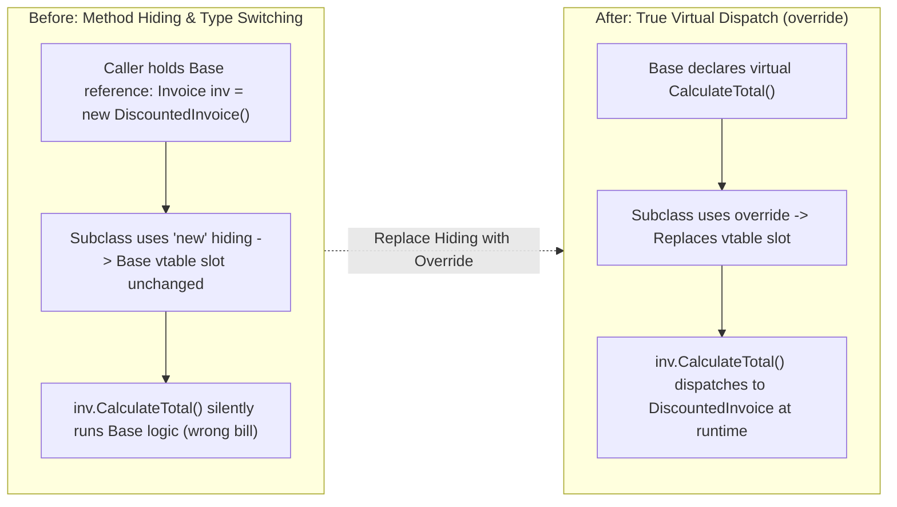
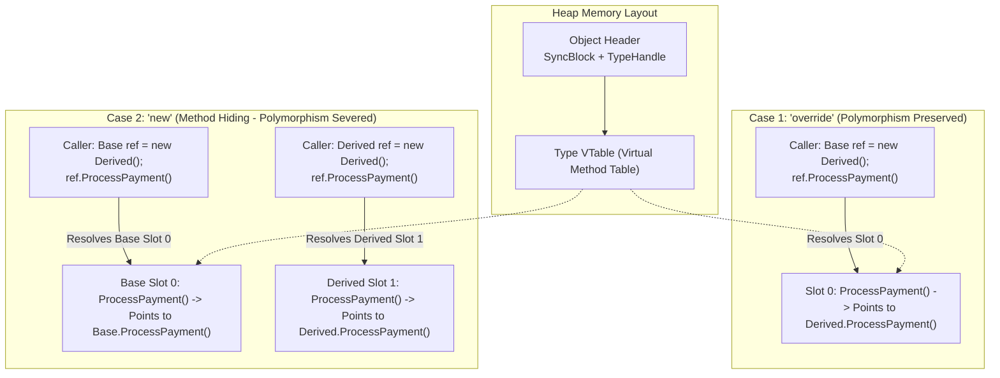

# Lesson 04: Overloading, Overriding and Polymorphism

> **Prerequisites:** [Lesson 03: Abstract Class vs Interface](../03-abstract-class-vs-interface/README.md) and [Track 24 Overview](../README.md).  
> **Estimated Reading Time:** 20 minutes  
> **Target Audience:** Engineers preparing for LLD, OOP, C#, or Python technical screening and architecture rounds.

> [!NOTE]
> **In one line:** **Overloading** = same name, different signature, resolved at *compile time*; **overriding** = subclass replaces a virtual method, resolved at *run time* through the object's real type.

> [!TIP]
> **The One Rule of Polymorphism:** **Overloading** is static compile-time polymorphism where the compiler selects a method based on static parameter types in the calling scope; **overriding** is dynamic runtime polymorphism where the runtime engine dispatches calls via an object's Virtual Method Table (vtable in C#) or Method Resolution Order (MRO in Python) based on the actual heap type. Never use method hiding (`new`) when polymorphic substitution is intended.

---

## 1. Why This Matters: The Interview Trap

Polymorphism ("many forms") is the bedrock of extensible object-oriented design. Yet candidates routinely confuse compile-time static binding with runtime dynamic dispatch.

During an LLD or backend screening interview, interviewers present scenarios like this:
```csharp
Base b = new Derived();
b.Execute();
```
*"Which method executes, how does the CPU/CLR find it, and what happens if `Derived` defined `Execute` with `new` instead of `override`?"*

A junior candidate recites:
> *"Overloading is same method name with different parameters in the same class. Overriding is rewriting a parent method in a child class. `new` creates a new method. Python doesn't have overloading because it doesn't have types."*

This response fails to demonstrate senior engineering depth:
1. **Misses dispatch mechanics:** It ignores how the compiler binds early calls via method signatures versus how the CLR resolves late calls via vtable pointers in the object header.
2. **Misunderstands C#'s `new` modifier:** It fails to explain that `new` hides a member by creating an independent vtable slot, intentionally severing the polymorphism chain and violating the Liskov Substitution Principle (LSP).
3. **Misunderstands Python's architecture:** Python lacks compile-time overloading not because it lacks types, but because class namespaces are dynamic dictionaries (`__dict__`) where method definitions overwrite previous keys of the same name.

A senior engineer explains with **memory structures, dispatch latency, and interface contracts**:
- **Overloading (Static Polymorphism):** Evaluated entirely at compile time. The compiler inspects the argument types and generates direct `call` instructions to distinct, mangled method symbols. There is zero runtime performance penalty.
- **Overriding (Dynamic Polymorphism):** Evaluated at runtime via virtual dispatch (`callvirt` in IL). The runtime inspects the actual object instance on the heap, navigates to its type descriptor, and looks up the method address in its Virtual Method Table (vtable).
- **C# `override` vs `new`:** `override` replaces the function pointer in the inherited vtable slot, ensuring polymorphic dispatch even when accessed through a base-type reference. In contrast, `new` introduces an independent slot; callers using base-class references invoke the base implementation, while callers using derived-class references invoke the derived implementation.
- **Python's Approach:** Handled dynamically via single-method definitions using default arguments, variadic parameters (`*args`, `**kwargs`), `@functools.singledispatch` for type-based routing, or `@typing.overload` for static analyzer type hints.
- **Static Methods:** Static methods belong to the type namespace, not to instance heap allocations. Because they lack an instance reference (`this`/`self`) and an object header vtable pointer, they cannot participate in dynamic polymorphic dispatch.

---

## 1A. The Visual Story: Problem -> Analogy -> Solution

### The Problem (Why Naive Code Breaks)

In a billing engine, a developer adds a `DiscountedInvoice` subclass and accidentally uses C#'s `new` keyword (`public new decimal CalculateTotal()`) instead of `override`, or writes a `switch (invoice.Type)` block in the caller. When `BillingRunner` iterates over `List<Invoice>` and calls `invoice.CalculateTotal()`, the base `Invoice.CalculateTotal()` runs silently instead of `DiscountedInvoice`'s logic—overcharging enterprise customers by thousands of dollars with zero compiler warnings.

### Real-World Analogy

Think of **a universal remote's "Play" button vs. a restaurant combo menu**:
- **Overriding (Runtime Polymorphism):** Pressing **Play** on a universal remote sends the same `Play()` signal, but at runtime a **Blu-ray player** spins a disc while a **Spotify speaker** streams audio—resolved by the actual device receiving the signal.
- **Overloading (Compile-Time Polymorphism):** Ordering **"Coffee()"** vs. **"Coffee(size, oatMilk)"**—the barista knows at order time (compile time) which exact recipe to run based on the arguments you passed.

### Visual Problem -> Solution Diagram



### Where It Is Used & Progressive Buildup

| Ecosystem / Context | Real-World Usage |
| :--- | :--- |
| **.NET** | `virtual`/`override` in `DbContext.SaveChanges()`, `Object.ToString()`, `HttpMessageHandler.SendAsync`; method overloading in `Console.WriteLine`. |
| **Python** | Dynamic method overriding via MRO (`super()`), operator overloading (`__add__`, `__eq__`), `@functools.singledispatch` for type-based dispatch. |
| **Go** | No method overloading (explicit names like `ParseInt` vs `ParseFloat`); runtime polymorphism via interface `itable` dispatch. |
| **TypeScript** | Method overloading via type-level signature overloads + single implementation; runtime overriding via `override` keyword (TS 4.3+ `noImplicitOverride`). |
| **LLD Interviews** | Pricing/Discount Engine, Logger Sinks, File Parsers, Shape/Canvas Renderer, Middleware Chain. |

**Progressive Buildup:**
1. **Simple:** Use **overloading** (or default args) for ergonomic caller APIs that accept different input shapes for the same operation.
2. **Extensible:** Use **overriding** (`virtual`/`override` or interface dispatch) so callers operate on a base/interface type without `switch` statements.
3. **Production:** Enable compiler guardrails (`noImplicitOverride` in TS, `override` checks in C#, `Protocol` + `mypy` in Python) so accidental method hiding is caught at build time, never in billing production.

---

## 2. Visual Mental Model & Taxonomic Comparison

### The Virtual Method Table (vtable) Architecture

The diagram below contrasts how C# and the CLR resolve method calls when using `override` versus method hiding (`new`).



### Taxonomic Comparison Matrix

| Dimension | Method Overloading | Method Overriding (`override`) | Method Hiding (`new` in C#) |
| :--- | :--- | :--- | :--- |
| **Polymorphism Type** | Static (Compile-Time / Early Binding). | Dynamic (Runtime / Late Binding). | Static / Non-Polymorphic Hiding. |
| **Resolution Time** | Compile time via method signature matching. | Runtime via vtable slot lookup (CLR) or MRO (`__dict__`). | Compile time based on the **declared reference type**. |
| **VTable Effect (C#)** | No vtable needed; generates direct IL `call` instructions. | Replaces the function pointer in the base type's vtable slot. | Leaves base vtable slot untouched; creates a distinct new slot. |
| **Liskov Substitution** | Preserved (distinct signatures). | Fully preserved (substitutable under base reference). | **Severed!** Calling via base reference bypasses derived code. |
| **Python Equivalent** | Not supported directly; use default args or `singledispatch`. | Standard inheritance; derived class overrides method name. | Normal attribute assignment; shadows base class in MRO. |
| **Performance** | Zero overhead (direct branch target). | 1 extra memory indirection (pointer dereference). | Zero overhead (bound statically to declared reference type). |

---

## 3. Code Implementation: Overloading, Overriding, and Operator Overloading

The following implementations demonstrate:
1. **Operator Overloading** with a value object (`Money`).
2. **Dynamic Runtime Polymorphism** via `virtual` and `override`.
3. **Method Hiding (`new` in C#)** and its dynamic resolution equivalent in Python.
4. **Static Method Binding** demonstrating the absence of polymorphic dispatch.
5. **Overloading Resolution** (compile-time in C#, default parameter dispatch in Python).

````carousel
```python
"""Demonstrates Overriding, Static Method Binding, Operator Overloading, and

Idiomatic Python Overloading.
"""


# 1. Operator Overloading (Value Object)
class Money:

  def __init__(self, amount: float, currency: str = "USD") -> None:
    self.amount: float = round(amount, 2)
    self.currency: str = currency

  def __add__(self, other: "Money") -> "Money":
    if self.currency != other.currency:
      raise ValueError("Cannot add different currencies")
    return Money(self.amount + other.amount, self.currency)

  def __repr__(self) -> str:
    return f"{self.currency} {self.amount:.2f}"


# 2. Runtime Polymorphism: Override vs Method Hiding
class PaymentGateway:

  def process_payment(self, money: Money) -> str:
    return f"[Base] Processing generic payment of {money}"

  @staticmethod
  def gateway_type() -> str:
    return "GenericGateway"


class ModernCardGateway(PaymentGateway):

  def process_payment(self, money: Money) -> str:
    # Overrides base method in class dictionary
    return f"[ModernCard] Processed card payment of {money} via VTable override"

  @staticmethod
  def gateway_type() -> str:
    return "ModernCardGateway"


class LegacyHidingGateway(PaymentGateway):

  def process_payment(self, money: Money) -> str:
    # Shadows the base method in the class dictionary
    return f"[LegacyHiding] Processed payment of {money} via hidden new method"


# 3. Method Overloading in Python (Default arguments & single dispatch)
class RefundService:

  def refund(self, money: Money, reason: str = "Customer requested") -> str:
    """Idiomatic Python overloading using optional parameters."""
    return f"Refunded {money}. Reason: {reason}"


if __name__ == "__main__":
  print("--- 1. Operator Overloading ---")
  m1 = Money(50.25)
  m2 = Money(25.50)
  print(f"Total: {m1 + m2}")

  print("\n--- 2. Runtime Polymorphism (override vs new) ---")
  # Polymorphic dispatch resolves to derived implementation
  g1: PaymentGateway = ModernCardGateway()
  print(g1.process_payment(Money(100.00)))

  g2 = LegacyHidingGateway()
  # Calling via explicit base type simulates static binding (C# 'new' through base reference)
  print(PaymentGateway.process_payment(g2, Money(100.00)))
  # Direct invocation uses the derived class method
  print(g2.process_payment(Money(100.00)))

  print("\n--- 3. Static Method Binding (No Dynamic Dispatch) ---")
  print(f"Direct Class Call: {ModernCardGateway.gateway_type()}")
  print(f"Base Class Call: {PaymentGateway.gateway_type()}")

  print("\n--- 4. Method Overloading Resolution ---")
  refunds = RefundService()
  print(refunds.refund(Money(15.00)))
  print(refunds.refund(Money(30.00), "Defective merchandise"))
```
<!-- slide -->
```csharp
using System;

// 1. Operator Overloading (Value Object)
public readonly struct Money : IEquatable<Money>
{
    public decimal Amount { get; }
    public string Currency { get; }

    public Money(decimal amount, string currency = "USD")
    {
        Amount = Math.Round(amount, 2);
        Currency = currency;
    }

    public static Money operator +(Money a, Money b)
    {
        if (a.Currency != b.Currency)
            throw new InvalidOperationException("Cannot add different currencies");
        return new Money(a.Amount + b.Amount, a.Currency);
    }

    public bool Equals(Money other) => Amount == other.Amount && Currency == other.Currency;
    public override bool Equals(object? obj) => obj is Money other && Equals(other);
    public override int GetHashCode() => HashCode.Combine(Amount, Currency);
    public override string ToString() => $"{Currency} {Amount:F2}";
}

// 2. Runtime Polymorphism: Virtual, Override, and New (Method Hiding)
public class PaymentGateway
{
    public virtual string ProcessPayment(Money money)
    {
        return $"[Base] Processing generic payment of {money}";
    }

    public static string GatewayType() => "GenericGateway";
}

public class ModernCardGateway : PaymentGateway
{
    // Proper polymorphism: replaces the function pointer in the inherited vtable slot
    public override string ProcessPayment(Money money)
    {
        return $"[ModernCard] Processed card payment of {money} via VTable override";
    }

    public new static string GatewayType() => "ModernCardGateway";
}

public class LegacyHidingGateway : PaymentGateway
{
    // Method hiding: creates a separate vtable slot; base slot remains untouched
    public new string ProcessPayment(Money money)
    {
        return $"[LegacyHiding] Processed payment of {money} via hidden new method";
    }
}

// 3. Compile-time Method Overloading
public class RefundService
{
    public string Refund(Money money)
    {
        return Refund(money, "Customer requested");
    }

    public string Refund(Money money, string reason)
    {
        return $"Refunded {money}. Reason: {reason}";
    }
}

public class Program
{
    public static void Main()
    {
        Console.WriteLine("--- 1. Operator Overloading ---");
        var m1 = new Money(50.25m);
        var m2 = new Money(25.50m);
        Console.WriteLine($"Total: {m1 + m2}");

        Console.WriteLine("\n--- 2. Runtime Polymorphism (override vs new) ---");
        PaymentGateway g1 = new ModernCardGateway();
        Console.WriteLine(g1.ProcessPayment(new Money(100.00m)));

        PaymentGateway g2 = new LegacyHidingGateway();
        // Danger! Calls Base method because 'new' did not replace Base's vtable slot
        Console.WriteLine(g2.ProcessPayment(new Money(100.00m)));

        LegacyHidingGateway g2Direct = (LegacyHidingGateway)g2;
        Console.WriteLine(g2Direct.ProcessPayment(new Money(100.00m)));

        Console.WriteLine("\n--- 3. Static Method Binding (No Dynamic Dispatch) ---");
        Console.WriteLine($"Direct Class Call: {ModernCardGateway.GatewayType()}");
        Console.WriteLine($"Base Class Call: {PaymentGateway.GatewayType()}");

        Console.WriteLine("\n--- 4. Method Overloading Resolution ---");
        var refunds = new RefundService();
        Console.WriteLine(refunds.Refund(new Money(15.00m)));
        Console.WriteLine(refunds.Refund(new Money(30.00m), "Defective merchandise"));
    }
}
```
````

**Expected Output (Both Languages):**

```text
--- 1. Operator Overloading ---
Total: USD 75.75

--- 2. Runtime Polymorphism (override vs new) ---
[ModernCard] Processed card payment of USD 100.00 via VTable override
[Base] Processing generic payment of USD 100.00
[LegacyHiding] Processed payment of USD 100.00 via hidden new method

--- 3. Static Method Binding (No Dynamic Dispatch) ---
Direct Class Call: ModernCardGateway
Base Class Call: GenericGateway

--- 4. Method Overloading Resolution ---
Refunded USD 15.00. Reason: Customer requested
Refunded USD 30.00. Reason: Defective merchandise
```

---

## 4. Where You Already Use It

Polymorphic dispatch and overloading form the core of enterprise frameworks:

- **In .NET / C#:**
  - `object.ToString()`, `object.Equals()`, `object.GetHashCode()`: The three root virtual methods every .NET class overrides.
  - `Console.WriteLine()`: Offers 18 separate compile-time overloads (`bool`, `char`, `decimal`, `string`, `ReadOnlySpan<char>`), enabling zero-allocation logging for value types.
  - Entity Framework Core (`DbContext.OnModelCreating(ModelBuilder)`): Declared `virtual` in the base class to let developers configure database schema mappings via `override`.
  - `sealed` keyword on overridden methods: `public sealed override void Process()` prevents subclasses from further altering the method, allowing the JIT compiler to devirtualize the call and inline it directly for high-performance loops.

- **In Python:**
  - Magic Methods (`__repr__`, `__len__`, `__getitem__`, `__eq__`): Python's protocols rely entirely on runtime method overriding. Calling `len(my_obj)` delegates directly to `my_obj.__len__()`.
  - `functools.singledispatch` & `singledispatchmethod`: Standard library decorator transforming a function into a generic function that dispatches based on the type of the first argument.
  - `typing.overload`: Used ubiquitously in type stubs (e.g., standard library stubs for `open()`, `json.loads()`, and NumPy) to provide IDE autocomplete and static type safety without altering runtime bytecode.

---

## 5. Pitfalls and When Not to Use It

### 1. The Accidental `new` Modifier Trap
If a developer forgets the `override` keyword when subclassing a class in C#, the compiler issues a warning (`CS0108`) and assumes `new`. If an upstream dependency collection holds references to the base type, the derived logic will **silently never execute**:
```csharp
public class BaseValidator { public virtual bool IsValid() => true; }
public class StrictValidator : BaseValidator { public bool IsValid() => false; } // Missing override!

BaseValidator validator = new StrictValidator();
validator.IsValid(); // RETURNS TRUE! Silent production security bypass!
```

### 2. Overload Resolution Ambiguity with `null` or Implicit Conversions
When overloaded methods share compatible types, passing `null` or primitives causes ambiguous compiler errors or unexpected target selection:
```csharp
public void Log(string message) { }
public void Log(Exception ex) { }

Log(null); // Compile Error: The call is ambiguous between 'Log(string)' and 'Log(Exception)'
```

### 3. Misleading Operator Overloading
Overloading operators for actions that are not mathematically intuitive or associative violates the Principle of Least Surprise:
```csharp
// ANTIPATTERN: Using addition operator to execute a database query or send network packet
var result = database + query; // Confusing and dangerous
```

---

## 6. Exercises & Practical Drills

### Drill 1: The Reference-Type Method Hiding Puzzle
What does the following C# snippet print?

```csharp
public class A
{
    public virtual void Show() => Console.Write("A");
}

public class B : A
{
    public override void Show() => Console.Write("B");
}

public class C : B
{
    public new virtual void Show() => Console.Write("C");
}

public class D : C
{
    public override void Show() => Console.Write("D");
}

public class Program
{
    public static void Main()
    {
        A ref1 = new D();
        B ref2 = new D();
        C ref3 = new D();

        ref1.Show();
        ref2.Show();
        ref3.Show();
    }
}
```

<details>
<summary>Answer</summary>

**Output:** `BBD`

**Explanation:**
1. Class `C` declared `new virtual void Show()`. This severed the inheritance chain starting from `A` and `B`. It created a **brand-new vtable slot** for `C`.
2. Class `D` overrides `C`'s new slot, pointing `C`'s slot to `D.Show()`.
3. When calling via `A ref1` or `B ref2`, the CLR inspects the **original vtable slot (Slot 0)**. In Slot 0, the latest override was in class `B` (`B.Show()`). Therefore, `ref1.Show()` and `ref2.Show()` both print `"B"`.
4. When calling via `C ref3`, the CLR inspects the **new vtable slot (Slot 1)** introduced by `C`. In Slot 1, class `D` overrode it. Therefore, `ref3.Show()` prints `"D"`.
</details>

---

### Drill 2: Refactor Type-Checking Branching to `singledispatchmethod`
Refactor this Python code to eliminate brittle `isinstance` checks using `@functools.singledispatchmethod`:

```python
class EventDispatcher:

  def dispatch(self, event):
    if isinstance(event, str):
      print(f"Text Event: {event}")
    elif isinstance(event, dict):
      print(f"Payload Event with {len(event)} keys")
    elif isinstance(event, int):
      print(f"Ping Event #{event}")
    else:
      raise ValueError("Unsupported event")
```

<details>
<summary>Answer</summary>

```python
from functools import singledispatchmethod


class EventDispatcher:

  @singledispatchmethod
  def dispatch(self, event):
    raise ValueError(f"Unsupported event type: {type(event)}")

  @dispatch.register
  def _(self, event: str):
    print(f"Text Event: {event}")

  @dispatch.register
  def _(self, event: dict):
    print(f"Payload Event with {len(event)} keys")

  @dispatch.register
  def _(self, event: int):
    print(f"Ping Event #{event}")
```
</details>

---

## 7. Interview Questions & Model Answers

<details>
<summary><strong>1. What is the difference between overloading and overriding? [BASIC]</strong></summary>

The fundamental difference lies in **when and how method dispatch is resolved**:

1. **Method Overloading** is **compile-time (static) polymorphism**. Methods share the exact same name within the same scope but have distinct parameter signatures (count, types, or order). The compiler evaluates the call site and binds it directly to a specific static method symbol. It has zero runtime indirection cost.
2. **Method Overriding** is **runtime (dynamic) polymorphism**. A subclass redefines the implementation of a `virtual` method inherited from its parent class using the identical signature. The method to execute is resolved dynamically at runtime by dereferencing the actual object's Virtual Method Table (vtable in C#) or traversing the class MRO (in Python).

Overloading adjusts behavior based on the static caller arguments; overriding adjusts behavior based on the dynamic type of the target object.

</details>

<details>
<summary><strong>2. What is the difference between `override` and `new` in C#? [BASIC]</strong></summary>

In C#, both keywords alter method behavior in a derived class, but their effect on the Virtual Method Table (vtable) and polymorphism is fundamentally opposite:

- **`override` extends runtime polymorphism.** It replaces the function pointer in the inherited vtable slot allocated by the base class. Regardless of whether the object is accessed through a base-class reference (`Base b = new Derived()`) or a derived-class reference, `Derived`'s implementation will execute. This honors the Liskov Substitution Principle.
- **`new` (method hiding) severs polymorphism.** It leaves the inherited base vtable slot untouched and creates an entirely separate, distinct method slot for the derived type. If the object is invoked via a base reference, the **base method** executes; if invoked via a derived reference, the **derived method** executes.

Using `new` is dangerous in domain hierarchies because it causes contradictory behavior depending on how the caller references the instance.

</details>

<details>
<summary><strong>3. Does Python support method overloading? [TRICKY]</strong></summary>

No, Python does not support compile-time method overloading in the classical C++ or C# sense.

In Python, a class definition is executed sequentially as a dictionary namespace (`class.__dict__`). If you declare two methods with the same name in the same class, the second method definition simply overwrites the first in the class dictionary.

However, Python achieves equivalent functionality through three idiomatic patterns:
1. **Default & Variadic Arguments:** Defining a single method with optional parameters (`val=None`) or `*args, **kwargs`.
2. **Single Dispatch:** Using the standard library decorator `@functools.singledispatch` or `@functools.singledispatchmethod` to register distinct handlers based on the argument's type.
3. **Type Hint Overloads:** Using `@typing.overload` to declare multiple type signatures for static type checkers (Mypy) while providing a single unified implementation function at runtime.

</details>

<details>
<summary><strong>4. What is runtime polymorphism, and how does the language find the right method? [BASIC]</strong></summary>

Runtime polymorphism is the ability of different concrete objects to respond to the same method invocation in their own specialized way when accessed through a common base abstraction.

Languages resolve the target method at runtime through specific dispatch data structures:
- **In C# (.NET CLR):** Every heap-allocated object has an object header containing a pointer to its `TypeHandle` (Method Table). For `virtual` methods, the compiler emits a `callvirt` IL instruction. At runtime, the CPU reads the object's method table pointer, navigates to the fixed offset (index) allocated for that virtual slot, and jumps directly to the function pointer stored there. This requires two pointer dereferences.
- **In Python:** Resolution uses dynamic attribute lookup guided by the class's **Method Resolution Order (MRO)**. When `obj.method()` is called, Python checks `obj.__dict__`, then traverses `type(obj).__mro__` checking each class's `__dict__` until it finds the callable descriptor, binding `self` to create a bound method.

</details>

<details>
<summary><strong>5. Can you override a static method? [TRICKY]</strong></summary>

No, static methods **cannot** be overridden polymorphically in either C# or Python.

Dynamic overriding requires runtime virtual dispatch, which depends on an instantiated object residing on the heap with an object header pointing to a vtable. Static methods belong strictly to the **type or module namespace**, not to an instance.

- In C#, calling `StaticMethod()` generates a static IL `call` instruction bound directly to the declaring type symbol at compile time. Defining a static method with the same name in a derived class merely **hides** the base method (`new`), resolving according to the declared type reference.
- In Python, `@staticmethod` creates a callable object inside the class namespace that does not receive an implicit `self` or `cls`. While a subclass can shadow a parent class's static method in its own dictionary, invoking the method through the base class or an unbound reference will never dynamically dispatch to the derived class.

</details>

<details>
<summary><strong>6. In C#, `Base b = new Derived(); b.Run();` where Derived declares `new void Run()`. Which runs? [TRICKY]</strong></summary>

`Base.Run`. `new` only hides the member; the call is bound by the *static* type, not the runtime type. With `virtual`/`override` the `Derived` version runs. Mixing the two is a classic source of bugs, so prefer `override` and treat the `new` warning as an error.

</details>

---

## Try it

Run this to see runtime dispatch and Python's substitute for overloading. Then draw `Shape.area()` with two subclasses in [LLD Studio](/tools/lld-studio/); the [track hub](../README.md) has the `override` vs `new` question.

```python
from functools import singledispatch

class Animal:
    def speak(self): return "..."
class Dog(Animal):
    def speak(self): return "woof"              # overriding: run-time dispatch

pets: list[Animal] = [Animal(), Dog()]
assert [p.speak() for p in pets] == ["...", "woof"]

@singledispatch                                 # Python's "overloading"
def show(x): return "other"
@show.register
def _(x: int): return "int"
@show.register
def _(x: str): return "str"
assert (show(1), show("a"), show(1.5)) == ("int", "str", "other")
```

---

## One-page cheat sheet

```text
OVERLOAD   same name, different params   compile-time   C#/Java yes, Python no
OVERRIDE   same signature in subclass     run-time (vtable)   needs virtual/override
C#  virtual + override -> polymorphic     new -> hides (static type decides!)
C#  sealed override stops further overriding
Python  default args | *args | functools.singledispatch | duck typing
Static methods: hidden, never overridden
Polymorphism = reference type X, behaviour of object type Y
```

---

## 8. Sources & Further Reading

- [Microsoft Learn: Polymorphism in C#](https://learn.microsoft.com/en-us/dotnet/csharp/fundamentals/object-oriented/polymorphism)
- [Microsoft Learn: Knowing When to Use Override and New Keywords](https://learn.microsoft.com/en-us/dotnet/csharp/programming-guide/classes-and-structs/knowing-when-to-use-override-and-new-keywords)
- [Microsoft Learn: Operator Overloading in C#](https://learn.microsoft.com/en-us/dotnet/csharp/language-reference/operators/operator-overloading)
- [Python 3 Documentation: `functools.singledispatch`](https://docs.python.org/3/library/functools.html#functools.singledispatch)
- [PEP 484: Type Hints - Overload Decorator](https://peps.python.org/pep-0484/#function-method-overloading)

---

Previous: [Abstract Class vs Interface](../03-abstract-class-vs-interface/README.md) · Next: [Inheritance, Composition and the Diamond Problem](../05-inheritance-composition-and-the-diamond-problem/README.md)
