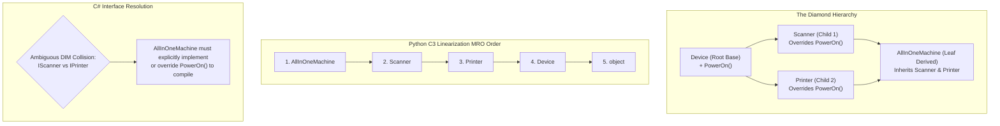

# Lesson 05: Inheritance, Composition and the Diamond Problem

> **Prerequisites:** [Lesson 04: Overloading, Overriding and Polymorphism](../04-overloading-overriding-and-polymorphism/README.md) and [Track 24 Overview](../README.md).  
> **Estimated Reading Time:** 20 minutes  
> **Target Audience:** Engineers preparing for LLD, OOP, C#, or Python technical screening and architecture rounds.

> [!NOTE]
> **In one line:** Prefer **composition** (has-a, swappable at runtime) over **inheritance** (is-a, locked at compile time) unless the subtype truly honours the base's contract; multiple inheritance gives you the **diamond**, which C# forbids for classes and Python resolves with the MRO.

> [!TIP]
> **The One Rule of Inheritance vs. Composition:** Inherit strictly when an authentic, immutable **is-a** relationship exists and you need to substitute subclasses polymorphically under a contract without modifying base behavior; otherwise, **compose**. Composition turns rigid compile-time coupling into dynamic runtime flexibility, completely eliminating fragile base classes and the diamond problem.

---

## 1. Why This Matters: The Interview Trap

"Why is composition preferred over inheritance, and what is the diamond problem?" is one of the most reliable tests of an engineer's design maturity.

A junior candidate recites standard tropes:
> *"Inheritance is an is-a relationship, and composition is a has-a relationship. You should favor composition because everyone says inheritance is bad. The diamond problem is when two parents have the same method and the compiler gets confused."*

This response lacks architectural depth and mechanics:
1. It fails to identify the **Fragile Base Class problem**, where an internal optimization or refactoring in a parent class silently breaks derived classes.
2. It fails to explain why inheritance causes a **combinatorial class explosion** when multidimensional features must be combined.
3. It fails to explain how modern languages resolve multiple inheritance: why C# banned multiple class inheritance while supporting multiple interface contracts, and how Python computes a deterministic, monotonic dispatch path using **C3 Linearization**.

A senior engineer explains with **coupling dynamics, dispatch algorithms, and testability**:
- **Coupling & Encapsulation:** Inheritance breaches encapsulation by exposing protected internal mechanics to subclasses ("white-box reuse"). If `BaseClass.Add()` internally calls `BaseClass.AddRange()`, an overriding subclass that intercepts both will double-count items. Composition ("black-box reuse") restricts interaction strictly through public interfaces.
- **Dynamic Swapping & Testability:** Inherited behavior is hardcoded at compile time. Composed collaborators can be swapped dynamically at runtime (e.g., switching from `FastMemoryCache` to `DistributedRedisCache`) and easily replaced with mock objects during unit testing.
- **The Diamond Problem:** Arises when class `D` inherits from classes `B` and `C`, both of which inherit from class `A`. If `B` and `C` override a method from `A`, which implementation does `D` invoke?
- **Language Solutions:**
  - **C#:** Banned multiple class inheritance completely (`CS1721`), avoiding dual-memory layout and constructor-state ambiguities. Multiple interface implementation is permitted, and since C# 8, Default Interface Method (DIM) collisions must be resolved explicitly by the implementing class.
  - **Python:** Fully supports multiple class inheritance by employing the **C3 Linearization algorithm** to calculate a deterministic Method Resolution Order (`__mro__`). Python's `super()` does not mean "call my syntactic parent"—it means **"call the next class in the runtime MRO chain"** (cooperative multiple inheritance).
- **Mixins:** Small, focused classes or traits that inject reusable orthogonal capabilities (such as JSON serialization, audit logging, or validation) without participating in domain identity or maintaining independent instance state.

---

## 2. Visual Mental Model & Taxonomic Comparison

### The Diamond Problem Architecture & C3 Resolution

The diagram below illustrates the classic diamond hierarchy and how Python's C3 Linearization linearizes the graph into an unambiguous execution chain compared to C#'s interface resolution.



### Taxonomic Comparison Matrix

| Architectural Pattern | Relationship | Coupling Degree | State Sharing | Runtime Flexibility | Diamond Hazard |
| :--- | :--- | :--- | :--- | :--- | :--- |
| **Class Inheritance** | **Is-A** (Core identity) | **High (White-Box)**: Subclass depends on parent internals. | Shared mutable state via `protected` fields. | **Static**: Fixed at compile time; cannot swap base class. | **Severe**: Leads to duplicate state and dispatch collisions. |
| **Object Composition** | **Has-A** (Collaboration) | **Low (Black-Box)**: Interacts solely through public contracts. | Encapsulated; each object owns private state. | **Dynamic**: Can swap collaborators at runtime via DI. | **None**: No shared ancestry or inheritance branches. |
| **Mixins (Python)** | **Equipped-With** (Trait) | **Moderate**: Mixin expects host methods/attributes. | Stateless or strictly additive attributes. | **Semi-Dynamic**: Combined at class definition time. | **Resolved**: Deterministically handled by C3 MRO. |
| **Interfaces / DIM (C#)** | **Can-Do** (Capability) | **Low**: Defines purely contracts and default traits. | **No instance state**: Cannot define instance fields. | **High**: Polymorphic pluggability across any type hierarchy. | **Resolved**: Compiler forces explicit member override. |

---

## 3. Code Implementation: Diamond Resolution, Mixins, and Composition

The following implementations demonstrate:
1. **The Diamond Problem & Resolution:** Cooperative MRO execution via `super()` in Python; explicit interface resolution in C#.
2. **The Mixin / Trait Pattern:** Adding orthogonal capabilities (`ToJson`, `LogAudit`) without domain subclassing.
3. **Refactoring Inheritance to Composition:** Eliminating subclass explosion using injected formatters and transports.

````carousel
```python
"""Demonstrates the Diamond Problem (C3 MRO), Mixin Architecture, and

Refactoring Inheritance to Composition.
"""

import json
from typing import Protocol


# 1. THE DIAMOND PROBLEM & C3 LINEARIZATION (MRO)
class Device:

  def power_on(self) -> str:
    return "Device [Base Core]"


class Printer(Device):

  def power_on(self) -> str:
    # super() traverses the MRO dynamically, calling Scanner or Device depending on context
    return f"Printer -> {super().power_on()}"


class Scanner(Device):

  def power_on(self) -> str:
    # In AllInOneMachine, the next class in MRO after Scanner is Printer!
    return f"Scanner -> {super().power_on()}"


class AllInOneMachine(Scanner, Printer):

  def power_on(self) -> str:
    return f"AllInOne -> {super().power_on()}"


# 2. MIXIN PATTERN (Reusable capabilities without identity/state)
class JsonExportMixin:

  def to_json(self) -> str:
    # Mixins inspect host instance dictionary
    return json.dumps(self.__dict__, separators=(",", ":"))


class AuditLogMixin:

  def log_audit(self, action: str) -> str:
    return f"[AUDIT] Action '{action}' on {self.__class__.__name__}"


class UserAccount(JsonExportMixin, AuditLogMixin):

  def __init__(self, username: str, email: str) -> None:
    self.username = username
    self.email = email


# 3. REFACTORING INHERITANCE TO COMPOSITION
class MessageFormatter(Protocol):

  def format(self, message: str) -> str:
    ...


class TransportSender(Protocol):

  def send(self, recipient: str, payload: str) -> str:
    ...


class PlainTextFormatter:

  def format(self, message: str) -> str:
    return f"[Plain] {message}"


class EmailTransport:

  def send(self, recipient: str, payload: str) -> str:
    return f"Sent Email to {recipient}: '{payload}'"


class NotificationService:
  # Favoring Composition: Collaborators are injected via constructor
  def __init__(
      self, formatter: MessageFormatter, sender: TransportSender
  ) -> None:
    self._formatter = formatter
    self._sender = sender

  def notify(self, recipient: str, message: str) -> str:
    formatted = self._formatter.format(message)
    return self._sender.send(recipient, formatted)


if __name__ == "__main__":
  print("--- 1. Diamond Problem & C3 MRO ---")
  machine = AllInOneMachine()
  print(machine.power_on())
  print(
      "Resolution: Ambiguity resolved (C# via interface implementation, Python"
      " via C3 MRO)"
  )

  print("\n--- 2. Mixin Capabilities ---")
  user = UserAccount("alice99", "alice@example.com")
  print(user.log_audit("LOGIN"))
  print(f"Serialized: {user.to_json()}")

  print("\n--- 3. Composition over Inheritance ---")
  service = NotificationService(PlainTextFormatter(), EmailTransport())
  print(service.notify("dev@company.com", "Deployment completed"))
```
<!-- slide -->
```csharp
using System;
using System.Text.Json;

// 1. THE DIAMOND PROBLEM IN C#
// Multiple class inheritance is banned (CS1721).
// With C# 8 Default Interface Methods (DIM), diamond hierarchies on interfaces must be resolved explicitly.
public interface IDevice
{
    string PowerOn() => "Device [Base Core]";
}

public interface IScanner : IDevice
{
    new string PowerOn() => "Scanner -> Device [Base Core]";
}

public interface IPrinter : IDevice
{
    new string PowerOn() => "Printer -> Device [Base Core]";
}

public class AllInOneMachine : IScanner, IPrinter
{
    // The class overrides PowerOn to resolve the diamond collision between IScanner and IPrinter
    public string PowerOn()
    {
        return "AllInOne -> Scanner -> Printer -> Device [Base Core]";
    }
}

// 2. MIXIN PATTERN IN C# (Default Interface Methods acting as stateless traits)
public interface IJsonExportable
{
    string ToJson() => JsonSerializer.Serialize(this, GetType());
}

public interface IAuditLoggable
{
    string LogAudit(string action) => $"[AUDIT] Action '{action}' on {GetType().Name}";
}

public class UserAccount : IJsonExportable, IAuditLoggable
{
    public string username { get; set; }
    public string email { get; set; }

    public UserAccount(string username, string email)
    {
        this.username = username;
        this.email = email;
    }
}

// 3. REFACTORING INHERITANCE TO COMPOSITION
public interface IMessageFormatter
{
    string Format(string message);
}

public interface ITransportSender
{
    string Send(string recipient, string payload);
}

public class PlainTextFormatter : IMessageFormatter
{
    public string Format(string message) => $"[Plain] {message}";
}

public class EmailTransport : ITransportSender
{
    public string Send(string recipient, string payload) =>
        $"Sent Email to {recipient}: '{payload}'";
}

public class NotificationService
{
    private readonly IMessageFormatter _formatter;
    private readonly ITransportSender _sender;

    // Composition via Dependency Injection
    public NotificationService(IMessageFormatter formatter, ITransportSender sender)
    {
        _formatter = formatter;
        _sender = sender;
    }

    public string Notify(string recipient, string message)
    {
        string formatted = _formatter.Format(message);
        return _sender.Send(recipient, formatted);
    }
}

public class Program
{
    public static void Main()
    {
        Console.WriteLine("--- 1. Diamond Problem & C3 MRO ---");
        var machine = new AllInOneMachine();
        Console.WriteLine(machine.PowerOn());
        Console.WriteLine("Resolution: Ambiguity resolved (C# via interface implementation, Python via C3 MRO)");

        Console.WriteLine("\n--- 2. Mixin Capabilities ---");
        var user = new UserAccount("alice99", "alice@example.com");
        Console.WriteLine(((IAuditLoggable)user).LogAudit("LOGIN"));
        Console.WriteLine($"Serialized: {((IJsonExportable)user).ToJson()}");

        Console.WriteLine("\n--- 3. Composition over Inheritance ---");
        var service = new NotificationService(new PlainTextFormatter(), new EmailTransport());
        Console.WriteLine(service.Notify("dev@company.com", "Deployment completed"));
    }
}
```
````

**Expected Output (Both Languages):**

```text
--- 1. Diamond Problem & C3 MRO ---
AllInOne -> Scanner -> Printer -> Device [Base Core]
Resolution: Ambiguity resolved (C# via interface implementation, Python via C3 MRO)

--- 2. Mixin Capabilities ---
[AUDIT] Action 'LOGIN' on UserAccount
Serialized: {"username":"alice99","email":"alice@example.com"}

--- 3. Composition over Inheritance ---
Sent Email to dev@company.com: '[Plain] Deployment completed'
```

---

## 4. Where You Already Use It

Standard production frameworks heavily prioritize composition and traits:

- **In .NET / C#:**
  - ASP.NET Core Middleware Pipeline: Each HTTP middleware (`UseAuthentication`, `UseRouting`, `UseEndpoints`) wraps a `RequestDelegate`. ASP.NET Core rejected the monolithic `HttpApplication` inheritance model in favor of pure delegate composition.
  - `System.IO.Stream`: Rather than creating classes like `BufferedGZipEncryptedFileStream`, .NET composes streams: `new CryptoStream(new GZipStream(new FileStream(...)))`. This is the classic Decorator Pattern.
  - Multi-interface types: `List<T>` implements `IList<T>`, `ICollection<T>`, `IEnumerable<T>`, `IReadOnlyList<T>`, demonstrating capability composition without multiple class inheritance.
  - Default Interface Methods (C# 8+): Enables interface evolution by providing default traits without breaking existing third-party implementers.

- **In Python:**
  - Django Class-Based Views (CBVs): Django constructs views using mixins: `class CreateUserView(LoginRequiredMixin, PermissionRequiredMixin, CreateView)`.
  - `socketserver.ThreadingMixIn` and `socketserver.ForkingMixIn`: Added to base server classes (`TCPServer`) to convert synchronous socket loops into threaded or multiprocess servers without altering socket connection logic.
  - `collections.UserDict` and `collections.UserList`: Subclassing `dict` in CPython is notorious for failing to invoke overridden methods from C-level builtins. `UserDict` solves this by **composing** an underlying dictionary in `self.data`.

---

## 5. Pitfalls and When Not to Use It

### 1. The Fragile Base Class Problem
Consider a base collection whose `Add` method internally delegates to `AddRange`:
```csharp
public class BaseList
{
    public virtual void Add(int item) { /* store item */ }
    public virtual void AddRange(IEnumerable<int> items)
    {
        foreach (var item in items) Add(item); // Base calls its own virtual method!
    }
}

public class CountingList : BaseList
{
    public int Count { get; private set; }
    public override void Add(int item) { Count++; base.Add(item); }
    public override void AddRange(IEnumerable<int> items)
    {
        Count += items.Count(); // Adds count once
        base.AddRange(items);   // BUG: Base calls Add() in a loop, adding count twice!
    }
}
```
Subclasses are tightly coupled to the private implementation details of their ancestors. If the base class refactors `AddRange` to not call `Add`, the subclass silently breaks.
*Fix:* Use composition. Inject an `IList<int>` and track counts cleanly without inheriting.

### 2. Forwarding Hell (Over-Composition)
Excessive dogmatism against inheritance can produce "forwarding hell," where a wrapper class writes 30 boilerplate delegation methods just to forward calls to an internal field:
```csharp
public class WrappedList<T>
{
    private readonly List<T> _inner = new();
    public int Count => _inner.Count;
    public void Clear() => _inner.Clear();
    public bool Contains(T item) => _inner.Contains(item);
    // 25 more boilerplate forwarding methods...
}
```
If an object genuinely **is** a specialized type and requires zero modification of base behavior, single inheritance is completely acceptable.

### 3. Non-Cooperative `super()` in Python
In multiple inheritance, if any class in the inheritance chain fails to call `super().__init__(*args, **kwargs)` or hardcodes a direct parent call `ParentClass.__init__(self)`, the C3 Linearization chain is abruptly severed, leaving downstream mixins uninitialized:
```python
# BROKEN: Hardcoded parent call breaks MRO chain for multiple inheritance!
class BrokenScanner(Device):

  def __init__(self):
    Device.__init__(self)  # Bypasses next class in MRO!
```

### 4. C# DIM Infinite Recursion
In C#, if an implementing class defines `public void Method()` and attempts to invoke a default interface method on `this` via `((IInterface)this).Method()`, the CLR re-dispatches right back to the class's `public void Method()`, causing an immediate `StackOverflowException`.

---

## 6. Exercises & Practical Drills

### Drill 1: Calculate the C3 Linearization MRO Manually
Given the following Python hierarchy:
```python
class O:
  pass


class A(O):
  pass


class B(O):
  pass


class C(O):
  pass


class X(A, B):
  pass


class Y(B, C):
  pass


class Z(X, Y):
  pass
```
Determine the exact `Z.__mro__` sequence using C3 Linearization.

<details>
<summary>Answer</summary>

**Rule of C3 Linearization:** `L[Z] = Z + merge(L[X], L[Y], (X, Y))`
1. `L[O] = [O]`
2. `L[A] = [A, O]`
3. `L[B] = [B, O]`
4. `L[C] = [C, O]`
5. `L[X] = [X, A, B, O]`
6. `L[Y] = [Y, B, C, O]`
7. `L[Z] = Z + merge([X, A, B, O], [Y, B, C, O], [X, Y])`
   - Pick `X` (not in the tail of any list): `[Z, X] + merge([A, B, O], [Y, B, C, O], [Y])`
   - Pick `A` (not in tail): `[Z, X, A] + merge([B, O], [Y, B, C, O], [Y])`
   - Can we pick `B`? No, `B` is in the tail of `[Y, B, C, O]`.
   - Pick `Y` (not in tail): `[Z, X, A, Y] + merge([B, O], [B, C, O])`
   - Pick `B` (now clear): `[Z, X, A, Y, B] + merge([O], [C, O])`
   - Can we pick `O`? No, `O` is in tail of `[C, O]`.
   - Pick `C`: `[Z, X, A, Y, B, C] + merge([O], [O])`
   - Pick `O`: `[Z, X, A, Y, B, C, O]`

**Final MRO:** `Z -> X -> A -> Y -> B -> C -> O`
</details>

---

### Drill 2: Refactor Combinatorial Subclass Explosion to Composition
An e-commerce system has the following class explosion:
- `StandardOrder`
- `ExpressOrder`
- `GiftWrappedStandardOrder`
- `GiftWrappedExpressOrder`
- `DiscountedGiftWrappedExpressOrder`

How would you refactor this using composition?

<details>
<summary>Answer</summary>

Separate the independent axes of variation using the **Strategy** and **Decorator** patterns:
1. Create a core `Order` entity containing items and base calculations.
2. Inject a `DeliveryStrategy` (`StandardDelivery`, `ExpressDelivery`).
3. Wrap or compose optional features:
   - A `GiftWrapOption` component or pricing modifier.
   - A `DiscountPolicy` (`SeasonalDiscount`, `VipDiscount`).

The single `Order` class now composes `IDeliveryStrategy`, `IDiscountPolicy`, and `IGiftWrapService`, reducing an exponential $2^N$ class hierarchy down to a linear set of reusable, swappable components.
</details>

---

## 7. Interview Questions & Model Answers

<details>
<summary><strong>1. Why is composition often preferred to inheritance? [BASIC]</strong></summary>

Composition is favored over inheritance in modern low-level design for four primary architectural reasons:

1. **Preserves Encapsulation (Prevents Fragile Base Class):** Inheritance exposes internal implementation details of ancestors to subclasses ('white-box reuse'). Changes to parent class orchestration frequently break subclass invariants. Composition interacts strictly through public interfaces ('black-box reuse').
2. **Runtime Flexibility:** Inheritance hierarchies are statically frozen at compile time; an instance of `SqlRepository` cannot transform into `InMemoryRepository` at runtime. With composition, dependencies are injected as interfaces, allowing runtime swapping of strategies.
3. **Avoids Class Explosions:** Combining multiple orthogonal features via inheritance leads to a combinatorial explosion of subclasses (`EncryptedBufferedFileStream`). Composition handles this linearly through the Decorator or Strategy patterns.
4. **Testability & Mocking:** Composed dependencies can be trivially replaced with unit test mocks and stubs, whereas hardcoded base class methods often trigger unwanted database connections or external I/O.

</details>

<details>
<summary><strong>2. What is the diamond problem? [BASIC]</strong></summary>

The diamond problem is an architectural ambiguity that arises in multiple inheritance when a class `D` inherits from two classes `B` and `C`, both of which inherit from a common base class `A`.

The ambiguity occurs on two fronts:
1. **State Duplication:** Does `D` contain one shared copy of `A`'s fields, or two separate copies (one via `B` and one via `C`)? If `A` has an `int _id`, which `_id` is updated?
2. **Method Dispatch Collision:** If `A` defines a method `Execute()`, and both `B` and `C` override `Execute()` with different behavior, which method should execute when a caller invokes `d.Execute()`?

Without an unambiguous resolution rule, the compiler or runtime cannot determine the correct dispatch target.

</details>

<details>
<summary><strong>3. Does C# support multiple inheritance? [TRICKY]</strong></summary>

C# does **not** support multiple inheritance for classes, but it **does** support multiple inheritance for interfaces:

- **Classes:** A C# class can only inherit from a single base class (`class D : B, C` results in compile-time error `CS1721`). This intentional design decision completely eliminates object memory layout ambiguities, duplicate field state, and base constructor chaining conflicts.
- **Interfaces:** A class can implement an unlimited number of interfaces. Since C# 8, interfaces can contain **Default Interface Methods (DIM)**. If a class implements two interfaces that provide conflicting default implementations for the same method signature, the compiler throws an error unless the implementing class explicitly implements or overrides the method itself to resolve the ambiguity.

</details>

<details>
<summary><strong>4. How does `super()` decide which method to call in Python? [SCENARIO]</strong></summary>

In Python, `super()` does **not** simply call the syntactic parent class declared in the class definition. Instead, it dynamically queries the **Method Resolution Order (MRO)** of the actual runtime instance `self` (`type(self).__mro__`).

Python computes the MRO at class definition time using the **C3 Linearization algorithm**, which enforces three guarantees:
1. Subclasses appear before parent classes.
2. The order of parent classes listed in the class definition is strictly preserved.
3. Monotonicity: if class `A` precedes class `B` in one linearization, it precedes it in all linearizations across the hierarchy.

When `super().method()` is called inside a class `CurrentClass`, Python looks up `CurrentClass` in `type(self).__mro__` and jumps to the **immediate next class in that sequence** that implements `method()`. This mechanism enables cooperative multiple inheritance, allowing methods across sibling classes in a diamond hierarchy to execute sequentially in a deterministic chain.

</details>

<details>
<summary><strong>5. What is a mixin? [BASIC]</strong></summary>

A **mixin** is a specialized, lightweight class designed to provide reusable, orthogonal functionality to other classes without acting as a standalone domain entity.

Key characteristics of a mixin:
1. **No Standalone Identity:** A mixin is never instantiated by itself; it exists solely to be mixed into concrete host classes.
2. **Stateless / Trait-Focused:** Mixins typically do not maintain independent instance state. Instead, they provide utility methods (e.g., `JsonSerializableMixin`, `AuditLogMixin`, `RateLimiterMixin`) that operate on the host class's existing attributes.
3. **Non-Hierarchical Reuse:** Mixins enable cross-cutting behavior to be shared across completely unrelated class hierarchies without forcing them into an artificial or fragile base class relationship.

</details>

<details>
<summary><strong>6. You have `Bird`, then `Penguin` which cannot fly. How do you fix the model? [SCENARIO]</strong></summary>

`Penguin : Bird` with a `Fly()` that throws breaks Liskov. Split the hierarchy: keep `Bird` for shared traits and give flying birds a `Flyer` capability, or compose a `FlyBehavior` (`CanFly`, `CannotFly`). The rule is: inherit only when *every* base promise holds for the subtype.

</details>

---

## Try it

Run this: the MRO shows how `super()` walks a diamond. Then redraw "Duck has-a FlyBehavior" in [LLD Studio](/tools/lld-studio/); the [track hub](../README.md) lists the composition-vs-inheritance follow-ups.

```python
class A:
    def hi(self): return ["A"]
class B(A):
    def hi(self): return ["B"] + super().hi()
class C(A):
    def hi(self): return ["C"] + super().hi()
class D(B, C):
    def hi(self): return ["D"] + super().hi()

assert D().hi() == ["D", "B", "C", "A"]          # A appears once
assert [k.__name__ for k in D.__mro__] == ["D", "B", "C", "A", "object"]
```

---

## One-page cheat sheet

```text
is-a  -> inheritance (LSP must hold)     has-a -> composition (default choice)
Inheritance risks: fragile base class, tight coupling, deep trees
Composition wins: swap at runtime, test with fakes, no hierarchy explosion
Diamond: D(B, C), both extend A   C#: classes single only (interfaces many)
Python: C3 MRO  -> D.__mro__ ; super() = "next in MRO", not "parent"
Mixin: small, stateless, single-purpose capability class
Rule: "Favour composition over inheritance" (GoF)
```

---

## 8. Sources & Further Reading

- [The Python 2.3 Method Resolution Order (C3 Linearization Paper by Michele Simionato)](https://www.python.org/download/releases/2.3/mro/)
- [Microsoft Learn: Inheritance in C#](https://learn.microsoft.com/en-us/dotnet/csharp/fundamentals/object-oriented/inheritance)
- [Microsoft Learn: Default Interface Methods](https://learn.microsoft.com/en-us/dotnet/csharp/advanced-topics/interface-cycle/default-interface-methods-versions)
- [Martin Fowler: Prefer Composition over Inheritance](https://martinfowler.com/)
- [Refactoring.Guru: Replace Inheritance with Delegation](https://refactoring.guru/replace-inheritance-with-delegation)

---

Previous: [Overloading, Overriding and Polymorphism](../04-overloading-overriding-and-polymorphism/README.md) · Next: [Access Modifiers, Properties and Encapsulation](../06-access-modifiers-properties-and-encapsulation/README.md)
