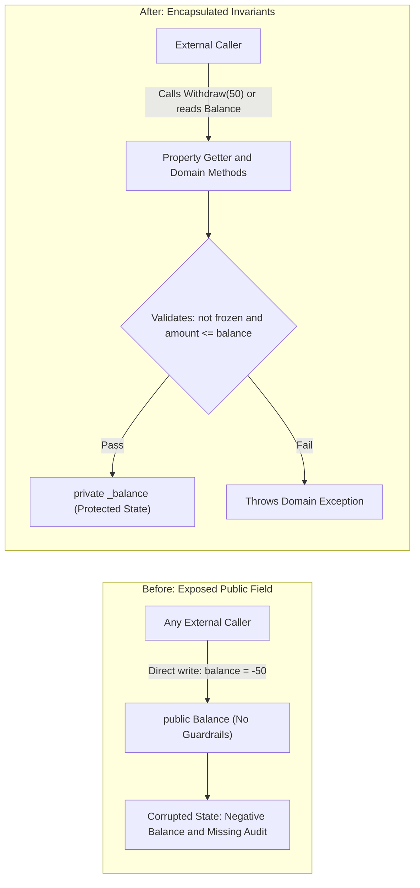
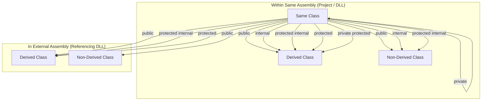
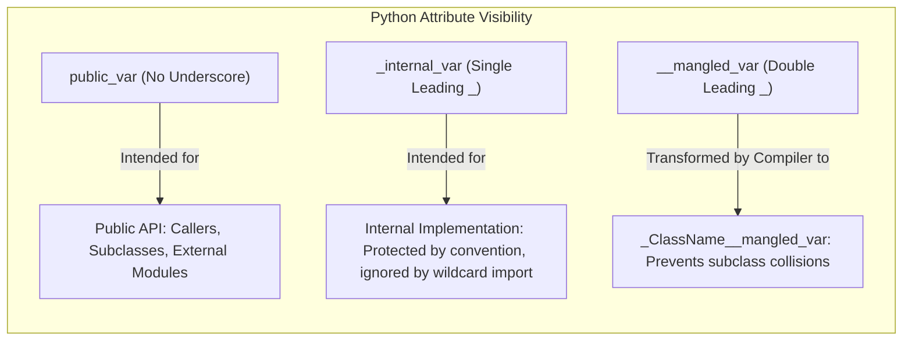
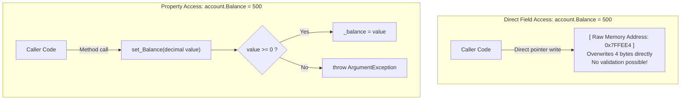

# Lesson 06: Access Modifiers, Properties and Encapsulation

> **Prerequisites:** [Inheritance, Composition and the Diamond Problem](../05-inheritance-composition-and-the-diamond-problem/README.md) and [Track 24 Overview](../README.md).  
> **Estimated Reading Time:** 18 minutes  
> **Target Audience:** Engineers preparing for LLD, OOP, C#, or Python technical screening and architecture rounds.

> [!NOTE]
> **In one line:** Encapsulation is **hiding state behind the smallest useful surface** — access modifiers set who can see it, properties let you add validation later without breaking callers.

> [!TIP]
> **The One Rule of Encapsulation:** Encapsulation is not "making fields private and adding getters and setters." Encapsulation is the protection of **business invariants**. If a caller can bypass your validation or put an object into an invalid state at any point in its lifecycle, encapsulation is broken regardless of how many access modifiers you used.

---

## 1. Why This Matters: The Interview Trap

Few questions expose a candidate's depth faster than access modifiers and properties. When an interviewer asks:
> *"What is the difference between a field and a property?"* or *"How do you make a field private in Python?"*

### The Junior Answer
- *"A field is a variable, and a property has get and set. You use properties so other classes can read your variables."*
- *"In Python, you put two underscores in front of the variable like `__balance` and then it's private and nobody can access it from outside."*

Both answers are dangerously flawed:
1. Auto-generating public getters and setters for every private field is the **Anemic Domain Model** antipattern. It gives the illusion of encapsulation while providing zero actual protection.
2. In Python, double underscores (`__`) do not make a variable private—they trigger **name mangling**, a name collision defense mechanism for inheritance that can be bypassed in one line of code.

### The Senior Answer
- *"A field represents a raw physical memory slot. A property is an abstraction: a syntactic method pair (`get` / `set`) that compiles into accessor methods. Properties decouple the public interface from the internal storage representation, enabling invariant enforcement, computed values, asymmetric accessibility (e.g., `public get; private set;`), change notification, and Application Binary Interface (ABI) stability without forcing consumers to change call-site syntax."*
- *"Python has no runtime access modifiers. It relies on community convention: a single underscore `_variable` indicates an internal implementation detail ('protected/private' by social contract). Double underscores `__variable` invoke name mangling to prevent accidental overriding in subclasses. Python's design philosophy is 'we are all consenting adults here': data hiding is an architectural guidepost, not a compiler-enforced sandbox."*

---

## 1A. The Visual Story: Problem -> Analogy -> Solution

### The Problem (Why Naive Code Breaks)

A developer builds a `BankAccount` class with `public decimal Balance;` (or `self.balance = 100` in Python) to "keep things simple." Within weeks, three different services read and write `account.Balance` directly: a refund bug sets `Balance = -50`, the checkout service deducts funds without writing a ledger entry, and a batch job mutates a frozen account. When you finally try to add validation, you are trapped—hundreds of callers touch the raw field directly, and switching a public field to a method breaks binary and call-site compatibility.

### Real-World Analogy

Think of an **Open Cash Drawer vs. an ATM**:
- **Public fields** are like leaving the bank's cash drawer open on the sidewalk. Anyone can grab cash or stuff counterfeit bills inside with zero receipt, PIN check, or balance validation.
- **Encapsulation and properties** are like an ATM. The cash sits behind armored steel (`private` backing field), and callers interact only through a narrow, controlled slot (`Balance` getter, `Deposit()`, `Withdraw()`) that enforces PIN checks, non-negative invariants, and audit logging.

### Visual Problem -> Solution Diagram



### Where It Is Used & Progressive Buildup

| Ecosystem / Context | Real-World Usage |
| :--- | :--- |
| **.NET** | `public get; private set;`, `init` properties, `internal` / `private protected` assembly boundaries |
| **Python** | `@property` descriptors for lazy validation, `_internal` social contract, `__mangled` subclass collision defense |
| **Go** | Exported `Capitalized` vs package-private `lowercase` identifiers enforcing module boundaries |
| **TypeScript** | `private` / ES `#private` fields, `get`/`set` accessors, `readonly` DTO contracts |
| **LLD Interviews** | BankAccount / ATM, Elevator state machine, ParkingLot spot allocation, VendingMachine balance |

**3-Step Progressive Buildup:**
1. **Step 1 (Simple):** Hide raw fields (`private` / `_backing`) and expose read-only properties so external callers can observe without mutating.
2. **Step 2 (Growing):** Replace naive public setters with domain methods (`Deposit()`, `Freeze()`) or validating property setters so invalid states become unrepresentable.
3. **Step 3 (Production):** Enforce package/assembly boundaries (`internal`, module-private) and return immutable views or DTOs across service boundaries so internal invariants never leak.

---

## 2. Visual Mental Model / Taxonomic Comparison

### C# Accessibility Matrix: The Assembly vs. Hierarchy Grid

C# has six access modifiers formed by combining assembly boundaries and inheritance hierarchies:



| Access Modifier | Within Same Class | Derived Class (Same Assembly) | Non-Derived (Same Assembly) | Derived Class (Other Assembly) | External World (Other Assembly) | Logical Meaning |
| :--- | :---: | :---: | :---: | :---: | :---: | :--- |
| `public` | Yes | Yes | Yes | Yes | Yes | Unrestricted |
| `protected internal` | Yes | Yes | Yes | Yes | No | **Union**: Same Assembly **OR** Derived anywhere |
| `internal` | Yes | Yes | Yes | No | No | Same Assembly only |
| `protected` | Yes | Yes | No | Yes | No | Inheritance hierarchy only |
| `private protected` | Yes | Yes | No | No | No | **Intersection**: Same Assembly **AND** Derived |
| `private` | Yes | No | No | No | No | Containing type only |

### Python Visibility Hierarchy

Python replaces compiler gates with naming conventions and runtime namespace transforms:



### Field vs. Property: Memory Layout vs. Method Invocation



---

## 3. Code Implementation

The following implementation models a high-integrity financial `BankAccount`. It demonstrates:
1. Protecting business invariants (strictly positive deposits, preventing overdrafts, enforcing frozen state).
2. Read-only and init-only attributes (account identifiers).
3. Computed properties without backing fields.
4. Python name mangling versus C# access modifiers.
5. Invariant enforcement through properties.

````carousel
```python
"""
Lesson 06: Access Modifiers, Properties, and Encapsulation (Python)
Demonstrating Python property decorators, conventions, and name mangling.
"""

from typing import Final


class BankAccount:
  # Class-level constant (convention: uppercase)
  MAX_SINGLE_DEPOSIT: Final[float] = 10000.0

  def __init__(
      self, account_id: str, owner: str, initial_balance: float = 0.0
  ) -> None:
    if initial_balance < 0:
      raise ValueError("Initial balance cannot be negative.")

    # Public immutable attribute (convention: treat as read-only)
    self._account_id: str = account_id

    # Protected by convention: internal state
    self._owner: str = owner
    self._balance: float = initial_balance
    self._is_frozen: bool = False

    # Name-mangled attribute: intended to avoid subclass collision
    # Python transforms this attribute into _BankAccount__pin_hash
    self.__pin_hash: str = "hash_sec_9876"

  # 1. READ-ONLY PROPERTY (getter only, no setter)
  @property
  def account_id(self) -> str:
    """Read-only account identifier."""
    return self._account_id

  @property
  def is_frozen(self) -> bool:
    return self._is_frozen

  # 2. ENCAPSULATED PROPERTY WITH VALIDATED INVARIANTS
  @property
  def balance(self) -> float:
    """Safe read-only exposure of balance."""
    return self._balance

  # 3. COMPUTED PROPERTY (No backing field)
  @property
  def status_summary(self) -> str:
    status = "Frozen" if self._is_frozen else "Active"
    return f"Account: {self._account_id} | Owner: {self._owner} | Status: {status}"

  # 4. BUSINESS METHODS GUARDING STATE TRANSITIONS
  def deposit(self, amount: float) -> None:
    """Guarantees deposit invariant."""
    if self._is_frozen:
      raise RuntimeError("Cannot deposit into a frozen account.")
    if amount <= 0:
      raise ValueError("Deposit amount must be strictly positive.")
    if amount > self.MAX_SINGLE_DEPOSIT:
      raise ValueError(f"Deposit exceeds limit of {self.MAX_SINGLE_DEPOSIT}")

    self._balance += amount

  def withdraw(self, amount: float) -> None:
    """Guarantees balance invariant: cannot drop below zero."""
    if self._is_frozen:
      raise RuntimeError("Cannot withdraw from a frozen account.")
    if amount <= 0:
      raise ValueError("Withdrawal amount must be strictly positive.")
    if amount > self._balance:
      raise ValueError(
          f"Insufficient funds. Current balance: ${self._balance:.2f}, Requested: ${amount:.2f}"
      )

    self._balance -= amount

  def freeze_account(self) -> None:
    self._is_frozen = True


def main() -> None:
  account = BankAccount(
      account_id="ACC-101", owner="Alice Smith", initial_balance=1000.0
  )
  print(f"Account created: {account.account_id} with initial balance: $1000.00")

  # 1. Valid deposit
  account.deposit(250.0)
  print(f"Deposit: $250.00 | New Balance: ${account.balance:.2f}")

  # 2. Invariant violation: Overdraft attempt
  try:
    print("Attempting illegal withdrawal: $2000.00")
    account.withdraw(2000.0)
  except ValueError as ex:
    print(f"Invariant Violation Caught: {ex}")

  # 3. Invariant violation: Negative deposit
  try:
    print("Attempting negative deposit: -$50.00")
    account.deposit(-50.0)
  except ValueError as ex:
    print(f"Invariant Violation Caught: {ex}")

  # 4. Account status via computed property
  print(f"Account status: Active | Frozen: {account.is_frozen}")

  # 5. Inspect name mangling
  # The attribute '__pin_hash' is mangled into '_BankAccount__pin_hash'
  print("Testing name mangling / encapsulation inspection:")
  has_mangled_pin = "_BankAccount__pin_hash" in account.__dict__
  print(f"Python mangled attribute key exists: {has_mangled_pin}")
  print(f"Verified balance invariant held: ${account.balance:.2f}")


if __name__ == "__main__":
  main()
```
<!-- slide -->
```csharp
/**
 * Lesson 06: Access Modifiers, Properties, and Encapsulation (C#)
 * Demonstrating access modifiers, auto-properties, init-only setters, and backing fields.
 */

using System;

namespace OopInterviewPrep.Lesson06
{
    public class BankAccount
    {
        // Class-level constant
        public const decimal MaxSingleDeposit = 10000.0m;

        // 1. INIT-ONLY PROPERTY: Can only be set during construction/initialization (C# 9+)
        public string AccountId { get; init; }

        // 2. ENCAPSULATED PRIVATE BACKING FIELDS
        private string _owner;
        private decimal _balance;
        private bool _isFrozen;

        // Private field demonstrating access protection
        private readonly string _pinHash;

        public BankAccount(string accountId, string owner, decimal initialBalance = 0.0m)
        {
            if (initialBalance < 0)
                throw new ArgumentException("Initial balance cannot be negative.");

            AccountId = accountId;
            _owner = owner;
            _balance = initialBalance;
            _isFrozen = false;
            _pinHash = "hash_sec_9876";
        }

        // 3. READ-ONLY PROPERTY WITH EXPRESSION-BODIED SYNTAX
        public decimal Balance => _balance;
        public bool IsFrozen => _isFrozen;

        // 4. COMPUTED PROPERTY (No backing field allocation)
        public string StatusSummary
        {
            get
            {
                string status = _isFrozen ? "Frozen" : "Active";
                return $"Account: {AccountId} | Owner: {_owner} | Status: {status}";
            }
        }

        // 5. BUSINESS INVARIANT GUARD METHODS
        public void Deposit(decimal amount)
        {
            if (_isFrozen)
                throw new InvalidOperationException("Cannot deposit into a frozen account.");
            if (amount <= 0)
                throw new ArgumentException("Deposit amount must be strictly positive.");
            if (amount > MaxSingleDeposit)
                throw new ArgumentException($"Deposit exceeds limit of {MaxSingleDeposit}");

            _balance += amount;
        }

        public void Withdraw(decimal amount)
        {
            if (_isFrozen)
                throw new InvalidOperationException("Cannot withdraw from a frozen account.");
            if (amount <= 0)
                throw new ArgumentException("Withdrawal amount must be strictly positive.");
            if (amount > _balance)
                throw new ArgumentException($"Insufficient funds. Current balance: ${_balance:F2}, Requested: ${amount:F2}");

            _balance -= amount;
        }

        public void FreezeAccount()
        {
            _isFrozen = true;
        }
    }

    public class Program
    {
        public static void Main()
        {
            var account = new BankAccount("ACC-101", "Alice Smith", 1000.0m);
            Console.WriteLine($"Account created: {account.AccountId} with initial balance: $1000.00");

            // 1. Valid deposit
            account.Deposit(250.0m);
            Console.WriteLine($"Deposit: $250.00 | New Balance: ${account.Balance:F2}");

            // 2. Invariant violation: Overdraft attempt
            try
            {
                Console.WriteLine("Attempting illegal withdrawal: $2000.00");
                account.Withdraw(2000.0m);
            }
            catch (ArgumentException ex)
            {
                Console.WriteLine($"Invariant Violation Caught: {ex.Message}");
            }

            // 3. Invariant violation: Negative deposit
            try
            {
                Console.WriteLine("Attempting negative deposit: -$50.00");
                account.Deposit(-50.0m);
            }
            catch (ArgumentException ex)
            {
                Console.WriteLine($"Invariant Violation Caught: {ex.Message}");
            }

            // 4. Account status
            Console.WriteLine($"Account status: Active | Frozen: {account.IsFrozen}");

            // 5. Verification of encapsulation
            Console.WriteLine("Testing name mangling / encapsulation inspection:");
            // In C#, reflection is required to view private fields; at compile time, direct access is a CS0122 error
            bool hasPrivatePin = typeof(BankAccount).GetField("_pinHash", 
                System.Reflection.BindingFlags.NonPublic | System.Reflection.BindingFlags.Instance) != null;
            Console.WriteLine($"Python mangled attribute key exists: {hasPrivatePin}");
            Console.WriteLine($"Verified balance invariant held: ${account.Balance:F2}");
        }
    }
}
```
````

**Expected Output (Both Languages):**
```text
Account created: ACC-101 with initial balance: $1000.00
Deposit: $250.00 | New Balance: $1250.00
Attempting illegal withdrawal: $2000.00
Invariant Violation Caught: Insufficient funds. Current balance: $1250.00, Requested: $2000.00
Attempting negative deposit: -$50.00
Invariant Violation Caught: Deposit amount must be strictly positive.
Account status: Active | Frozen: False
Testing name mangling / encapsulation inspection:
Python mangled attribute key exists: True
Verified balance invariant held: $1250.00
```

---

## 4. Where You Already Use It

Every major framework and standard library relies on access modifiers and properties to enforce constraints and maintain binary compatibility:

### In .NET / C#
- **`System.Collections.Generic.List<T>`:** The backing storage `T[] _items` and element counter `int _size` are `private`. The property `public int Count => _size;` exposes only the logical size. If `_items` were a public field, external callers could alter the array length or insert nulls out of order, corrupting the collection.
- **`System.Net.Http.HttpClient`:** Uses `internal` and `private` constructors and members to ensure socket handles are safely reused across pooled connections without exposing raw OS socket descriptors.
- **`ASP.NET Core Options Pattern`:** Configuration classes use `{ get; init; }` or `{ get; set; }` to bind from `appsettings.json`, ensuring properties cannot be tampered with once the DI container builds the application pipeline.

### In Python
- **`property` in Python Standard Library:**
  - `datetime.date`: Exposes `.year`, `.month`, and `.day` as read-only properties. Calling `date(2026, 2, 29)` raises `ValueError` at construction, and attempting `d.year = 2027` raises `AttributeError: can't set attribute`.
  - `array.array`: Exposes `typecode` and `itemsize` as read-only properties while maintaining internal C memory buffers.
- **Name Mangling in Python's `threading.Thread`:**
  - `Thread` uses `self.__target`, `self.__args`, and `self.__kwargs` internally. Subclasses overriding `run()` can define their own attributes without accidentally overwriting the parent class's internal dispatch mechanics.

---

## 5. Pitfalls and When Not to Use It

### 1. The Anemic Getter/Setter Syndrome (Fake Encapsulation)
Writing boilerplate like:
```csharp
public class Customer
{
    public string Name { get; set; }
    public decimal Balance { get; set; }
    public string Status { get; set; }
}
```
provides **zero encapsulation**. Any external service can write `customer.Balance = -999999` or `customer.Status = "InvalidStatus"`. 
- **Fix:** Keep setters `private` or `init`-only. Expose business methods (`Debit`, `Credit`, `PromoteToVip`) that validate all transitions.

### 2. Side-Effect-Heavy Properties
A property getter should behave like a fast variable lookup ($O(1)$). Violating the Principle of Least Astonishment by executing database queries, network requests, or long-running computations inside a `get` accessor leads to catastrophic bugs:
```csharp
// ANTI-PATTERN: Property makes a remote network call
public decimal CurrentExchangeRate => _forexService.FetchLiveRateOverHttp();
```
- **Fix:** If an operation is slow ($O(N)$ or I/O-bound), allocates significant memory, or throws network exceptions, make it an explicit method: `GetExchangeRateAsync()`.

### 3. Misunderstanding Python's Double Underscore as "Security"
Junior developers assume `__password` hides sensitive data. Anyone can run:
```python
user = User("secret123")
print(user._User__password)  # Easily accessed!
```
Python name mangling is an anti-collision tool for inheritance, not an encryption or access control mechanism.

### 4. ABI Incompatibility: Changing Public Fields to Properties
In C#, changing a field to a property is source-compatible (`account.Balance` syntax doesn't change), but it is a **breaking binary change (ABI break)**. A field read compiles to IL opcode `ldfld`; a property read compiles to `callvirt get_Balance()`. If dependent libraries are not recompiled against the new assembly, a `MissingFieldException` is thrown at runtime in production. Always design public APIs with properties from day one.

---

## 6. Exercises & Practical Drills

### Exercise 1: Spot the Encapsulation Breaches
Review this C# class:
```csharp
public class Order
{
    public readonly List<string> Items = new List<string>();
    public decimal SubTotal;
    public decimal TaxRate { get; set; }
    public decimal TotalAmount => SubTotal * (1 + TaxRate);
}
```
Identify the three critical encapsulation violations and explain how to fix them.

<details>
<summary>Answer</summary>

1. **`Items` field is publicly mutable:** Even though the reference `Items` is marked `readonly`, any external caller can execute `order.Items.Clear()` or `order.Items.Add("Hacked")` directly, bypassing inventory and pricing checks.
   - *Fix:* Make the field `private List<string> _items = new();` and expose `public IReadOnlyList<string> Items => _items.AsReadOnly();`. Provide an `AddItem(string item)` method.
2. **`SubTotal` is a public field:** External callers can write arbitrary negative values or values that do not correspond to the actual items in the cart.
   - *Fix:* Make `SubTotal` private or calculated dynamically from the item prices.
3. **`TaxRate` has an unvalidated public setter:** A caller can set `order.TaxRate = -0.5m`, resulting in negative total charges.
   - *Fix:* Make the setter validate `value >= 0` or restrict mutation to constructor/init.
</details>

### Exercise 2: Implementing Python Safe Backward-Compatibility
Suppose a class originally exposed a public attribute `temperature_celsius`. Requirements change: we must ensure temperatures never drop below absolute zero ($-273.15^\circ\text{C}$). How do you add validation without breaking existing client code that reads and writes `obj.temperature_celsius` directly?

<details>
<summary>Answer</summary>

Use the `@property` decorator to convert the field into a managed property without changing the call-site syntax:

```python
class Thermometer:

  def __init__(self, temp: float = 0.0) -> None:
    # Uses the setter below for initial validation
    self.temperature_celsius = temp

  @property
  def temperature_celsius(self) -> float:
    return self._temperature_celsius

  @temperature_celsius.setter
  def temperature_celsius(self, value: float) -> None:
    if value < -273.15:
      raise ValueError("Temperature cannot be below absolute zero.")
    self._temperature_celsius = value


# Existing client code continues to work seamlessly:
t = Thermometer(25.0)
t.temperature_celsius = 30.0  # Calls setter
# t.temperature_celsius = -300.0  # Raises ValueError
```
</details>

---

## 7. Interview Questions & Model Answers

<details>
<summary><strong>1. What access modifiers does C# have? [BASIC]</strong></summary>

C# has six core access modifiers that govern visibility across types and assembly boundaries:
1. `public`: Accessible from any code in any assembly.
2. `private`: Accessible only within the containing class or struct.
3. `protected`: Accessible within the containing class and any derived classes, even in different assemblies.
4. `internal`: Accessible by any code within the same compilation assembly (.dll), but hidden from external assemblies.
5. `protected internal`: A logical **OR (union)**—accessible by any code in the same assembly, OR by derived classes in external assemblies.
6. `private protected`: A logical **AND (intersection)** introduced in C# 7.2—accessible only by derived classes that reside within the same assembly.
In C# 11, `file` scope was also introduced, restricting type visibility strictly to the source file where it is declared.

</details>

<details>
<summary><strong>2. What is the default access modifier of a class member in C#? [BASIC]</strong></summary>

In C#, default accessibility always selects the most restrictive sensible scope:
- For members inside a class, struct, or record (fields, methods, properties), the default access modifier is **`private`**.
- For top-level types declared directly in a namespace (classes, structs, interfaces, enums, records), the default is **`internal`**.
- For nested types (a class declared inside another class), the default is **`private`**.
- For interface members, default visibility is historically **`public`** (since C# 8, interfaces can also contain private and protected members for default implementations).
- For enum members, visibility is always **`public`** and cannot be modified.

</details>

<details>
<summary><strong>3. How do you make an attribute private in Python? [SCENARIO]</strong></summary>

Python does not have compiler-enforced access modifiers. Instead, it relies on standard naming conventions and runtime mechanisms:
1. **Single underscore convention (`_attr`):** Indicates an internal implementation detail ('protected/private' by convention). Linters and IDEs warn against outside access, and wildcard imports (`from module import *`) ignore it, but the Python runtime will not prevent access.
2. **Double underscore name mangling (`__attr`):** The Python interpreter syntactically rewrites the variable name to `_ClassName__attr`. While this prevents accidental name clashes in subclasses, it is not truly private—any caller can still access or mutate `obj._ClassName__attr` directly.
Python's guiding philosophy is *'we are all consenting adults here'*: true encapsulation is achieved by designing clean interface contracts and protecting invariants with the `@property` decorator, rather than relying on false security boundaries.

</details>

<details>
<summary><strong>4. What is the difference between a field and a property? [BASIC]</strong></summary>

A field is a variable declared directly inside a class representing raw physical memory storage. Accessing a field reads or writes directly to that memory address without executing logic.

A property is a language abstraction consisting of a getter and setter method pair. Syntactically, it looks like a field to the consumer (`obj.Value = 10`), but under the hood the compiler converts it into method calls (`set_Value(10)`).

Key architectural differences:
- **Invariant Enforcement:** Properties allow validation, range checking, and state-transition guards before mutating state.
- **Computed State:** Properties can compute values dynamically on the fly without allocating backing storage.
- **Asymmetric Accessibility:** You can make a getter `public` and its setter `private` or `init`-only.
- **ABI Stability:** Replacing a public field with a property breaks binary compatibility (ABI) in compiled languages like C#, requiring all dependent assemblies to be recompiled. Designing with properties from the start preserves long-term backward compatibility.

</details>

<details>
<summary><strong>5. What is name mangling? [BASIC]</strong></summary>

Name mangling is Python's compiler mechanism for identifiers with at least two leading underscores and at most one trailing underscore (e.g., `__attribute`).

When the Python bytecode compiler encounters such an identifier inside a class definition, it replaces it by prefixing `_ClassName`. For example, `self.__balance` inside class `BankAccount` is stored in the instance `__dict__` as `_BankAccount__balance`.

Its primary purpose is **subclass namespace isolation**: it prevents a subclass from accidentally clobbering or overriding an internal attribute used by its parent class during inheritance. It was never intended as a data security or privacy feature, because any external code can still inspect and mutate `instance._BankAccount__balance` directly.

</details>

<details>
<summary><strong>6. A public field `Price` is used in 200 places and now needs validation. What do you do? [SCENARIO]</strong></summary>

In C# turn it into a property: the call sites recompile unchanged (binary compat aside), and you add the validation in the setter. In Python switch to `@property`; attribute syntax stays the same. That migration path is exactly why properties beat public fields.

</details>

---

## Try it

Run this: a Python property validates, and `__x` is mangled rather than truly private. Then sketch `Account` with a private balance in [LLD Studio](/tools/lld-studio/); the [track hub](../README.md) has the C# modifier table.

```python
class Account:
    def __init__(self): self.__balance = 0       # name-mangled
    @property
    def balance(self): return self.__balance
    @balance.setter
    def balance(self, v):
        if v < 0: raise ValueError("negative")
        self.__balance = v

a = Account(); a.balance = 10
assert a.balance == 10 and a._Account__balance == 10   # mangled, not secret
try: a.balance = -1
except ValueError: pass
else: raise AssertionError
```

---

## One-page cheat sheet

```text
C# modifiers: public | internal | protected | private
              protected internal (either) | private protected (both)
Defaults: class -> internal ; member -> private
Field vs property: property = method pair, can validate, can be virtual/in interface
Auto-prop: { get; set; }   init-only: { get; init; }   (immutable after ctor)
Python: _x convention | __x mangled to _Class__x | @property for control
Anemic model (getters/setters only) = encapsulation failed
Tell, don't ask: expose behaviour, not data
```

---

## 8. Sources & Further Reading

- [Microsoft Learn: Access Modifiers (C# Programming Guide)](https://learn.microsoft.com/en-us/dotnet/csharp/programming-guide/classes-and-structs/access-modifiers)
- [Microsoft Learn: Properties and Auto-Implemented Properties](https://learn.microsoft.com/en-us/dotnet/csharp/programming-guide/classes-and-structs/properties)
- [Python 3 Tutorial: Private Variables and Class-local References](https://docs.python.org/3/tutorial/classes.html#private-variables)
- [PEP 8: Style Guide for Python Code (Naming Conventions)](https://peps.python.org/pep-0008/#naming-conventions)
- [Martin Fowler: Anemic Domain Model](https://martinfowler.com/bliki/AnemicDomainModel.html)

---

Previous: [Inheritance, Composition and the Diamond Problem](../05-inheritance-composition-and-the-diamond-problem/README.md) · Next: [Static Members, Static Classes, and When Static Is a Smell](../07-static-members-and-static-classes/README.md)
