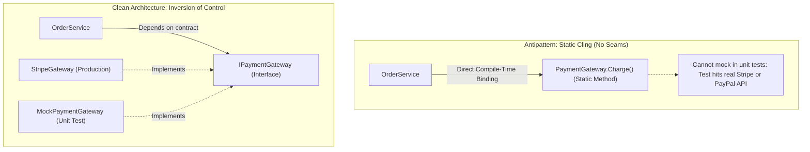
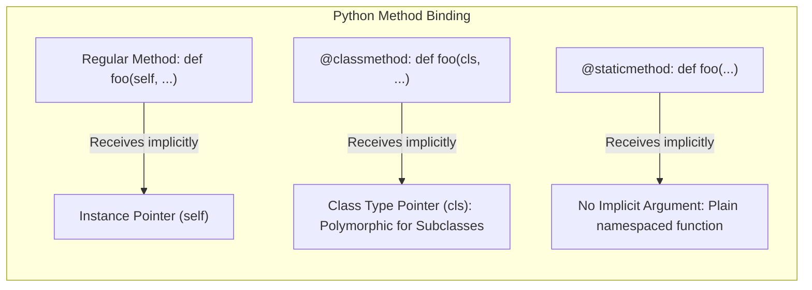

# Lesson 07: Static Members, Static Classes, and When Static Is a Smell

> **Prerequisites:** [Access Modifiers, Properties and Encapsulation](../06-access-modifiers-properties-and-encapsulation/README.md) and [Track 24 Overview](../README.md).  
> **Estimated Reading Time:** 18 minutes  
> **Target Audience:** Engineers preparing for LLD, OOP, C#, or Python technical screening and architecture rounds.

> [!NOTE]
> **In one line:** `static` means **belongs to the type, not an instance** — good for stateless helpers and factories, bad for hidden global state that you cannot mock or reset between tests.

> [!TIP]
> **The One Rule of Static:** Static is reserved for **pure, stateless computation** or **immutable constants**. The moment a static member holds **mutable state** or performs **I/O** (network, disk, clock), it becomes a hidden global variable that destroys testability, violates Dependency Inversion, and causes concurrency race conditions.

---

## 1. Why This Matters: The Interview Trap

In system design and LLD interviews, candidates are frequently tempted to use static classes:
> *"Why not make the `DatabaseClient`, `ConfigurationService`, or `PaymentGateway` static? It avoids object allocation and lets any class call `DatabaseClient.Query()` directly without wiring up Dependency Injection!"*

### The Junior Answer
- *"Static is better for performance because the garbage collector doesn't have to clean up instances. You should use a static class whenever you only need one copy of a service across the entire application."*

This response is an immediate red flag for senior interviewers:
1. It confuses a **Static Class** with the **Singleton Pattern**.
2. It completely ignores **unit test isolation**, **concurrency race conditions**, and the **Dependency Inversion Principle (DIP)**.

### The Senior Answer
- *"Static methods introduce rigid, compile-time coupling. In C#, a static class cannot implement an interface (`IDatabaseClient`), which means callers cannot substitute mocks or fakes during unit testing. In multithreaded backends, mutable static state leads to data races and static constructor deadlocks. Furthermore, static state causes test pollution: tests that pass in isolation fail intermittently when executed concurrently in CI/CD pipelines.*
- *Static should be restricted to pure, deterministic functions (e.g., `Math.Sqrt`), factory constructors (e.g., Python `@classmethod` or C# `Task.FromResult`), and extension methods. Stateful services must be managed as injected dependencies with container-controlled lifecycles (Scoped or Singleton)."*

---

## 2. Visual Mental Model / Taxonomic Comparison

### Testability Architecture: Static Cling vs. Dependency Injection

The fundamental architectural flaw of static calls is the destruction of seams:



### Static Class vs. Singleton vs. Module Functions

| Architectural Dimension | C# `static class` | Singleton (`ISingleton`) | Python `@classmethod` | Python `@staticmethod` | Python Module Function |
| :--- | :--- | :--- | :--- | :--- | :--- |
| **Can Implement Interfaces?** | ❌ No | ✅ Yes | ❌ No (Class level) | ❌ No | ❌ No |
| **Can be Injected (DI)?** | ❌ No | ✅ Yes | ❌ No | ❌ No | ❌ No |
| **Unit Test Mockable?** | ❌ Impossible without IL hooks | ✅ Trivial via interface | ⚠️ Requires monkey-patching | ⚠️ Requires monkey-patching | ⚠️ Requires monkey-patching |
| **Supports Polymorphism?** | ❌ Sealed & Abstract | ✅ Full subtyping | ✅ Dispatches to `cls` | ❌ No subclass awareness | ❌ No inheritance |
| **Memory Allocation** | Type metadata heap (Once) | Managed Heap (1 Instance) | Class object reference | Bound/unbound function | Module namespace object |
| **Idiomatic Use Case** | Pure utilities, Extension methods | Shared stateful manager (Logger, Cache) | Factory constructors (`User.from_json`) | Grouped utility inside class namespace | Pure utility functions (PEP 8 preferred) |

### Python Method Dispatch: `self` vs. `cls` vs. None



---

## 3. Code Implementation

The following implementation models a `User` entity and an authentication workflow. It demonstrates:
1. Static factory methods (`@classmethod` in Python vs. static factory in C#) supporting alternative constructors.
2. Pure static validation utilities (`@staticmethod` vs. static utility method).
3. System-wide static metrics counters.
4. Demonstrating why static mutable state (`SessionStore`) is dangerous in backend services.

````carousel
```python
"""
Lesson 07: Static Members, Static Classes, and When Static Is a Smell (Python)
Demonstrating @classmethod, @staticmethod, class variables, and the static smell.
"""

from typing import Final, Optional


class User:
  # Class-level variable (shared across all instances)
  _user_count: int = 0

  def __init__(self, username: str, email: str, role: str = "Standard") -> None:
    self.username: str = username
    self.email: str = email
    self.role: str = role

    # Increment static counter
    User._user_count += 1

  # 1. CLASS METHOD: Alternative factory constructors
  # Receives 'cls' instead of 'self'. If subclassed, 'cls' refers to the subclass.
  @classmethod
  def create_guest(cls, guest_id: int) -> "User":
    """Factory method for creating a temporary guest account."""
    return cls(
        username=f"Guest_{guest_id}",
        email="guest@example.com",
        role="Guest",
    )

  @classmethod
  def create_admin(cls, username: str, email: str) -> "User":
    """Factory method for creating an administrator."""
    return cls(username=username, email=email, role="Administrator")

  @classmethod
  def get_total_users(cls) -> int:
    """Class method accessing class-level state."""
    return cls._user_count

  # 2. STATIC METHOD: Pure utility function with no access to self or cls
  @staticmethod
  def is_valid_email(email: str) -> bool:
    """Pure stateless validation."""
    return "@" in email and "." in email


# 3. THE STATIC SMELL: Shared mutable global state
class SessionStore:
  # Antipattern: Global mutable state inside a class namespace
  current_token: Optional[str] = None


def main() -> None:
  print("=== 1. Factory Methods & Constructors ===")
  u1 = User("Alice", "alice@example.com")
  print(f"User created: {u1.username} ({u1.email}) [Role: {u1.role}]")

  u2 = User.create_guest(99)
  print(f"Guest created: {u2.username} ({u2.email}) [Role: {u2.role}]")

  u3 = User.create_admin("Admin_Bob", "bob@example.com")
  print(f"Admin created: {u3.username} ({u3.email}) [Role: {u3.role}]")

  print("=== 2. Pure Static Utility Validation ===")
  print(
      f"Email 'valid.user@example.com' valid:"
      f" {User.is_valid_email('valid.user@example.com')}"
  )
  print(
      f"Email 'invalid-email-address' valid:"
      f" {User.is_valid_email('invalid-email-address')}"
  )

  print("=== 3. Static State vs Instance State ===")
  print(f"Total users created across system: {User.get_total_users()}")

  print("=== 4. Why Static Mutable State Is a Smell ===")
  # Mutating static state introduces hidden coupling across execution threads
  SessionStore.current_token = "AUTH_SESSION_9999"
  print(f"Static session token set to: '{SessionStore.current_token}'")
  print("Risk: All concurrent requests share the exact same static session!")
  SessionStore.current_token = None
  print("Session cleared safely.")


if __name__ == "__main__":
  main()
```
<!-- slide -->
```csharp
/**
 * Lesson 07: Static Members, Static Classes, and When Static Is a Smell (C#)
 * Demonstrating static factories, static utility methods, class-level state, and static smells.
 */

using System;

namespace OopInterviewPrep.Lesson07
{
    public class User
    {
        // 1. STATIC FIELD: Shared across all instances in the AppDomain
        private static int s_userCount = 0;

        // Instance properties
        public string Username { get; }
        public string Email { get; }
        public string Role { get; }

        public User(string username, string email, string role = "Standard")
        {
            Username = username;
            Email = email;
            Role = role;

            // Increment shared static counter
            s_userCount++;
        }

        // 2. STATIC FACTORY METHODS: Explicit, intention-revealing constructors
        public static User CreateGuest(int guestId)
        {
            return new User($"Guest_{guestId}", "guest@example.com", "Guest");
        }

        public static User CreateAdmin(string username, string email)
        {
            return new User(username, email, "Administrator");
        }

        public static int GetTotalUsers() => s_userCount;

        // 3. PURE STATIC UTILITY METHOD: Stateless computation
        public static bool IsValidEmail(string email)
        {
            if (string.IsNullOrWhiteSpace(email))
                return false;

            return email.Contains("@") && email.Contains(".");
        }
    }

    // 4. THE STATIC SMELL: Static class holding mutable state
    public static class SessionStore
    {
        // Antipattern: Global mutable state accessible by any thread without synchronization
        public static string? CurrentToken { get; set; }
    }

    public class Program
    {
        public static void Main()
        {
            Console.WriteLine("=== 1. Factory Methods & Constructors ===");
            var u1 = new User("Alice", "alice@example.com");
            Console.WriteLine($"User created: {u1.Username} ({u1.Email}) [Role: {u1.Role}]");

            var u2 = User.CreateGuest(99);
            Console.WriteLine($"Guest created: {u2.Username} ({u2.Email}) [Role: {u2.Role}]");

            var u3 = User.CreateAdmin("Admin_Bob", "bob@example.com");
            Console.WriteLine($"Admin created: {u3.Username} ({u3.Email}) [Role: {u3.Role}]");

            Console.WriteLine("=== 2. Pure Static Utility Validation ===");
            Console.WriteLine($"Email 'valid.user@example.com' valid: {User.IsValidEmail("valid.user@example.com")}");
            Console.WriteLine($"Email 'invalid-email-address' valid: {User.IsValidEmail("invalid-email-address")}");

            Console.WriteLine("=== 3. Static State vs Instance State ===");
            Console.WriteLine($"Total users created across system: {User.GetTotalUsers()}");

            Console.WriteLine("=== 4. Why Static Mutable State Is a Smell ===");
            SessionStore.CurrentToken = "AUTH_SESSION_9999";
            Console.WriteLine($"Static session token set to: '{SessionStore.CurrentToken}'");
            Console.WriteLine("Risk: All concurrent requests share the exact same static session!");
            SessionStore.CurrentToken = null;
            Console.WriteLine("Session cleared safely.");
        }
    }
}
```
````

**Expected Output (Both Languages):**
```text
=== 1. Factory Methods & Constructors ===
User created: Alice (alice@example.com) [Role: Standard]
Guest created: Guest_99 (guest@example.com) [Role: Guest]
Admin created: Admin_Bob (bob@example.com) [Role: Administrator]
=== 2. Pure Static Utility Validation ===
Email 'valid.user@example.com' valid: True
Email 'invalid-email-address' valid: False
=== 3. Static State vs Instance State ===
Total users created across system: 3
=== 4. Why Static Mutable State Is a Smell ===
Static session token set to: 'AUTH_SESSION_9999'
Risk: All concurrent requests share the exact same static session!
Session cleared safely.
```

---

## 4. Where You Already Use It

### In .NET / C#
- **`System.Math` & `System.MathF`:** Pure, stateless mathematical operations (`Math.Abs`, `Math.Max`, `Math.Sin`). A static class is ideal here because mathematical formulas carry no state and never require mocking.
- **`System.IO.Path`:** Pure path manipulation utilities (`Path.Combine`, `Path.GetExtension`).
- **Static Factory Methods:**
  - `Task.FromResult<T>(value)`: Bypasses state machine allocation for synchronously completed tasks.
  - `Guid.NewGuid()`: Intention-revealing static generation of UUIDs.
  - `TimeSpan.FromMinutes(15)`: Strongly typed duration creation.
- **C# Extension Methods:** Declared as `static` methods within a `static class` using the `this` parameter modifier (e.g., LINQ's `.Where()` and `.Select()`).

### In Python
- **`@classmethod` in Standard Library:**
  - `dict.fromkeys(iterable, value)`: Creates a new dictionary initialized from keys.
  - `datetime.date.fromtimestamp(ts)`: Alternative constructor instantiating a date from a UNIX timestamp.
  - `datetime.datetime.now(tz)`: Factory returning the current timestamp.
- **`@staticmethod` in Standard Library:**
  - `bytes.maketrans()`: Utility mapping table generation.
- **Top-Level Module Functions (Python's True Static Equivalent):**
  - Functions in `math` (`math.sqrt`, `math.floor`), `os.path` (`os.path.join`), and `json` (`json.dumps`). Python embraces module-level functions over wrapping static methods inside artificial utility classes.

---

## 5. Pitfalls and When Not to Use It

### 1. The Test Pollution Trap (Shared Mutable State)
When multiple unit tests run in parallel, any test that writes to a mutable static field alters the environment for all concurrent tests:
```csharp
// TEST 1
UserContext.CurrentUserId = 42;
var result = service.Execute();
Assert.True(result);

// TEST 2 (Running simultaneously on another thread)
UserContext.CurrentUserId = 99; // Corrupts Test 1's state mid-execution!
```
- **Consequence:** Flaky, non-deterministic test suites that pass locally on single-threaded test runners but fail unpredictably in CI.
- **Fix:** Never use static fields for contextual state (e.g., current user, tenant ID, database transaction). Use scoped dependency injection (`IUserContext`).

### 2. The Static Constructor Death Spiral (`TypeInitializationException`)
In C#, a static constructor initializes static data before any member is accessed. If a static constructor throws an unhandled exception:
```csharp
public static class PaymentConfig
{
    static PaymentConfig()
    {
        // If this file is missing or network times out:
        string secret = File.ReadAllText("/etc/secrets/key.pem");
    }
}
```
- **Consequence:** The .NET runtime wraps the failure in a `TypeInitializationException`. The type is marked as **permanently broken** for the lifetime of the `AppDomain`. Any subsequent call to `PaymentConfig` from anywhere in the application will immediately throw without even re-attempting initialization.
- **Fix:** Never perform I/O, file reading, or network calls inside a static constructor. Use an injected configuration service initialized during application startup.

### 3. Java/C# Thinking in Python (Unnecessary `@staticmethod`)
In languages like Java or C#, every function must belong to a class. In Python, wrapping standalone functions inside a dummy class:
```python
# ANTI-PATTERN: Forcing Java class paradigms onto Python
class MathHelper:

  @staticmethod
  def add(a: int, b: int) -> int:
    return a + b
```
is an antipattern. PEP 20 explicitly declares: *"Flat is better than nested."* Define `add(a, b)` directly at the module level.

---

## 6. Exercises & Practical Drills

### Exercise 1: Refactor Static Cling to Dependency Injection
Review the following code:
```csharp
public class InvoiceService
{
    public void IssueInvoice(Order order)
    {
        decimal tax = TaxCalculator.Compute(order.Total);
        EmailSender.Send(order.CustomerEmail, $"Invoice for {order.Total + tax}");
    }
}
```
Explain why `TaxCalculator` and `EmailSender` present architectural hazards, and refactor the design so `InvoiceService` can be unit tested without sending real emails.

<details>
<summary>Answer</summary>

**Hazards:**
1. `EmailSender.Send` performs network I/O. Testing `IssueInvoice` will either fail if the SMTP server is down or send spam to real customer emails during test runs.
2. Direct static calls prevent mocking. You cannot assert that `EmailSender.Send` was invoked with the expected parameters.

**Refactoring:**
Extract `ITaxCalculator` and `IEmailSender` interfaces and inject them via the constructor:
```csharp
public interface ITaxCalculator { decimal Compute(decimal total); }
public interface IEmailSender { void Send(string recipient, string message); }

public class InvoiceService
{
    private readonly ITaxCalculator _taxCalculator;
    private readonly IEmailSender _emailSender;

    public InvoiceService(ITaxCalculator taxCalculator, IEmailSender emailSender)
    {
        _taxCalculator = taxCalculator;
        _emailSender = emailSender;
    }

    public void IssueInvoice(Order order)
    {
        decimal tax = _taxCalculator.Compute(order.Total);
        _emailSender.Send(order.CustomerEmail, $"Invoice for {order.Total + tax}");
    }
}
```
In unit tests, pass a `Mock<IEmailSender>` to verify delivery without touching an external network.
</details>

### Exercise 2: Why `cls` Matters in `@classmethod`
Given the following Python hierarchy:
```python
class BaseEntity:

  def __init__(self, id: str) -> None:
    self.id = id

  @classmethod
  def create_default(cls) -> "BaseEntity":
    return cls(id="DEFAULT-01")


class CustomerEntity(BaseEntity):

  def __init__(self, id: str, loyalty_tier: str = "Bronze") -> None:
    super().__init__(id)
    self.loyalty_tier = loyalty_tier
```
What happens when a caller invokes `CustomerEntity.create_default()`? What would happen if `create_default` were hardcoded to return `BaseEntity("DEFAULT-01")`?

<details>
<summary>Answer</summary>

Because `create_default` uses `@classmethod` and constructs `cls(...)`, calling `CustomerEntity.create_default()` dynamically binds `cls` to `CustomerEntity`. It invokes `CustomerEntity`'s constructor and returns a valid `CustomerEntity` instance with `loyalty_tier = "Bronze"`.

If the base method had hardcoded `return BaseEntity("DEFAULT-01")` (as a standard `@staticmethod` would be forced to do), calling it on the derived class would incorrectly return an instance of `BaseEntity`, stripping away all specialized attributes and methods of `CustomerEntity`.
</details>

---

## 7. Interview Questions & Model Answers

<details>
<summary><strong>1. What is the difference between a static class and a Singleton? [BASIC]</strong></summary>

A static class and a Singleton both guarantee a single point of access, but their architectural properties are completely different:
1. **Interface Implementation:** A static class in C# cannot implement an interface (`IDatabaseConnection`), whereas a Singleton is a standard object instance that can implement any interface.
2. **Polymorphism and DI:** Because a Singleton implements interfaces, it can be registered with a Dependency Injection container (`builder.Services.AddSingleton<IService, Service>()`) and injected into consumers. A static class cannot be passed as a parameter or substituted at runtime.
3. **Unit Testability:** You can easily substitute a Singleton with a mock or fake during unit testing. A static class hardcodes compile-time references into calling code ('static cling'), making isolated testing impossible without IL rewrite tools.
4. **Initialization Lifecycle:** A Singleton can support thread-safe, deferred lazy initialization and graceful disposal (`IDisposable`), whereas static classes are bound to type initialization rules controlled strictly by the runtime.

</details>

<details>
<summary><strong>2. What is the difference between `@staticmethod` and `@classmethod` in Python? [BASIC]</strong></summary>

Both decorators define methods callable on the class without prior instantiation, but their signatures and dispatch behaviors differ:
- **`@classmethod`:** Automatically receives the class object itself (`cls`) as its first parameter. This makes it ideal for **alternative factory constructors** (e.g., `User.from_json(payload)`) and maintains **inheritance polymorphism**: when invoked on a subclass, `cls` refers to the subclass, ensuring the factory instantiates the correct derived type.
- **`@staticmethod`:** Receives no implicit first parameter (neither `self` nor `cls`). It behaves exactly like a plain module-level function that happens to reside within the class's namespace.
In idiomatic Python, `@staticmethod` is rarely needed; if a function does not interact with class or instance state, PEP 8 recommends defining it as a module-level function instead.

</details>

<details>
<summary><strong>3. Can a static method access instance members? [BASIC]</strong></summary>

No, a static method cannot directly access instance members (fields, properties, or methods).

Static methods belong to the type itself rather than any individual allocated object. When a static method executes, there is no instance pointer—neither `this` in C# nor `self` in Python—passed on the call stack.

The only way a static method can access instance members is if an explicit instance of the class is passed into the static method as a parameter (for example: `public static void LogUser(User user) => Console.WriteLine(user.Name);`).

</details>

<details>
<summary><strong>4. When is static a bad idea? [SCENARIO]</strong></summary>

Static is a severe architectural smell under four primary conditions:
1. **When holding mutable state:** Static mutable fields act as hidden global variables. In multithreaded web applications, they cause race conditions and memory leaks. In test suites, they cause test pollution, making tests pass in isolation but fail when run in parallel.
2. **When performing I/O or accessing external dependencies:** Static methods that perform database queries, call external HTTP APIs, or read the system clock (`DateTime.UtcNow`) cannot be mocked or intercepted, destroying unit testability.
3. **When extensibility is required:** Static classes cannot be inherited from, cannot implement interfaces, and cannot override behavior, violating both the Open/Closed and Dependency Inversion principles.
4. **When initialization involves complex logic:** Static constructors that throw unhandled exceptions cause fatal `TypeInitializationException` crashes that permanently disable the type for the lifetime of the application process.

</details>

<details>
<summary><strong>5. Two threads read a static counter and increment it. What goes wrong and how do you fix it? [TRICKY]</strong></summary>

`count++` is read-modify-write, so updates are lost. Static fields are shared by every thread. Use `Interlocked.Increment` or a `lock` in C#, and a `threading.Lock` in Python (the GIL does not make `+=` atomic). Better: avoid shared mutable statics.

</details>

<details>
<summary><strong>6. A service calls `DateTime.Now` statically and tests are flaky. What's the fix? [SCENARIO]</strong></summary>

Hide time behind an injected abstraction (`IClock` / `TimeProvider`, or a `now()` callable in Python). Tests then pass a fixed clock. The principle: static access to the outside world is a hidden dependency.

</details>

---

## Try it

Run this to compare Python's three "static-ish" tools. Then place a `Validator` utility and a `Config` singleton in [LLD Studio](/tools/lld-studio/); the [track hub](../README.md) has the static-class vs Singleton question.

```python
class Temp:
    unit = "C"
    def __init__(self, v): self.v = v
    @staticmethod
    def is_valid(v): return v > -273.15          # no cls, no self
    @classmethod
    def boiling(cls): return cls(100)            # factory via cls

assert Temp.is_valid(5) and not Temp.is_valid(-300)
assert Temp.boiling().v == 100
```

---

## One-page cheat sheet

```text
static member  1 copy per type, no `this`  -> cannot touch instance state
static class (C#)  sealed, only static members, no instances
Static ctor  runs once before first access (thread-safe by CLR)
Python  @staticmethod (no cls) | @classmethod (gets cls, factories) | module function
Static class != Singleton: Singleton is an object -> can implement interfaces, be injected
Smell: static mutable state, static DB/clock access (untestable)
Use for: pure functions, extension methods, constants
```

---

## 8. Sources & Further Reading

- [Microsoft Learn: Static Classes and Static Class Members](https://learn.microsoft.com/en-us/dotnet/csharp/programming-guide/classes-and-structs/static-classes-and-static-class-members)
- [Microsoft Learn: Extension Methods (C# Programming Guide)](https://learn.microsoft.com/en-us/dotnet/csharp/programming-guide/classes-and-structs/extension-methods)
- [Python 3 Documentation: Built-in Functions (`classmethod`, `staticmethod`)](https://docs.python.org/3/library/functions.html#classmethod)
- [Mark Seemann: Static Cling (Dependency Injection in .NET)](https://blog.ploeh.dk/2014/08/07/why-dry-is-not-the-most-important-thing/)
- [Martin Fowler: Eradicating Non-Determinism in Tests](https://martinfowler.com/articles/non-determinism.html)

---

Previous: [Access Modifiers, Properties and Encapsulation](../06-access-modifiers-properties-and-encapsulation/README.md) · Next: [Value vs Reference, Equality and Immutability](../08-value-vs-reference-equality-and-immutability/README.md)
