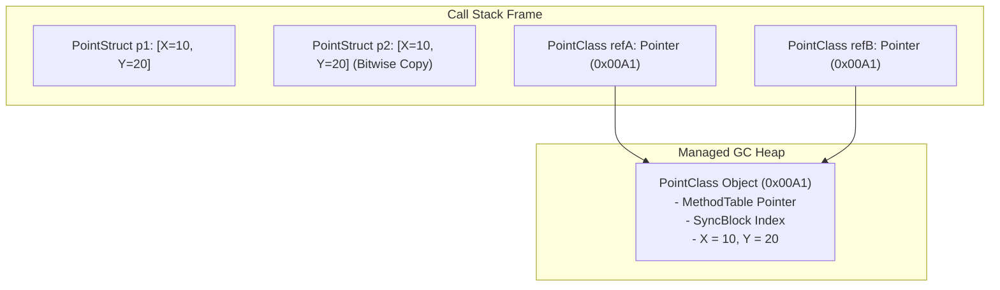
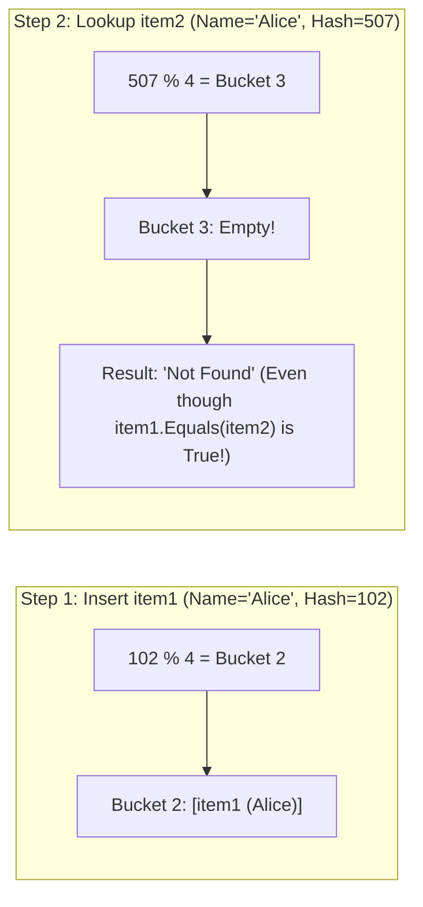

# Lesson 08: Value vs Reference, Equality and Immutability

> **Prerequisites:** [Static Members, Static Classes, and When Static Is a Smell](../07-static-members-and-static-classes/README.md) and [Track 24 Overview](../README.md).  
> **Estimated Reading Time:** 20 minutes  
> **Target Audience:** Engineers preparing for LLD, OOP, C#, or Python technical screening and architecture rounds.

> [!NOTE]
> **In one line:** **Value types/equality** compare by content, **reference types** by identity unless overridden — and if you override `Equals` you must override `GetHashCode` (Python: `__eq__` and `__hash__`) so hashed collections still work.

> [!TIP]
> **The One Rule of Equality and Immutability:** Two objects that are equal **must** produce identical hash codes, and the state contributing to that hash code **must never mutate** while the object resides in a hash-based collection. If an object is mutable, using it as a dictionary key or set element invites silent data corruption and memory leaks.

---

## 1. Why This Matters: The Interview Trap

Few interview questions uncover the difference between surface-level coders and senior engineers like equality contracts and memory semantics:
> *"Why did my `HashSet.Contains()` return `false` right after I inserted an identical object?"*  
> *"What is the danger of passing `def append_item(item, items=[])` in Python?"*  
> *"When should you choose a `struct` over a `class` in C#?"*

### The Junior Answer
- *"A struct is stored on the stack and a class is stored on the heap. You use structs when you want small things.*
- *If you override `Equals`, you override `GetHashCode` just because the compiler gives you a warning if you don't.*
- *In Python, `is` checks if things are the same and `==` checks values. Default arguments just give default values when nothing is passed."*

These answers overlook the underlying mechanics:
1. Structs are not always on the stack; when embedded in a class, they live on the managed heap. The true distinction is **copy-by-value vs. copy-by-reference semantics**.
2. Failing to override `GetHashCode` breaks the **hash table bucket invariant**: equal objects land in different hash buckets, rendering hash lookups non-functional.
3. Python evaluates default arguments **once at definition time**, binding mutable references permanently to the function's closure.

### The Senior Answer
- *"In C#, value types (`struct`) exhibit value semantics: assignment and argument passing perform bitwise copies. Reference types (`class`) allocate on the managed heap, with variable bindings passing 8-byte reference pointers. Equality represents two distinct operations: reference identity (same memory address) versus structural equivalence (matching values).*
- *The hash contract mandates that $a == b \implies \text{hash}(a) == \text{hash}(b)$. If two objects evaluate as equal but produce differing hash codes, hash-based collections (`HashSet<T>`, `Dictionary<TKey, TValue>`) route lookups to the wrong bucket.*
- *In Python, all variables are pointers to heap objects. `is` checks memory address identity via `id(a) == id(b)`, while `==` invokes `__eq__`. Mutable default arguments are evaluated once during module compilation, binding a single shared instance across every future invocation unless protected by a `None` sentinel."*

---

## 2. Visual Mental Model / Taxonomic Comparison

### Memory Layout: Stack vs. Managed Heap in C#



### The Hash Table Bucket Invariant Failure

What happens when `Equals` is overridden without overriding `GetHashCode`:



### Type Mechanics Comparison Matrix

| Architectural Feature | C# `class` | C# `struct` | C# `record class` | C# `readonly record struct` | Python `@dataclass(frozen=True)` |
| :--- | :--- | :--- | :--- | :--- | :--- |
| **Allocation** | Managed Heap | Inline (Stack or Parent) | Managed Heap | Inline (Stack or Parent) | Managed Heap (PyObject) |
| **Copy Semantics** | Reference pointer | Bitwise value copy | Reference pointer | Bitwise value copy | Reference pointer |
| **Default Equality** | Reference Identity | Value (Reflection) | Value (Synthesized) | Value (Synthesized) | Value (Synthesized `__eq__`) |
| **Hash Code** | Runtime memory hash | Value (Reflection) | Value (Synthesized) | Value (Synthesized) | Synthesized `__hash__` |
| **Immutability** | Opt-in | Opt-in | Opt-in (Default positional) | Enforced by compiler | Enforced at runtime |
| **Non-Destructive Mutation** | Manual cloning | Manual copying | `with` expression | `with` expression | `dataclasses.replace()` |
| **Inheritance** | Single class | Interfaces only | Single record class | Interfaces only | Single/Multiple classes |

---

## 3. Code Implementation

The following implementation models an immutable financial `Money` value object and a transaction ledger. It demonstrates:
1. Value equality versus reference identity.
2. The hash code contract enabling safe dictionary and hash set lookups.
3. Non-destructive mutation (`with` in C# vs. `replace` in Python).
4. The Python mutable default argument trap and its idiomatic sentinel solution.

````carousel
```python
"""
Lesson 08: Value vs Reference, Equality, and Immutability (Python)
Demonstrating value equality, hash contracts, frozen dataclasses, and default arg safety.
"""

from dataclasses import dataclass, replace
from typing import List, Optional


# 1. IMMUTABLE VALUE OBJECT (Frozen Dataclass)
# Automatically synthesizes __eq__, __hash__, and prevents attribute mutation
@dataclass(frozen=True)
class Money:
  amount: float
  currency: str

  def __repr__(self) -> str:
    return f"{self.amount:.2f} {self.currency}"


# 2. SAFE DEFAULT ARGUMENT PATTERN
# Antipattern: def add_transaction(desc: str, ledger: List[str] = [])
# That would share a single list across every invocation!
def add_transaction(
    description: str, ledger: Optional[List[str]] = None
) -> List[str]:
  if ledger is None:
    ledger = []  # Fresh instance allocated per invocation
  ledger.append(description)
  return ledger


def main() -> None:
  print("=== 1. Value vs Reference Equality ===")
  m1 = Money(100.0, "USD")
  m2 = Money(100.0, "USD")
  print(f"m1: {m1} | m2: {m2}")

  # Value equality checks structural equivalence via __eq__
  print(f"Value Equality (m1 == m2): {m1 == m2}")
  # Reference identity checks whether memory addresses match via id()
  print(f"Reference Identity (m1 is m2): {m1 is m2}")

  print("=== 2. Hash Code & Dictionary Lookup ===")
  # Because Money is frozen, it is hashable and safe as a dictionary key
  budget_map = {m1: "Q1 Operations Budget"}
  lookup_result = budget_map.get(m2, "Not Found")
  print(f"Lookup using m2 key: '{lookup_result}'")
  print(f"Hash match verified: {hash(m1) == hash(m2)}")

  print("=== 3. Immutability & Non-Destructive Mutation ===")
  # Creating a modified copy without altering original instance
  m3 = replace(m1, amount=80.0)
  print(f"Original m1 unchanged: {m1}")
  print(f"New modified copy m3: {m3}")

  print("=== 4. Mutable Default Argument Fix ===")
  call1 = add_transaction("Payment received")
  call2 = add_transaction("Refund issued")
  print(f"Call 1 ledger size: {len(call1)} | Items: {call1}")
  print(f"Call 2 ledger size: {len(call2)} | Items: {call2}")
  print(f"Ledgers independent: {call1 is not call2}")


if __name__ == "__main__":
  main()
```
<!-- slide -->
```csharp
/**
 * Lesson 08: Value vs Reference, Equality, and Immutability (C#)
 * Demonstrating C# records, value equality, GetHashCode contract, and defensive copies.
 */

using System;
using System.Collections.Generic;

namespace OopInterviewPrep.Lesson08
{
    // 1. IMMUTABLE RECORD: Compiler synthesizes value equality, GetHashCode, ToString, and 'with'
    public record Money(decimal Amount, string Currency)
    {
        public override string ToString() => $"{Amount:F2} {Currency}";
    }

    public class Program
    {
        // 2. SAFE OPTIONAL PARAMETER PATTERN
        // C# requires optional parameter defaults to be compile-time constants (null)
        public static List<string> AddTransaction(string description, List<string>? ledger = null)
        {
            ledger ??= new List<string>(); // Fresh allocation if omitted
            ledger.Add(description);
            return ledger;
        }

        public static void Main()
        {
            Console.WriteLine("=== 1. Value vs Reference Equality ===");
            var m1 = new Money(100.0m, "USD");
            var m2 = new Money(100.0m, "USD");
            Console.WriteLine($"m1: {m1} | m2: {m2}");

            // Value equality synthesized by C# record
            Console.WriteLine($"Value Equality (m1 == m2): {m1 == m2}");
            // Reference identity check
            Console.WriteLine($"Reference Identity (m1 is m2): {object.ReferenceEquals(m1, m2)}");

            Console.WriteLine("=== 2. Hash Code & Dictionary Lookup ===");
            var budgetMap = new Dictionary<Money, string>
            {
                [m1] = "Q1 Operations Budget"
            };

            // Lookup succeeds because m1 and m2 yield identical hash codes and evaluate as equal
            string lookupResult = budgetMap.TryGetValue(m2, out var val) ? val : "Not Found";
            Console.WriteLine($"Lookup using m2 key: '{lookupResult}'");
            Console.WriteLine($"Hash match verified: {m1.GetHashCode() == m2.GetHashCode()}");

            Console.WriteLine("=== 3. Immutability & Non-Destructive Mutation ===");
            // 'with' expression synthesizes a clone constructor call with mutated properties
            var m3 = m1 with { Amount = 80.0m };
            Console.WriteLine($"Original m1 unchanged: {m1}");
            Console.WriteLine($"New modified copy m3: {m3}");

            Console.WriteLine("=== 4. Mutable Default Argument Fix ===");
            var call1 = AddTransaction("Payment received");
            var call2 = AddTransaction("Refund issued");
            Console.WriteLine($"Call 1 ledger size: {call1.Count} | Items: ['{string.Join("', '", call1)}']");
            Console.WriteLine($"Call 2 ledger size: {call2.Count} | Items: ['{string.Join("', '", call2)}']");
            Console.WriteLine($"Ledgers independent: {!object.ReferenceEquals(call1, call2)}");
        }
    }
}
```
````

**Expected Output (Both Languages):**
```text
=== 1. Value vs Reference Equality ===
m1: 100.00 USD | m2: 100.00 USD
Value Equality (m1 == m2): True
Reference Identity (m1 is m2): False
=== 2. Hash Code & Dictionary Lookup ===
Lookup using m2 key: 'Q1 Operations Budget'
Hash match verified: True
=== 3. Immutability & Non-Destructive Mutation ===
Original m1 unchanged: 100.00 USD
New modified copy m3: 80.00 USD
=== 4. Mutable Default Argument Fix ===
Call 1 ledger size: 1 | Items: ['Payment received']
Call 2 ledger size: 1 | Items: ['Refund issued']
Ledgers independent: True
```

---

## 4. Where You Already Use It

### In .NET / C#
- **Primitive Value Types (`struct`):**
  - `int`, `double`, `bool`, `char`, `decimal`, `DateTime`, `Guid`, and `TimeSpan` are all value types. Passing an `int` copies 4 bytes directly; passing a `Guid` copies 16 bytes.
- **Reference Types with Overridden Value Equality:**
  - `System.String`: A reference type allocated on the managed heap, but `==` and `.Equals()` are overloaded to evaluate string character sequence equivalence. Strings are immutable and interned by the CLR.
- **`System.HashCode.Combine()`:**
  - Modern .NET utility method for generating well-distributed, collision-resistant hash codes across multiple struct or class fields.
- **C# Records in Production:**
  - Widely used as Data Transfer Objects (DTOs), CQRS Commands and Queries, API contracts, and Domain Events in MediatR pipelines.

### In Python
- **Immutable Builtins:**
  - `int`, `float`, `str`, `tuple`, `frozenset`, and `bytes` are immutable. When you write `s = s + "!"`, Python allocates an entirely new string on the heap.
- **Dictionary Key Invariant (`collections.abc.Hashable`):**
  - Python dictionaries only accept hashable objects. Mutable collections (`list`, `dict`, `set`) lack `__hash__`; attempting `{ [1, 2]: "val" }` immediately raises `TypeError: unhashable type: 'list'`.
- **String and Integer Interning:**
  - CPython pre-allocates and caches small integers from $-5$ through $256$. Python also automatically interns string literals that look like valid identifiers.

---

## 5. Pitfalls and When Not to Use It

### 1. The Mutating Hash Key Trap (The "Lost Object" Bug)
If a mutable object is used as a dictionary key or placed inside a `HashSet`, and one of its fields subsequently changes:
```csharp
var person = new Person { Id = 101, Name = "Alice" };
set.Add(person); // Placed in Bucket 3 based on HashCode(101, "Alice")

person.Name = "Alicia"; // HashCode recalculates to Bucket 7!

bool exists = set.Contains(person); // Calculates Bucket 7 -> Empty! Returns FALSE!
```
- **Consequence:** `set.Contains()` returns `false`, `set.Remove()` fails, and the object can never be deleted from the collection, causing a catastrophic memory leak in long-running services.
- **Rule:** Never use a mutable type as a dictionary key or set element. Always use immutable types (`record`, `readonly struct`, `frozen dataclass`).

### 2. Struct Boxing and GC Pressure
When a value type (`struct`) is assigned to an `object` reference or an interface, the runtime allocates a box on the heap and copies the value into it:
```csharp
struct Point { public int X, Y; }

Point p = new Point { X = 1, Y = 2 };
object boxed = p; // BOXING: Allocates 24 bytes on managed heap!
Point unboxed = (Point)boxed; // UNBOXING: Unpacks back to stack
```
- **Consequence:** Casting structs inside tight loops (e.g., calling non-generic `ArrayList` or unconstrained interface methods) causes high GC allocation rates and frequent Generation 0 garbage collections.
- **Fix:** Always implement `IEquatable<T>` on structs to avoid boxing during equality checks.

### 3. Relying on `is` for Value Equality in Python
```python
a = 1000
b = 1000
print(a is b)  # Might be False! CPython only caches integers between -5 and 256.
```
- **Trap:** Code using `is` for integers or strings may pass in local testing (due to temporary compiler string interning) but fail in production when values exceed cache boundaries.
- **Rule:** Use `is` **only** for checking identity against singletons (`x is None`, `x is True`, `x is False`). Always use `==` for values.

---

## 6. Exercises & Practical Drills

### Exercise 1: Spot the Hash Contract Breach
Review this C# class:
```csharp
public class DeviceId
{
    public string SerialNumber { get; set; }

    public override bool Equals(object? obj)
    {
        return obj is DeviceId other && SerialNumber == other.SerialNumber;
    }
}
```
What happens when you add two `DeviceId` instances with `SerialNumber = "DEV-999"` into a `HashSet<DeviceId>`?

<details>
<summary>Answer</summary>

Both instances will be inserted into the `HashSet`, resulting in **duplicate entries**!

Because `GetHashCode()` was not overridden, the class inherits `object.GetHashCode()`, which computes a hash based on the object's physical memory address. Even though `d1.Equals(d2)` is `true`, `d1.GetHashCode()` and `d2.GetHashCode()` produce completely different integers. 

The `HashSet` places `d1` and `d2` into different buckets without ever comparing them via `Equals`.

**Fix:**
```csharp
public override int GetHashCode() => HashCode.Combine(SerialNumber);
```
Or simply convert `DeviceId` to a `public record DeviceId(string SerialNumber);`.
</details>

### Exercise 2: The Shared Default Argument Mystery
Explain what this Python code outputs and why:
```python
def create_profile(username: str, roles: list = []) -> dict:
  roles.append("Viewer")
  return {"user": username, "roles": roles}


p1 = create_profile("Alice")
p2 = create_profile("Bob")
print(p1["roles"])
print(p2["roles"])
```

<details>
<summary>Answer</summary>

**Output:**
```python
['Viewer', 'Viewer']
['Viewer', 'Viewer']
```

**Explanation:**
Python evaluates the default argument `roles: list = []` exactly once, when the `def` statement executes during module load. That empty list object is stored in the function's internal metadata (`create_profile.__defaults__`). 

When `create_profile("Alice")` runs, it appends `"Viewer"` to that shared list. When `create_profile("Bob")` runs, it receives that same shared list (which already contains `"Viewer"`) and appends a second `"Viewer"`. Both `p1` and `p2` point to the identical list in memory.

**Fix:**
```python
def create_profile(username: str, roles: list | None = None) -> dict:
  if roles is None:
    roles = []
  roles.append("Viewer")
  return {"user": username, "roles": roles}
```
</details>

---

## 7. Interview Questions & Model Answers

<details>
<summary><strong>1. What is the difference between a struct and a class? [BASIC]</strong></summary>

In C#, the fundamental difference is **value semantics versus reference semantics**:
1. **Memory Allocation:** A `struct` is a value type (`System.ValueType`), allocated inline where declared—on the stack for local variables, or embedded directly within the containing object if inside a class. A `class` is a reference type (`System.Object`), whose storage always resides on the managed GC heap while callers hold an 8-byte pointer.
2. **Assignment:** Assigning a `struct` copies the entire memory payload bit-by-bit. Modifying the copy has zero effect on the original. Assigning a `class` copies only the reference pointer; both variables point to the same object on the heap.
3. **Default Equality:** Classes default to reference identity (`ReferenceEquals`). Structs default to value equality, but because `ValueType.Equals` uses runtime reflection to compare fields, it is slow unless explicitly overridden with `IEquatable<T>`.
4. **Inheritance & Boxing:** Structs cannot participate in class inheritance (they can only implement interfaces). When a struct is cast to an `object` or interface, the CLR performs **boxing**, allocating an object wrapper on the heap and incurring GC overhead.

</details>

<details>
<summary><strong>2. Why must `GetHashCode` change when you override `Equals`? [TRICKY]</strong></summary>

Overriding `Equals` without overriding `GetHashCode` violates the fundamental **Hash Contract**:
$$\text{If } a.\text{Equals}(b) == \text{true}, \text{ then } a.\text{GetHashCode}() \text{ MUST equal } b.\text{GetHashCode}()$$

Hash-based collections like `Dictionary<TKey, TValue>` and `HashSet<T>` rely on a two-step lookup algorithm:
1. Compute `hash = key.GetHashCode()`.
2. Map `hash` to a bucket array index via `hash % BucketCount`.
3. Search that specific bucket for an existing element where `existing.Equals(key)` is true.

If `Equals` is overridden based on field values, but `GetHashCode` is left to `object.GetHashCode()` (which returns a value based on memory address), two identical objects will produce different hash codes and map to completely different buckets. Lookups will return 'key not found', and sets will insert duplicate records.

Additionally, any fields used to compute `GetHashCode` **must be immutable**; mutating a key inside a hash table alters its hash code, leaving the element permanently stranded in the wrong bucket.

</details>

<details>
<summary><strong>3. What is the difference between `is` and `==` in Python? [BASIC]</strong></summary>

In Python:
- **`is`** checks **identity**: it evaluates whether two variables point to the exact same physical object in memory by comparing their memory addresses (`id(a) == id(b)`).
- **`==`** checks **value equality**: it evaluates whether two objects represent equivalent content by invoking the left operand's `__eq__()` dunder method (`a.__eq__(b)`).

A common interview trap involves small integers and strings: CPython pre-caches integers between $-5$ and $256$ and interns certain string literals, so `a = 100; b = 100; a is b` evaluates to `True`. However, for numbers outside this range, like `a = 1000; b = 1000; a is b`, it evaluates to `False`.

Therefore, `is` should strictly be reserved for comparisons against memory singletons (such as `if val is None:`), while `==` must always be used for evaluating data values.

</details>

<details>
<summary><strong>4. Why is a list a bad default argument in Python? [TRICKY]</strong></summary>

In Python, default arguments are evaluated **once**, at function definition time when the module is compiled and imported, rather than dynamically on each invocation.

If a mutable object like a `list` (`def add_item(item, items=[]):`) or `dict` is passed as a default, Python instantiates that list once and binds it to the function object's `__defaults__` attribute. Every caller that omits that parameter receives a reference to that **exact same list in memory**. Modifying the list inside the function mutates the default argument for all subsequent invocations throughout the application lifecycle.

The senior pattern is to use an immutable sentinel (`None`) and perform defensive allocation inside the function body:
`def add_item(item, items=None):`
`    if items is None: items = []`

</details>

<details>
<summary><strong>5. What is a `record` in C#? [BASIC]</strong></summary>

Introduced in C# 9, a `record` (or `record class`) is a compiler-enhanced reference type specifically designed for immutable data modeling and value semantics.

When you declare a positional record, such as `public record Money(decimal Amount, string Currency);`, the C# compiler automatically synthesizes:
1. **Init-only properties:** `{ get; init; }` ensuring the object cannot be mutated after construction.
2. **Value-based equality:** Overridden `Equals(object)`, strongly typed `IEquatable<T>.Equals`, `operator ==`, and `operator !=` comparing all properties by value instead of memory reference.
3. **Consistent HashCode:** Overridden `GetHashCode()` factoring in all properties according to the hash contract.
4. **Non-destructive mutation:** A hidden copy constructor enabling the **`with` expression** (`var discounted = original with { Amount = 80m };`), which shallow-clones the record while updating specified properties.
5. **Formatted string output:** An overridden `ToString()` displaying readable property names and values.

In C# 10, Microsoft also introduced `record struct` to provide the same value-based synthesis and `with` expressions for value types.

</details>

<details>
<summary><strong>6. You use a mutable object as a dictionary key and later change a field. What happens? [TRICKY]</strong></summary>

Its hash changes, so lookups probe the wrong bucket and the entry appears lost (or is stranded). Keys must be immutable, or at least have hash/equality based only on fields that never change. This is why `list` is unhashable in Python.

</details>

---

## Try it

Run this: `==` vs `is`, the equality/hash contract, and the mutable-default trap. Then model `Money` as a value object in [LLD Studio](/tools/lld-studio/); the [track hub](../README.md) has the immutability follow-ups.

```python
from dataclasses import dataclass

@dataclass(frozen=True)
class Money:                                    # value equality + hash for free
    amount: int
    cur: str

assert Money(5, "INR") == Money(5, "INR")
assert Money(5, "INR") is not Money(5, "INR")
assert len({Money(5, "INR"), Money(5, "INR")}) == 1   # hash consistent with eq

def add(x, bag=[]):                              # BUG: shared default
    bag.append(x); return bag
add(1); assert add(2) == [1, 2]
```

---

## One-page cheat sheet

```text
Python:  is = same object      == = equal value (__eq__)
C#:      ReferenceEquals / == on class = identity ; record/struct = value
Contract: a == b  =>  hash(a) == hash(b)   (override both or neither)
Mutable key in dict/set -> lost entries     Immutable: frozen dataclass, record, readonly
struct = value, copied on assign, may live on stack ; class = reference, heap
record (C#) = reference type with value equality + `with`
Mutable default arg: use None sentinel, create inside
Boxing: value type -> object (alloc!)
```

---

## 8. Sources & Further Reading

- [Microsoft Learn: Structure Types (C# Reference)](https://learn.microsoft.com/en-us/dotnet/csharp/language-reference/builtin-types/struct)
- [Microsoft Learn: Records (C# Reference)](https://learn.microsoft.com/en-us/dotnet/csharp/fundamentals/types/records)
- [Microsoft Learn: Guidelines for Overriding Equals() and GetHashCode()](https://learn.microsoft.com/en-us/dotnet/api/system.object.gethashcode)
- [Python 3 Documentation: The Standard Type Hierarchy and Data Model](https://docs.python.org/3/reference/datamodel.html)
- [PEP 557: Data Classes](https://peps.python.org/pep-0557/)
- [Python Common Gotchas: Mutable Default Arguments](https://docs.python-guide.org/writing/gotchas/#mutable-default-arguments)

---

Previous: [Static Members, Static Classes, and When Static Is a Smell](../07-static-members-and-static-classes/README.md) · Next: [Coupling, Cohesion and SOLID as Interview Answers](../09-coupling-cohesion-and-solid-as-answers/README.md)
