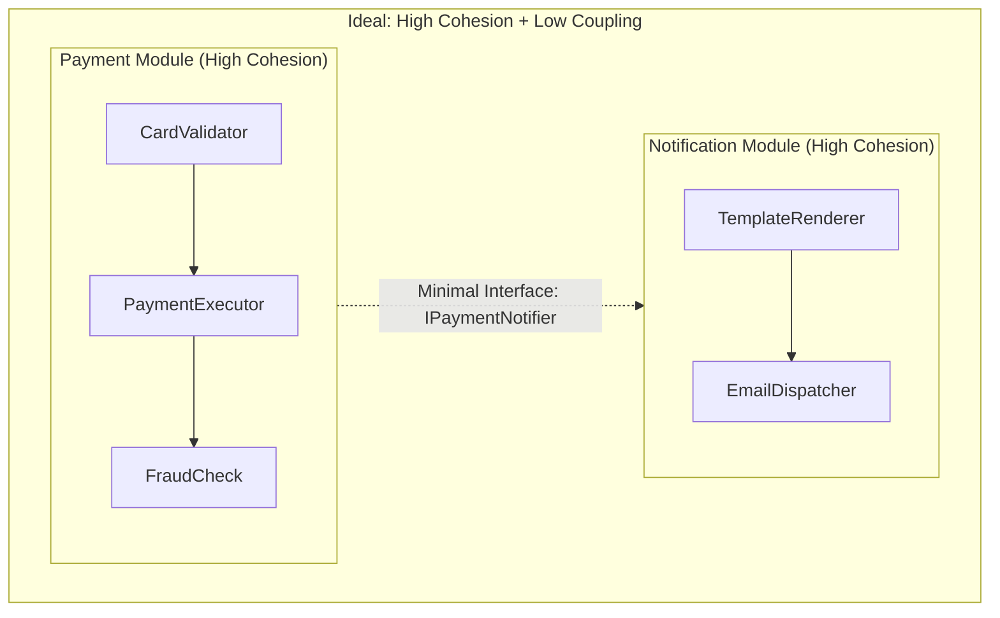
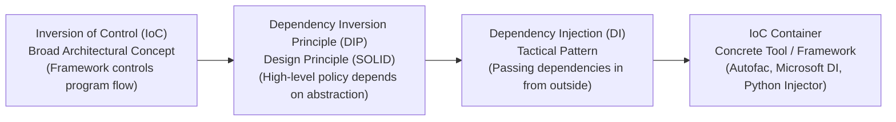
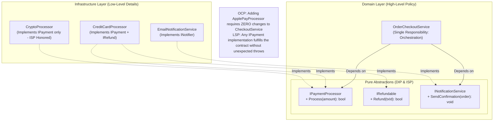

# Lesson 09: Coupling, Cohesion and SOLID as Interview Answers

> **Prerequisites:** [Value vs Reference, Equality and Immutability](../08-value-vs-reference-equality-and-immutability/README.md) and [Track 24 Overview](../README.md).  
> **Estimated Reading Time:** 22 minutes  
> **Target Audience:** Engineers preparing for LLD, OOP, C#, or Python technical screening and architecture rounds.

> [!NOTE]
> **In one line:** **High cohesion + low coupling** is the goal; **SOLID** is the five-part checklist for getting there — and every principle should be answerable as *smell → fix → example*.

> [!TIP]
> **The One Rule of Coupling, Cohesion, and SOLID:** Aim for **high cohesion** (code that changes for the same business reason stays together) and **low coupling** (modules interact through minimal, stable contracts). The five SOLID principles are not dogmatic laws; they are the concrete tactical patterns that produce high cohesion (SRP) and low coupling (OCP, LSP, ISP, DIP).

---

## 1. Why This Matters: The Interview Trap

"Can you explain the SOLID principles?" is one of the most frequently asked questions in backend and low-level design interviews. Almost every candidate can rattle off the acronym: *Single Responsibility, Open/Closed, Liskov Substitution, Interface Segregation, and Dependency Inversion.*

Yet, the majority of candidates fail to impress interviewers because they recite academic soundbites without demonstrating **architectural judgment**:
- **Weak Answer:** *"SRP means a class should do only one thing. OCP means open for extension and closed for modification. LSP means child classes can replace parent classes. ISP means don't force clients to implement methods they don't need. DIP means use interfaces instead of classes."*
- **Why It Fails:** It reveals rote memorization. "Do only one thing" is dangerously vague—does an `OrderService` doing both `ValidateOrder` and `SaveOrder` violate SRP? What does "closed for modification" actually look like in real code? How does LSP differ from basic polymorphism?

A senior engineer answers with **failure modes, coupling dynamics, and real-world trade-offs**:
- **SRP:** *"A class should have only one reason to change—meaning it should encapsulate a single business actor's policy or concern. If accounting rule changes and database schema changes force edits to the exact same file, that class violates SRP."*
- **OCP:** *"Existing, tested production code should remain untouched when new features arrive. We achieve this by introducing stable abstractions and polymorphic strategies or pipelines so new behavior is added by creating new classes, not editing existing `switch` statements."*
- **LSP:** *"Subtypes must preserve the behavioral invariants, pre-conditions, and post-conditions of their base contracts. If calling a method on a subclass unexpectedly throws `NotSupportedException` or silently mutates state in a way callers of the base contract cannot anticipate, it breaks LSP."*
- **ISP:** *"Clients should not depend on interfaces containing methods they do not call. Fat interfaces force artificial coupling and dummy implementations; lean, role-based interfaces keep client blast radiuses minimal."*
- **DIP:** *"High-level policy modules should not import low-level I/O or plumbing modules; both should depend on abstractions. This flips the architectural dependency graph so business domain logic remains independent of databases, web frameworks, and third-party vendors."*

---

### The Fundamental Concepts: Coupling vs. Cohesion

Before diving into SOLID, you must understand the two core metrics that govern all object-oriented architecture:



| Dimension | Cohesion | Coupling |
| :--- | :--- | :--- |
| **Question** | *How focused and related are the responsibilities inside this single module?* | *How heavily does this module depend on the internal details of other modules?* |
| **Goal** | **High Cohesion:** Everything inside the class or module directly supports a single, well-defined purpose. | **Low Coupling:** Modules know as little as possible about each other and interact strictly through minimal contracts. |
| **High State (Desired)** | Changes to order processing logic only affect `OrderProcessor`. Code is easy to reason about, locate, and test. | Changes to the database layer do not break the payment gateway or billing logic. Modules can be swapped or mocked effortlessly. |
| **Low / Bad State** | **Low Cohesion:** A "God class" (`CommonManager` or `UtilityService`) holding 4,000 lines mixing SQL queries, HTTP calls, and PDF generation. | **High / Tight Coupling:** Class A directly instantiates Class B with `new`, accesses Class B's internal public fields, and breaks whenever Class B changes. |
| **Failure Mode** | Sprawling cognitive load; any developer working on feature X accidentally breaks feature Y in the same file. | Fragile blast radius; changing an internal helper in one file cascades compile or runtime errors across 15 downstream services. |

---

### Clarifying the Architecture Alphabet: DIP vs. DI vs. IoC

One of the most notorious interview traps is conflating **Dependency Inversion**, **Dependency Injection**, and **Inversion of Control**:



1. **Inversion of Control (IoC):** The broad architectural philosophy where framework code calls your custom code rather than your custom code controlling the flow (the "Hollywood Principle": *Don't call us, we'll call you*). Web frameworks (ASP.NET Core, FastAPI) are IoC: the framework handles the main loop and invokes your controller or route handler.
2. **Dependency Inversion Principle (DIP):** The **architectural principle** (the "D" in SOLID). It states:
   - High-level modules (business domain) should not depend on low-level modules (database, file system, HTTP clients). Both should depend on abstractions.
   - Abstractions should not depend on details. Details should depend on abstractions.
3. **Dependency Injection (DI):** A **software design pattern and technique** used to realize DIP. Instead of a class instantiating its own dependencies using `new DatabaseConnection()`, the dependencies are "injected" (passed into the class) via constructor parameters, method arguments, or properties.
4. **IoC Container:** A **tool/library** (such as `IServiceCollection` in .NET, Autofac, or `dependency-injector` in Python) that automates the instantiation, lifetime management, and injection of dependencies across an application.

---

### The Pragmatic Trio: DRY, KISS, and YAGNI

Interviewers often ask how SOLID relates to pragmatic software engineering heuristics:

- **DRY (Don't Repeat Yourself):** DRY is not about blindly deduplicating identical-looking syntax; it is about ensuring **every piece of business knowledge has a single, unambiguous representation in a system**. Two methods that happen to have three identical lines of code but change for completely different business reasons should *not* be coupled together. Premature DRYing causes catastrophic tight coupling.
- **KISS (Keep It Simple, Stupid):** The simplest solution that reliably solves the problem is best. Unnecessary layers of indirection, speculative factories, and 12-level interface hierarchies violate KISS.
- **YAGNI (You Aren't Gonna Need It):** Never build abstractions or features for hypothetical future requirements. Build what is needed today, but design clean boundaries so tomorrow's requirements can be added without rewrites.

---

## 2. Visual Mental Model / Taxonomic Comparison

### The SOLID Principles at a Glance

The following decision matrix provides the essential summary for each principle—the exact structure interviewers want to hear:

| Principle | Core Law | Code Smell / Dead Giveaway | Concrete Refactoring Fix | Canonical Example |
| :--- | :--- | :--- | :--- | :--- |
| **S** - Single Responsibility | A class should have one, and only one, reason to change (one business actor). | A single class imports both database drivers and formatting/email libraries; methods change for different stakeholders. | Extract distinct responsibilities into dedicated collaborating classes. | Split an `Invoice` class into `InvoiceCalculator`, `InvoiceRepository`, and `InvoicePdfRenderer`. |
| **O** - Open / Closed | Software entities should be open for extension, but closed for modification. | Giant `switch` or cascading `if/else` checking type codes or enums when computing behavior. | Introduce an interface/strategy and inject concrete polymorphic handlers. | Replace `switch(paymentType)` with `IPaymentProcessor` strategies (`CreditCardProcessor`, `PayPalProcessor`). |
| **L** - Liskov Substitution | Subtypes must be substitutable for their base types without altering program correctness. | A subclass overrides a base method with `throw new NotImplementedException()`, or mutates state unexpectedly. | Split the inheritance hierarchy; favor composition, or introduce narrower capability contracts. | `Square` inheriting from `Rectangle` (breaks dimension invariants); `ReadOnlyStream` throwing on `Write`. |
| **I** - Interface Segregation | Clients should not be forced to depend upon methods they do not use. | A monolithic interface with 20 methods where implementations provide empty stubs or throw `NotSupportedException`. | Break the fat interface into smaller, focused, client-specific role interfaces. | Decompose `IWorker` (`Work`, `Eat`, `Sleep`) into `IWorkable` and `IFeedable`. |
| **D** - Dependency Inversion | High-level business logic must not depend on low-level infrastructure; both depend on abstractions. | A business service directly executes `new SqlServerConnection()` or `new SmtpClient()`. | Define an interface in the domain layer (`IOrderRepository`); pass the concrete infrastructure class via constructor. | `OrderCheckoutService` depends on `IPaymentGateway` interface, implemented by `StripePaymentGateway`. |

---

### Architectural System Flow: Clean Decoupled Checkout

The diagram below demonstrates how all five principles work in concert in a production checkout pipeline:



---

## 3. Code Implementation

The following complete implementations contrast two critical scenarios:
1. **The Classic Liskov Violation:** The famous `Rectangle` vs. `Square` geometric trap, demonstrating why mathematical inheritance breaks object-oriented invariants.
2. **A Production-Grade SOLID Architecture:** An e-commerce order checkout system satisfying all five principles simultaneously using interfaces, constructor dependency injection, and strategy extensibility.

````carousel
```python
from abc import ABC, abstractmethod
from typing import List, Optional


# ============================================================================
# PART 1: THE CLASSIC LISKOV SUBSTITUTION VIOLATION (AND WHY IT FAILS)
# ============================================================================

class BadRectangle:
    """A mutable rectangle with independent width and height."""

    def __init__(self, width: float, height: float) -> None:
        self._width = width
        self._height = height

    @property
    def width(self) -> float:
        return self._width

    @width.setter
    def width(self, value: float) -> None:
        self._width = value

    @property
    def height(self) -> float:
        return self._height

    @height.setter
    def height(self, value: float) -> None:
        self._height = value

    def area(self) -> float:
        return self._width * self._height


class BadSquare(BadRectangle):
    """
    LSP VIOLATION: In mathematics, a square is a rectangle.
    In OOP, mutating width must also mutate height to preserve squareness.
    This silently breaks consumer assumptions and pre/post-conditions!
    """

    def __init__(self, side: float) -> None:
        super().__init__(side, side)

    @BadRectangle.width.setter  # type: ignore[misc]
    def width(self, value: float) -> None:
        self._width = value
        self._height = value  # Side-effect violates caller expectations!

    @BadRectangle.height.setter  # type: ignore[misc]
    def height(self, value: float) -> None:
        self._width = value
        self._height = value


def verify_rectangle_area(rect: BadRectangle) -> None:
    """
    Client function written against BadRectangle.
    Invariant assumption: Changing width does NOT change height.
    """
    rect.width = 10
    rect.height = 5
    # Expected area: 10 * 5 = 50.
    # If a BadSquare is passed: width becomes 5, height becomes 5, area = 25!
    expected = 50.0
    actual = rect.area()
    if actual != expected:
        print(f"[LSP Violation Detected] Expected area {expected}, but got {actual}!")
    else:
        print(f"[LSP Respected] Area is correct: {actual}")


# ============================================================================
# PART 2: THE REFACTORED SOLID ARCHITECTURE
# ============================================================================

# 1. LSP FIX FOR SHAPES: Prefer shared read-only contracts or immutable types
class Shape(ABC):
    @abstractmethod
    def area(self) -> float:
        pass


class Rectangle(Shape):
    def __init__(self, width: float, height: float) -> None:
        self._width = width
        self._height = height

    def area(self) -> float:
        return self._width * self._height


class Square(Shape):
    def __init__(self, side: float) -> None:
        self._side = side

    def area(self) -> float:
        return self._side * self._side


# 2. INTERFACE SEGREGATION PRINCIPLE (ISP): Lean, client-specific contracts
class IPaymentProcessor(ABC):
    @abstractmethod
    def process_payment(self, amount: float) -> bool:
        pass


class IRefundable(ABC):
    """Segregated: Not all payment gateways support automated refunds."""
    @abstractmethod
    def refund_payment(self, transaction_id: str, amount: float) -> bool:
        pass


class INotificationService(ABC):
    @abstractmethod
    def send_confirmation(self, recipient: str, message: str) -> None:
        pass


# 3. SINGLE RESPONSIBILITY & OPEN/CLOSED: Concrete infrastructure providers
class CreditCardProcessor(IPaymentProcessor, IRefundable):
    """Implements both payment and refund capabilities."""

    def process_payment(self, amount: float) -> bool:
        print(f"Charged ${amount:.2f} via Credit Card Gateway.")
        return True

    def refund_payment(self, transaction_id: str, amount: float) -> bool:
        print(f"Refunded ${amount:.2f} for Tx {transaction_id} via Credit Card Gateway.")
        return True


class CryptoProcessor(IPaymentProcessor):
    """
    ISP honored: Crypto does not implement IRefundable (irreversible by nature).
    No stub or NotImplementedError required!
    """

    def process_payment(self, amount: float) -> bool:
        print(f"Confirmed on-chain transfer of ${amount:.2f} in USDT.")
        return True


class EmailNotificationService(INotificationService):
    def send_confirmation(self, recipient: str, message: str) -> None:
        print(f"Email sent to {recipient}: '{message}'")


# 4. DEPENDENCY INVERSION PRINCIPLE (DIP): High-level domain depends on abstraction
class OrderCheckoutService:
    """
    SRP: Coordinates checkout orchestration only.
    DIP: Injected with abstractions (IPaymentProcessor, INotificationService).
    OCP: Can accept any new payment method (e.g., ApplePay) without modifying this class.
    """

    def __init__(
        self,
        payment_processor: IPaymentProcessor,
        notifier: INotificationService,
    ) -> None:
        self._payment_processor = payment_processor
        self._notifier = notifier

    def checkout(self, customer_email: str, total_amount: float) -> bool:
        if total_amount <= 0:
            raise ValueError("Order total must be positive.")

        success = self._payment_processor.process_payment(total_amount)
        if success:
            self._notifier.send_confirmation(
                customer_email,
                f"Your order of ${total_amount:.2f} has been processed successfully.",
            )
            return True
        return False


if __name__ == "__main__":
    # Demonstrate Liskov violation
    bad_rect = BadRectangle(2, 3)
    bad_sq = BadSquare(5)
    verify_rectangle_area(bad_rect)
    verify_rectangle_area(bad_sq)  # Fails assertion!

    print("\n--- Running SOLID Order Checkout ---")
    email_service = EmailNotificationService()

    # Checkout 1: Credit Card
    cc_processor = CreditCardProcessor()
    checkout_cc = OrderCheckoutService(cc_processor, email_service)
    checkout_cc.checkout("alice@example.com", 120.50)

    # Checkout 2: Crypto (OCP in action: zero modification to OrderCheckoutService)
    crypto_processor = CryptoProcessor()
    checkout_crypto = OrderCheckoutService(crypto_processor, email_service)
    checkout_crypto.checkout("bob@example.com", 350.00)
```
<!-- slide -->
```csharp
using System;

// ============================================================================
// PART 1: THE CLASSIC LISKOV SUBSTITUTION VIOLATION (AND WHY IT FAILS)
// ============================================================================

public class BadRectangle
{
    public virtual int Width { get; set; }
    public virtual int Height { get; set; }

    public BadRectangle(int width, int height)
    {
        Width = width;
        Height = height;
    }

    public int GetArea() => Width * Height;
}

public class BadSquare : BadRectangle
{
    // LSP VIOLATION: In mathematics, a square is a rectangle.
    // In OOP, mutating Width mutates Height to maintain square invariants.
    // This silently breaks consumer assumptions and pre/post-conditions!
    public BadSquare(int side) : base(side, side) { }

    public override int Width
    {
        get => base.Width;
        set
        {
            base.Width = value;
            base.Height = value; // Side-effect violates caller expectations!
        }
    }

    public override int Height
    {
        get => base.Height;
        set
        {
            base.Width = value;
            base.Height = value;
        }
    }
}

public static class LspTester
{
    public static void VerifyRectangleArea(BadRectangle rect)
    {
        // Client assumes rect is an independent rectangle:
        rect.Width = 10;
        rect.Height = 5;
        // Expected: 10 * 5 = 50.
        // For BadSquare: Width becomes 5 when Height is set to 5, resulting in 25!
        int expected = 50;
        int actual = rect.GetArea();

        if (actual != expected)
        {
            Console.WriteLine($"[LSP Violation Detected] Expected area {expected}, but got {actual}!");
        }
        else
        {
            Console.WriteLine($"[LSP Respected] Area is correct: {actual}");
        }
    }
}

// ============================================================================
// PART 2: THE REFACTORED SOLID ARCHITECTURE
// ============================================================================

// 1. LSP FIX FOR SHAPES: Common contract exposing invariant calculation
public interface IShape
{
    double GetArea();
}

public class Rectangle : IShape
{
    public double Width { get; }
    public double Height { get; }

    public Rectangle(double width, double height)
    {
        Width = width;
        Height = height;
    }

    public double GetArea() => Width * Height;
}

public class Square : IShape
{
    public double Side { get; }

    public Square(double side)
    {
        Side = side;
    }

    public double GetArea() => Side * Side;
}

// 2. INTERFACE SEGREGATION PRINCIPLE (ISP): Lean, client-focused contracts
public interface IPaymentProcessor
{
    bool ProcessPayment(decimal amount);
}

public interface IRefundable
{
    // Segregated: Only gateways that support refunds implement this contract
    bool RefundPayment(string transactionId, decimal amount);
}

public interface INotificationService
{
    void SendConfirmation(string recipient, string message);
}

// 3. SINGLE RESPONSIBILITY & OPEN/CLOSED: Concrete implementations
public class CreditCardProcessor : IPaymentProcessor, IRefundable
{
    public bool ProcessPayment(decimal amount)
    {
        Console.WriteLine($"Charged ${amount:F2} via Credit Card Gateway.");
        return true;
    }

    public bool RefundPayment(string transactionId, decimal amount)
    {
        Console.WriteLine($"Refunded ${amount:F2} for Tx {transactionId} via Credit Card Gateway.");
        return true;
    }
}

public class CryptoProcessor : IPaymentProcessor
{
    // ISP honored: Crypto cannot be refunded; does not implement IRefundable.
    public bool ProcessPayment(decimal amount)
    {
        Console.WriteLine($"Confirmed on-chain transfer of ${amount:F2} in USDT.");
        return true;
    }
}

public class EmailNotificationService : INotificationService
{
    public void SendConfirmation(string recipient, string message)
    {
        Console.WriteLine($"Email sent to {recipient}: '{message}'");
    }
}

// 4. DEPENDENCY INVERSION PRINCIPLE (DIP): High-level domain depends on abstraction
public class OrderCheckoutService
{
    private readonly IPaymentProcessor _paymentProcessor;
    private readonly INotificationService _notifier;

    // Injected via constructor dependency injection (DI)
    public OrderCheckoutService(IPaymentProcessor paymentProcessor, INotificationService notifier)
    {
        _paymentProcessor = paymentProcessor ?? throw new ArgumentNullException(nameof(paymentProcessor));
        _notifier = notifier ?? throw new ArgumentNullException(nameof(notifier));
    }

    public bool Checkout(string customerEmail, decimal totalAmount)
    {
        if (totalAmount <= 0)
            throw new ArgumentException("Order total must be positive.");

        bool success = _paymentProcessor.ProcessPayment(totalAmount);
        if (success)
        {
            _notifier.SendConfirmation(
                customerEmail,
                $"Your order of ${totalAmount:F2} has been processed successfully."
            );
            return true;
        }

        return false;
    }
}

public class Program
{
    public static void Main()
    {
        // 1. Demonstrate Liskov violation
        var badRect = new BadRectangle(2, 3);
        var badSq = new BadSquare(5);
        LspTester.VerifyRectangleArea(badRect);
        LspTester.VerifyRectangleArea(badSq); // Fails assertion!

        Console.WriteLine("\n--- Running SOLID Order Checkout ---");
        var emailService = new EmailNotificationService();

        // 2. Checkout via Credit Card
        var ccProcessor = new CreditCardProcessor();
        var checkoutCc = new OrderCheckoutService(ccProcessor, emailService);
        checkoutCc.Checkout("alice@example.com", 120.50m);

        // 3. Checkout via Crypto (OCP in action: zero modification to OrderCheckoutService)
        var cryptoProcessor = new CryptoProcessor();
        var checkoutCrypto = new OrderCheckoutService(cryptoProcessor, emailService);
        checkoutCrypto.Checkout("bob@example.com", 350.00m);
    }
}
```
````

**Expected Output (Both Languages):**

```text
[LSP Respected] Area is correct: 50
[LSP Violation Detected] Expected area 50, but got 25!

--- Running SOLID Order Checkout ---
Charged $120.50 via Credit Card Gateway.
Email sent to alice@example.com: 'Your order of $120.50 has been processed successfully.'
Confirmed on-chain transfer of $350.00 in USDT.
Email sent to bob@example.com: 'Your order of $350.00 has been processed successfully.'
```

---

## 4. Where You Already Use It

Every modern runtime and enterprise framework is constructed upon these principles:

### In .NET / C#
- **Dependency Inversion & DI (`Microsoft.Extensions.DependencyInjection`):** The entire ASP.NET Core ecosystem is built on constructor injection. You register dependencies via `builder.Services.AddScoped<IOrderRepository, SqlOrderRepository>()`. The high-level controllers and minimal API endpoints depend strictly on the interface `IOrderRepository`.
- **Open/Closed Principle (Middleware Pipelines):** The ASP.NET Core HTTP request pipeline (`app.Use(...)`) is a pure manifestation of OCP. You add authentication, CORS, rate limiting, and custom headers by appending new middleware components into the pipeline without modifying a single line of Kestrel server code.
- **Interface Segregation (`IReadOnlyList<T>` vs. `IList<T>`):** .NET intentionally segregates collection interfaces. If a component only needs to iterate over elements and read them by index, it accepts `IReadOnlyList<T>`. It does not force the consumer to provide an `IList<T>` with `Add()`, `Remove()`, and `Clear()` methods.
- **Liskov Substitution (`System.IO.Stream`):** Whether you pass a `FileStream`, `MemoryStream`, `GZipStream`, or `NetworkStream` into a serializer (`JsonSerializer.Serialize(stream, data)`), all streams honor the core stream contract without breaking the caller.

### In Python
- **Interface Segregation (`collections.abc`):** Python's standard library provides deeply segregated abstract base classes: `Iterable` (only requires `__iter__`), `Iterator` (adds `__next__`), `Collection` (adds `__len__` and `__contains__`), and `Sequence` (adds index slicing). Clients declare type hints against the most specific role protocol required.
- **Open/Closed Principle (`logging.Handler`):** Python’s built-in `logging` module is fully closed for modification. You can route log messages to files, console, Syslog, Datadog, or Slack by subclassing `logging.Handler` and attaching your new handler via `logger.addHandler(CustomHandler())`.
- **Dependency Inversion via Protocols (`typing.Protocol`):** Python 3.8+ introduced static duck typing via `Protocol`. High-level business logic can define a protocol contract right alongside the domain code without even needing third-party libraries or low-level modules to import the base class.

---

## 5. Pitfalls and When Not to Use It

1. **The 1:1 Interface-to-Class Trap (Fake DIP):**
   - **Antipattern:** Blindly creating an interface for every single class in the application (`IOrderValidator` implemented only by `OrderValidator`, `ICartItem` implemented only by `CartItem`).
   - **Consequence:** Doubles the number of files in the codebase, obfuscates navigation in IDEs, and provides zero real architectural flexibility.
   - **Rule of Thumb:** Introduce an interface when there are **multiple implementations** (e.g., test mocks, alternative storage, different vendors) or when establishing a **hard architectural boundary** between disparate layers (e.g., Domain vs. Infrastructure).

2. **Micro-Interface Explosion (ISP Taken to Absurdity):**
   - Splitting interfaces until every single method has its own interface (`IHasName`, `IHasId`, `IHasCreatedDate`, `IHasUpdatedDate`). This creates unbearable cognitive overhead and complex generic constraints (`where T : IHasName, IHasId, IHasCreatedDate`).
   - **Remediation:** Group methods that naturally cohere around a single business role or client workflow.

3. **Cargo Cult Clean Architecture & Premature Abstraction (Violating YAGNI):**
   - Creating 5 layers of indirection (Controller -> Command -> Handler -> DomainService -> Repository -> DbContext) for a microservice that performs basic CRUD reads from a single Postgres table.
   - If business logic is trivial, direct simplicity (KISS) trumps elaborate abstractions. Apply SOLID at points of **known business volatility**, not everywhere preemptively.

4. **The Real-World Liskov Dilemma in Legacy APIs:**
   - In .NET, `System.IO.Stream` exposes `.CanWrite` and `.CanRead`. If you call `Write()` on a read-only stream, it throws `NotSupportedException`. Strictly speaking, this is a Liskov violation baked into the base class design!
   - Modern design avoids this by segregating capabilities into distinct interfaces (`IReadable`, `IWritable`) rather than a monolithic base class with boolean capability flags.

---

## 6. Exercises & Practical Drills

### Exercise 1: Spot the SOLID Violations in the God Service
Review the following Python snippet:

```python
class UserManager:
    def register_user(self, email: str, password: str) -> None:
        # 1. Validate inputs
        if "@" not in email or len(password) < 8:
            raise ValueError("Invalid email or password.")

        # 2. Hash password and save to database
        db = MySqlDatabaseConnection("localhost:3306")
        hashed_pwd = hashlib.sha256(password.encode()).hexdigest()
        db.execute(f"INSERT INTO users VALUES ('{email}', '{hashed_pwd}')")

        # 3. Format email and dispatch via SMTP
        smtp = SmtpClient("smtp.mailprovider.com")
        msg = f"Subject: Welcome\n\nWelcome to our platform, {email}!"
        smtp.send("noreply@company.com", email, msg)

        # 4. Write audit entry to disk
        with open("/var/log/users.log", "a") as f:
            f.write(f"USER_REGISTERED: {email}\n")
```

Which SOLID principles are violated, and how would you refactor this?

<details>
<summary>Answer</summary>

**Violations:**
1. **Single Responsibility Principle (SRP):** `UserManager` has at least 4 distinct reasons to change: input validation rules, password hashing algorithm, SQL schema/database engine, SMTP email formatting, and logging strategy.
2. **Dependency Inversion Principle (DIP):** The class directly instantiates low-level infrastructure (`MySqlDatabaseConnection`, `SmtpClient`, hardcoded local file I/O). It cannot be unit tested without a live MySQL database and SMTP server.
3. **Open/Closed Principle (OCP):** Switching from MySQL to PostgreSQL or from SMTP to SendGrid requires modifying this core registration method directly.

**Remediation:**
- Extract dependencies behind interfaces: `IUserRepository`, `IPasswordHasher`, `IEmailNotifier`, and `IAuditLogger`.
- Pass these contracts into `UserManager` via constructor injection.
- Keep only orchestration logic inside `UserManager.register_user(...)`.
</details>

---

### Exercise 2: Refactoring a Liskov Substitution Violation
A team built a document processing system in C#:

```csharp
public class Document
{
    public virtual string Content { get; set; }
    public virtual void Save() { /* Writes to disk */ }
}

public class ReadOnlyDocument : Document
{
    public override void Save()
    {
        throw new InvalidOperationException("Cannot save a read-only document!");
    }
}
```

Why does this violate LSP, and how should the hierarchy be redesigned?

<details>
<summary>Answer</summary>

**Why it violates LSP:**
Any client code expecting a `Document` assumes that calling `doc.Save()` will successfully persist state (or fail only on genuine I/O errors). Passing a `ReadOnlyDocument` causes unexpected runtime exceptions, forcing callers to write defensive type checks:
```csharp
if (!(doc is ReadOnlyDocument)) {
    doc.Save();
}
```
This breaks both LSP and OCP.

**Remediation:**
Separate read access from persistence capabilities using Interface Segregation:
- `IDocument` exposes `string Content { get; }`.
- `ISavableDocument : IDocument` (or a dedicated `IDocumentRepository`) exposes `void Save()`.
- `ReadOnlyDocument` implements only `IDocument`.
- `EditableDocument` implements `ISavableDocument`.
Consumers that need to save accept `ISavableDocument`; consumers that only read accept `IDocument`.
</details>

---

### Exercise 3: Categorize DIP, DI, and IoC
Identify which term (**DIP**, **DI**, or **IoC Container**) best describes each scenario:
1. Passing an instance of `IOrderRepository` into the constructor of `OrderService`.
2. Defining the architectural rule that domain entities must never reference the Entity Framework Core NuGet package.
3. A library that reads a configuration file, resolves graph dependencies, and automatically instantiates singletons and transient instances on application startup.

<details>
<summary>Answer</summary>

1. **Dependency Injection (DI):** Specifically, Constructor Injection (a concrete design pattern).
2. **Dependency Inversion Principle (DIP):** An architectural rule stating that high-level domain policy must not depend on low-level data access frameworks.
3. **IoC Container:** A framework tool (e.g., ASP.NET Core `ServiceCollection`, Autofac, Castle Windsor) managing object lifetimes and graph resolution.
</details>

---

## 7. Interview Questions & Model Answers

<details>
<summary><strong>1. Explain SOLID with an example of each. [BASIC]</strong></summary>

SOLID represents five design principles that promote high cohesion and low coupling:
1. **Single Responsibility Principle (SRP):** A module should have one reason to change, meaning it serves one business actor. *Example:* Separating an `Invoice` class into an `InvoiceCalculator` (for accounting rules), `InvoiceRepository` (for database persistence), and `InvoicePdfRenderer` (for presentation).
2. **Open/Closed Principle (OCP):** Software entities should be open for extension but closed for modification. *Example:* In a payment gateway, instead of a `switch` statement checking payment types, define an `IPaymentStrategy` interface. Adding `CryptoPayment` requires authoring a new class without modifying existing, tested code.
3. **Liskov Substitution Principle (LSP):** Subtypes must be substitutable for their base types without breaking behavioral correctness or invariants. *Example:* A `Square` inheriting from `Rectangle` breaks LSP because altering its width mutates its height, breaking the rectangle's post-conditions.
4. **Interface Segregation Principle (ISP):** Clients should not be forced to depend on methods they do not use. *Example:* Decomposing a fat `IMachine` interface (`Print`, `Scan`, `Fax`) into `IPrinter`, `IScanner`, and `IFax` so basic desktop printers do not have to throw `NotImplementedException` for scanning.
5. **Dependency Inversion Principle (DIP):** High-level policy modules must not depend on low-level infrastructure; both must depend on abstractions. *Example:* An `OrderProcessor` depends on an `IPaymentGateway` interface rather than directly instantiating a concrete `StripeClient`.

</details>

<details>
<summary><strong>2. What is the difference between dependency inversion and dependency injection? [BASIC]</strong></summary>

The key distinction is between an **architectural principle** and a **tactical implementation technique**:
- **Dependency Inversion Principle (DIP)** is a high-level architectural rule stating that high-level business modules should not depend on low-level plumbing details; both should depend on abstractions. It dictates the direction of dependencies in an architecture (inverting the traditional top-down flow so business logic owns the contract).
- **Dependency Injection (DI)** is a concrete design pattern used to deliver dependencies to an object from the outside—typically via constructor parameters, method arguments, or properties—rather than having the object instantiate them internally with `new`.

You can practice Dependency Injection without Dependency Inversion (e.g., injecting a concrete `SqlServerDatabase` directly into `OrderService`). Conversely, Dependency Inversion defines *what* abstractions the architecture requires, while Dependency Injection is the mechanism that *supplies* the concrete implementations at runtime.

</details>

<details>
<summary><strong>3. Give an example of a Liskov violation. [SCENARIO]</strong></summary>

The classic theoretical example is the **Square inheriting from Rectangle**. In mathematics, a square is a rectangle. However, in behavioral software design, a mutable `Rectangle` guarantees that modifying `Width` does not alter `Height`. A `Square` subclass must mutate both dimensions simultaneously to preserve squareness. Any consumer written against `Rectangle` that sets `Width = 10` and `Height = 5` will compute an unexpected area of 25 instead of 50.

A common production example is **`System.IO.Stream` and `ReadOnlyStream`**. The base `Stream` abstraction defines a `Write(byte[], int, int)` method. When a subclass like a read-only memory stream or compressed stream is substituted, calling `Write()` throws a `NotSupportedException`. The subclass weakens the contract and fails to substitute for the base type safely, forcing the caller to either inspect `stream.CanWrite` defensively or catch unexpected runtime exceptions.

</details>

<details>
<summary><strong>4. What do high cohesion and low coupling mean? [BASIC]</strong></summary>

Cohesion and coupling describe the internal focus and external entanglement of software modules:
- **Cohesion** measures how closely related and focused the responsibilities are *within* a single module. High cohesion means a class does one cohesive job and all its members contribute to that single purpose. When requirements for that job change, all edits are contained within that module.
- **Coupling** measures the degree of interdependence *between* different modules. Low coupling means modules interact through minimal, well-defined abstractions and have zero knowledge of each other's internal implementation details.

In design interviews, the goal is always **high cohesion and low coupling**. High cohesion prevents 'God objects' and minimizes cognitive overhead; low coupling minimizes the blast radius of bugs and allows components to be modified, tested, and replaced in isolation.

</details>

<details>
<summary><strong>5. How does the Open/Closed principle show up in real code? [SCENARIO]</strong></summary>

In production codebases, OCP manifests in three primary architectural patterns:
1. **The Strategy Pattern:** Instead of a branching `switch` or `if/else` block that evaluates enums (e.g., calculating taxes or discounts based on country codes), the caller delegates to an injected strategy interface (`ITaxCalculator`). Adding support for a new country simply means implementing a new class without editing existing calculator logic.
2. **Middleware and Pipeline Architectures:** In web frameworks like ASP.NET Core (`IApplicationBuilder`) or Python WSGI/ASGI, HTTP requests pass through an onion-layered pipeline. Developers add logging, rate limiting, authentication, and error handling by chaining new middleware classes without modifying the core server loop.
3. **Plugin and Event Dispatcher Architectures:** Event-driven systems allow new subscribers or event handlers (`IEventHandler<OrderPlaced>`) to be registered dynamically. When an order is placed, new post-processing workflows (e.g., fraud scanning or analytics ingestion) are introduced by adding listener classes without altering the checkout pipeline.

</details>

<details>
<summary><strong>6. A `Report` class loads data, formats it and emails it. How do you refactor? [SCENARIO]</strong></summary>

It has three reasons to change (SRP). Split into `ReportRepository`, `ReportFormatter` and `ReportSender`, each behind a small interface, and a thin `ReportService` that composes them. Each piece can then be tested and swapped independently.

</details>

---

## Try it

Run this tiny DIP example: the service depends on an abstraction and a fake replaces the real thing. Then draw it in [LLD Studio](/tools/lld-studio/); the [track hub](../README.md) has the SOLID follow-ups.

```python
from typing import Protocol

class Mailer(Protocol):
    def send(self, to: str, body: str) -> None: ...

class SignupService:
    def __init__(self, mailer: Mailer): self.mailer = mailer   # injected abstraction
    def register(self, email): self.mailer.send(email, "welcome")

class FakeMailer:
    def __init__(self): self.out = []
    def send(self, to, body): self.out.append((to, body))

m = FakeMailer(); SignupService(m).register("a@x.com")
assert m.out == [("a@x.com", "welcome")]
```

---

## One-page cheat sheet

```text
S  one reason to change              smell: class with "and" in its name
O  extend, don't edit (add class)    smell: growing if/switch on type
L  subtype keeps base promises       smell: override throws NotSupported
I  small role interfaces             smell: empty/throwing implementations
D  depend on abstractions            smell: `new` inside business logic
DIP (principle) != DI (technique) != IoC container (tool)
Cohesion: things that change together live together
Coupling: how much one class must know about another
DRY / KISS / YAGNI: don't repeat knowledge, stay simple, don't build "just in case"
```

---

## 8. Sources & Further Reading

- [Martin Fowler: Inversion of Control Containers and the Dependency Injection pattern](https://martinfowler.com/articles/injection.html)
- [Robert C. Martin: Clean Architecture: A Craftsman's Guide to Software Structure and Design](https://www.oreilly.com/library/view/clean-architecture-a/9780134494272/)
- [Barbara Liskov & Jeannette Wing: A Behavioral Notion of Subtyping (ACM TOPLAS)](https://dl.acm.org/doi/10.1145/197320.197383)
- [Microsoft Learn: Architectural Principles and Dependency Inversion in .NET](https://learn.microsoft.com/en-us/dotnet/architecture/modern-web-apps-azure/architectural-principles#dependency-inversion)
- [PEP 544: Protocols: Structural subtyping (static duck typing)](https://peps.python.org/pep-0544/)

---

Previous: [Value vs Reference, Equality and Immutability](../08-value-vs-reference-equality-and-immutability/README.md) · Next: [Rapid Fire: the OOP Revision Sheet](../10-rapid-fire-oop-revision-sheet/README.md)
