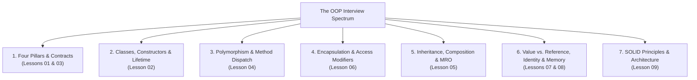

# Lesson 10: Rapid Fire: the OOP Revision Sheet

> **Prerequisites:** [Lesson 09: Coupling, Cohesion and SOLID as Interview Answers](../09-coupling-cohesion-and-solid-as-answers/README.md) and [Track 24 Overview](../README.md).  
> **Estimated Reading Time:** 28 minutes  
> **Target Audience:** Engineers preparing for LLD, OOP, C#, or Python technical screening and architecture rounds.

> [!NOTE]
> **In one line:** A **rapid-fire revision sheet**: ~60 OOP questions grouped by domain — use it the night before, answering each in one or two sentences out loud.

> [!TIP]
> **The One Rule of Rapid-Fire OOP Revision:** In technical screenings and rapid-fire rounds, the difference between a pass and a rejection is **speed and conceptual precision**. Do not ramble with lengthy personal anecdotes; state the core definition in your first sentence, cite the underlying mechanism or trade-off in your second sentence, and provide an idiomatic language example in your third.

---

## 1. Why This Matters: The Interview Trap

The rapid-fire technical screening is designed to test your **reflexes, depth, and communication conciseness**. Interviewers ask 10 to 15 fundamental object-oriented programming questions back-to-back in a 30-minute phone call.

The most common trap is **waffling**:
- **Weak Candidate:** Asked *"What is constructor chaining?"*, the candidate talks for three minutes about a project where they built an e-commerce cart, mentions that constructors initialize variables, and trails off without explaining how chaining works or what keywords (`this()`, `base()`, `super().__init__()`) are involved.
- **Strong Candidate:** Answers in two crisp sentences: *"Constructor chaining is the practice of having one constructor call another constructor within the same class or base class to centralize initialization logic and eliminate duplicate code. In C#, it is implemented using `: this(...)` or `: base(...)`; in Python, it is accomplished via `super().__init__(...)`."*

This revision sheet serves as your **ultimate night-before reference guide**. It condenses all 64 core questions across Lessons 01 through 09 into high-impact, two-sentence model answers with direct C# and Python comparisons.

---

## 2. Visual Mental Model / Taxonomic Comparison

### The 7 Core Domains of OOP Mastery



### C# vs. Python: Runtime & Execution Model Comparison

| Dimension | C# (.NET Core / CLR) | Python (CPython / Data Model) |
| :--- | :--- | :--- |
| **Type System** | Static, strongly typed, nominal subtyping. JIT-compiled to machine code via CIL. | Dynamic, strongly typed, duck typing and structural subtyping (`typing.Protocol`). Bytecode interpreted. |
| **Memory Allocation** | Stack for value types (`struct`), managed heap for reference types (`class`). Managed GC with generational collection (Gen 0, 1, 2). | Managed heap for all objects (`everything is an object`). Reference counting combined with a cyclical garbage collector. |
| **Method Dispatch** | Static binding by default; dynamic via virtual method table (`vtable`) when marked `virtual` or `override`. Interface dispatch via `itable`. | Dynamic dispatch on every method call via `__dict__` lookup following the class Method Resolution Order (MRO). |
| **Privacy & Encapsulation** | Strict compiler-enforced access modifiers (`public`, `private`, `protected`, `internal`, `private protected`, `protected internal`). | Conventional privacy: `_single_underscore` for internal use; `__double_underscore` activates name mangling (`_Class__var`). |
| **Multiple Class Inheritance** | **Forbidden.** Single class inheritance only. A class may implement unlimited interfaces. | **Supported.** Resolved deterministically using the C3 Linearization Algorithm (MRO). |
| **Value Types vs. References** | Distinct `struct` vs. `class` types. Primitives (`int`, `bool`) are value types on the stack unless boxed. | Everything is a reference (`PyObject*`). Primitives (`int`, `float`, `str`, `tuple`) are immutable reference objects. |
| **Equality Semantics** | `==` compares references by default for classes (overrideable), and compares values for primitives and `record`. `.Equals()` defines logical equivalence. | `==` tests value equality via `__eq__`. `is` tests pointer/object identity (`id(a) == id(b)`). |
| **Static Constructors** | Explicit `static MyClass()` runs once before the class is first accessed; thread-safe by CLR guarantee. | Module-level execution on first import; class-level statements execute at class definition time. |

---

## 3. Code Implementation: The Rapid-Fire Comparison Benchmark

The following benchmark demonstrates the primary syntactic and semantic contrasts across both languages in a single cohesive example:
1. Encapsulated property invariants.
2. Static / class-level state and factories.
3. Polymorphic dynamic dispatch vs. explicit virtual overriding.
4. Value equality vs. reference identity.

````carousel
```python
from abc import ABC, abstractmethod
from typing import ClassVar


# 1. ENCAPSULATION & STATIC/CLASS CONSTRUCTORS
class BankAccount:
    interest_rate: ClassVar[float] = 0.05  # Shared class-level attribute

    def __init__(self, owner: str, balance: float) -> None:
        self.owner = owner
        if balance < 0:
            raise ValueError("Balance cannot be negative.")
        self._balance = balance  # Protected by convention

    @property
    def balance(self) -> float:
        return self._balance

    def deposit(self, amount: float) -> None:
        if amount <= 0:
            raise ValueError("Amount must be positive.")
        self._balance += amount

    @classmethod
    def create_promotional_account(cls, owner: str) -> "BankAccount":
        """Alternative factory constructor using classmethod."""
        return cls(owner, 100.0)  # Starts with $100 bonus


# 2. POLYMORPHISM & METHOD DISPATCH
class TransactionNotifier(ABC):
    @abstractmethod
    def send(self, message: str) -> str:
        pass


class SmsNotifier(TransactionNotifier):
    def send(self, message: str) -> str:
        return f"[SMS] {message}"


class EmailNotifier(TransactionNotifier):
    def send(self, message: str) -> str:
        return f"[Email] {message}"


# 3. IDENTITY VS VALUE EQUALITY
class Currency:
    def __init__(self, code: str, amount: float) -> None:
        self.code = code
        self.amount = amount

    def __eq__(self, other: object) -> bool:
        if not isinstance(other, Currency):
            return False
        return self.code == other.code and self.amount == other.amount

    def __hash__(self) -> int:
        return hash((self.code, self.amount))


if __name__ == "__main__":
    # Test Encapsulation & Classmethod
    acc = BankAccount.create_promotional_account("Alice")
    acc.deposit(50.0)
    print(f"{acc.owner} balance: ${acc.balance:.2f}")

    # Test Polymorphic Dispatch (Duck / Abstract subtyping)
    notifiers: list[TransactionNotifier] = [SmsNotifier(), EmailNotifier()]
    for n in notifiers:
        print(n.send("Transaction approved"))

    # Test Identity (is) vs Equality (==)
    c1 = Currency("USD", 100.0)
    c2 = Currency("USD", 100.0)
    print(f"c1 == c2: {c1 == c2}")  # True: Value equality via __eq__
    print(f"c1 is c2: {c1 is c2}")  # False: Distinct objects in memory
```
<!-- slide -->
```csharp
using System;
using System.Collections.Generic;

// 1. ENCAPSULATION & STATIC CONSTRUCTORS
public class BankAccount
{
    public static decimal InterestRate { get; private set; } // Shared static state
    public string Owner { get; }
    private decimal _balance; // Encapsulated backing field

    public decimal Balance => _balance;

    // Static constructor: Runs once before first access
    static BankAccount()
    {
        InterestRate = 0.05m;
    }

    public BankAccount(string owner, decimal balance)
    {
        if (balance < 0)
            throw new ArgumentException("Balance cannot be negative.");
        Owner = owner;
        _balance = balance;
    }

    public void Deposit(decimal amount)
    {
        if (amount <= 0)
            throw new ArgumentException("Amount must be positive.");
        _balance += amount;
    }

    // Static factory method for alternative construction
    public static BankAccount CreatePromotionalAccount(string owner)
    {
        return new BankAccount(owner, 100.0m); // Starts with $100 bonus
    }
}

// 2. POLYMORPHISM & METHOD DISPATCH
public abstract class TransactionNotifier
{
    public abstract string Send(string message);
}

public class SmsNotifier : TransactionNotifier
{
    public override string Send(string message) => $"[SMS] {message}";
}

public class EmailNotifier : TransactionNotifier
{
    public override string Send(string message) => $"[Email] {message}";
}

// 3. IDENTITY VS VALUE EQUALITY (Using C# record for value semantics)
public record Currency(string Code, decimal Amount);

public class Program
{
    public static void Main()
    {
        // Test Encapsulation & Static Factory
        var acc = BankAccount.CreatePromotionalAccount("Alice");
        acc.Deposit(50.0m);
        Console.WriteLine($"{acc.Owner} balance: ${acc.Balance:F2}");

        // Test Polymorphic Dispatch (Virtual table lookup)
        var notifiers = new List<TransactionNotifier> { new SmsNotifier(), new EmailNotifier() };
        foreach (var n in notifiers)
        {
            Console.WriteLine(n.Send("Transaction approved"));
        }

        // Test Identity (ReferenceEquals) vs Equality (== on record)
        var c1 = new Currency("USD", 100.0m);
        var c2 = new Currency("USD", 100.0m);
        Console.WriteLine($"c1 == c2: {c1 == c2}"); // True: Record value equality
        Console.WriteLine($"c1 is c2: {ReferenceEquals(c1, c2)}"); // False: Distinct heap references
    }
}
```
````

**Expected Output (Both Languages):**

```text
Alice balance: $150.00
[SMS] Transaction approved
[Email] Transaction approved
c1 == c2: True
c1 is c2: False
```

---

## 4. Where You Already Use It

- **System Diagnostics & Code Reviews:** Rapid-fire mental models enable senior engineers to spot memory leaks (e.g., event listener subscriptions in C# or circular references in Python), brittle hierarchies, and Liskov violations in pull requests in under 30 seconds.
- **Architectural Refactoring:** Deciding between a `struct` vs. `record` vs. `class` in .NET, or between a `Protocol` vs. `ABC` in Python, dictates the cache locality, GC pressure, and coupling profile of high-throughput services.
- **Framework Plumbing:** ASP.NET Core dependency injection lifetimes (`Transient`, `Scoped`, `Singleton`) directly mirror constructor and lifetime concepts from Lesson 02.

---

## 5. Pitfalls and When Not to Use It

1. **The Buzzword Soup Trap:** Reciting buzzwords like "Liskov Substitution" or "Polymorphism" without knowing the underlying mechanics (e.g., vtables, pre/post-conditions). If you use a term, be prepared to defend it.
2. **The Ultra-Brief Omission Trap:** Answering so briefly that you omit critical language nuances. Saying *"Python has no private variables"* without mentioning convention (`_`) and name mangling (`__`) signals shallow knowledge.
3. **The Language Conflation Trap:** Assuming C# semantics apply to Python (e.g., assuming method overloading works by signature) or assuming Python semantics apply to C# (e.g., assuming structs are reference types allocated on the heap).

---

## 6. Exercises & Practical Drills

### Drill 1: The 15-Second Bug Hunter
Look at this Python function:
```python
def append_timestamp(item: str, timestamps: list = []) -> list:
    timestamps.append(item)
    return timestamps
```
What is the bug, why does it happen, and how do you fix it in 15 seconds?

<details>
<summary>Answer</summary>

**Bug:** Mutable default argument.  
**Why:** In Python, default arguments are evaluated once when the function is defined, not when it is invoked. All calls sharing the default argument mutate the exact same list instance in memory.  
**Fix:** Use `None` as the sentinel default value: `timestamps: list | None = None`, and initialize `timestamps = []` inside the function body if `timestamps is None`.
</details>

---

### Drill 2: Predict the Output (C# Method Hiding)
Look at this C# code:
```csharp
public class BasePrinter { public void Print() => Console.WriteLine("Base"); }
public class LaserPrinter : BasePrinter { public new void Print() => Console.WriteLine("Laser"); }

BasePrinter printer = new LaserPrinter();
printer.Print();
```
What is printed, and why?

<details>
<summary>Answer</summary>

**Output:** `Base`  
**Why:** The `new` keyword hides the base method rather than overriding it. Because `Print()` is non-virtual, the call is bound statically at compile time to the reference type (`BasePrinter`), ignoring the runtime object type (`LaserPrinter`).
</details>

---

### Drill 3: Identify the Diamond Resolution
Given this Python inheritance hierarchy:
```python
class A: pass
class B(A): pass
class C(A): pass
class D(B, C): pass
```
In what order does Python search for attributes in `D`?

<details>
<summary>Answer</summary>

**Order:** `D -> B -> C -> A -> object`  
**Why:** Python resolves multiple inheritance using the C3 Linearization Algorithm (MRO). It inspects subclasses before their base classes and preserves the local declaration order (`B` before `C`).
</details>

---

## 7. The ~60 Core OOP Rapid-Fire Interview Questions & Model Answers

### Domain 1: The 4 Pillars & Core Concepts

> [!interview]
> **Question 1: What are the four pillars of OOP?**  
> **Strong Answer:**  
> "The four pillars are **Encapsulation** (bundling state and behavior while safeguarding invariants), **Abstraction** (exposing minimal contracts while hiding internal implementation details), **Inheritance** (establishing 'is-a' relationships for code reuse and subtyping), and **Polymorphism** (treating different concrete types uniformly via a shared contract at runtime)."

> [!interview]
> **Question 2: What is the fundamental difference between abstraction and encapsulation?**  
> **Strong Answer:**  
> "Encapsulation is about **containment and data safety**—protecting an object's internal state using access modifiers or properties so outside code cannot violate invariants. Abstraction is about **simplification and interface design**—hiding complex implementation mechanics behind a clean contract so callers only need to know *what* a component does, not *how* it does it."

> [!interview]
> **Question 3: Can you do OOP without inheritance?**  
> **Strong Answer:**  
> "Yes, absolutely. Modern software engineering heavily favors composition over inheritance. Languages like **Go** and **Rust** support encapsulation, abstraction, and polymorphism through structs, interfaces, and traits without supporting classical class inheritance at all."

> [!interview]
> **Question 4: What is the difference between an abstract class and an interface?**  
> **Strong Answer:**  
> "An **interface** defines a pure capability or contract (*'what an object can do'*, e.g., `IDisposable`), holds no instance state, and allows multiple implementations per class. An **abstract class** defines a core identity (*'what an object is'*, e.g., `Stream`), can maintain state, enforce constructor invariants, and implement template method workflows, but is restricted to single inheritance in languages like C#."

> [!interview]
> **Question 5: When should you choose an interface over an abstract class?**  
> **Strong Answer:**  
> "Choose an interface when you want to define a cross-cutting capability across completely unrelated classes (e.g., `IComparable` for both a `Customer` and a `Temperature`), or when designing loosely coupled plug-in contracts for dependency injection. Choose an abstract class when subclasses share common internal state, require parameterized constructors, or need default algorithm scaffolding via the Template Method pattern."

> [!interview]
> **Question 6: Can an interface contain method implementations?**  
> **Strong Answer:**  
> "Yes, in modern languages. In C# 8+, interfaces support **Default Interface Methods** (DIM) to provide default implementations for API evolution without breaking existing implementers; however, implementing classes do not inherit interface state. In Python, abstract base classes (`abc.ABC`) can contain concrete method bodies that subclasses can call via `super()`."

> [!interview]
> **Question 7: Can an abstract class have a constructor? Can an interface?**  
> **Strong Answer:**  
> "An abstract class **can** have constructors (invoked by subclasses via `base(...)` in C# or `super().__init__(...)` in Python) to validate and initialize required state. An interface **cannot** have instance constructors in C# or Python because it does not maintain instance state."

> [!interview]
> **Question 8: How does Python enforce interfaces without a native `interface` keyword?**  
> **Strong Answer:**  
> "Python uses two complementary mechanisms: **Abstract Base Classes (`abc.ABC`)** with `@abstractmethod` decorators for nominal runtime type checking, and **Protocols (`typing.Protocol`)** introduced in PEP 544 for static structural subtyping (compile-time duck typing checked by tools like `mypy`)."

---

### Domain 2: Classes, Constructors & Lifetime

> [!interview]
> **Question 9: What is the difference between a class, an object, and an instance?**  
> **Strong Answer:**  
> "A **class** is the compile-time blueprint or type definition defining fields, methods, and invariants. An **object** is the concrete entity allocated in memory at runtime. An **instance** describes that object's specific relationship to its class (e.g., `'alice'` is an instance of `Customer`)."

> [!interview]
> **Question 10: What is constructor chaining and how is it written?**  
> **Strong Answer:**  
> "Constructor chaining is the practice of having one constructor call another constructor within the same class or base class to centralize initialization logic and eliminate code duplication. In C#, it uses `: this(...)` for overloaded constructors or `: base(...)` for parent constructors; in Python, it uses `super().__init__(...)`."

> [!interview]
> **Question 11: What is a static constructor in C# and when does it execute?**  
> **Strong Answer:**  
> "A static constructor (`static MyClass()`) in C# initializes type-level static state. It is parameterless, cannot have access modifiers, cannot be called directly, and is guaranteed by the CLR to execute exactly once before the first instance is created or any static member is referenced."

> [!interview]
> **Question 12: What is the difference between `__new__` and `__init__` in Python?**  
> **Strong Answer:**  
> "`__new__` is the static allocator method that actually creates and returns a new object instance in memory (used in singletons or immutable subclassing like `int` or `tuple`). `__init__` is the initializer method that receives the freshly created instance (`self`) and configures its attributes."

> [!interview]
> **Question 13: Can a class have a private constructor? Why would you want one?**  
> **Strong Answer:**  
> "Yes. A private constructor prevents external instantiation with `new`. It is used in the **Singleton pattern**, **Static utility classes** (in C#), and classes that force construction exclusively through **Static Factory Methods** (e.g., `ComplexNumber.FromPolarCoordinates(r, theta)`)."

> [!interview]
> **Question 14: What is a finalizer or destructor, and why is relying on `__del__` or `Finalize()` dangerous?**  
> **Strong Answer:**  
> "A finalizer (`~MyClass()` in C#, `__del__` in Python) is executed before an unreferenced object is reclaimed by the garbage collector. Relying on them is dangerous because their execution timing is non-deterministic, can prolong object lifetimes into higher GC generations, and may fail to execute altogether if the process abruptly terminates."

> [!interview]
> **Question 15: What is the `IDisposable` pattern in C# and what is its Python equivalent?**  
> **Strong Answer:**  
> "The `IDisposable` pattern (`using` statement) provides deterministic, immediate release of unmanaged resources (file handles, database connections, sockets) without waiting for garbage collection. In Python, the equivalent is the **Context Manager pattern** (`with` statement) backed by `__enter__` and `__exit__` dunder methods."

> [!interview]
> **Question 16: What is the difference between a shallow copy and a deep copy?**  
> **Strong Answer:**  
> "A **shallow copy** creates a new object instance but copies references to nested objects, meaning mutations to inner objects reflect across both copies. A **deep copy** recursively duplicates the parent object and all nested child objects, producing an entirely independent object graph."

---

### Domain 3: Polymorphism, Virtual Methods & Method Dispatch

> [!interview]
> **Question 17: What is the difference between method overloading and method overriding?**  
> **Strong Answer:**  
> "**Overloading** is compile-time (static) polymorphism where multiple methods in the same class share the same name but have different parameter signatures. **Overriding** is runtime (dynamic) polymorphism where a subclass provides a specific implementation of a virtual or abstract method defined in its base class."

> [!interview]
> **Question 18: What is compile-time (static) vs run-time (dynamic) polymorphism?**  
> **Strong Answer:**  
> "Compile-time polymorphism resolves the target method at compilation time using static type signatures (e.g., method overloading, generics, templates, operator overloading). Run-time polymorphism resolves the target method dynamically during execution based on the concrete runtime type of the object (e.g., virtual method overriding, interface dispatch)."

> [!interview]
> **Question 19: What is the difference between `override` and `new` in C#?**  
> **Strong Answer:**  
> "`override` replaces the base class virtual method in the vtable, so the derived method is called even when accessed through a base-type reference. `new` (method hiding) does not alter the vtable; it merely hides the base method, meaning the base implementation is invoked when accessed via a base-type reference."

> [!interview]
> **Question 20: Does Python support method overloading? If not, what is used instead?**  
> **Strong Answer:**  
> "Python does **not** natively support method overloading by signature; declaring a method with the same name simply overwrites the previous definition. Instead, Python developers use **default arguments**, **variable-length arguments (`*args, **kwargs`)**, `@functools.singledispatch` for type-based dispatch, or `@typing.overload` for static type hints."

> [!interview]
> **Question 21: What is a vtable (virtual method table) and how does runtime dispatch work?**  
> **Strong Answer:**  
> "A **vtable** is an array of function pointers created by the compiler for any class containing virtual methods. Each object instance contains an invisible pointer (`vptr`) to its class's vtable; at runtime, calling a virtual method dereferences the `vptr` and jumps to the function pointer at that method's assigned slot index."

> [!interview]
> **Question 22: Can you override a static method?**  
> **Strong Answer:**  
> "No. Static methods belong to the type itself, not an instance, and are resolved statically at compile time. Because there is no instance `vptr` involved, static methods cannot be entered into a vtable and cannot participate in runtime polymorphic overriding."

> [!interview]
> **Question 23: What does the `sealed` keyword do on a class or method in C#?**  
> **Strong Answer:**  
> "Applied to a **class**, `sealed` prevents other classes from inheriting from it (like `final` in Java). Applied to an **overridden method**, `sealed override` prevents downstream derived classes from overriding that specific method further."

> [!interview]
> **Question 24: What is duck typing, and how does it relate to polymorphism?**  
> **Strong Answer:**  
> "Duck typing (*'If it walks like a duck and quacks like a duck, it is a duck'*) is dynamic polymorphism where an object's suitability is determined by the presence of specific methods and properties at runtime, rather than explicit inheritance from a nominal base class or interface."

> [!interview]
> **Question 25: What is `functools.singledispatch` in Python?**  
> **Strong Answer:**  
> "`@functools.singledispatch` is a decorator that transforms a standard Python function into a generic function, allowing you to overload behavior based on the type of the first argument without writing branching `isinstance()` checks."

---

### Domain 4: Encapsulation & Access Modifiers

> [!interview]
> **Question 26: What access modifiers are available in C# and what do they mean?**  
> **Strong Answer:**  
> "C# has six access levels: `public` (accessible everywhere), `private` (accessible only within containing type), `protected` (accessible within containing type and derived classes), `internal` (accessible only within current assembly), `protected internal` (accessible within current assembly OR derived classes in other assemblies), and `private protected` (accessible only within derived classes within current assembly)."

> [!interview]
> **Question 27: What is the default access modifier for a class and a class member in C#?**  
> **Strong Answer:**  
> "At file scope, top-level classes default to `internal`. Class members (methods, fields, properties) default to `private`. Interface members default to `public`."

> [!interview]
> **Question 28: How do you make an attribute private in Python? Is it truly private?**  
> **Strong Answer:**  
> "Python uses naming conventions: a single underscore prefix (`_variable`) signals protected internal use. A double underscore prefix (`__variable`) triggers **name mangling** (transforming it internally to `_ClassName__variable`). Nothing in Python is strictly private; mangled attributes can still be accessed if explicitly addressed."

> [!interview]
> **Question 29: What is name mangling in Python and when does it occur?**  
> **Strong Answer:**  
> "Name mangling automatically rewrites any identifier prefixed with two or more underscores (without trailing underscores) to `_ClassName__identifier`. Its architectural purpose is to prevent accidental attribute shadowing and name collisions in complex inheritance hierarchies."

> [!interview]
> **Question 30: What is the difference between a field and a property?**  
> **Strong Answer:**  
> "A **field** is a raw memory storage location holding data directly. A **property** is a syntactic wrapper around getter and setter methods that enables encapsulation, allowing data validation, computation, lazy loading, and access control without altering caller syntax."

> [!interview]
> **Question 31: What are auto-properties and `init`-only properties in C#?**  
> **Strong Answer:**  
> "An **auto-property** (`public int Id { get; set; }`) instructs the compiler to automatically generate a private backing field. An **`init`-only property** (`public int Id { get; init; }`) allows mutation only during object construction or object initializers, making the property immutable thereafter."

> [!interview]
> **Question 32: How does the `@property` decorator work in Python compared to explicit getter/setter methods?**  
> **Strong Answer:**  
> "The `@property` decorator exposes an underlying method as a readable attribute, allowing clean `obj.attribute` access syntax while executing custom code. It preserves backward compatibility, allowing developers to refactor public fields into validated accessors without breaking consumer code."

> [!interview]
> **Question 33: What is an Anemic Domain Model and why is it considered an antipattern?**  
> **Strong Answer:**  
> "An Anemic Domain Model is an entity design where classes contain only public getters and setters with zero behavior or invariant validation, while all business logic is pushed into external service classes. It violates encapsulation because external callers can mutate state into illegal configurations bypassing domain rules."

> [!interview]
> **Question 34: What is the difference between `protected internal` and `private protected` in C#?**  
> **Strong Answer:**  
> "`protected internal` means **Union / OR**: accessible to derived classes anywhere OR any code inside the same assembly. `private protected` means **Intersection / AND**: accessible only to derived classes that reside inside the same assembly."

---

### Domain 5: Inheritance, Composition & MRO

> [!interview]
> **Question 35: Why is composition generally preferred over inheritance?**  
> **Strong Answer:**  
> "Composition (*'has-a'*) provides loose coupling, dynamic runtime swapping of behaviors via interfaces, and prevents exposing base class internals to clients. Inheritance (*'is-a'*) creates tight compile-time coupling, exposes subclasses to base class changes, and frequently leads to brittle, unwieldy hierarchies."

> [!interview]
> **Question 36: What is the Fragile Base Class problem?**  
> **Strong Answer:**  
> "The Fragile Base Class problem occurs when seemingly safe modifications to a base class's internal method implementations unintentionally break derived classes that depended on the previous internal execution flow or overridden method sequencing."

> [!interview]
> **Question 37: What is the Diamond Problem and why does it happen?**  
> **Strong Answer:**  
> "The Diamond Problem arises in multiple inheritance when a class inherits from two parent classes that both inherit from a single grandparent class. If both parents override the same method from the grandparent, ambiguity arises as to which implementation the derived class should inherit."

> [!interview]
> **Question 38: Does C# support multiple inheritance of classes? Why or why not?**  
> **Strong Answer:**  
> "No, C# forbids multiple class inheritance to avoid the Diamond Problem and complex memory layout complications (multiple vtables and pointer adjustments). C# instead allows a class to implement multiple interfaces, which provide polymorphism without multiple state inheritance."

> [!interview]
> **Question 39: How does Python solve multiple inheritance? What is the C3 Linearization (MRO)?**  
> **Strong Answer:**  
> "Python resolves multiple inheritance deterministically using the **C3 Linearization Algorithm** to construct a class's Method Resolution Order (MRO). C3 guarantees two critical properties: child classes are always checked before parent classes, and the declared order of multiple parent classes is strictly preserved."

> [!interview]
> **Question 40: How does `super()` decide which method to call in Python?**  
> **Strong Answer:**  
> "In Python, `super()` does not simply refer to the direct parent; it delegates method resolution to the **next class in the current instance's MRO chain**. This enables cooperative multiple inheritance where methods can pass control down a predictable linear sequence."

> [!interview]
> **Question 41: What is a Mixin and how does it differ from traditional inheritance?**  
> **Strong Answer:**  
> "A **Mixin** is a lightweight class intended to provide standalone, optional functionality to other classes via multiple inheritance without acting as a primary 'is-a' identity. Mixins do not have state or separate constructors and are designed to be mixed into diverse, unrelated classes."

> [!interview]
> **Question 42: What is the difference between "is-a", "has-a", and "uses-a" relationships?**  
> **Strong Answer:**  
> "**Is-a** represents inheritance/subtyping (`Dog is an Animal`). **Has-a** represents composition or aggregation where an object owns or contains another object (`Car has an Engine`). **Uses-a** represents dependency or association where a class temporarily consumes another object via a method parameter (`ReportGenerator uses a Printer`)."

> [!interview]
> **Question 43: What is object slicing in object-oriented programming?**  
> **Strong Answer:**  
> "Object slicing occurs when a derived class object is assigned by value to a base class object variable. The derived class state and specialized behaviors are 'sliced off', retaining only the base class data. In C# and Python, reference semantics prevent accidental slicing when working with objects on the heap."

---

### Domain 6: Value vs. Reference, Identity, Static & Memory

> [!interview]
> **Question 44: What is the difference between a value type and a reference type?**  
> **Strong Answer:**  
> "A **value type** holds its data directly (typically allocated on the execution stack) and assignments copy the actual data. A **reference type** stores a pointer/reference to an object allocated on the managed heap, and assignments copy only the pointer, pointing both variables to the same underlying instance."

> [!interview]
> **Question 45: What is the difference between `struct`, `class`, and `record` in C#?**  
> **Strong Answer:**  
> "A `struct` is an allocated-by-value stack type with copy semantics. A `class` is an allocated-by-reference heap type with identity semantics. A `record` is a compiler-synthesized type (defaults to reference type, or `record struct` for value type) that provides built-in value-based equality, non-destructive mutation (`with`), and concise positional formatting."

> [!interview]
> **Question 46: Is everything an object in Python? Is argument passing call-by-value or call-by-reference?**  
> **Strong Answer:**  
> "Yes, everything in Python is an object, including integers, functions, and modules. Python passes arguments using **call-by-object-reference** (call-by-sharing): the function receives a copy of the reference pointing to the object. Reassigning the parameter variable does not affect the caller, but mutating a mutable object in-place affects the caller."

> [!interview]
> **Question 47: What is the difference between `is` and `==` in Python?**  
> **Strong Answer:**  
> "`==` evaluates **value equality** by invoking the `__eq__` method to determine if two objects contain equivalent data. `is` evaluates **object identity** by comparing memory addresses (`id(a) == id(b)`), returning `True` only if both variables refer to the exact same object in memory."

> [!interview]
> **Question 48: Why must `GetHashCode()` always be overridden when `Equals()` is overridden in C#?**  
> **Strong Answer:**  
> "The hashing contract requires that if two objects are equal according to `Equals()`, they **must return identical hash codes**. If `GetHashCode()` is not overridden, equal objects will generate different bucket hashes, causing hash-based collections like `Dictionary<TKey, TValue>` and `HashSet<T>` to lose or duplicate entries."

> [!interview]
> **Question 49: What is the equality and hashing contract in Python (`__eq__` and `__hash__`)?**  
> **Strong Answer:**  
> "In Python, if two objects compare equal via `__eq__`, their `__hash__` values must be identical. Furthermore, if a class overrides `__eq__` without defining `__hash__`, Python automatically sets `__hash__ = None`, making instances unhashable to prevent mutable objects from corrupting dictionaries and sets."

> [!interview]
> **Question 50: Why is using a mutable default argument (`def add(item, lst=[])`) dangerous in Python?**  
> **Strong Answer:**  
> "Default parameter expressions in Python are evaluated once at module load time when the function definition is parsed, not at execution time. Every subsequent invocation that uses the default value shares the exact same list instance in memory, causing cumulative state pollution across unrelated calls."

> [!interview]
> **Question 51: How do you make an object truly immutable in C# and Python?**  
> **Strong Answer:**  
> "In C#, declare a `readonly struct` or a `record` with `init`-only properties and read-only collection wrappers (`IReadOnlyList<T>`). In Python, use `@dataclass(frozen=True)` or inherit from `typing.NamedTuple`, ensuring all contained child attributes are also immutable."

> [!interview]
> **Question 52: What are boxing and unboxing in C#, and what is their performance cost?**  
> **Strong Answer:**  
> "**Boxing** converts a value type (e.g., `int`) to a reference type (`object` or an interface) by allocating an object on the managed heap and copying the value into it. **Unboxing** extracts the value from the heap object back onto the stack. Both incur severe CPU and GC overhead in hot execution paths."

> [!interview]
> **Question 53: What is the difference between static and instance members?**  
> **Strong Answer:**  
> "An **instance member** belongs to a specific object instance and requires an instantiated object to be accessed. A **static member** belongs to the type itself, has only one shared memory representation across the entire application domain, and is accessed directly via the class name."

> [!interview]
> **Question 54: What is the difference between a static class and a Singleton pattern?**  
> **Strong Answer:**  
> "A **static class** cannot be instantiated, cannot implement interfaces, cannot inherit from other classes, and is bound at compile time. A **Singleton** is an instantiated heap object that implements interfaces, supports polymorphism, allows lazy initialization, and can be passed as a dependency parameter."

> [!interview]
> **Question 55: What is the difference between `@staticmethod`, `@classmethod`, and a module-level function in Python?**  
> **Strong Answer:**  
> "`@staticmethod` receives no implicit first argument and acts as a plain function scoped inside a class's namespace. `@classmethod` receives the class object (`cls`) as its first argument and is used for alternative constructors. A module-level function lives outside any class and is generally preferred in Python when class namespacing is unnecessary."

---

### Domain 7: Coupling, Cohesion, SOLID & Architecture

> [!interview]
> **Question 56: What do high cohesion and low coupling mean?**  
> **Strong Answer:**  
> "**High cohesion** means all elements within a module or class are closely related and focused on achieving a single business purpose. **Low coupling** means modules interact through minimal, stable contracts and know as little as possible about each other's internal implementation details."

> [!interview]
> **Question 57: What is the Single Responsibility Principle (SRP) in one sentence with a smell and fix?**  
> **Strong Answer:**  
> "A class should have only one reason to change, serving a single business stakeholder or actor.  
> - **Smell:** A class that mixes database access, business calculation, and PDF generation.  
> - **Fix:** Extract responsibilities into focused collaborators (`OrderCalculator`, `OrderRepository`, `OrderPdfExporter`)."

> [!interview]
> **Question 58: What is the Open/Closed Principle (OCP) in one sentence with a smell and fix?**  
> **Strong Answer:**  
> "Software entities should be open for extension, but closed for modification.  
> - **Smell:** A cascading `switch` statement checking type enums to execute conditional business algorithms.  
> - **Fix:** Replace the switch with the Strategy pattern, injecting a polymorphic interface (`IPaymentProcessor`)."

> [!interview]
> **Question 59: What is the Liskov Substitution Principle (LSP) in one sentence with a classic violation?**  
> **Strong Answer:**  
> "Subtypes must be substitutable for their base types without altering the correctness or invariant contracts of the program.  
> - **Violation:** A `Square` inheriting from `Rectangle` where mutating `Width` automatically changes `Height`, breaking the rectangle's independent dimension contract."

> [!interview]
> **Question 60: What is the Interface Segregation Principle (ISP) in one sentence with a smell and fix?**  
> **Strong Answer:**  
> "Clients should not be forced to depend upon interfaces containing methods they do not call.  
> - **Smell:** A monolithic `IMachine` interface forcing a basic desktop printer class to throw `NotImplementedException` for `Fax()`.  
> - **Fix:** Decompose into lean, role-based interfaces (`IPrinter`, `IScanner`, `IFax`)."

> [!interview]
> **Question 61: What is the Dependency Inversion Principle (DIP) in one sentence with a smell and fix?**  
> **Strong Answer:**  
> "High-level domain policy must not depend on low-level infrastructure modules; both must depend on abstractions.  
> - **Smell:** An `OrderService` directly instantiating `new SqlDatabaseConnection()` or `new SmtpEmailClient()`.  
> - **Fix:** Define repository and notification interfaces in the domain layer and inject implementations via constructor injection."

> [!interview]
> **Question 62: What is the difference between Dependency Inversion (DIP) and Dependency Injection (DI)?**  
> **Strong Answer:**  
> "**Dependency Inversion Principle (DIP)** is a high-level architectural rule stating that domain policies must depend on abstractions rather than low-level details. **Dependency Injection (DI)** is a concrete design pattern/technique of passing dependency instances into an object (via constructor or method) from the outside."

> [!interview]
> **Question 63: What is the difference between Dependency Injection (DI) and an IoC Container?**  
> **Strong Answer:**  
> "**Dependency Injection (DI)** is the coding pattern of accepting dependencies through parameters rather than instantiating them internally. An **IoC Container** is a software library or framework tool (e.g., ASP.NET Core DI, Autofac) that automates dependency resolution, object graph instantiation, and lifetime management across the entire application."

> [!interview]
> **Question 64: What do DRY, KISS, and YAGNI mean to a senior engineer?**  
> **Strong Answer:**  
> "**DRY** (Don't Repeat Yourself) mandates a single unambiguous representation of business *knowledge*, not mindless deduplication of coincidentally similar lines of code. **KISS** (Keep It Simple, Stupid) asserts that simplicity is an architectural feature and unnecessary layers of indirection are technical debt. **YAGNI** (You Aren't Gonna Need It) dictates building only for verified current requirements rather than engineering complex speculative abstractions."

### Top 6 drills (tagged)

<details>
<summary><strong>1. What is the difference between abstraction and encapsulation? [BASIC]</strong></summary>

Abstraction hides *complexity* by exposing a simple contract (what it does). Encapsulation hides *state* by guarding data behind methods (how it is protected). One is a design-level idea, the other is an implementation-level mechanism.

</details>

<details>
<summary><strong>2. Abstract class or interface? [BASIC]</strong></summary>

Interface for a capability that unrelated types share; abstract class when subclasses share state, a constructor or a template algorithm. Default to the interface and compose.

</details>

<details>
<summary><strong>3. How do you stop a growing `switch` on type? [SCENARIO]</strong></summary>

Replace it with polymorphism (Strategy): one abstraction, one class per case. New cases add a class, they do not edit the switch.

</details>

<details>
<summary><strong>4. How would you make a class safe to use as a dictionary key? [SCENARIO]</strong></summary>

Make it immutable and override equality and hash together, based only on immutable fields (record / frozen dataclass).

</details>

<details>
<summary><strong>5. Why can `Square : Rectangle` break code? [TRICKY]</strong></summary>

Setting width independently of height is valid for a rectangle but not a square, so callers that rely on rectangle behaviour break. This is a Liskov violation: model them as separate shapes behind a `Shape` interface.

</details>

<details>
<summary><strong>6. Does Python's `__del__` guarantee cleanup? [TRICKY]</strong></summary>

No. Timing is not deterministic and it may not run at interpreter shutdown. Use a context manager (`with`) for deterministic cleanup; in C# use `using`/`IDisposable`.

</details>

---

## Try it

Set a 10-minute timer and answer five random questions from section 7 out loud, no peeking. Anything you hesitate on, jump to its lesson in the [track hub](../README.md) and then redraw the idea in [LLD Studio](/tools/lld-studio/).

---

## One-page cheat sheet

```text
PILLARS      encapsulate | abstract | inherit | polymorph
ABSTRACT/IF  is-a + shared state  vs  can-do contract
OVERLOAD     compile-time, signature     OVERRIDE  run-time, virtual
INHERIT      prefer composition; diamond -> C# no / Python MRO
ENCAPSULATE  modifiers, properties, Python _x / __x
EQUALITY     Equals<->GetHashCode, __eq__<->__hash__, is vs ==
STATIC       type-level, no this; avoid mutable statics
SOLID        S O L I D  = smell -> fix
```

---

## 8. Sources & Further Reading

- [Microsoft Learn: Object-Oriented Programming Fundamentals in C#](https://learn.microsoft.com/en-us/dotnet/csharp/fundamentals/tutorials/oop)
- [Microsoft Learn: .NET Common Type System & Memory Management](https://learn.microsoft.com/en-us/dotnet/standard/base-types/common-type-system)
- [Python 3 Documentation: The Python Data Model & Dunder Methods](https://docs.python.org/3/reference/datamodel.html)
- [Python 3 Documentation: Abstract Base Classes (`abc`)](https://docs.python.org/3/library/abc.html)
- [PEP 544: Protocols: Structural subtyping (static duck typing)](https://peps.python.org/pep-0544/)
- [Martin Fowler: Patterns of Enterprise Application Architecture](https://martinfowler.com/eaaCatalog/)

---

Previous: [Coupling, Cohesion and SOLID as Interview Answers](../09-coupling-cohesion-and-solid-as-answers/README.md) · Next: [Whiteboard Drills: Design a Class Hierarchy](../11-whiteboard-drills-design-a-class-hierarchy/README.md)
