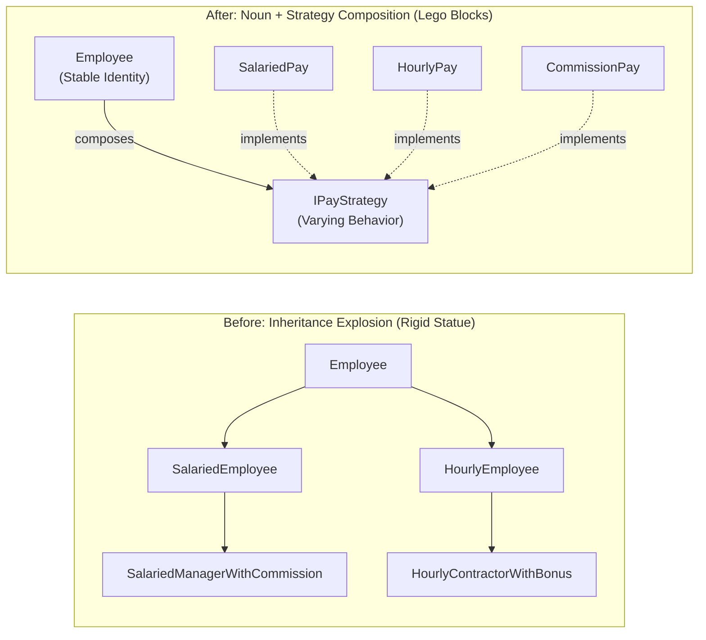
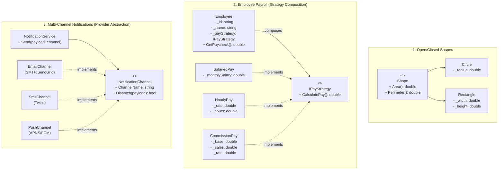

# Lesson 11: Whiteboard Drills: Design a Class Hierarchy

> **Prerequisites:** [Lesson 10: Rapid Fire: the OOP Revision Sheet](../10-rapid-fire-oop-revision-sheet/README.md) and [Track 24 Overview](../README.md).  
> **Estimated Reading Time:** 25 minutes  
> **Target Audience:** Engineers preparing for LLD, OOP, C#, or Python technical screening and architecture rounds.

> [!NOTE]
> **In one line:** A whiteboard hierarchy drill follows one loop — **requirements → nouns → what varies → abstraction → one extension demo** — and the interviewer watches for composition over deep inheritance.

> [!TIP]
> **The One Rule of Whiteboard Class Hierarchy Design:** Never rush into drawing deep inheritance trees; model **nouns as entities**, **varying behaviors as pluggable strategies or interfaces**, and keep inheritance depth to **two levels or fewer**. If an interviewer introduces a new variation, it should be accommodated by adding a new class implementing an interface, never by modifying an existing class.

---

## 1. Why This Matters: The Interview Trap

"Design a class hierarchy for a notification system / employee payroll / shape calculator" is the quintessential 20-to-30 minute object-oriented whiteboard prompt. It is not a test of your ability to memorize syntax; it is a simulation of how you think through **abstractions, extensibility, and domain boundaries under pressure**.

### The Junior Trap: The Inheritance Avalanche
When asked: *"Design an employee system with full-time, part-time, and commission-based staff"*, the typical candidate immediately starts drawing boxes connected by solid arrows:

```
Employee -> SalariedEmployee -> SalariedManager
         -> HourlyEmployee   -> HourlyContractor
```

Then the interviewer introduces the inevitable follow-up:
- *"What if an employee works remotely and has different tax withholding?"*
- *"What if a salaried manager also earns a sales commission?"*
- *"What if an hourly contractor gets a holiday bonus?"*

The candidate's hierarchy disintegrates. They are forced into:
1. **Multiple inheritance** (introducing diamond problems and coupling).
2. **Combinatorial class explosion** (`SalariedManagerWithCommissionRemote`).
3. **Copy-pasting logic** across unrelated subclasses.

### The Senior Playbook: Decouple Identity from Behavior
A senior engineer pauses, clarifies invariants for 90 seconds, and identifies the **dimensions of change**:
- An employee's **identity** (ID, name, department) is stable.
- An employee's **compensation formula** (salaried, hourly, commission) is a *behavior* that varies independently and may change over time.

Instead of making `HourlyEmployee` a subclass of `Employee`, the senior engineer models `IPayStrategy` as an interface and **composes** it into `Employee`. When the interviewer asks for a contractor with a commission, the senior candidate responds: *"We simply inject a `CompositePayStrategy` or a new `CommissionPay` instance without modifying `Employee`."*

### Junior vs. Senior Whiteboard Execution

| Evaluation Dimension | Junior Candidate Approach | Senior Architect Approach |
| :--- | :--- | :--- |
| **Initial 90 Seconds** | Immediately writes class definitions on the whiteboard. | Asks 2-3 clarifying questions: scale, mutation frequency, required polymorphic dispatch. |
| **Inheritance Depth** | Deep hierarchies (3 to 5 levels) capturing every permutation as a subclass. | Shallow hierarchies ($\le 2$ levels). Prefers interfaces and composition for varying behaviors. |
| **Handling Curveballs** | Erases existing classes, introduces multiple inheritance, or adds `switch` statements. | Accommodates new requirements by adding a new class conforming to an existing interface (OCP). |
| **Separation of Concerns** | Blends mathematical/business rules with external I/O (e.g., `Shape.DrawToGpu()`, `Employee.SaveToDb()`). | Isolates pure domain invariants from persistence, formatting, and transport mechanisms. |
| **Verbal Communication** | Silent while drawing, then reads method names verbatim. | Continuously narrates architectural rationale: *"I am isolating the transport channel behind an interface to decouple dispatching from provider SDKs."* |

---

## 1A. The Visual Story: Problem -> Analogy -> Solution

### The Problem (Why Naive Code Breaks)
Imagine an interview candidate asked to design an Employee Payroll hierarchy. Without pausing to discover entities and variation points, they immediately draw `Employee -> SalariedEmployee -> SalariedManager` and `Employee -> HourlyEmployee -> HourlyContractor`. Ten minutes later, the interviewer asks: *"What if a salaried manager also earns commission, or a contractor switches to salaried next quarter?"* Suddenly, the candidate is trapped in an **inheritance avalanche**—creating `SalariedManagerWithCommission`, duplicating tax logic, or mutating an object's class at runtime. Jumping straight into inheritance before separating **stable identity (nouns)** from **varying behavior (verbs/strategies)** turns a clean 20-minute drill into an unmaintainable class explosion.

### Real-World Analogy
Think of **Lego minifigures vs. porcelain statues**. A porcelain statue of a "Firefighter with Axe" is molded as one solid piece—if you need a "Firefighter with Hose" or a "Doctor with Axe," you must smash the mold and sculpt a brand-new statue. A Lego minifigure separates the **core figure (stable identity)** from **snap-on tools and hats (pluggable interfaces/strategies)**. You can swap an axe for a stethoscope in one click without rebuilding the figure.

### Visual Problem -> Solution Diagram



### Where It Is Used & Progressive Buildup

| Ecosystem / Context | How Real Systems Model Hierarchies & Variation |
| :--- | :--- |
| **.NET (`IAuthorizationHandler` / `Middleware`)** | ASP.NET Core composes small `IAuthorizationRequirement` and middleware handlers rather than subclassing a giant `BaseController`. |
| **Python (`logging.Handler` / `Strategies`)** | `Logger` (stable identity) composes pluggable `Handler` and `Formatter` objects instead of `FileJsonLogger` subclasses. |
| **Go (`http.RoundTripper` / Struct Embedding)** | `http.Client` composes a `Transport` (`RoundTripper` interface) so retry, auth, and logging wrap cleanly without inheritance. |
| **TypeScript (`Express` / `Strategy Maps`)** | Payment/notification pipelines compose typed handler interfaces (`ChannelDispatcher`) in a registry map rather than subclassing. |
| **LLD Interview Problems** | Parking Lot (`PricingStrategy`), Notification System (`INotificationChannel`), Elevator (`SchedulingPolicy`), Chess (`MoveValidator`). |

**3-Step Progressive Buildup:**
1. **Discover Nouns & Invariants:** Clarify requirements for 90 seconds and list the core domain entities (`Employee`, `Shape`, `NotificationService`).
2. **Isolate What Varies:** Extract every axis of change (pay formula, transport channel, pricing rule) behind a narrow interface (`IPayStrategy`).
3. **Demo One Extension Live:** Prove Open/Closed compliance by adding one new requirement (e.g., `WebhookChannel` or `CompositePay`) without touching existing classes.

---

## 2. Visual Mental Model / Taxonomic Comparison

Below is the architectural taxonomy of the three classic whiteboard drills: Shapes, Employees, and Notifications.



### Hierarchy Design Patterns Matrix

| Drill Archetype | Primary Pattern | Variation Point | Why Pure Subclassing Fails |
| :--- | :--- | :--- | :--- |
| **Geometric Shapes** | **Polymorphic Hierarchy** (Pure Abstraction) | Formula calculations (`Area`, `Perimeter`). | Shapes have clear mathematical invariants. Adding rendering or serialization into subclasses breaks SRP. |
| **Employee Payroll** | **Strategy Pattern** (Composition over Inheritance) | Compensation algorithm (Salary vs. Hourly vs. Commission). | Employees change pay structures over time; employees can have multiple simultaneous compensation rules. |
| **Notification Dispatch** | **Bridge / Provider Abstraction** | Transport medium (Email, SMS, Webhook, Mobile Push). | Subclassing notifications by channel (`WelcomeEmail`, `WelcomeSms`) causes an $M \times N$ class explosion. |

---

## 3. Code Implementation

Here are the complete, runnable implementations covering all three whiteboard drills. Notice how each hierarchy fulfills the Open/Closed Principle: adding a new shape, pay rule, or notification channel requires **zero modifications** to existing classes.

````carousel
```python
import math
from abc import ABC, abstractmethod
from dataclasses import dataclass
from typing import List


# ==========================================
# DRILL 1: OPEN/CLOSED SHAPE HIERARCHY
# ==========================================
class Shape(ABC):
    """Abstract base contract for geometric shapes."""

    @abstractmethod
    def area(self) -> float:
        """Calculate shape area polymorphically."""
        pass

    @abstractmethod
    def perimeter(self) -> float:
        """Calculate shape perimeter polymorphically."""
        pass


class Circle(Shape):
    def __init__(self, radius: float) -> None:
        if radius <= 0:
            raise ValueError("Radius must be positive.")
        self.radius = radius

    def area(self) -> float:
        return math.pi * self.radius * self.radius

    def perimeter(self) -> float:
        return 2 * math.pi * self.radius


class Rectangle(Shape):
    def __init__(self, width: float, height: float) -> None:
        if width <= 0 or height <= 0:
            raise ValueError("Dimensions must be positive.")
        self.width = width
        self.height = height

    def area(self) -> float:
        return self.width * self.height

    def perimeter(self) -> float:
        return 2 * (self.width + self.height)


# ==========================================
# DRILL 2: EMPLOYEE PAYROLL (COMPOSITION OVER INHERITANCE)
# ==========================================
class PayStrategy(ABC):
    """Encapsulates varying compensation calculation algorithms."""

    @abstractmethod
    def calculate_pay(self) -> float:
        pass


class SalariedPay(PayStrategy):
    def __init__(self, monthly_salary: float) -> None:
        self.monthly_salary = monthly_salary

    def calculate_pay(self) -> float:
        return self.monthly_salary


class HourlyPay(PayStrategy):
    def __init__(self, hourly_rate: float, hours_worked: float) -> None:
        self.hourly_rate = hourly_rate
        self.hours_worked = hours_worked

    def calculate_pay(self) -> float:
        regular_hours = min(40.0, self.hours_worked)
        overtime_hours = max(0.0, self.hours_worked - 40.0)
        return (regular_hours * self.hourly_rate) + (overtime_hours * self.hourly_rate * 1.5)


class Employee:
    """Stable entity composing identity with a pluggable compensation strategy."""

    def __init__(self, emp_id: str, name: str, pay_strategy: PayStrategy) -> None:
        self.emp_id = emp_id
        self.name = name
        self.pay_strategy = pay_strategy

    def get_paycheck(self) -> float:
        return self.pay_strategy.calculate_pay()


# ==========================================
# DRILL 3: NOTIFICATION DISPATCH HIERARCHY
# ==========================================
@dataclass(frozen=True)
class NotificationPayload:
    recipient: str
    subject: str
    body: str


class NotificationChannel(ABC):
    """Transport abstraction decoupling message dispatch from carrier SDKs."""

    @property
    @abstractmethod
    def channel_name(self) -> str:
        pass

    @abstractmethod
    def dispatch(self, payload: NotificationPayload) -> bool:
        pass


class EmailChannel(NotificationChannel):
    @property
    def channel_name(self) -> str:
        return "EMAIL"

    def dispatch(self, payload: NotificationPayload) -> bool:
        print(f"[{self.channel_name}] To: {payload.recipient} | Subj: {payload.subject} | Body: {payload.body}")
        return True


class SmsChannel(NotificationChannel):
    @property
    def channel_name(self) -> str:
        return "SMS"

    def dispatch(self, payload: NotificationPayload) -> bool:
        print(f"[{self.channel_name}] Phone: {payload.recipient} | Msg: {payload.body}")
        return True


class PushChannel(NotificationChannel):
    @property
    def channel_name(self) -> str:
        return "PUSH"

    def dispatch(self, payload: NotificationPayload) -> bool:
        print(f"[{self.channel_name}] DeviceToken: {payload.recipient} | Alert: {payload.body}")
        return True


def main() -> None:
    # 1. Shapes Drill: Open/Closed polymorphic calculation
    shapes: List[Shape] = [Circle(5.0), Rectangle(4.0, 6.0)]
    total_area = sum(s.area() for s in shapes)
    print(f"Total Shapes Area: {total_area:.2f}")

    # 2. Employees Drill: Composition-driven payroll
    emp1 = Employee("E01", "Alice", SalariedPay(5000.0))
    emp2 = Employee("E02", "Bob", HourlyPay(40.0, 45.0))
    print(f"Payroll - {emp1.name}: ${emp1.get_paycheck():.2f}")
    print(f"Payroll - {emp2.name}: ${emp2.get_paycheck():.2f}")

    # 3. Notifications Drill: Multi-channel dispatch
    channels: List[NotificationChannel] = [EmailChannel(), SmsChannel(), PushChannel()]
    msg = NotificationPayload("user@example.com", "Security Alert", "New login from Linux terminal.")
    for ch in channels:
        ch.dispatch(msg)


if __name__ == "__main__":
    main()
```
<!-- slide -->
```csharp
using System;
using System.Collections.Generic;
using System.Linq;

namespace WhiteboardDrills;

// ==========================================
// DRILL 1: OPEN/CLOSED SHAPE HIERARCHY
// ==========================================
public abstract class Shape
{
    public abstract double Area();
    public abstract double Perimeter();
}

public class Circle : Shape
{
    public double Radius { get; }

    public Circle(double radius)
    {
        if (radius <= 0)
            throw new ArgumentException("Radius must be positive.");
        Radius = radius;
    }

    public override double Area() => Math.PI * Radius * Radius;
    public override double Perimeter() => 2 * Math.PI * Radius;
}

public class Rectangle : Shape
{
    public double Width { get; }
    public double Height { get; }

    public Rectangle(double width, double height)
    {
        if (width <= 0 || height <= 0)
            throw new ArgumentException("Dimensions must be positive.");
        Width = width;
        Height = height;
    }

    public override double Area() => Width * Height;
    public override double Perimeter() => 2 * (Width + Height);
}

// ==========================================
// DRILL 2: EMPLOYEE PAYROLL (COMPOSITION OVER INHERITANCE)
// ==========================================
public interface IPayStrategy
{
    double CalculatePay();
}

public class SalariedPay : IPayStrategy
{
    public double MonthlySalary { get; }

    public SalariedPay(double monthlySalary)
    {
        MonthlySalary = monthlySalary;
    }

    public double CalculatePay() => MonthlySalary;
}

public class HourlyPay : IPayStrategy
{
    public double HourlyRate { get; }
    public double HoursWorked { get; }

    public HourlyPay(double hourlyRate, double hoursWorked)
    {
        HourlyRate = hourlyRate;
        HoursWorked = hoursWorked;
    }

    public double CalculatePay()
    {
        double regularHours = Math.Min(40.0, HoursWorked);
        double overtimeHours = Math.Max(0.0, HoursWorked - 40.0);
        return (regularHours * HourlyRate) + (overtimeHours * HourlyRate * 1.5);
    }
}

public class Employee
{
    public string EmpId { get; }
    public string Name { get; }
    public IPayStrategy PayStrategy { get; set; }

    public Employee(string empId, string name, IPayStrategy payStrategy)
    {
        EmpId = empId;
        Name = name;
        PayStrategy = payStrategy;
    }

    public double GetPaycheck() => PayStrategy.CalculatePay();
}

// ==========================================
// DRILL 3: NOTIFICATION DISPATCH HIERARCHY
// ==========================================
public record NotificationPayload(string Recipient, string Subject, string Body);

public interface INotificationChannel
{
    string ChannelName { get; }
    bool Dispatch(NotificationPayload payload);
}

public class EmailChannel : INotificationChannel
{
    public string ChannelName => "EMAIL";

    public bool Dispatch(NotificationPayload payload)
    {
        Console.WriteLine($"[{ChannelName}] To: {payload.Recipient} | Subj: {payload.Subject} | Body: {payload.Body}");
        return true;
    }
}

public class SmsChannel : INotificationChannel
{
    public string ChannelName => "SMS";

    public bool Dispatch(NotificationPayload payload)
    {
        Console.WriteLine($"[{ChannelName}] Phone: {payload.Recipient} | Msg: {payload.Body}");
        return true;
    }
}

public class PushChannel : INotificationChannel
{
    public string ChannelName => "PUSH";

    public bool Dispatch(NotificationPayload payload)
    {
        Console.WriteLine($"[{ChannelName}] DeviceToken: {payload.Recipient} | Alert: {payload.Body}");
        return true;
    }
}

public static class Program
{
    public static void Main()
    {
        // 1. Shapes Drill: Open/Closed polymorphic calculation
        var shapes = new List<Shape> { new Circle(5.0), new Rectangle(4.0, 6.0) };
        double totalArea = shapes.Sum(s => s.Area());
        Console.WriteLine($"Total Shapes Area: {totalArea:F2}");

        // 2. Employees Drill: Composition-driven payroll
        var emp1 = new Employee("E01", "Alice", new SalariedPay(5000.0));
        var emp2 = new Employee("E02", "Bob", new HourlyPay(40.0, 45.0));
        Console.WriteLine($"Payroll - {emp1.Name}: ${emp1.GetPaycheck():F2}");
        Console.WriteLine($"Payroll - {emp2.Name}: ${emp2.GetPaycheck():F2}");

        // 3. Notifications Drill: Multi-channel dispatch
        var channels = new List<INotificationChannel> { new EmailChannel(), new SmsChannel(), new PushChannel() };
        var msg = new NotificationPayload("user@example.com", "Security Alert", "New login from Linux terminal.");
        foreach (var ch in channels)
        {
            ch.Dispatch(msg);
        }
    }
}
```
````

**Expected Output (Both Languages):**
```text
Total Shapes Area: 102.54
Payroll - Alice: $5000.00
Payroll - Bob: $1900.00
[EMAIL] To: user@example.com | Subj: Security Alert | Body: New login from Linux terminal.
[SMS] Phone: user@example.com | Msg: New login from Linux terminal.
[PUSH] DeviceToken: user@example.com | Alert: New login from Linux terminal.
```

---

## 4. Where You Already Use It

Standard frameworks rely on precisely structured class hierarchies to keep core pipelines extensible:

- **In .NET:**
  - `System.IO.Stream`: The root abstract class defining `Read`, `Write`, and `Flush`. Specializations like `FileStream`, `MemoryStream`, `NetworkStream`, and `GZipStream` implement byte-level transport without exposing transport-specific quirks to the caller.
  - `Microsoft.Extensions.Logging.ILoggerProvider`: Concrete providers (`ConsoleLoggerProvider`, `EventLogLoggerProvider`, `ApplicationInsightsLoggerProvider`) implement a common interface so that ASP.NET Core log aggregation remains completely decoupled from target destinations.
  - `System.Text.Json.Serialization.JsonConverter<T>`: Abstract class enabling custom polymorphic serialization hierarchies for domain objects.

- **In Python:**
  - `io.IOBase`: Abstract hierarchy (`RawIOBase`, `BufferedIOBase`, `TextIOBase`) providing unified stream access across file handles, string buffers (`io.StringIO`), and socket byte streams.
  - `logging.Handler`: The logging framework routes log records polymorphically across `StreamHandler`, `FileHandler`, `RotatingFileHandler`, and `SocketHandler`.
  - `collections.abc`: Abstract Base Classes like `Mapping`, `Sequence`, and `MutableMapping` establishing standard contracts for dictionaries, lists, and custom container types.

---

## 5. Pitfalls and When Not to Use It

1. **The Classic Square-Rectangle Liskov Trap:**
   - Modeling `class Square(Rectangle)` where `set_width(w)` mutates both width and height violates the Liskov Substitution Principle. Any client code assuming independent axes (`rect.set_width(5); rect.set_height(10); assert rect.area() == 50`) breaks when passed a `Square`. If shapes are mutable, do not inherit `Square` from `Rectangle`; make them independent siblings under `Shape`.

2. **The God Base Class Antipattern:**
   - Shoving channel-specific or entity-specific methods into the abstract base class (e.g., adding `send_email()`, `send_sms()`, and `send_apns_badge()` to `NotificationChannel`). Subclasses are forced to throw `NotSupportedException` or implement empty dummy methods, violating the Interface Segregation Principle.

3. **Mixing Side Effects and I/O with Pure Domain Computation:**
   - Putting database persistence or screen rendering directly on domain entities (e.g., `shape.render_to_directx()`, `employee.persist_to_sql()`). This couples pure calculation logic to heavy external hardware or infrastructure libraries. Use the Visitor or Repository patterns instead.

4. **Deep Inheritance Trees ($\ge 3$ levels):**
   - The "Fragile Base Class" problem: changes to base class constructors or private lifecycle hooks cascade destructively down the tree. Keep inheritance trees shallow ($\le 2$ levels) and delegate behavior to composed interfaces.

---

## 6. Exercises & Practical Drills

### Drill 1: The Liskov Substitution Refactoring
An interviewer presents the following code and asks: *"What principle does this violate, and how would you fix it?"*

```csharp
public class Rectangle
{
    public virtual int Width { get; set; }
    public virtual int Height { get; set; }
    public int Area() => Width * Height;
}

public class Square : Rectangle
{
    public override int Width { set { base.Width = value; base.Height = value; } }
    public override int Height { set { base.Width = value; base.Height = value; } }
}
```

<details>
<summary>Answer</summary>

**Principle Violated:** The **Liskov Substitution Principle (LSP)**. A client method expecting a `Rectangle` assumes setting `Width = 5` and `Height = 10` produces an area of 50. Passing a `Square` silently mutates `Height` to 5 when `Width` is set, producing an area of 25. The subtype cannot be substituted without breaking caller invariants.

**The Fix:**
1. **Option A (Prefer Immutability):** Make `Rectangle` and `Square` immutable with get-only properties. If dimensions cannot change after construction, `Square` can safely inherit from `Rectangle` or both can implement `IShape`.
2. **Option B (Sibling Hierarchy):** Make `IShape` (or abstract `Shape`) the common parent. `Rectangle(width, height)` and `Square(side)` are peer siblings that inherit from `Shape`, preventing callers from confusing their dimension invariants.
</details>

### Drill 2: Fallback Notification Router
The interviewer introduces an extension requirement: *"If sending via SMS fails or is throttled, the system must automatically fall back to Email. How do you implement this without touching `EmailChannel` or `SmsChannel`?"*

<details>
<summary>Answer</summary>

Implement the **Composite** (or **Chain of Responsibility**) pattern via a `FallbackNotificationChannel`:

```python
class FallbackNotificationChannel(NotificationChannel):
    def __init__(self, primary: NotificationChannel, fallback: NotificationChannel) -> None:
        self.primary = primary
        self.fallback = fallback

    @property
    def channel_name(self) -> str:
        return f"{self.primary.channel_name}_WITH_FALLBACK_{self.fallback.channel_name}"

    def dispatch(self, payload: NotificationPayload) -> bool:
        try:
            if self.primary.dispatch(payload):
                return True
        except Exception as ex:
            print(f"Primary {self.primary.channel_name} failed: {ex}. Engaging fallback.")
        return self.fallback.dispatch(payload)
```

Neither `EmailChannel` nor `SmsChannel` is modified. The client simply configures `FallbackNotificationChannel(SmsChannel(), EmailChannel())`. This adheres strictly to the Open/Closed Principle.
</details>

### Drill 3: Employee Performance Bonus
The interviewer adds: *"Some employees receive an annual performance bonus on top of their standard pay. How do you model this without creating `SalariedEmployeeWithBonus` and `HourlyEmployeeWithBonus`?"*

<details>
<summary>Answer</summary>

Use the **Decorator Pattern** on `IPayStrategy`:

```csharp
public class BonusPayDecorator : IPayStrategy
{
    private readonly IPayStrategy _baseStrategy;
    private readonly double _bonusAmount;

    public BonusPayDecorator(IPayStrategy baseStrategy, double bonusAmount)
    {
        _baseStrategy = baseStrategy;
        _bonusAmount = bonusAmount;
    }

    public double CalculatePay() => _baseStrategy.CalculatePay() + _bonusAmount;
}
```

Now, any employee's compensation strategy can be wrapped dynamically:
```csharp
var bobPay = new BonusPayDecorator(new HourlyPay(40.0, 45.0), 500.0);
var emp2 = new Employee("E02", "Bob", bobPay);
```
No subclass explosion occurs.
</details>

---

## 7. Interview Questions & Model Answers

<details>
<summary><strong>1. Design classes for a notification system that sends email, SMS and push. [BASIC]</strong></summary>

I structure a notification system by decoupling the **notification payload** from the **dispatch transport mechanism** using the Strategy and Provider patterns.

First, I define a value object or immutable record, `NotificationPayload`, holding recipient identifiers, subject, message body, and metadata.

Second, I create an abstraction, `INotificationChannel`, exposing a `Dispatch(payload)` method and a `ChannelName` property. Concrete implementations—`EmailChannel`, `SmsChannel`, and `PushChannel`—wrap their respective third-party SDKs (such as SendGrid, Twilio, or Firebase Cloud Messaging) acting as Anti-Corruption Layers.

Third, a high-level `NotificationService` accepts a collection of channels via Dependency Injection. Callers invoke `notificationService.Send(payload, ChannelType.Email)`. If requirements expand to include batch dispatch, multi-channel broadcast, or fallback retries, we compose channels using a `CompositeNotificationChannel` or decorate them with a `RetryChannelDecorator` without touching existing provider implementations, fully respecting the Open/Closed and Single Responsibility Principles.

</details>

<details>
<summary><strong>2. Model employees with different pay rules. [SCENARIO]</strong></summary>

Modeling employee payroll through pure class inheritance (`SalariedEmployee`, `HourlyEmployee`, `CommissionEmployee`) is an antipattern because an employee's identity is stable, while their compensation structure is volatile and can change over time or be combined.

Instead, I apply **Composition over Inheritance** using the Strategy pattern. The `Employee` class acts as an entity holding identity attributes (ID, name, department) and holds a reference to an `IPayStrategy` interface.

Concrete pay strategies encapsulate specific arithmetic: `SalariedPay` returns fixed monthly pay, `HourlyPay` computes regular hours plus 1.5x overtime, and `CommissionPay` computes base plus percentage of sales volume.

This architecture yields three major advantages:
1. An employee can transition from hourly to salaried at runtime by simply reassigning the strategy.
2. We can compose multiple compensation rules using the Decorator pattern (e.g., `BonusPayDecorator(new SalariedPay(5000))`) without combinatorial class explosion.
3. Payroll calculation logic can be unit-tested in complete isolation from the employee entity lifecycle.

</details>

<details>
<summary><strong>3. Design a shape hierarchy where new shapes do not change existing code. [SCENARIO]</strong></summary>

To design an extensible shape hierarchy conforming to the Open/Closed Principle, I establish an abstract base class or interface, `Shape`, defining pure mathematical invariants common to all two-dimensional geometric entities: `Area()` and `Perimeter()`.

Concrete shapes like `Circle`, `Rectangle`, and `Triangle` inherit from `Shape` and encapsulate their specific geometric dimensions (such as radius or width/height) as immutable constructor arguments with guard validations. High-level modules, such as a `CanvasAreaCalculator`, operate purely against `IEnumerable<Shape>` or `List[Shape]` using polymorphic dispatch: `shapes.Sum(s => s.Area())`. When a new shape like `Pentagon` is added, we write a new class without editing existing shapes or the calculator.

Crucially, to avoid violating the Single Responsibility Principle, I do **not** add rendering (`Draw()`) or serialization (`ToJson()`) directly into the `Shape` classes. Instead, if diverse operations must traverse the hierarchy, I use the **Visitor Pattern** (`IShapeVisitor`) or dedicated external renderers, keeping domain shapes focused strictly on geometric geometry.

</details>

<details>
<summary><strong>4. What is the first thing you do when handed a "design a class hierarchy" prompt? [SCENARIO]</strong></summary>

Clarify requirements and identify *what varies*. I list the nouns, ask which behaviours differ per type and which rules are likely to change, and only then draw an abstraction on that axis.

</details>

<details>
<summary><strong>5. How do you show the interviewer your design is extensible? [SCENARIO]</strong></summary>

Walk through a new requirement end to end: "to add WhatsApp I create `WhatsAppChannel : Channel` and register it; `NotificationService` is untouched." If the walkthrough edits existing classes, the abstraction is wrong.

</details>

<details>
<summary><strong>6. When is a deep inheritance tree the *right* answer on a whiteboard? [TRICKY]</strong></summary>

Rarely: only for a stable, genuinely taxonomic domain with shared state and where every subtype honours the base contract. Otherwise one level of abstraction plus composition (strategy objects) is safer and easier to test.

</details>

---

## Try it

Time-box 10 minutes on each prompt in [LLD Studio](/tools/lld-studio/): draw only classes and relationships, then say how a *new* case (new channel / pay rule / shape) is added without editing existing code. Drill order is in the [track hub](../README.md).

```python
from abc import ABC, abstractmethod
import math

class Shape(ABC):
    @abstractmethod
    def area(self) -> float: ...
class Circle(Shape):
    def __init__(self, r): self.r = r
    def area(self): return math.pi * self.r ** 2
class Rect(Shape):
    def __init__(self, w, h): self.w, self.h = w, h
    def area(self): return self.w * self.h

total = sum(s.area() for s in [Rect(2, 3), Circle(1)])   # new shape = new class only
assert round(total, 2) == 9.14
```

---

## One-page cheat sheet

```text
1 Clarify   who uses it, what varies, scale (2 min)
2 Nouns -> classes, verbs -> methods, "or" -> abstraction
3 Pick the axis of change; put an interface on it
4 Prefer composition; hierarchy <= 2 levels
5 Show extension: add a class, edit nothing
6 Name trade-offs + what you'd test
Smells: type enums + switch | isinstance chains | god class | override that throws
```

---

## 8. Sources & Further Reading

- [Microsoft Learn: Object-Oriented Programming in C#](https://learn.microsoft.com/en-us/dotnet/csharp/fundamentals/tutorials/oop)
- [Python Documentation: The Python Standard Library — Abstract Base Classes](https://docs.python.org/3/library/abc.html)
- [Martin Fowler: Polymorphism](https://martinfowler.com/bliki/Polymorphism.html)
- [Refactoring.Guru: Strategy Pattern](https://refactoring.guru/design-patterns/strategy)
- [Robert C. Martin: The Liskov Substitution Principle](https://web.archive.org/web/20150906155800/http://www.objectmentor.com/resources/articles/lsp.pdf)

---

Previous: [Rapid Fire: the OOP Revision Sheet](../10-rapid-fire-oop-revision-sheet/README.md) · Next: [Track 25: Design Patterns, One at a Time](../../25-design-patterns-one-at-a-time/README.md)
