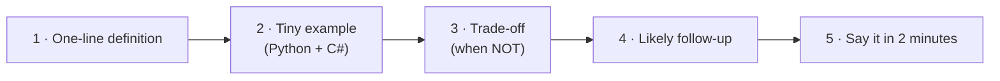

# Track 24: OOP Interview Questions

> **Prerequisites:** [01 · Classes & Objects](../01-classes-objects-and-oop-building-blocks/README.md), [02 · OOP Foundations & UML](../02-oop-foundations-and-uml/README.md), [04 · SOLID](../04-solid-principles/README.md)  
> **Reading time:** ~15 minutes for this overview; ~25 minutes per lesson  
> **Audience:** Anyone with an interview in the next 1–4 weeks who must *say* OOP answers out loud, in Python and C#

> [!NOTE]
> **In one line:** The object-oriented questions that open almost every developer interview — pillars, abstract vs interface, overriding, composition vs inheritance, encapsulation, static, equality — each trained as a **definition → tiny example → trade-off → likely follow-up** answer you can give in two minutes.

> [!TIP]
> **Golden rule:** Never answer an OOP question with a definition alone. Interviewers grade the *example* and the *trade-off*. "Polymorphism means many forms" is a 3/10; "`Payment.pay()` is overridden by `Card` and `Upi`, so checkout never branches on type" is an 8/10.

> [!TIP]
> **Try it:** Run the 20-line example in section 2 below, then re-sketch it as a class diagram in [LLD Studio](/tools/lld-studio/). If you can narrate both versions, you are ready for lesson 01.

---

## 1. Why this track exists

Modules 01–05 *teach* OOP and SOLID. In a real interview the same ideas arrive as **short, slightly adversarial questions**:

- *"What's the difference between abstraction and encapsulation?"* (they sound identical)
- *"Abstract class or interface here — why?"* (design judgement)
- *"Overloading vs overriding? Does Python even have overloading?"* (language trap)
- *"Is `Square : Rectangle` fine?"* (LSP trap)
- *"Why would you prefer composition?"* (needs a concrete example)

This track turns each into an answer with a fixed shape, so you stop improvising under pressure.



---

## 2. The whole track in one runnable example

Every lesson is a deeper look at some part of this tiny model. Run it first so the vocabulary is concrete.

````carousel
```python
from abc import ABC, abstractmethod


class Payment(ABC):                      # abstraction: the contract callers rely on
    def __init__(self, amount_cents: int) -> None:
        self._amount = amount_cents      # encapsulation: state is internal

    @abstractmethod
    def pay(self) -> str: ...            # polymorphism: each subtype answers differently

    def receipt(self) -> str:            # shared behaviour via inheritance
        return f"{self.pay()} (${self._amount / 100:.2f})"


class Card(Payment):
    def pay(self) -> str:
        return "charged card"


class Upi(Payment):
    def pay(self) -> str:
        return "debited UPI"


class Checkout:                          # composition: has-a, depends on the abstraction
    def __init__(self, method: Payment) -> None:
        self._method = method

    def complete(self) -> str:
        return self._method.receipt()


if __name__ == "__main__":
    for method in (Card(1999), Upi(1999)):
        print(Checkout(method).complete())
    try:
        Payment(100)                     # cannot instantiate an abstract class
    except TypeError as err:
        print("TypeError:", err)
```
<!-- slide -->
```csharp
public abstract class Payment(int amountCents)
{
    protected int AmountCents { get; } = amountCents;   // encapsulation
    public abstract string Pay();                       // polymorphism
    public string Receipt() => $"{Pay()} (${AmountCents / 100.0:F2})";
}

public sealed class Card(int cents) : Payment(cents)
{
    public override string Pay() => "charged card";
}

public sealed class Upi(int cents) : Payment(cents)
{
    public override string Pay() => "debited UPI";
}

public sealed class Checkout(Payment method)           // composition
{
    public string Complete() => method.Receipt();
}
```
````

**Where each pillar shows up:** abstraction = `Payment` contract · encapsulation = `_amount` · inheritance = `Card(Payment)` reuses `receipt` · polymorphism = `pay()` overridden · composition = `Checkout` *has a* `Payment`.

---

## 3. How this track works

- Each lesson is a group of related questions. For each: the short answer, the example in both languages, the common wrong answer, and the follow-up the interviewer is likely to ask.
- The examples are small on purpose — shapes, payments, notifications — so you can write any of them on a whiteboard from memory.
- Every example is written twice, in Python and in C#, as switchable tabs.
- Lesson 10 is the revision sheet: every question of the track with a one-line answer, for the night before.
- Lesson 11 is live drills: design a small class hierarchy against a clock.
- The track has eleven lessons. Lessons whose text is not ready yet are marked *Soon* in the sidebar; their page already lists what they will cover and the questions they will answer.

### Suggested plans

| Time you have | Do this |
| :--- | :--- |
| **1 evening** | Lessons 01, 03, 04, 05, then 10 (rapid fire) |
| **1 week** | One lesson per day (01–09), 10 on day 8, 11 on day 9 — say each answer aloud, timed |
| **Mock-interview week** | 11 (drills) daily; use 10 as the checklist of what you can't yet answer |

---

## 4. Lessons

| # | Lesson | What you'll be able to do |
|---|--------|---------------------------|
| 01 | [The Four Pillars, Answered Well](01-the-four-pillars-answered-well/README.md) | Explain encapsulation, abstraction, inheritance and polymorphism with one running example, and tell abstraction from encapsulation |
| 02 | [Classes, Objects, Constructors and Object Lifetime](02-classes-objects-constructors-and-lifetime/README.md) | Describe how an object is created and destroyed in both languages: constructors, chaining, static constructors, `__new__` and finalizers |
| 03 | [Abstract Class vs Interface](03-abstract-class-vs-interface/README.md) | Choose between an abstract class and an interface in C#, and between an ABC, a Protocol and plain duck typing in Python |
| 04 | [Overloading, Overriding and Polymorphism](04-overloading-overriding-and-polymorphism/README.md) | Tell compile-time from run-time polymorphism, and use `virtual`, `override`, `new` and `sealed` correctly |
| 05 | [Inheritance, Composition and the Diamond Problem](05-inheritance-composition-and-the-diamond-problem/README.md) | Argue composition over inheritance with a concrete example, and explain the diamond problem in both languages |
| 06 | [Access Modifiers, Properties and Encapsulation](06-access-modifiers-properties-and-encapsulation/README.md) | Name every C# access modifier and its Python convention, and protect an invariant with a property |
| 07 | [Static Members, Static Classes, and When Static Is a Smell](07-static-members-and-static-classes/README.md) | Use static members, static classes, `@staticmethod` and `@classmethod` on purpose, and say when static makes code hard to test |
| 08 | [Value vs Reference, Equality and Immutability](08-value-vs-reference-equality-and-immutability/README.md) | Explain value and reference semantics, implement equality correctly, and design an immutable object in both languages |
| 09 | [Coupling, Cohesion and SOLID as Interview Answers](09-coupling-cohesion-and-solid-as-answers/README.md) | Give a two-minute answer for each SOLID principle: the rule, a violation, the fix, in both languages |
| 10 | [Rapid Fire: the OOP Revision Sheet](10-rapid-fire-oop-revision-sheet/README.md) | Answer about sixty common OOP questions in one or two sentences each |
| 11 | [Whiteboard Drills: Design a Class Hierarchy](11-whiteboard-drills-design-a-class-hierarchy/README.md) | Design and code a small class hierarchy live: shapes, payments, notifications, employees |

---

## 5. Edges: where candidates lose marks

- **Python has no method overloading.** A second `def f` just rebinds the name. Say so, then name the substitutes: default/keyword arguments, `*args`, `functools.singledispatch`, `typing.overload` (type hints only).
- **"Everything is inherited" confusion.** Private (C#) vs "private by convention" (Python `_x`, `__x` name mangling) — know the real mechanism, not just the word.
- **Interface vs abstract class** is a *design* answer, not a vocabulary quiz: capability contract vs shared partial implementation.
- **Inheritance for reuse** is the classic wrong answer. Reach for composition; use inheritance only for true *is-a* with a shared contract (LSP).
- **Don't recite SOLID letters.** Give one violation and one fix each.
- **Over-claiming.** If you don't know whether C# allows something, say "I believe… I'd confirm in the docs" — it beats confident wrongness.

---

## 6. What you'd say in two minutes (the meta-answer)

> "For any OOP question I use the same shape: one-line definition, a tiny example, the trade-off, and where it breaks. For polymorphism: one interface, many implementations — `Payment.pay()` overridden by `Card` and `Upi` — so the checkout never branches on type. The trade-off is indirection, and it only pays off when you really have multiple behaviours. For inheritance versus composition: inheritance couples a subclass to its parent's implementation; composition lets me swap collaborators at runtime and test with fakes, so I default to composition and keep inheritance for genuine is-a relationships that respect Liskov."

---

## 7. Anti-patterns in OOP answers

| Weak answer | Why it scores low | Better |
| :--- | :--- | :--- |
| Dictionary definition only | No evidence you can apply it | Add a 5-line example |
| "Inheritance is for code reuse" | Leads to deep hierarchies | "Reuse via composition; inherit for substitutability" |
| "Abstraction = encapsulation" | They differ in intent | Abstraction hides *complexity behind a contract*; encapsulation hides *state behind rules* |
| Listing all four pillars as the answer to "what is OOP" | Rote | Pick one pillar, show it solving a real branching problem |
| "Interface = no code" (old C# answer) | Outdated | Mention default interface methods exist; the *intent* is the contract |

---

## 8. Interview questions about this track (how to use it)

<details>
<summary><strong>1. Abstraction vs encapsulation in one sentence each? [BASIC]</strong></summary>

Abstraction: expose *what* something does behind a stable contract (`Payment.pay()`). Encapsulation: protect *how* it holds state, so invariants can't be broken from outside (`_amount` is only changed through methods).

</details>

<details>
<summary><strong>2. Does Python support overloading? [BASIC]</strong></summary>

Not by signature — redefining a function rebinds the name. Use default arguments, `*args/**kwargs`, `functools.singledispatch`, or `typing.overload` for type-checker-only overloads.

</details>

<details>
<summary><strong>3. When would you choose an abstract class over an interface? [SCENARIO]</strong></summary>

When subtypes share real implementation or state (template-method skeleton), or I need a protected constructor/fields. When I only need a capability contract — especially across unrelated types — I choose an interface / `Protocol`.

</details>

<details>
<summary><strong>4. "Prefer composition over inheritance" — give a concrete reason. [SCENARIO]</strong></summary>

A `Stack(list)` exposes every list method and breaks if the parent changes; a `Stack` that *holds* a list exposes only `push/pop`, and the storage can be swapped. Composition gives a smaller surface, runtime flexibility, and easier testing.

</details>

<details>
<summary><strong>5. Is `Square` a `Rectangle`? [TRICKY]</strong></summary>

Mathematically yes; as mutable types, no. A square forcing `width == height` breaks callers who set width and height independently — an LSP violation. Model both as immutable `Shape`s, or compose.

</details>

<details>
<summary><strong>6. What is the diamond problem and how do Python and C# differ? [TRICKY]</strong></summary>

Two parents share a grandparent; which implementation does the child inherit? C# avoids it by allowing single class inheritance (multiple *interfaces*). Python allows multiple inheritance and resolves with the C3 MRO; `super()` follows that order, so cooperative classes call `super().__init__()` once each.

</details>

<details>
<summary><strong>7. You blank on a question. What do you do? [SCENARIO]</strong></summary>

Restate it, give the nearest concept you *do* know, and work from an example: "I don't remember the exact term, but here's the behaviour I'd expect…". Showing reasoning beats silence.

</details>

---

## 9. One-page cheat sheet

```text
Pillars      Encapsulation = hide state behind rules     Abstraction = hide complexity behind a contract
             Inheritance   = is-a, reuse + substitutable Polymorphism = same call, different behaviour
Choose       interface/Protocol = capability   abstract class = shared skeleton/state
Override     C#: virtual/override/new/sealed   Python: just redefine; super() follows the MRO
Overload     C#: by signature (compile time)   Python: no — defaults, *args, singledispatch
Prefer       composition + small interfaces; inherit only for real is-a (LSP)
Equality     reference vs value; override Equals/GetHashCode together; Python __eq__ + __hash__
Answer shape definition -> 5-line example -> trade-off -> follow-up

Night-before: lesson 10. Day-of: say the answers aloud.
```

---

## Sources

- [Microsoft Learn: object-oriented programming in C#](https://learn.microsoft.com/en-us/dotnet/csharp/fundamentals/tutorials/oop)
- [Python tutorial: classes](https://docs.python.org/3/tutorial/classes.html)
- [Python: the method resolution order (MRO)](https://docs.python.org/3/howto/mro.html)
- [PEP 544: Protocols (structural subtyping)](https://peps.python.org/pep-0544/)

Start here → [01-the-four-pillars-answered-well/README.md](01-the-four-pillars-answered-well/README.md)

Back to the course index: [../README.md](../README.md)
