# Lesson 01: How to Answer Any Design Pattern Question

> **Prerequisites:** [Track 24: OOP Interview Questions](../../24-oop-interview-questions/README.md) and [Track 25 Overview](../README.md).  
> **Estimated Reading Time:** 18 minutes  
> **Target Audience:** Engineers preparing for LLD, OOP, C#, or Python technical screening and architecture rounds.

> [!TIP]
> **The One Rule of Design Pattern Interviews:** Never define a design pattern by its internal mechanics alone; define it by the **tension** it resolves. Use the 5-step framework: **Intent** (what problem does it solve in one sentence?), **Tension** (what forces conflict without it?), **Structure** (who are the actors and contracts?), **Concrete Example** (production use case in Python/C#), and **Trade-offs** (what complexity or performance penalty do you pay?). And remember: saying *"I would NOT use a pattern here because a simple first-class function suffices"* is often the hallmark of a senior engineer.

---

## 1. Why This Matters: The Interview Trap

"What is the Strategy pattern?" or "Can you explain Decorator?" are standard questions in senior system design and low-level design (LLD) interviews. 

Candidates frequently walk straight into the **junior recitation trap**:
- **Weak Answer:** *"A design pattern is a template from the Gang of Four book. Strategy is when you have an interface and multiple classes implementing it so you can switch them. You use it because it's good OOP and reusable."*

Interviewers dislike this response because it memorizes class diagrams without demonstrating architectural judgment. It fails to answer the critical questions: *Why would you choose this over an `if/else`? What breaks in production if you don't use it? What complexity does it introduce?*

A senior engineer answers with **trade-offs, architectural tension, and intent**:
- **Strong Answer:** *"A design pattern is a battle-tested, named solution to a recurring architectural tension in software engineering. Patterns give teams a shared vocabulary and separate invariant business policies from volatile implementation details.*
*For example, when dealing with algorithmic variation—like multiple payment providers—hardcoded branching violates the Open/Closed Principle and forces frequent modifications to core billing code. The Strategy pattern resolves this tension by encapsulating each algorithm behind a uniform contract, enabling runtime pluggability and independent testing, at the cost of an extra layer of indirection and class proliferation."*

### The 5-Step Senior Answering Framework

Whenever an interviewer asks you about *any* design pattern, follow this structured five-step progression:

| Step | Focus | Prompt to Yourself | Example (Strategy Pattern) |
| :--- | :--- | :--- | :--- |
| **1. Intent** | One-sentence summary | *What does this pattern achieve at a high level?* | "Defines a family of algorithms, encapsulates each one, and makes them interchangeable at runtime." |
| **2. The Tension** | The pain point / code smell | *What goes wrong if I just write naive code?* | "A monolithic class bloated with mutating `switch/case` statements that requires modifying existing code every time business rules change." |
| **3. Structure** | Actors and relationships | *What are the core moving parts?* | "A Context class, a Strategy abstraction/protocol, and Concrete Strategy implementations." |
| **4. Real-World Case** | Concrete production usage | *Where have I or industry frameworks used it?* | "Processing payments (Stripe vs. PayPal vs. Adyen) or routing orders based on shipping carriers." |
| **5. Trade-offs** | Nuance and failure modes | *When should you NOT use this pattern?* | "If you only have two static algorithms that never change, Strategy adds unnecessary indirection; a simple conditional or lambda is superior." |

---

## 2. Visual Mental Model / Taxonomic Comparison

The 23 Gang of Four (GoF) patterns fall into three distinct functional categories based on their primary architectural objective:

```mermaid
flowchart TD
    GoF["GoF Design Patterns (23 Total)"]

    GoF --> Creational["1. Creational Patterns\n(Object Creation Mechanisms)"]
    GoF --> Structural["2. Structural Patterns\n(Class & Object Composition)"]
    GoF --> Behavioral["3. Behavioral Patterns\n(Communication & Responsibilities)"]

    Creational --> C1["Singleton: Single global instance"]
    Creational --> C2["Factory Method: Defer instantiation to subclasses"]
    Creational --> C3["Abstract Factory: Create families of related products"]
    Creational --> C4["Builder: Step-by-step complex object construction"]
    Creational --> C5["Prototype: Clone existing instances"]

    Structural --> S1["Adapter: Bridge incompatible interfaces"]
    Structural --> S2["Decorator: Attach responsibilities dynamically"]
    Structural --> S3["Facade: Simple interface to complex subsystem"]
    Structural --> S4["Composite: Treat tree hierarchies uniformly"]
    Structural --> S5["Proxy: Control access, lazy load, or cache"]

    Behavioral --> B1["Strategy: Interchangeable algorithms"]
    Behavioral --> B2["Observer: Publish/subscribe state notifications"]
    Behavioral --> B3["Command: Encapsulate requests as objects (undo/queue)"]
    Behavioral --> B4["State: Alter behavior when internal state changes"]
    Behavioral --> B5["Chain of Resp: Pipeline of handlers / middleware"]
```



### The Symptom-to-Pattern Diagnostic Matrix

In LLD whiteboard rounds, the interviewer will rarely say "Implement the Observer pattern." Instead, they will describe a business problem with specific symptoms. Use this diagnostic table to map symptoms directly to candidate patterns:

| Symptom / Code Smell | Core Tension | Primary Candidate Pattern | Modern Alternative |
| :--- | :--- | :--- | :--- |
| **Growing `switch` / `if-else` on a type** | Adding new behaviors requires altering existing methods (violates OCP). | **Strategy** (for algorithms) / **Factory Method** (for creation) | First-class functions / dictionary of lambdas |
| **Hardcoded `new ConcreteClass()` everywhere** | Tight coupling between consumer and concrete dependency; cannot mock for tests. | **Factory Method** / **Abstract Factory** | Dependency Injection container (`IServiceCollection`) |
| **Constructor takes 9 arguments, 6 optional** | Telescoping constructors; confusing parameter order; partial initialization bugs. | **Builder** | Fluent builder or named/keyword arguments with defaults |
| **"When X happens, A, B, and C must update"** | Hardcoding calls to A, B, and C creates high coupling and cyclic dependencies. | **Observer** | In-memory event bus, message broker (RabbitMQ/Kafka), C# `event` |
| **Incompatible external SDK interface** | Legacy or third-party API does not match your internal domain abstractions. | **Adapter** | Wrapper class or extension methods |
| **Need logging, caching, or auth around calls** | Duplicating cross-cutting concerns across every domain method. | **Decorator** / **Proxy** | ASP.NET Action Filters, middleware pipelines, Python `@decorators` |
| **Hierarchical tree of items and groups** | Client code constantly checking `if (node.IsGroup)` vs `if (node.IsLeaf)`. | **Composite** | Recursive visitor or recursive LINQ |
| **Object behaves completely differently per status** | Massive switch statements checking `Order.Status == Pending / Paid / Shipped`. | **State** | Finite State Machine (Stateless library or table-driven dispatch) |
| **Need undo/redo, audit logging, or task queues** | Execution of an action is bound to its invocation time and UI trigger. | **Command** | Event Sourcing, command queue (`Channel<T>` / `asyncio.Queue`) |

---

## 3. Code Implementation

Let us apply the 5-step framework to a classic interview refactoring problem: converting a brittle billing fee engine full of branching logic into a clean, extensible **Strategy** pattern with runtime registration.

````carousel
```python
from abc import ABC, abstractmethod
from decimal import Decimal
from typing import Callable, Dict


# 1. CONTRACT (Strategy Interface): Defines the invariant behavior
class PricingStrategy(ABC):

  @abstractmethod
  def calculate_fee(self, amount: Decimal) -> Decimal:
    """Calculates processing fee for a given transaction amount."""
    pass


# 2. CONCRETE STRATEGIES: Encapsulate volatile algorithmic variations
class StandardPricingStrategy(PricingStrategy):

  def calculate_fee(self, amount: Decimal) -> Decimal:
    # 2.9% + $0.30 fixed fee
    return (amount * Decimal("0.029") + Decimal("0.30")).quantize(
        Decimal("0.01")
    )


class HighVolumePricingStrategy(PricingStrategy):

  def calculate_fee(self, amount: Decimal) -> Decimal:
    # 1.5% flat fee for enterprise high-volume tiers
    return (amount * Decimal("0.015")).quantize(Decimal("0.01"))


class CryptoPricingStrategy(PricingStrategy):

  def calculate_fee(self, amount: Decimal) -> Decimal:
    # Flat $0.10 network miner relay charge
    return Decimal("0.10")


# 3. CONTEXT & STRATEGY REGISTRY: Decouples strategy selection from execution
class PaymentFeeCalculator:

  def __init__(self, strategy: PricingStrategy) -> None:
    self._strategy = strategy

  def set_strategy(self, strategy: PricingStrategy) -> None:
    """Allows dynamic runtime switching of the algorithm."""
    self._strategy = strategy

  def compute_final_charge(self, subtotal: Decimal) -> Decimal:
    fee = self._strategy.calculate_fee(subtotal)
    return subtotal + fee


# Modern Pythonic Alternative: Functional Strategy using Callable
FunctionalPricingStrategy = Callable[[Decimal], Decimal]


def seasonal_promo_strategy(amount: Decimal) -> Decimal:
  return Decimal("0.00")  # Zero fee promotion


# Demonstration
if __name__ == "__main__":
  order_total = Decimal("100.00")

  # 1. Standard Tier
  calculator = PaymentFeeCalculator(StandardPricingStrategy())
  print(f"Standard Total: ${calculator.compute_final_charge(order_total)}")

  # 2. Dynamic runtime swap to High Volume
  calculator.set_strategy(HighVolumePricingStrategy())
  print(f"High-Volume Total: ${calculator.compute_final_charge(order_total)}")

  # 3. Dynamic runtime swap to Crypto
  calculator.set_strategy(CryptoPricingStrategy())
  print(f"Crypto Total: ${calculator.compute_final_charge(order_total)}")
```
<!-- slide -->
```csharp
using System;
using System.Collections.Generic;

// 1. CONTRACT (Strategy Interface): Defines the invariant behavior
public interface IPricingStrategy
{
    decimal CalculateFee(decimal amount);
}

// 2. CONCRETE STRATEGIES: Encapsulate volatile algorithmic variations
public class StandardPricingStrategy : IPricingStrategy
{
    public decimal CalculateFee(decimal amount)
    {
        // 2.9% + $0.30 fixed fee
        return Math.Round((amount * 0.029m) + 0.30m, 2, MidpointRounding.AwayFromZero);
    }
}

public class HighVolumePricingStrategy : IPricingStrategy
{
    public decimal CalculateFee(decimal amount)
    {
        // 1.5% flat fee for enterprise high-volume tiers
        return Math.Round(amount * 0.015m, 2, MidpointRounding.AwayFromZero);
    }
}

public class CryptoPricingStrategy : IPricingStrategy
{
    public decimal CalculateFee(decimal amount)
    {
        // Flat $0.10 network miner relay charge
        return 0.10m;
    }
}

// 3. CONTEXT: Operates against the abstraction, supporting runtime substitution
public class PaymentFeeCalculator
{
    private IPricingStrategy _strategy;

    public PaymentFeeCalculator(IPricingStrategy strategy)
    {
        _strategy = strategy ?? throw new ArgumentNullException(nameof(strategy));
    }

    public void SetStrategy(IPricingStrategy strategy)
    {
        _strategy = strategy ?? throw new ArgumentNullException(nameof(strategy));
    }

    public decimal ComputeFinalCharge(decimal subtotal)
    {
        decimal fee = _strategy.CalculateFee(subtotal);
        return subtotal + fee;
    }
}

public class Program
{
    public static void Main()
    {
        decimal orderTotal = 100.00m;

        // 1. Standard Tier
        var calculator = new PaymentFeeCalculator(new StandardPricingStrategy());
        Console.WriteLine($"Standard Total: ${calculator.ComputeFinalCharge(orderTotal):F2}");

        // 2. Dynamic runtime swap to High Volume
        calculator.SetStrategy(new HighVolumePricingStrategy());
        Console.WriteLine($"High-Volume Total: ${calculator.ComputeFinalCharge(orderTotal):F2}");

        // 3. Dynamic runtime swap to Crypto
        calculator.SetStrategy(new CryptoPricingStrategy());
        Console.WriteLine($"Crypto Total: ${calculator.ComputeFinalCharge(orderTotal):F2}");
    }
}
```
````

**Expected Output (Both Languages):**
```text
Standard Total: $103.20
High-Volume Total: $101.50
Crypto Total: $100.10
```

---

## 4. Where You Already Use It

Production libraries in both .NET and Python are built directly on these GoF foundations:

### .NET / C# Ecosystem
- **`IHttpClientFactory` (Factory Method / Object Pool):** Manages the lifecycle and pooling of `HttpMessageHandler` instances, preventing socket exhaustion while ensuring DNS changes are respected.
- **ASP.NET Core Middleware (`RequestDelegate`) (Chain of Responsibility):** Incoming HTTP requests traverse a linked pipeline of handlers (`app.UseAuthentication()`, `app.UseAuthorization()`, `app.UseResponseCaching()`).
- **`CryptoStream` & `GZipStream` (Decorator):** Wrap any base `Stream` object to transparently inject compression, encryption, or buffered I/O without modifying downstream readers.
- **LINQ `IEnumerable<T>` & `yield return` (Iterator):** Decouples in-memory or streamed sequential traversal from data structures.
- **`IServiceProvider` (Dependency Injection / Service Locator):** Inverts object instantiation and binds interfaces to concrete lifetimes.

### Python Ecosystem
- **`functools.lru_cache` (Decorator / Proxy):** Intercepts function invocations, wrapping them with caching and eviction logic without changing function signatures.
- **`logging.Handler` (Observer / Strategy):** Loggers dispatch log records to multiple attached handlers (`StreamHandler`, `RotatingFileHandler`, `SocketHandler`).
- **`urllib.request.HTTPHandler` & `requests.adapters.HTTPAdapter` (Adapter / Strategy):** Allows developers to plug custom transport logic, retries, and SSL verification into high-level HTTP client requests.
- **`typing.Protocol` & `abc.ABC` (Strategy / Template Method):** Establishes explicit interface boundaries for duck-typed or abstract behavioral algorithms.

---

## 5. Pitfalls and When Not to Use It

### 1. Patternitis (The "Golden Hammer" Antipattern)
When developers first learn design patterns, they often try to force every problem into a pattern. A 20-line utility script does not need an `AbstractBillingStrategyFactoryProvider`. If an algorithm has only one implementation and zero business requirement to vary, applying the Strategy pattern is premature abstraction.

### 2. Speculative Generality
Building complex factories and interfaces for features that *"we might need next year"* violates **YAGNI** (You Aren't Gonna Need It). Every pattern introduces an architectural tax: extra files, interfaces, indirection, and cognitive overhead for new developers reading the codebase.

### 3. The Functional Shortcut
In modern C# and Python, functions are first-class citizens. Before creating an `IValidator` interface and three subclasses, ask: *Can this simply be a `Func<Order, bool>` or `Callable[[Order], bool]`?* If a Strategy or Command has only a single method and holds no mutable state, pass a lambda or pure function instead of creating a heavyweight class hierarchy.

```python
# Over-engineered class:
class UppercaseFormatter(IFormatter):

  def format(self, text: str) -> str:
    return text.upper()


# Modern idiomatic Python: Pass the function directly
def print_report(text: str, formatter: Callable[[str], str]) -> None:
  print(formatter(text))


print_report("hello world", str.upper)
```

---

## 6. Exercises & Practical Drills

### Drill 1: Identify the Pattern From System Symptoms
Read the architectural requirement and select the most appropriate GoF design pattern:
1. *"Our system generates reports in PDF, Excel, and CSV formats. Callers must request a report by format code without knowing which renderer class produces it, and adding Markdown reports must not require altering existing renderers."*
2. *"Our e-commerce checkout needs to send an SMS confirmation, email invoice, and notify the warehouse dispatch system simultaneously whenever an order transitions to `Paid`. Additional downstream notification systems will be added in upcoming quarters."*

<details>
<summary>Answer</summary>

1. **Factory Method (or Registry-backed Factory):** Centralizes instantiation logic, decouples the consumer from concrete report renderers, and adheres to the Open/Closed Principle by allowing new renderers to register themselves.
2. **Observer (Publish-Subscribe):** The checkout order subject emits an `OrderPaidEvent`, and decoupled subscribers (`SmsNotifier`, `EmailService`, `WarehouseDispatcher`) react independently without checkout needing direct references to them.
</details>

### Drill 2: Diagnostic Code Smell Review
Examine this Python code snippet. What antipattern is present, and how would you simplify it?

```python
class TaxCalculator:

  def calculate_tax(self, amount: float, state: str) -> float:
    if state == "CA":
      return amount * 0.0825
    elif state == "NY":
      return amount * 0.08875
    elif state == "TX":
      return amount * 0.0625
    else:
      return 0.0
```

<details>
<summary>Answer</summary>

**Antipattern:** Violation of the Open/Closed Principle (OCP) via hardcoded branching logic. Adding a new state or modifying a tax rate requires altering and re-testing `TaxCalculator`.

**Remediation:**
1. If the rates are purely static data, replace the branching logic with a lookup table / dictionary mapping state codes to decimal rates:
   ```python
   TAX_RATES = {"CA": Decimal("0.0825"), "NY": Decimal("0.08875"), "TX": Decimal("0.0625")}
   ```
2. If tax rules involve distinct state-specific algorithmic logic (e.g., food vs. apparel tax exemptions, tiered thresholds), refactor each state rule into a dedicated `TaxStrategy` conforming to an `ITaxStrategy` interface.
</details>

---

## 7. Interview Questions & Model Answers

> [!interview]
> **Question 1: What is a design pattern?**  
> **Strong Answer:**  
> "A design pattern is a battle-tested, reusable architectural solution to a commonly recurring design problem within a given software context. Rather than being finished code or a library, a pattern is an architectural blueprint describing relationships between classes, interfaces, and objects to solve a specific tension—such as decoupling object creation, managing runtime behavioral changes, or organizing object composition.  
> 
> Critically, patterns establish a standardized, shared vocabulary among software engineers. When I tell my team, 'Let's use an Adapter here for the third-party payment gateway,' everyone immediately understands the intent, structural boundaries, and trade-offs without needing a 30-minute explanation."

> [!interview]
> **Question 2: What are the three categories of GoF patterns?**  
> **Strong Answer:**  
> "The Gang of Four catalog categorizes patterns into three distinct domains based on their architectural intent:  
> 
> 1. **Creational Patterns:** Focus on mechanisms for object instantiation, decoupling the client from the concrete class, instantiation complexity, and lifecycle management. Key examples include **Singleton**, **Factory Method**, **Abstract Factory**, and **Builder**.  
> 2. **Structural Patterns:** Focus on class and object composition, assembling smaller objects and interfaces into larger, flexible structures while keeping systems decoupled. Key examples include **Adapter** (interface translation), **Decorator** (dynamic behavior augmentation), **Facade** (subsystem simplification), and **Composite** (tree hierarchies).  
> 3. **Behavioral Patterns:** Focus on communication, algorithms, and the assignment of responsibilities between objects. They identify common communication channels and shift control flow to avoid tight coupling. Key examples include **Strategy** (interchangeable algorithms), **Observer** (event notification), **Command** (action encapsulation), and **Chain of Responsibility** (pipeline handling)."

> [!interview]
> **Question 3: Which patterns have you used in a real project?**  
> **Strong Answer:**  
> "In my recent distributed order processing system, I applied four primary patterns:  
> 
> - **Strategy Pattern:** Implemented for payment fee calculation and shipment rate quoting. We integrated multiple third-party providers (FedEx, UPS, DHL). Each provider had unique API payloads, rate lookups, and discount calculations. Encapsulating each inside a `IShippingStrategy` allowed our checkout service to remain completely agnostic of shipping vendor changes.  
> - **Factory Method & Dependency Injection:** Used to dynamically resolve payment processor clients based on user selection and tenant configuration, keeping our high-level order service strictly coupled to abstractions (`IPaymentGateway`).  
> - **Observer Pattern:** Implemented using domain events. When an order was marked paid, an `OrderPaidEvent` was published. Completely decoupled subscribers (inventory reservation, email invoice dispatcher, analytics logger) handled their tasks asynchronously without polluting the checkout coordinator.  
> - **Decorator Pattern:** Used in our data access layer to wrap database repositories with a transparent in-memory Redis caching decorator, adding caching and cache eviction without modifying a single line of domain repository code."

> [!interview]
> **Question 4: Can overusing patterns be a problem?**  
> **Strong Answer:**  
> "Yes, absolutely. Overusing design patterns is commonly known as **'Patternitis'** or the **'Golden Hammer'** antipattern. It occurs when developers apply patterns preemptively to hypothetical future requirements rather than addressing current domain complexities.  
> 
> Overusing patterns introduces three major problems:  
> 1. **Accidental Complexity:** Codebases become buried under dozens of unnecessary interfaces, factories, abstract creators, and proxy wrappers, making simple control flows difficult to trace and debug.  
> 2. **Speculative Generality:** Engineers design elaborate abstraction layers for flexibility that is never actually utilized, violating the **YAGNI** and **KISS** principles.  
> 3. **Cognitive Overhead:** Onboarding new team members becomes slow and frustrating when a 10-line business rule is scattered across five separate classes.  
> 
> The best practice is to start with the simplest working implementation. Only refactor toward a design pattern when code smells appear—such as duplicate conditionals, tight coupling that prevents testing, or repeated cross-cutting concerns."

---

## 8. Sources & Further Reading

- Gamma, Helm, Johnson, Vlissides: *Design Patterns: Elements of Reusable Object-Oriented Software* (Addison-Wesley, 1994)
- [Refactoring.Guru: The Design Pattern Catalog](https://refactoring.guru/design-patterns/catalog)
- [Brandon Rhodes: Python Design Patterns Guide](https://python-patterns.guide/)
- [Martin Fowler: Patterns of Enterprise Application Architecture](https://martinfowler.com/eaaCatalog/)
- [Microsoft Learn: Architectural Principles and Patterns](https://learn.microsoft.com/en-us/dotnet/architecture/modern-web-apps-azure/architectural-principles)

---

Previous: [Track 25 Overview](../README.md) · Next: [Singleton: Where to Use It, How, and When Not To](../02-singleton/README.md)
