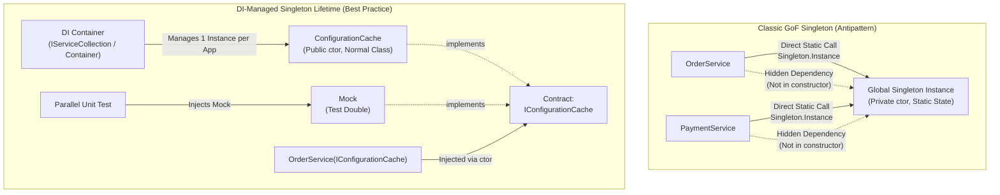

# Lesson 02: Singleton: Where to Use It, How, and When Not To

> **Prerequisites:** [How to Answer Any Design Pattern Question](../01-how-to-answer-any-pattern-question/README.md) and [Track 25 Overview](../README.md).  
> **Estimated Reading Time:** 18 minutes  
> **Target Audience:** Engineers preparing for LLD, OOP, C#, or Python technical screening and architecture rounds.

> [!TIP]
> **The One Rule of Singleton:** Never implement the classic GoF static Singleton (with a private constructor and static `GetInstance()`) when you can use **Dependency Injection lifetime management (`AddSingleton`)**. GoF Singleton introduces hidden dependencies, tight coupling, and untestable global state; DI-managed singletons provide exact single-instance semantics while preserving interfaces, loose coupling, and parallel unit test isolation.

---

## 1. Why This Matters: The Interview Trap

The Singleton pattern is simultaneously the most famous and most abused pattern in software engineering. 

In technical interviews, asking about Singleton is rarely about checking if you know how to write a private constructor. It is a **litmus test for concurrency knowledge, memory models, and architectural maturity**.

### The Junior Trap
- **Weak Answer:** *"Singleton is a class that guarantees only one instance exists in memory. You make the constructor private, declare a static field, and provide a `public static GetInstance()` method that creates it if it doesn't exist yet."*

An interviewer will immediately dismantle this answer with three follow-up traps:
1. *"What happens when two threads call `GetInstance()` at the exact same microsecond on a multicore CPU?"* (Race condition creates two instances).
2. *"How do you write isolated, parallel unit tests for a class that calls `DatabaseConnection.Instance.ExecuteQuery()`?"* (You cannot; global state bleeds across tests).
3. *"Why is Singleton considered an antipattern in modern microservice architectures?"* (It hides dependencies, creates tight coupling, and violates the Single Responsibility Principle).

### The Senior Reality
- **Strong Answer:** *"The Singleton pattern ensures a class has only one instance and provides a single global access point. While historically used for hardware access, logging, or connection pools, the classic GoF implementation is widely considered an antipattern because it introduces hidden global state, temporal coupling, and destroys unit test isolation.*
*In modern production systems, we achieve thread-safe, single-instance semantics via our Dependency Injection container (e.g., `AddSingleton` in ASP.NET Core or container scoping in Python). When writing an explicit Singleton, thread safety must be guaranteed using `Lazy<T>` in C# or thread-safe double-checked locks/metaclasses in Python."*

---

## 2. Visual Mental Model: GoF Singleton vs. DI Container Singleton

The critical distinction in modern engineering is **how** single-instance lifetime is enforced:



### Architectural Comparison: GoF Singleton vs. Static Class vs. DI Singleton

| Dimension | Classic GoF Singleton | Static Class (`static class`) | DI Container Singleton (`AddSingleton`) |
| :--- | :--- | :--- | :--- |
| **Instantiation** | Lazy on first `GetInstance()` | Eager/Lazy on first class access | Controlled by container (Startup or first resolve) |
| **Can Implement Interface?** | **Yes** | **No** (Static classes cannot implement interfaces) | **Yes** (Essential for loose coupling) |
| **Can Be Passed as Parameter?** | **Yes** (Passed as `object` or type) | **No** (Cannot be passed as instance reference) | **Yes** (Standard constructor injection) |
| **Polymorphism & Subtyping** | Limited (subclassing singletons is notoriously fragile) | **None** | **Full** (Any class implementing the interface) |
| **Unit Test Mockability** | **Extremely Poor** (State bleeds across tests) | **Impossible** without heavy shims or wrappers | **Trivial** (Pass a mock/stub in test ctor) |
| **Memory / GC Lifecycle** | Tied to `AppDomain` / process death | Tied to `AppDomain` / process death | Bound to DI container scope / disposable |

---

## 3. Code Implementation

Let us inspect thread-safe implementations across both languages, comparing the classic pattern with modern patterns.

````carousel
```python
from abc import ABC, abstractmethod
import threading
from typing import Any, Dict, Optional


# ---------------------------------------------------------
# Approach 1: Thread-Safe Metaclass Singleton (Reusable)
# ---------------------------------------------------------
class SingletonMeta(type):
  """Thread-safe Singleton Metaclass using Double-Checked Locking."""

  _instances: Dict[type, Any] = {}
  _lock: threading.Lock = threading.Lock()

  def __call__(cls, *args, **kwargs):
    # First check (without lock for performance)
    if cls not in cls._instances:
      with cls._lock:
        # Second check (with lock to prevent race condition)
        if cls not in cls._instances:
          instance = super().__call__(*args, **kwargs)
          cls._instances[cls] = instance
    return cls._instances[cls]


class ThreadSafeCache(metaclass=SingletonMeta):

  def __init__(self) -> None:
    # Notice: In naive metaclasses, __init__ runs every call.
    # But because instance creation is intercepted, we protect initialization:
    if not hasattr(self, "_initialized"):
      self._data: Dict[str, str] = {}
      self._initialized = True

  def set(self, key: str, value: str) -> None:
    self._data[key] = value

  def get(self, key: str) -> Optional[str]:
    return self._data.get(key)


# ---------------------------------------------------------
# Approach 2: Idiomatic Pythonic Singleton (Module-Level)
# ---------------------------------------------------------
# In Python, modules are cached in sys.modules upon first import.
# A module-level instance is already a lazy, thread-safe singleton.
# Example:
#   # config_manager.py
#   class _ConfigManager:
#       ...
#   config = _ConfigManager() # Imported elsewhere as: from config_manager import config


# ---------------------------------------------------------
# Approach 3: Modern Dependency Injection Alternative
# ---------------------------------------------------------
class IConfigService(ABC):

  @abstractmethod
  def get_setting(self, key: str) -> str:
    pass


class ProductionConfigService(IConfigService):

  def __init__(self) -> None:
    self._settings = {"Environment": "Production", "MaxRetries": "3"}

  def get_setting(self, key: str) -> str:
    return self._settings.get(key, "")


# Demonstration
if __name__ == "__main__":
  # 1. Metaclass singleton verification
  cache1 = ThreadSafeCache()
  cache2 = ThreadSafeCache()
  cache1.set("db_host", "cluster-primary.internal")

  print(f"Same singleton instance: {cache1 is cache2}")
  print(f"Cache retrieved: {cache2.get('db_host')}")

  # 2. Modern DI Container Lifetime Simulation
  container: Dict[str, IConfigService] = {
      "IConfigService": ProductionConfigService()
  }
  config1 = container["IConfigService"]
  config2 = container["IConfigService"]

  print(f"DI singletons identical: {config1 is config2}")
  print(f"DI Setting: {config1.get_setting('Environment')}")
```
<!-- slide -->
```csharp
using System;
using System.Collections.Concurrent;
using Microsoft.Extensions.DependencyInjection;

// ====================================================================
// Approach 1: Modern & Bulletproof: Lazy<T> (Recommended GoF Pattern)
// ====================================================================
public sealed class ThreadSafeCache
{
    // Lazy<T> handles thread safety, lazy instantiation, and CLR memory barriers natively
    private static readonly Lazy<ThreadSafeCache> _lazyInstance =
        new Lazy<ThreadSafeCache>(() => new ThreadSafeCache(), isThreadSafe: true);

    public static ThreadSafeCache Instance => _lazyInstance.Value;

    private readonly ConcurrentDictionary<string, string> _data = new();

    // Private constructor prevents external instantiation
    private ThreadSafeCache() { }

    public void Set(string key, string value) => _data[key] = value;

    public string? Get(string key) => _data.TryGetValue(key, out var val) ? val : null;
}

// ====================================================================
// Approach 2: Double-Checked Locking (Classic Interview Problem)
// ====================================================================
public sealed class DoubleCheckedLockingCache
{
    // volatile ensures memory barrier: reads/writes are not reordered by CPU/compiler
    private static volatile DoubleCheckedLockingCache? _instance;
    private static readonly object _padlock = new object();

    private DoubleCheckedLockingCache() { }

    public static DoubleCheckedLockingCache Instance
    {
        get
        {
            if (_instance == null) // First check (no lock)
            {
                lock (_padlock)
                {
                    if (_instance == null) // Second check (locked)
                    {
                        _instance = new DoubleCheckedLockingCache();
                    }
                }
            }
            return _instance;
        }
    }
}

// ====================================================================
// Approach 3: Modern Architectural Best Practice (AddSingleton DI)
// ====================================================================
public interface IConfigurationCache
{
    string GetSetting(string key);
}

// Plain, unencumbered class with public constructor - fully testable!
public class ConfigurationCache : IConfigurationCache
{
    public string GetSetting(string key) => key switch
    {
        "Environment" => "Production",
        "MaxRetries" => "3",
        _ => string.Empty
    };
}

public class Program
{
    public static void Main()
    {
        // 1. Verify Lazy<T> Singleton
        var cache1 = ThreadSafeCache.Instance;
        var cache2 = ThreadSafeCache.Instance;
        cache1.Set("db_host", "cluster-primary.internal");

        Console.WriteLine($"Same singleton instance: {ReferenceEquals(cache1, cache2)}");
        Console.WriteLine($"Cache retrieved: {cache2.Get("db_host")}");

        // 2. Modern ASP.NET Core DI Container Lifetime Registration
        var services = new ServiceCollection();
        
        // The container guarantees single instance without polluting class design!
        services.AddSingleton<IConfigurationCache, ConfigurationCache>();
        
        using var provider = services.BuildServiceProvider();
        var config1 = provider.GetRequiredService<IConfigurationCache>();
        var config2 = provider.GetRequiredService<IConfigurationCache>();

        Console.WriteLine($"DI singletons identical: {ReferenceEquals(config1, config2)}");
        Console.WriteLine($"DI Setting: {config1.GetSetting("Environment")}");
    }
}
```
````

**Expected Output (Both Languages):**
```text
Same singleton instance: True
Cache retrieved: cluster-primary.internal
DI singletons identical: True
DI Setting: Production
```

---

## 4. Where You Already Use It

### In .NET / C#
- **`StringComparer.OrdinalIgnoreCase`:** A statically cached, immutable singleton instance that eliminates allocating new string comparers on every dictionary lookup.
- **`Array.Empty<T>()`:** Returns an internally cached 0-length heap allocation singleton to prevent garbage collector churn.
- **`HttpClient`:** Microsoft explicitly advises treating `HttpClient` as a long-lived singleton (or creating it via `IHttpClientFactory`) to prevent socket exhaustion caused by rapid disposal leaving sockets in `TIME_WAIT`.
- **`IConfiguration` and `IHostEnvironment` in ASP.NET Core:** Automatically registered as singletons in `WebApplication.CreateBuilder(args)`.

### In Python
- **`None` (`NoneType`):** `None` is a true singleton in Python. When you write `if x is None:`, you are testing memory identity (`id(x) == id(None)`) against Python's global singleton instance.
- **`sys.modules`:** When Python imports a module, it caches the compiled bytecode module object in `sys.modules`. Every subsequent `import foo` anywhere in the process returns the identical module singleton.
- **`logging.getLogger(name)`:** Functions as a **Multiton** (a dictionary of named singletons). Calling `getLogger("payment_service")` from five different files returns the identical logger instance.

---

## 5. Pitfalls and When Not to Use It

### 1. The Broken Double-Checked Lock (Missing `volatile`)
In C#, double-checked locking without the `volatile` keyword on the instance field can cause catastrophic race conditions. Without a memory barrier, modern CPUs and compilers can reorder instructions:
1. Memory is allocated for the instance.
2. The reference is assigned to `_instance`.
3. The constructor runs.

If Thread A executes steps 1 and 2, Thread B can perform the first null check, observe `_instance != null`, and access fields of a **partially constructed object**, throwing `NullReferenceException` in production.

### 2. State Contamination Across Unit Tests
When multiple unit tests run in parallel (e.g., xUnit or pytest-xdist), any test that writes to a Singleton mutates global state for all concurrently executing tests:

```text
Test 1: UserAdminTest -> Sets AppConfig.Instance.MaintenanceMode = true
Test 2 (Parallel): CheckoutTest -> Fails unexpectedly because MaintenanceMode is true!
```
To fix this, developers write brittle cleanup code (`AppConfig.Instance.Reset()`), creating test coupling.

### 3. Reflection and Deserialization Attacks
In C#, private constructors do not prevent instantiation via Reflection:
```csharp
var ctor = typeof(ThreadSafeLogger).GetConstructor(
    System.Reflection.BindingFlags.NonPublic | System.Reflection.BindingFlags.Instance,
    null, Type.EmptyTypes, null);
var rogueInstance = (ThreadSafeLogger)ctor!.Invoke(null); // Singleton violated!
```
Similarly, binary serialization creates a fresh instance unless the class implements custom deserialization hooks (e.g., `IObjectReference`).

---

## 6. Exercises & Practical Drills

### Drill 1: Spot the Thread-Safety Bug
Examine the following C# implementation. Why is it broken under concurrent load?

```csharp
public class InventoryManager
{
    private static InventoryManager? _instance;

    private InventoryManager() { }

    public static InventoryManager GetInstance()
    {
        if (_instance == null)
        {
            _instance = new InventoryManager();
        }
        return _instance;
    }
}
```

<details>
<summary>Answer</summary>

**Race condition:** This is naive lazy initialization without locking or memory barriers. If Thread 1 checks `_instance == null` and is pre-empted by the OS scheduler just before assigning `_instance`, Thread 2 can enter, also evaluate `_instance == null`, and instantiate the object. When Thread 1 resumes, it instantiates a second object. Two instances exist, causing lost updates and fragmented state.

**Remediation:** Use `Lazy<InventoryManager>` or static initialization:
```csharp
private static readonly Lazy<InventoryManager> _lazy = 
    new Lazy<InventoryManager>(() => new InventoryManager());
public static InventoryManager Instance => _lazy.Value;
```
</details>

### Drill 2: Refactoring a Static Singleton to Dependency Injection
Refactor this tightly coupled code so it can be thoroughly unit tested with mock data:

```csharp
public class OrderService
{
    public void PlaceOrder(decimal amount)
    {
        // Tight coupling to static singleton!
        PaymentGatewaySingleton.Instance.Charge(amount);
    }
}
```

<details>
<summary>Answer</summary>

Extract an interface and use constructor dependency injection:

```csharp
public interface IPaymentGateway
{
    void Charge(decimal amount);
}

public class OrderService
{
    private readonly IPaymentGateway _gateway;

    // Explicit dependency injection
    public OrderService(IPaymentGateway gateway)
    {
        _gateway = gateway ?? throw new ArgumentNullException(nameof(gateway));
    }

    public void PlaceOrder(decimal amount)
    {
        _gateway.Charge(amount);
    }
}

// In composition root (e.g., Program.cs):
// services.AddSingleton<IPaymentGateway, PaymentGatewayImpl>();
// Now unit tests can pass new Mock<IPaymentGateway>()!
```
</details>

---

## 7. Interview Questions & Model Answers

> [!interview]
> **Question 1: Where would you use a Singleton? Give a real example.**  
> **Strong Answer:**  
> "A Singleton is justified when a system requires strict centralized coordination over a single physical or logical resource to avoid contention, data corruption, or memory waste.  
> 
> A prime real-world example is an **In-Memory Cache Manager** or a **Hardware Controller** (such as a serial port driver or printer spooler). If multiple instances of a serial port controller were instantiated, they would collide over the same operating system port handle.  
> 
> Another common example is a **Database Connection Pool Manager**. The pool itself must be a single coordinator that rations out physical sockets to worker threads; having multiple connection pool objects would defeat the pool's maximum connection throttle and overwhelm the database. However, in modern practice, I always register that coordinator with a Singleton lifetime inside a Dependency Injection container rather than hardcoding a GoF static `Instance`."

> [!interview]
> **Question 2: How do you make a Singleton thread-safe in C#?**  
> **Strong Answer:**  
> "In modern C#, the gold standard is using **`System.Lazy<T>`**. You initialize a `private static readonly Lazy<MyClass> _lazy = new Lazy<MyClass>(() => new MyClass(), isThreadSafe: true);` and expose it via `public static MyClass Instance => _lazy.Value;`. `Lazy<T>` is thread-safe by default, executes lazily on first access, guarantees memory barriers, and is highly optimized by the runtime.  
> 
> The second approach is **Static Initialization** (`public static readonly MyClass Instance = new MyClass();`). The .NET Common Language Runtime (CLR) guarantees that static initializers execute before any static field is accessed, and the runtime handles thread safety without requiring explicit locks.  
> 
> The third, historic approach is **Double-Checked Locking**. You mark the static instance field as `volatile` to prevent CPU instruction reordering, acquire a `lock (_padlock)` only if the instance is null, and verify the instance is still null inside the synchronized block before calling `new`. While valid, `Lazy<T>` has superseded double-checked locking in production."

> [!interview]
> **Question 3: How do you write a Singleton in Python?**  
> **Strong Answer:**  
> "There are three primary approaches in Python, depending on the architecture:  
> 
> 1. **The Idiomatic Pythonic Way (Module-Level Singleton):** Python modules are singletons by design. When a module is imported for the first time, its code is executed and the resulting module object is cached in `sys.modules`. Instantiating a class at the module top level and importing that variable elsewhere gives you lazy, thread-safe single-instance semantics with zero boilerplate.  
> 2. **Metaclass Singleton:** You define a custom `SingletonMeta(type)` class that overrides `__call__`. Inside `__call__`, you implement double-checked locking using a `threading.Lock()` to intercept class instantiation. Classes that require singleton behavior simply declare `class MyService(metaclass=SingletonMeta):`.  
> 3. **Overriding `__new__`:** You override the class's `__new__` method to check an internal class attribute `_instance`. However, this approach has a famous trap: Python's runtime invokes `__init__` on every call to `MyClass()`, even if `__new__` returns an existing instance, requiring extra guarding inside `__init__`."

> [!interview]
> **Question 4: What is the difference between a Singleton and a static class?**  
> **Strong Answer:**  
> "While both enforce single-point access, they have profound architectural differences:  
> 
> 1. **Interface Implementation:** A Singleton is a genuine object that can implement interfaces (e.g., `public class Cache : ICache`). A `static class` cannot implement interfaces or inherit from any class other than `object`.  
> 2. **Passability:** A Singleton instance can be passed as a parameter to methods, stored in collections, or injected via constructor dependency injection. A static class is not an object; it cannot be passed as an argument or manipulated polymorphically.  
> 3. **Lifecycle & Loading:** A Singleton can defer its instantiation until explicitly requested (lazy loading) or be disposed via `IDisposable`. A static class is loaded and initialized automatically by the runtime when the class is first accessed and cannot be torn down or garbage-collected independently of the application domain.  
> 4. **Testability:** A Singleton can be abstracted behind an interface for unit test mocking; static classes hardcode dependencies into calling code, making isolation impossible without third-party bytecode profilers."

> [!interview]
> **Question 5: Why is Singleton called an anti-pattern?**  
> **Strong Answer:**  
> "Singleton is labeled an antipattern because it fundamentally introduces **hidden global state** into an object-oriented codebase.  
> 
> First, it violates the **Single Responsibility Principle**: a class becomes responsible for its domain behavior *and* managing its own lifetime across the process.  
> 
> Second, it creates **hidden temporal coupling**. When a method calls `UserContext.Instance.CurrentUser`, that dependency is invisible from the class constructor signature. Callers cannot know what the method requires without reading its internal implementation line by line.  
> 
> Third, it **destroys automated unit testing**. Parallel unit test runners execute multiple test methods simultaneously across threads. If test A sets `Configuration.Instance.Timeout = 5000` and test B modifies it to `100`, the tests intermittently fail due to shared mutable memory contamination.  
> 
> Fourth, it promotes **tight coupling**, making it nearly impossible to swap implementations without refactoring every consumer."

> [!interview]
> **Question 6: What is the difference between the Singleton pattern and `AddSingleton` in ASP.NET Core?**  
> **Strong Answer:**  
> "The Gang of Four Singleton pattern is a **creational design pattern enforced by class design**; `AddSingleton` in ASP.NET Core is a **service lifetime managed by an Inversion of Control (IoC) container**.  
> 
> In the classic GoF pattern, the class itself enforces single-instance restriction by making its constructor private and hardcoding a static `Instance` property. This pollutes the class with lifecycle management and forces consumers to couple directly to the concrete class.  
> 
> In contrast, with `AddSingleton<IService, ServiceImpl>()`:  
> - The class `ServiceImpl` remains a regular, decoupled class with a `public` constructor and no static fields. It can be instantiated freely in unit tests via `new ServiceImpl()`.  
> - The DI container takes sole responsibility for creating exactly one instance during application bootstrap and injecting that instance into constructors that request `IService`.  
> - The application gains all benefits of a single shared instance (memory conservation, centralized state) while maintaining total loose coupling, interface abstraction, and seamless mockability in unit tests."

---

## 8. Sources & Further Reading

- [Microsoft Learn: Thread-Safe Singleton Pattern in C#](https://learn.microsoft.com/en-us/previous-versions/msp-n-p/ff650316(v=pandp.10))
- [Jon Skeet: Implementing the Singleton Pattern in C#](https://csharpindepth.com/articles/singleton)
- [Python 3 Documentation: Customizing Class Creation & Metaclasses](https://docs.python.org/3/reference/datamodel.html#metaclasses)
- [Martin Fowler: Inversion of Control Containers and the Dependency Injection Pattern](https://martinfowler.com/articles/injection.html)
- [Refactoring.Guru: Singleton Pattern](https://refactoring.guru/design-patterns/singleton)

---

Previous: [How to Answer Any Design Pattern Question](../01-how-to-answer-any-pattern-question/README.md) · Next: [Factory Method and Simple Factory](../03-factory-method-and-simple-factory/README.md)
