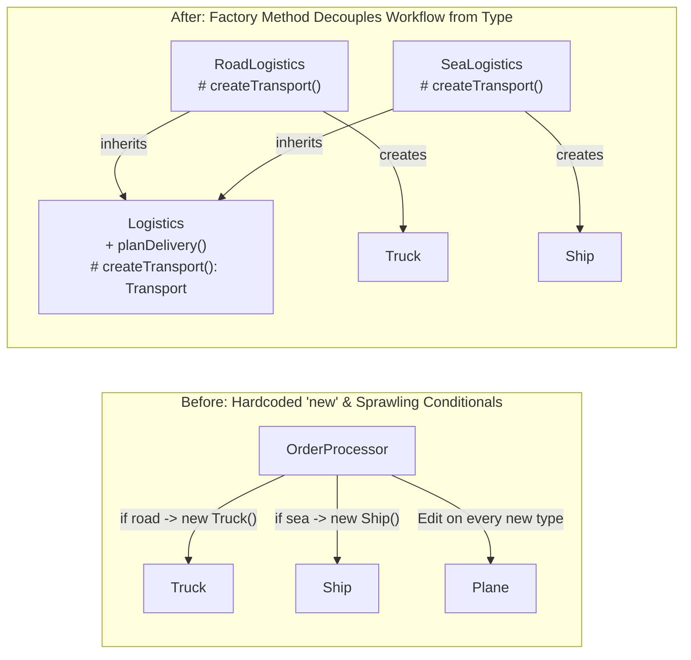
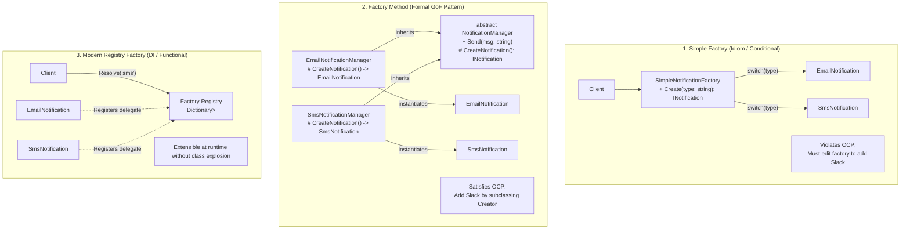

# Lesson 03: Factory Method and Simple Factory

> **Prerequisites:** [Singleton: Where to Use It, How, and When Not To](../02-singleton/README.md) and [Track 25 Overview](../README.md).  
> **Estimated Reading Time:** 18 minutes  
> **Target Audience:** Engineers preparing for LLD, OOP, C#, or Python technical screening and architecture rounds.

> [!NOTE]
> **In one line:** **Factory** moves `new` out of the caller so you can add new concrete types without editing client code — simple factory = one function with a switch; Factory Method = subclass decides.

> [!TIP]
> **The One Rule of Factory Patterns:** Use a **Simple Factory** when you just need to centralize conditional object creation (`switch/case`) in one utility class; use the **Factory Method** GoF pattern when an abstract creator defines an end-to-end workflow but delegates *which* concrete product to instantiate to subclasses. "New is glue"—factories decouple consumers from concrete constructors, transforming hardcoded compile-time dependencies into runtime polymorphic flexibility.

---

## 1. Why This Matters: The Interview Trap

In software architecture, the phrase **"New is glue"** describes how hardcoding `new ConcreteService()` throughout your business logic binds your domain code directly to concrete implementations. This violates the Dependency Inversion Principle (DIP) and Open/Closed Principle (OCP), preventing unit test mocking and making runtime configuration impossible.

However, in interviews, candidates frequently blur the distinction between **Simple Factory**, **Factory Method**, and **Abstract Factory**.

### The Junior Trap
- **Weak Answer:** *"The Factory pattern is a class that creates objects so you don't have to use the `new` keyword in your main code. You pass it a string like `'SMS'` or `'Email'` and it returns the right instance using an `if/else`."*

An interviewer will immediately test your depth:
- *"The `if/else` you just described is actually a Simple Factory idiom, not the GoF Factory Method pattern. What happens to that class when your business adds 15 new notification types?"* (It violates OCP because you must constantly edit and re-test the factory class).
- *"How does the formal GoF Factory Method pattern solve this without modifying existing code?"* (It uses inheritance and polymorphism: creators become subclasses that override an abstract creation method).

### The Senior Reality
- **Strong Answer:** *"A Simple Factory is a programmatic idiom that centralizes instantiation logic inside a single method, typically using conditional branching. While practical, it violates OCP when new types are introduced.*
*The formal Gang of Four **Factory Method** pattern is an architectural creational pattern that relies on polymorphism. It defines an abstract creator class with an abstract `CreateProduct()` method alongside core business logic. Subclasses decide which concrete product class to instantiate.*
*In modern backend architectures, we often use a **Registry-backed Factory** with Dependency Injection: creators register factory delegates in a dictionary or IoC container, achieving strict OCP compliance without the class explosion of classical inheritance hierarchies."*

---

## 1A. The Visual Story: Problem -> Analogy -> Solution

### The Problem (Why Naive Code Explodes)
Imagine building a logistics platform that initially only supports road transport (`Truck`). Your `OrderProcessor`, `RoutePlanner`, and `DispatchService` all hardcode `new Truck()`. Six months later, the business expands to sea freight (`Ship`) and air freight (`Plane`). Now you must hunt down every `new Truck()` across 30 files and wrap them in sprawling `if (mode == "sea") new Ship() else if (mode == "air") new Plane() else new Truck()` blocks. Every new transport mode forces you to crack open and re-test core business logic.

### Real-World Analogy
A **Logistics Company's Dispatch Office**. The head office runs the exact same delivery workflow (`planDelivery()` -> load cargo -> dispatch -> track), whether the cargo travels by road or sea. `RoadLogistics` overrides the creation step to supply a `Truck`, while `SeaLogistics` overrides it to supply a `Ship`—the core delivery workflow never changes.

### Visual Problem -> Solution Diagram



### Applicability & Pattern Relations
- **Use when:** you do not know beforehand the exact types and dependencies of the objects your code should work with; you want to provide users of your library or framework with a way to extend its internal components; or you want to save system resources by reusing existing objects instead of rebuilding them each time.
- **Relations with Other Patterns:**
  - Many designs start by using **Factory Method** (less complicated and more customizable via subclasses) and evolve toward **Abstract Factory**, **Prototype**, or **Builder** (more flexible, but more complex).
  - **Template Method** often calls a **Factory Method** as one of its steps to let subclasses decide which concrete helper object to create.
  - **Abstract Factory** classes are often based on a set of **Factory Methods**, though you can also use **Prototype** to compose the methods on these classes.

---

## 2. Visual Mental Model: Simple Factory vs. Factory Method vs. Registry

Understanding the structural differences between these three approaches is essential for technical interviews:



### Architectural Comparison

| Dimension | Simple Factory | Factory Method (GoF) | Modern Registry / DI Factory |
| :--- | :--- | :--- | :--- |
| **GoF Status** | Idiom / Helper Class | **Formal Creational Pattern** | Modern Architectural Pattern |
| **Primary Mechanism** | Static method with `switch/case` | Inheritance & Subclass Overriding | Delegate Dictionary / IoC Container |
| **Open/Closed Principle** | **Violated** (Editing factory required) | **Satisfied** (Add new creator subclass) | **Satisfied** (Register delegate at boot) |
| **Class Proliferation** | Minimal (1 factory class) | **High** (1 creator per product class) | Minimal (No creator classes needed) |
| **Inversion of Control** | None (Caller chooses type string) | High (Base class dictates execution flow) | Full (Config or DI resolves dependency) |

---

## 3. Code Implementation

Let us construct a production-grade notification delivery engine. We will implement both the **classic GoF Factory Method** and the **modern Registry Factory** in both languages.

````carousel
```python
from abc import ABC, abstractmethod
from typing import Callable, Dict, Type


# =====================================================================
# 1. PRODUCT HIERARCHY
# =====================================================================
class INotification(ABC):

  @abstractmethod
  def send(self, recipient: str, message: str) -> str:
    """Dispatches message to the target recipient."""
    pass


class EmailNotification(INotification):

  def send(self, recipient: str, message: str) -> str:
    return f"[EMAIL sent to {recipient}] Content: {message}"


class SmsNotification(INotification):

  def send(self, recipient: str, message: str) -> str:
    return f"[SMS sent to {recipient}] Content: {message}"


class PushNotification(INotification):

  def send(self, recipient: str, message: str) -> str:
    return f"[PUSH ALERT to {recipient}] Content: {message}"


# =====================================================================
# 2. CLASSIC GoF FACTORY METHOD PATTERN
# =====================================================================
class NotificationSender(ABC):
  """Abstract Creator: Enforces the workflow while delegating instantiation."""

  @abstractmethod
  def create_notification(self) -> INotification:
    """Factory Method: Subclasses override to produce concrete products."""
    pass

  def notify_user(self, recipient: str, message: str) -> str:
    # Core invariant algorithm relies on the factory method
    notification = self.create_notification()
    # Cross-cutting concerns (audit logging, metrics, etc.) live here
    return notification.send(recipient, message)


class EmailNotificationSender(NotificationSender):

  def create_notification(self) -> INotification:
    return EmailNotification()


class SmsNotificationSender(NotificationSender):

  def create_notification(self) -> INotification:
    return SmsNotification()


# =====================================================================
# 3. MODERN REGISTRY FACTORY (Open/Closed without Class Proliferation)
# =====================================================================
class NotificationRegistry:

  def __init__(self) -> None:
    self._registry: Dict[str, Callable[[], INotification]] = {}

  def register(
      self, channel: str, creator: Callable[[], INotification]
  ) -> None:
    self._registry[channel.lower()] = creator

  def create(self, channel: str) -> INotification:
    creator = self._registry.get(channel.lower())
    if not creator:
      raise ValueError(f"Unknown notification channel: {channel}")
    return creator()


# Demonstration
if __name__ == "__main__":
  # 1. Classic Factory Method Execution
  sender: NotificationSender = EmailNotificationSender()
  print(sender.notify_user("alice@domain.com", "Your order has shipped."))

  # 2. Modern Registry Factory Execution
  registry = NotificationRegistry()
  registry.register("sms", SmsNotification)
  registry.register("push", PushNotification)

  client_notifier = registry.create("sms")
  print(client_notifier.send("+1-555-0199", "Your auth code is 482910."))
```
<!-- slide -->
```csharp
using System;
using System.Collections.Generic;

// =====================================================================
// 1. PRODUCT HIERARCHY
// =====================================================================
public interface INotification
{
    string Send(string recipient, string message);
}

public class EmailNotification : INotification
{
    public string Send(string recipient, string message) =>
        $"[EMAIL sent to {recipient}] Content: {message}";
}

public class SmsNotification : INotification
{
    public string Send(string recipient, string message) =>
        $"[SMS sent to {recipient}] Content: {message}";
}

public class PushNotification : INotification
{
    public string Send(string recipient, string message) =>
        $"[PUSH ALERT to {recipient}] Content: {message}";
}

// =====================================================================
// 2. CLASSIC GoF FACTORY METHOD PATTERN
// =====================================================================
public abstract class NotificationSender
{
    // The Factory Method: Abstract hook for subclasses to return concrete product
    public abstract INotification CreateNotification();

    // The Invariant Workflow: Enforces auditing/logging around creation
    public string NotifyUser(string recipient, string message)
    {
        INotification notification = CreateNotification();
        return notification.Send(recipient, message);
    }
}

public class EmailNotificationSender : NotificationSender
{
    public override INotification CreateNotification() => new EmailNotification();
}

public class SmsNotificationSender : NotificationSender
{
    public override INotification CreateNotification() => new SmsNotification();
}

// =====================================================================
// 3. MODERN REGISTRY FACTORY (Open/Closed without Class Proliferation)
// =====================================================================
public class NotificationRegistry
{
    private readonly Dictionary<string, Func<INotification>> _registry = 
        new(StringComparer.OrdinalIgnoreCase);

    public void Register(string channel, Func<INotification> factory)
    {
        _registry[channel] = factory ?? throw new ArgumentNullException(nameof(factory));
    }

    public INotification Create(string channel)
    {
        if (_registry.TryGetValue(channel, out var factory))
        {
            return factory();
        }
        throw new KeyNotFoundException($"Unknown notification channel: {channel}");
    }
}

public class Program
{
    public static void Main()
    {
        // 1. Classic Factory Method Execution
        NotificationSender sender = new EmailNotificationSender();
        Console.WriteLine(sender.NotifyUser("alice@domain.com", "Your order has shipped."));

        // 2. Modern Registry Factory Execution
        var registry = new NotificationRegistry();
        registry.Register("sms", () => new SmsNotification());
        registry.Register("push", () => new PushNotification());

        INotification clientNotifier = registry.Create("sms");
        Console.WriteLine(clientNotifier.Send("+1-555-0199", "Your auth code is 482910."));
    }
}
```
````

**Expected Output (Both Languages):**
```text
[EMAIL sent to alice@domain.com] Content: Your order has shipped.
[SMS sent to +1-555-0199] Content: Your auth code is 482910.
```

---

## 3A. Where It Is Used, Why It Exists & Progressive Buildup

### Where It Is Used (Real-World Systems & LLD Interviews)

| Domain / Ecosystem | Concrete Real-World Usage | LLD Interview Problem Where You Use It |
| :--- | :--- | :--- |
| **.NET BCL / ASP.NET Core** | `IHttpClientFactory`, `ILoggerFactory.CreateLogger()`, `DbProviderFactories.GetFactory()`, `Task.Run()` | **Notification / Payment Gateway:** Dispatching `Email`, `SMS`, `Push`, or `Stripe` / `Razorpay` processors dynamically. |
| **Python stdlib / Django / FastAPI** | `pathlib.Path()` (returns `PosixPath` or `WindowsPath`), `datetime.fromtimestamp()`, `logging.getLogger()` | **Document Exporter / Parser:** Creating `PdfParser`, `CsvParser`, or `JsonParser` from file extension or MIME type. |
| **Go stdlib** | `sql.Register(name, driver)` + `sql.Open(driverName, dsn)`, `image.Decode` format registry | **Parking Lot Vehicle/Spot Factory:** Instantiating `Car`, `Truck`, or `Motorcycle` and matching `Spot` types. |
| **TypeScript / Node.js** | NestJS dynamic providers (`useFactory`), Express/Fastify middleware factories, TypeORM `DataSource` drivers | **Ride-Sharing Pricing / Vehicle:** Selecting `Sedan`, `SUV`, or `Auto` ride objects and fare calculators at runtime. |
| **Game Engines / Logistics** | Enemy/NPC spawners (`Level1Spawner.CreateEnemy()`), shipping carrier adapters (`FedEx`, `UPS`, `DHL`) | **Chess / Board Game Piece Factory:** Creating `Piece` subclasses from board notation without coupling the board parser. |

### Why It Is Used — The Step-by-Step Buildup (Before -> Pain -> Pattern)

#### Stage 0: Naive Code (Hardcoded `new` + Growing `if/elif` in Business Logic)

```python
# Stage 0: OrderService directly instantiates concrete payment processors
class OrderService:
    def checkout(self, method: str, amount: float) -> str:
        if method == "stripe":
            return f"Stripe charged ${amount:.2f}"
        elif method == "paypal":
            return f"PayPal charged ${amount:.2f}"
        else:
            raise ValueError(f"Unsupported method: {method}")
```

#### What Breaks as Requirements Grow
- **Requirement 2 (4 More Payment Providers + Unit Testing):** You add Apple Pay, Razorpay, SEPA, and Crypto. `OrderService` balloons into a 300-line `if/elif` block. Every time a new provider is added, you must edit and re-deploy `OrderService` (violating **OCP**), and you cannot unit-test `OrderService` without hitting real payment SDKs.
- **Requirement 3 (Per-Region Workflows & Dependencies):** Stripe needs an API key, while SEPA needs an IBAN validator and retry policy. Constructing them inline inside `OrderService` leaks infrastructure secrets into domain logic.

#### Step-by-Step Refactoring
1. **Step 1 (Simple Factory):** Extract the `if/elif` into `PaymentFactory.create(method)` returning an `IPaymentProcessor` interface. `OrderService` is now clean and testable, though `PaymentFactory` still has a `switch`.
2. **Step 2 (Factory Method / Registry):** Replace the `switch` with either subclasses overriding `create_processor()` (GoF Factory Method when an invariant workflow wraps creation) or a `dict[str, Callable[[], IPaymentProcessor]]` registry where new providers register themselves at startup with zero edits to existing code.

### Progressive Real-World Examples (More & More Typical Use Cases)

````carousel
```python
# Example A (Everyday Simple Case): Simple Factory for Document Parsers
from abc import ABC, abstractmethod

class IDocumentParser(ABC):
    @abstractmethod
    def parse(self, raw: bytes) -> dict: ...

class JsonParser(IDocumentParser):
    def parse(self, raw: bytes) -> dict:
        return {"format": "json", "size": len(raw)}

class CsvParser(IDocumentParser):
    def parse(self, raw: bytes) -> dict:
        return {"format": "csv", "size": len(raw)}

def create_parser(ext: str) -> IDocumentParser:
    parsers = {".json": JsonParser, ".csv": CsvParser}
    if ext not in parsers:
        raise ValueError(f"Unsupported extension: {ext}")
    return parsers[ext]()
```
<!-- slide -->
```typescript
// Example B (Production Backend / Middleware Case): Auth Strategy Registry Factory
interface AuthVerifier {
  verify(token: string): Promise<{ userId: string }>;
}

class JwtVerifier implements AuthVerifier {
  async verify(token: string) { return { userId: `jwt:${token.slice(0, 6)}` }; }
}

class ApiKeyVerifier implements AuthVerifier {
  async verify(token: string) { return { userId: `key:${token.slice(0, 6)}` }; }
}

const verifierRegistry = new Map<string, () => AuthVerifier>([
  ["Bearer", () => new JwtVerifier()],
  ["ApiKey", () => new ApiKeyVerifier()],
]);

export function resolveAuthVerifier(scheme: string): AuthVerifier {
  const factory = verifierRegistry.get(scheme);
  if (!factory) throw new Error(`Unknown auth scheme: ${scheme}`);
  return factory();
}
```
<!-- slide -->
```python
# Example C (Classic LLD Interview Problem): Parking Lot Vehicle & Ticket Workflow (Factory Method)
from abc import ABC, abstractmethod

class IVehicle(ABC):
    @abstractmethod
    def spot_size(self) -> str: ...

class Motorcycle(IVehicle):
    def spot_size(self) -> str: return "COMPACT"

class Truck(IVehicle):
    def spot_size(self) -> str: return "LARGE"

class GateEntryProcessor(ABC):
    @abstractmethod
    def create_vehicle(self, plate: str) -> IVehicle: ...

    def admit(self, plate: str) -> str:
        vehicle = self.create_vehicle(plate)
        return f"Admitted {plate} to {vehicle.spot_size()} spot"

class TruckGateProcessor(GateEntryProcessor):
    def create_vehicle(self, plate: str) -> IVehicle:
        return Truck()
```
````

---

## 4. Where You Already Use It

### In .NET / C#
- **`IHttpClientFactory`:** One of the most critical factories in modern .NET. Directly instantiating `new HttpClient()` exhausts OS sockets under high load because sockets linger in `TIME_WAIT`. `IHttpClientFactory` pools and manages the lifetime of the underlying `HttpMessageHandler` while ensuring DNS TTL expirations are respected.
- **`ILoggerFactory` & `LoggerFactory.Create()`:** Creates typed `ILogger<T>` instances configured with logging providers (Console, Debug, OpenTelemetry) specified at application startup.
- **`DbProviderFactories.GetFactory("Microsoft.Data.SqlClient")`:** Returns a provider factory capable of creating database-specific connections, commands, and parameter objects.
- **`Task.Run()` & `Task.FromResult()`:** Static factory methods on `Task` that encapsulate complex asynchronous promise initialization.

### In Python
- **`@classmethod` Alternative Constructors:** Python's standard library extensively uses class methods as factories to construct objects from diverse data representations:
  - `datetime.fromtimestamp(ts)` and `datetime.strptime(date_string, fmt)`
  - `dict.fromkeys(iterable, default_value)`
  - `pathlib.Path("...")`: Instantiates either `PosixPath` or `WindowsPath` depending on the current OS.
- **`logging.getLogger(name)`:** Returns or creates a configured `Logger` instance by name.
- **`concurrent.futures`:** `ThreadPoolExecutor` and `ProcessPoolExecutor` serve as factories creating future task workers.

---

## 5. Pitfalls and When Not to Use It

### 1. Class Explosion
The primary drawback of the classic GoF Factory Method pattern is **inheritance tax**. If you have 10 notification products, you must write 10 distinct `NotificationSender` subclasses just to return `new MyNotification()`. If there is no shared workflow in the creator, this adds huge cognitive noise. Modern registry dictionaries or DI factory delegates (`Func<T>`) completely eliminate this problem.

### 2. Constructor Signature Mismatches
The factory method interface must typically be uniform: `CreateNotification()`. What happens when `EmailNotification` needs an SMTP client and credentials, but `SmsNotification` needs a Twilio Auth Token and Twilio phone number?  
Passing disparate configuration objects into a generic factory method signature is awkward. The modern solution is to let the **Dependency Injection container** resolve individual dependencies for each concrete class.

### 3. Leaky Abstractions
If callers receive an `INotification` abstraction from the factory but immediately attempt to downcast it to access product-specific properties:
```csharp
var notif = factory.Create("email");
((EmailNotification)notif).AttachFile("report.pdf"); // Broken abstraction!
```
This proves that the abstraction contract is defective. If different products require fundamentally different interactions, forcing them under a single factory is a design smell.

---

## 6. Exercises & Practical Drills

### Drill 1: Refactor Conditional Instantiation to Registry Factory
Identify the architectural violation in this C# payment processor and explain how to remediate it:

```csharp
public class PaymentFactory
{
    public IPaymentProcessor Create(string provider)
    {
        return provider.ToUpper() switch
        {
            "STRIPE" => new StripeProcessor(),
            "PAYPAL" => new PayPalProcessor(),
            "BRAINTREE" => new BraintreeProcessor(),
            _ => throw new ArgumentException("Invalid provider")
        };
    }
}
```

<details>
<summary>Answer</summary>

**Violation:** Violates the Open/Closed Principle (OCP). Every time a new payment processor is onboarded (e.g., `AdyenProcessor`), `PaymentFactory` must be reopened and modified.

**Remediation:** Replace the `switch` statement with a **Registry Factory** where creators register factory lambdas:
```csharp
public class PaymentFactory
{
    private readonly Dictionary<string, Func<IPaymentProcessor>> _creators = new();

    public void Register(string provider, Func<IPaymentProcessor> creator) => 
        _creators[provider.ToUpper()] = creator;

    public IPaymentProcessor Create(string provider) => 
        _creators.TryGetValue(provider.ToUpper(), out var creator) 
            ? creator() 
            : throw new ArgumentException($"Provider '{provider}' not registered.");
}
```
Now, new processors are added during application bootstrapping without altering `PaymentFactory`.
</details>

### Drill 2: Trace the Architectural Problem in `new HttpClient()`
Why does Microsoft warn against writing `using var client = new HttpClient()` inside a controller action or web handler, and how does `IHttpClientFactory` resolve this?

<details>
<summary>Answer</summary>

**Problem:** Although `HttpClient` implements `IDisposable`, disposing it does not immediately close the underlying physical OS socket. The socket enters the `TIME_WAIT` state for 120-240 seconds to ensure lingering TCP packets are processed. Under high traffic, continuous instantiation and disposal exhausts the OS socket pool, causing `SocketException` ("Address already in use"). Conversely, keeping a single static `HttpClient` forever ignores DNS changes because sockets remain open indefinitely.

**Solution via `IHttpClientFactory`:** `IHttpClientFactory` maintains a managed pool of `HttpMessageHandler` instances with an active lifetime (default 2 minutes). It reuses handlers to eliminate socket exhaustion while cycling them periodically so DNS updates take effect.
</details>

---

## 7. Interview Questions & Model Answers

<details>
<summary><strong>1. What is the Factory pattern and why use it? [BASIC]</strong></summary>

The Factory pattern is a creational pattern that encapsulates and decouples object instantiation from the client code consuming that object.

We use it for four primary architectural reasons:
1. **Decoupling ('New is Glue'):** It prevents business logic from being tightly coupled to concrete classes, programming instead to abstractions or interfaces.
2. **Centralization of Complex Instantiation Logic:** If an object requires multi-step setup, configuration validation, dependency wiring, or pooling, a factory centralizes that logic rather than scattering it across callers.
3. **Open/Closed Principle:** Clients remain agnostic of concrete types. New product variations can be introduced without modifying existing client business logic.
4. **Enhanced Testability:** Because callers rely on factories returning abstractions, unit tests can easily substitute mock objects or test doubles without touching domain execution flows.

</details>

<details>
<summary><strong>2. What is the difference between a simple factory and the Factory Method? [BASIC]</strong></summary>

The difference lies in **how creation is structured and how OCP is maintained**:

- A **Simple Factory** is an architectural idiom or utility class. It typically consists of a single concrete class containing a method with conditional logic (`switch/case` or `if/else`) that instantiates and returns one of several product types. Its drawback is that adding a new product requires modifying the factory class itself, violating the Open/Closed Principle.
- The **Factory Method** is a formal Gang of Four design pattern based on **inheritance and polymorphism**. It defines an abstract creator class with an abstract method (e.g., `CreateProduct()`). The base creator contains the invariant business workflow, while concrete creator subclasses override the factory method to return specific concrete products.

In short: Simple Factory uses a centralized conditional switch in one class; Factory Method defers the decision of which class to instantiate to polymorphic subclasses.

</details>

<details>
<summary><strong>3. How does a factory help with the Open/Closed principle? [BASIC]</strong></summary>

The Open/Closed Principle states that software entities should be open for extension but closed for modification.

A factory adheres to this by ensuring that high-level client business logic only depends on an abstract product interface (e.g., `IExporter`) and an abstract factory or registry.

When a new business requirement arrives—such as supporting a `JsonExporter` in addition to PDF and CSV—we do not modify the existing client code or existing exporters. In the Factory Method pattern, we simply author a new `JsonExporter` class and a corresponding `JsonExporterCreator` subclass. In a modern registry-based factory, we register `() => new JsonExporter()` at startup.

Existing client code continues to execute unchanged, eliminating regression risks in battle-tested components.

</details>

<details>
<summary><strong>4. Give a .NET example of a factory. [SCENARIO]</strong></summary>

A prominent example in the .NET ecosystem is **`IHttpClientFactory`**.

Rather than manually creating `HttpClient` instances with `new`, developers inject `IHttpClientFactory` and call `factory.CreateClient("GitHubClient")`. Under the hood, the factory manages the pooling and rotation of `HttpMessageHandler` pipelines. This prevents two notorious production bugs:
1. Socket exhaustion caused by rapid creation and disposal of `HttpClient` instances leaving thousands of TCP sockets in `TIME_WAIT`.
2. Stale DNS lookups caused by indefinitely caching a single `HttpClient` instance across application lifetime.

Other prominent .NET examples include **`LoggerFactory.Create()`** for configuring logging subsystems and **`DbProviderFactories.GetFactory()`** in ADO.NET for constructing matched sets of database connection objects.

</details>

<details>
<summary><strong>5. Your factory has a 12-branch `switch`. How do you evolve it? [SCENARIO]</strong></summary>

Replace the switch with a registry (`dict[str, Callable]`) or DI keyed services so new types register themselves. The factory stays closed to modification and each concrete type is added in one place.

</details>

<details>
<summary><strong>6. Is calling `new` always bad? When is a factory over-engineering? [TRICKY]</strong></summary>

No. If there is one concrete type, it never varies, and construction is trivial, `new` is fine. A factory pays off when the type varies, construction is complex, or you need to swap it in tests.

</details>

---

## Try it

Run this registry-style factory: new types register themselves, no `if/elif` to edit. Then redraw it in [LLD Studio](/tools/lld-studio/); the [track hub](../README.md) has the pattern-choice drills.

```python
class Shape:
    registry = {}
    def __init_subclass__(cls, **kw):
        Shape.registry[cls.__name__.lower()] = cls

class Circle(Shape): pass
class Square(Shape): pass

def make(kind):
    return Shape.registry[kind]()

assert isinstance(make("circle"), Circle) and isinstance(make("square"), Square)
```

---

## One-page cheat sheet

```text
SIMPLE FACTORY   one function/class: make(kind) -> Product (switch inside)
FACTORY METHOD   base class declares create(); subclass overrides it
Goal: callers depend on the abstraction, never on `new Concrete()`
OCP: registry/DI map > switch (add type = add class)
.NET: ILoggerFactory, HttpClientFactory, IServiceProvider
Smell: factory that needs a switch edit for every new type
```

---

## 8. Sources & Further Reading

- [Microsoft Learn: Use IHttpClientFactory to Implement Resilient HTTP Requests](https://learn.microsoft.com/en-us/dotnet/architecture/microservices/implement-resilient-applications/use-httpclientfactory-to-implement-resilient-http-requests)
- [Microsoft Learn: DbProviderFactories Class](https://learn.microsoft.com/en-us/dotnet/api/system.data.common.dbproviderfactories)
- [Refactoring.Guru: Factory Method Pattern](https://refactoring.guru/design-patterns/factory-method)
- [Python Design Patterns: Alternative Constructors](https://python-patterns.guide/python/alternative-constructors/)
- Gamma, Helm, Johnson, Vlissides: *Design Patterns: Elements of Reusable Object-Oriented Software* (Creational Patterns)

---

Previous: [Singleton: Where to Use It, How, and When Not To](../02-singleton/README.md) · Next: [Abstract Factory](../04-abstract-factory/README.md)
