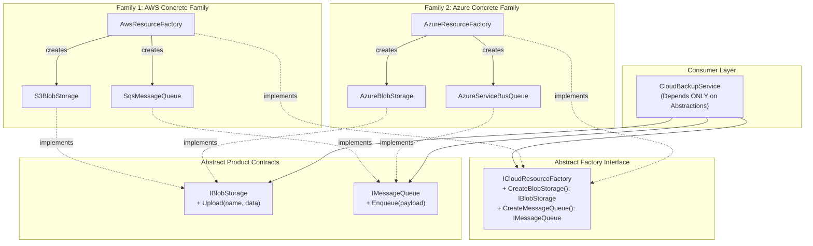

# Lesson 04: Abstract Factory

> **Prerequisites:** [Factory Method and Simple Factory](../03-factory-method-and-simple-factory/README.md) and [Track 25 Overview](../README.md).  
> **Estimated Reading Time:** 18 minutes  
> **Target Audience:** Engineers preparing for LLD, OOP, C#, or Python technical screening and architecture rounds.

> [!NOTE]
> **In one line:** **Abstract Factory** creates a *family* of related objects that must be used together (e.g. a Windows button + Windows checkbox) behind one factory interface.

> [!TIP]
> **The One Rule of Abstract Factory:** Abstract Factory is designed to enforce **semantic consistency across families of related or dependent products**. If you need to create a single object polymorphically, use **Factory Method**; if you must guarantee that an entire cluster of interdependent objects—such as an AWS S3 client with an SQS queue, or a macOS button with a macOS scrollbar—are strictly instantiated from the same vendor or theme without cross-contamination, use **Abstract Factory**.

---

## 1. Why This Matters: The Interview Trap

Candidates often answer the question "What is an Abstract Factory?" by describing it as *"a factory of factories"* or *"an interface with multiple factory methods."*

While mechanically true, that answer fails the interview because it misses the **architectural purpose**: **family consistency**.

### The Junior Trap
- **Weak Answer:** *"Abstract Factory is an abstract class or interface used to make factories. It's like Factory Method, but you have an interface for the factory, and then concrete factories implement it to return concrete objects."*

An interviewer will immediately follow up:
- *"If I have a factory that creates a `User` and an `Order`, is that an Abstract Factory?"*  
  (No! That is just an arbitrary container or service. In an Abstract Factory, the products **must belong to the same family and be designed to collaborate together**).
- *"What happens if your client application accidentally pairs an AWS S3 Storage client with an Azure Service Bus queue client?"*  
  (Runtime configuration mismatch, incompatible authentication credentials, and architectural chaos).

### The Senior Reality
- **Strong Answer:** *"Abstract Factory provides an interface for creating families of related or dependent objects without specifying their concrete classes. Its primary responsibility is enforcing consistency: it guarantees that products from one family are never accidentally mixed with products from another.*
*For example, in a multi-cloud abstraction layer, an `AwsCloudFactory` guarantees that both the `BlobStorage` and `MessageQueue` instances created are AWS-native (S3 and SQS). The client code simply consumes `ICloudFactory` and remains completely decoupled from cloud vendor specifics.*
*The primary architectural trade-off of Abstract Factory is high rigidity: adding a new product type requires modifying the abstract factory interface and every existing concrete factory subclass."*

---

## 2. Visual Mental Model: Product Families & Taxonomic Comparison

An Abstract Factory groups multiple related Factory Methods into a single cohesive interface:



### Architectural Comparison: Factory Method vs. Abstract Factory

| Architectural Dimension | Factory Method | Abstract Factory |
| :--- | :--- | :--- |
| **Primary Scope** | Creates **one** product | Creates **families of related** products |
| **Core Mechanism** | **Inheritance:** Subclasses override a factory method | **Object Composition:** Client is injected with a factory instance |
| **Focus / Goal** | Decouple client from a single concrete class | Enforce semantic consistency between multiple collaborating objects |
| **Adding a New Variant / Family** | Add a new product and creator subclass | Add a new concrete factory class implementing the factory interface |
| **Adding a New Product Type** | Trivial (unrelated to other creators) | **Extremely Expensive:** Must update the abstract factory and all concrete factories |
| **Real-World Analogy** | A car dealership method: `CreateSedan()` | A complete vehicle platform: `CreateEngine()`, `CreateChassis()`, `CreateTires()` |

---

## 3. Code Implementation

Let us implement a multi-cloud infrastructure engine where backup files and synchronization events are handled by matched cloud primitives (Storage + Queue) without vendor cross-contamination.

````carousel
```python
from abc import ABC, abstractmethod


# =====================================================================
# 1. ABSTRACT PRODUCTS (The Family Members)
# =====================================================================
class IBlobStorage(ABC):

  @abstractmethod
  def upload(self, file_name: str, payload: bytes) -> str:
    """Uploads a binary blob and returns its URI."""
    pass


class IMessageQueue(ABC):

  @abstractmethod
  def enqueue(self, event_type: str, data: str) -> str:
    """Dispatches a notification event into the cloud queue."""
    pass


# =====================================================================
# 2. CONCRETE PRODUCTS: AWS Family
# =====================================================================
class S3BlobStorage(IBlobStorage):

  def upload(self, file_name: str, payload: bytes) -> str:
    return f"s3://production-bucket/{file_name} ({len(payload)} bytes)"


class SqsMessageQueue(IMessageQueue):

  def enqueue(self, event_type: str, data: str) -> str:
    return f"[AWS SQS MessageId: sqs-9102] Event: {event_type} | Body: {data}"


# =====================================================================
# 3. CONCRETE PRODUCTS: Azure Family
# =====================================================================
class AzureBlobStorage(IBlobStorage):

  def upload(self, file_name: str, payload: bytes) -> str:
    return (
        f"https://prodstorage.blob.core.windows.net/data/{file_name}"
        f" ({len(payload)} bytes)"
    )


class AzureServiceBusQueue(IMessageQueue):

  def enqueue(self, event_type: str, data: str) -> str:
    return f"[Azure ServiceBus Seq: asb-4410] Event: {event_type} | Body: {data}"


# =====================================================================
# 4. ABSTRACT FACTORY CONTRACT
# =====================================================================
class ICloudResourceFactory(ABC):

  @abstractmethod
  def create_blob_storage(self) -> IBlobStorage:
    pass

  @abstractmethod
  def create_message_queue(self) -> IMessageQueue:
    pass


# =====================================================================
# 5. CONCRETE FACTORIES
# =====================================================================
class AwsResourceFactory(ICloudResourceFactory):

  def create_blob_storage(self) -> IBlobStorage:
    return S3BlobStorage()

  def create_message_queue(self) -> IMessageQueue:
    return SqsMessageQueue()


class AzureResourceFactory(ICloudResourceFactory):

  def create_blob_storage(self) -> IBlobStorage:
    return AzureBlobStorage()

  def create_message_queue(self) -> IMessageQueue:
    return AzureServiceBusQueue()


# =====================================================================
# 6. CLIENT: Consumes factory and products purely via abstractions
# =====================================================================
class CloudBackupService:

  def __init__(self, factory: ICloudResourceFactory) -> None:
    # Client receives a factory that guarantees matched family products
    self._storage = factory.create_blob_storage()
    self._queue = factory.create_message_queue()

  def backup_and_notify(self, file_name: str, payload: bytes) -> None:
    uri = self._storage.upload(file_name, payload)
    receipt = self._queue.enqueue("BackupCompleted", uri)
    print(f"Uploaded to: {uri}")
    print(f"Enqueued: {receipt}")


# Demonstration
if __name__ == "__main__":
  dummy_data = b"Encrypted financial audit records"

  # 1. Run pipeline against AWS family
  print("--- Running AWS Backup ---")
  aws_pipeline = CloudBackupService(AwsResourceFactory())
  aws_pipeline.backup_and_notify("audit_2026.csv", dummy_data)

  # 2. Run pipeline against Azure family
  print("\n--- Running Azure Backup ---")
  azure_pipeline = CloudBackupService(AzureResourceFactory())
  azure_pipeline.backup_and_notify("audit_2026.csv", dummy_data)
```
<!-- slide -->
```csharp
using System;
using System.Text;

// =====================================================================
// 1. ABSTRACT PRODUCTS (The Family Members)
// =====================================================================
public interface IBlobStorage
{
    string Upload(string fileName, byte[] payload);
}

public interface IMessageQueue
{
    string Enqueue(string eventType, string data);
}

// =====================================================================
// 2. CONCRETE PRODUCTS: AWS Family
// =====================================================================
public class S3BlobStorage : IBlobStorage
{
    public string Upload(string fileName, byte[] payload) =>
        $"s3://production-bucket/{fileName} ({payload.Length} bytes)";
}

public class SqsMessageQueue : IMessageQueue
{
    public string Enqueue(string eventType, string data) =>
        $"[AWS SQS MessageId: sqs-9102] Event: {eventType} | Body: {data}";
}

// =====================================================================
// 3. CONCRETE PRODUCTS: Azure Family
// =====================================================================
public class AzureBlobStorage : IBlobStorage
{
    public string Upload(string fileName, byte[] payload) =>
        $"https://prodstorage.blob.core.windows.net/data/{fileName} ({payload.Length} bytes)";
}

public class AzureServiceBusQueue : IMessageQueue
{
    public string Enqueue(string eventType, string data) =>
        $"[Azure ServiceBus Seq: asb-4410] Event: {eventType} | Body: {data}";
}

// =====================================================================
// 4. ABSTRACT FACTORY CONTRACT
// =====================================================================
public interface ICloudResourceFactory
{
    IBlobStorage CreateBlobStorage();
    IMessageQueue CreateMessageQueue();
}

// =====================================================================
// 5. CONCRETE FACTORIES
// =====================================================================
public class AwsResourceFactory : ICloudResourceFactory
{
    public IBlobStorage CreateBlobStorage() => new S3BlobStorage();
    public IMessageQueue CreateMessageQueue() => new SqsMessageQueue();
}

public class AzureResourceFactory : ICloudResourceFactory
{
    public IBlobStorage CreateBlobStorage() => new AzureBlobStorage();
    public IMessageQueue CreateMessageQueue() => new AzureServiceBusQueue();
}

// =====================================================================
// 6. CLIENT: Consumes factory and products purely via abstractions
// =====================================================================
public class CloudBackupService
{
    private readonly IBlobStorage _storage;
    private readonly IMessageQueue _queue;

    public CloudBackupService(ICloudResourceFactory factory)
    {
        if (factory == null) throw new ArgumentNullException(nameof(factory));
        // Client receives a factory that guarantees matched family products
        _storage = factory.CreateBlobStorage();
        _queue = factory.CreateMessageQueue();
    }

    public void BackupAndNotify(string fileName, byte[] payload)
    {
        string uri = _storage.Upload(fileName, payload);
        string receipt = _queue.Enqueue("BackupCompleted", uri);
        Console.WriteLine($"Uploaded to: {uri}");
        Console.WriteLine($"Enqueued: {receipt}");
    }
}

public class Program
{
    public static void Main()
    {
        byte[] dummyData = Encoding.UTF8.GetBytes("Encrypted financial audit records");

        // 1. Run pipeline against AWS family
        Console.WriteLine("--- Running AWS Backup ---");
        var awsPipeline = new CloudBackupService(new AwsResourceFactory());
        awsPipeline.BackupAndNotify("audit_2026.csv", dummyData);

        // 2. Run pipeline against Azure family
        Console.WriteLine("\n--- Running Azure Backup ---");
        var azurePipeline = new CloudBackupService(new AzureResourceFactory());
        azurePipeline.BackupAndNotify("audit_2026.csv", dummyData);
    }
}
```
````

**Expected Output (Both Languages):**
```text
--- Running AWS Backup ---
Uploaded to: s3://production-bucket/audit_2026.csv (33 bytes)
Enqueued: [AWS SQS MessageId: sqs-9102] Event: BackupCompleted | Body: s3://production-bucket/audit_2026.csv (33 bytes)

--- Running Azure Backup ---
Uploaded to: https://prodstorage.blob.core.windows.net/data/audit_2026.csv (33 bytes)
Enqueued: [Azure ServiceBus Seq: asb-4410] Event: BackupCompleted | Body: https://prodstorage.blob.core.windows.net/data/audit_2026.csv (33 bytes)
```

---

## 4. Where You Already Use It

### In .NET / C#
- **`System.Data.Common.DbProviderFactory`:** The canonical GoF Abstract Factory in .NET. It produces complete families of database access objects:
  - `CreateConnection()` -> returns `DbConnection` (e.g., `SqlConnection`, `NpgsqlConnection`)
  - `CreateCommand()` -> returns `DbCommand`
  - `CreateParameter()` -> returns `DbParameter`
  - `CreateDataAdapter()` -> returns `DbDataAdapter`  
  Because all objects stem from the same provider factory, the runtime guarantees you cannot pass a Postgres `NpgsqlParameter` into a SQL Server `SqlCommand`.
- **`System.Text.Json.Serialization.JsonConverterFactory`:** An abstract factory that evaluates whether a type can be converted and instantiates matched `JsonConverter` family handlers for complex generics.
- **Cross-Platform UI Rendering (.NET MAUI):** Maps abstract UI controls (`IButton`, `ISlider`) to platform-specific renderer families (WinUI on Windows, UIKit on iOS, Android View hierarchy).

### In Python
- **`os.path` Module:** In Python, `os.path` is an abstract interface dynamically bound at runtime to either `posixpath` (on Linux/macOS) or `ntpath` (on Windows). Both families provide identical signatures (`join`, `split`, `abspath`), ensuring all path operations remain platform-consistent.
- **Python Database API Specification (PEP 249):** Libraries conforming to PEP 249 (`sqlite3`, `psycopg2`, `mysqlclient`) act as concrete factories creating matched sets of `Connection` and `Cursor` objects.
- **GUI Libraries (Tkinter / PyQt):** Theme engines provide matched families of widgets (DarkTheme vs LightTheme producing coordinated buttons, text fields, and scroll bars).

---

## 5. Pitfalls and When Not to Use It

### 1. The "New Product" Maintenance Crisis
The most severe drawback of Abstract Factory is its **rigidity against new product types**.  
If you need to add a third cloud service—say, `CreateKeyVault(): IKeyVault`—you must update:
1. The `ICloudResourceFactory` interface.
2. `AwsResourceFactory`.
3. `AzureResourceFactory`.
4. `GcpResourceFactory` (and every other existing implementation).  
This directly violates the **Interface Segregation Principle** (ISP) and triggers breaking changes across all factory implementations.

### 2. Over-Engineering Single-Variant Systems
If your backend services are deployed exclusively on AWS and will never migrate to Azure or GCP, building an `ICloudResourceFactory` is speculative generality. Direct dependency injection of `IAmazonS3` and `IAmazonSQS` is cleaner and avoids pointless layers of abstraction.

### 3. Divergent Configuration Models
Different product families often require radically different initialization parameters. AWS requires IAM roles and region identifiers; Azure requires connection strings and tenant IDs. Forcing these disparate parameters into a uniform `CreateBlobStorage()` method forces engineers to use clumsy configuration objects or ambient context.

---

## 6. Exercises & Practical Drills

### Drill 1: Identify the Design Smell
An engineer proposes the following interface to simplify factory code:

```csharp
public interface IApplicationFactory
{
    IUserRepository CreateUserRepository();
    IPaymentGateway CreatePaymentGateway();
    IPdfReportGenerator CreatePdfReportGenerator();
}
```

Is this a valid Abstract Factory? Why or why not?

<details>
<summary>Answer</summary>

**Design Smell:** This is **not** an Abstract Factory; it is a **God Factory** or **Service Locator in disguise**.  
An Abstract Factory's defining characteristic is that its products belong to a **cohesive family designed to collaborate together** (e.g., all AWS components, or all Dark Theme components).  
A repository, payment gateway, and PDF generator have no family dependency or mutual coupling. Packing unrelated factory methods into one interface violates the Single Responsibility Principle and Interface Segregation Principle. Each service should be registered and resolved independently via Dependency Injection.
</details>

### Drill 2: Multi-Theme UI Architecture
Design the class interfaces for an Abstract Factory that provides matched UI components for an admin portal supporting two visual themes: `StandardTheme` and `HighContrastAccessibilityTheme`. Each theme must produce a `Header` and an `ActionButton`.

<details>
<summary>Answer</summary>

```csharp
// Products
public interface IHeader { string RenderTitle(string text); }
public interface IActionButton { string RenderButton(string label); }

// Abstract Factory
public interface IThemeFactory
{
    IHeader CreateHeader();
    IActionButton CreateActionButton();
}

// Concrete Factory 1
public class StandardThemeFactory : IThemeFactory
{
    public IHeader CreateHeader() => new StandardHeader();
    public IActionButton CreateActionButton() => new StandardActionButton();
}

// Concrete Factory 2
public class HighContrastThemeFactory : IThemeFactory
{
    public IHeader CreateHeader() => new HighContrastHeader();
    public IActionButton CreateActionButton() => new HighContrastActionButton();
}
```
Now, passing `HighContrastThemeFactory` to the rendering view engine guarantees that buttons and headers always share the accessible high-contrast palette without mixing styling rules.
</details>

---

## 7. Interview Questions & Model Answers

<details>
<summary><strong>1. What is the difference between Factory Method and Abstract Factory? [BASIC]</strong></summary>

The core distinction lies in **scope and structural mechanism**:

1. **Scope of Products:**
   - **Factory Method** creates a **single product**. Its intent is to decouple the client from a specific concrete class by delegating the instantiation of that one object to a subclass.
   - **Abstract Factory** creates **families of related or dependent products**. Its intent is to enforce consistency across multiple collaborating objects so that products from incompatible families are never mixed.

2. **Structural Mechanism:**
   - Factory Method relies on **inheritance**: an abstract base creator defines the factory method, and concrete creator subclasses override it.
   - Abstract Factory relies on **composition**: the client is injected with an abstract factory object, which it invokes to instantiate product family members.

In practice, an Abstract Factory is often implemented as a class whose methods are themselves individual Factory Methods.

</details>

<details>
<summary><strong>2. When would you use an Abstract Factory? [SCENARIO]</strong></summary>

You should use an Abstract Factory when a system must configure and collaborate with multiple families of related objects, and the system must enforce that objects from different families are **never accidentally intermingled**.

Common scenarios include:
1. **Multi-Cloud Infrastructure Abstractions:** Creating cloud primitives where storage, queues, secret managers, and identity clients must strictly match the chosen provider (e.g., AWS S3 + SQS vs. Azure Blob + Service Bus).
2. **Cross-Platform UI Rendering & Theming:** Providing UI widget families (buttons, scrollbars, dialog boxes) tailored to specific operating systems (Windows WinUI vs. macOS Cocoa) or visual themes (Dark Mode vs. High-Contrast Accessibility Mode).
3. **Database Driver Engines:** When an ORM or data framework needs to instantiate connections, SQL commands, parameter wrappers, and transaction coordinators that must all strictly belong to the same database engine (PostgreSQL, Oracle, or SQL Server).

</details>

<details>
<summary><strong>3. Give a real-world example. [SCENARIO]</strong></summary>

A quintessential real-world example is **`DbProviderFactory` in .NET ADO.NET (`System.Data.Common`)**.

When building a database-agnostic data access layer, writing `new SqlConnection()` or `new NpgsqlConnection()` hardcodes the database vendor. Instead, .NET provides `DbProviderFactory`, which acts as an Abstract Factory exposing:
- `CreateConnection()` -> returns `DbConnection`
- `CreateCommand()` -> returns `DbCommand`
- `CreateParameter()` -> returns `DbParameter`
- `CreateDataAdapter()` -> returns `DbDataAdapter`

At runtime, based on application configuration (`appsettings.json`), the application resolves either `SqlClientFactory.Instance` or `NpgsqlFactory.Instance`. The data layer interacts entirely with base classes. Crucially, the Abstract Factory guarantees that a PostgreSQL command object cannot accidentally be paired with a Microsoft SQL Server connection, preventing fatal runtime parameter mismatch exceptions.

</details>

<details>
<summary><strong>4. What is the main weakness of Abstract Factory? [TRICKY]</strong></summary>

Adding a new *product type* (say `Slider`) means changing the factory interface and every concrete factory. It is easy to add families, hard to add product kinds.

</details>

<details>
<summary><strong>5. When would you prefer plain DI over an Abstract Factory? [SCENARIO]</strong></summary>

If the family is chosen once at startup (e.g. one DB provider), register the concrete services in the container and skip the factory. Use the pattern when the family is chosen at runtime per request or tenant.

</details>

<details>
<summary><strong>6. Give a one-line example of an Abstract Factory in .NET. [SCENARIO]</strong></summary>

`DbProviderFactory`: one factory per provider that creates a matching `DbConnection`, `DbCommand`, and `DbParameter`.

</details>

---

## Try it

Run this: swapping the factory swaps the whole family consistently. Then redraw it in [LLD Studio](/tools/lld-studio/); the [track hub](../README.md) has the pattern-choice drills.

```python
class LightFactory:
    def button(self): return "light-button"
    def input(self): return "light-input"
class DarkFactory:
    def button(self): return "dark-button"
    def input(self): return "dark-input"

def render(f): return (f.button(), f.input())
assert render(DarkFactory()) == ("dark-button", "dark-input")   # never mixed
```

---

## One-page cheat sheet

```text
ABSTRACT FACTORY  interface with N create_*() -> product FAMILY
Concrete factory = one family (Light / Dark, SQL / Mongo, Win / Mac)
Guarantees consistency: no Dark button inside a Light form
Factory Method = 1 product, inheritance | Abstract Factory = many, composition
Adding a new FAMILY is easy; adding a new PRODUCT TYPE touches all factories
Use when: themes, cross-platform UI, DB provider sets
```

---

## 8. Sources & Further Reading

- [Microsoft Learn: DbProviderFactories Class Overview](https://learn.microsoft.com/en-us/dotnet/framework/data/adonet/obtaining-a-dbproviderfactory)
- [Refactoring.Guru: Abstract Factory Pattern](https://refactoring.guru/design-patterns/abstract-factory)
- [Python 3 PEP 249: Python Database API Specification v2.0](https://peps.python.org/pep-0249/)
- Gamma, Helm, Johnson, Vlissides: *Design Patterns: Elements of Reusable Object-Oriented Software* (Creational Patterns: Abstract Factory)
- [Martin Fowler: Patterns of Enterprise Application Architecture](https://martinfowler.com/eaaCatalog/)

---

Previous: [Factory Method and Simple Factory](../03-factory-method-and-simple-factory/README.md) · Next: [Builder](../05-builder/README.md)
