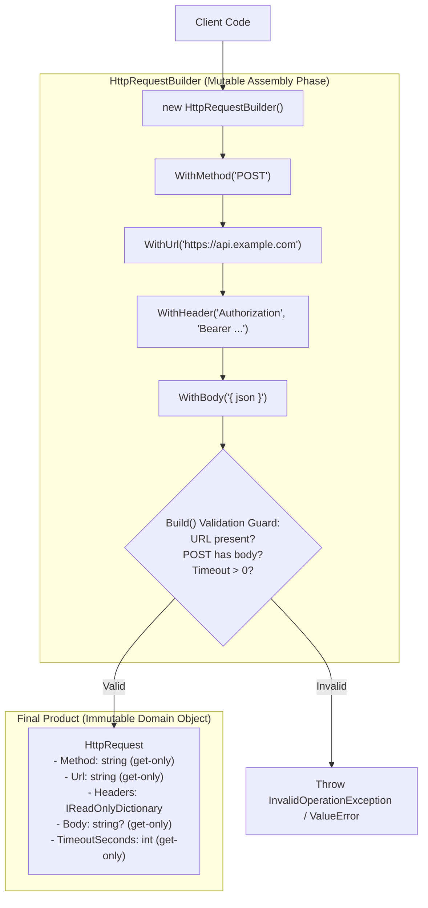

# Lesson 05: Builder

> **Prerequisites:** [Abstract Factory](../04-abstract-factory/README.md) and [Track 25 Overview](../README.md).  
> **Estimated Reading Time:** 18 minutes  
> **Target Audience:** Engineers preparing for LLD, OOP, C#, or Python technical screening and architecture rounds.

> [!NOTE]
> **In one line:** **Builder** assembles a complex object step by step (fluent, validated at `Build()`), replacing telescoping constructors and half-initialised objects.

> [!TIP]
> **The One Rule of the Builder Pattern:** Use a Builder when constructing a complex object requires **step-by-step assembly**, **multi-attribute validation before instantiation**, or **constructing immutable representations without telescoping constructors**. If creation can occur in a single atomic invocation with sensible defaults, a simple constructor or factory method is cleaner.

---

## 1. Why This Matters: The Interview Trap

"When would you choose the Builder pattern over a Factory, and why is the telescoping constructor problem dangerous in production systems?"

Junior candidates frequently offer textbook generalities:
> *"The Builder pattern is used to create complex objects step by step. A Factory creates an object all at once. You use a Builder when a class has lots of fields so you don't have to pass `null` everywhere."*

Interviewers probe deeper because this answer misses **domain integrity, immutability, and API ergonomics**. In real production backends, constructors with many parameters present severe architectural liabilities:

1. **The Telescoping Constructor Anti-Pattern:** When an entity grows, developers add overloaded constructors with 4, 6, 8, or 12 parameters (`new Order(id, customer, items, null, null, false, null, 0)`). When several adjacent parameters share primitive types (e.g., three `string` or `int` parameters like `timeoutMs`, `retryCount`, `batchSize`), calling code can swap them silently. The compiler cannot catch `new Client("api-key", "prod-url")` being called as `new Client("prod-url", "api-key")`.
2. **The Mutable JavaBean / Property Initializer Anti-Pattern:** To avoid telescoping constructors, developers often switch to a parameterless constructor followed by public property setters (`order.CustomerId = "123"; order.Discount = 0.1m;`). This completely breaks **encapsulation**: the object exists in an invalid, partially initialized state across multiple statements. If a thread reads it midway or an exception is thrown before all setters execute, corrupted state leaks into the system. Furthermore, properties cannot be made `readonly` or immutable.
3. **Multi-Field Invariant Validation:** Often, field validity depends on combinations of inputs (e.g., *"If authentication is `ApiKey`, then `ApiKeyHeader` must be non-empty; if `BearerToken`, then an expiry timestamp is required"*). Placing this validation across individual property setters is fragile. A Builder collects configuration incrementally and validates all cross-cutting invariants atomically inside the `.Build()` method before returning a finalized, immutable object.

### Telescoping Constructor vs. Object Initializer vs. Builder

| Construction Strategy | Immutability Supported? | Validates Cross-Field Invariants? | Readability with 8+ Params | Compile-Time Safety |
| :--- | :--- | :--- | :--- | :--- |
| **Telescoping Constructors** | Yes (all fields can be `readonly`) | Yes (inside constructor body) | **Terrible** (swapped parameters, endless `null` arguments) | Medium (type-checked, but vulnerable to primitive obsession) |
| **Public Setters / Initializers** | No (requires public mutation) | Hard (object is temporarily invalid between setter calls) | Medium (named properties in C# / keyword args) | Low (objects can be instantiated in incomplete states) |
| **Fluent Builder Pattern** | **Yes** (fields assigned to immutable product on `.Build()`) | **Yes** (atomic verification in `.Build()` before instantiation) | **Excellent** (method chaining clearly declares each intention) | **High** (can use Step Builder interfaces to enforce mandatory steps) |

---

## 2. Visual Mental Model / Taxonomic Comparison

A Fluent Builder separates the step-by-step gathering of configuration options from the instantiation of the final product. The product itself has a private or internal constructor, ensuring it can only be obtained through the Builder's validated pipeline.



### Factory vs. Builder vs. Prototype

| Pattern | Creation Mechanics | Primary Purpose | Lifecycle / Mutability |
| :--- | :--- | :--- | :--- |
| **Factory Method / Abstract Factory** | **Single-shot** execution (`factory.Create()`). | Polymorphic object creation where the client does not know the concrete class. | Returns product immediately; caller cannot customize creation steps. |
| **Builder** | **Multi-step** fluent configuration (`builder.WithA().WithB().Build()`). | Step-by-step construction of complex objects with custom options and invariant enforcement. | Builder is mutable during assembly; product returned by `Build()` is immutable. |
| **Prototype** | **Cloning** an existing prototype instance (`prototype.Clone()`). | Avoiding expensive initialization by duplicating existing state. | Starts from pre-populated state rather than configuring from scratch. |

---

## 3. Code Implementation

In the following example, we build an immutable, production-grade `HttpRequest` entity. The Builder provides a fluent API, default configurations (such as a 30-second timeout and default `GET` method), and enforces invariants:
1. The URL must be supplied and non-empty.
2. HTTP methods like `POST` or `PUT` require a payload body.
3. Timeout values must be strictly positive.

````carousel
```python
from typing import Dict, Optional, Self


class HttpRequest:
    """Immutable HTTP Request representation produced by HttpRequestBuilder."""

    def __init__(
        self,
        method: str,
        url: str,
        headers: Dict[str, str],
        query_params: Dict[str, str],
        body: Optional[str],
        timeout_seconds: int,
    ) -> None:
        # Private backing attributes: callers cannot mutate after instantiation
        self.method: str = method
        self.url: str = url
        self.headers: Dict[str, str] = headers
        self.query_params: Dict[str, str] = query_params
        self.body: Optional[str] = body
        self.timeout_seconds: int = timeout_seconds

    def __repr__(self) -> str:
        q_str = (
            ("?" + "&".join(f"{k}={v}" for k, v in self.query_params.items()))
            if self.query_params
            else ""
        )
        return (
            f"HttpRequest({self.method} {self.url}{q_str}, "
            f"Headers={len(self.headers)}, "
            f"Timeout={self.timeout_seconds}s, "
            f"Body={'[Present]' if self.body else '[None]'})"
        )


class HttpRequestBuilder:
    """Fluent Builder for constructing immutable HttpRequest instances."""

    def __init__(self) -> None:
        self._method: str = "GET"
        self._url: Optional[str] = None
        self._headers: Dict[str, str] = {}
        self._query_params: Dict[str, str] = {}
        self._body: Optional[str] = None
        self._timeout_seconds: int = 30

    def with_method(self, method: str) -> Self:
        self._method = method.upper()
        return self

    def with_url(self, url: str) -> Self:
        self._url = url
        return self

    def with_header(self, key: str, value: str) -> Self:
        self._headers[key] = value
        return self

    def with_query_param(self, key: str, value: str) -> Self:
        self._query_params[key] = value
        return self

    def with_body(self, body: str) -> Self:
        self._body = body
        return self

    def with_timeout(self, seconds: int) -> Self:
        if seconds <= 0:
            raise ValueError("Timeout must be positive.")
        self._timeout_seconds = seconds
        return self

    def build(self) -> HttpRequest:
        # Atomic invariant validation before constructing the product
        if not self._url:
            raise ValueError("Cannot build HttpRequest: URL is required.")
        if self._method in ("POST", "PUT", "PATCH") and not self._body:
            raise ValueError(
                f"Cannot build HttpRequest: {self._method} requests require a body."
            )

        # Return a finalized, defensive copy of headers and query parameters
        return HttpRequest(
            method=self._method,
            url=self._url,
            headers=dict(self._headers),
            query_params=dict(self._query_params),
            body=self._body,
            timeout_seconds=self._timeout_seconds,
        )


if __name__ == "__main__":
    # 1. Successful build of POST request
    post_req = (
        HttpRequestBuilder()
        .with_method("POST")
        .with_url("https://api.example.com/v1/orders")
        .with_header("Authorization", "Bearer token_xyz")
        .with_header("Content-Type", "application/json")
        .with_query_param("trace", "true")
        .with_body('{"order_id": 101, "item": "Keyboard"}')
        .with_timeout(10)
        .build()
    )
    print(post_req)

    # 2. Successful build of default GET request with minimal params
    get_req = (
        HttpRequestBuilder()
        .with_url("https://api.example.com/v1/health")
        .build()
    )
    print(get_req)

    # 3. Validation failure: POST without body
    try:
        (
            HttpRequestBuilder()
            .with_method("POST")
            .with_url("https://api.example.com/v1/orders")
            .build()
        )
    except ValueError as ex:
        print(f"Validation Caught: {ex}")
```

<!-- slide -->

```csharp
using System;
using System.Collections.Generic;
using System.Collections.ObjectModel;
using System.Linq;

public sealed class HttpRequest
{
    public string Method { get; }
    public string Url { get; }
    public IReadOnlyDictionary<string, string> Headers { get; }
    public IReadOnlyDictionary<string, string> QueryParams { get; }
    public string? Body { get; }
    public int TimeoutSeconds { get; }

    // Internal constructor: forces callers to assemble via HttpRequestBuilder
    internal HttpRequest(
        string method,
        string url,
        Dictionary<string, string> headers,
        Dictionary<string, string> queryParams,
        string? body,
        int timeoutSeconds)
    {
        Method = method;
        Url = url;
        Headers = new ReadOnlyDictionary<string, string>(headers);
        QueryParams = new ReadOnlyDictionary<string, string>(queryParams);
        Body = body;
        TimeoutSeconds = timeoutSeconds;
    }

    public override string ToString()
    {
        string qStr = QueryParams.Count > 0
            ? "?" + string.Join("&", QueryParams.Select(kv => $"{kv.Key}={kv.Value}"))
            : string.Empty;
        string bodyDesc = Body != null ? "[Present]" : "[None]";
        return $"HttpRequest({Method} {Url}{qStr}, Headers={Headers.Count}, Timeout={TimeoutSeconds}s, Body={bodyDesc})";
    }
}

public sealed class HttpRequestBuilder
{
    private string _method = "GET";
    private string? _url;
    private readonly Dictionary<string, string> _headers = new();
    private readonly Dictionary<string, string> _queryParams = new();
    private string? _body;
    private int _timeoutSeconds = 30;

    public HttpRequestBuilder WithMethod(string method)
    {
        _method = method.ToUpperInvariant();
        return this;
    }

    public HttpRequestBuilder WithUrl(string url)
    {
        _url = url;
        return this;
    }

    public HttpRequestBuilder WithHeader(string key, string value)
    {
        _headers[key] = value;
        return this;
    }

    public HttpRequestBuilder WithQueryParam(string key, string value)
    {
        _queryParams[key] = value;
        return this;
    }

    public HttpRequestBuilder WithBody(string body)
    {
        _body = body;
        return this;
    }

    public HttpRequestBuilder WithTimeout(int seconds)
    {
        if (seconds <= 0)
            throw new ArgumentOutOfRangeException(nameof(seconds), "Timeout must be positive.");
        _timeoutSeconds = seconds;
        return this;
    }

    public HttpRequest Build()
    {
        // Atomic invariant validation
        if (string.IsNullOrWhiteSpace(_url))
            throw new InvalidOperationException("Cannot build HttpRequest: URL is required.");

        if ((_method == "POST" || _method == "PUT" || _method == "PATCH") && string.IsNullOrWhiteSpace(_body))
            throw new InvalidOperationException($"Cannot build HttpRequest: {_method} requests require a body.");

        return new HttpRequest(
            _method,
            _url,
            new Dictionary<string, string>(_headers),
            new Dictionary<string, string>(_queryParams),
            _body,
            _timeoutSeconds);
    }
}

public class Program
{
    public static void Main()
    {
        // 1. Successful build of POST request
        var postReq = new HttpRequestBuilder()
            .WithMethod("POST")
            .WithUrl("https://api.example.com/v1/orders")
            .WithHeader("Authorization", "Bearer token_xyz")
            .WithHeader("Content-Type", "application/json")
            .WithQueryParam("trace", "true")
            .WithBody("{\"order_id\": 101, \"item\": \"Keyboard\"}")
            .WithTimeout(10)
            .Build();
        Console.WriteLine(postReq);

        // 2. Successful build of default GET request with minimal params
        var getReq = new HttpRequestBuilder()
            .WithUrl("https://api.example.com/v1/health")
            .Build();
        Console.WriteLine(getReq);

        // 3. Validation failure: POST without body
        try
        {
            new HttpRequestBuilder()
                .WithMethod("POST")
                .WithUrl("https://api.example.com/v1/orders")
                .Build();
        }
        catch (InvalidOperationException ex)
        {
            Console.WriteLine($"Validation Caught: {ex.Message}");
        }
    }
}
```
````

**Expected Output (Both Languages):**
```text
HttpRequest(POST https://api.example.com/v1/orders?trace=true, Headers=2, Timeout=10s, Body=[Present])
HttpRequest(GET https://api.example.com/v1/health, Headers=0, Timeout=30s, Body=[None])
Validation Caught: Cannot build HttpRequest: POST requests require a body.
```

---

## 3A. Where It Is Used, Why It Exists & Progressive Buildup

### Where It Is Used (Real-World Systems & LLD Interviews)

| Domain / Ecosystem | Concrete Real-World Usage | LLD Interview Problem Where You Use It |
| :--- | :--- | :--- |
| **.NET BCL / ASP.NET Core** | `WebApplicationBuilder`, `IConfigurationBuilder`, `StringBuilder`, `DbContextOptionsBuilder<T>`, `UriBuilder` | **HTTP Client / API Request Builder:** Constructing signed, retried HTTP requests with optional headers and timeouts. |
| **Python stdlib / Frameworks** | `SQLAlchemy` query builder (`select().where().order_by()`), `argparse.ArgumentParser`, `urllib.request.Request` | **SQL Query / Search Filter Builder:** Composing dynamic `SELECT` + `JOIN` + `WHERE` + `LIMIT` clauses safely. |
| **Go stdlib / Ecosystem** | `strings.Builder`, `http.NewRequestWithContext`, functional options (`WithTimeout`, `WithRetries`) in gRPC/k8s clients | **gRPC / Service Client Config:** Assembling TLS certs, retry policies, and rate-limiters into an immutable client config. |
| **TypeScript / Node.js** | Knex.js / Prisma / TypeORM query builders, Zod schema chaining, Webpack/Vite config builders | **Notification / Email Campaign Builder:** Building multi-part emails (attachments, CC/BCC, templates, tracking pixels). |
| **E-Commerce / Domain Modeling** | Order checkout pipelines, insurance policy quoting, CI/CD YAML pipeline generators | **Meal / Pizza / Car Configurator:** Classic LLD interview problem with mandatory base + optional toppings + price invariant. |

### Why It Is Used — The Step-by-Step Buildup (Before -> Pain -> Pattern)

#### Stage 0: Naive Code (Telescoping Constructor + Silent Parameter Swapping)

```python
# Stage 0: Telescoping constructor with adjacent same-type parameters
class DatabaseConfig:
    def __init__(
        self,
        host: str,
        port: int,
        db_name: str,
        user: str,
        password: str,
        timeout_sec: int = 30,
        max_retries: int = 3,
        pool_size: int = 10,
        use_tls: bool = True,
    ) -> None:
        self.host = host
        # ... 9 assignments
```

#### What Breaks as Requirements Grow
- **Requirement 2 (Positional Bug & Readability Collapse):** A caller writes `DatabaseConfig("prod-db", 5432, "orders", "app", "secret", 10, 30, 5)`—accidentally swapping `timeout_sec` (10) and `max_retries` (30). Both are `int`, so no type checker catches it, and production retries 30 times!
- **Requirement 3 (Cross-Field Invariants & Immutability):** You switch to mutable setters (`cfg.use_tls = True; cfg.ca_cert = ...`), leaving `DatabaseConfig` half-initialized and invalid if `use_tls=True` without `ca_cert`.

#### Step-by-Step Refactoring
1. **Step 1 (Separate Assembly from Product):** Make `DatabaseConfig` immutable (e.g., `@dataclass(frozen=True)` or `readonly` properties) and move mutable assembly state into `DatabaseConfigBuilder`.
2. **Step 2 (Fluent Methods + Atomic `build()` Validation):** Expose self-documenting methods (`with_timeout(10)`, `with_tls(ca_cert)`), and enforce cross-field invariants (e.g., `if use_tls and not ca_cert: raise ValueError(...)`) inside `.build()` before returning the immutable object.

### Progressive Real-World Examples (More & More Typical Use Cases)

````carousel
```python
# Example A (Everyday Simple Case): Immutable Pizza / Order Builder
from dataclasses import dataclass
from typing import Tuple, Self

@dataclass(frozen=True)
class PizzaOrder:
    size: str
    crust: str
    toppings: Tuple[str, ...]

class PizzaBuilder:
    def __init__(self, size: str) -> None:
        self._size = size
        self._crust = "thin"
        self._toppings: list[str] = []

    def with_crust(self, crust: str) -> Self:
        self._crust = crust
        return self

    def add_topping(self, topping: str) -> Self:
        self._toppings.append(topping)
        return self

    def build(self) -> PizzaOrder:
        if self._size not in {"S", "M", "L"}:
            raise ValueError("Size must be S, M, or L")
        return PizzaOrder(self._size, self._crust, tuple(self._toppings))
```
<!-- slide -->
```typescript
// Example B (Production Backend / Middleware Case): SQL Query Builder
class SqlSelectBuilder {
  private table = "";
  private columns: string[] = ["*"];
  private wheres: string[] = [];
  private limitVal?: number;

  from(table: string): this { this.table = table; return this; }
  select(...cols: string[]): this { this.columns = cols; return this; }
  where(cond: string): this { this.wheres.push(cond); return this; }
  limit(n: number): this { this.limitVal = n; return this; }

  build(): string {
    if (!this.table) throw new Error("FROM table is required");
    const whereSql = this.wheres.length ? ` WHERE ${this.wheres.join(" AND ")}` : "";
    const limitSql = this.limitVal !== undefined ? ` LIMIT ${this.limitVal}` : "";
    return `SELECT ${this.columns.join(", ")} FROM ${this.table}${whereSql}${limitSql};`;
  }
}
```
<!-- slide -->
```csharp
// Example C (Classic LLD Interview Problem): Step Builder Enforcing Mandatory Fields at Compile Time
public interface INeedHost { INeedPort WithHost(string host); }
public interface INeedPort { IOptionalStep WithPort(int port); }
public interface IOptionalStep
{
    IOptionalStep WithTls(string caCertPath);
    ServiceEndpoint Build();
}

public sealed record ServiceEndpoint(string Host, int Port, string? CaCertPath);

public sealed class ServiceEndpointBuilder : INeedHost, INeedPort, IOptionalStep
{
    private string _host = "";
    private int _port;
    private string? _caCert;

    public static INeedHost Create() => new ServiceEndpointBuilder();
    public INeedPort WithHost(string host) { _host = host; return this; }
    public IOptionalStep WithPort(int port) { _port = port; return this; }
    public IOptionalStep WithTls(string caCertPath) { _caCert = caCertPath; return this; }
    public ServiceEndpoint Build() => new(_host, _port, _caCert);
}
```
````

---

## 4. Where You Already Use It

The Builder pattern is everywhere in modern backend application frameworks and standard libraries:

- **In ASP.NET Core & .NET:**
  - `WebApplicationBuilder` (`var builder = WebApplication.CreateBuilder(args);`): Manages service registration (`builder.Services.Add...`), configuration sources (`builder.Configuration`), and logging before compiling everything into an immutable `WebApplication` via `builder.Build()`.
  - `IHostBuilder` / `HostBuilder`: The foundational hosting model in generic .NET host applications.
  - `IConfigurationBuilder` / `ConfigurationBuilder`: Incrementally adds JSON files, environment variables, command-line flags, and Azure KeyVault providers before calling `.Build()` to produce an `IConfigurationRoot`.
  - `StringBuilder`: Incrementally appends strings and buffers memory before producing a single immutable `string`.
  - `DbContextOptionsBuilder<TContext>` in Entity Framework Core: Configures connection strings, lazy loading, and interceptors before generating `DbContextOptions`.

- **In Python:**
  - `SQLAlchemy` Query Construction: `session.query(User).filter(User.is_active == True).order_by(User.created_at.desc()).limit(10)` incrementally builds an SQL Abstract Syntax Tree before compiling and executing it.
  - `argparse.ArgumentParser`: Developers iteratively invoke `parser.add_argument(...)` across modules before parsing sysargs into an immutable namespace.
  - `requests.Request` and `PreparedRequest`: In the `requests` library, `Request(...)` collects headers, authentication, cookies, and parameters before calling `session.prepare_request(req)` to produce a final `PreparedRequest`.

---

## 5. Pitfalls and When Not to Use It

1. **Over-Engineering on Simple Value Objects / DTOs:**
   - If a class has 3 fields (e.g., `Point(x, y)` or `Money(amount, currency)`), writing a 40-line `PointBuilder` with `WithX()`, `WithY()`, and `Build()` adds boilerplate without adding value. Use standard constructors or positional records.
2. **Builder Reusability / State Bleed:**
   - Reusing the same builder instance to produce multiple objects (`builder.WithUrl("url1").Build(); builder.WithUrl("url2").Build()`) can cause unexpected side effects if internal collections (like `_headers`) are mutated in place rather than cleared or copied. Builders should generally be single-use, or explicitly implement a `.Reset()` method.
3. **Thread Safety Hazard:**
   - Unlike the product it produces (which is typically immutable and thread-safe), the Builder itself is **stateful and mutable**. A Builder instance should never be shared across concurrent threads during its configuration phase.
4. **Failure to Enforce Required Steps at Compile Time:**
   - Standard builders only detect missing required fields at runtime inside `.Build()`. If mandatory properties are missed, the compiler cannot alert the developer. When compile-time safety for mandatory sequences is required, consider the **Step Builder** pattern.

---

## 6. Exercises & Practical Drills

### Exercise 1: Compile-Time Step Builder
How can you modify a C# or Python Builder so that the compiler forces the caller to call `WithUrl()` *before* they are even allowed to call `WithMethod()` or `Build()`?

<details>
<summary>Answer</summary>

Use the **Step Builder** (or Interface Chaining) idiom. Define separate interfaces representing stages in a finite state machine:

```csharp
public interface IUrlStep
{
    IMethodStep WithUrl(string url);
}

public interface IMethodStep
{
    IOptionalStep WithMethod(string method);
}

public interface IOptionalStep
{
    IOptionalStep WithTimeout(int seconds);
    HttpRequest Build();
}
```

The builder class implements all three interfaces. The initial entry point returns `IUrlStep`. The only method visible on `IUrlStep` is `WithUrl()`, which returns `IMethodStep`. The caller is physically prevented by the compiler from calling `.Build()` before supplying the mandatory URL.
</details>

### Exercise 2: Pythonic Dataclass Alternative
In Python, when should you choose a standard `dataclass` over a full `Builder` pattern?

<details>
<summary>Answer</summary>

When the object has no complex multi-step assembly, default values are independent of other parameters, and validation can be handled cleanly in `__post_init__`. Python's support for keyword arguments (`User(name="Alice", age=30, role="Admin")`) already eliminates positional parameter ambiguity. 

A Builder is only warranted in Python when:
1. Construction happens across distinct application layers or time steps (e.g., middleware adding headers sequentially).
2. Complex conditional logic determines which representation to construct.
3. Building a dynamic query or AST where methods represent operations rather than raw property assignments.
</details>

---

## 7. Interview Questions & Model Answers

<details>
<summary><strong>1. What problem does the Builder pattern solve? [BASIC]</strong></summary>

The Builder pattern addresses three primary problems:
1. **The Telescoping Constructor anti-pattern:** When an object has numerous optional or required fields, creating constructor overloads results in unmaintainable code where developers pass chains of `null` and boolean flags, frequently swapping adjacent parameters of the same type.
2. **State corruption during instantiation:** Relying on public property setters allows an object to exist in a partially initialized, invalid state across multiple lines of code, breaking encapsulation and prohibiting immutability.
3. **Cross-field invariant validation:** In complex domain entities, validation often depends on interdependent fields (e.g., if payment type is card, CVV is mandatory; if cash, it must be absent). The Builder gathers these parameters and runs holistic validation atomically in `.Build()` before instantiating an immutable product.

</details>

<details>
<summary><strong>2. What is the difference between Builder and Factory? [BASIC]</strong></summary>

The difference lies in **creation granularity and intent**:
- **Granularity:** A **Factory** (Simple, Method, or Abstract) creates an object in a **single-shot** execution (`factory.CreateOrder(data)`). The client hands over input and immediately gets back the product. A **Builder** constructs an object through a **multi-step** process where the client controls the configuration sequence over time (`builder.WithA().WithB().Build()`).
- **Product Diversity:** A Factory typically emphasizes polymorphism—returning different subclasses or interface implementations while hiding concrete types from the caller. A Builder typically creates a single complex product, emphasizing customization of representation and configuration options.
- **Statefulness:** Factories are usually stateless services that can be registered as singletons in DI. Builders are inherently stateful and ephemeral, accumulating configuration for one specific product instance before being discarded.

</details>

<details>
<summary><strong>3. Where is the Builder pattern used in ASP.NET Core? [SCENARIO]</strong></summary>

The Builder pattern is fundamental to modern ASP.NET Core architecture:
1. **`WebApplicationBuilder`** (introduced in .NET 6 minimal APIs via `WebApplication.CreateBuilder(args)`): It assembles services into the `IServiceCollection`, configures logging, and sets up configuration providers. Calling `builder.Build()` freezes the service collection, builds the dependency injection container, and returns the immutable `WebApplication` host.
2. **`IHostBuilder` and `IWebHostBuilder`**: The classic generic host builders used to configure application lifetimes and background worker services.
3. **`IConfigurationBuilder`**: Aggregates disparate configuration sources (e.g., `appsettings.json`, environment variables, Azure Key Vault) via fluent extension methods like `.AddJsonFile()`, culminating in `.Build()` to produce an `IConfigurationRoot`.
4. **`IEndpointRouteBuilder`**: Configures endpoint routing paths (`app.MapGet()`, `app.MapPost()`) before routing tables are compiled.

</details>

<details>
<summary><strong>4. Do you need a Builder in Python? [BASIC]</strong></summary>

In Python, the need for classic GoF builders is significantly lower than in statically typed languages like Java or C#. Python natively supports **named keyword arguments**, **default parameter values**, and `@dataclass(frozen=True)` with `__post_init__` validation. This eliminates the telescoping constructor problem without requiring 60 lines of builder boilerplate.

However, the Builder pattern is still indispensable in Python for:
1. **Step-by-step or distributed assembly:** When an object's configuration is assembled across multiple functions or middleware layers before execution (e.g., constructing an HTTP request or machine learning pipeline).
2. **Complex Query Builders:** Libraries like SQLAlchemy or PyMongo use fluent builders to generate SQL/queries incrementally (`query.filter().order_by().limit()`).
3. **Document and AST Construction:** Constructing complex nested payloads, such as HTML/XML trees, PDF reports, or dynamic JSON-schema definitions.

</details>

<details>
<summary><strong>5. Why make `build()` return a new object instead of the builder itself? [TRICKY]</strong></summary>

So the product can be immutable and validated once. If the builder doubles as the product, callers can keep mutating it after "construction" and you cannot enforce invariants.

</details>

<details>
<summary><strong>6. A constructor takes 11 parameters, 7 optional. What are your options? [SCENARIO]</strong></summary>

In Python use keyword args / a dataclass with defaults. In C# use object initialisers, `required`/`init` properties, or a builder if validation or step ordering matters. Reach for Builder only when construction has rules, not just many fields.

</details>

---

## Try it

Run this fluent builder: validation happens once, at `build()`. Then redraw it in [LLD Studio](/tools/lld-studio/); the [track hub](../README.md) has the pattern-choice drills.

```python
class Request:
    def __init__(self, url, method, headers): self.url, self.method, self.headers = url, method, headers

class RequestBuilder:
    def __init__(self, url): self._url, self._m, self._h = url, "GET", {}
    def method(self, m): self._m = m; return self
    def header(self, k, v): self._h[k] = v; return self
    def build(self):
        if not self._url: raise ValueError("url required")
        return Request(self._url, self._m, dict(self._h))

r = RequestBuilder("/x").method("POST").header("A", "1").build()
assert (r.method, r.headers) == ("POST", {"A": "1"})
```

---

## One-page cheat sheet

```text
BUILDER   step-by-step construction, fluent API, build() validates + returns
Fixes: telescoping ctors (10 params), invalid half-built objects
Immutable result: builder is mutable, product is not
Director (optional): reusable recipe of builder steps
.NET: WebApplication.CreateBuilder, StringBuilder, HostBuilder
Python: kwargs / dataclass often enough - don't force a builder
Builder != Factory: builder = HOW assembled, factory = WHICH type
```

---

## 8. Sources & Further Reading

- [Microsoft Learn: WebApplicationBuilder Class](https://learn.microsoft.com/en-us/dotnet/api/microsoft.aspnetcore.builder.webapplicationbuilder)
- [Microsoft Learn: Generic Host in .NET](https://learn.microsoft.com/en-us/dotnet/core/extensions/generic-host)
- [Martin Fowler: FluentInterface](https://martinfowler.com/bliki/FluentInterface.html)
- [Python Documentation: dataclasses — Data Classes](https://docs.python.org/3/library/dataclasses.html)
- [Refactoring.Guru: Builder Pattern](https://refactoring.guru/design-patterns/builder)

---

Previous: [Abstract Factory](../04-abstract-factory/README.md) · Next: [Prototype](../06-prototype/README.md)
