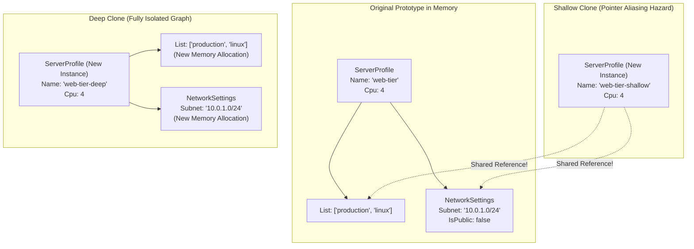

# Lesson 06: Prototype

> **Prerequisites:** [Builder](../05-builder/README.md) and [Track 25 Overview](../README.md).  
> **Estimated Reading Time:** 18 minutes  
> **Target Audience:** Engineers preparing for LLD, OOP, C#, or Python technical screening and architecture rounds.

> [!NOTE]
> **In one line:** **Prototype** creates new objects by *copying an existing one* — useful when construction is expensive or the concrete class is unknown — and the whole risk is shallow vs deep copy.

> [!TIP]
> **The One Rule of the Prototype Pattern:** Use the Prototype pattern when creating an object from scratch via constructors is **computationally expensive, requires copying private internal state, or when the client must remain decoupled from concrete classes by cloning pre-configured templates**. Always be explicit about copy depth: never rely on ambiguous cloning contracts.

---

## 1. Why This Matters: The Interview Trap

"What is the Prototype pattern, when would you use it over a Factory or Builder, and why does Microsoft Learn explicitly discourage using `ICloneable` in .NET?"

Junior candidates typically stumble into textbook generalities:
> *"The Prototype pattern creates new objects by copying an existing object. You use it when object creation with `new` is too slow. In C# you implement `ICloneable`, and in Python you use `copy.deepcopy()`."*

An interviewer asks this question to uncover whether you understand **memory topology, object lifetimes, and API contract design**. In production backend engineering, naive cloning causes critical bugs:

1. **The `ICloneable` Contract Disaster:** The .NET standard interface `ICloneable` exposes a single method: `object Clone()`. It suffers from two fatal architectural flaws:
   - **Type Safety Loss:** It returns `System.Object`, forcing callers into brittle runtime casts (`(User)user.Clone()`).
   - **Semantic Ambiguity:** The interface does **not** specify whether the returned copy is **shallow** or **deep**. If one developer implements a shallow clone and another expects a deep clone, mutating a nested collection (e.g., `clone.Roles.Add("Admin")`) secretly mutates the original prototype in memory, corrupting shared application state.
2. **The Pointer Aliasing Hazard (Shallow Copy Pitfall):** When an object containing reference types is shallow-copied, only the stack values (primitive values and memory addresses) are duplicated. Both the original object and the clone now reference the exact same memory locations on the managed heap for child objects. Under concurrent requests, mutations to the clone produce insidious race conditions and data corruption.
3. **Circular Reference Infinite Loops:** Real-world enterprise domain models contain bidirectional relationships (`Parent -> Child -> Parent`). A naive recursive deep clone will enter infinite recursion and trigger a `StackOverflowException` (or `RecursionError` in Python) unless an object identity tracking table (`memo`) is maintained.

### Factory vs. Builder vs. Prototype

| Pattern | Creation Mechanics | Primary Purpose | Best Used When... |
| :--- | :--- | :--- | :--- |
| **Factory Method** | Instantiates a fresh class via polymorphism (`factory.Create()`). | Hides concrete subtype from the client. | Objects share a common interface and start with default, clean states. |
| **Builder** | Step-by-step assembly of complex configurations (`builder.WithA().Build()`). | Eliminates telescoping constructors; validates multi-property invariants. | Objects have numerous optional parameters assembled over time. |
| **Prototype** | Duplicates an existing pre-configured instance (`prototype.Clone()`). | Bypasses expensive initialization (I/O, database hydration, heavy parsing) or copies private state. | Instantiation involves costly setup, or system requires dynamic runtime templates. |

---

## 2. Visual Mental Model / Taxonomic Comparison

Understanding the Prototype pattern requires visualizing how memory references behave on the managed heap during shallow versus deep copy operations.



### Cloning Mechanisms Comparison

| Mechanism | Language | Copy Depth | Preserves Invariants? | Handles Cyclic Graphs? | Performance |
| :--- | :--- | :--- | :--- | :--- | :--- |
| `MemberwiseClone()` | C# (.NET) | **Shallow** | Yes (preserves private fields) | Yes (shallow pointer copy) | **Fastest** (low-level CLR bitwise copy) |
| Strongly Typed `IPrototype<T>` | C# (.NET) | Explicit (Contract defines shallow or deep) | **Yes** (encapsulated in domain class) | Yes (with visited-object dictionary) | **High** (targeted field copy) |
| Modern `record with` | C# (.NET) | **Shallow** | **Yes** (compiler-generated copy constructor) | Yes (shallow reference copy) | **Extremely Fast** (built into CLR) |
| `copy.copy(obj)` | Python | **Shallow** | Invokes `__copy__` hook | Yes (shallow pointer copy) | **Fast** |
| `copy.deepcopy(obj)` | Python | **Deep** | Invokes `__deepcopy__(memo)` hook | **Yes** (automatically memoized in `memo` dict) | Moderate (traverses object graph via reflection) |
| JSON / Binary Serialization | Both | **Deep** | **No** (bypasses constructors, fails on non-serializable fields) | Risky (requires reference-handling flags) | **Slowest** (serialization / deserialization overhead) |

---

## 3. Code Implementation

In the following example, we model a cloud infrastructure `ServerProfile` with nested `NetworkSettings` and a collection of tags. We implement both shallow cloning (demonstrating the danger of pointer aliasing) and deep cloning (ensuring complete memory isolation).

````carousel
```python
import copy
from typing import Any, Dict, List


class NetworkSettings:
    """Nested configuration object demonstrating deep copy mechanics."""

    def __init__(self, subnet: str, is_public: bool) -> None:
        self.subnet = subnet
        self.is_public = is_public

    def __deepcopy__(self, memo: Dict[int, Any]) -> "NetworkSettings":
        # Deep copy creates a brand new, completely independent instance
        return NetworkSettings(self.subnet, self.is_public)

    def __repr__(self) -> str:
        return f"NetworkSettings(subnet='{self.subnet}', is_public={self.is_public})"


class ServerProfile:
    """Prototype representing a virtual machine deployment template."""

    def __init__(
        self,
        name: str,
        cpu_cores: int,
        memory_gb: int,
        tags: List[str],
        network: NetworkSettings,
    ) -> None:
        self.name = name
        self.cpu_cores = cpu_cores
        self.memory_gb = memory_gb
        self.tags = tags
        self.network = network

    def clone_shallow(self) -> "ServerProfile":
        """Shallow copy: duplicates primitive fields, but aliases references to tags & network."""
        return copy.copy(self)

    def clone_deep(self) -> "ServerProfile":
        """Deep copy: creates new collections and recursively duplicates nested objects."""
        return copy.deepcopy(self)

    def __repr__(self) -> str:
        return (
            f"ServerProfile(name='{self.name}', cpu={self.cpu_cores}, mem={self.memory_gb}GB, "
            f"tags={self.tags}, network={self.network})"
        )


def main() -> None:
    # 1. Base Prototype
    baseline = ServerProfile(
        name="web-tier-base",
        cpu_cores=4,
        memory_gb=16,
        tags=["production", "linux"],
        network=NetworkSettings("10.0.1.0/24", False),
    )
    print(f"Original Baseline: {baseline}")

    # 2. Shallow Clone Mutation (Demonstrating pointer aliasing hazard)
    shallow_clone = baseline.clone_shallow()
    shallow_clone.name = "web-tier-shallow"
    shallow_clone.tags.append("dmz")  # Aliased reference! Mutates baseline.tags!
    shallow_clone.network.is_public = True  # Aliased reference! Mutates baseline.network!

    print("\n--- After Shallow Clone Mutation ---")
    print(f"Original Baseline (Corrupted): {baseline}")
    print(f"Shallow Clone:                {shallow_clone}")

    # Reset baseline tags and network for deep copy demonstration
    baseline.tags = ["production", "linux"]
    baseline.network = NetworkSettings("10.0.1.0/24", False)

    # 3. Deep Clone Mutation (Safe, isolated copy)
    deep_clone = baseline.clone_deep()
    deep_clone.name = "web-tier-isolated"
    deep_clone.tags.append("secure-enclave")
    deep_clone.network.subnet = "10.0.2.0/24"
    deep_clone.network.is_public = False

    print("\n--- After Deep Clone Mutation ---")
    print(f"Original Baseline (Protected): {baseline}")
    print(f"Deep Clone (Independent):      {deep_clone}")


if __name__ == "__main__":
    main()
```
<!-- slide -->
```csharp
using System;
using System.Collections.Generic;

namespace PrototypePattern;

public class NetworkSettings
{
    public string Subnet { get; set; }
    public bool IsPublic { get; set; }

    public NetworkSettings(string subnet, bool isPublic)
    {
        Subnet = subnet;
        IsPublic = isPublic;
    }

    public NetworkSettings CloneDeep() => new NetworkSettings(Subnet, IsPublic);

    public override string ToString() => $"NetworkSettings(subnet='{Subnet}', is_public={IsPublic})";
}

public interface IPrototype<T>
{
    T CloneShallow();
    T CloneDeep();
}

public class ServerProfile : IPrototype<ServerProfile>
{
    public string Name { get; set; }
    public int CpuCores { get; set; }
    public int MemoryGb { get; set; }
    public List<string> Tags { get; set; }
    public NetworkSettings Network { get; set; }

    public ServerProfile(string name, int cpuCores, int memoryGb, List<string> tags, NetworkSettings network)
    {
        Name = name;
        CpuCores = cpuCores;
        MemoryGb = memoryGb;
        Tags = tags;
        Network = network;
    }

    // Shallow clone via MemberwiseClone() copies value types and references as-is
    public ServerProfile CloneShallow()
    {
        return (ServerProfile)this.MemberwiseClone();
    }

    // Deep clone instantiates new collections and deeply cloned nested objects
    public ServerProfile CloneDeep()
    {
        return new ServerProfile(
            Name,
            CpuCores,
            MemoryGb,
            new List<string>(Tags),
            Network.CloneDeep()
        );
    }

    public override string ToString()
    {
        string tagsStr = $"['{string.Join("', '", Tags)}']";
        return $"ServerProfile(name='{Name}', cpu={CpuCores}, mem={MemoryGb}GB, tags={tagsStr}, network={Network})";
    }
}

public static class Program
{
    public static void Main()
    {
        // 1. Base Prototype
        var baseline = new ServerProfile(
            name: "web-tier-base",
            cpuCores: 4,
            memoryGb: 16,
            tags: new List<string> { "production", "linux" },
            network: new NetworkSettings("10.0.1.0/24", false)
        );
        Console.WriteLine($"Original Baseline: {baseline}");

        // 2. Shallow Clone Mutation (Demonstrating pointer aliasing hazard)
        var shallowClone = baseline.CloneShallow();
        shallowClone.Name = "web-tier-shallow";
        shallowClone.Tags.Add("dmz"); // Aliased reference! Mutates baseline.Tags!
        shallowClone.Network.IsPublic = true; // Aliased reference! Mutates baseline.Network!

        Console.WriteLine("\n--- After Shallow Clone Mutation ---");
        Console.WriteLine($"Original Baseline (Corrupted): {baseline}");
        Console.WriteLine($"Shallow Clone:                {shallowClone}");

        // Reset baseline tags and network for deep copy demonstration
        baseline.Tags = new List<string> { "production", "linux" };
        baseline.Network = new NetworkSettings("10.0.1.0/24", false);

        // 3. Deep Clone Mutation (Safe, isolated copy)
        var deepClone = baseline.CloneDeep();
        deepClone.Name = "web-tier-isolated";
        deepClone.Tags.Add("secure-enclave");
        deepClone.Network.Subnet = "10.0.2.0/24";
        deepClone.Network.IsPublic = false;

        Console.WriteLine("\n--- After Deep Clone Mutation ---");
        Console.WriteLine($"Original Baseline (Protected): {baseline}");
        Console.WriteLine($"Deep Clone (Independent):      {deepClone}");
    }
}
```
````

**Expected Output (Both Languages):**
```text
Original Baseline: ServerProfile(name='web-tier-base', cpu=4, mem=16GB, tags=['production', 'linux'], network=NetworkSettings(subnet='10.0.1.0/24', is_public=False))

--- After Shallow Clone Mutation ---
Original Baseline (Corrupted): ServerProfile(name='web-tier-base', cpu=4, mem=16GB, tags=['production', 'linux', 'dmz'], network=NetworkSettings(subnet='10.0.1.0/24', is_public=True))
Shallow Clone:                ServerProfile(name='web-tier-shallow', cpu=4, mem=16GB, tags=['production', 'linux', 'dmz'], network=NetworkSettings(subnet='10.0.1.0/24', is_public=True))

--- After Deep Clone Mutation ---
Original Baseline (Protected): ServerProfile(name='web-tier-base', cpu=4, mem=16GB, tags=['production', 'linux'], network=NetworkSettings(subnet='10.0.1.0/24', is_public=False))
Deep Clone (Independent):      ServerProfile(name='web-tier-isolated', cpu=4, mem=16GB, tags=['production', 'linux', 'secure-enclave'], network=NetworkSettings(subnet='10.0.2.0/24', is_public=False))
```

---

## 3A. Where It Is Used, Why It Exists & Progressive Buildup

### Where It Is Used (Real-World Systems & LLD Interviews)

| Domain / Ecosystem | Concrete Real-World Usage | LLD Interview Problem Where You Use It |
| :--- | :--- | :--- |
| **.NET BCL / C#** | `Object.MemberwiseClone()`, C# 9+ `record with { ... }`, `Array.Clone()`, `DataTable.Clone()` vs `DataTable.Copy()` | **Document / Slide Editor:** Duplicating complex shapes, styles, and grouped vector nodes (`shape.CloneDeep()`). |
| **Python stdlib / Data** | `copy.copy()`, `copy.deepcopy()`, `dataclasses.replace(obj, **changes)`, `list.copy()`, `dict.copy()` | **ML / Report Template Registry:** Cloning pre-loaded feature pipelines or report templates per tenant request. |
| **JavaScript / TypeScript** | `structuredClone(obj)`, `Object.create(proto)`, Redux/Immer structural sharing | **Spreadsheet / Form Builder:** Cloning a row or form section with nested validation rules without re-fetching schema. |
| **Go / Infrastructure** | `proto.Clone(msg)` (Protobuf), Kubernetes `obj.DeepCopy()` generated for CRDs | **VM / Container Spec Provisioner:** Spawning tenant sandboxes by cloning a baseline `PodTemplate` or `ServerProfile`. |
| **Game Engines** | Unity `Instantiate(prefab)`, Unreal Archetype spawning, Enemy Wave Spawners | **Chess / Board Game Undo-Redo & AI Search:** Deep-cloning `BoardState` to simulate minimax moves safely. |

### Why It Is Used — The Step-by-Step Buildup (Before -> Pain -> Pattern)

#### Stage 0: Naive Code (Re-Constructing from Expensive I/O or Shallow Aliasing)

```python
# Stage 0: Re-running expensive DB/file hydration OR naive shallow assignment
def spawn_tenant_config(base_template: dict, tenant_id: str) -> dict:
    clone = base_template.copy()  # Shallow copy trap!
    clone["tenant"] = tenant_id
    clone["allowed_ips"].append("10.9.0.1")  # Mutates base_template["allowed_ips"]!
    return clone
```

#### What Breaks as Requirements Grow
- **Requirement 2 (Cross-Tenant State Corruption):** `base_template["allowed_ips"]` is a nested list. Shallow `.copy()` aliases the inner list, so Tenant B inherits Tenant A's private IP allowlist—a severe security bug.
- **Requirement 3 (Expensive Initialization & Unknown Subtypes):** Re-loading the template from PostgreSQL/S3 on every request takes 120ms, and the caller only holds an abstract `IDocumentNode` without knowing if it's a `ChartNode` or `TableNode` (so it cannot call `new ChartNode(...)`).

#### Step-by-Step Refactoring
1. **Step 1 (Explicit Cloning Contract):** Add a strongly typed `clone_deep()` method on the base interface/class so callers can duplicate any concrete subtype polymorphically without downcasting.
2. **Step 2 (Prototype Registry + Copy-on-Write / Deep Copy):** Store pre-hydrated baseline objects in a `PrototypeRegistry` at startup; each request fetches `registry.get_clone("enterprise-tier")` in microseconds with guaranteed memory isolation.

### Progressive Real-World Examples (More & More Typical Use Cases)

````carousel
```python
# Example A (Everyday Simple Case): Immutable-Style Clone with dataclasses.replace
from dataclasses import dataclass, replace, field
from typing import List

@dataclass
class RetryPolicy:
    max_attempts: int
    backoff_ms: int
    retryable_codes: List[int] = field(default_factory=lambda: [502, 503, 504])

    def clone_with(self, **changes) -> "RetryPolicy":
        # Deep-copy mutable list before applying selective overrides
        copied_codes = list(self.retryable_codes)
        return replace(self, retryable_codes=copied_codes, **changes)

base_policy = RetryPolicy(max_attempts=3, backoff_ms=100)
payment_policy = base_policy.clone_with(max_attempts=5)
payment_policy.retryable_codes.append(429)  # Does NOT mutate base_policy
```
<!-- slide -->
```typescript
// Example B (Production Backend / Middleware Case): Prototype Registry for Tenant Templates
interface Cloner<T> {
  cloneDeep(): T;
}

class RateLimitRule implements Cloner<RateLimitRule> {
  constructor(
    public tier: string,
    public rpm: number,
    public burstHeaders: Record<string, string>
  ) {}

  cloneDeep(): RateLimitRule {
    return new RateLimitRule(this.tier, this.rpm, structuredClone(this.burstHeaders));
  }
}

class RuleRegistry {
  private templates = new Map<string, RateLimitRule>();
  register(key: string, proto: RateLimitRule) { this.templates.set(key, proto); }
  create(key: string): RateLimitRule {
    const proto = this.templates.get(key);
    if (!proto) throw new Error(`Unknown template: ${key}`);
    return proto.cloneDeep();
  }
}
```
<!-- slide -->
```csharp
// Example C (Classic LLD Interview Problem): Board Game / Document Editor Deep Clone
public interface IPrototype<out T>
{
    T CloneDeep();
}

public sealed class ChessBoardState : IPrototype<ChessBoardState>
{
    public string[,] Grid { get; }
    public List<string> MoveHistory { get; }

    public ChessBoardState(string[,] grid, List<string> moveHistory)
    {
        Grid = grid;
        MoveHistory = moveHistory;
    }

    public ChessBoardState CloneDeep()
    {
        var gridCopy = (string[,])Grid.Clone(); // 2D array of immutable strings
        var historyCopy = new List<string>(MoveHistory);
        return new ChessBoardState(gridCopy, historyCopy);
    }
}
```
````

---

## 4. Where You Already Use It

- **In .NET:**
  - `System.Object.MemberwiseClone()`: The protected runtime method that performs a shallow bitwise copy of an object's fields directly in CLR memory.
  - **C# 9+ Records and `with` Expressions:** Records natively implement compiler-generated copy constructors. Invoking `var updated = original with { MemoryGb = 32 };` clones the record non-destructively using shallow copy semantics.
  - `System.Array.Clone()`: Duplicates an array instance. For value types (`int[]`), it copies data; for reference types (`Order[]`), it shallow-copies object pointers.
  - `System.Data.DataTable.Clone()` vs. `DataTable.Copy()`: In ADO.NET, `.Clone()` copies only the metadata schema, while `.Copy()` deeply copies both the schema and all rows.

- **In Python:**
  - `copy.copy(x)` and `copy.deepcopy(x)`: The standard library cloning engine. Classes can customize their copying behavior by implementing `__copy__()` and `__deepcopy__(memo)`.
  - `dataclasses.replace(instance, **changes)`: Clones a dataclass instance while selectively replacing specified attributes, functioning identically to C#'s `with` expression.
  - Built-in container copying: `list.copy()`, `dict.copy()`, `set.copy()`, or full slicing (`lst[:]`) all produce shallow copies of collections.

---

## 5. Pitfalls and When Not to Use It

1. **The `ICloneable` Trap in .NET:**
   - Never implement `ICloneable`. Its signature `object Clone()` forces casting and lacks any semantic guarantee regarding copy depth. Instead, declare an explicit domain interface like `IPrototype<T>` with `T CloneShallow()` and `T CloneDeep()`, or provide an explicit copy constructor (`public ServerProfile(ServerProfile other)`).
2. **Circular References and Memory Exhaustion:**
   - In complex domain graphs with parent-child links (`Department -> List<Employee> -> Department`), naive recursive deep clones cause infinite recursion. In Python, `copy.deepcopy` automatically handles this by tracking visited IDs in its `memo` dictionary. In C#, manual deep-cloning algorithms must pass a `Dictionary<object, object>` tracking already-cloned objects.
3. **Cloning Objects Holding System or Network Handles:**
   - Objects wrapping unmanaged OS resources—such as open database connections, TCP sockets, thread mutexes, or file descriptors—cannot be meaningfully cloned. Duplicating the memory address causes two objects to believe they own the same OS handle, leading to double-dispose crashes or handle corruption.
4. **Performance Overhead of Serialization-Based Cloning:**
   - Reaching for `JsonSerializer.Deserialize(JsonSerializer.Serialize(obj))` as a "lazy deep clone" is an antipattern in high-throughput hot paths. It incurs massive CPU serialization overhead, memory allocations on the LOH (Large Object Heap), and drops private unmapped state.

---

## 6. Exercises & Practical Drills

### Drill 1: Prototype Registry (Template Cache)
Design a generic `PrototypeRegistry<TKey, TValue>` that allows services to register baseline prototypes by name and fetch independent deep clones on demand.

<details>
<summary>Answer</summary>

```csharp
public class PrototypeRegistry<TKey, TValue> where TValue : IPrototype<TValue>
{
    private readonly Dictionary<TKey, TValue> _prototypes = new();

    public void Register(TKey key, TValue prototype)
    {
        _prototypes[key] = prototype;
    }

    public TValue Create(TKey key)
    {
        if (!_prototypes.TryGetValue(key, out var prototype))
            throw new KeyNotFoundException($"No prototype registered under key: {key}");

        return prototype.CloneDeep();
    }
}
```

The registry acts as a dynamic factory where templates are configured at runtime rather than hardcoded in compilation factories.
</details>

### Drill 2: Resolving Object Cycles in Python
How does Python's `copy.deepcopy` prevent infinite recursion when an object contains a cyclic reference to itself?

<details>
<summary>Answer</summary>

Python's `copy.deepcopy(x, memo=None)` accepts an internal `memo` dictionary keyed by `id(obj)`:

```python
def __deepcopy__(self, memo):
    obj_id = id(self)
    if obj_id in memo:
        return memo[obj_id]

    # Create the new shell instance and register it in memo BEFORE recursing
    cls = self.__class__
    new_obj = cls.__new__(cls)
    memo[obj_id] = new_obj

    # Populate fields recursively
    new_obj.parent = copy.deepcopy(self.parent, memo)
    new_obj.child = copy.deepcopy(self.child, memo)
    return new_obj
```

By storing the half-initialized clone in `memo[id(self)]` *before* descending into child references, any cyclical call back to `self` returns the memoized instance immediately, preventing infinite loops.
</details>

### Drill 3: Modern C# Records vs. Prototype Pattern
If C# 9+ provides records and `with` expressions, do we still need the Gang of Four Prototype pattern?

<details>
<summary>Answer</summary>

`record` with `with` expressions solves the prototype problem for **shallow-copy, immutable value objects and DTOs**.

However, the classic Prototype pattern is still necessary when:
1. **Deep Cloning is Required:** Record `with` expressions are strictly **shallow copies**. If a record has a `List<string>`, both records share the exact same list instance.
2. **Polymorphic Cloning via Interfaces:** When client code works against an abstract type (`IReportTemplate`) without knowing whether it is a `PdfReport` or `ExcelReport`, it cannot use `with`. It must call a polymorphic method like `.Clone()`.
3. **Complex Initialization / Re-hydration:** If cloning requires resetting internal counters, generating new GUIDs, or reconnecting non-serializable transient states.
</details>

---

## 7. Interview Questions & Model Answers

<details>
<summary><strong>1. What is the Prototype pattern? [BASIC]</strong></summary>

The Prototype pattern is a creational design pattern where new objects are created by cloning an existing 'prototype' instance rather than instantiating classes from scratch via constructors.

It is primarily used in three scenarios:
1. **High Construction Cost:** When instantiating an object involves expensive operations like database hydration, file I/O, or heavy mathematical computation, creating a baseline instance once and cloning it saves significant CPU and latency.
2. **Decoupling from Concrete Classes:** Callers can spawn new instances while programming against an abstract interface (`IPrototype<T>`), allowing dynamic runtime registration of new types without changing client code.
3. **Avoiding Class Explosions:** Instead of creating dozens of static subclasses representing different configuration presets (e.g., `Linux4CpuVm`, `Windows16CpuVm`), the application instantiates a generic class and stores pre-configured instances in a prototype registry.

</details>

<details>
<summary><strong>2. What is the difference between a shallow and a deep copy? [BASIC]</strong></summary>

The difference lies in how nested reference types and collections are duplicated in memory:
- **Shallow Copy:** Duplicates only the top-level object. Value types (primitives like `int`, `double`) are copied by value, but reference fields (pointers to arrays, lists, or custom classes) are copied as memory addresses. Consequently, both the original object and the clone point to the **same child objects on the heap**. Mutating a nested property on the clone secretly mutates the original object.
- **Deep Copy:** Recursively duplicates the top-level object and **all nested reference objects** across the entire object graph. The clone receives its own independent allocations on the heap. Mutating child objects on a deep clone has zero side effects on the original prototype.

In C#, `MemberwiseClone()` and record `with` perform shallow copies, while deep copies require explicit graph traversal or copy constructors. In Python, `copy.copy()` performs a shallow copy, whereas `copy.deepcopy()` performs a deep copy using a memoization dictionary to handle cyclic graphs.

</details>

<details>
<summary><strong>3. Why is `ICloneable` discouraged in .NET? [TRICKY]</strong></summary>

Microsoft's official framework design guidelines explicitly discourage implementing `ICloneable` for two fundamental architectural reasons:
1. **Undefined Copy Semantics:** The interface specifies a single method, `object Clone()`, but completely fails to specify whether the implementation should perform a **shallow copy or a deep copy**. Callers cannot know what guarantees the class provides, leading to pointer aliasing bugs when a caller assumes deep copy isolation.
2. **Lack of Type Safety:** Because it was created in .NET 1.0 prior to generics, `Clone()` returns untyped `System.Object`. Every consumer must write manual runtime typecasts, introducing runtime casting overhead and potential `InvalidCastException` bugs.

The modern .NET best practice is to define a custom generic interface like `IPrototype<T>` with distinct `CloneShallow()` and `CloneDeep()` methods, use explicit copy constructors (`public Person(Person other)`), or leverage C# records with non-destructive `with` expressions.

</details>

<details>
<summary><strong>4. You have a game with 1,000 enemies loaded from heavy config. How does Prototype help? [SCENARIO]</strong></summary>

Load and configure one template enemy, then clone it per spawn and tweak position/health. You pay the parse/IO cost once, not 1,000 times.

</details>

<details>
<summary><strong>5. What breaks with a deep copy of an object graph that has cycles or external resources? [TRICKY]</strong></summary>

A naive recursive copy loops forever on cycles (Python's `deepcopy` uses a memo to avoid that), and it cannot sensibly copy sockets/file handles. Exclude or re-create those in `__deepcopy__`/a copy ctor.

</details>

<details>
<summary><strong>6. How is a C# `record` related to Prototype? [BASIC]</strong></summary>

`with` produces a modified *copy* of an immutable record, which is Prototype-like copy-and-tweak, though it is a shallow copy.

</details>

---

## Try it

Run this: a shallow copy shares nested state, a deep copy does not. Then redraw it in [LLD Studio](/tools/lld-studio/); the [track hub](../README.md) has the pattern-choice drills.

```python
import copy

class Doc:
    def __init__(self): self.title, self.tags = "t", ["a"]

orig = Doc()
shallow, deep = copy.copy(orig), copy.deepcopy(orig)
orig.tags.append("b")
assert shallow.tags == ["a", "b"]      # shared list!
assert deep.tags == ["a"]              # independent
```

---

## One-page cheat sheet

```text
PROTOTYPE  clone(): new object from an existing one
Shallow copy: top-level fields copied, nested refs SHARED
Deep copy: whole graph copied (cycles + cost!)
Python: copy.copy / copy.deepcopy / __copy__ / __deepcopy__
C#: MemberwiseClone (shallow) | record `with` | copy ctor | serialise round-trip
ICloneable is discouraged: doesn't say shallow or deep
Use when: expensive setup, templates/presets, undo snapshots
```

---

## 8. Sources & Further Reading

- [Microsoft Learn: ICloneable Interface](https://learn.microsoft.com/en-us/dotnet/api/system.icloneable)
- [Microsoft Learn: Object.MemberwiseClone Method](https://learn.microsoft.com/en-us/dotnet/api/system.object.memberwiseclone)
- [Microsoft Learn: C# Records and Non-Destructive Mutation](https://learn.microsoft.com/en-us/dotnet/csharp/language-reference/builtin-types/record)
- [Python Documentation: copy — Shallow and deep copy operations](https://docs.python.org/3/library/copy.html)
- [Refactoring.Guru: Prototype Pattern](https://refactoring.guru/design-patterns/prototype)

---

Previous: [Builder](../05-builder/README.md) · Next: [Object Pool](../07-object-pool/README.md)
